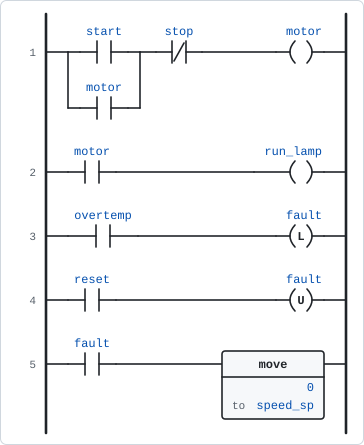

# logex

logex is a compiler and an interpreter of
[ladder logic](guides/reference/glossary.md#ladder-logic), written in Elixir. It compiles a ladder
[program](guides/reference/glossary.md#program) from text to plain data. Your Elixir application
runs an [instance](guides/reference/glossary.md#instance) of the program 1
[scan](guides/reference/glossary.md#scan) at a time, with the time that the application gives.
A [runner](guides/reference/glossary.md#runner) runs a [plant](guides/reference/glossary.md#plant) of programs on the
clock, through your [device](guides/reference/glossary.md#device) [adapters](guides/reference/glossary.md#adapter). logex
has no dependencies and no generated code.

> #### Warning {: .warning}
>
> Do not use logex for a [safety function](guides/reference/glossary.md#safety-function),
> because logex is not a safety controller. An emergency stop, a guard interlock, a light
> curtain, a 2-hand control and the protection of a burner or against pressure are
> safety functions.
>
> Put each safety function in hardwired circuits or in a safety-rated controller. Design
> and validate it to the functional-safety standards that apply. logex makes no claim
> against any of them, and it has no certificate for any industrial use. The emergency
> stop that cuts the power of a machine must work with logex stopped, crashed or never
> started. [Safety and limits](guides/explanation/safety-and-limits.md) gives each limit
> and its reason.

## What logex is for

These are 4 uses of logex:

- Learn ladder logic on a computer, with no controller.
- Simulate a machine, for example a conveyor or a box counter, before you commission it.
- Run ExUnit tests of ladder programs in CI.
- Control a lab rig that has no safety function.

## A small program

The program `motor.ld` is a motor starter with a latched fault:

<!-- file: motor.ld -->
```text
var_input start bool
var_input stop bool
var_input overtemp bool
var_input reset bool
var_output motor bool
var_output run_lamp bool
var_output speed_sp dint 1200
var fault bool

( xic start | xic motor ) xio stop ote motor
xic motor ote run_lamp
xic overtemp otl fault
xic reset otu fault
xic fault move 0 speed_sp
```

<!-- rung: motor.ld -->


The script `scan.exs` compiles the program and runs 5 scans of 1 instance:

```elixir
{:ok, motor} = Logex.compile_file("motor.ld")

scan = fn state, label, inputs ->
  state = Logex.Runtime.put_inputs(motor, state, inputs)
  {outputs, state} = Logex.Runtime.scan(motor, state)
  IO.puts("#{label}  #{inspect(outputs)}  fault=#{state.env["fault"]}")
  state
end

Logex.Runtime.instance(motor)
|> scan.("start pressed ", %{"start" => 1})
|> scan.("start released", %{"start" => 0})
|> scan.("overtemp      ", %{"overtemp" => 1})
|> scan.("stop pressed  ", %{"stop" => 1})
|> scan.("cooled, idle  ", %{"stop" => 0, "overtemp" => 0})
```

```console
$ mix run scan.exs
start pressed   %{"motor" => 1, "run_lamp" => 1, "speed_sp" => 1200}  fault=0
start released  %{"motor" => 1, "run_lamp" => 1, "speed_sp" => 1200}  fault=0
overtemp        %{"motor" => 1, "run_lamp" => 1, "speed_sp" => 0}  fault=1
stop pressed    %{"motor" => 0, "run_lamp" => 0, "speed_sp" => 0}  fault=1
cooled, idle    %{"motor" => 0, "run_lamp" => 0, "speed_sp" => 0}  fault=1
```

The motor holds itself on. The fault stays latched, and holds the speed setpoint at 0.

## Install and run

1. Make a clone of the repository, and go into its directory `examples`.

```console
$ git clone https://github.com/rellen/logex.git
$ cd logex/examples
```

2. Install Erlang/OTP 28 and Elixir 1.20, the versions of `.tool-versions`. With asdf or
   mise, run `asdf install` or `mise install` in the clone. With Nix, run `nix develop`.
   Then `elixir --version` names Elixir 1.20.

3. Run the command `mix run scan.exs`. Mix compiles logex, and the script prints the 5
   lines of [A small program](#a-small-program).

To use logex in your project, add `{:logex, github: "rellen/logex"}` to its dependencies.
[Install logex and run a program](guides/howto/install-and-run.md) gives each step.

## What logex is not

[Safety and limits](guides/explanation/safety-and-limits.md) gives each limit in full:

- logex is not a safety controller, and it has no certificate for any industrial use.
- logex is not hard real-time. A [round](guides/reference/glossary.md#round) can be late, and a
  [watchdog](guides/reference/glossary.md#watchdog) does not stop a task from running too
  long. A program can miss a short pulse on an input.
- logex does not guarantee that each output goes to 0. If the Elixir virtual machine
  stops, no part of logex runs. The hardware of each device must set its outputs to a
  safe state when it gets no write.
- logex has no adapter for real I/O. You write the adapter of each real device.
- logex compiles no BEAM code. It interprets each program as data.
- logex reads only its own dialect of ladder logic, not IEC 61131-3 text.
- logex does not have each part of a controller.
  [What logex does not have](guides/reference/not-supported.md) gives each part.
- logex has no battery-backed memory and no safety memory. Do not keep a value of a
  safety function in logex, for example the lockout of a burner. A person can edit the
  [store](guides/reference/glossary.md#store), a cold start discards it, and a crash can
  set it back.
- logex does not guard against a warm start that sets an output to 1 in its first round.

## Where to go next

The [site](https://rellen.github.io/logex/) has 4 kinds of user page, and the pages
for a person who changes logex.

| You want to | Read |
|---|---|
| Learn logex on 1 safe path | The tutorial [Your first program](guides/tutorials/first-program.md) |
| Do 1 task | A how-to guide, such as [Install logex and run a program](guides/howto/install-and-run.md) |
| Find an exact rule | A reference page, such as the [instruction cheatsheet](guides/reference/cheatsheet.cheatmd) or the [glossary](guides/reference/glossary.md) |
| Know the model and the reasons | An explanation page, such as [What logex is](guides/explanation/what-logex-is.md) |
| Change logex | [A map of the documents](docs/README.md) and [`CONTRIBUTING.md`](CONTRIBUTING.md) |

## Status

logex is at an early stage, at version 0.1.0, with no release. The suite runs each example
of the documentation. [What logex is not](#what-logex-is-not) gives what logex does not
do, and [`CHANGELOG.md`](CHANGELOG.md) gives each change. Report a defect in the
[issues of logex](https://github.com/rellen/logex/issues).

## Licence

Apache-2.0. See [`LICENSE`](LICENSE).
