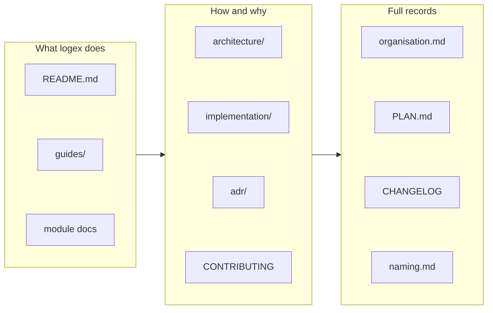

# A map of the documents

This page is for a contributor. It gives each document of logex, what it is for and who
reads it. A user starts at the site, <https://rellen.github.io/logex/>, which ExDoc makes
from the pages and the module documentation, or at `README.md`.

## Where to start

| You want to | Start with |
|---|---|
| Run ladder programs from an Elixir application | [Your first program](../guides/tutorials/first-program.md), then the [host contract](../guides/reference/host-contract.md) |
| Know exactly what a [rung](../guides/reference/glossary.md#rung) does in logex | [What logex is](../guides/explanation/what-logex-is.md), then the [instruction cheatsheet](../guides/reference/cheatsheet.cheatmd) |
| Change the code of logex | [The toolchain and the gates](contributing/toolchain.md), then [The parts of logex](architecture/overview.md), then [`CONTRIBUTING.md`](../CONTRIBUTING.md) |
| Write a page of the documentation | The [style guide](style-guide.md), then [Add and check a page](check-a-page.md) |
| Find the meaning of a word | The [glossary](../guides/reference/glossary.md) |

> #### Warning {: .warning}
>
> Do not use logex for a [safety function](../guides/reference/glossary.md#safety-function).
> Read [Safety and limits](../guides/explanation/safety-and-limits.md) before you connect
> logex to a machine.

## How the documents fit together

The documents make 3 layers. The first layer says what logex does. The second layer says
how logex is built and why. The third layer holds the full records: each decision, each
name and the history of the work.

Figure: the 3 layers of the documents. An arrow goes to the layer with more detail.

### Which document answers your question

This table sends each question to the document that answers it. If 2 documents give
different rules, the code in `lib/` is correct. Then correct the document.

| Question | The document that answers it |
|---|---|
| What does logex do? | The [site](https://rellen.github.io/logex/): the user pages under `guides/` and the module documentation |
| How is logex built? | [The parts of logex](architecture/overview.md), then the other pages under `docs/architecture/` and `docs/implementation/` |
| Why is logex built this way? | A [decision record](adr/README.md), then [`docs/organisation.md`](organisation.md) |
| What changes in a release? | [`CHANGELOG.md`](../CHANGELOG.md) |
| What is the plan, and what did each item of work do? | [`PLAN.md`](../PLAN.md) |
| What do [IEC 61131-3](../guides/reference/glossary.md#iec-61131-3) and other tools call an operation? | [`docs/naming.md`](naming.md) and [`docs/instruction-sets.md`](instruction-sets.md) |

## The user pages

The user pages are under `guides/`. Each page has 1 of 4 kinds. A page does not mix the
kinds. It links to a page of a different kind.

| Kind | For whom, and what it gives | Start with |
|---|---|---|
| Tutorial (`guides/tutorials/`) | A reader new to logex: a lesson on 1 safe path | [Your first program](../guides/tutorials/first-program.md) |
| How-to guide (`guides/howto/`) | A reader who knows the basics: the steps of 1 task | [Install logex and run a program](../guides/howto/install-and-run.md) |
| Reference (`guides/reference/`) | A reader who looks up a rule: the exact rules, complete | [Host contract](../guides/reference/host-contract.md) |
| Explanation (`guides/explanation/`) | A reader who wants to understand: the model and the reasons | [What logex is](../guides/explanation/what-logex-is.md) |

The readers of the user pages are the Elixir developer and the controls engineer of the
[style guide](style-guide.md#the-readers). The sidebar of the site lists each user page in
its group. 3 more documents are for users:

- `README.md` is the first page of the site and of the repository. It says what logex
  is and what it is not, and shows 1 small program. It links to each kind of page.
- The module documentation is the text of each module in `lib/`. The site shows the
  modules of the [host contract](../guides/reference/glossary.md#host-contract) first. A
  module with `@moduledoc false` is not in the site. The comment at the start of its file
  gives its rules.
- [`CHANGELOG.md`](../CHANGELOG.md) says what changes in each release.

## The contributor pages

The contributor pages are under `docs/`. Their reader knows Elixir and will change logex.
A contributor page can cite a decision of [`docs/organisation.md`](organisation.md#7-decisions)
by its number.

### Architecture and implementation

| Page | What it gives |
|---|---|
| [The parts of logex](architecture/overview.md) | The parts of logex and the data that moves between them |
| [The compile pipeline](architecture/compile-pipeline.md) | The loader, the lexer, the parser, the compiler and the printer, and where each error comes from |
| [The IR and the program type](architecture/ir-and-program-type.md) | Each form of the IR, the fields of a program type and the walk of the IR |
| [The runtime and the evaluator](architecture/runtime-and-evaluator.md) | [Instances](../guides/reference/glossary.md#instance), the [scan](../guides/reference/glossary.md#scan), the evaluator, its records and the [faults](../guides/reference/glossary.md#fault) |
| [The resource and the schedule](architecture/resource-and-schedule.md) | [Resources](../guides/reference/glossary.md#resource), the steps of a [cycle](../guides/reference/glossary.md#cycle), the schedule of [tasks](../guides/reference/glossary.md#task) and the copies around a scan |
| [The architecture of the runner](architecture/runner.md) | The processes of the [runner](../guides/reference/glossary.md#runner), a [round](../guides/reference/glossary.md#round), the share of the time for its work and the [trip](../guides/reference/glossary.md#trip) |
| [The devices of the runner](architecture/runner-devices.md) | The process of a [device](../guides/reference/glossary.md#device), its deadline and the check of silent devices |
| [The file work of the runner](architecture/runner-files.md) | The writer of the period, a write with a limit, the write of a [force](../guides/reference/glossary.md#force) and the table of paths |
| [The architecture of an online edit](architecture/online-edit.md) | The plans, the [switch](../guides/reference/glossary.md#switch) and the [state](../guides/reference/glossary.md#state) of an [instance](../guides/reference/glossary.md#instance) across an [online edit](../guides/reference/glossary.md#online-edit) |
| [The online edit of a resource](architecture/online-edit-of-a-resource.md) | The edit of a [configuration](../guides/reference/glossary.md#configuration) over a [resource](../guides/reference/glossary.md#resource), its generation and the edit through the [runner](../guides/reference/glossary.md#runner) |
| [The architecture of the store and its files](architecture/store-and-files.md) | The [retained image](../guides/reference/glossary.md#retained-image), the text of the [store](../guides/reference/glossary.md#store), its digests and versions, and the refusals |
| [The writes and the copies of the store](architecture/store-writes.md) | The atomic write, the numbered copies of the store and the [forces file](../guides/reference/glossary.md#forces-file) |
| [The test strategy](implementation/testing-strategy.md) | How the suite finds a defect by a run: the kinds of test, oracles and walks |
| [The cost of a stage in reductions](implementation/testing-cost.md) | The growth tests, the bounds against a twin and the ceilings |
| [Tests of time](implementation/testing-time.md) | The manual clock, the tests on the real clock and the load runs |
| [The checks of a change](implementation/testing-checks.md) | The mutation tables, the examples of the pages, the tests that read the source and the gate |
| [Add an instruction](implementation/adding-an-instruction.md) | The survey of the name, then the steps in the code and in the suite |
| [The naming survey](implementation/naming-survey.md) | The rules of a name, the stanza of `docs/naming.md` for each word and the test that reads the stanzas |
| [Runs and tables of the records: the language](implementation/record-runs-language.md) | The runs, measurements and long tables of records 0001, 0002, 0003, 0005 and 0006 |
| [Runs and tables of the records: the core](implementation/record-runs-core.md) | The runs, measurements and long tables of records 0004, 0007 and 0008 |
| [Runs and tables of the records: faults](implementation/record-runs-faults.md) | The runs, measurements and long tables of record 0010 |
| [Runs and tables of the records: tasks and edits](implementation/record-runs-tasks-and-edits.md) | The runs, measurements and long tables of records 0011 and 0012 |
| [Runs and tables of the records: the runner](implementation/record-runs-runner.md) | The runs, measurements and long tables of records 0013 and 0014 |
| [Runs and tables of the records: forcing](implementation/record-runs-forcing.md) | The runs, measurements and long tables of record 0015 |
| [Runs and tables of the records: retained values](implementation/record-runs-retained.md) | The runs, measurements and long tables of record 0016 |
| [Runs and tables of the records: the store](implementation/record-runs-store.md) | The runs, measurements and long tables of record 0017 |
| [Runs and tables of the records: the copies of the store](implementation/record-runs-store-copies.md) | The runs, measurements and long tables of record 0017 |
| [Runs and tables of the records: file work](implementation/record-runs-file-work.md) | The runs, measurements and long tables of record 0018 |
| [Runs and tables of the records: cost](implementation/record-runs-cost.md) | The runs, measurements and long tables of record 0019 |
| [Runs and tables of the records: verification](implementation/record-runs-verify.md) | The runs, measurements and long tables of record 0020 |
| [Runs and tables of the records: the toolchain](implementation/record-runs-toolchain.md) | The runs and long tables of record 0021 |
| [Runs and tables of the records: typespecs](implementation/record-runs-typespecs.md) | The runs, measurements and long tables of record 0022 |
| [Runs and tables of the records: the documentation](implementation/record-runs-documentation.md) | The runs and long tables of record 0023 |
| [Runs and tables of the records: the practice](implementation/record-runs-practice.md) | The runs, measurements and long tables of record 0009 |

### Decision records

A decision record gives 1 large decision: the problem, the choice, the options not taken
and the results. It names the decisions of §7 of `docs/organisation.md` that it sums up.
The [index of the records](adr/README.md) lists each record. Read the record before you
change the part that it decides.

### The project

To work on the code:

| Page | What it gives |
|---|---|
| [The toolchain and the gates](contributing/toolchain.md) | The pinned versions of Elixir and Erlang/OTP, how to install them, the gates and CI. Read it before your first build |
| [The changelog and the release step](contributing/releasing.md) | The rules of `CHANGELOG.md`, which the suite checks at each commit, and the script that makes the Git tag of a release |
| [Project history](contributing/project-history.md) | What logex has, milestone by milestone, what changed for a program and the work that waits |
| [The review after Milestone 6](contributing/project-history-review.md) | The review of the whole code after Milestone 6, its close and the items after it |

To write a page of the documentation:

| Page | What it gives |
|---|---|
| [Style guide](style-guide.md) | The readers of the pages and the writing rules |
| [Forms that the pages do not have](house-manner.md) | The style of the older documents, which a page does not have |
| [Examples and pictures](examples-and-pictures.md) | The marks of a code block and of a picture |
| [Add and check a page](check-a-page.md) | The kinds of page, the steps to add a page and the commands that check it |

## The older documents

These 9 documents are older than the writing rules, and the rules do not apply to them.
They are not in the site. A link to one of them from the site goes to GitHub.

| Document | For | What it holds |
|---|---|---|
| [`CONTRIBUTING.md`](../CONTRIBUTING.md) | A contributor | How to work on logex: the rules of a run and of a fix, what you must not change, the release and the scripts |
| [`CLAUDE.md`](../CLAUDE.md) | A contributor, and a tool that changes the code | An index: the commands, the conventions, and 1 line for each module and each test file |
| [`CHANGELOG.md`](../CHANGELOG.md) | A developer who moves to a new version of logex | What each release changes for a running program, with its decision numbers. `Unreleased` is the next release |
| [`PLAN.md`](../PLAN.md) | The maintainer, and a contributor who takes an item | The state of the project, the items of work in sequence, the record of each item and the backlog |
| [`docs/organisation.md`](organisation.md) | A contributor who designs a change | How logex maps IEC 61131-3: §4 the design, §7 each numbered decision and fix, §8 the sources |
| [`docs/naming.md`](naming.md) | A contributor who adds a word | 1 stanza for each mnemonic, declaration word, word that heads a file and word of a configuration file. A stanza gives the IEC 61131-3 name and the vendors' names, and can come before logex has the word |
| [`docs/instruction-sets.md`](instruction-sets.md) | A contributor who writes a stanza | What IEC 61131-3 gives for ladder diagram, clause by clause, and what free ladder-logic tools give |
| [`docs/review-2026-11-01.md`](review-2026-11-01.md) | A contributor who reproduces a finding | The adversarial review of the whole code: 203 findings, the steps that reproduce each one, and a count of what became of them |
| [`docs/defladder.md`](defladder.md) | A contributor who thinks about a second front end | A study of a `defladder` DSL, with a spike. logex does not have the DSL. It is a proposal in the backlog of `PLAN.md` |

> #### Read §4 before a design {: .tip}
>
> Read §4 of `docs/organisation.md` before you design a change. Read §4.4 to §4.6 for
> the name, the schedule and the I/O of a program. Read §4.9 for a change to a running
> controller, §4.11 for the runner, §4.12 for a data type and §4.13 for a retained value.

## Other files

| File | What it is for |
|---|---|
| `docs/pages.exs` | The list of pages: the path, the kind and the group of each page |
| `docs/templates/` | 1 template for each kind of page. You read them on GitHub |
| `docs/site-warnings.txt` | Each ExDoc message and each dead link that the site can have. `scripts/docs.sh` fails on a different one. It also fails when the build does not give a line of the list |
| `examples/` | Each file that a page shows or names. It is a separate Mix project, with logex as its dependency |
| `guides/assets/` | The pictures that `scripts/draw.exs` makes, and the descriptions of the timing diagrams |
| `scripts/` | The scripts of the gates, the site, the checker, the pictures, the release, the mutation tables and the load runs. `CONTRIBUTING.md` gives each script |
| `test/` | The suite. `CLAUDE.md` gives 1 line for each test file |
| `LICENSE` | The text of the Apache License 2.0 |

## Why the documents are split this way

- Decision 546 moves the details of the README into user pages of the 4 kinds of
  Diátaxis and into contributor pages. A page then holds 1 kind of text.
- Decision 547 keeps about 20 decision records, for the large choices. The full log stays in
  §7, so each decision number that the code and the suite cite stays correct.
- Decision 548 publishes the site on GitHub Pages. CI builds the site on each push and
  each pull request, and publishes it from each push to `main`.
- Decision 556 keeps the 9 older documents out of the site. `README.md` is the first page.
- Decision 557 lets a page show a file of `examples/` or link to the page that shows it.

## Add a page to this map

Each Markdown file needs its line in `docs/pages.exs`, or `test/logex/docs_test.exs`
fails. Do the steps of [Add and check a page](check-a-page.md#add-a-page), then add the
row that this map needs:

- A page under `docs/architecture/`, `docs/implementation/` or `docs/contributing/`: a
  row in the table of its group on this page.
- A decision record: a row in the [index of the records](adr/README.md).
- A user page: no row. The sidebar of the site lists it.

No file of the suite checks these rows. Check them yourself.

## See also

- [Decision records](adr/README.md): the index of the records.
- [The parts of logex](architecture/overview.md): the architecture, from the top.
- [Glossary](../guides/reference/glossary.md): the technical words of logex.
