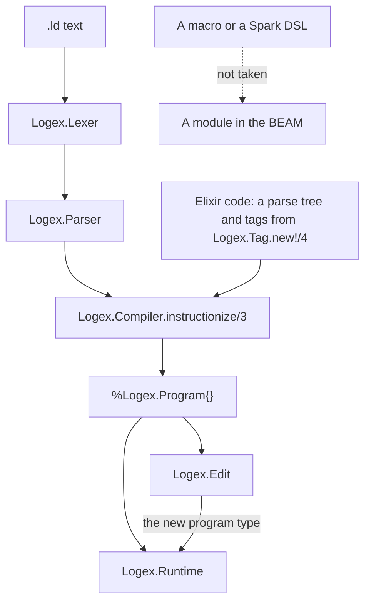

# 0001. A program is data

This record is for a contributor who wants to know why logex compiles a ladder program
to data and not to code for the BEAM. logex compiles a program to a `%Logex.Program{}`
value, and `Logex.Runtime` interprets it. Read this record before you propose a macro that
declares a program in Elixir, or a back end that makes code generated from a program.
Read it also before a change that loads a module into a running controller.

## Status

Accepted. No later record replaces this record.

## Date

2026-10-01.

## Context

A [host](../../guides/reference/glossary.md#host) [compiles](../../guides/reference/glossary.md#compile) the text of a [program](../../guides/reference/glossary.md#program) into a
[program type](../../guides/reference/glossary.md#program-type), and runs it as [instances](../../guides/reference/glossary.md#instance). An
[online edit](../../guides/reference/glossary.md#online-edit) replaces the program type of an instance while the
[plant](../../guides/reference/glossary.md#plant) runs. The maintainer asked to change "the whole
controller/configuration at runtime" and did not want to run each change "through an
Elixir compiler first" ([§4.9](../organisation.md#49-changing-a-running-controller-online-edit)).
The controllers of the [conventional set](../../guides/reference/glossary.md#conventional-set) also change a program
while it runs.

There were 2 possible forms for a program type:

- A module that an Elixir macro or a Spark DSL declares. The Elixir compiler makes it
  into BEAM code.
- A value of plain data, with text as its saved form. An interpreter runs it.

A measurement on 2026-10-01 compared the 2 forms for 2 programs, of 4 and 200
[tags](../../guides/reference/glossary.md#tag). In each run, `Logex.compile/2` took less
than 0.06 of the time of a compile of a module.
[Runs and tables of the records: the language](../implementation/record-runs-language.md#0001-a-program-is-data) gives the times.

The 2026-10-01 measurement found 2 more problems with a module:

- The compile ran each Elixir expression in the body of the new module. Thus an edit can
  run any code.
- If the new version failed its check, the BEAM unloaded the old version. The controller
  then had no program.

A third problem follows from how Spark names an entity. The name is usually an atom, and
each new name in an edit adds an atom. The BEAM never frees an atom, and it stops when its
table of 1,048,576 atoms is full.

A run on 2026-11-21 confirms the first 2 problems for a plain module. 3 of 4 failed
edits leave the controller with no program that works. The same page gives each case.

An earlier study, [`docs/defladder.md`](../defladder.md), made a back end that generated
1 Elixir function for each [rung](../../guides/reference/glossary.md#rung). The generated code and the interpreter
disagreed on 5,708 of 20,000 seeded maps of tag values. The interpreter compared a value
with `==`, and a pattern match compares with `=:=`. Thus `1.0` closed a
[contact](../../guides/reference/glossary.md#contact) in the interpreter and not in the generated code. On maps of
integers only, the 2 back ends agreed. A text can write only integers, so the suite did
not find the difference.

Speed gave no reason to generate code. In the same study, on Elixir 1.14, a
[scan](../../guides/reference/glossary.md#scan) of 5 rungs took 240 ns as generated code and 525 ns in the interpreter.
Each time is less than 0.001 of the 1 ms scan limit that the study used.

## Decision

A program type is plain data. logex never compiles a program to BEAM code.

A path is a way to make a program type: from text, or from Elixir.



Figure: the 2 paths into a program type, and the path that logex does not take. Both
paths meet at 1 check, and no path goes from the data to the BEAM.

- A program type is a struct, `%Logex.Program{}`. It holds no pid, no function, no
  reference and no port.
- Its saved form is text. A program from text has its `.ld` file.
  `Logex.Printer.print/1` writes a parse tree back as `.ld` text, and that text compiles
  again. A [configuration](../../guides/reference/glossary.md#configuration) has a `.logex` file, and
  `Logex.Configuration.Text.print/1` writes a configuration's entries as `.logex` text.
- Each path goes through 1 check in `Logex.Compiler`: the check that `instructionize/3`
  runs. Text comes through `Logex.Lexer` and `Logex.Parser`. Elixir code gives a parse
  tree and tags from `Logex.Tag.new!/4`.
- The path from Elixir refuses what the text cannot say. `Logex.Parser.well_formed!/1`
  refuses a tree that `Logex.Parser.parse/1` cannot give. `Logex.Tag.new!/4` refuses a
  [preset](../../guides/reference/glossary.md#preset) on a [timer](../../guides/reference/glossary.md#timer). In the text, the preset of a timer is the
  number on its `ton` instruction. A [declaration](../../guides/reference/glossary.md#declaration) cannot give it.
- `Logex.Runtime` interprets the data. Its evaluator is the only code that runs an
  [instruction](../../guides/reference/glossary.md#instruction).
- `Logex.Edit` compares 2 values, the program type that runs and the new one, and moves
  the [state](../../guides/reference/glossary.md#state) of the instance from one to the other.
  [0012. The staged online edit](0012-staged-online-edit.md) gives the steps of an edit.
- No path puts the Elixir compiler on the way that compiles, runs or changes a program.
- Spark is not a part of logex. A separate package can declare a program in Elixir. It
  makes the first data. logex does not change the Elixir code of the package after an
  online edit.

The 2 refusals, from a run. The first message refuses a rung with no instruction. The second
refuses a preset on the declaration of a `ton`.

<!-- unchecked: messages copied from a run of Logex.Parser.well_formed!/1 and Logex.Tag.new!/4 -->
```text
ArgumentError: not a tree Logex.Parser.parse/1 can produce: a rung is {:rung, elements}, with one element or more, got: []
ArgumentError: `t1` is a ton: its preset is the number on its `ton` instruction, as in `ton t1 5000`, not an initial value on its declaration
```

## Consequences

The good results:

- A compile, a scan and an online edit make no call into a compiler. They add no module
  and no atom to the BEAM. A run counts the calls, the modules and the atoms, and finds
  0 of each. [Runs and tables of the records: the language](../implementation/record-runs-language.md#0001-a-program-is-data) gives the script.
- A program type is a value. 2 compiles of 1 file give equal values, and a value is the
  same after `:erlang.term_to_binary/1` and back. A host can keep it, send it and
  compare it.
- An error in a new text does not touch the program that runs. The compile returns
  `{:error, diagnostics}`, and the host keeps the old program type.
- Each instruction has 1 definition. A new instruction is a row of `@instructions` and 2
  clauses of `evaluate/3`, and the paths do not change.
  [Add an instruction](../implementation/adding-an-instruction.md) gives the steps.
- A compile of a program costs much less than a compile of a module.

The costs:

- An interpreter does more work for each scan than generated code. A scan of `motor.ld`
  took a median of 2.4 µs in a run on 2026-11-21, less than 0.003 of 1 ms.
- A host can change a program type by hand, and `Logex.Runtime` checks only a part of
  it. In a run, a rung added by hand wrote 1 to `nowhere`, a tag that the program does
  not declare. `Logex.Runtime.instance/1` and `Logex.Runtime.scan/3` accepted the
  program, and `Logex.Program.edited_by_hand/1` gave `[]`.
- If you add a form to the text, change `Logex.Parser.well_formed!/1` and
  `Logex.Declarations.check/1` in the same change. If you do not, each compile of a text
  with the new form raises `ArgumentError`, because `instructionize/3` checks each tree
  with `well_formed!/1`.
- logex has no DSL. A host that builds a program in Elixir writes by hand the parse tree
  that `Logex.Parser.parse/1` gives, and calls `Logex.Compiler.instructionize/3` with it.

## Alternatives considered

- **A Spark or macro DSL as the model.** A DSL compiles into a module. A running
  controller edits a value. It cannot edit a module that the BEAM runs.
- **The Elixir compiler on the path of an edit.** It took about 300 to 4,300 times the
  time of `Logex.compile/2`, ran code from the edit and unloaded the running module.
- **Spark inside logex.** A separate package that makes the same data does the same job.
- **A back end of generated code beside the interpreter.** It is a second definition of
  each instruction, and the 2 definitions disagreed.
- **The macro that the `defladder` study recommends.** It makes a function that returns a
  parse tree. The rungs still run in the interpreter, so it agrees with this decision. It
  is not a part of logex.

[Programs as data](../../guides/explanation/programs-as-data.md) gives the same model for
a user of logex.

## The decisions that this record sums up

This record sums up decisions 15, 16 and 17 of
[`docs/organisation.md`](../organisation.md#7-decisions).

| Decision | What it says |
|---|---|
| 15 | A controller is 1 model of data, with text as its saved form. The path from Elixir refuses what the text cannot say. |
| 16 | The Elixir compiler is never on the path of an edit. |
| 17 | Spark is not inside logex. A separate package that makes the same data stays possible. |

The measurements are in
[`docs/organisation.md` §4.9](../organisation.md#49-changing-a-running-controller-online-edit).
`PLAN.md` keeps the decision in [§5](../../PLAN.md#5-settled-decisions) and in
[§6](../../PLAN.md#6-deliberately-not-changing).
