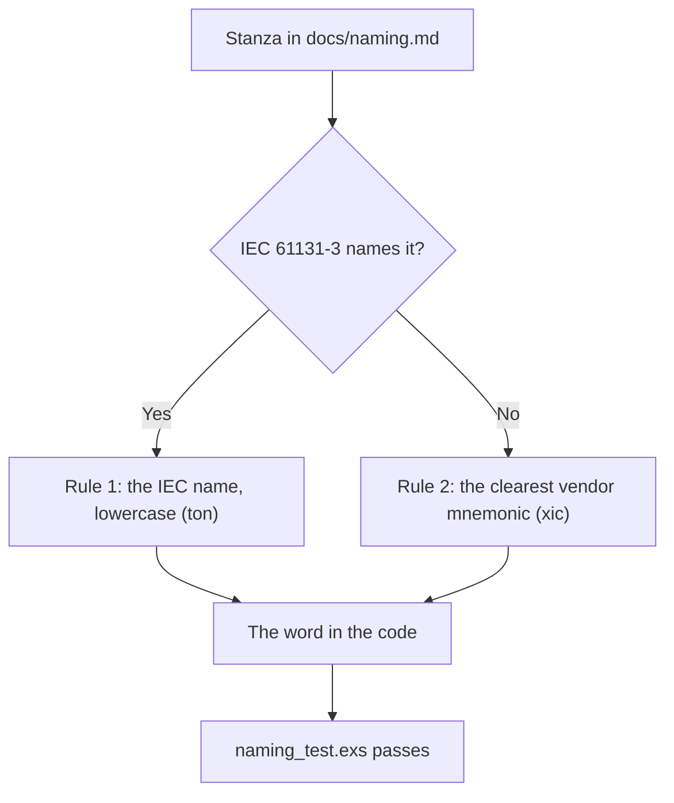

# 0002. A dialect for logex, and a survey for each word

This record is for a contributor who adds a word to logex, such as a
[mnemonic](../../guides/reference/glossary.md#mnemonic) or a [type](../../guides/reference/glossary.md#type) word. It gives the rule that selects the word, and the survey that comes before the code.
It also says why logex reads its own text form and not the export format of a vendor.
Read it before you add a word, and before you propose a function that imports a program.

## Status

Accepted. No later record replaces this record.

## Date

2026-08-31, the date of the survey and of this decision. The decisions in section 7 of
`docs/organisation.md` that apply the rule are from 2026-10-14 to 2026-11-16.

## Context

A [host](../../guides/reference/glossary.md#host) gives logex a [program](../../guides/reference/glossary.md#program) as text. That text needed a form, from
[IEC 61131-3](../../guides/reference/glossary.md#iec-61131-3) or from a vendor. The survey in
[`docs/naming.md`](../naming.md#why-survey-at-all) found 2 facts about IEC 61131-3:

- It defines a [contact](../../guides/reference/glossary.md#contact) and a [coil](../../guides/reference/glossary.md#coil) as drawings with English names,
  such as "Normally open contact", and gives them no mnemonic. The tables are 61 and 62 of
  Edition 2, 75 and 76 of Edition 3, and 74 and 75 of Edition 4.
- Edition 4 (2025) removed Instruction List, its only language with mnemonics. Its Scope
  reads: "This suite consists of the textual language structured text (ST), and the
  graphical languages, ladder diagram (LD) and function block diagram (FBD)".

Thus IEC 61131-3 has no text form of a [rung](../../guides/reference/glossary.md#rung) with mnemonics. A ladder language of
mnemonics is necessarily a dialect that no standard defines.

The current controllers of the [conventional set](../../guides/reference/glossary.md#conventional-set) export uppercase text. That
text puts each [operand](../../guides/reference/glossary.md#operand) between parentheses, as in `XIC(start)`, ends a rung with a
semicolon and writes a [branch](../../guides/reference/glossary.md#branch) with brackets and commas. Earlier controllers write a
branch with the 3 words `BST`, `NXB` and `BND`. The software of the current controllers
still takes these 3 words in its text area for 1 rung.

A dialect still needs a rule for its words. Without a rule, a writer names a thing by
reflex: a new readable word such as `on_delay`, or the word of 1 vendor. In 2024 the
toolchain of the conventional set renamed 16 mnemonics "to conform to IEC 61131-3 and
PLCopen standards". For example, `EQU` became `EQ` and `MOV` became `MOVE`. It kept
`XIC`, `XIO`, `OTE`, `OTL` and `OTU`, because IEC 61131-3 gives those only a drawing.

## Decision

logex reads its own [dialect](../../guides/reference/glossary.md#dialect). logex does not read the export format of a vendor.
logex will not have an importer. logex takes its vocabulary from IEC 61131-3 and from the
conventional set, but not their syntax.

The dialect writes each word in lowercase, with spaces between the words and no
parentheses around an operand. logex reads a mnemonic in any case. Each rung is on 1 line.

Each word has its name by this rule, in this sequence:

1. If IEC 61131-3 names the operation, the word is the IEC name in lowercase: `ton`,
   `ctu`, `move`, `eq`, `real_to_int`.
2. If IEC 61131-3 gives only a drawing, or nothing, the word is the clearest vendor
   mnemonic. Examples: `xic`, `ote`, `rto`, `neg`, `osr`. The stanza of the word says
   where it comes from: "the conventional set", or another vendor by its name.
3. logex never makes a new readable word for a thing that has a standard name. It has
   no `on_delay` (IEC 61131-3: `ton`) and no `rising` (the conventional set: `osr`).

The rule has 1 exception: a branch is punctuation, not a word
([Why a branch is punctuation](#why-a-branch-is-punctuation)). logex took `xic`, `xio`,
`ote`, `otl` and `otu` from the conventional set because IEC 61131-3 gives them only a
drawing. They are not a reason to take the next word from the conventional set: apply
rule 1 first.

A survey comes before the code of each word:
[`docs/naming.md`](../naming.md#the-naming-rule), with 1 stanza for each word. A stanza
gives the names of IEC 61131-3 and of the major vendors, the logex name and its reason,
and its sources under `Checked:`. It marks `unverified` each fact that its writer did not
check. [Add an instruction](../implementation/adding-an-instruction.md) gives the steps.

`test/logex/naming_test.exs` fails if a word in 1 of these places has no stanza:

| Place | Words |
|---|---|
| `@instructions` in `Logex.Compiler` | Mnemonics, the 182 conversions |
| `Logex.Declarations` | [Section](../../guides/reference/glossary.md#section) words, [qualifiers](../../guides/reference/glossary.md#qualifier), type words |
| `Logex.Declarations.kinds/0` | `function_block` |
| `Logex.Configuration.Text` | Words of a [configuration file](../../guides/reference/glossary.md#configuration-file) |

The name of a user [function block](../../guides/reference/glossary.md#function-block) needs no stanza.
This is the start of the message of the test after a change to the heading of the stanza
of `osr`:

<!-- unchecked: the start of the failure of naming_test.exs, copied from a run on a copy of the repository with the heading of the stanza of osr changed -->
```text
These instructions are in @instructions but have no stanza in docs/naming.md:

    osr
```

> #### Caution {: .error}
>
> Say in the commit message that the new word is a reserved word. logex reserves the word
> in any case, so each file that uses it as a name gets a diagnostic.



Figure: the path of a new word. The stanza comes first. The code is 1 of the 4 places in
the table, and `naming_test.exs` fails for a word there with no stanza. logex never makes
a new readable word (rule 3).

### The decisions that apply the rule

| Decision | logex took | Not taken, and why |
|---|---|---|
| 67 | Rule 1: `ctu`, `ctd` and `ctud` | 2 kinds of [counter](../../guides/reference/glossary.md#counter). IEC 61131-3 has 3 |
| 68 | Rule 1: the [members](../../guides/reference/glossary.md#member) `cu`, `cd`, `r`, `ld`, `pv`, `q`, `qu`, `qd`, `cv`. Rule 2: `ov` and `un`, because IEC 61131-3 has no overflow flag | `pre`, `acc` and `dn` on a counter. IEC 61131-3 names these members |
| 80 | Rule 2: `osr` and `osf`, the transition-sensing coils of IEC 61131-3 | Only `ons`. A pulse coil passes on the power that it receives |
| 83 | No word for a master control zone | The zone, later. The vendors do not agree on it, and IEC 61131-3 does not have it |
| 144 | Rule 1: `sint` to `ulint`, `real`, `lreal` | Width words, such as `i16`. IEC 61131-3 names each type |
| 148, 162 | Rule 1: `<from>_to_<to>` and `real_trunc_int`, 182 names | `to_int` and `trunc_int`. A typed name gives both types |
| 155 | Rule 1: `byte` to `lword`, and `and`, `or`, `xor`, `not`, `shl`, `shr`, `rol`, `ror` | `wand`, `wor`, `wxor`, `wnot`. IEC 61131-3 names them `AND`, `OR`, `XOR`, `NOT` |
| 163 | Rule 1: `ctu_dint`, `ctd_dint`, `ctud_dint`, other words for `ctu`, `ctd`, `ctud` | No `ctu_dint`. IEC 61131-3 names this counter `CTU_DINT` |
| 351 | A rung that writes nothing is a [diagnostic](../../guides/reference/glossary.md#diagnostic) | Let it compile. A rung on 2 lines compiled with no message |
| 367 | A [label](../../guides/reference/glossary.md#label) alone compiles if a `jmp` names it | A coil that does nothing after the label |
| 532 | The words in lowercase, for the [store](../../guides/reference/glossary.md#store) | Each word in its case. `XIC start` and `xic start` were 2 programs |
| 561 | "The conventional set" on each page | The name of the vendor beside each word |

### What the dialect settles

The results are those of the script in [The rules in a run](#the-rules-in-a-run).

- **A branch is punctuation.** `(` opens a branch, `|` separates 2 [legs](../../guides/reference/glossary.md#leg) and `)`
  closes it (result 7).
- **Case.** logex reads a mnemonic, a section word, a qualifier, a type word and
  `function_block` in any case, as IEC 61131-3 reads a keyword. The name of a [tag](../../guides/reference/glossary.md#tag)
  is case-sensitive (results 1 and 3).
- **The case in the store.** At a fresh start, logex compares the text of a program with
  the text that wrote the store. It first writes the words that it reads in any case in
  lowercase. Thus `XIC start` and `xic start` are the same program, and `Start` and
  `start` are not.
- **[Reserved words](../../guides/reference/glossary.md#reserved-word).** logex reserves a word in any case, in
  each kind of file that uses it (result 2). It reserves a mnemonic in a program and in the file of a block. It
  reserves `task` only in a configuration file, and a type word such as `int` in all 3.
  [0005. Every tag is declared](0005-every-tag-is-declared.md) gives the reason, and
  [Source syntax](../../guides/reference/source-syntax.md) lists the words.
- **`mov` is `move`,** the IEC name, with no second word (result 4).
- **A newline ends a rung.** If a rung continues on a second line, logex reads 2 rungs.
  The first writes nothing, so logex refuses it (result 8).
- **No operand syntax of a vendor.** logex has no address such as `I:003/4` or `T4:5/DN`.
  `;` and `:` are illegal characters.
- **No name for the vendor of the conventional set.** A page and a stanza write "the
  conventional set" (`CONTRIBUTING.md`, "Do not restore vendor names"). A page names
  [Logix](../../guides/reference/glossary.md#logix) only to compare behaviour.

### Why a branch is punctuation

The words `bst`, `nxb` and `bnd` have the letters of a tag name, so a missing space joins
a word to a name. Before a branch was punctuation, logex read the 3 words. logex at
commit `5ae70f2` compiles these 2 rungs with no error:

<!-- unchecked: 2 rungs in the branch form that logex refuses, the second with 1 space missing -->
```text
bst xic start nxb xic motor bnd xio stop ote motor
bst xic startnxb xic motor bnd xio stop ote motor
```

The first rung has 2 legs. The second rung has 1 leg, with the contacts `startnxb` and
`motor` in series. `(`, `|` and `)` cannot be a part of a name, so
`(xic start|xic motor)` reads the same with or without spaces. The brackets and commas of
the current controllers work only with each operand between parentheses. Without the
parentheses, a `[` in logex has 2 meanings: a branch and a [subscript](../../guides/reference/glossary.md#subscript).

Thus `( | )` departs from a vendor spelling that is still in use, not only from an old
one. It is a deliberate exception to rule 2.

### The rules in a run

This script [compiles](../../guides/reference/glossary.md#compile) 9 texts of a motor and of a counter of boxes. Each text has a word
or a form that this record decides. The last line compares a program in lowercase with
the same program in uppercase. The script is `examples/0002-own-dialect-and-names.exs`.
Run it from `examples/`.

```elixir
# Print "compiles", or each diagnostic of the compile.
report = fn
  {:ok, _program} -> IO.puts("  compiles")
  {:error, diagnostics} -> Enum.each(diagnostics, &IO.puts("  " <> Logex.Diagnostic.format(&1)))
end

# The declarations of the motor, and of the box counter.
motor = "var_input start bool\nvar_input stop bool\nvar_output motor bool\n"
boxes = "var_input eye bool\n"

texts = [
  {"1. A mnemonic in uppercase", motor <> "XIC start XIO stop OTE motor\n"},
  {"2. A mnemonic as the name of a tag", motor <> "var Ote bool\nxic start ote motor\n"},
  {"3. A tag in the wrong case", motor <> "xic Start xio stop ote motor\n"},
  {"4. The old name of move", motor <> "var speed dint\nmov 600 speed\n"},
  {"5. A new word for ton", motor <> "var t1 ton\nxic start on_delay t1 3000\n"},
  {"6. A master control zone", motor <> "xic start mcr\n"},
  {"7. A branch in words", motor <> "bst xic start nxb xic motor bnd xio stop ote motor\n"},
  {"8. A rung on 2 lines", motor <> "xic start xio stop\note motor\n"},
  {"9. ctu_dint, and a ctd on it", boxes <> "var boxes ctu_dint\nxic eye ctd boxes 3\n"}
]

Enum.each(texts, fn {title, text} ->
  IO.puts(title)
  report.(Logex.compile(text, name: "dialect"))
end)

# The case of a mnemonic, a section and a type word changes nothing in the program.
{:ok, lower} = Logex.compile(motor <> "xic start xio stop ote motor\n", name: "motor")
declarations = "VAR_INPUT start BOOL\nVAR_INPUT stop BOOL\nVAR_OUTPUT motor BOOL\n"
{:ok, upper} = Logex.compile(declarations <> "XIC start XIO stop OTE motor\n", name: "motor")
same = {lower.rungs, lower.tags} == {upper.rungs, upper.tags}
IO.puts("The same rungs and tags in uppercase: #{same}")
```

```console
$ mix run 0002-own-dialect-and-names.exs
1. A mnemonic in uppercase
  compiles
2. A mnemonic as the name of a tag
  line 4: `Ote` is an instruction and cannot name a tag
3. A tag in the wrong case
  line 4: `Start` is not declared — did you mean `start`? (tags are case-sensitive)
4. The old name of move
  line 5: unknown instruction `mov` — did you mean `move`? (renamed to its IEC name)
5. A new word for ton
  line 5: unknown instruction `on_delay`
6. A master control zone
  line 4: unknown instruction `mcr`
7. A branch in words
  line 4: `bst` is no longer a keyword — branches are written `( … | … )`
  line 4: `nxb` is no longer a keyword — branches are written `( … | … )`
  line 4: `bnd` is no longer a keyword — branches are written `( … | … )`
8. A rung on 2 lines
  line 4: this rung writes nothing and jumps nowhere: none of its instructions writes a tag, a member or a bit, runs an instance or keeps a one-shot's storage bit. A newline ends a rung, so a rung's conditions and its outputs go on one line, as in `xic start xio stop ote motor`
9. ctu_dint, and a ctd on it
  line 3: `ctd` runs a ctd, ctud, ctd_int, ctud_int, ctd_lint, ctud_lint, ctd_udint, ctud_udint, ctd_ulint or ctud_ulint, but `boxes` is a ctu (declared on line 2): a ctu only counts up; declare it `var boxes ctud` to count both ways
The same rungs and tags in uppercase: true
```

The message of result 8 ends with the rule: "A newline ends a rung". Result 9 names
`ctu` for `boxes`, which `ctu_dint` declares: "`boxes` is a ctu".

## Consequences

The good results:

- A controls engineer finds in logex the names of IEC 61131-3 and of the manuals of the
  vendors.
- Each word has a written reason and its sources, and `naming_test.exs` stops a word with
  no survey.
- `ctu_dint` and `ctu` give the same rungs and tags. The report of an
  [online edit](../../guides/reference/glossary.md#online-edit) from 1 word to the other is empty.

The costs:

- logex reads no program of a different tool. A user writes each program again.
  [Port a program from Logix or IEC 61131-3](../../guides/howto/port-a-program.md) gives
  the steps.
- Each new reserved word gives a diagnostic in each file that uses it as a name.
  Decisions 144 and 155 reserved `int`, `real`, `byte`, `word`, `and` and `or`.
- The members come from 2 vocabularies. A program reads `xic boxes.q` for a counter, from
  IEC 61131-3, and `xic t1.dn` for a [timer](../../guides/reference/glossary.md#timer), from the conventional set.
- The branch punctuation is a form of logex alone. logex gives a diagnostic for each of
  `bst`, `nxb` and `bnd` (result 7).
- The survey is work before the code. The 182 conversions have 5 stanzas, 1 for each
  family.

## Alternatives considered

- **An importer for the export format of a vendor.** It ties logex to the format and the
  addresses of 1 vendor.
- **A text form of IEC 61131-3.** IEC 61131-3 has no text form of a rung with mnemonics.
- **New readable words, such as `on_delay`.** Each reader who knows ladder logic must
  translate them, and no manual has them.
- **The word of the conventional set for each thing.** It has no word for some things of
  IEC 61131-3, such as the negated coil `--(/)--`, which logex does not have. Its own
  renames moved to the IEC names.
- **Words, or brackets and commas, for a branch.**
  [Why a branch is punctuation](#why-a-branch-is-punctuation) gives the reasons.

[The decisions that apply the rule](#the-decisions-that-apply-the-rule) gives the option
that each decision did not take, and why.
[The dialect and IEC 61131-3](../../guides/explanation/the-dialect-and-iec.md) gives the
same model for a user.

## Decisions in section 7

This record sums up decisions 67, 68, 80, 83, 144, 148, 155, 162, 163, 351, 367, 532 and
561 of [`docs/organisation.md`](../organisation.md#7-decisions). `PLAN.md` keeps the
decision in [§5](../../PLAN.md#5-settled-decisions), under
[What the decision settles](../../PLAN.md#what-the-decision-settles).
