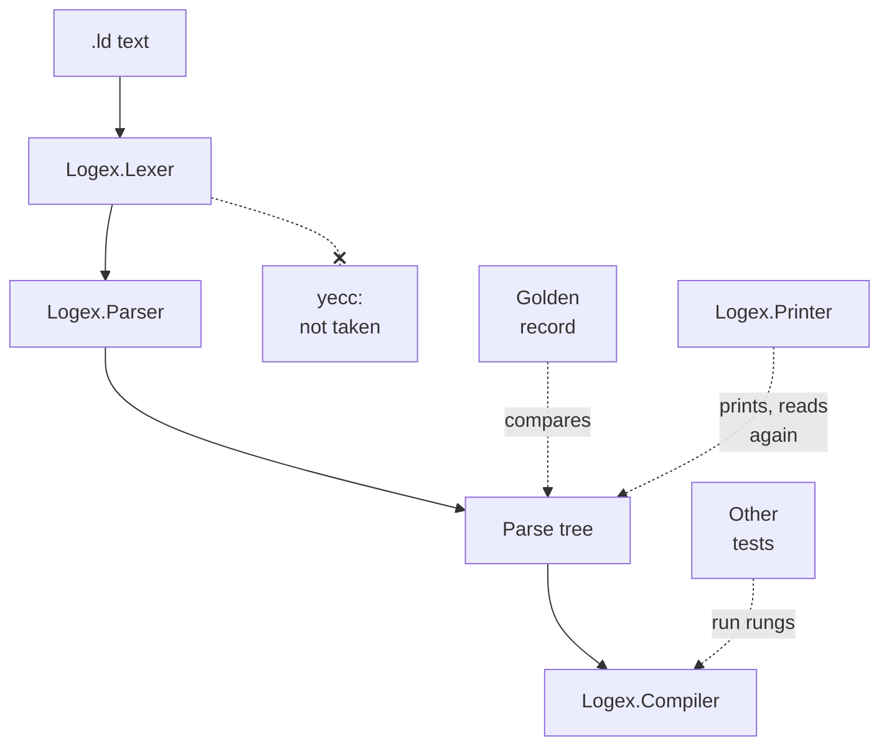

# 0003. No dependencies and no generated code

This record is for a contributor who wants to know why logex has no dependency outside
the `docs` environment and no generated code. logex reads its text with a hand-written
lexer and parser, `Logex.Lexer` and `Logex.Parser`. Read this record before you add an
entry to the dependencies in `mix.exs`. Read it also before you propose a parser
generator, a library of parser combinators or a file that a tool writes at build time.

## Status

Accepted. It reverses an earlier decision to keep leex and yecc.
[`PLAN.md` §6](../../PLAN.md#6-deliberately-not-changing) records the earlier decision and
the reasons to reverse it. No later record replaces this record.

## Date

2026-09-26, the day that the hand-written lexer and parser replaced leex and yecc.
On 2026-11-12, decision 515 applied this rule to static analysis. On 2026-11-15,
decision 546 applied it to the documentation.

## Context

The front end of logex is its lexer and its parser. It reads the text of a
[program](../../guides/reference/glossary.md#program) into a parse tree. Until 2026-09-26,
2 tools of Erlang/OTP generated the front end:

- leex made the lexer from `src/ladder_lexer.xrl`.
- yecc made the parser from `src/ladder_parser.yrl`.

Both tools are a part of the `parsetools` application. Some Linux distributions put it in
a separate package, `erlang-parsetools`. Mix wrote the generated `src/*.erl` files into
the tree of the repository.

The project kept yecc for 1 reason: yecc finds each conflict in a grammar. A conflict is a
place where yecc cannot choose between 2 rules of the grammar. No other tool in the
project finds a conflict. In a hand-written parser, the same problem is an overlap: 2
clauses of the parser match the same tokens, and the first clause wins.

But yecc reports a shift/reduce conflict, and the build goes on. A run on 2026-11-21 on
Elixir 1.20.4 shows this. A small grammar has the 2 rules `elems -> elems elem` and
`elems -> elem elems`. These commands build it and show the exit code:

```console
$ mix compile --warnings-as-errors
$ echo $?
```

<!-- unchecked: the output of the 2 commands, copied from a run of a scratch project with 1 yecc grammar on Elixir 1.20.4 -->
```text
Compiling 1 file (.yrl)
src/rungs.yrl: Warning: conflicts: 2 shift/reduce, 0 reduce/reduce
Compiling 1 file (.erl)
Generated y app
0
```

The build exits with 0, and yecc writes `src/rungs.erl` beside the grammar. Only a
reduce/reduce conflict makes `mix compile` exit with 1. Thus the check protects the
grammar only if a separate [gate](../../CONTRIBUTING.md#before-you-commit) stops the build
on the conflict. The project had no CI until 2026-10-14. Until then, a contributor ran the
check by hand.

In September 2026, 2 studies on Elixir 1.20.4 and Erlang/OTP 28 tried to make that gate.
The first study made 5 front ends and ran the suite on each:

| Front end | What the first study found |
|---|---|
| leex and yecc, as they were and with fixes | A conflict does not stop the build |
| A hand-written lexer and yecc | The best option for yecc |
| NimbleParsec | 6.9 to 8.3 times slower. No message for an error in the grammar. A dependency |
| Pegasus | The same results as NimbleParsec |
| A hand-written lexer and parser | The front end that logex took |

The second study added a guard compiler to the best option. The guard compiler was a Mix
compiler of the project that stopped the build on a conflict of yecc. 3 adversarial
reviews made it stronger. It cost this:

- 221 lines of guard, coupled to about 8 behaviours of Mix.
- An 87-second test suite.
- A gap that the last review found. The build lock of Mix makes 2 builds of 1 project run
  one after the other. Mix 1.20.4 puts this lock under `System.tmp_dir!()`, in lines 132
  to 134 of `mix/sync/lock.ex`. Thus 2 runs of `mix compile` with different values of
  `TMPDIR` share no lock. With 2 such runs, the review built a parser with a conflict, and
  the build exited with 0. The study did not record how the second build missed the
  conflict.

## Decision

logex has no dependency to build it, to run it or to run its suite. Each module of logex
comes from a `.ex` file in `lib/` that a person wrote. No tool writes code into the
repository at build time.

- `Logex.Lexer` reads the text into tokens by binary pattern matching. Each token has its
  line and its column.
- `Logex.Parser` reads the tokens into a parse tree by recursive descent. Its moduledoc
  gives the grammar and the function that parses each rule. The parser reads the
  left-factored form of the grammar, which is LL(1): it makes each choice on the next
  token alone.
- 3 checks of the suite take the place of the conflict check of yecc:

| Check | It fails if |
|---|---|
| The golden record, `test/fixtures/frontend_golden.txt`: for each of 1,590 source texts, the tree or the line of the error. `frontend_golden_test.exs` reads it | 1 source text gives a different tree or a different line |
| The printer's check, in `printer_test.exs`: `Logex.Printer.print/1` prints a tree, and the front end reads that text again | The 2 trees differ in a part other than the line numbers, or the generator of the test does not make each shape of `@required_shapes` |
| The other tests of the suite: the [rungs](../../guides/reference/glossary.md#rung) of each test, run | A rung does a different thing |



Figure: the front end and the 3 checks of the suite. Each check reads what the front end
gives. No check reads the grammar.

The first golden record gives the results of leex and yecc for 1,362 source texts. On
2026-09-26, the hand-written front end gave the same result for each of them, and for
200,000 seeded texts. The golden record changes only in a commit that changes the language
or its generator on purpose. [The test strategy](../implementation/testing-strategy.md) tells how to make it again.

The same rule applies to the documentation and to the static analysis:

- ExDoc builds the site of the documentation. It is the only direct dependency. Only the
  `docs` environment has it, with the 5 packages that ExDoc needs (decision 546).
  `mix docs` runs in that environment.
- Static analysis uses `dialyzer`, the tool of Erlang/OTP, with no dependency
  (decision 515). `scripts/dialyzer.sh` runs it, and CI runs that script.

<!-- fragment: the dependencies in mix.exs, as the file gives them -->
```elixir
defp deps(:docs), do: [{:ex_doc, "~> 0.40", runtime: false}]
defp deps(_env), do: []
```

`mix.exs` gives its dependencies by the environment, and not as 1 entry with
`only: :docs`. Mix needs Hex to read any entry from Hex, in each environment. In a run on
2026-11-21, `mix compile` in the `dev` environment of a small project with that entry
stopped with `Could not find an SCM for dependency :ex_doc`:

<!-- unchecked: the output of mix compile with no Hex installed, copied from a run of a scratch project on Elixir 1.20.4 -->
```text
Mix requires the Hex package manager to fetch dependencies
Shall I install Hex? (if running non-interactively, use "mix local.hex --force") [Yn] ** (Mix) Could not find an SCM for dependency :ex_doc from OnlyDocs.MixProject
```

`test/logex/docs_test.exs` reads `mix.exs` with a Mix that has no Hex, and expects no
dependency in `dev`, `test` and `prod`. The site also loads Mermaid from a CDN in the
browser of the reader, to draw the diagrams. That is not a dependency of Mix.

## Consequences

The good results:

- Erlang/OTP and Elixir alone build logex. It needs no `parsetools`, no Hex and no
  network. In a run on 2026-11-21 with no Hex installed, Mix read no dependency in the
  `dev`, `test` and `prod` environments. A fresh `mix compile` printed only
  `Compiling 40 files (.ex)` and `Generated logex app`.
- The repository holds no generated file, and a build writes none into it.
- The lexer gives each token its column, and each error its line and column. leex gave
  only the line. For a text that is not UTF-8, the error gives the line and the column of
  the first byte that is not UTF-8.
- If an overlap changes a result that a test reads, the checks find it. A run on
  2026-11-21 put 2 overlaps into a copy of `Logex.Parser`, 1 at a time. The first reads a
  [branch](../../guides/reference/glossary.md#branch) of 1 leg as
  [instructions](../../guides/reference/glossary.md#instruction) in series. It changed 159
  of the 1,590 source texts of the golden record, and 16 other tests failed. The second
  drops an empty leg before another leg. It changed 106, and 7 other tests failed.

This script shows 2 good results: logex needs only Erlang/OTP and Elixir, and a tree that
the printer prints reads back as the same tree. Run it from `examples/`, a Mix project that
has logex as its dependency. The first run also prints the compile lines of logex.

```elixir
# Load the description of logex if no Mix project loaded it.
_ = Application.load(:logex)
IO.puts("logex needs: #{inspect(Application.spec(:logex, :applications))}")

# The file that each module of logex comes from.
modules = Application.spec(:logex, :modules)
files = Enum.map(modules, &to_string(&1.module_info(:compile)[:source]))

from_lib =
  Enum.all?(files, &(String.contains?(&1, "/lib/logex") and String.ends_with?(&1, ".ex")))

IO.puts("each module comes from a .ex file under lib/: #{from_lib}")

# Text to tokens, tokens to a tree, the tree to text, and that text to a tree again.
text = """
( xic start | xic motor ) xio stop ote motor
xic motor ( xio overtemp | ) ote run_lamp
"""

{:ok, tokens, _end_line} = Logex.Lexer.tokenize(text)
{:ok, tree} = Logex.Parser.parse(tokens)
{:routine, {:rungs, [_rung_1, {:rung, [_xic, _motor, group | _]}]}} = tree
IO.puts("the branch of rung 2: #{inspect(group)}")

printed = Logex.Printer.print(tree)
IO.puts(printed)
{:ok, tokens, _end_line} = Logex.Lexer.tokenize(printed)
same = Logex.Parser.parse(tokens) == {:ok, tree}
IO.puts("the printed text reads back as the same tree: #{same}")
```

```console
$ mix run 0003-no-dependencies-no-generated-code.exs
logex needs: [:kernel, :stdlib, :elixir]
each module comes from a .ex file under lib/: true
the branch of rung 2: {:branches, [[{:name, 2, "xio"}, {:name, 2, "overtemp"}], []]}
( xic start | xic motor ) xio stop ote motor
xic motor ( xio overtemp | ) ote run_lamp
the printed text reads back as the same tree: true
```

The branch of rung 2 has 2 [legs](../../guides/reference/glossary.md#leg). The second leg
is the empty list `[]`. An empty leg passes the power that it receives.

The costs:

- Nothing finds an overlap in `Logex.Parser` that no test reads. The caution after this
  list gives an example.
- The lexer and the parser are code that a contributor keeps. `lib/logex/lexer.ex` has
  816 lines and `lib/logex/parser.ex` has 455.
- The `docs` environment needs Hex and the network. `scripts/docs.sh` gets ExDoc from
  Hex, and `mix.lock` names 6 packages: ExDoc and the 5 that it needs. NimbleParsec is 1
  of the 5. It is in the `docs` environment only, and the front end does not use it.

> #### Caution {: .error}
>
> Do not trust the suite to find an overlap in `Logex.Parser`. Nothing checks the grammar
> for ambiguity, and an overlap that no test reads passes each check. When you change
> `Logex.Parser`, add a source text for each form that the change touches to the curated
> list of `test/fixtures/generate_frontend_golden.exs`. For a new rule of the grammar, add
> a shape to `@required_shapes` in `printer_test.exs`.

A run on 2026-11-21 shows this cost. The diff adds 1 clause to `legs/3` in
`lib/logex/parser.ex`. `acc` holds the legs that the parser read before. The new clause
drops an empty leg when 3 legs or more come before it and another leg follows it:

```diff
     case branch(tokens, []) do
+      {:ok, [], [{:nxb, _} | rest]} when length(acc) >= 3 -> legs(rest, open, acc)
       {:ok, leg, [{:nxb, _} | rest]} -> legs(rest, open, [leg | acc])
```

The full suite passed with this overlap. But it changes a rung. Declare `aa`, `bb`, `cc`
and `ee` as `var_input`, each at 0. Then the rung
`( xic aa | xic bb | xic cc | | xic ee ) ote lamp` sets `lamp` to 1 with the correct
parser, because the empty leg passes power. With the overlap, the parser drops the empty
leg, and `lamp` is 0. The overlap does not change rung 2 of the script, because its empty
leg has only 1 leg before it.

## Alternatives considered

- **Keep leex and yecc, with the conflict check as a gate.** The best gate cost 221 lines
  and an 87-second test suite, and 2 builds with different values of `TMPDIR` still passed
  a conflict.
- **A hand-written lexer with yecc.** It has the same gap. It also keeps `parsetools` and
  the generated `src/*.erl`.
- **NimbleParsec or Pegasus.** Each was 6.9 to 8.3 times slower, gave no message for an
  error in the grammar, and is a dependency.
- **leex beside the hand-written lexer, as a second lexer.** The project declined it on
  2026-09-27. A contributor must then make each change of the lexer 2 times, and convert
  the tokens of 1 lexer to the form of the other. It also brings back `parsetools`, the
  message of Mix about leex and the generated `src/*.erl`. Speed was not a reason. In 2
  runs on 2026-11-21, the hand-written lexer took 0.61 to 0.74 of the time of leex on 13 programs.
- **ExDoc as 1 entry with `only: :docs`.** Mix then needs Hex in each environment, as the
  [Decision](#decision) shows.
- **A Mix package that runs Dialyzer.** Decision 515 took the `dialyzer` of Erlang/OTP,
  with no dependency added.

## The decisions that this record sums up

This record sums up decisions 515 and 546 of
[`docs/organisation.md`](../organisation.md#7-decisions). The choice itself is older than
section 7. [`PLAN.md` §6](../../PLAN.md#6-deliberately-not-changing) records it.

| Decision | What it says |
|---|---|
| 515 | 4 changes to how the project works. Its part (c) puts typespecs on the [host contract](../../guides/reference/glossary.md#host-contract) and runs the `dialyzer` of Erlang/OTP in CI, with no dependency added |
| 546 | A short README, and pages for users and contributors that ExDoc builds. ExDoc is a dependency of the `docs` environment alone |

[0021. A pinned toolchain and the gates](0021-pinned-toolchain-and-gates.md),
[0022. Typespecs and Dialyzer](0022-typespecs-and-dialyzer.md) and
[0023. The shape of the documentation](0023-documentation-shape.md) give the decisions
that use this rule. [The compile pipeline](../architecture/compile-pipeline.md) gives the
front end and the stages after it. [The test strategy](../implementation/testing-strategy.md)
gives the golden record and the printer's check with the other checks of the suite.
