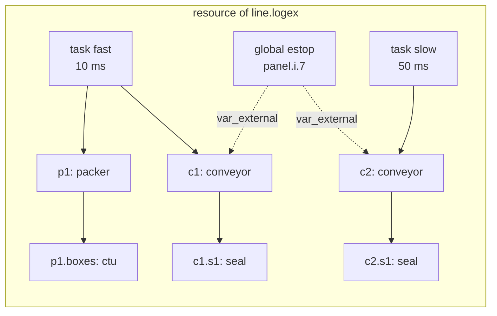
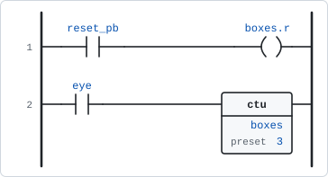

# 0004. The software model of IEC 61131-3

This record is for a contributor who wants to know how logex organises a
[plant](../../guides/reference/glossary.md#plant), and why. A file is a type, and an
instance holds the values. A configuration file makes the instances, connects them to
globals and puts them on tasks.

Read this record before you add one of these:

- a subroutine, or a tag that each program reads with no declaration
- a link from 1 program to another
- a write to a [member](../../guides/reference/glossary.md#member)
- a new line of a
  [configuration file](../../guides/reference/glossary.md#configuration-file)

## Status

Accepted. No later record replaces this record.

## Date

2026-09-28, for the direction and decisions 1 to 14. The other decisions apply it:
2026-10-02 (30 to 35), 2026-10-04 (46 to 49), 2026-10-05 (53) and 2026-10-14 (84 to 92).

## Context

Until 2026-09-28, a `.ld` file was a list of rungs with no program name. `evaluate/2` ran
it 1 time against a flat map of values, with no instance, no mark on the physical inputs
and no loop. The maintainer asked for 3 things of
[IEC 61131-3](../../guides/reference/glossary.md#iec-61131-3): its hierarchy, its tasks
and its mapping of I/O.

Edition 2 §1.4.1 of IEC 61131-3 gives the hierarchy. A configuration contains resources. A
resource contains programs, and tasks control them. A program contains
[function blocks](../../guides/reference/glossary.md#function-block).

| Element of IEC 61131-3 | What it is |
|---|---|
| Configuration and resource | The whole controller, and 1 processor in it |
| Task | A schedule. SINGLE starts the task on a [rising edge](../../guides/reference/glossary.md#rising-edge), INTERVAL starts it each period. [PRIORITY](../../guides/reference/glossary.md#priority) orders the tasks that are due together |
| Program type and instance | Only a resource makes an instance of a program type |
| Function block instance | Its values persist from 1 call to the next |
| VAR_GLOBAL and VAR_EXTERNAL | A program reaches a global only through a VAR_EXTERNAL |
| Connection | A global to an input of a program, or an output to a global. Table 49 has no connection between 2 programs |
| Located variable | A global at a physical address, with `AT` |

The [conventional set](../../guides/reference/glossary.md#conventional-set) has a
different hierarchy. Its program is a type and a schedule together, and JSR calls its
subroutines. Each program reads each controller-scope tag with no declaration. A parameter
connection joins 2 programs with no global.

IEC 61131-3 has no subroutine. Edition 3 §6.6.1.4.1 gives what a call runs: "a function, a
function block instance, or a method of a function block or class". Edition 3 also
deprecates an address in the body of a program or a block. Such an address "limits the
reusability of these program organization unit types" (§6.5.5.1).
[`docs/organisation.md` §2](../organisation.md#2-the-iec-model-top-down) gives the
sources.

## Decision

logex follows the software model of IEC 61131-3, in its
[dialect](../../guides/reference/glossary.md#dialect).

| IEC 61131-3 | logex |
|---|---|
| Program type | 1 `.ld` file: `conveyor.ld` is the type `conveyor` |
| Function block type | 1 `.ld` file that starts with `function_block seal` |
| Function block instance | `var s1 seal`, run by `cal s1 …` |
| Timer or counter instance | `var t1 ton`, `var boxes ctu` |
| Configuration with 1 resource | 1 `.logex` file |
| [Task](../../guides/reference/glossary.md#task) | `task fast interval 10 …` |
| Program instance | `program c1 conveyor with fast` |
| Global, located or not | `var_global k1 bool at …` |
| VAR_EXTERNAL | `var_external estop bool` |
| Connection | `c1.motor k1`, with no arrow |
| Access path | `c1.s1.run`, for `Logex.Runtime.get/2` |

| Part | Where logex keeps its values |
|---|---|
| Program type, block type | A type holds no values: it is data, `%Logex.Program{}` or `%Logex.FbType{}` |
| Block, timer or counter instance | In the instance that declares it: `c1.s1`, `p1.boxes` |
| Program instance, task, global | In the [resource](../../guides/reference/glossary.md#resource), 1 copy of each global |
| `var_external` | It is its global, and holds no copy |
| Connection | It copies a value in before each scan, and out after it |
| Access path | It names a value, and holds none |

The rules:

1. **A file is a type.** It is a
   [program type](../../guides/reference/glossary.md#program-type) or a
   [function block type](../../guides/reference/glossary.md#function-block-type). A block
   file starts with `function_block <name>` after comments. `<name>` is the name of its
   file. A block never holds itself, at any depth.
2. **An [instance](../../guides/reference/glossary.md#instance) holds all the values.**
   Its [state](../../guides/reference/glossary.md#state) maps each
   [tag](../../guides/reference/glossary.md#tag) name to its value. Each
   [timer](../../guides/reference/glossary.md#timer),
   [counter](../../guides/reference/glossary.md#counter) and block instance in it is a
   nested map. The field `blocks` of a program holds 1 copy of each block type that it
   uses, at any depth.
3. **A [rung](../../guides/reference/glossary.md#rung) writes only some members of a timer
   or a counter.** It writes no member of a user block.
4. **The [power flow](../../guides/reference/glossary.md#power-flow) into an instance is 1
   of its inputs.** It is IN of a timer, or CU or CD of a counter. For a block, it is EN,
   the [enable](../../guides/reference/glossary.md#enable) input of `cal`. A
   [false rung](../../guides/reference/glossary.md#false-rung) resets a `ton`.
5. **A false rung freezes a block.** `cal` then copies nothing in and writes nothing out.
   The operands of `cal` are positional: the `var_input` tags, then the `var_output` tags.
6. **A rung writes `r`, `ld` and `pv` of a counter.** The counter reads them when its
   instruction runs. Thus a reset on an earlier rung acts in the same
   [scan](../../guides/reference/glossary.md#scan). A reset on a later rung acts in the
   next scan. While the counter reads `r` as 1, it counts no edge. logex has no `res`
   instruction.
7. **1 `ctud` counts up and down.** Declare `var stock ctud`. Put `ctu stock 50` on 1 rung
   and `ctd stock 50` on another. Each rung gives 1 count input of the same instance.
8. **A [configuration](../../guides/reference/glossary.md#configuration) is a separate
   `.logex` file.**
9. **A [connection](../../guides/reference/glossary.md#connection) has no arrow, and each
   `var_input` has one.** The [section](../../guides/reference/glossary.md#section) of the
   member gives the direction. A `var_input` connects to a
   [global](../../guides/reference/glossary.md#global),
   [located](../../guides/reference/glossary.md#located-global) or not, or to a constant.
10. **Programs share a value only through a global.**
11. **A `var_external` is its global.** A write to it is a write to the global. After the
    scan, the copy-out writes each output of the instance to the global of its connection.
    If 1 instance writes a global in both ways, the copy-out writes last, with a warning.
    Only a program type declares a `var_external`. A block takes a value through a
    `var_input`.
12. **A program has 1 [routine](../../guides/reference/glossary.md#routine).** It has no
    subroutine and no `jsr`. A function block divides a large program.

This table gives the members that a rung reads and writes.

| Member | A rung reads it | A rung writes it |
|---|---|---|
| `pre`, `acc` of a timer, and `r` of an `rto` | Yes | Yes |
| `dn`, `tt`, `en` of a timer | Yes | No |
| `r`, `ld`, `pv` of a counter | Yes | Yes |
| `cu`, `cd`, `cv`, `q`, `qu`, `qd`, `ov`, `un` of a counter | Yes | No |
| `var_input`, `var_output` of a user block | Yes | No |
| `var` of a user block | No | No |

A counter has only the members of its kind: for example, a `ctu` has no `ld`, and a `ctd`
has no `r`.

### A file alone, and the loader of blocks

A `.ld` file alone runs as 1 instance with no task, which the
[host](../../guides/reference/glossary.md#host) scans with `Logex.Runtime.scan/3`.
`Logex.compile_file/1` loads each block from `<word>.ld` beside the file. It gives the
warnings of each block, with its file, after the warnings of the program.
`Logex.compile/2` takes the blocks in `types:`.

### A plant in this model

> #### Warning {: .warning}
>
> Do not use logex for a safety function. In this record, `estop` is a signal that a
> program reads. Hard-wire the e-stop that stops the machine, so that it works when logex
> stops, crashes or does not start. See
> [Safety and limits](../../guides/explanation/safety-and-limits.md).

This plant has 2 instances of the program type `conveyor` and 1 instance `p1` of `packer`.
Each conveyor holds 1 `seal`, and both read the global `estop`. The packer counts boxes
with its counter `boxes`.

<!-- file: 0004-iec-software-model/line.logex -->
```text
// line.logex -- 2 conveyors of 1 program type, and a packer
task fast interval 10 priority 1
task slow interval 50 priority 2

var_global estop      bool at panel.i.7
var_global pb_start_1 bool at panel.i.0
var_global pb_start_2 bool at panel.i.1
var_global eye        bool at panel.i.2
var_global pb_reset   bool at panel.i.3
var_global k1         bool at panel.q.0
var_global k2         bool at panel.q.1
var_global case_full  bool at panel.q.2

program c1 conveyor with fast
  c1.start pb_start_1
  c1.stop  0
  c1.motor k1

program c2 conveyor with slow
  c2.start pb_start_2
  c2.stop  0
  c2.motor k2

program p1 packer with fast
  p1.eye       eye
  p1.reset_pb  pb_reset
  p1.full_lamp case_full
```

<!-- file: 0004-iec-software-model/conveyor.ld -->
```text
// A conveyor: its motor runs from start until stop or the shared e-stop.
var_input start bool
var_input stop bool
var_output motor bool
var_external estop bool
var halt bool
var s1 seal

( xic stop | xic estop ) ote halt
cal s1 start halt motor
```

<!-- file: 0004-iec-software-model/seal.ld -->
```text
// A seal-in: `run` holds itself in from `start` until `stop`.
function_block seal
var_input start bool
var_input stop bool
var_output run bool

( xic start | xic run ) xio stop ote run
```

<!-- file: 0004-iec-software-model/packer.ld -->
```text
// A packer: it counts boxes at the eye and lights a lamp when a case holds 3.
var_input eye bool
var_input reset_pb bool
var_output full_lamp bool
var_output count dint
var boxes ctu

xic reset_pb ote boxes.r
xic eye ctu boxes 3
xic boxes.q ote full_lamp
move boxes.cv count
```



Figure: the resource of `line.logex`. A solid arrow goes from a task to an instance that
it runs, or from an instance to an instance that it holds. A dotted arrow goes from a
global to an instance that reads it. See that the 2 conveyors share 1 global, and hold 1
`seal` each.

On rung 1 of `packer.ld`, a [coil](../../guides/reference/glossary.md#coil) writes the
member `boxes.r`. The power flow of rung 2 is the count input of `boxes`.

<!-- rung: 0004-iec-software-model/packer.ld 1 2 -->


### A run of the plant

This script runs the plant 2 times, then shows 5 refusals. Run it from `examples/`, a Mix
project that has logex as its dependency.

```elixir
# The configuration file makes 3 instances of 2 program types and puts them on 2 tasks.
{:ok, line} = Logex.Configuration.compile_file("0004-iec-software-model/line.logex")

for {name, program} <- line.programs do
  IO.puts("program type #{name}, block types #{inspect(Map.keys(program.blocks))}")
end

# 1 cycle each 10 ms. The task fast runs c1 and p1 in each cycle, slow runs c2 each 50 ms.
cycle = fn {rt, now}, elapsed, inputs ->
  {rt, out, events} = Logex.Runtime.cycle(rt, elapsed, inputs)
  ran = for {:ran, _task, instance, _now} <- events, do: instance
  boxes = Logex.Runtime.get!(rt, "p1.boxes.cv")
  IO.puts("t=#{now + elapsed}  k1=#{out["k1"]} k2=#{out["k2"]}  boxes=#{boxes}  ran #{Enum.join(ran, " ")}")
  {rt, now + elapsed}
end

# Each instance has its own state: c1.s1 and c2.s1 are 2 instances of the block seal.
seals = fn {rt, now} ->
  IO.puts("       c1.s1.run=#{Logex.Runtime.get!(rt, "c1.s1.run")} c2.s1.run=#{Logex.Runtime.get!(rt, "c2.s1.run")}")
  {rt, now}
end

# Run 1: the e-stop goes to 1 at 40 ms and stays 1.
{Logex.Runtime.start(line), 0}
|> cycle.(0, %{"pb_start_1" => 1, "pb_start_2" => 1})
|> cycle.(10, %{"pb_start_1" => 0, "pb_start_2" => 0, "eye" => 1})
|> cycle.(10, %{"eye" => 0})
|> cycle.(10, %{"eye" => 1})
|> cycle.(10, %{"estop" => 1})
|> seals.()
|> cycle.(10, %{"pb_reset" => 1})
|> seals.()

# Run 2: the e-stop is 1 for 10 ms only, from 10 ms to 20 ms. The task slow does not run then.
IO.puts("run 2")

{Logex.Runtime.start(line), 0}
|> cycle.(0, %{"pb_start_1" => 1, "pb_start_2" => 1})
|> cycle.(10, %{"pb_start_1" => 0, "pb_start_2" => 0, "estop" => 1})
|> cycle.(10, %{"estop" => 0})
|> cycle.(10, %{})
|> cycle.(10, %{})
|> cycle.(10, %{})

print = fn {:error, [diagnostic | _]} -> IO.puts(Logex.Diagnostic.format(diagnostic)) end

# A rung writes the inputs r and pv of a counter, and never its count cv.
print.(Logex.compile("var e bool\nvar boxes ctu\nxic e ctu boxes 3\nmove 5 boxes.cv\n", name: "m"))

# A program has 1 routine, and no subroutine to call.
print.(Logex.compile("var e bool\nxic e jsr fill\n", name: "m"))

# A block reaches no global: it takes a value through a var_input.
block = "function_block b\nvar_input i bool\nvar_output o bool\nvar_external g bool\nxic i xic g ote o\n"
print.(Logex.compile(block, name: "b"))

# 2 instances share a value only through a global. Each var_input has a connection.
text = File.read!("0004-iec-software-model/line.logex")
linked = String.replace(text, "c2.start pb_start_2", "c2.start c1.motor")
print.(Logex.Configuration.compile("line", linked, line.programs))
unconnected = String.replace(text, "  c2.stop  0\n", "")
print.(Logex.Configuration.compile("line", unconnected, line.programs))
```

```console
$ mix run 0004-iec-software-model.exs
program type conveyor, block types ["seal"]
program type packer, block types []
t=0  k1=1 k2=1  boxes=0  ran c1 p1 c2
t=10  k1=1 k2=1  boxes=1  ran c1 p1
t=20  k1=1 k2=1  boxes=1  ran c1 p1
t=30  k1=1 k2=1  boxes=2  ran c1 p1
t=40  k1=0 k2=1  boxes=2  ran c1 p1
       c1.s1.run=0 c2.s1.run=1
t=50  k1=0 k2=0  boxes=0  ran c1 p1 c2
       c1.s1.run=0 c2.s1.run=0
run 2
t=0  k1=1 k2=1  boxes=0  ran c1 p1 c2
t=10  k1=0 k2=1  boxes=0  ran c1 p1
t=20  k1=0 k2=1  boxes=0  ran c1 p1
t=30  k1=0 k2=1  boxes=0  ran c1 p1
t=40  k1=0 k2=1  boxes=0  ran c1 p1
t=50  k1=0 k2=1  boxes=0  ran c1 p1 c2
line 4: `move` writes `boxes.cv`, but logic may write only `.r` and `.pv` of a ctu
line 2: unknown instruction `jsr`
line 4: `g` cannot be a var_external in a function block's file: a block reaches no global of a configuration, so it takes one through a var_input, which the `cal` that runs it fills
line 20: `c1.motor` is an instance's member: instances share a value only through a global, which one drives and the other reads
line 19: `c2` leaves its var_input `stop` unconnected: connect it to a global, a point or a constant, as in `c2.stop 0`
```

In run 1 at 40 ms, `c1.s1.run` is 0 and `c2.s1.run` is 1: the 2 seals are 2 instances. At
50 ms, `pb_reset` is 1, so rung 1 of `packer.ld` writes `boxes.r`. The counter goes to 0
in the same scan. In run 2, the task slow does not run while `estop` is 1, so `k2`
stays 1. The 5 refusals show rules 3, 12, 11, 10 and 9.

## Consequences

The good results:

- 1 program type runs as many instances. Each instance has its own values and its own
  task.
- The state is a map by tag name. Thus an
  [online edit](../../guides/reference/glossary.md#online-edit) moves each value to the
  tag of the same name.
- The `var_global ... at` lines are the list of the I/O of the plant. A program type holds
  no address.
- No `var_input` reads 0 forever because its connection is missing.
- The flags `ov` and `un` of a counter agree with its count. Apart from the count inputs,
  only `r` and `ld` change the count, and both clear the flags.
- The size of a program grows with its block types, not with the paths to them.

In this table, each level has 2 block types, and each type holds both types of the level
under it.

| Where the program holds its block types | 6 levels | 12 levels |
|---|---|---|
| Each block type in each holder, measured for decision 53 | 36,405 | 2,354,805 |
| 1 table on the program, a run on 2026-11-21 | 4,642 | 9,082 |

The unit is the machine word of a flat copy, as `:erts_debug.flat_size/1` counts it. The 2
rows come from 2 shapes of the same kind, so compare how each row grows.

The costs:

- A reader from the conventional set finds no subroutine, no tag that each program reads
  with no declaration, no parameter connection and no `res`.
- An instance reads a global only when its task runs it. In run 1, `k2` goes to 0 10 ms
  after `k1`. In run 2, `estop` is 1 for 10 ms only, and `k2` stays 1.
- A counter in a frozen block does not count, and the block keeps its outputs. A box still
  at the eye when the block runs again counts then, if the counter last saw the eye at 0.
- The operands of `cal` are positional, so the compiler cannot find 2 bool operands in the
  wrong sequence: `cal s1 halt start motor` compiles with no message.
- No public function shows that a resource keeps 1 copy of each global. Tests in
  `test/logex/scheduler_test.exs` and `test/logex/api_contract_test.exs` look inside the
  opaque `%Logex.Runtime{}`.

> #### Warning {: .warning}
>
> Hold the e-stop signal for at least the slowest interval of the tasks that read it. An
> instance on a slower task can miss a shorter pulse. It then reads the e-stop as 0, and
> its outputs do not change. See
> [the configuration file](../../guides/reference/configuration-file.md).

> #### Warning {: .warning}
>
> Do not put the e-stop in front of `cal`. A false rung freezes the block: with
> `xio estop cal s1 start stop motor`, `motor` stays 1 when `estop` is 1. Write the
> e-stop into an input of the block, as `conveyor.ld` writes it into `halt`. See
> [function blocks](../../guides/reference/function-blocks.md).

## Alternatives considered

| Alternative | Why logex does not do it |
|---|---|
| Subroutines with JSR, SBR and RET | IEC 61131-3 has none, and `cal` divides a program. logex can add them if a block cannot do the job |
| A tag that each program reads with no declaration, or a connection between 2 programs | IEC 61131-3 reaches a global only through VAR_EXTERNAL, and its Table 49 has no connection between programs |
| `var_external` in a block, as IEC 61131-3 lets | A block then reaches past its caller. The refusal can relax later and break no program |
| More than 1 resource | 1 resource is legal in IEC 61131-3, and it is 1 value of `%Logex.Runtime{}` |
| An address such as `%qx0.0` in a declaration or a connection | The plant then has no list of its I/O. The lexer refuses `%` |
| `AT %I*` in a program type, which a configuration completes for each instance | It puts an address in a type, which Edition 3 deprecates |
| The arrows `:=` and `=>` on a connection | The section of the member gives the direction. The lexer refuses `:` and `=` |
| A second file extension for a block | 1 extension, `.ld`, for each type |
| `.lcf` for a configuration file | 5,264 files of other tools on GitHub use it. No tool used `.logex` on 2026-10-02 |
| `cal` on a false rung writes its outputs again | IEC 61131-3 says that the outputs "keep their states" |
| A `res` instruction, a reset operand, or a reset that acts when a rung writes it | IEC 61131-3 resets a counter through its input R, at the next call of the block |
| 1 `ctud` instruction with both count inputs | A rung has 1 power flow, so 1 instruction has 1 count input |
| A rung writes `cv` | A write can leave the overflow flag `ov` at 1 at a count of 3 |
| The counters of a frozen block run | A frozen block holds all its state, its counters too |
| A user block shows its `var` tags, or takes writes to its inputs | IEC 61131-3 hides the `var` tags, and the next `cal` writes each input again. Each rule can relax later |
| Each block type held in each holder | The size grows as 2 to the power of the levels, as the table in Consequences shows |
| A `var_input` with no connection reads 0 | To relax the rule later breaks no plant. To make it stricter later breaks plants |
| logex refuses a global that 1 instance writes both ways | IEC 61131-3 lets it, so logex gives a warning |
| The e-stop stops each instance in the same cycle | No decision asks for it. The first Warning in Consequences gives the practice |

## Decisions in section 7

This record sums up these decisions of
[`docs/organisation.md`](../organisation.md#7-decisions). Its §4.1 to §4.5 give the
design, and its §5 the parts that logex does not have.

| Decision | What it says |
|---|---|
| 1 | The software model of IEC 61131-3, in the dialect of logex |
| 2 | Milestone 1: a named program, `call/4`, the `file` of a diagnostic, `evaluate/3` with `%Logex.Scan{}`, nested timers |
| 3, 35 | A separate configuration file, `.logex` |
| 4 | `function_block <name>` as the first rung of a block |
| 5, 6 | No arrow on a connection, and a [location](../../guides/reference/glossary.md#location) such as `panel.q.0` |
| 7 | Each `var_input` has a connection |
| 9 | Nested maps for the state. A rung writes `.pre` and `.acc` of a timer |
| 12, 89 | A false `cal` writes nothing, and its counters do not count |
| 30 | Milestone 2: the resource, then user blocks, then the configuration file |
| 33 | A user block shows only its inputs and outputs, and takes no write |
| 34 | The loader of blocks and their warnings |
| 46 | Hold an e-stop for the slowest interval that reads it |
| 47, 48 | The copy-out writes last, and the 2 warnings of a global with 2 writers |
| 49 | A test of 1 copy of each global |
| 53 | Each block type 1 time, in 1 table |
| 84, 86, 92 | A rung writes `r`, `ld` and `pv` of a counter, never `cv` |
| 85 | 1 `ctud`, with `ctu` on 1 rung and `ctd` on another |
| 90 | `.r` clears an `rto` |
| 91 | A reset or a load acts when the counter runs |

Related pages:

- [0002. A dialect for logex, and a survey for each word](0002-own-dialect-and-names.md):
  the words of the dialect.
- [0011. Tasks and rounds](0011-tasks-and-rounds.md): the schedule of the tasks.
- [0012. The staged online edit](0012-staged-online-edit.md): the edit that moves the
  state by tag name.
- [The configuration file](../../guides/reference/configuration-file.md) and
  [function blocks](../../guides/reference/function-blocks.md): the rules for a user.
