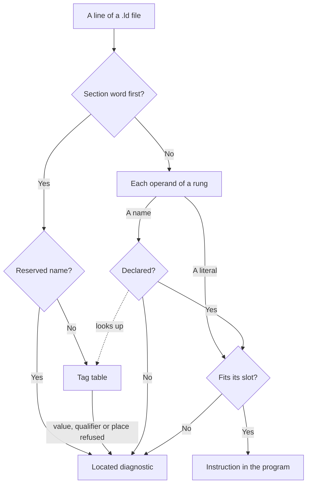

# 0005. Every tag is declared

This record is for a contributor who adds a word to logex or changes a check of a
[declaration](../../guides/reference/glossary.md#declaration). Examples are a new
[section](../../guides/reference/glossary.md#section), a new
[type](../../guides/reference/glossary.md#type) word, a new
[mnemonic](../../guides/reference/glossary.md#mnemonic) and a new word of a
[configuration file](../../guides/reference/glossary.md#configuration-file). It says why
a [program](../../guides/reference/glossary.md#program) must declare each
[tag](../../guides/reference/glossary.md#tag). It also says why logex reserves its words,
and why the [reserved words](../../guides/reference/glossary.md#reserved-word) change
with the kind of file. Read it before you add a word or change what a declaration line
can hold.

## Status

Accepted. No later record replaces this record.
## Date

2026-09-28, the date of the tag table (`PLAN.md` M1-3) and of decisions 2 and 10. The
mnemonics are reserved since 2026-09-27 (M1-2). The later decisions are of 2026-10-01
(24), 2026-10-24 (247), 2026-10-27 (294, 295, 296 and 298) and 2026-10-29 (300).

## Context

Until 2026-09-28, logex checked no name against a declaration. Each name in a
[rung](../../guides/reference/glossary.md#rung) was a tag, and a name with no value read
as 0. Thus a typing error in a name, such as the
[contact](../../guides/reference/glossary.md#contact) `xic strat` for `start`, gave a rung
that did nothing, with no message.

A second defect came from the operand list. Before M1-2, logex knew only the number of
[operands](../../guides/reference/glossary.md#operand) of each mnemonic. It took that
number of words after the mnemonic, also when a word was a mnemonic. The rung
`xic aa mov src ote` wrote 9 to a tag with the name `ote`, with no error. A table of
operand signatures alone cannot find this error, because `ote` is a legal name.
[Runs and tables of the records: the language](../implementation/record-runs-language.md#0005-every-tag-is-declared) gives a run of each defect on its commit.

[IEC 61131-3](../../guides/reference/glossary.md#iec-61131-3) declares variables in
blocks, such as `VAR_INPUT start : BOOL; END_VAR`. It also reserves its keywords.
Edition 2, §2.1.3, gives 2 rules:

- "The case of characters shall not be significant in keywords"
- "The keywords listed in annex C shall not be used for any other purpose, for example,
  variable names"

Thus IEC 61131-3 reserves each keyword everywhere. logex has 3 kinds of file, and each
kind uses different words. A reservation of each word in each kind of file stops a tag
with the name `task` or `program` in a program. But no line of a program uses those
words.

## Decision

[Runs and tables of the records: the language](../implementation/record-runs-language.md#0005-every-tag-is-declared) shows each rule of this section as a numbered result. A number in brackets
is a result of that run.

### A declaration line for each tag

Each tag of a program or of a function block has 1 declaration line, before the first
rung. The line has the words of IEC 61131-3 in lowercase, with no `END_VAR`:

<!-- unchecked: the form of a declaration line, from the moduledoc of Logex.Declarations -->
```text
<section> [<qualifier>] <name> <type> [<initial>...]
```

| Part | Words | Rule |
|---|---|---|
| Section | `var`, `var_input`, `var_output`, `var_external` | Where the value comes from, and who can write it |
| [Qualifier](../../guides/reference/glossary.md#qualifier) | `retain`, `non_retain` | Straight after the section word, or not there. Not on a `var_input` of a program or on a `var_external` |
| Name | A name that is not a reserved word | Case-sensitive. logex refuses 2 names that differ only in case |
| Type | An [elementary type](../../guides/reference/glossary.md#elementary-type), a [function block type](../../guides/reference/glossary.md#function-block-type) or an [array](../../guides/reference/glossary.md#array) of either | `var t1 ton` declares a [timer](../../guides/reference/glossary.md#timer) |
| [Initial value](../../guides/reference/glossary.md#initial-value) | 1 [literal](../../guides/reference/glossary.md#literal), or 1 for each [element](../../guides/reference/glossary.md#element) of an array | Not on a `var_input`, a `var_external` or an instance |

The section words and the type words are rows of data in `Logex.Declarations` and
`Logex.FbType.builtins/0`. A new section or type is 1 more row, with no second parser
(decision 2). The file is the scope of its tags. logex has no scope for the whole
controller. Programs share a value through a `var_external` and its global.

### logex checks each tag and each use of it

logex compiles a program only if each tag that a rung uses has a declaration. The
compiler checks each operand against the signature of its slot in
`Logex.Compiler.instructions/0`: the access and the type. Each error is a located
[diagnostic](../../guides/reference/glossary.md#diagnostic). Among the first 100 names
that a compile cannot find, each gets a suggestion if a declared name is near it
(decision 522).

A timer or a [counter](../../guides/reference/glossary.md#counter) is a tag too, an
instance of a [function block](../../guides/reference/glossary.md#function-block) type
(decision 2). The number on its
[instruction](../../guides/reference/glossary.md#instruction) is its
[preset](../../guides/reference/glossary.md#preset): `ton t1 3000`. Its declaration takes
no initial value (decision 24).



Figure: the checks of a name in a `.ld` file. Each failure ends in a diagnostic with its
line.

### Some refused lines still declare their tag

If logex refuses a line only for 1 of these parts, it still declares the tag with its
name, section and type:

- Its initial value, such as `var r int 40000` (result 9, decision 247).
- Its qualifier, such as `var count retain dint` (result 10, decision 294). The message
  says where the qualifier goes (decision 295).
- Its place after the first rung (result 11, `PLAN.md` M1-3).

Each use of the tag then gets the checks of its type. It does not get 1 more
`is not declared` diagnostic. A line refused for its type word, such as `var x foo`,
declares nothing, but logex gives no diagnostic for the uses of the name. The unknown
type is the 1 message.

These lines declare nothing. Each use of the name gets `is not declared` or another
diagnostic:

- A line with an unexpected word after its initial value, such as `var r int 5 7`
  (result 12).
- A line with a refused name, such as `var_external task bool` (result 14).
- A line with no type, such as `var x`.

### Tags from Elixir get the same checks

`Logex.Tag.new!/4,5` declares a tag from Elixir with the rules of a declaration line. It
refuses what a line refuses, and it raises `ArgumentError` with the message that the
line gets. For example, it refuses an initial value on a timer, also as a preset map
`%{"pre" => 3000}` (decision 24, result 17). The qualifier is an option with the word of
the line as its key: `retain: true` or `non_retain: true` (decision 296). The option
`retain: false` gives no qualifier.

### Reserved words, by the kind of file

A reserved word cannot name a tag, in upper case, lower case or a mix of the 2. Thus
`ote`, `OTE` and `Ote` are never tags, and no operand list can take a mnemonic as a tag.
This closes the defect of `5360eb9`. logex reserves each word in the kinds of file whose
lines use it, so a line has only 1 reading (decision 10).

In this table, "Program" is the `.ld` file of a program and "Block" is the `.ld` file of
a function block. "Configuration" is a `.logex` file. "Yes" means that the kind of file
reserves the words.

| Words | Program | Block | Configuration |
|---|---|---|---|
| The 222 mnemonics (182 of them are conversions, such as `dint_to_int`) | Yes | Yes | No |
| The 4 section words | Yes | Yes | No |
| `retain`, `non_retain` | Yes | Yes | Yes |
| The 15 elementary type words, such as `bool` and `real` | Yes | Yes | Yes |
| The 26 built-in function block types, such as `ton_ltime` | Yes | Yes | No |
| `function_block` | No | Yes | No |
| The 10 other configuration words, such as `task` and `with` | No | No | Yes |
| The name of a user function block, such as `seal` | No | No | No |

A `var_external` names a [global](../../guides/reference/glossary.md#global) of a
configuration file, so its name must be legal in both files. Thus a `var` of a program
can have the name `task` (result 13), but no `var_external` can have it (result 14). In a
configuration file, a reserved word names no global,
[instance](../../guides/reference/glossary.md#instance),
[task](../../guides/reference/glossary.md#task),
[program type](../../guides/reference/glossary.md#program-type) or
[device](../../guides/reference/glossary.md#device) (decisions 298 and 300). A message
calls a reserved word a keyword, as in "`task` is a keyword and cannot name a global".

These 4 functions hold the words:

- `Logex.Compiler.instructions/0` holds the mnemonics.
- `Logex.Declarations.keywords/0` holds the 47 section, qualifier, type and built-in
  function block type words.
- `Logex.Declarations.kinds/0` holds `function_block`, which heads the file of a block.
- `Logex.Configuration.Text.keywords/0` holds the 27 words of a configuration file.

`test/logex/naming_test.exs` compares the 2 keyword lists with copies that it holds. It
fails for a word of any of the 4 functions that has no stanza in `docs/naming.md`.

## Consequences

The good results:

- A typing error in a name, a wrong type and a write to a `var_input` give located
  diagnostics. None of them gives a rung that does nothing.
- A mnemonic is never an operand. An operand list that is too short stops at the next
  mnemonic (result 5).
- A tag from Elixir and a tag from text have the same rules and the same messages
  (result 17).
- A refused line that still declares its tag gives 1 diagnostic for the line. Its uses
  get the checks of the type of the tag, not `is not declared` (results 9, 10 and 11).
- A program can have a tag such as `task` or `function_block`, and a configuration file
  can have a global such as `xic`. A different kind of file reserves these words
  (results 13, 15 and 16).

The costs:

- Each program declares each tag. A program of 5 rungs can have 8 lines of declarations.
- Each new reserved word breaks each file that uses it as a name. Decision 144 reserved
  the 7 integer type words. Decision 298 stopped a plant file with a global named
  `retain`. Decision 300 stopped a plant file with a device named `task`.
- The reserved words change with the kind of file. A contributor must learn 3 sets of
  words, not 1. A name that is legal as a tag can be illegal as a `var_external`
  (result 14).
- Each word owes a stanza in `docs/naming.md`, and `naming_test.exs` fails without it.

> #### Caution {: .error}
>
> Say in the commit message which word your change reserves and in which kinds of file.
> Name the tags and the configuration names that it breaks. A file that uses the word as
> a name stops compiling.

[Add an instruction](../implementation/adding-an-instruction.md) gives the steps: the
row, the stanza in `docs/naming.md` and the lists that `naming_test.exs` compares.

## Alternatives considered

- **No declarations.** A typing error gives a rung that does nothing, with no message
  (Context).
- **Strict only when the program declares a tag.** Deletion of the last declaration
  makes each name legal again, and the silent rung comes back.
- **Blocks of IEC 61131-3, `VAR_INPUT ... END_VAR`.** They need diagnostics for a block
  with no end, for nested blocks and for a stray block, and a way to recover from
  each. They also reserve `end_var`.
- **The keywords of Annex C reserved in each kind of file, as IEC 61131-3 does.** logex
  reserves a word to give a line only 1 reading. No line of a program uses `task` or
  `with`, so that reservation only breaks programs with a tag of that name (decision 10).
- **A preset map from Elixir, `%{"pre" => 3000}`.** If a `ton` instruction runs the
  timer, its preset replaces the value of the map, with no message (decision 24).
- **A refused line that declares nothing.** Each use of its tag gets 1 more
  `is not declared` (decisions 247 and 294).
- **No `.ld` word reserved in a configuration file.** `var_global retain bool` was then a
  global with the name `retain` (decisions 298 and 300).

Decisions 295 and 296 give the other options for the place and the form of a qualifier.

## The decisions that this record sums up

This record sums up decisions 2, 10, 24, 247, 294, 295, 296, 298 and 300 of
[`docs/organisation.md`](../organisation.md#7-decisions), and
[§4.8](../organisation.md#48-reserved-words-by-file-kind) of the same document.
`PLAN.md` keeps the history in
[M1-2](../../PLAN.md#m1-2--a-validation-pass),
[M1-3](../../PLAN.md#m1-3--a-tag-table-with-types) and
[§5](../../PLAN.md#5-settled-decisions), under "Mnemonics are reserved words, in any
case". [0002. A dialect for logex, and a survey for each word](0002-own-dialect-and-names.md) gives the rule that
names each word. [Source syntax](../../guides/reference/source-syntax.md) and
[Declarations and types](../../guides/reference/declarations-and-types.md) give the rules
for a user.
