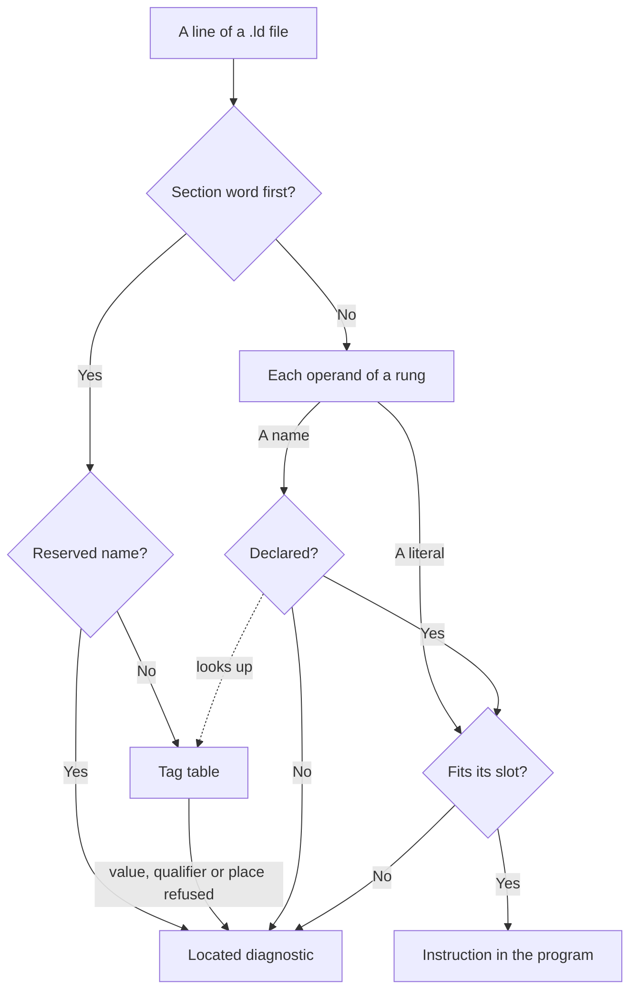

# 0005. Every tag is declared

This record is for a contributor who adds a word to logex or changes a check of a
[declaration](../../guides/reference/glossary.md#declaration). Examples are a new
[section](../../guides/reference/glossary.md#section), a new
[type](../../guides/reference/glossary.md#type) word, a new
[mnemonic](../../guides/reference/glossary.md#mnemonic) and a new word of a
[configuration file](../../guides/reference/glossary.md#configuration-file). It says why
a [program](../../guides/reference/glossary.md#program) must declare each
[tag](../../guides/reference/glossary.md#tag). It also says why logex reserves its words,
and why the [reserved words](../../guides/reference/glossary.md#reserved-word) change
with the kind of file. Read it before you add a word or change what a declaration line
can hold.

## Status

Accepted. No later record replaces this record.

## Date

2026-09-28, the date of the tag table. Each part of the record has its date:

- 2026-09-27: the mnemonics are reserved (`PLAN.md` M1-2).
- 2026-09-28: the tag table (M1-3), decisions 2 and 10.
- 2026-10-01: decision 24.
- 2026-10-24: decision 247.
- 2026-10-27: decisions 294, 295, 296 and 298.
- 2026-10-29: decision 300.

## Context

Until 2026-09-28, logex checked no name against a declaration. Each name in a
[rung](../../guides/reference/glossary.md#rung) was a tag, and a name with no value read
as 0. Thus a typing error in a name gave a rung that did nothing, with no message. Commit
`5b63a9f` shows this. It reads declaration lines into a table, but it does not use the
table to check a rung. The [contact](../../guides/reference/glossary.md#contact)
`xic strat` is the error:

<!-- unchecked: a program that logex at commit 5b63a9f compiled with no diagnostic -->
```text
var_input start bool
var_input stop bool
var_output motor bool

( xic strat | xic motor ) xio stop ote motor
```

A run on a copy of that commit [compiles](../../guides/reference/glossary.md#compile) the program and
does 1 [scan](../../guides/reference/glossary.md#scan) with `start` at 1. The motor
stays off:

<!-- unchecked: the output of a run on a copy of commit 5b63a9f, 2026-11-21 -->
```text
instructionize: :ok
after a scan with start = 1: %{"motor" => 0, "start" => 1, "stop" => 0}
```

A second defect came from the operand list. Before M1-2, logex knew only the number of
[operands](../../guides/reference/glossary.md#operand) of each mnemonic. It took that
number of words after the mnemonic, also when a word was a mnemonic. On a copy of commit
`5360eb9`, the rung `xic aa mov src ote` writes 9 to a tag with the name `ote`, with no
error. `mov` was the name of `move` at that commit:

<!-- unchecked: the output of a run on a copy of commit 5360eb9, 2026-11-21 -->
```text
ir: {:routine,
 {:rungs,
  [rung: [xic: [{:name, 1, "aa"}], mov: [{:name, 1, "src"}, {:name, 1, "ote"}]]]}}
env: %{"aa" => 1, "ote" => 9, "src" => 9}
```

The mnemonic of a [coil](../../guides/reference/glossary.md#coil), `ote`, became the name
of a tag. A table of operand
signatures alone cannot find this error, because `ote` is a legal name.

[IEC 61131-3](../../guides/reference/glossary.md#iec-61131-3) declares variables in
blocks, such as `VAR_INPUT start : BOOL; END_VAR`. It also reserves its keywords.
Edition 2, §2.1.3, gives 2 rules:

- "The case of characters shall not be significant in keywords"
- "The keywords listed in annex C shall not be used for any other purpose, for example,
  variable names"

Thus IEC 61131-3 reserves each keyword everywhere. logex has 3 kinds of file, and each
kind uses different words. A reservation of each word in each kind of file stops a tag
with the name `task` or `program` in a program. But no line of a program uses those
words.

## Decision

[The rules in a run](#the-rules-in-a-run) shows each rule of this section as a numbered
result.

### A declaration line for each tag

Each tag of a program or of a function block has 1 declaration line, before the first
rung. The line has the words of IEC 61131-3 in lowercase, with no `END_VAR`:

<!-- unchecked: the form of a declaration line, from the moduledoc of Logex.Declarations -->
```text
<section> [<qualifier>] <name> <type> [<initial>...]
```

| Part | Words | Rule |
|---|---|---|
| Section | `var`, `var_input`, `var_output`, `var_external` | Where the value comes from, and who can write it |
| [Qualifier](../../guides/reference/glossary.md#qualifier) | `retain`, `non_retain` | Straight after the section word, or not there. Not on a `var_input` of a program or on a `var_external` |
| Name | A name that is not a reserved word | Case-sensitive. logex refuses 2 names that differ only in case |
| Type | An [elementary type](../../guides/reference/glossary.md#elementary-type), a [function block type](../../guides/reference/glossary.md#function-block-type) or an [array](../../guides/reference/glossary.md#array) of either | `var t1 ton` declares a [timer](../../guides/reference/glossary.md#timer) |
| [Initial value](../../guides/reference/glossary.md#initial-value) | 1 [literal](../../guides/reference/glossary.md#literal), or 1 for each [element](../../guides/reference/glossary.md#element) of an array | Not on a `var_input`, a `var_external` or an instance |

The section words and the type words are rows of data in `Logex.Declarations` and
`Logex.FbType.builtins/0`. A new section or type is 1 more row, with no second parser
(decision 2). The file is the scope of its tags. logex has no scope for the whole
controller. Programs share a value through a `var_external` and its global.

### logex checks each tag and each use of it

logex compiles a program only if each tag that a rung uses has a declaration. The
compiler checks each operand against the signature of its slot in
`Logex.Compiler.instructions/0`: the access and the type. Each error is a located
[diagnostic](../../guides/reference/glossary.md#diagnostic). Among the first 100 names
that a compile cannot find, each gets a suggestion if a declared name is near it
(decision 522).

A timer or a [counter](../../guides/reference/glossary.md#counter) is a tag too, an
instance of a [function block](../../guides/reference/glossary.md#function-block) type
(decision 2). The number on its
[instruction](../../guides/reference/glossary.md#instruction) is its
[preset](../../guides/reference/glossary.md#preset): `ton t1 3000`. Its declaration takes
no initial value (decision 24).



Figure: the checks of a name in a `.ld` file. Each failure ends in a diagnostic with its
line.

### Some refused lines still declare their tag

If logex refuses a line only for 1 of these parts, it still declares the tag with its
name, section and type:

- Its initial value, such as `var r int 40000` (result 9, decision 247).
- Its qualifier, such as `var count retain dint` (result 10, decision 294). The message
  says where the qualifier goes (decision 295).
- Its place after the first rung (result 11, `PLAN.md` M1-3).

Each use of the tag then gets the checks of its type. It does not get 1 more
`is not declared` diagnostic. A line refused for its type word, such as `var x foo`,
declares nothing, but logex gives no diagnostic for the uses of the name. The unknown
type is the 1 message.

These lines declare nothing. Each use of the name gets `is not declared` or another
diagnostic:

- A line with an unexpected word after its initial value, such as `var r int 5 7`
  (result 12).
- A line with a refused name, such as `var_external task bool` (result 14).
- A line with no type, such as `var x`.

### Tags from Elixir get the same checks

`Logex.Tag.new!/4,5` declares a tag from Elixir with the rules of a declaration line. It
refuses what a line refuses, and it raises `ArgumentError` with the message that the
line gets. For example, it refuses an initial value on a timer, also as a preset map
`%{"pre" => 3000}` (decision 24, result 17). The qualifier is an option with the word of
the line as its key: `retain: true` or `non_retain: true` (decision 296). The option
`retain: false` gives no qualifier.

### Reserved words, by the kind of file

A reserved word cannot name a tag, in upper case, lower case or a mix of the 2. Thus
`ote`, `OTE` and `Ote` are never tags, and no operand list can take a mnemonic as a tag.
This closes the defect of `5360eb9`. logex reserves each word in the kinds of file whose
lines use it, so a line has only 1 reading (decision 10).

In this table, "Program" is the `.ld` file of a program and "Block" is the `.ld` file of
a function block. "Configuration" is a `.logex` file. "Yes" means that the kind of file
reserves the words.

| Words | Program | Block | Configuration |
|---|---|---|---|
| The 222 mnemonics (182 of them are conversions, such as `dint_to_int`) | Yes | Yes | No |
| The 4 section words | Yes | Yes | No |
| `retain`, `non_retain` | Yes | Yes | Yes |
| The 15 elementary type words, such as `bool` and `real` | Yes | Yes | Yes |
| The 26 built-in function block types, such as `ton_ltime` | Yes | Yes | No |
| `function_block` | No | Yes | No |
| The 10 other configuration words, such as `task` and `with` | No | No | Yes |
| The name of a user function block, such as `seal` | No | No | No |

A `var_external` names a [global](../../guides/reference/glossary.md#global) of a
configuration file, so its name must be legal in both files. Thus a `var` of a program
can have the name `task` (result 13), but no `var_external` can have it (result 14). In a
configuration file, a reserved word names no global,
[instance](../../guides/reference/glossary.md#instance),
[task](../../guides/reference/glossary.md#task),
[program type](../../guides/reference/glossary.md#program-type) or
[device](../../guides/reference/glossary.md#device) (decisions 298 and 300). A message
calls a reserved word a keyword, as in "`task` is a keyword and cannot name a global".

These 4 functions hold the words:

- `Logex.Compiler.instructions/0` holds the mnemonics.
- `Logex.Declarations.keywords/0` holds the 47 section, qualifier, type and built-in
  function block type words.
- `Logex.Declarations.kinds/0` holds `function_block`, which heads the file of a block.
- `Logex.Configuration.Text.keywords/0` holds the 27 words of a configuration file.

`test/logex/naming_test.exs` compares the 2 keyword lists with copies that it holds. It
fails for a word of any of the 4 functions that has no stanza in `docs/naming.md`.

### The rules in a run

This script compiles 14 programs of the motor, 2 files with `function_block`, 4
configuration files of the fan and 4 tags from Elixir. The script is
`examples/0005-every-tag-is-declared.exs`. Run it from `examples/`.

```elixir
# Print "compiles", or each diagnostic of the compile.
report = fn
  {:ok, _program_or_type} -> IO.puts("  compiles")
  {:error, diagnostics} -> Enum.each(diagnostics, &IO.puts("  " <> Logex.Diagnostic.format(&1)))
end

# The declarations of the motor: lines 1 to 4 of each program.
motor = """
var_input start bool
var_input stop bool
var_output motor bool
var_output speed_sp dint 1200
"""

programs = [
  {"1. A typing error in a name", motor <> "( xic strat | xic motor ) xio stop ote motor\n"},
  {"2. A program that declares nothing", "xic start ote motor\n"},
  {"3. A dint read as a bool", motor <> "xic speed_sp ote motor\n"},
  {"4. A rung that writes a var_input", motor <> "xic stop ote start\n"},
  {"5. A move with 1 operand", motor <> "var src dint\nmove src ote motor\n"},
  {"6. A mnemonic as the name of a tag", motor <> "var Ote bool\nxic start ote motor\n"},
  {"7. A timer that is not declared", motor <> "xic start ton t1 3000\n"},
  {"8. A preset on the declaration of a timer",
   motor <> "var t1 ton 3000\nxic start ton t1 3000\n"},
  {"9. An initial value that does not fit", motor <> "var r int 40000\nxic r ote motor\n"},
  {"10. A qualifier after the name", motor <> "var count retain dint\nxic start move 1 count\n"},
  {"11. A declaration after the first rung",
   motor <> "xic start ote motor\nvar late dint\nxic late ote motor\n"},
  {"12. A word after the initial value", motor <> "var r int 5 7\nxic r ote motor\n"},
  {"13. A configuration word as a tag", motor <> "var task bool\nxic start xio task ote motor\n"},
  {"14. A configuration word as a var_external",
   motor <> "var_external task bool\nxic start xio task ote motor\n"}
]

Enum.each(programs, fn {title, text} ->
  IO.puts(title)
  report.(Logex.compile(text, name: "motor"))
end)

# The same word in a program and in the file of a function block.
seal = "function_block seal\nvar_input start bool\nvar_input stop bool\nvar_output run bool\n"
IO.puts("15. function_block as a tag, in a program, then in a block")

report.(
  Logex.compile(motor <> "var function_block bool\nxic start xio function_block ote motor\n",
    name: "motor"
  )
)

report.(
  Logex.compile(seal <> "var function_block bool\n( xic start | xic run ) xio stop ote run\n",
    name: "seal"
  )
)

# The words in a configuration file: a global, a device and an instance.
{:ok, fan} =
  Logex.compile("var_input hot bool\nvar_output fan bool\nxic hot ote fan\n", name: "fan")

plant = fn global, device, instance ->
  """
  task fast interval 10 priority 1
  var_global #{global} bool at #{device}.i.0
  var_global fan_q bool at panel.q.0
  program #{instance} fan with fast
  #{instance}.hot #{global}
  #{instance}.fan fan_q
  """
end

IO.puts("16. A mnemonic, then 3 configuration words, in a configuration file")
report.(Logex.Configuration.compile("plant", plant.("xic", "panel", "f1"), %{"fan" => fan}))
report.(Logex.Configuration.compile("plant", plant.("task", "panel", "f1"), %{"fan" => fan}))
report.(Logex.Configuration.compile("plant", plant.("hot_i", "program", "f1"), %{"fan" => fan}))
report.(Logex.Configuration.compile("plant", plant.("hot_i", "panel", "retain"), %{"fan" => fan}))

# A tag declared from Elixir gets the checks of a declaration line.
declare = fn call ->
  try do
    tag = call.()
    IO.puts("  `#{tag.name}` is declared, qualifier: #{inspect(tag.retain)}")
  rescue
    error in ArgumentError -> IO.puts("  ArgumentError: " <> Exception.message(error))
  end
end

IO.puts("17. Tags declared from Elixir")
declare.(fn -> Logex.Tag.new!("count", :dint, :var, nil, retain: true) end)
declare.(fn -> Logex.Tag.new!("count", :dint, :var, nil, :retain) end)
declare.(fn -> Logex.Tag.new!("t1", Logex.FbType.ton(), :var, %{"pre" => 3000}) end)
declare.(fn -> Logex.Tag.new!("Ote", :bool) end)
```

```console
$ mix run 0005-every-tag-is-declared.exs
1. A typing error in a name
  line 5: `strat` is not declared — did you mean `start`?
2. A program that declares nothing
  line 1: `start` is not declared (this program declares no tags: each is now declared before the first rung, as in `var start bool` or `var start dint`)
  line 1: `motor` is not declared
3. A dint read as a bool
  line 5: `xic` reads a bool, but `speed_sp` is a dint (declared on line 4)
4. A rung that writes a var_input
  line 5: `ote` writes `start`, a var_input (declared on line 1): logic must not write an input
5. A move with 1 operand
  line 6: `move` expects 2 operands (a value, then a tag), found 1 before the instruction `ote`
6. A mnemonic as the name of a tag
  line 5: `Ote` is an instruction and cannot name a tag
7. A timer that is not declared
  line 5: `t1` is not declared
8. A preset on the declaration of a timer
  line 5: `t1` is a ton: its preset is the number on its `ton` instruction, as in `ton t1 5000`, not an initial value on its declaration
9. An initial value that does not fit
  line 5: `r` is an int: `40000` is outside -32768 to 32767
  line 6: `xic` reads a bool, but `r` is an int (declared on line 5)
10. A qualifier after the name
  line 5: `retain` comes straight after the section word, as in `var retain count dint`
11. A declaration after the first rung
  line 6: `var` after the first rung (line 5): declarations come first
  line 7: `xic` reads a bool, but `late` is a dint (declared on line 6)
12. A word after the initial value
  line 5: unexpected `7` after the declaration of `r`
  line 6: `r` is not declared
13. A configuration word as a tag
  compiles
14. A configuration word as a var_external
  line 5: `task` is a keyword of a configuration file, where a var_external's global is declared, so it cannot name a var_external
  line 6: `task` is not declared
15. function_block as a tag, in a program, then in a block
  compiles
  line 5: `function_block` heads a function block's file and cannot name a tag in one
16. A mnemonic, then 3 configuration words, in a configuration file
  compiles
  line 2: `task` is a keyword and cannot name a global
  line 2: `program` is a keyword and cannot name a device
  line 4: `retain` is a keyword and cannot name an instance
17. Tags declared from Elixir
  `count` is declared, qualifier: :retain
  ArgumentError: the options of `count` are a keyword list, `retain: true` or `non_retain: true`, found :retain
  ArgumentError: `t1` is a ton: its preset is the number on its `ton` instruction, as in `ton t1 5000`, not an initial value on its declaration
  ArgumentError: `Ote` is an instruction and cannot name a tag
```

Result 1 is the program of the Context, with its typing error. Result 5 is the defect of
`5360eb9`: `move` stops at `ote`, and `ote motor` is a correct instruction. In results 9, 10
and 11, the line declares its tag. Thus the second diagnostic of results 9 and 11 is
about the type of the tag, and `move 1 count` in result 10 gets no diagnostic. In results
12 and 14, the line declares nothing.

## Consequences

The good results:

- A typing error in a name, a wrong type and a write to a `var_input` give located
  diagnostics. None of them gives a rung that does nothing.
- A mnemonic is never an operand. An operand list that is too short stops at the next
  mnemonic (result 5).
- A tag from Elixir and a tag from text have the same rules and the same messages
  (result 17).
- A refused line that still declares its tag gives 1 diagnostic for the line. Its uses
  get the checks of the type of the tag, not `is not declared` (results 9, 10 and 11).
- A program can have a tag such as `task` or `function_block`, and a configuration file
  can have a global such as `xic`. A different kind of file reserves these words
  (results 13, 15 and 16).

The costs:

- Each program declares each tag. A program of 5 rungs can have 8 lines of declarations.
- Each new reserved word breaks each file that uses it as a name. Decision 144 reserved
  the 7 integer type words. Decision 298 stopped a plant file with a global named
  `retain`. Decision 300 stopped a plant file with a device named `task`.
- The reserved words change with the kind of file. A contributor must learn 3 sets of
  words, not 1. A name that is legal as a tag can be illegal as a `var_external`
  (result 14).
- Each word owes a stanza in `docs/naming.md`, and `naming_test.exs` fails without it.

> #### Caution {: .error}
>
> Say in the commit message which word your change reserves and in which kinds of file.
> Name the tags and the configuration names that it breaks. A file that uses the word as
> a name stops compiling.

[Add an instruction](../implementation/adding-an-instruction.md) gives the steps: the
row, the stanza in `docs/naming.md` and the lists that `naming_test.exs` compares.

## Alternatives considered

- **No declarations.** A typing error gives a rung that does nothing, with no message
  (Context).
- **Strict only when the program declares a tag.** Deletion of the last declaration
  makes each name legal again, and the silent rung comes back.
- **Blocks of IEC 61131-3, `VAR_INPUT ... END_VAR`.** They need diagnostics for a block
  with no end, for nested blocks and for a stray block, and a way to recover from
  each. They also reserve `end_var`.
- **No reserved mnemonics, and the tag table finds an undeclared `ote`.** The tag table
  came 1 plan item later, in M1-3. With this option, `mov src ote` writes a tag with no
  message until then.
- **The keywords of Annex C reserved in each kind of file, as IEC 61131-3 does.** logex
  reserves a word to give a line only 1 reading. No line of a program uses `task` or
  `with`, so that reservation only breaks programs with a tag of that name (decision 10).
- **A preset map from Elixir, `%{"pre" => 3000}`.** If a `ton` instruction runs the
  timer, its preset replaces the value of the map, with no message. If no `ton` runs the
  timer, no `.ld` text can give the same preset (decision 24).
- **A refused line that declares nothing.** Each use of its tag gets 1 more
  `is not declared` (decisions 247 and 294).
- **A qualifier in either place, such as `var count retain dint`.** Decision 295 kept the
  refusal, with a message that names the correct place.
- **A positional qualifier, `new!("c", :dint, :var, nil, :retain)`, or `qualifier:
  :retain`.** The option `retain: true` reads as the line `var retain c dint`, word for
  word (decision 296).
- **No `.ld` word reserved in a configuration file.** `var_global retain bool` was then a
  global with the name `retain`. With the reservation, `var_global retain total_boxes dint
  0` has only 1 reading (decision 298).
- **Only `retain` and `non_retain` refused as the name of a device.** Then the same word
  can name a device and not a global in 1 file: logex takes `at task.i.0` but refuses
  `var_global task bool` (decision 300).

## Decisions in section 7

This record sums up decisions 2, 10, 24, 247, 294, 295, 296, 298 and 300 of
[`docs/organisation.md`](../organisation.md#7-decisions), and
[§4.8](../organisation.md#48-reserved-words-by-file-kind) of the same document.
`PLAN.md` keeps the history in
[M1-2](../../PLAN.md#m1-2--a-validation-pass),
[M1-3](../../PLAN.md#m1-3--a-tag-table-with-types) and
[§5](../../PLAN.md#5-settled-decisions), under "Mnemonics are reserved words, in any
case". [0002. A dialect for logex, and a survey for each word](0002-own-dialect-and-names.md) gives the rule that
names each word. [Source syntax](../../guides/reference/source-syntax.md) and
[Declarations and types](../../guides/reference/declarations-and-types.md) give the rules
for a user.
