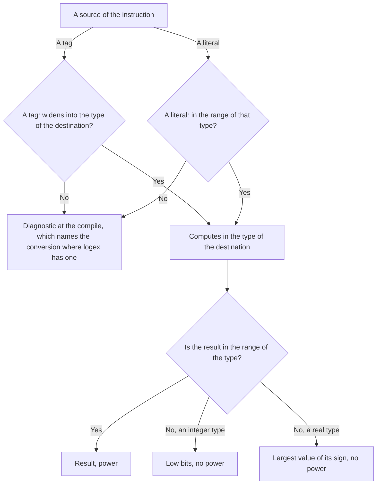

# 0006. The types of IEC 61131-3 and overflow

This record is for a contributor who adds a [type](../../guides/reference/glossary.md#type),
a [conversion](../../guides/reference/glossary.md#conversion) or an arithmetic
[instruction](../../guides/reference/glossary.md#instruction). It is also for a
contributor who changes what an instruction writes at the limit of a type. It says why
logex has the 15 [elementary types](../../guides/reference/glossary.md#elementary-type)
of [IEC 61131-3](../../guides/reference/glossary.md#iec-61131-3) under their IEC names.
It says why an instruction computes in the type of its destination, and why an integer
result outside its type [wraps](../../guides/reference/glossary.md#wrap) and passes no
[power](../../guides/reference/glossary.md#power-flow). It also says why an
[array](../../guides/reference/glossary.md#array) has the form of
[Logix](../../guides/reference/glossary.md#logix).

## Status

Accepted. No later record replaces this record. Decision 146 replaces decision 77, which
stopped a `dint` result at the nearer limit of its type.

## Date

2026-10-21, the date of decisions 144 to 152, 154 to 156, 158, 159 and 161 to 163. They
are the answers of the maintainer to the design of the data types. Decision 77 is of 2026-10-14.
Decisions 170 and 175 to 177 are of 2026-10-22. Decisions 204, 206, 214 to 216, 220 and
221 are of 2026-10-23.

## Context

Until 2026-10-22, logex had 2 elementary types, `bool` and `dint`. Decision 77 stopped a
`dint` result outside its range at the nearer limit, and the instruction passed no power.
The maintainer then asked for integers of 1, 2, 4 and 8 bytes, reals of 32 and 64 bits,
and arrays of each type. The maintainer also asked how IEC 61131-3 and the vendors
handle a signed value, and which other types they have.

Each new type asked questions, for example about an integer result outside its type.
IEC 61131-3 Edition 3 and the controllers answer them differently. For example, IEC 61131-3 calls an integer overflow "an error" and lets the
implementer decide. Logix wraps, sets `S:V` and passes the power in (1756-RM018A p.868,
1756-PM015Q p.57). The S7-1200 wraps and gives ENO 0.
[Runs and tables of the records: the language](../implementation/record-runs-language.md#0006-the-types-of-iec-61131-3-and-overflow)
gives the table of the answers, with the source of each.

The BEAM sets 1 more limit. A float has no infinity and no NaN. On Elixir 1.20.4 and
OTP 28, `1.0e308 * 10.0` and `0.0 / 0.0` each raise `ArithmeticError`.

## Decision

The same page runs a small program for each rule of this section. A number in brackets,
such as (result 3), names a line that the run prints.

> #### Caution {: .error}
>
> Make a new instruction pass no power when it wraps an integer result or stops a real at
> the largest value of its sign. logex adds no
> [fault](../../guides/reference/glossary.md#fault) to the
> [state](../../guides/reference/glossary.md#state) for these results. A
> [program](../../guides/reference/glossary.md#program) finds them only by that power.

### The 15 types of IEC 61131-3, under their names

logex has the 15 elementary types of IEC 61131-3, with their IEC names in lowercase
(decision 144). They are `bool`, 8 integers (decision 145), `real`, `lreal` and the 4
[bit strings](../../guides/reference/glossary.md#bit-string) (decision 155). Each type is
1 row of `Logex.Declarations.table/0`. The row gives its width in bits (decision 170) and
the types that it [widens](../../guides/reference/glossary.md#widen) into, from Figure 11
of IEC 61131-3.
[Declarations and types](../../guides/reference/declarations-and-types.md) gives the
table.

A bit string is a pattern, not a number. An arithmetic instruction refuses it. The bitwise
instructions take a `bool`, a bit string or an integer (decisions 155 and 206). A
[rung](../../guides/reference/glossary.md#rung) can read and write a
[bit](../../guides/reference/glossary.md#bit) of a bit string or of an integer, such as
`drive_status.3`. A real has no bits.

### An instruction computes in the type of its destination

An arithmetic instruction and `move` compute in the type of the
[tag](../../guides/reference/glossary.md#tag) that they write (decision 147). Figure 1
shows the path of a source value.

Figure 1: a source of an arithmetic instruction or of `move`, from the
[compile](../../guides/reference/glossary.md#compile) to the write. A result out of range
writes a value, but the instruction passes no power.

- A source that does not widen gets a
  [diagnostic](../../guides/reference/glossary.md#diagnostic) that names the conversion
  to write (results 6 and 8). logex has no conversion between a `bool` and an integer
  (result 7).
- 2 `int` values added into a `dint` do not wrap (result 3).
- The compiler checks a [literal](../../guides/reference/glossary.md#literal) against the
  type at its place: `move 16#ffff trim` into an `int` is refused (result 9).

Some instructions do not compute in the type of the destination:

- A comparison has no destination. It compares 2 integers by value, whatever their types.
- `not` and the shifts compute in the type of their source, as IEC does, and then widen
  the result by value (decision 214). Thus `not` of a `usint` 5 into an `int` is 250
  (result 13).
- A conversion takes a source of the first type in its name, or of a type that widens
  into it (decision 176, result 12).
- A `var_external` has exactly the type of its
  [global](../../guides/reference/glossary.md#global), because it is the global
  (decision 159).

### An integer result outside its type wraps and passes no power

An integer result outside its type keeps its low bits, in 2's complement for a signed
type. The instruction passes no power, and logex adds no fault to the state. This rule is
the same for each width (decision 146, results 1, 2 and 4). The compiler refuses `neg`
into an unsigned type (decision 145).

A conversion is the only way to put a value into a narrower type, or between a signed
type and an unsigned type. logex has 182 conversions (decisions 148, 155 and 162). A real
to an integer takes the nearest integer, a tie to the even integer, and then wraps
(decision 161). A truncation removes the fraction and then wraps (decision 162). A
conversion to or from a bit string is never out of range, and passes power (decision
204). [Conversions](../../guides/reference/conversions.md) gives each group.

### A real stops at the largest value of its sign

A `real` or an `lreal` never holds an infinity, a NaN, `-0.0` or a subnormal value
(decision 150, result 14). A result past the limit writes the largest value with the sign
of the result, and passes no power. A result nearer to 0.0 than the smallest normal value
writes 0.0, and passes power. A divisor of 0 writes 0.0, passes no power and gives the
[minor fault](../../guides/reference/glossary.md#minor-fault) `:divide_by_zero`. The
compiler refuses a real literal that the type cannot hold, or that the write makes 0.0
(decision 216, result 15).

logex takes the literals of IEC 61131-3, with no typed literal, no octal and no vendor
suffix (decision 149).

### Arrays have the form of Logix

An array is a count of [elements](../../guides/reference/glossary.md#element) from 0:
`var temps real[8]` holds `temps[0]` to `temps[7]` (decision 151). It has 1, 2 or 3
dimensions and 65536 elements at most (decision 220). A
[subscript](../../guides/reference/glossary.md#subscript) is a literal or an integer tag,
never an expression (decision 152). A rung can read and write a bit of an element, such as
`faults[2].3` (decision 221). A located array takes 1
[point](../../guides/reference/glossary.md#point) for each element (decision 156).

The instruction that runs an element of an array of
[timers](../../guides/reference/glossary.md#timer), counters or blocks takes a literal
subscript (decision 154, result 19). So does the
[storage bit](../../guides/reference/glossary.md#storage-bit) of a
[one-shot](../../guides/reference/glossary.md#one-shot). The checks of a compile and of an
[online edit](../../guides/reference/glossary.md#online-edit) then make sure that 1
instruction runs each element.

### Timers and counters get typed variants

A [counter](../../guides/reference/glossary.md#counter) has the IEC types such as
`ctu_int` and `ctu_ulint` (decision 158). `ctu` stays the `dint` counter, and `ctu_dint` is
a second word for it (decision 163). A counter does not wrap. Its count stops at the limit
of its type, and the next count sets `ov` or `un` (result 20). A long timer, such as
`ton_ltime`, counts `pre` and `acc` in nanoseconds. Thus `ton jam_t 5000` on a long timer
waits 5000 ns, not 5000 ms (result 21).

## Consequences

The good results:

- The same rule at the limit for all integer widths, for an arithmetic instruction and
  for a number conversion.
- The program sees a wrap in the same scan, from the power out of the instruction. The
  power out is ENO of IEC 61131-3, so any instruction can follow it on the rung.
- A program shows each place where a value narrows, by its conversion.
- A state never holds an infinity or a NaN, so no answer to the
  [host](../../guides/reference/glossary.md#host) holds one.
- A new width is 1 row of `Logex.Declarations.table/0` and 1 stanza of `docs/naming.md`.

The costs:

- Each type word is a [reserved word](../../guides/reference/glossary.md#reserved-word)
  in each `.ld` and `.logex` file, in any case. A tag with the name `int`, `Word`, `byte`
  or `real` stops compiling. So does a tag with the name `and`, `or` or `not`.
- Decision 146 changed programs that ran: a `dint` total that stopped at 2147483647
  wraps to -2147483648.
- A program from an IEC 61131-3 controller or a Siemens controller can expect `INT + INT`
  to wrap in `INT`. In logex it does not wrap if the destination is a `dint`.
- A program from a Logix controller that moves `16#ffff` into an `INT` gets -1 there
  (1756-RM018A p.869). In logex, the compiler refuses it.
- A Logix `NOT` widens a `SINT` -1 into a `DINT` with zeros, which gives 16#ffffff00
  (1756-RM018A p.871). In logex, `not` of an `sint` -1 into a `dint` is 0.
- An arithmetic instruction wraps, but a counter stops at its limit.
- logex has no `TIME`, `LTIME`, string, structure, enumeration, array bound or typed
  literal.

Where the rules are in the code:

| Rule | Function | ExUnit test file |
|---|---|---|
| The types and Figure 11 | `Logex.Declarations.table/0` and `widens?/2` | `type_table_test.exs` |
| The range in a message | `Logex.Declarations.misfit/2` | `integer_width_test.exs` |
| The name of a conversion | `Logex.Declarations.conversion/2` | `type_table_test.exs`, `integer_width_test.exs`, `bit_string_test.exs` |
| The wrap and its power | `wrapped/2`, private in `Logex.Runtime` | `arithmetic_test.exs` |
| The limits of a real | The largest and the smallest value, the range and the flush to 0.0, in the internal module of [`lib/logex/real.ex`](../../lib/logex/real.ex) | `real_test.exs` |
| The typed counters | `Logex.FbType.rules/1` | `typed_counter_test.exs` |

## Alternatives considered

| Question | Not taken | Why |
|---|---|---|
| Names (144) | Width words such as `i8` and `f32` | IEC 61131-3, Logix, Siemens and CODESYS use the IEC names |
| Overflow (146) | Stop at the limit with no power, decision 77 | None of the vendors in the Context table does it |
| Overflow (146) | Wrap and pass power, as the ladder of Logix does | The program then sees no overflow in the scan |
| Mixed types (147) | 1 type for all operands, as IEC 61131-3 Edition 2 (2003) asks | Each wider source needs a conversion |
| Mixed types (147) | Any conversion, as Logix does | A value narrows with no mark in the program |
| Real too large (161) | Truncate, then wrap | IEC 61131-3 and Logix take the nearest integer for each value |
| Real overflow (150) | The infinity and the NaN of IEEE 754 | The BEAM has neither |
| `not` and shifts (214) | Compute in the type of the destination | `not` of a `bool` 1 into a `word` gave 16#fffe. IEC gives 0 |
| Array form (151) | The bounds of IEC 61131-3, such as `[1..8]` | The maintainer took the form of Logix. `docs/organisation.md` gives no other reason |
| Subscripts (152) | An expression, `weights[slot + 1]` | logex has no expression syntax |
| Arrays of timers, one-shots (154) | A tag subscript on the instruction that runs an element | No check can then tell which element runs, or which bit holds the edge |
| `var_external` (159) | Widen it as a connection does | A widened `var_external` is a copy of its global |

Section 7 gives the other options of each decision. Examples are the options for the
unsigned types (145), the nearest integer (148) and the messages (177).

## The decisions that this record sums up

This record sums up these decisions of
[`docs/organisation.md`](../organisation.md#7-decisions):

- 77, which decision 146 replaces
- 144 to 152, 154 to 156, 158, 159 and 161 to 163
- 170 and 175 to 177
- 204, 206, 214 to 216, 220 and 221

[§4.12](../organisation.md#412-data-types-milestone-5) of the same document gives the
design and its sources.
[Types and overflow](../../guides/explanation/types-and-overflow.md) gives the reasons
for a user. [Declarations and types](../../guides/reference/declarations-and-types.md),
[Conversions](../../guides/reference/conversions.md),
[Literals](../../guides/reference/literals.md) and
[Instructions: arithmetic and comparison](../../guides/reference/instructions-arithmetic-and-comparison.md)
give the rules.

[Choose an integer type and convert values](../../guides/howto/choose-integer-widths-and-convert.md)
and [Use arrays](../../guides/howto/use-arrays.md) give the procedures.
[Add an instruction](../implementation/adding-an-instruction.md) gives the steps for a
new instruction. [0002. A dialect for logex, and a survey for each word](0002-own-dialect-and-names.md)
gives the rule that names each type word.
