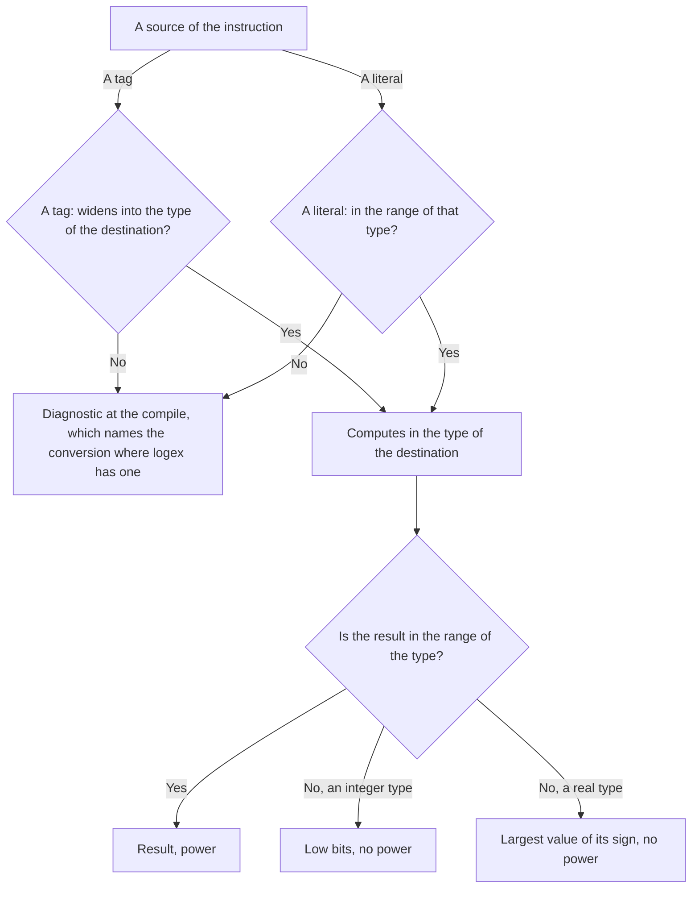

# 0006. The types of IEC 61131-3 and overflow

This record is for a contributor who adds a [type](../../guides/reference/glossary.md#type),
a [conversion](../../guides/reference/glossary.md#conversion) or an arithmetic
[instruction](../../guides/reference/glossary.md#instruction). It is also for a
contributor who changes what an instruction writes at the limit of a type. It says why
logex has the 15 [elementary types](../../guides/reference/glossary.md#elementary-type)
of [IEC 61131-3](../../guides/reference/glossary.md#iec-61131-3) under their IEC names.
It says why an instruction computes in the type of its destination, and why an integer
result outside its type [wraps](../../guides/reference/glossary.md#wrap) and passes no
[power](../../guides/reference/glossary.md#power-flow). It also says why an
[array](../../guides/reference/glossary.md#array) has the form of
[Logix](../../guides/reference/glossary.md#logix).

## Status

Accepted. No later record replaces this record. Decision 146 replaces decision 77, which
stopped a `dint` result at the nearer limit of its type.

## Date

2026-10-21, the date when the maintainer answered the questions of the design of the
data types. Each part of the record has its date:

- 2026-10-14: decision 77, a `dint` result stops at its limit.
- 2026-10-21: decisions 144 to 152, 154 to 156, 158, 159 and 161 to 163.
- 2026-10-22: decisions 170 and 175 to 177. The first integer widths, the wrap and the
  56 integer conversions are available on this date. Decision 175 refused a mix of widths
  in `add` until the arithmetic of each width was available. It gives no rule of the
  present.
- 2026-10-23: decisions 204, 206, 214 to 216, 220 and 221.

## Context

Until 2026-10-22, logex had 2 elementary types, `bool` and `dint`. Decision 77 stopped a
`dint` result outside its range at the nearer limit, and the instruction passed no power.
The maintainer then asked for integers of 1, 2, 4 and 8 bytes, reals of 32 and 64 bits,
and arrays of each type. The maintainer also asked how IEC 61131-3 and the vendors
handle a signed value, and which other types they have.

Each new type asked the questions of the first column of this table. IEC 61131-3
Edition 3 (2013) and the controllers answer them differently. The table gives their
answers from the sources of §4.12 of
[`docs/organisation.md`](../organisation.md#412-data-types-milestone-5):

| Question | IEC 61131-3 Edition 3 | Logix | Siemens |
|---|---|---|---|
| Names of the integer types | `SINT` to `LINT`, `USINT` to `ULINT` | The IEC names. The unsigned types only on CompactLogix 5380 and 5480 and ControlLogix 5580 and 5590 | The IEC names. The S7-1200 has no `LINT` and no `ULINT`, and the S7-1500 has both |
| An integer result outside its type | "an error", and the implementer decides what occurs | Wraps, and sets the status bit `S:V` | The S7-1200 wraps: "the least significant part of the result that fits" |
| The power out after a wrap | Not specified | The power in. A minor fault only if Report Overflow Faults is on | ENO of the S7-1200 is 0 |
| Types in 1 instruction | Only an implicit conversion that keeps each value (Figure 11). `INT + INT` computes in `INT`, also into a `DINT` | Converts any number type into any number type | The IEC check of TIA Portal, on by default, refuses signed and unsigned together |
| A real to an integer | To the nearest, a tie to the even integer. A value outside the target is the implementer's | To the nearest in the same way, then the low bits | `docs/organisation.md` gives no source |
| Arrays | Bounds, such as `[1..8]` or `[-2..5]` | A count from 0, such as `[8]`, up to 3 dimensions | Up to 6 dimensions |

The BEAM sets 1 more limit. A float has no infinity and no NaN. On Elixir 1.20.4 and
OTP 28, `1.0e308 * 10.0` and `0.0 / 0.0` each raise `ArithmeticError`.

## Decision

A number such as (result 3) names a line that the script in
[The rules in a run](#the-rules-in-a-run) prints.

> #### Caution {: .error}
>
> Make a new instruction pass no power when it wraps an integer result or stops a real at
> the largest value of its sign. logex adds no
> [fault](../../guides/reference/glossary.md#fault) to the
> [state](../../guides/reference/glossary.md#state) for these results. A
> [program](../../guides/reference/glossary.md#program) finds them only by that power.

### The 15 types of IEC 61131-3, under their names

logex uses the IEC names in lowercase (decision 144). It has all 4 unsigned types
(decision 145) and the 4 [bit strings](../../guides/reference/glossary.md#bit-string)
(decision 155). Each type is 1 row of `Logex.Declarations.table/0`. The width is in bits
(decision 170). The last column is Figure 11 of IEC 61131-3: the types that a value
[widens](../../guides/reference/glossary.md#widen) into, with no conversion.

| Type | Bits | Values | Widens into |
|---|---|---|---|
| `bool` | 1 | 0 to 1 | `byte`, `word`, `dword`, `lword` |
| `sint` | 8 | -128 to 127 | `int`, `dint`, `lint`, `real`, `lreal` |
| `int` | 16 | -32768 to 32767 | `dint`, `lint`, `real`, `lreal` |
| `dint` | 32 | -2147483648 to 2147483647 | `lint`, `lreal` |
| `lint` | 64 | -2^63 to 2^63-1 | None |
| `usint` | 8 | 0 to 255 | `uint`, `udint`, `ulint`, `int`, `dint`, `lint`, `real`, `lreal` |
| `uint` | 16 | 0 to 65535 | `udint`, `ulint`, `dint`, `lint`, `real`, `lreal` |
| `udint` | 32 | 0 to 4294967295 | `ulint`, `lint`, `lreal` |
| `ulint` | 64 | 0 to 2^64-1 | None |
| `real` | 32 | 0.0 and the normal values of IEEE 754 single | `lreal` |
| `lreal` | 64 | 0.0 and the normal values of IEEE 754 double | None |
| `byte` | 8 | A pattern of 8 bits | `word`, `dword`, `lword` |
| `word` | 16 | A pattern of 16 bits | `dword`, `lword` |
| `dword` | 32 | A pattern of 32 bits | `lword` |
| `lword` | 64 | A pattern of 64 bits | None |

The normal values of a `real` are 1.1754943508222875e-38 to 3.4028234663852886e38, with
either sign. The normal values of an `lreal` are 2.2250738585072014e-308 to
1.7976931348623157e308, with either sign.

A bit string is a pattern, not a number. An arithmetic instruction refuses it. The bitwise
instructions `and`, `or`, `xor`, `not`, `shl`, `shr`, `rol` and `ror` take a `bool`, a bit
string or an integer (decisions 155 and 206). A [rung](../../guides/reference/glossary.md#rung)
can read and write a [bit](../../guides/reference/glossary.md#bit) of a bit string or of
an integer, such as `drive_status.3`. A real has no bits.

### An instruction computes in the type of its destination

An arithmetic instruction and `move` compute in the type of the
[tag](../../guides/reference/glossary.md#tag) that they write (decision 147). Figure 1
shows the path of a source value.



Figure 1: a source of an arithmetic instruction or of `move`, from the
[compile](../../guides/reference/glossary.md#compile) to the write. A result out of range
writes a value, but the instruction passes no power.

The rule gives these results:

- A source that does not widen gets a [diagnostic](../../guides/reference/glossary.md#diagnostic)
  at the compile. The diagnostic names the conversion to write (results 6 and 8).
- logex has no conversion between a `bool` and an integer (result 7).
- 2 `int` values added into a `dint` do not wrap (result 3).
- The compiler checks a [literal](../../guides/reference/glossary.md#literal) against the
  type that the instruction reads or writes at its place. `move 16#ffff trim` checks
  65535 against `int`, the type of `trim`, and refuses it (result 9).
- The compiler refuses an integer literal that a real cannot hold exactly, and the
  diagnostic names the nearest value. It refuses a real literal in an integer place
  (decision 147, result 9).
- `sqrt` writes only a `real` or an `lreal` (decision 215).

### Where an instruction does not compute in the type of its destination

- A comparison has no destination. It compares 2 integers by value, whatever their types.
  It compares an integer with a real only if the integer widens into the type of the
  real. A bit string compares only with a bit string or a literal.
- `not`, `shl`, `shr`, `rol` and `ror` compute in the type of their source, as IEC does.
  Then they widen the result by value (decision 214). Thus `not` of a `usint` 5 into an
  `int` is 250, not -6 (result 13).
- `and`, `or` and `xor` compute in the type of the destination. The result has the same
  bits as a result computed in the type of the sources and then widened (decision 214).
- A conversion takes a source of the first type in its name, or of a type that widens
  into it. `dint_to_int` takes an `sint`, because an `sint` widens into a `dint`
  (result 12). The destination must have the second type in the name (decision 176).
- The value that `cal` writes into a `var_input` member of a block must widen into the
  type of that [member](../../guides/reference/glossary.md#member). The value that `cal`
  writes out of a `var_output` member must widen into the type of the tag that gets it. A
  [connection](../../guides/reference/glossary.md#connection) follows the same 2 rules.
- A `var_external` has exactly the type of its
  [global](../../guides/reference/glossary.md#global), because it is the global and not a
  copy (decision 159).

### An integer result outside its type wraps and passes no power

An integer result outside its type keeps its low bits, in 2's complement for a signed
type. The instruction passes no power, and logex adds no fault to the state. This rule is
the same for each width (decision 146, results 1, 2 and 4). `neg` into an unsigned type
has no correct result other than 0, so the compiler refuses it (decision 145).

A conversion is the only way to put a value into a narrower type, or between a signed
type and an unsigned type. logex has 182 conversions (decisions 148, 155 and 162). A
`<real>_to_<integer>` conversion takes the nearest integer, a tie to the even integer,
and then wraps (decision 161). A truncation removes the fraction and then wraps
(decision 162). A bit string has bits and no range, so a conversion to or from a bit
string is never out of range (decision 204). Results 10 and 11 show these rules.

| Group | Count | Example | A value that does not fit | Power |
|---|---|---|---|---|
| Integer to integer | 56 | `dint_to_sint` | The low bits: 129 gives -127 | No |
| Real to integer | 16 | `real_to_int` | The nearest integer, then the low bits | No |
| Truncation | 16 | `real_trunc_int` | No fraction, then the low bits | No |
| Integer to real, real to real | 18 | `lreal_to_real` | The largest value of its sign | No |
| To or from a bit string | 76 | `word_to_byte` | The low bits | Yes |

Every integer fits a `real` or an `lreal`, so only `lreal_to_real` can be out of range in
its group. For each width, a message about a value outside an integer type gives the
range of the type (decision 177, result 9).

### A real stops at the largest value of its sign

A `real` or an `lreal` never holds an infinity, a NaN, `-0.0` or a subnormal value
(decision 150). Result 14 shows the 3 cases at the edge:

- A result past the limit of the type writes the largest value with the sign of the
  result, and the instruction passes no power.
- A result nearer to 0.0 than the smallest normal value of the type writes 0.0, and the
  instruction passes power.
- A divisor of 0 writes 0.0, passes no power and gives the
  [minor fault](../../guides/reference/glossary.md#minor-fault) `:divide_by_zero`.

Each value that logex writes into a `real` becomes the nearest value of IEEE 754
single. The compiler refuses a literal divisor of `0.0`, as it refuses `0`. `mod` stays
an integer instruction. The compiler refuses a real literal that the type cannot hold.
It also refuses a literal so near 0.0 that the write gives 0.0 (decision 216, result 15).

### Literals

logex takes the literals of IEC 61131-3, with no typed literal, no octal and no vendor
suffix (decision 149). [Literals](../../guides/reference/literals.md) gives the rules.

### Arrays have the form of Logix

An array is a count of [elements](../../guides/reference/glossary.md#element) from 0:
`var temps real[8]` holds `temps[0]` to `temps[7]` (decision 151). An array has 1, 2 or
3 dimensions and 65536 elements at most (decision 220). Its
[declaration](../../guides/reference/glossary.md#declaration) gives no
[initial value](../../guides/reference/glossary.md#initial-value), or 1 initial value for each element.

A [subscript](../../guides/reference/glossary.md#subscript) is a literal or an integer
tag, never an expression (decision 152). The instruction that runs an element of an
array of [timers](../../guides/reference/glossary.md#timer), counters or blocks takes a
literal subscript (decision 154, result 19).

With a literal subscript, the compiler knows which element each instruction runs. The
checks of a compile and of an [online edit](../../guides/reference/glossary.md#online-edit) can
then make sure that 1 instruction runs each element. A
[one-shot](../../guides/reference/glossary.md#one-shot)'s
[storage bit](../../guides/reference/glossary.md#storage-bit) and a pulse
[coil](../../guides/reference/glossary.md#coil)'s bits on an element also take a literal
subscript (result 19). With `ons edge[slot]`, the bit of the one-shot can be a different
element on each scan. A rung can read or write a member through a tag subscript, as in
`xic lane_t[slot].dn`.

A rung can read and write a bit of an element, such as `faults[2].3` (decision 221,
result 16). A [located global](../../guides/reference/glossary.md#located-global) can have
each elementary type. A located array takes 1
[point](../../guides/reference/glossary.md#point) for each element, at consecutive
addresses (decision 156).

### Timers and counters get typed variants

A [counter](../../guides/reference/glossary.md#counter) has the IEC types `ctu_int`,
`ctu_lint`, `ctu_udint` and `ctu_ulint`, and the same for `ctd` and `ctud` (decision
158). `ctu` stays the `dint` counter, and `ctu_dint` is a second word for the same type
(decision 163). A counter does not wrap. Its count stops at the limit of its type, and
the next count sets the member `ov` or `un` (result 20).

A long timer is a tag of a type such as `ton_ltime`, and the instruction `ton` runs it.
Its members `pre` and `acc` are `lint` counts of nanoseconds. While the timer times,
each ms between 2 scans adds 1000000 to `acc`. Thus `ton jam_t 5000` on a long timer waits 5000 ns, not 5000 ms
(result 21).

### The rules in a run

This script runs small programs of the box counter, the fan and the drive. It does 1
[scan](../../guides/reference/glossary.md#scan) of each program, except for results 20
and 21. It prints the [outputs](../../guides/reference/glossary.md#output), the faults or
the diagnostics. The script is `examples/0006-iec-types-and-overflow.exs`. Run it from
`examples/`.

```elixir
# Do 1 scan of a program and print its outputs and faults, or print its diagnostics.
# Each line that it prints starts with the text of label.
show = fn
  label, {:ok, program}, inputs ->
    state = Logex.Runtime.put_inputs(program, Logex.Runtime.instance(program), inputs)
    {outputs, state} = Logex.Runtime.scan(program, state, 10)
    faults = Enum.map(state.faults, & &1.kind)
    IO.puts("#{label}#{inspect(outputs)} faults: #{inspect(faults)}")

  label, {:error, diagnostics}, _inputs ->
    Enum.each(diagnostics, &IO.puts(label <> Logex.Diagnostic.format(&1)))
end

run = fn title, text, inputs ->
  IO.puts(title)
  show.("  ", Logex.compile(text, name: "box_line"), inputs)
end

# The box counter adds 1 to the top of each integer type. ok is the power out of the add.
IO.puts("1. The top of each integer type, plus 1")

tops = [
  sint: 127,
  int: 32767,
  dint: 2_147_483_647,
  lint: 9_223_372_036_854_775_807,
  usint: 255,
  uint: 65535,
  udint: 4_294_967_295,
  ulint: 18_446_744_073_709_551_615
]

for {type, top} <- tops do
  text = """
  var_input box bool
  var_output boxes #{type} #{top}
  var_output ok bool
  xic box add boxes 1 boxes ote ok
  """

  show.("  #{type} #{top} + 1: ", Logex.compile(text, name: "box_line"), %{"box" => 1})
end

run.(
  "2. 0 - 1 in a usint",
  """
  var_input box bool
  var_output boxes usint
  var_output ok bool
  xic box sub boxes 1 boxes ote ok
  """,
  %{"box" => 1}
)

run.(
  "3. 2 ints added into a dint",
  """
  var_input a int
  var_input b int
  var_output total dint
  var_output ok bool
  add a b total ote ok
  """,
  %{"a" => 32767, "b" => 1}
)

run.(
  "4. 1000 * 1000 in an int",
  """
  var_input a int
  var_output area int
  var_output ok bool
  mul a a area ote ok
  """,
  %{"a" => 1000}
)

run.(
  "5. A uint moved into a dint",
  """
  var_input hz uint
  var_output speed dint
  move hz speed
  """,
  %{"hz" => 65535}
)

run.(
  "6. A dint moved into an int",
  """
  var_input level dint
  var_output trim int
  move level trim
  """,
  %{}
)

run.(
  "7. A bool moved into an int",
  """
  var_input run bool
  var_output trim int
  move run trim
  """,
  %{}
)

run.(
  "8. A word added to a uint",
  """
  var_input status word
  var_output hz uint
  add status 1 hz
  """,
  %{}
)

# Each literal is moved into a tag of the type that the line names.
IO.puts("9. A literal that its type cannot hold")

for {type, literal} <- [int: "16#ffff", real: "16777217", dint: "1.5"] do
  text = """
  var_output trim #{type}
  move #{literal} trim
  """

  show.("  #{literal} into #{type}: ", Logex.compile(text, name: "box_line"), %{})
end

# The fan speed is a real. Each conversion writes into an int, and ok is its power out.
IO.puts("10. real_to_int and real_trunc_int of the fan speed")

speeds = [
  real_to_int: 2.5,
  real_to_int: 3.5,
  real_to_int: -2.5,
  real_to_int: 32767.6,
  real_to_int: 40000.7,
  real_trunc_int: 40000.7,
  real_trunc_int: -1.6
]

for {conversion, speed} <- speeds do
  text = """
  var_input speed real
  var_output hz int
  var_output ok bool
  #{conversion} speed hz ote ok
  """

  show.("  #{conversion} #{speed}: ", Logex.compile(text, name: "fan"), %{"speed" => speed})
end

run.(
  "11. dint_to_sint of 129, and word_to_byte of 16#1234",
  """
  var_input n dint
  var_input status word
  var_output trim sint
  var_output low byte
  var_output ok1 bool
  var_output ok2 bool
  dint_to_sint n trim ote ok1
  word_to_byte status low ote ok2
  """,
  %{"n" => 129, "status" => 0x1234}
)

run.(
  "12. dint_to_int with an sint source",
  """
  var_input small sint
  var_output trim int
  dint_to_int small trim
  """,
  %{"small" => -5}
)

run.(
  "13. not of a usint 5 into an int, and not of a bool into a word",
  """
  var_input n usint
  var_input left bool
  var_output wide int
  var_output mask word
  not n wide
  not left mask
  """,
  %{"n" => 5, "left" => 1}
)

# Each line runs 1 instruction on 2 reals, a and b, into the real r. ok is its power out.
IO.puts("14. A real result out of range, too near 0.0, and a divisor of 0.0")

reals = [
  {"mul", 2.0e38, 2.0},
  {"mul", -2.0e38, 2.0},
  {"mul", 1.2e-38, 0.001},
  {"div", 2.0e38, 0.0}
]

for {op, a, b} <- reals do
  text = """
  var_input a real
  var_input b real
  var_output r real
  var_output ok bool
  #{op} a b r ote ok
  """

  show.("  #{op} #{a} #{b}: ", Logex.compile(text, name: "fan"), %{"a" => a, "b" => b})
end

run.(
  "15. A real literal too near 0.0",
  """
  var_output speed real
  move 1.0e-40 speed
  """,
  %{}
)

run.(
  "16. Subscripts from 0, and a bit of an element",
  """
  var_input faults word[4]
  var_output lamp bool
  var_output first word
  xic faults[2].3 ote lamp
  move faults[0] first
  """,
  %{"faults" => [7, 0, 8, 0]}
)

run.(
  "17. The subscript 4 of an array of 4",
  """
  var temps real[4]
  var_output t real
  move temps[4] t
  """,
  %{}
)

run.(
  "18. An array of 65537",
  """
  var weights int[65537]
  var_output w int
  move weights[0] w
  """,
  %{}
)

run.(
  "19. A timer and a one-shot of an array, each through a tag subscript",
  """
  var_input slot dint
  var_input jam bool
  var lane_t ton[4]
  var edge bool[4]
  var_output reject bool
  xic jam ton lane_t[slot] 500
  xic jam ons edge[slot] ote reject
  """,
  %{}
)

# A counter does not wrap. The count starts at 32766, and 2 boxes go past the eye.
IO.puts("20. A ctu_int at the top of its type")

{:ok, counter} =
  Logex.compile(
    """
    var_input eye bool
    var boxes ctu_int
    var_output cv int
    var_output ov bool
    xic eye ctu boxes 32767
    move boxes.cv cv
    xic boxes.ov ote ov
    """,
    name: "boxes"
  )

start = Logex.Runtime.instance(counter)

Enum.reduce([0, 1, 0, 1], put_in(start.env["boxes"]["cv"], 32766), fn eye, state ->
  state = Logex.Runtime.put_inputs(counter, state, %{"eye" => eye})
  {outputs, state} = Logex.Runtime.scan(counter, state, 10)
  IO.puts("  eye #{eye}: #{inspect(outputs)}")
  state
end)

# The preset 5000 of a long timer is in nanoseconds. The 2 scans are 7 ms apart.
IO.puts("21. ton with the preset 5000 on a ton_ltime")

{:ok, jam} =
  Logex.compile(
    """
    var_input jam bool
    var jam_t ton_ltime
    var_output acc lint
    var_output done bool
    xic jam ton jam_t 5000
    move jam_t.acc acc
    xic jam_t.dn ote done
    """,
    name: "jam"
  )

state = Logex.Runtime.put_inputs(jam, Logex.Runtime.instance(jam), %{"jam" => 1})

Enum.reduce([0, 7], state, fn now, state ->
  {outputs, state} = Logex.Runtime.scan(jam, state, now)
  IO.puts("  at #{now} ms: #{inspect(outputs)}")
  state
end)
```

```console
$ mix run 0006-iec-types-and-overflow.exs
1. The top of each integer type, plus 1
  sint 127 + 1: %{"boxes" => -128, "ok" => 0} faults: []
  int 32767 + 1: %{"boxes" => -32768, "ok" => 0} faults: []
  dint 2147483647 + 1: %{"boxes" => -2147483648, "ok" => 0} faults: []
  lint 9223372036854775807 + 1: %{"boxes" => -9223372036854775808, "ok" => 0} faults: []
  usint 255 + 1: %{"boxes" => 0, "ok" => 0} faults: []
  uint 65535 + 1: %{"boxes" => 0, "ok" => 0} faults: []
  udint 4294967295 + 1: %{"boxes" => 0, "ok" => 0} faults: []
  ulint 18446744073709551615 + 1: %{"boxes" => 0, "ok" => 0} faults: []
2. 0 - 1 in a usint
  %{"boxes" => 255, "ok" => 0} faults: []
3. 2 ints added into a dint
  %{"ok" => 1, "total" => 32768} faults: []
4. 1000 * 1000 in an int
  %{"area" => 16960, "ok" => 0} faults: []
5. A uint moved into a dint
  %{"speed" => 65535} faults: []
6. A dint moved into an int
  line 3: `move` writes `level`, a dint, into `trim`, an int: a dint does not widen into an int, so convert it with `dint_to_int`
7. A bool moved into an int
  line 3: `move` writes `run`, a bool, into `trim`, an int: a bool does not widen into an int, and logex has no conversion between them
8. A word added to a uint
  line 3: `add` reads a number, but `status` is a word (declared on line 1): a word is a bit string, not a number: convert it first, with `word_to_uint`
9. A literal that its type cannot hold
  16#ffff into int: line 2: `move` writes `16#ffff` into `trim`, an int: it is outside -32768 to 32767
  16777217 into real: line 2: `move` writes `16777217` into `trim`, a real: it is no value of a real, which holds integers exactly only to 2^24: the nearest it holds is 16777216.0
  1.5 into dint: line 2: `move` writes `1.5` into `trim`, a dint: it is a real, and a dint holds only integers
10. real_to_int and real_trunc_int of the fan speed
  real_to_int 2.5: %{"hz" => 2, "ok" => 1} faults: []
  real_to_int 3.5: %{"hz" => 4, "ok" => 1} faults: []
  real_to_int -2.5: %{"hz" => -2, "ok" => 1} faults: []
  real_to_int 32767.6: %{"hz" => -32768, "ok" => 0} faults: []
  real_to_int 40000.7: %{"hz" => -25535, "ok" => 0} faults: []
  real_trunc_int 40000.7: %{"hz" => -25536, "ok" => 0} faults: []
  real_trunc_int -1.6: %{"hz" => -1, "ok" => 1} faults: []
11. dint_to_sint of 129, and word_to_byte of 16#1234
  %{"low" => 52, "ok1" => 0, "ok2" => 1, "trim" => -127} faults: []
12. dint_to_int with an sint source
  %{"trim" => -5} faults: []
13. not of a usint 5 into an int, and not of a bool into a word
  %{"mask" => 0, "wide" => 250} faults: []
14. A real result out of range, too near 0.0, and a divisor of 0.0
  mul 2.0e38 2.0: %{"ok" => 0, "r" => 3.4028234663852886e38} faults: []
  mul -2.0e38 2.0: %{"ok" => 0, "r" => -3.4028234663852886e38} faults: []
  mul 1.2e-38 0.001: %{"ok" => 1, "r" => 0.0} faults: []
  div 2.0e38 0.0: %{"ok" => 0, "r" => 0.0} faults: [:divide_by_zero]
15. A real literal too near 0.0
  line 2: `move` writes `1.0e-40` into `speed`, a real: it is too near 0.0 for a real, whose smallest above 0.0 is 1.1754943508222875e-38: it would be written as 0.0
16. Subscripts from 0, and a bit of an element
  %{"first" => 7, "lamp" => 1} faults: []
17. The subscript 4 of an array of 4
  line 3: `temps[4]`'s subscript `4` is outside the elements of `temps`, 0 to 3: `temps` is an array of 4 reals (declared on line 1)
18. An array of 65537
  line 1: `weights` would hold 65537 elements, `[65537]`: an array holds 65536 at most
19. A timer and a one-shot of an array, each through a tag subscript
  line 6: `ton` runs `lane_t[slot]`, whose subscript `slot` holds: an instruction that runs an instance takes an element of an array of instances by literal subscripts, as in `ton lane_t[0]`, so that each element is one instance, run by one instruction whatever the program does
  line 7: `ons` keeps its storage bit in `edge[slot]`, whose subscript `slot` holds: a one-shot's storage bit is a bool, a bit with a literal number or an element with literal subscripts, as in `edge[0]`, so that it is one bit whatever the program does
20. A ctu_int at the top of its type
  eye 0: %{"cv" => 32766, "ov" => 0}
  eye 1: %{"cv" => 32767, "ov" => 0}
  eye 0: %{"cv" => 32767, "ov" => 0}
  eye 1: %{"cv" => 32767, "ov" => 1}
21. ton with the preset 5000 on a ton_ltime
  at 0 ms: %{"acc" => 0, "done" => 0}
  at 7 ms: %{"acc" => 5000, "done" => 1}
```

Result 1 shows the wrap in all 8 integer widths, and results 2 and 4 show it in a `sub`
and a `mul`. Result 4 shows that a wrapped value can look like a correct value:
1000 * 1000 in an `int` gives 16960. In result 10, 32767.6 goes to the nearest integer,
32768, which wraps to -32768.

Result 11 shows the 2 rules of power for a conversion. In result 13, `not` of a `bool` 1
into a `word` is 0, because `not` computes in the type of the `bool`. Result 14 shows a
real at the largest value of each sign, and a result too near 0.0 that writes 0.0 with
power. Result 20 shows that the counter stops at 32767 and sets `ov`, but an `add` wraps
(result 1). Result 21 shows that the [preset](../../guides/reference/glossary.md#preset)
of a long timer is in nanoseconds.

## Consequences

The good results:

- The same rule at the limit for all integer widths, for an arithmetic instruction and
  for a number conversion.
- The program sees a wrap in the same scan, from the power out of the instruction. The
  power out is ENO of IEC 61131-3, so any instruction can follow it on the rung.
- Only a conversion puts a value into a narrower type, or between a signed type and an
  unsigned type. Thus a program shows each place where this occurs.
- A state never holds an infinity or a NaN. Thus no answer to the
  [host](../../guides/reference/glossary.md#host) and no write to a
  [device](../../guides/reference/glossary.md#device) holds one.
- A new width is 1 row of `Logex.Declarations.table/0` and 1 stanza of `docs/naming.md`.
  The messages read the row.

The costs:

- Each type word is a [reserved word](../../guides/reference/glossary.md#reserved-word)
  in each `.ld` and `.logex` file, in any case. A tag with the name `int`, `Word`, `byte`
  or `real` stops compiling. So does a tag with the name `and`, `or` or `not`.
- Decision 146 changed programs that ran. Before it, a `dint` total stopped at
  2147483647. After it, the total goes to -2147483648 and goes up from there. The suite
  and the examples that held the old value changed in the same commit.
- A program from an IEC 61131-3 controller or a Siemens controller can expect `INT + INT`
  to wrap in `INT`. In logex it does not wrap if the destination is a `dint`.
- A program from a Logix controller that moves `16#ffff` into an `INT` gets -1 there. In
  logex, the compiler refuses it.
- A Logix `NOT` widens a `SINT` -1 into a `DINT` with zeros, which gives 16#ffffff00. In
  logex, `not` of an `sint` -1 into a `dint` is 0.
- An arithmetic instruction wraps, but a counter stops at its limit. A contributor must
  keep 2 rules.
- logex does not have the types `TIME` and `LTIME`, strings, structures or enumerations.
  It does not have the array bounds of IEC 61131-3 or typed literals.

Where the rules are in the code:

| Rule | Function | Test file |
|---|---|---|
| The types and Figure 11 | `Logex.Declarations.table/0` and `widens?/2` | `type_table_test.exs` |
| The range in a message | `Logex.Declarations.misfit/2` | `integer_width_test.exs` |
| The name of a conversion | `Logex.Declarations.conversion/2` | `type_table_test.exs`, `integer_width_test.exs`, `bit_string_test.exs` |
| The wrap and its power | `wrapped/2`, private in `Logex.Runtime` | `arithmetic_test.exs` |
| The limits of a real | The largest and the smallest value, the range and the flush to 0.0, in the internal module of [`lib/logex/real.ex`](../../lib/logex/real.ex) | `real_test.exs` |
| The typed counters | `Logex.FbType.rules/1` | `typed_counter_test.exs` |

## Alternatives considered

| Question | Not taken | Why |
|---|---|---|
| Names (144) | Width words such as `i8` and `f32` | IEC 61131-3, Logix, Siemens and CODESYS use the IEC names |
| Unsigned types (145) | None, or only the 3 under 64 bits | A width is 1 row, so 4 cost no more than 1 |
| Overflow (146) | Stop at the limit with no power, decision 77 | None of the vendors in the Context table does it |
| Overflow (146) | Wrap and pass power, as the ladder of Logix does | The program then sees no overflow in the scan |
| Mixed types (147) | 1 type for all operands, as IEC 61131-3 Edition 2 (2003) asks | Each wider source needs a conversion |
| Mixed types (147) | Any conversion, as Logix does | A value narrows with no mark in the program |
| Nearest integer (148) | A tie away from 0, or no fraction | IEC 61131-3 and Logix take a tie to the even integer |
| Real too large (161) | Truncate, then wrap | At the edge of the range, the conversion then truncates: 32766.6 gives 32767 as the nearest integer, and 32767.6 gives 32767 by truncation. IEC 61131-3 and Logix take the nearest integer for each value |
| Truncation (162) | `trunc_int` | `real_trunc_int` names its source, as `real_to_int` does |
| Real overflow (150) | The infinity and the NaN of IEEE 754 | The BEAM has neither |
| Real literal near 0.0 (216) | Take it and write 0.0 | The text then shows a value that the tag never holds |
| `not` and shifts (214) | Compute in the type of the destination | `not` of a `bool` 1 into a `word` gave 16#fffe. IEC gives 0 |
| Bit string conversion (204) | No power when the conversion drops bits | A bit string has no range. IEC 61131-3 gives no error for these conversions |
| Array form (151) | The bounds of IEC 61131-3, such as `[1..8]` | The maintainer took the form of Logix. `docs/organisation.md` gives no other reason |
| Subscripts (152) | An expression, `weights[slot + 1]` | logex has no expression syntax |
| Arrays of timers, one-shots (154) | A tag subscript on the instruction that runs an element, or on the bit of a one-shot | No check can then tell which element runs, or which bit holds the edge |
| Typed counters (158) | `dint` members only | A count past 2147483647 needs a wider type |
| `ctu_dint` (163) | No such word | A programmer of IEC 61131-3 writes `ctu_dint` |
| `var_external` (159) | Widen it as a connection does | A widened `var_external` is a copy of its global |
| Messages (177) | 2 wordings: bits for a signed type, a range for an unsigned type | 1 wording for all widths, which the row of the table gives. A range gives the limit of a signed type and of an unsigned type alike |
| Conversion source (176) | Only the first type in its name | A typed function of IEC takes a source that widens |

## The decisions that this record sums up

This record sums up these decisions of
[`docs/organisation.md`](../organisation.md#7-decisions):

- 77, which decision 146 replaces
- 144 to 152, 154 to 156, 158, 159 and 161 to 163
- 170 and 175 to 177
- 204, 206, 214 to 216, 220 and 221

[§4.12](../organisation.md#412-data-types-milestone-5) of the same document gives the
design and its sources.
[Types and overflow](../../guides/explanation/types-and-overflow.md) gives the reasons
for a user. [Declarations and types](../../guides/reference/declarations-and-types.md),
[Conversions](../../guides/reference/conversions.md),
[Literals](../../guides/reference/literals.md) and
[Instructions: arithmetic and comparison](../../guides/reference/instructions-arithmetic-and-comparison.md)
give the rules.

[Choose integer widths and convert](../../guides/howto/choose-integer-widths-and-convert.md)
and [Use arrays](../../guides/howto/use-arrays.md) give the procedures.
[Add an instruction](../implementation/adding-an-instruction.md) gives the steps for a
new instruction. [0002. A dialect for logex, and a survey for each word](0002-own-dialect-and-names.md)
gives the rule that names each type word.
