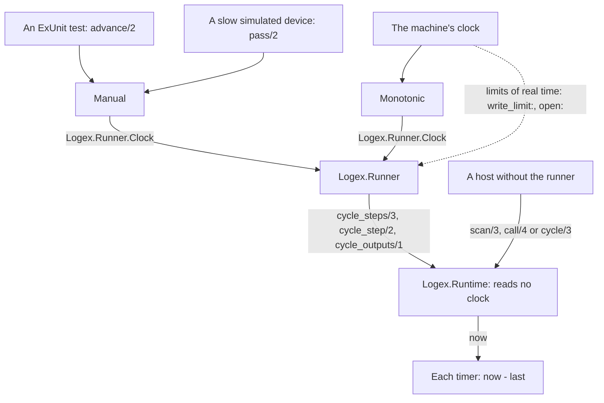

# 0007. The host gives the time

This record is for a contributor who changes `Logex.Runtime`, a
[timer](../../guides/reference/glossary.md#timer), the
[runner](../../guides/reference/glossary.md#runner) or an ExUnit test that needs time. It
says why the core of logex reads no clock. It also says why each timer keeps the time of
its last run, and why only the runner reads a
[clock](../../guides/reference/glossary.md#clock). Read it before you add code that reads
the time.

## Status

Accepted. No later record replaces this record. Decision 339 changes the rule of
decision 56 for an [online edit](../../guides/reference/glossary.md#online-edit), and
[Decision](#decision) gives the rule that logex follows.

## Date

2026-09-28, the date of decisions 8 and 13. Each part of the record has its date:

- 2026-09-28: decisions 8 and 13, and the design of `PLAN.md` M1-6 (its decisions 1 and
  5).
- 2026-09-30: M1-6 is available, with its ExUnit test of 1 timer at 2 rates.
- 2026-10-13: decision 56. 2026-10-31: decision 339 changes it.
- 2026-10-14: decision 82.
- 2026-10-17: decision 118. 2026-10-18: decisions 122 and 131.
- 2026-10-27: decisions 273 and 276, and decision 282. 2026-10-30: decision 322.
- 2026-11-04: decisions 442 and 444.

## Context

A controller reads its own clock. It starts each
[scan](../../guides/reference/glossary.md#scan) and gives each timer the time that
passed. [IEC 61131-3](../../guides/reference/glossary.md#iec-61131-3) does not say where
a timer gets its time. A timer of the
[conventional set](../../guides/reference/glossary.md#conventional-set) adds the time
since the last scan of its [instruction](../../guides/reference/glossary.md#instruction). `docs/naming.md` gives the formula:
"ACC = ACC + (current_time - last_time_scanned)".

logex is a library. An Elixir [host](../../guides/reference/glossary.md#host) calls it,
and an ExUnit test calls it. If the core reads the clock of the machine, 3 problems
follow:

- 2 runs of the same inputs give different [outputs](../../guides/reference/glossary.md#output). The time between 2 calls changes
  from run to run.
- An ExUnit test of a timer of 10 s waits 10 s, and a slow machine fails it.
- No host can run the same scans again from a record of its inputs.

A second question is where each timer keeps its time. The
[instance](../../guides/reference/glossary.md#instance) can keep 1 time for all its
timers: the time since its last scan, `dt`. Or each timer can keep the time of its last
run. The 2 answers are equal only when each scan runs each timer. Some scans do not run a
timer:

- A [jump](../../guides/reference/glossary.md#jump) skips the
  [rung](../../guides/reference/glossary.md#rung) of the timer.
- The `cal` of a [function block](../../guides/reference/glossary.md#function-block) is
  false, so no rung of the block runs.
- An online edit gives the instance to a
  [program](../../guides/reference/glossary.md#program) that does not run the timer.

The [plant](../../guides/reference/glossary.md#plant) also needs real time. A
[round](../../guides/reference/glossary.md#round) of a plant must start on time, and a
[watchdog](../../guides/reference/glossary.md#watchdog) must measure a run. A function
that reads no clock cannot measure itself.

## Decision

### The core is a function of its arguments

`Logex.Runtime` reads no clock. The host gives the time to each call, as a whole number
of milliseconds (decision 13):

| Call | The time it takes |
|---|---|
| `Logex.Runtime.scan/3` | `elapsed_ms`, added to the `now` of the instance |
| `Logex.Runtime.scan/2` | 0 ms |
| `Logex.Runtime.call/4` | The `now` of a `%Logex.Scan{}`, an absolute time |
| `Logex.Runtime.cycle/3` | `elapsed_ms`, added to the `now` of the [resource](../../guides/reference/glossary.md#resource) |

The time of an instance or of a resource is an integer, `now`, that starts at 0. It never
goes back. A negative or fractional `elapsed_ms` is a wrong argument. So is a
`%Logex.Scan{}` earlier than the instance. logex raises an `ArgumentError` for each
(result 2 of [The rules in a run](#the-rules-in-a-run)).

The same [state](../../guides/reference/glossary.md#state),
[inputs](../../guides/reference/glossary.md#input) and time always give the same outputs
and events (result 1).

The interval of a [task](../../guides/reference/glossary.md#task) is an integer of
milliseconds too. It is not a [literal](../../guides/reference/glossary.md#literal) of
time such as `t#10ms` (decision 13).

The core also keeps no file. A
[warm restart](../../guides/reference/glossary.md#warm-restart) and the retained values
are pure data in the core: `Logex.Runtime.retained/1,2` takes the values out, and
`Logex.Runtime.start/2` and `Logex.Runtime.instance/2` put them back. The runner owns the
file of the [store](../../guides/reference/glossary.md#store) (decision 282).

### Each timer keeps the time of its last run

Each timer keeps an internal [member](../../guides/reference/glossary.md#member), `last`,
the time of its last run. No name in a program reaches it: `xic t1.last` gets a
[diagnostic](../../guides/reference/glossary.md#diagnostic). A `ton` sets `last` to `now`
each time that it runs, true or false. When its rung is true and `.en` was already 1, it
adds `now - last` to `.acc` (decision 8, and decision 5 of M1-6). It adds nothing on the
scan that starts it.

Thus a timer that a scan does not run catches up at its next run:

- A timer in rungs that a jump skips (decision 82). The conventional set does the same.
- A timer in a block whose `cal` is false (decision 8).
- An instance that a slow task does not scan in each
  [cycle](../../guides/reference/glossary.md#cycle).

A warm restart is different. The
[restart](../../guides/reference/glossary.md#restart) sets the `last` of each retained
timer to the `now` of the restart. The timer does not count the time from its last run to
the restart (decision 273). `Logex.Runtime.start/2` and `Logex.Runtime.instance/2` do the same with a
[retained image](../../guides/reference/glossary.md#retained-image).

An online edit is different too. A timer counts time only while a program that runs it
holds the instance (decision 339):

- The [test](../../guides/reference/glossary.md#test) step gives the instance to the
  candidate, the new program of the edit. The
  [untest](../../guides/reference/glossary.md#untest) step gives it back. Each of these
  steps is a switch, and the instance takes the `now` of the resource (decision 56).
- The timer does not count the time while the candidate held the instance, if the
  candidate does not run the timer.
- The timer counts the time from its last run to the first switch at its next scan.

Result 6 shows this with `d2`, an instance on a task of 50 ms:

| Time | What occurs | `d2.t1.acc` |
|---|---|---|
| 50 ms | The original program scans `d2` | 50 |
| 70 ms | The test step gives `d2` to the candidate. The candidate has no rung that runs `t1` | 50 |
| 100 ms | The candidate scans `d2` | 50 |
| 130 ms | The untest step gives `d2` back, and reports `{:resumed, "d2.t1", 60}` | 50 |
| 150 ms | The original program scans `d2`. It adds 20 ms (50 to 70) and 20 ms (130 to 150) | 90 |

This program, `jog.ld`, is a motor with a manual part. In auto, the jump skips rungs 2
to 4, and `jog_t` with them.

<!-- file: jog.ld -->
```text
var_input manual bool
var_input jog_pb bool
var_input run_pb bool
var_output auto_lamp bool
var_output jog_lamp bool
var_output jog_long bool
var_output motor bool
var jog_t ton

// in auto, jump over the manual section
xio manual jmp auto ote auto_lamp
xic jog_pb ote jog_lamp
xic jog_pb ton jog_t 3000
xic jog_t.dn ote jog_long
lbl auto ( xic run_pb xio manual | xic manual xic jog_pb ) ote motor
```

<!-- rung: jog.ld -->


<!-- timing: 0007-the-host-gives-the-time-catch-up.timing.exs -->


The diagram shows that `jog_t.acc` stops while the jump skips its rung, and then gets to
its [preset](../../guides/reference/glossary.md#preset), 3000, in 1 scan. With a `dt` for
each instance, scan 9 adds only 1000 ms, and `jog_long` comes on 1 scan later.

### Only the runner reads a clock

`Logex.Runner` runs a resource on a clock. It reads the time through the behaviour
`Logex.Runner.Clock`. logex has 2 clocks, `Logex.Runner.Clock.Monotonic` and
`Logex.Runner.Clock.Manual`:

| Clock | Its time | `wall_ms/1` | Use |
|---|---|---|---|
| Monotonic | `System.monotonic_time/1` | `System.os_time/1` | A plant. The default |
| Manual | A process. An ExUnit test moves it with `advance/2`. A slow [simulated device](../../guides/reference/glossary.md#simulated-device) moves it with `pass/2` | Its own time | An ExUnit test. A run repeats (result 7) |

The callback `wall_ms/1` gives the time that a runner writes into the header of its
store. It is optional (decision 276). A runner can use a clock without `wall_ms/1` only
if the runner has no store. A runner with `retain:` and such a clock is a wrong argument
(decision 322, result 8).



Figure: where the time comes from. Only the runner reads a clock, and it reads the
machine's clock directly for its limits of real time. The core gets each time as an
argument.

The runner measures each task by the clock. It does not call `cycle/3`. It calls the 3
internal functions of `Logex.Runtime` that make up `cycle/3`:

1. `cycle_steps/3` moves the time, takes the inputs and lists the runs that are due.
2. `cycle_step/2` does 1 run. The runner calls it for each due task, and for the
   [continuous task](../../guides/reference/glossary.md#continuous-task).
3. `cycle_outputs/1` gives the outputs.

The runner reads its clock before and after each `cycle_step/2`. Thus a watchdog names
the task that was slow, not the cycle (decision 118). Each step is still a pure function
of the resource.

The runner follows the same rules on the manual clock and on the monotonic clock. Thus an
ExUnit test on the manual clock checks the rules that a plant runs:

- **1 round in each clock millisecond, at most.** If a program is on no timed task, the
  rounds follow each other, at most 1 in each millisecond of the clock.
  `advance(clock, 10)` runs 10 rounds (decision 122, result 7).
- **A call from a host can wait for a round.** If no round is due, the runner answers a
  call, such as `Logex.Runner.get!/2`, with no wait. If a round is due, the call waits
  for a slot. A slot is a time for the work of the runner between rounds. The share of
  the runner, `overhead:`, sets the slots (decisions 131 and 444). A slot that no call
  used stays open, and the next call takes it with no wait (decision 442).
- **A slow device can make the call wait for an advance.** A simulated device with
  `clock:` and a delay of 3 ms moves the manual clock 3 ms during the round. The next
  round is then due, and the next slot comes only after that round. On the
  manual clock, that round runs only when the ExUnit test calls `advance/2`.

> #### Caution {: .error}
>
> Do not call the runner from the process that moves the manual clock, if a round can
> move that clock. The call waits for a slot that only an advance brings, and that
> process cannot advance. The call has no time limit, so the ExUnit test stops there.
> Make the call from a different process, such as `Task.async/1`, and call
> `advance(clock, 0)` until the call answers.

Some limits of the runner are limits of real time on each clock. Examples are
`write_limit:` for a file and `open:` for a
[device](../../guides/reference/glossary.md#device). A device that takes 300 ms of real
time to open fails `open: 100` while the manual clock stays at 0 ms (result 9).

### The rules in a run

The script `examples/0007-the-host-gives-the-time.exs` shows each rule of this record as
a numbered result. It reads `delay.ld` and `jog.ld`. Run it from `examples/`. This table
gives the line of output that shows each rule:

| Result | Rule | The output to read |
|---|---|---|
| 1 | The same steps give the same outputs | The last step adds 3000 ms and `lamp` comes on. No 3 s of real time pass. The second run gives `true` |
| 2 | A time that goes back is a wrong argument | 2 lines of `ArgumentError` |
| 3 | A timer that a jump skips catches up | `jog_t.acc` stays at 1000 for 10 s, then gets to 3000 in 1 scan |
| 4 | A timer in a block whose `cal` is false catches up | `r1.t.acc` stays at 1000, then gets to 3000 in 1 scan |
| 5 | A timer counts the time, not the scans | The lamp comes on 3000 ms after `go`. With uneven steps, `go` rises at 1015 ms, and the lamp comes on at the first scan at 4015 ms or later: 4060 ms |
| 6 | A timer resumes from the switch of an online edit | The table in [Each timer keeps the time of its last run](#each-timer-keeps-the-time-of-its-last-run) |
| 7 | The runner on the manual clock gives 1 round in each millisecond, and a run repeats | 11 rounds at 10 ms. `go` changes at 10 ms, the round at 11 ms reads it, and the lamp comes on at 3011 ms. The second run gives `true` |
| 8 | A runner with `retain:` refuses a clock without `wall_ms/1` | 1 line of `ArgumentError`, then a start with no store |
| 9 | A limit of real time applies on the manual clock | `{:error, {:io_init, "panel", :timeout}}` at 0 ms |

`delay.ld` also has a [one-shot](../../guides/reference/glossary.md#one-shot), `s1`. Its
memory is state too, so result 1 shows `pulse` on the same scans in both runs.

<!-- file: delay.ld -->
```text
var_input go bool
var_output lamp bool
var_output pulse bool
var_output waited dint
var t1 ton
var s1 bool

xic go ton t1 3000
xic t1.dn ote lamp
xic go ons s1 ote pulse
move t1.acc waited
```

```elixir
alias Logex.Runtime
alias Logex.Runner
alias Logex.Runner.Clock.Manual
alias Logex.IO.Sim

{:ok, delay} = Logex.compile_file("delay.ld")
{:ok, jog} = Logex.compile_file("jog.ld")

# Give each step's inputs and milliseconds to scan/3. Keep the time and the outputs.
run = fn program, steps ->
  {rows, _state} =
    Enum.map_reduce(steps, Runtime.instance(program), fn {ms, inputs}, state ->
      state = Runtime.put_inputs(program, state, inputs)
      {outputs, state} = Runtime.scan(program, state, ms)
      {{state.now, outputs, state.env}, state}
    end)

  rows
end

IO.puts("1. delay.ld: the same steps, 2 runs")

steps = [
  {0, %{}},
  {500, %{"go" => 1}},
  {1250, %{}},
  {2000, %{"go" => 0}},
  {100, %{"go" => 1}},
  {3000, %{}}
]

first = run.(delay, steps)
Enum.each(first, fn {now, outputs, _env} -> IO.puts("  #{now} ms  #{inspect(outputs)}") end)
IO.puts("  same outputs in the second run: #{run.(delay, steps) == first}")

IO.puts("2. A time that goes back")
state = Runtime.instance(delay)
{_outputs, state} = Runtime.scan(delay, state, 3000)

refused = fn call ->
  try do
    call.()
  rescue
    error in ArgumentError -> IO.puts("  ArgumentError: " <> Exception.message(error))
  end
end

refused.(fn -> Runtime.scan(delay, state, -5) end)
refused.(fn -> Runtime.call(delay, state, %{}, %Logex.Scan{now: 10, first: false}) end)

IO.puts("3. jog.ld: jog_t in the rungs that the jump skips")

jogged =
  run.(jog, [
    {0, %{"manual" => 1, "jog_pb" => 1}},
    {1000, %{}},
    {0, %{"manual" => 0}},
    {10_000, %{}},
    {0, %{"manual" => 1}}
  ])

Enum.each(jogged, fn {now, outputs, env} ->
  IO.puts("  #{now} ms  jog_t.acc #{env["jog_t"]["acc"]}  jog_long #{outputs["jog_long"]}")
end)

IO.puts("4. A timer in a block whose cal is false")

{:ok, run_on} =
  Logex.compile(
    """
    function_block run_on
    var_input go bool
    var_output done bool
    var t ton

    xic go ton t 3000
    xic t.dn ote done
    """,
    name: "run_on"
  )

{:ok, fan} =
  Logex.compile(
    """
    var_input enable bool
    var_input hot bool
    var_output fan bool
    var r1 run_on

    xic enable cal r1 hot fan
    """,
    name: "fan",
    types: [run_on]
  )

fan
|> run.([
  {0, %{"enable" => 1, "hot" => 1}},
  {1000, %{}},
  {0, %{"enable" => 0}},
  {10_000, %{}},
  {0, %{"enable" => 1}}
])
|> Enum.each(fn {now, outputs, env} ->
  IO.puts("  #{now} ms  r1.t.acc #{env["r1"]["t"]["acc"]}  fan #{outputs["fan"]}")
end)

IO.puts("5. delay.ld at 3 rates: go rises at 1000 ms")

# Scan until the lamp comes on. go is 1 from 1000 ms.
go = fn
  now when now >= 1000 -> 1
  _now -> 0
end

until_lamp = fn
  until_lamp, state, [ms | more], %{"lamp" => 0} ->
    state = Runtime.put_inputs(delay, state, %{"go" => go.(state.now + ms)})
    {outputs, state} = Runtime.scan(delay, state, ms)
    until_lamp.(until_lamp, state, more ++ [ms], outputs)

  _until_lamp, state, _steps, %{"lamp" => 1} ->
    state.now
end

Enum.each([[10], [50], [10, 25, 40, 70]], fn steps ->
  lamp = until_lamp.(until_lamp, Runtime.instance(delay), steps, %{"lamp" => 0})
  IO.puts("  steps of #{Enum.join(steps, ", ")} ms: lamp on at #{lamp} ms")
end)

IO.puts("6. An online edit gives back a timer")

# d2 runs on a task of 50 ms. The candidate has no rung that runs t1.
text = File.read!("delay.ld")
{:ok, no_timer} = Logex.compile(String.replace(text, "xic go ton t1 3000\n", ""), name: "delay")

slow = fn program ->
  {:ok, configuration} =
    Logex.Configuration.compile(
      "plant",
      """
      task fast interval 10 priority 1
      task slow interval 50 priority 2
      var_global go_i bool at panel.i.0
      var_global lamp_q bool at panel.q.0
      program d2 delay with slow
      d2.go go_i
      d2.lamp lamp_q
      """,
      %{"delay" => program}
    )

  configuration
end

cycles = fn runtime, n ->
  Enum.reduce(1..n, runtime, fn _cycle, runtime ->
    {runtime, _outputs, _events} = Runtime.cycle(runtime, 10, %{})
    runtime
  end)
end

{runtime, _outputs, _events} = Runtime.cycle(Runtime.start(slow.(delay)), 0, %{"go_i" => 1})
runtime = cycles.(runtime, 7)
IO.puts("  70 ms, d2 last scanned at 50 ms: d2.t1.acc #{Runtime.get!(runtime, "d2.t1.acc")}")
{:ok, edit, _forecast} = Logex.Configuration.Edit.accept(runtime, slow.(no_timer))
{edit, runtime, _report} = Logex.Configuration.Edit.test(edit, runtime)
runtime = cycles.(runtime, 6)
{_edit, runtime, report} = Logex.Configuration.Edit.untest(edit, runtime)
IO.puts("  untest at 130 ms: #{inspect(report)}, d2.t1.acc #{Runtime.get!(runtime, "d2.t1.acc")}")
runtime = cycles.(runtime, 2)
IO.puts("  150 ms, after the next scan: d2.t1.acc #{Runtime.get!(runtime, "d2.t1.acc")}")

IO.puts("7. The runner on the manual clock, 2 runs")

{:ok, plant} =
  Logex.Configuration.compile(
    "plant",
    """
    var_global go_i bool at panel.i.0
    var_global lamp_q bool at panel.q.0
    program d1 delay
    d1.go go_i
    d1.lamp lamp_q
    """,
    %{"delay" => delay}
  )

on_the_clock = fn say ->
  {:ok, clock} = Manual.start_link()
  {:ok, panel} = Sim.start_link(reports: true, clock: clock)

  {:ok, runner} =
    Runner.start_link(
      configuration: plant,
      io: %{"panel" => {Sim, sim: panel}},
      clock: {Manual, clock}
    )

  # This process moves the clock and calls the runner. That is safe here, because no
  # device in this run moves the clock with pass/2.
  status = fn label ->
    %{now: now, rounds: rounds} = Runner.status(runner)
    say.("  #{label}: now #{now}, rounds #{rounds}, lamp #{Sim.outputs(panel)["panel.q.0"]}")
  end

  status.("start")
  Manual.advance(clock, 10)
  status.("10 ms later")
  Sim.set(panel, "panel.i.0", 1)
  Manual.advance(clock, 3000)
  status.("go, then 3000 ms later")
  Manual.advance(clock, 1)
  status.("1 ms later")
  :ok = Runner.stop(runner)
  Sim.writes(panel)
end

writes = on_the_clock.(&IO.puts/1)
IO.puts("  the second run makes the same writes: #{on_the_clock.(fn _line -> :ok end) == writes}")

IO.puts("8. A clock with no wall_ms/1, and a store")

defmodule NoWall do
  @behaviour Logex.Runner.Clock
  defdelegate now_ms(clock), to: Manual
  defdelegate wake_at(clock, pid, message, at_ms), to: Manual
  defdelegate cancel(clock, timer), to: Manual
end

{:ok, clock} = Manual.start_link()
{:ok, panel} = Sim.start_link(clock: clock)
io = %{"panel" => {Sim, sim: panel}}

refused.(fn ->
  Runner.start_link(configuration: plant, io: io, clock: {NoWall, clock}, retain: "plant.retain")
end)

{:ok, runner} = Runner.start_link(configuration: plant, io: io, clock: {NoWall, clock})
IO.puts("  with no retain: the runner starts, rounds #{Runner.status(runner).rounds}")
:ok = Runner.stop(runner)

IO.puts("9. A limit of real time on the manual clock")
{:ok, slow} = Sim.start_link()
Sim.fail(slow, :init, {:delay, 300})

started =
  Runner.start_link(
    configuration: plant,
    io: %{"panel" => {Sim, sim: slow}},
    clock: {Manual, clock},
    open: 100
  )

IO.puts("  #{inspect(started)} at #{Manual.now_ms(clock)} ms on the manual clock")
```

```console
$ mix run 0007-the-host-gives-the-time.exs
1. delay.ld: the same steps, 2 runs
  0 ms  %{"lamp" => 0, "pulse" => 0, "waited" => 0}
  500 ms  %{"lamp" => 0, "pulse" => 1, "waited" => 0}
  1750 ms  %{"lamp" => 0, "pulse" => 0, "waited" => 1250}
  3750 ms  %{"lamp" => 0, "pulse" => 0, "waited" => 0}
  3850 ms  %{"lamp" => 0, "pulse" => 1, "waited" => 0}
  6850 ms  %{"lamp" => 1, "pulse" => 0, "waited" => 3000}
  same outputs in the second run: true
2. A time that goes back
  ArgumentError: elapsed_ms must be a non-negative integer of milliseconds, got: -5
  ArgumentError: time went backwards: this scan is at 10 ms, but the instance was last scanned at 3000 ms
3. jog.ld: jog_t in the rungs that the jump skips
  0 ms  jog_t.acc 0  jog_long 0
  1000 ms  jog_t.acc 1000  jog_long 0
  1000 ms  jog_t.acc 1000  jog_long 0
  11000 ms  jog_t.acc 1000  jog_long 0
  11000 ms  jog_t.acc 3000  jog_long 1
4. A timer in a block whose cal is false
  0 ms  r1.t.acc 0  fan 0
  1000 ms  r1.t.acc 1000  fan 0
  1000 ms  r1.t.acc 1000  fan 0
  11000 ms  r1.t.acc 1000  fan 0
  11000 ms  r1.t.acc 3000  fan 1
5. delay.ld at 3 rates: go rises at 1000 ms
  steps of 10 ms: lamp on at 4000 ms
  steps of 50 ms: lamp on at 4000 ms
  steps of 10, 25, 40, 70 ms: lamp on at 4060 ms
6. An online edit gives back a timer
  70 ms, d2 last scanned at 50 ms: d2.t1.acc 50
  untest at 130 ms: [{:resumed, "d2.t1", 60}], d2.t1.acc 50
  150 ms, after the next scan: d2.t1.acc 90
7. The runner on the manual clock, 2 runs
  start: now 0, rounds 1, lamp 0
  10 ms later: now 10, rounds 11, lamp 0
  go, then 3000 ms later: now 3010, rounds 3011, lamp 0
  1 ms later: now 3011, rounds 3012, lamp 1
  the second run makes the same writes: true
8. A clock with no wall_ms/1, and a store
  ArgumentError: the runner's clock `NoWall` has no wall_ms/1, which a runner given retain: writes its store's time by
  with no retain: the runner starts, rounds 1
9. A limit of real time on the manual clock
  {:error, {:io_init, "panel", :timeout}} at 0 ms on the manual clock
```

## Consequences

The good results:

- A run repeats exactly. A host that records the `elapsed_ms` and the inputs of each
  cycle can run it again and get the same outputs and events.
- An ExUnit test of a timer of hours takes no real time. An ExUnit test of the runner on
  the manual clock gives the same writes on a fast machine and on a slow machine.
- A timer counts the time that passed, not the scans and not the interval of its task. A
  late cycle gives the timer the full time.
- A timer that a jump or a false `cal` stopped catches up, as a timer of the
  conventional set does.
- The core has no process, no clock and no file. A host can run it in its own process,
  with its own clock.

The costs:

- Each timer has 1 internal member more, `last`, in its schema and in each instance.
- A host that does not use the runner must read a clock and give the time itself.
  logex cannot check a time that goes forward. If the host gives a wrong `elapsed_ms`,
  each timer is wrong, and logex gives no message.
- The core has no watchdog. Only the runner measures a run. A host that does not use the
  runner has no protection from a slow scan.
- The time unit is 1 ms. A timer of the `ltime` family counts in ns, but it gets whole
  milliseconds ([Timers and counters](../../guides/reference/instructions-timers-and-counters.md)).
- On the manual clock, an ExUnit test that calls from the wrong process stops (the
  Caution in [Only the runner reads a clock](#only-the-runner-reads-a-clock)).
- Some limits of the runner use the real time of the VM and not its clock. The runner
  and its writer process
  ([`lib/logex/runner/writer.ex`](../../lib/logex/runner/writer.ex)) call
  `System.monotonic_time/1`. The runner also uses timers of `Process.send_after/3`, and
  the time limits of calls, for example the `open:` of a device. A change to the time of
  the runner must find each of them.

What this means for a change:

- Code in the core that needs the time takes it as an argument.
- Code in the runner reads the time through `Logex.Runner.Clock`. A limit of real time is
  the only exception.

## Alternatives considered

| Alternative | Why logex does not do it |
|---|---|
| The core reads the clock of the machine | A run does not repeat, and an ExUnit test waits in real time (Context) |
| 1 `dt` for each instance, the time since its last scan | A timer that a jump skips or a false `cal` stops loses the time it did not run (decision 8, result 3) |
| A timer stops while a jump skips it, and carries on from where it was | The conventional set catches up a jumped timer. A block that does not run catches up too (decision 82) |
| A timer that an edit gives back catches up the time of the edit | A timer counts time only while a program that runs the timer holds the instance. The timer comes back with exactly the time that it had (decisions 56 and 339) |
| A retained timer counts the time while the plant was off | The timer then counts time in which the machine did not run. The store also needs the wall time, and the clocks of logex are monotonic: they mean nothing from one VM to the next (decision 273) |
| The interval of a task as a literal of time, `t#10ms` | The record recommends integer milliseconds and gives no other reason (decision 13) |
| The watchdog measures the whole cycle | The time of a slow task then counts against the watchdog of a fast task in the same round (decision 118) |
| The runner starts the next round with no wait on the monotonic clock, and 1 round in each millisecond on the manual clock | An ExUnit test then checks a rule that the plant does not run (decision 122) |
| A round in each [poll period](../../guides/reference/glossary.md#poll-period) | IEC 61131-3 and the continuous task of the conventional set start the next round as soon as a round ends (decisions 108 and 122) |
| A call that finds a round due runs that round first, with no wait, on each clock | The maintainer kept the rule that a call waits for its slot (decisions 131 and 444) |
| Each call on the manual clock gets an answer with no wait | The monotonic clock does not run this rule (decision 131) |
| The core writes the store | The core then reads a clock for the header and does file work (decision 282) |
| The runner writes the time of the machine into each store, also on the manual clock | A store from an ExUnit test then holds the real time. The manual clock gives its own time, so that the header repeats (decision 276) |
| Each clock must have `wall_ms/1` | The maintainer confirmed the build, in which `wall_ms/1` is optional. The record gives no other reason (decision 322) |

## Decisions in section 7

This record sums up decisions 8, 13, 56, 82, 118, 122, 131, 282, 322 and 444 of
[`docs/organisation.md`](../organisation.md#7-decisions), and
[§4.6](../organisation.md#46-execution-model) of the same document. `PLAN.md` keeps the
history in [M1-6](../../PLAN.md#m1-6--ton-and-ons), with its decisions 1, 5 and 6.

It also uses decisions that other records sum up:

- Decision 339, the resume after an online edit:
  [0012. The staged online edit](0012-staged-online-edit.md).
- Decision 273, the timer after a warm restart:
  [0016. Retained values and starts](0016-retained-values-and-starts.md).
- Decision 276, the time in the header of the store:
  [0017. The store on disk](0017-the-store-on-disk.md).
- Decision 442, the slot that stays open: [0011. Tasks and rounds](0011-tasks-and-rounds.md).

[The scan, the cycle and time](../../guides/explanation/scan-cycle-and-time.md) gives
the model for a user. [Execution model](../../guides/reference/execution-model.md) and
[Runner](../../guides/reference/runner.md) give the rules.
[Do a test of a plant on the manual clock](../../guides/howto/test-on-the-manual-clock.md)
gives the steps for an ExUnit test.
