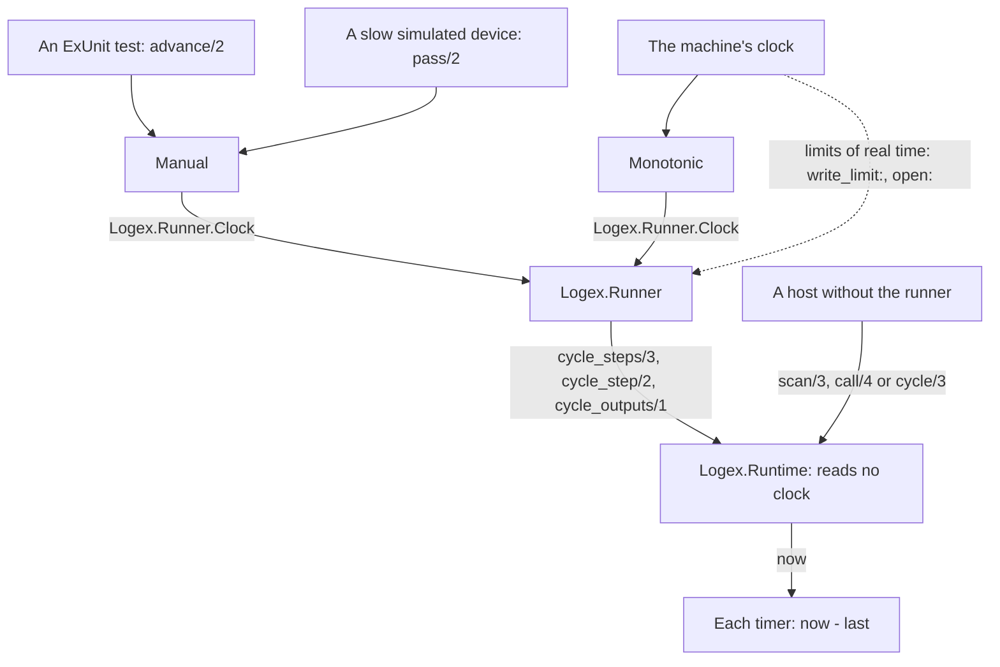

# 0007. The host gives the time

This record is for a contributor who changes `Logex.Runtime`, a
[timer](../../guides/reference/glossary.md#timer), the
[runner](../../guides/reference/glossary.md#runner) or an ExUnit test that needs time. It
says why the core of logex reads no clock. It also says why each timer keeps the time of
its last run, and why only the runner reads a
[clock](../../guides/reference/glossary.md#clock). Read it before you add code that reads
the time.

## Status

Accepted. No later record replaces this record. Decision 339 changes the rule of
decision 56 for an [online edit](../../guides/reference/glossary.md#online-edit), and
[Decision](#decision) gives the rule that logex follows.

## Date

2026-09-28, the date of decisions 8 and 13 and of the design of `PLAN.md` M1-6. The
last decisions of the record, 442 and 444, are of 2026-11-04.

## Context

A controller reads its own clock. It starts each
[scan](../../guides/reference/glossary.md#scan) and gives each timer the time that
passed. [IEC 61131-3](../../guides/reference/glossary.md#iec-61131-3) does not say where
a timer gets its time. A timer of the
[conventional set](../../guides/reference/glossary.md#conventional-set) adds the time
since the last scan of its [instruction](../../guides/reference/glossary.md#instruction):
"ACC = ACC + (current_time - last_time_scanned)". The source is the RTO of 1756-RM018A,
pp.112 and 113, which `docs/naming.md` quotes.

logex is a library. An Elixir [host](../../guides/reference/glossary.md#host) calls it,
and an ExUnit test calls it. If the core reads the clock of the computer, 3 problems
follow:

- 2 runs of the same inputs give different [outputs](../../guides/reference/glossary.md#output). The time between 2 calls changes
  from run to run.
- An ExUnit test of a timer of 10 s waits 10 s, and a slow machine fails it.
- No host can run the same scans again from a record of its inputs.

A second question is where each timer keeps its time. The
[instance](../../guides/reference/glossary.md#instance) can keep 1 time for all its
timers: the time since its last scan, `dt`. Or each timer can keep the time of its last
run. The 2 answers are equal only when each scan runs each timer. Some scans do not run a
timer:

- A [jump](../../guides/reference/glossary.md#jump) skips the
  [rung](../../guides/reference/glossary.md#rung) of the timer.
- The `cal` of a [function block](../../guides/reference/glossary.md#function-block) is
  false, so no rung of the block runs.
- An online edit gives the instance to a
  [program](../../guides/reference/glossary.md#program) that does not run the timer.

The [plant](../../guides/reference/glossary.md#plant) also needs real time. A
[round](../../guides/reference/glossary.md#round) of a plant must start on time, and a
[watchdog](../../guides/reference/glossary.md#watchdog) must measure a run. A function
that reads no clock cannot measure itself.

## Decision

[Runs and tables of the records: the core](../implementation/record-runs-core.md#0007-the-host-gives-the-time) shows each rule of this section as a numbered result. A number in brackets
is a result of that run.

### The core is a function of its arguments

`Logex.Runtime` reads no clock. The host gives the time to each call, as a whole number
of milliseconds (decision 13):

| Call | The time it takes |
|---|---|
| `Logex.Runtime.scan/3` | `elapsed_ms`, added to the `now` of the instance |
| `Logex.Runtime.scan/2` | 0 ms |
| `Logex.Runtime.call/4` | The `now` of a `%Logex.Scan{}`, an absolute time |
| `Logex.Runtime.cycle/3` | `elapsed_ms`, added to the `now` of the [resource](../../guides/reference/glossary.md#resource) |

The time of an instance or of a resource is an integer, `now`, that starts at 0. It never
goes back. A negative or fractional `elapsed_ms` is a wrong argument. So is a
`%Logex.Scan{}` earlier than the instance. logex raises an `ArgumentError` for each (result 2).

The same [state](../../guides/reference/glossary.md#state),
[inputs](../../guides/reference/glossary.md#input) and time always give the same outputs
and events (result 1). The interval of a [task](../../guides/reference/glossary.md#task)
is an integer of milliseconds too, not a literal of time such as `t#10ms` (decision 13).

The core also keeps no file. A
[warm restart](../../guides/reference/glossary.md#warm-restart) and the retained values
are pure data in the core: `Logex.Runtime.retained/1,2` takes the values out, and
`Logex.Runtime.start/2` and `Logex.Runtime.instance/2` put them back. The runner owns the
file of the [store](../../guides/reference/glossary.md#store) (decision 282).

### Each timer keeps the time of its last run

Each timer keeps an internal [member](../../guides/reference/glossary.md#member), `last`,
the time of its last run. No name in a program reaches it: `xic t1.last` gets a
[diagnostic](../../guides/reference/glossary.md#diagnostic). A `ton` sets `last` to `now`
each time that it runs, true or false. When its rung is true and `.en` was already 1, it
adds `now - last` to `.acc` (decision 8, and decision 5 of M1-6). It adds nothing on the
scan that starts it.

Thus a timer that a scan does not run catches up at its next run:

- A timer in rungs that a jump skips (decision 82, result 3). The conventional set does
  the same for an RTO, by its formula (1756-RM018A, pp.112-113).
- A timer in a block whose `cal` is false (decision 8, result 4).
- An instance that a slow task does not scan in each
  [cycle](../../guides/reference/glossary.md#cycle).

A warm restart is different. The
[restart](../../guides/reference/glossary.md#restart) sets the `last` of each retained
timer to the `now` of the restart. The timer does not count the time from its last run to
the restart (decision 273).

An online edit is different too. A timer counts time only while a program that runs it
holds the instance (decision 339). The
[test](../../guides/reference/glossary.md#test) step gives the instance to the candidate,
the new program of the edit. The [untest](../../guides/reference/glossary.md#untest) step
gives it back. Each of these steps is a switch, and the instance takes the `now` of the
resource (decision 56). If the candidate does not run the timer, the timer does not count
the time while the candidate held the instance (result 6).

### Only the runner reads a clock

`Logex.Runner` runs a resource on a clock. It reads the time through the behaviour
`Logex.Runner.Clock`. logex has 2 clocks, `Logex.Runner.Clock.Monotonic` and
`Logex.Runner.Clock.Manual`:

| Clock | Its time | `wall_ms/1` | Use |
|---|---|---|---|
| Monotonic | `System.monotonic_time/1` | `System.os_time/1` | A plant. The default |
| Manual | A process. An ExUnit test moves it with `advance/2`. A slow [simulated device](../../guides/reference/glossary.md#simulated-device) moves it with `pass/2` | Its own time | An ExUnit test. A run repeats (result 7) |

The callback `wall_ms/1` gives the time that a runner writes into the header of its
store. It is optional (decision 276). A runner can use a clock without `wall_ms/1` only
if the runner has no store. A runner with `retain:` and such a clock is a wrong argument
(decision 322, result 8).

Figure: where the time comes from. Only the runner reads a clock, and it reads the
machine's clock directly for its limits of real time. The core gets each time as an
argument.

The runner does not call `cycle/3`. It calls the 3 internal functions of
`Logex.Runtime` that make up `cycle/3`, and reads its clock before and after the run of
each task. Thus a watchdog names the task that was slow, not the cycle (decision 118).

The runner follows the same rules on the manual clock and on the monotonic clock. Thus an
ExUnit test on the manual clock checks the rules that a plant runs:

- **1 round in each clock millisecond, at most.** If a program is on no timed task, the
  rounds follow each other, at most 1 in each millisecond of the clock.
  `advance(clock, 10)` runs 10 rounds (decision 122, result 7).
- **A call from a host can wait for a round.** If no round is due, the runner answers a
  call, such as `Logex.Runner.get!/2`, with no wait. If a round is due, the call waits
  for a slot. A slot is a time for the work of the runner between rounds. The share of
  the runner, `overhead:`, sets the slots (decisions 131 and 444). A slot that no call
  used stays open, and the next call takes it with no wait (decision 442).
- **A slow device can make the call wait for an advance.** A simulated device with a
  delay moves the manual clock during the round. The next round is then due, and it runs
  only when the ExUnit test calls `advance/2`.

> #### Caution {: .error}
>
> Do not call the runner from the process that moves the manual clock, if a round can
> move that clock. The call waits for a slot that only an advance brings, and that
> process cannot advance. The call has no time limit, so the ExUnit test stops there.
> Make the call from a different process, such as `Task.async/1`, and call
> `advance(clock, 0)` until the call answers.

Some limits of the runner are limits of real time on each clock. Examples are
`write_limit:` for a file and `open:` for a
[device](../../guides/reference/glossary.md#device) (result 9).

## Consequences

The good results:

- A run repeats exactly. A host that records the `elapsed_ms` and the inputs of each
  cycle can run it again and get the same outputs and events.
- An ExUnit test of a timer of hours takes no real time. An ExUnit test of the runner on
  the manual clock gives the same writes on a fast machine and on a slow machine.
- A timer counts the time that passed, not the scans and not the interval of its task. A
  late cycle gives the timer the full time.
- A timer that a jump or a false `cal` stopped catches up, as a timer of the
  conventional set does.
- The core has no process, no clock and no file. A host can run it in its own process,
  with its own clock.

The costs:

- Each timer has 1 internal member more, `last`, in its schema and in each instance.
- A host that does not use the runner must read a clock and give the time itself.
  logex cannot check a time that goes forward. If the host gives a wrong `elapsed_ms`,
  each timer is wrong, and logex gives no message.
- The core has no watchdog. A host that does not use the runner has no protection from a
  slow scan.
- The time unit is 1 ms. A timer of the `ltime` family counts in ns, but it gets whole
  milliseconds ([Timers and counters](../../guides/reference/instructions-timers-and-counters.md)).
- Some limits of the runner use the real time of the VM and not its clock. An example is
  the `open:` of a device. A change to the time of the runner must find each of them.

## Alternatives considered

| Alternative | Why logex does not do it |
|---|---|
| The core reads the clock of the computer | A run does not repeat, and an ExUnit test waits in real time (Context) |
| 1 `dt` for each instance, the time since its last scan | A timer that a jump skips or a false `cal` stops loses the time it did not run (decision 8, result 3) |
| A timer that an edit gives back catches up the time of the edit | The timer comes back with exactly the time that it had (decisions 56 and 339) |
| A retained timer counts the time while the plant was off | The timer then counts time in which the machine did not run (decision 273) |
| The watchdog measures the whole cycle | The time of a slow task then counts against the watchdog of a fast task (decision 118) |
| A round in each [poll period](../../guides/reference/glossary.md#poll-period) | IEC 61131-3 and the continuous task of the conventional set start the next round as soon as a round ends (decisions 108 and 122) |
| The core writes the store | The core then reads a clock for the header and does file work (decision 282) |

Section 7 gives the other options of decisions 13, 122, 131, 276, 322 and 444.

## The decisions that this record sums up

This record sums up decisions 8, 13, 56, 82, 118, 122, 131, 282, 322 and 444 of
[`docs/organisation.md`](../organisation.md#7-decisions), and
[§4.6](../organisation.md#46-execution-model) of the same document. `PLAN.md` keeps the
history in [M1-6](../../PLAN.md#m1-6--ton-and-ons), with its decisions 1, 5 and 6.

It also uses decisions that other records sum up:

- Decision 339, the resume after an online edit:
  [0012. The staged online edit](0012-staged-online-edit.md).
- Decision 273, the timer after a warm restart:
  [0016. Retained values and starts](0016-retained-values-and-starts.md).
- Decision 276, the time in the header of the store:
  [0017. The store on disk](0017-the-store-on-disk.md).
- Decision 442, the slot that stays open: [0011. Tasks and rounds](0011-tasks-and-rounds.md).

[The scan, the cycle and time](../../guides/explanation/scan-cycle-and-time.md) gives
the model for a user. [Execution model](../../guides/reference/execution-model.md) and
[Runner](../../guides/reference/runner.md) give the rules.
[Write ExUnit tests on the manual clock](../../guides/howto/test-on-the-manual-clock.md)
gives the steps for an ExUnit test.
