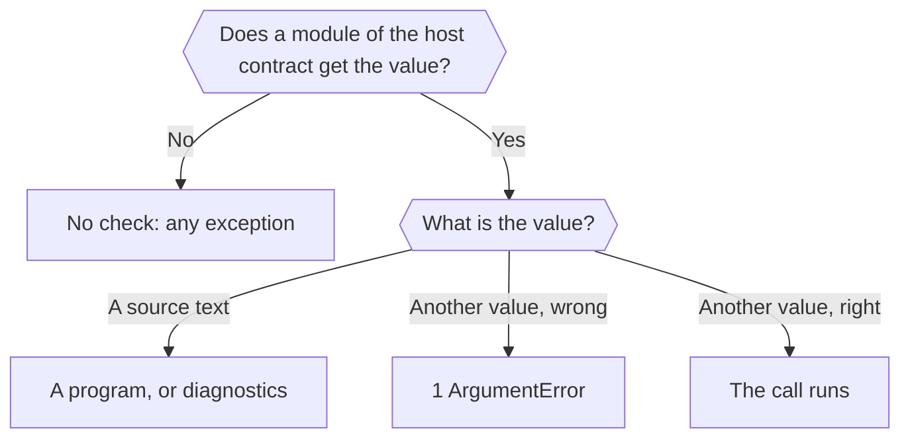

# 0008. Errors in the source and errors of the host

This record is for a contributor who adds a check, a public function or a value that a
[host](../../guides/reference/glossary.md#host) can give to logex. It says how logex
tells its caller of an error. An error in a source text is a
[diagnostic](../../guides/reference/glossary.md#diagnostic) that a
[compile](../../guides/reference/glossary.md#compile) returns. An error of the host is an
`ArgumentError` that logex raises. Read this record before you decide which of the 2 a
new check gives, and where the check runs.

## Status

Accepted. No later record replaces this record.

## Date

2026-09-29 (`PLAN.md` M1-5) to 2026-11-13. The last section lists the decisions.

## Context

A caller of logex can give 2 kinds of wrong value:

- An engineer writes the source text of a
  [program](../../guides/reference/glossary.md#program) with an error. Examples are a
  typing error in a name and a [tag](../../guides/reference/glossary.md#tag) of the
  wrong [type](../../guides/reference/glossary.md#type). The text is data. An error in it is
  normal work.
- A developer writes Elixir that gives logex a wrong argument. Examples are a value for a
  `var_output` tag given to `put_inputs/3`, and a
  [state](../../guides/reference/glossary.md#state) with a value outside the type of its
  tag. This is an error in the code of the host.

The engineer must see each error of the text, with its line, to correct the file in 1
pass. The developer must see the error at the call that has it, with a stack trace.

[IEC 61131-3](../../guides/reference/glossary.md#iec-61131-3) has no rule for the API of
a host (decision 514). Studio 5000 checks the tags and the code of a
[Logix](../../guides/reference/glossary.md#logix) project together before it downloads
the project. So Logix has no compiled program that a host can change.
`docs/organisation.md` marks this as not verified (decision 182).

Each rule of this record answers a case of this table:

| What logex got | What logex did before the rule |
|---|---|
| A tree that `Logex.Parser.parse/1` cannot give, to `Logex.Compiler.instructionize/3` (decision 28) | Raised `FunctionClauseError` or `Protocol.UndefinedError`, or took a line of 0 |
| A state that holds 5,000,000,000 in `count`, a dint of the box counter, or 5 in a bool (decision 171) | `add` computed and then wrapped the count. The count showed 705,032,704 and its lamp went off for 1 [scan](../../guides/reference/glossary.md#scan). A [contact](../../guides/reference/glossary.md#contact) read 5 as closed |
| A state that holds 37.5 in `speed`, a dint of the fan, or 2.5 or `nil` in a bool (decision 173) | A contact read 2.5 as closed and `nil` as open. `add` read a value that is not an integer as 0, and the fan ran as if 0 were its speed |
| `Logex.Program.initial_env(:x)` and 117 more such calls to 40 documented functions that take logex's own data (decision 514) | Raised `FunctionClauseError`, or an `ArgumentError` with no message that a test pins. No moduledoc gave this rule |
| A relative path after a process deletes the working directory (decision 478) | Raised `File.Error` |
| `var row cell[256]`, where the block `cell` holds `ton[256]`: 65,536 timers (decision 370) | Compiled, and ran out of memory at its [first scan](../../guides/reference/glossary.md#first-scan) |
| A box counter of 280 KB with 2,000 [rungs](../../guides/reference/glossary.md#rung) that name a renamed tag (decision 520) | Took 52 s to refuse |

## Decision

### The host contract

The [host contract](../../guides/reference/glossary.md#host-contract) is the modules
that check what a host gives them (decisions 514 and 523). A refusal is the
`ArgumentError` that a module of the contract raises for an error of the host.

| Group | In the host contract | Modules |
|---|---|---|
| The way in | Yes (decision 514) | `Logex`, `Logex.Runtime`, `Logex.Edit`, `Logex.Configuration`, `Logex.Configuration.Edit`, `Logex.Runner`, `Logex.IO` and `Logex.Tag.new!/5` |
| The tools of the host, and the parts of a configuration | Yes (decision 523) | `Logex.Configuration.Task`, `Global`, `Instance` and `Connection`, `Logex.IO.Point`, `Logex.IO.Sim`, `Logex.Runner.Clock`, `Clock.Manual` and `Clock.Monotonic` |
| The rest | No | `Logex.Compiler`, `Logex.Configuration.Text`, `Logex.Declarations`, `Logex.Diagnostic`, `Logex.Fault`, `Logex.FbType`, `Logex.FbType.Member`, `Logex.Instance`, `Logex.Lexer`, `Logex.Parser`, `Logex.Printer`, `Logex.Program`, `Logex.Scan`, `Logex.Walk` and `Logex.Warnings` |

The moduledoc of each of the 15 modules outside the contract ends with the same
sentence. It starts: "Outside the host contract, this module takes logex's own data
unguarded, and anything else may raise as Elixir does". `test/logex/runtime_test.exs`
reads each module of the application. It checks that each module outside the contract
ends with that sentence, and that no module inside the contract has it. A module outside
the contract can raise as Elixir does (result 13).

### 2 questions pick the answer

Ask 2 questions about a value that the host gives. Does a module of the
[host contract](#the-host-contract) get the value? Can a source text give the error in
it? The answers pick what logex does.

| What the host gives | Who made the error | What logex does |
|---|---|---|
| A source text of a program, a [function block](../../guides/reference/glossary.md#function-block) or a [configuration](../../guides/reference/glossary.md#configuration) | The engineer | Returns `{:error, diagnostics}`. Each diagnostic is a `%Logex.Diagnostic{}` with its stage, line, column and file where logex knows them |
| A configuration that the host builds in Elixir, with an error that a text can also have | The engineer, through the host | `Logex.Configuration.check/1` returns a diagnostic with the words of the text and no line. `Logex.Configuration.new!/1` and `Logex.Runtime.start/1` raise its message |
| An argument, a state or a program that no text can give | The host | Raises 1 `ArgumentError` at the call that gets it. Each error is 1 line of the message |
| An argument to a module outside the host contract | The host | No check. The module takes logex's own data, and a wrong argument can raise any exception (result 13) |

> #### Caution {: .error}
>
> Do not let a module of the host contract raise an exception that is not
> `ArgumentError`. Give an error in a source text a diagnostic. Give an error of the host
> 1 `ArgumentError`, and compare its whole message in an ExUnit test.
>
> `test/logex/api_contract_test.exs` makes seeded random calls to the host contract. Each
> refusal must start with the first words of a kind that the test lists in `@refusals`.
> A new kind of refusal adds its first words there, or the walk fails with
> `undocumented refusal: <message>`. Each other exception also fails the walk.



Figure: the 2 questions. A wrong value to a module of the host contract ends in
diagnostics or in 1 `ArgumentError`, and in no other exception. Only
`Logex.Configuration.check/1` returns diagnostics for a value that is not a text.

A compile returns each error of the text in line order (result 1). A lex or parse error
stops the compile, and it is the only diagnostic (result 2). In a configuration, a
global that logex refuses for its name, such as `hot.g`, gets 1 diagnostic. The
connections that name it get none (decision 42).

A value that no text can give is an `ArgumentError`, also when it arrives inside a
struct. `docs/organisation.md` records these cases:

- A tree that `Logex.Parser.parse/1` cannot give. `Logex.Parser.well_formed!/1` states
  each tree that it can give (decision 28).
- A configuration struct whose name is not a string, or whose programs hold a function
  block type. Line numbers that do not increase from 1 entry to the next, and a list that
  is not proper, are 2 more cases (decision 36).
- A program in a configuration whose `var_input` or `var_output` holds an
  [instance](../../guides/reference/glossary.md#instance), with or without a
  [connection](../../guides/reference/glossary.md#connection) to the tag.
  `Logex.Configuration.check/1` refuses it, and so `new!/1`, `compile/3` and
  `Logex.Runtime.start/1`. A program that runs alone gets no such check: its instance
  runs (decisions 169 and 172).
- A program whose `add` writes to a tag of no integer type (decision 182, result 9).
- A [function block type](../../guides/reference/glossary.md#function-block-type) in
  `types:` that its own source text does not give (decision 54, result 10).
- A candidate configuration that `Logex.Configuration.check/1` refuses, given to the
  [accept](../../guides/reference/glossary.md#accept) of an
  [online edit](../../guides/reference/glossary.md#online-edit). A candidate from text
  gets its diagnostics from `compile/3` first, so only a host builds such a candidate
  (decision 63).

`Logex.Runtime.get/2` asks a question, so a path that names nothing is an answer:
`{:error, reason}`. `get!/2` raises an `ArgumentError` with that reason. Both raise for a
value that is not a [resource](../../guides/reference/glossary.md#resource) or a path
that is not a string (decision 41, result 11).

### Where each check runs

A check runs at the call where a value comes in from the host. A program gets its check
1 time, because a walk of its rungs on each scan costs too much (decision 190).

| What the host gives | Where logex checks it | Decisions |
|---|---|---|
| The values of a state | Each call that takes a state: `put_inputs/3`, `call/4`, `scan/2,3`, `restart/3` and each step of `Logex.Edit` | 171, 173, 184, 186, 188 |
| An instance of a resource | As each scan takes the instance in `cycle/3`, and in `restart/2`, warm or cold | 171, 174 |
| A [global](../../guides/reference/glossary.md#global) of a resource | As a scan in `cycle/3` takes an instance that reads the global. `restart/2` checks only a global that a `var_external` reads. It keeps a global that only a connection reads, and a global that no instance reads, as they are | 174 |
| A program | 1 time, where it comes in. `Logex.Runtime.instance/1,2`. `Logex.Edit.accept/3`, for the running program and the candidate. `Logex.Configuration.check/1`, and so `new!/1`, `compile/3` and `start/1`. `Logex.Configuration.Edit.accept/3`, for each program type that runs and the candidate | 190, 200 |
| A program that the host changes after that check | The scan that gets to a changed `add` or timer | 194 |
| A type in `types:` | Compiled again from its text, 1 time for each compile | 54 |
| A global from `Global.new!/3` | Its initial value at the call, in the words of `check/1`. Its name, its type and its location at `new!/1` and `check/1` | 555, 575 |

The check of a program finds only 2 kinds of hand edit. One is an arithmetic
[instruction](../../guides/reference/glossary.md#instruction) whose destination has no
integer type. The other is timer units that do not agree with the tags (decisions 182
and 197). A configuration also refuses an instance in a `var_input` or a `var_output`
(decision 169). logex trusts each other hand edit of a program. For example, a contact on
a bool tag that the host retypes to a dint reads 5 as closed.

Decisions 171 to 188 record 4 forms of a value outside its type in a state:

- An integer outside the range of its type, such as 5,000,000,000 in a dint (result 8).
- A value that is not an integer in a bool or an integer type, such as 37.5 or `nil`.
- A tag of a [timer](../../guides/reference/glossary.md#timer) or another instance that
  holds no map, such as 5.
- The time at which a timer last ran (`last`) that is not an integer, or that is later
  than the `now` of the instance.

The check also refuses a real that is not a value of its type, such as 0.1 in a `real`.
It refuses an [array](../../guides/reference/glossary.md#array) that is not a tuple of its
size. Each wrong value is 1 line of 1 message, sorted by its path, such as `t1.last` or `w[1]`.
After 10 wrong elements of 1 array, 1 line gives the count of the rest. The message names
a global as `runtime.globals`, not as `state.env`.

The loader of `Logex.compile_file/1` trusts its own types:

- `compile_file/1` and `compile_files/1` compile each block file of a chain 1 time, and
  do not compile those types again (decision 371).
- Only private functions of `Logex.Compiler` reach the compile that trusts these types.
  No argument, token or function that a host gives can reach it (decision 432).
- A function that a host gives in a list of types gets the refusal
  `types must be a list of function block types`, and logex never calls it
  (decision 430).
- `Logex.Compiler.recompiled/4` and `Logex.FbType.check/2` stay public, outside the
  contract, and trust what they get (decision 436).

### Each source text compiles or gets its diagnostics

A compile of any text gives a program, a type or diagnostics. It raises nothing, within
these bounds:

| Bound | Limit | What logex gives past it | Decisions |
|---|---|---|---|
| The length of a number, also in a name, a [subscript](../../guides/reference/glossary.md#subscript) or a [bit](../../guides/reference/glossary.md#bit) number | 10,000 characters | A lex error at its column (result 3) | 369 |
| The exponent of a real | 9,999 | A lex error at its column | 369 |
| A [declaration](../../guides/reference/glossary.md#declaration) | 65,536 tags, [elements](../../guides/reference/glossary.md#element) and instances. logex adds the count at each depth, and counts each instance as 1 more | A diagnostic at its line (result 4) | 370, 403, 429 |
| Suggestions of a near name | The first 100 names that a text cannot find, for each text | No suggestion for the later names (result 5) | 520, 522, 525 |
| A list in a message, such as the [members](../../guides/reference/glossary.md#member) of a type | The first 100 messages each give the list | After them, logex gives each list 1 time, in the first message that needs it | 526 |
| A relative path of a file | None. Condition: logex can read the working directory | A `:file` diagnostic: `cannot be located: the working directory cannot be read` | 478 |

The readers of the [store](../../guides/reference/glossary.md#store) and of the
[forces file](../../guides/reference/glossary.md#forces-file) also refuse a number of more
than 10,000 characters (decision 369).
[Retained values and the store](../../guides/reference/retained-values-and-store.md) and
[Forcing](../../guides/reference/forcing.md) give their messages.

`test/logex/compile_total_test.exs` does a seeded walk of changed source texts. No text
raises.

Each of the 3 compiles of `Logex` runs in a separate process, which
[`lib/logex/compiler/worker.ex`](../../lib/logex/compiler/worker.ex) starts.
The process gives its result back to the caller. An exception in it raises again in the
caller with the same message. The caller gets the reductions of the compile. A compile
that a different process kills stops its caller (decisions 520 and 524).

### The rules in a run

This script gives 13 wrong values to the motor, the box counter, the seal and the fan.
The script is `examples/0008-source-mistakes-and-host-mistakes.exs`. Run it from
`examples/`.

```elixir
# Print each diagnostic of a compile, or "compiles".
report = fn
  {:ok, _program_or_type} -> IO.puts("  compiles")
  {:error, diagnostics} -> Enum.each(diagnostics, &IO.puts("  " <> Logex.Diagnostic.format(&1)))
end

# Run a call, and print what it returns or the exception it raises, 1 line of its
# message on each line of output.
refused = fn call ->
  try do
    IO.puts("  returned " <> inspect(call.()))
  rescue
    error ->
      message = String.replace(Exception.message(error), "\n", "\n    ")
      IO.puts("  #{inspect(error.__struct__)}: " <> message)
  end
end

motor = """
var_input start bool
var_input stop bool
var_output motor bool
var_output speed_sp dint 1200
"""

IO.puts("1. A program with 2 errors in its text")
report.(Logex.compile(motor <> "xic strat ote motor\nxic speed_sp ote motor\n", name: "motor"))

IO.puts("2. A lex error stops the compile")
report.(Logex.compile(motor <> "xic st@rt ote motor\nxic strat ote motor\n", name: "motor"))

IO.puts("3. A number of 10001 digits")

report.(
  Logex.compile(motor <> "xic start move #{String.duplicate("1", 10_001)} speed_sp\n",
    name: "motor"
  )
)

IO.puts("4. An array of 65537 elements")
report.(Logex.compile(motor <> "var log int[65537]\nxic start move 1 log[0]\n", name: "motor"))

IO.puts("5. 102 names that are not declared")
eyes = for i <- 1..102, into: "var_output full_lamp bool\n", do: "var_input eye_#{i} bool\n"
rungs = for i <- 1..102, into: "", do: "xic eey_#{i} ote full_lamp\n"
{:error, diagnostics} = Logex.compile(eyes <> rungs, name: "boxes")
IO.puts("  #{length(diagnostics)} diagnostics, of which the 100th and the 101st are:")
diagnostics |> Enum.slice(99..100) |> Enum.each(&IO.puts("  " <> Logex.Diagnostic.format(&1)))

IO.puts("6. A program name that no file can give")
refused.(fn -> Logex.compile(motor <> "xic start ote motor\n", name: "1motor") end)

{:ok, program} = Logex.compile(motor <> "xic start ote motor\n", name: "motor")
state = Logex.Runtime.instance(program)

IO.puts("7. 2 wrong inputs in 1 call")
refused.(fn -> Logex.Runtime.put_inputs(program, state, %{"motor" => 1, "strat" => 1}) end)

IO.puts("8. A state with a value outside the type of its tag")
refused.(fn -> Logex.Runtime.scan(program, put_in(state.env["speed_sp"], 5_000_000_000)) end)
refused.(fn -> Logex.Runtime.scan(program, put_in(state.env["speed_sp"], 37.5)) end)

IO.puts("9. A program edited by hand after it compiled")

{:ok, boxes} =
  Logex.compile("var_input eye bool\nvar_output count dint\nxic eye add count 1 count\n",
    name: "boxes"
  )

edited = put_in(boxes.tags["count"].type, :bool)
refused.(fn -> Logex.Runtime.instance(edited) end)
checked = Logex.Runtime.instance(boxes)
refused.(fn -> Logex.Runtime.scan(edited, checked) |> elem(0) end)

refused.(fn ->
  Logex.Runtime.scan(edited, Logex.Runtime.put_inputs(boxes, checked, %{"eye" => 1}))
end)

IO.puts("10. A block type edited by hand, given in types:")

{:ok, seal} =
  Logex.compile(
    "function_block seal\nvar_input start bool\nvar_input stop bool\nvar_output run bool\n( xic start | xic run ) xio stop ote run\n",
    name: "seal"
  )

uses_seal = motor <> "var s1 seal\ncal s1 start stop motor\n"
report.(Logex.compile(uses_seal, name: "motor", types: [seal]))
edited_seal = put_in(seal.body.tags["run"].initial, 1)

try do
  Logex.compile(uses_seal, name: "motor", types: [edited_seal])
rescue
  # Print the message up to the type that it quotes, which is long.
  error in ArgumentError ->
    [start | _] = String.split(Exception.message(error), ", got: ")
    IO.puts("  ArgumentError: " <> start <> ", got: %Logex.FbType{...}")
end

IO.puts("11. A path that names nothing, to get/2 and to get!/2")

{:ok, fan} =
  Logex.compile("var_input hot bool\nvar_output fan bool\nxic hot ote fan\n", name: "fan")

plant =
  "task fast interval 10 priority 1\nvar_global hot_i bool\nprogram f1 fan with fast\nf1.hot hot_i\n"

{:ok, config} = Logex.Configuration.compile("plant", plant, %{"fan" => fan})
resource = Logex.Runtime.start(config)
IO.puts("  " <> inspect(Logex.Runtime.get(resource, "f1.fna")))
refused.(fn -> Logex.Runtime.get!(resource, "f1.fna") end)

IO.puts("12. A wrong initial value of a global, from text and from Elixir")

report.(
  Logex.Configuration.compile("plant", String.replace(plant, "hot_i bool", "hot_i bool 2"), %{
    "fan" => fan
  })
)

refused.(fn ->
  Logex.Configuration.new!(
    name: "plant",
    programs: [fan],
    tasks: [%Logex.Configuration.Task{name: "fast", interval: 10, priority: 1}],
    globals: [Logex.Configuration.Global.new!("hot_i", :bool, initial: 2)],
    instances: [%Logex.Configuration.Instance{name: "f1", type: "fan", task: "fast"}],
    connections: [%Logex.Configuration.Connection{instance: "f1", member: "hot", to: "hot_i"}]
  )
end)

IO.puts("13. A module outside the host contract")
refused.(fn -> Logex.Diagnostic.format(:motor) end)
```

```console
$ mix run 0008-source-mistakes-and-host-mistakes.exs
1. A program with 2 errors in its text
  line 5: `strat` is not declared — did you mean `start`?
  line 6: `xic` reads a bool, but `speed_sp` is a dint (declared on line 4)
2. A lex error stops the compile
  line 5, column 7: illegal character "@"
3. A number of 10001 digits
  line 5, column 16: "111111111111111111111111…" is no number logex reads: a number is written in at most 10000 characters, and this one has 10001
4. An array of 65537 elements
  line 5: `log` would hold 65537 elements, `[65537]`: an array holds 65536 at most
5. 102 names that are not declared
  102 diagnostics, of which the 100th and the 101st are:
  line 203: `eey_100` is not declared — did you mean `eye_100`?
  line 204: `eey_101` is not declared
6. A program name that no file can give
  ArgumentError: "1motor" cannot name a program: a name is a letter or `_`, then letters, digits or `_`
7. 2 wrong inputs in 1 call
  ArgumentError: input `motor` is a var_output (declared on line 3), not a var_input: only a var_input is set from outside
    input `strat` is not declared — did you mean `start`?
8. A state with a value outside the type of its tag
  ArgumentError: state.env holds `speed_sp` outside its type: it is a dint, and 5000000000 is outside -2147483648 to 2147483647
  ArgumentError: state.env holds `speed_sp` outside its type: it is a dint, and its value must be an integer, found 37.5
9. A program edited by hand after it compiled
  ArgumentError: `boxes`'s `add` on line 3 computes in the type of `count`, a bool, which is no integer type: `boxes` was edited by hand after it compiled
  returned %{"count" => 0}
  ArgumentError: a scan's `add` on line 3 computes in the type of `count`, a bool, which is no integer type: the program was edited by hand after it was handed in and checked
10. A block type edited by hand, given in types:
  compiles
  ArgumentError: types must be function block types from Logex.compile/2, got: %Logex.FbType{...}
11. A path that names nothing, to get/2 and to get!/2
  {:error, "`f1` is a program instance of `fan`, which declares no `fna`"}
  ArgumentError: `f1` is a program instance of `fan`, which declares no `fna`
12. A wrong initial value of a global, from text and from Elixir
  line 2: `hot_i` is a bool: its initial value must be 0 or 1, found `2`
  ArgumentError: `hot_i` is a bool: its initial value must be 0 or 1, found `2`
13. A module outside the host contract
  FunctionClauseError: no function clause matching in Logex.Diagnostic.format/1
```

Results 1 to 5 are errors in a source text. Each is a diagnostic with its line, and
results 2 and 3, lex errors, also give a column. Results 6 to 11 are errors of the host.
Each refusal is 1 `ArgumentError`, and result 7 gives its 2 errors as 2 lines.

- Result 9: `instance/1` refuses the changed program. A scan of it with `eye` at 0 runs,
  because no scan gets to `add`. With `eye` at 1, the scan gets to `add` and raises.
- Result 10: the script cuts the long type out of the message.
- Result 11: `get/2` returns the reason, and `get!/2` raises it.
- Result 12: the global from Elixir gets the words of the
  [configuration file](../../guides/reference/glossary.md#configuration-file).
  `Global.new!/3` raises them when it is called, before `new!/1` runs (decisions 555 and
  575).

## Consequences

The good results:

- An engineer sees each error of a text after 1 compile. Each diagnostic gives its line.
- An error of the host stops at the call that has it. The message names the error and
  the form that the function takes.
- No scan reads a value outside the type of its tag in the program's table.
- An ExUnit test can tell a bug from a refusal: each other exception is a bug.
- A compile with many errors costs little more than a compile with few. Only the first
  100 names that a text cannot find get a suggestion. Take a box counter of 4,000 tags
  with 1,000 to 16,000 names that it cannot find. Decision 522 measured 1.3 to 1.8 s,
  close to flat. Before decision 520, 2,000 such names took 52 s.

The costs:

- Each call that takes a state examines each value of it. The check is linear, and each
  scan pays it (decision 171). On 2026-11-23, `put_inputs/3` cost 5,088 reductions for
  1,000 dints and 20,100 for 4,000, that is 5 for each more tag.
- logex trusts a hand edit of a program that its check does not find. A program that the
  host changes after its check runs until a scan gets to a changed `add` or timer
  (result 9).
- A host can put 2 in a bool global only by changing the opaque `%Logex.Runtime{}` by
  hand. A [warm restart](../../guides/reference/glossary.md#warm-restart) with
  `restart/2` keeps that 2 in a global that no instance reads, or that only a connection
  reads (decision 174). The next cycle refuses a 2 in a global that a connection reads.
- A module outside the contract does no check, so a wrong argument can raise
  `FunctionClauseError` (result 13).
- A name after the 100th that a text cannot find gets no suggestion (result 5).
- The caller of a compile gets its reductions. A compile that a different process kills
  stops its caller, also when the caller traps exits (decision 524).
- Each new kind of refusal needs a message and an ExUnit test that compares it whole. It
  also needs its first words in `@refusals` and a row in
  [Where each check runs](#where-each-check-runs).
  [The test strategy](../implementation/testing-strategy.md) gives the tests.

## Alternatives considered

| Alternative | Why logex does not do it |
|---|---|
| Raise an exception for an error in a source text | An exception stops at the first error. M1-5 made `%Logex.Diagnostic{}` the error type of each stage, returned in a list (`PLAN.md` M1-5) |
| Refuse only 4 known cases of a tree built by hand | Each other malformed tree still raised `FunctionClauseError`. The maintainer chose the full entry check (decision 28) |
| A configuration's errors of the host as diagnostics with no line | A raise keeps them out of the diagnostics that a user reads for the file (decision 36) |
| `get/2` raises for a path that names nothing | A host calls `get/2` to find out. `get!/2` raises (decision 41) |
| A diagnostic for each use of a refused name | 1 refusal for 1 error (decision 42) |
| Check the shape of a type in `types:`, not its text | A rung changed by hand into another legal rung got through (decision 54) |
| Compile each type again for each path to it | The cost grows as 2 to the power of the depth (decision 54) |
| `:edit` diagnostics for a candidate that `check/1` refuses | Only a host builds such a candidate, and `start/1` raises the same (decision 63) |
| A diagnostic at the line of the connection to an instance | No text declares such a program (decisions 169 and 172) |
| Read a value outside its type as it is, or bring it into its type | The box count wrapped, or showed 2,147,483,647 (decision 171) |
| Read a value that is not an integer as 0, as an empty instance, or as no time | The fan ran as if its speed were 0. A run-on timer that was under way started again (decisions 173, 184 and 186) |
| Check a resource on each call that takes it | Each [cycle](../../guides/reference/glossary.md#cycle) then walks the whole resource, and each instance that is not due (decision 174) |
| Compute a hand-edited `add` in the dint | The tag of no integer type got 200 with power (decision 182) |
| Check a program on each call that takes it | Each scan of each program cost 13% to 28% more, only to find a program that no text gives (decision 190) |
| Count only the elements of arrays | A block of 200 single timers counted 0, and `wide[65536]` compiled (decision 403) |
| Compile each type that the loader gives again | A chain of 30 blocks compiled 435 times (decision 371) |
| A token, a closure that only the loader makes | A closure built byte by byte passed as the token (decision 432) |
| `File.Error` for a working directory that logex cannot read | It was the only exception that the loader let out (decision 478) |
| Guard each documented module | 118 calls in 40 functions take logex's own data. Their moduledocs state this (decision 514) |
| Suggestions only from names of a near length | A single typing error such as `stp_buttn` got no suggestion (decision 522) |
| 100 suggestions for the whole compile | Only the first block file got suggestions (decision 525) |
| Each message lists the members | 16,000 unknown members of a block of 1,000 gave 174.5 MB of messages (decision 526) |
| A caller that traps exits gets `{:error, ...}`, or a compile with the settings of the VM and no charge | The count of reductions and the heap limit of the caller then do not hold its compile (decision 524) |

## Decisions in section 7

This record sums up these decisions of
[`docs/organisation.md`](../organisation.md#7-decisions):

- The rule and the host contract: 28, 36, 41, 42, 63, 514 and 523.
- Programs and types from the host: 54, 169, 182, 190, 194, 200, 371, 404, 430, 432
  and 436.
- States and resources: 171 to 174, 184 to 186 and 188.
- Globals from the host: 555 and 575.
- The bounds of a compile: 369, 370, 403, 429, 478, 520, 522 and 524 to 526.

[§4.6](../organisation.md#46-execution-model) of the same document says why the runtime
raises for a name that a program does not declare. Only a host can give such a name.
`PLAN.md` keeps the history in [M1-5](../../PLAN.md#m1-5--a-real-public-api).

[0005. Every tag is declared](0005-every-tag-is-declared.md) gives the checks of a
declaration. [0010. A fault does not stop a scan](0010-a-fault-does-not-stop-a-scan.md)
gives the [faults](../../guides/reference/glossary.md#fault) that a scan finds in a
correct program.
[Host contract](../../guides/reference/host-contract.md) and
[Diagnostics](../../guides/reference/diagnostics.md) give the rules for a user.
[Read a diagnostic](../../guides/howto/read-diagnostics.md) gives the steps.
