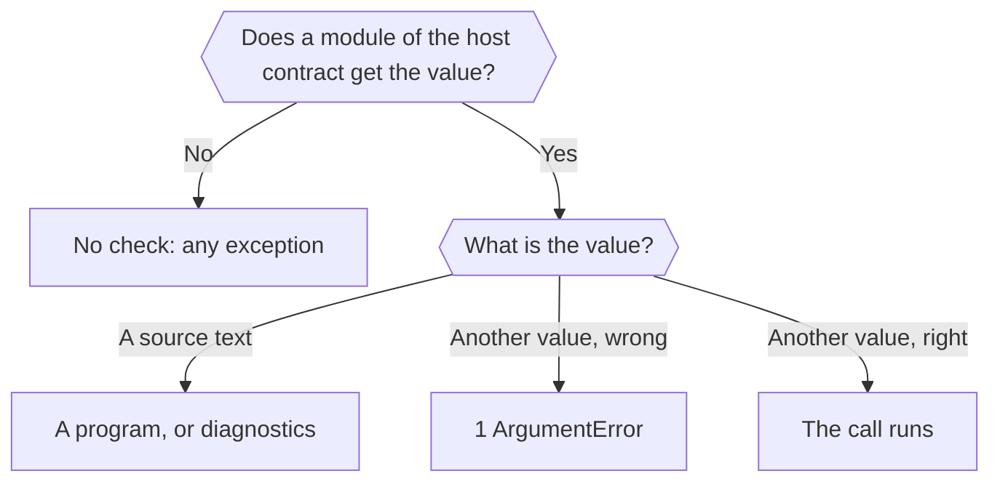

# 0008. Errors in the source and errors of the host

This record is for a contributor who adds a check, a public function or a value that a
[host](../../guides/reference/glossary.md#host) can give to logex. It says how logex
tells its caller of an error. An error in a source text is a
[diagnostic](../../guides/reference/glossary.md#diagnostic) that a
[compile](../../guides/reference/glossary.md#compile) returns. An error of the host is an
`ArgumentError` that logex raises. Read this record before you decide which of the 2 a
new check gives, and where the check runs.

## Status

Accepted. No later record replaces this record.

## Date

2026-09-29 (`PLAN.md` M1-5) to 2026-11-13. The last section lists the decisions.

## Context

A caller of logex can give 2 kinds of wrong value:

- An engineer writes the source text of a
  [program](../../guides/reference/glossary.md#program) with an error. Examples are a
  typing error in a name and a [tag](../../guides/reference/glossary.md#tag) of the
  wrong [type](../../guides/reference/glossary.md#type). The text is data. An error in it is
  normal work.
- A developer writes Elixir that gives logex a wrong argument. Examples are a value for a
  `var_output` tag given to `put_inputs/3`, and a
  [state](../../guides/reference/glossary.md#state) with a value outside the type of its
  tag. This is an error in the code of the host.

The engineer must see each error of the text, with its line, to correct the file in 1
pass. The developer must see the error at the call that has it, with a stack trace.

[IEC 61131-3](../../guides/reference/glossary.md#iec-61131-3) has no rule for the API of
a host (decision 514). Decision 182 says that Studio 5000 checks the tags and the code of
a [Logix](../../guides/reference/glossary.md#logix) project together before a download.
Thus Logix has no compiled program that a host can change. The source of this claim is
not recorded, and `docs/organisation.md` marks it as not verified.

Each rule of this record answers a case that logex handled badly in an earlier version.
For example, the dint `count` of the box counter held 5,000,000,000 in a state. `add`
then wrapped the count to 705,032,704 (decision 171). A program of 65,536 timers in nested arrays
compiled, and ran out of memory at its
[first scan](../../guides/reference/glossary.md#first-scan) (decision 370). A box counter
of 2,000 [rungs](../../guides/reference/glossary.md#rung) that name a renamed tag took
52 s to refuse (decision 520).

## Decision

[Runs and tables of the records: the core](../implementation/record-runs-core.md#0008-errors-in-the-source-and-errors-of-the-host) gives 13 wrong values to the motor, the box counter, the seal and the fan.
A number in brackets is a result of that run.

### The host contract

The [host contract](../../guides/reference/glossary.md#host-contract) is the modules
that check what a host gives them (decisions 514 and 523). A refusal is the
`ArgumentError` that a module of the contract raises for an error of the host.

| Group | In the host contract | Modules |
|---|---|---|
| The way in | Yes (decision 514) | `Logex`, `Logex.Runtime`, `Logex.Edit`, `Logex.Configuration`, `Logex.Configuration.Edit`, `Logex.Runner`, `Logex.IO` and `Logex.Tag.new!/5` |
| The tools of the host, and the parts of a configuration | Yes (decision 523) | `Logex.Configuration.Task`, `Global`, `Instance` and `Connection`, `Logex.IO.Point`, `Logex.IO.Sim`, `Logex.Runner.Clock`, `Clock.Manual` and `Clock.Monotonic` |
| The rest | No | `Logex.Compiler`, `Logex.Configuration.Text`, `Logex.Declarations`, `Logex.Diagnostic`, `Logex.Fault`, `Logex.FbType`, `Logex.FbType.Member`, `Logex.Instance`, `Logex.Lexer`, `Logex.Parser`, `Logex.Printer`, `Logex.Program`, `Logex.Scan`, `Logex.Walk` and `Logex.Warnings` |

The moduledoc of each module outside the contract ends with the same sentence. It starts:
"Outside the host contract, this module takes logex's own data unguarded".
`test/logex/runtime_test.exs` checks it (result 13).

### 2 questions pick the answer

Ask 2 questions about a value that the host gives. Does a module of the
[host contract](#the-host-contract) get the value? Can a source text give the error in
it? The answers pick what logex does.

| What the host gives | Who made the error | What logex does |
|---|---|---|
| A source text of a program, a [function block](../../guides/reference/glossary.md#function-block) or a [configuration](../../guides/reference/glossary.md#configuration) | The engineer | Returns `{:error, diagnostics}`. Each diagnostic is a `%Logex.Diagnostic{}` with its stage, line, column and file where logex knows them |
| A configuration that the host builds in Elixir, with an error that a text can also have | The engineer, through the host | `Logex.Configuration.check/1` returns a diagnostic with the words of the text and no line. `Logex.Configuration.new!/1` and `Logex.Runtime.start/1` raise its message |
| An argument, a state or a program that no text can give | The host | Raises 1 `ArgumentError` at the call that gets it. Each error is 1 line of the message |
| An argument to a module outside the host contract | The host | No check. The module takes logex's own data, and a wrong argument can raise any exception (result 13) |

> #### Caution {: .error}
>
> Do not let a module of the host contract raise an exception that is not
> `ArgumentError`. Give an error in a source text a diagnostic. Give an error of the host
> 1 `ArgumentError`, and compare its whole message in an ExUnit test.
>
> `test/logex/api_contract_test.exs` makes seeded random calls to the host contract. A
> new kind of refusal adds its first words to `@refusals` there, or the walk fails.

Figure: the 2 questions. A wrong value to a module of the host contract ends in
diagnostics or in 1 `ArgumentError`, and in no other exception. Only
`Logex.Configuration.check/1` returns diagnostics for a value that is not a text.

A compile returns each error of the text in line order (result 1). A lex or parse error
stops the compile, and it is the only diagnostic (result 2). A global that logex refuses
for its name gets 1 diagnostic, and the connections that name it get none (decision 42).

A value that no text can give is an `ArgumentError`, also inside a struct. Examples:

- a tree that `Logex.Parser.parse/1` cannot give (decision 28)
- a configuration struct whose name is not a string (decision 36)
- a program whose `add` writes to a tag of no integer type (decision 182, result 9)
- a [function block type](../../guides/reference/glossary.md#function-block-type) in
  `types:` that its own source text does not give (decision 54, result 10)

`Logex.Runtime.get/2` asks a question, so a path that names nothing is an answer:
`{:error, reason}`. `get!/2` raises an `ArgumentError` with that reason (decision 41,
result 11).

### Where each check runs

A check runs at the call where a value comes in from the host. A program gets its check
1 time, because a walk of its rungs on each scan costs too much (decision 190).

Each call that takes a state checks its values. A scan checks an instance and a global
of a resource as it takes them. A type in `types:` is compiled again from its text. The
page of the runs gives a table of each value and the call that checks it.

The check of a program finds only some hand edits. It finds an arithmetic or bitwise
[instruction](../../guides/reference/glossary.md#instruction) whose destination has no
type that it can calculate in (decision 182). It finds timer units, reals, arrays or
retained tags that do not agree with the tags (decision 197). logex trusts each other
hand edit.
For example, a contact on a bool tag that the host retypes to a dint reads 5 as closed.

The check of a state refuses a value outside the type of its tag, such as 37.5 in a bool
(result 8). It also refuses an instance that holds no map and a `last` of a timer later
than `now`. It refuses an [array](../../guides/reference/glossary.md#array) that is not
a tuple of its size. Each wrong value is 1 line of 1 message.

The loader of `Logex.compile_file/1` trusts its own types, and compiles each block file
of a chain 1 time (decision 371). No value that a host gives can reach that compile
(decisions 430 and 432).

### Each source text compiles or gets its diagnostics

A compile of any text gives a program, a type or diagnostics. It raises nothing, within
its bounds. A number has 10,000 characters at most, and a declaration 65,536 tags,
elements and instances (decisions 369, 370 and 403). Only the first 100 names that a text
cannot find get suggestions (decisions 520, 522 and 525). The page of the runs gives the
table of each bound.

The readers of the [store](../../guides/reference/glossary.md#store) and of the
[forces file](../../guides/reference/glossary.md#forces-file) also refuse a number of more
than 10,000 characters (decision 369).

A refusal of the host contract quotes a number whole up to 10,000 characters, as a
compile quotes a literal. It quotes a longer number by its first 24 characters and its
length (decisions 583, 584 and 586). It shows a text or a list as `inspect/1` shows it
(decision 585).

`test/logex/compile_total_test.exs` does a seeded walk of changed source texts. No text
raises. Each of the 3 compiles of `Logex` runs in a separate process, which
[`lib/logex/compiler/worker.ex`](../../lib/logex/compiler/worker.ex) starts. An
exception in it raises again in the caller with the same message (decisions 520 and
524).

## Consequences

The good results:

- An engineer sees each error of a text after 1 compile. Each diagnostic gives its line.
- An error of the host stops at the call that has it.
- No scan reads a value outside the type of its tag in the program's table.
- An ExUnit test can tell a bug from a refusal.
- A compile with many errors costs little more than a compile with few (decision 522).

The costs:

- Each call that takes a state examines each value of it. The check is linear, and each
  scan pays it (decision 171). The page of the runs gives a measurement.
- logex trusts a hand edit of a program that its check does not find (result 9).
- A [warm restart](../../guides/reference/glossary.md#warm-restart) keeps a 2 that a
  host put by hand into a bool global that no instance reads (decision 174).
- A module outside the contract does no check, so a wrong argument can raise
  `FunctionClauseError` (result 13).
- A compile that a different process kills stops its caller, also when the caller traps
  exits (decision 524).
- Each new kind of refusal needs a message and an ExUnit test that compares it whole. It
  also needs its first words in `@refusals` and a row in
  [Where each check runs](#where-each-check-runs).
  [The test strategy](../implementation/testing-strategy.md) gives the ExUnit tests.

## Alternatives considered

| Alternative | Why logex does not do it |
|---|---|
| Raise an exception for an error in a source text | An exception stops at the first error. M1-5 made `%Logex.Diagnostic{}` the error type of each stage, returned in a list (`PLAN.md` M1-5) |
| Refuse only 4 known cases of a tree built by hand | Each other malformed tree still raised `FunctionClauseError` (decision 28) |
| Read a value outside its type as it is, or bring it into its type | The box count wrapped, or showed 2,147,483,647 (decision 171) |
| Check a program on each call that takes it | Each scan of each program cost 13% to 28% more, only to find a program that no text gives (decision 190) |
| Guard each documented module | 118 calls in 40 functions take logex's own data. Their moduledocs state this (decision 514) |
| Each message lists the members | 16,000 unknown members of a block of 1,000 gave 174.5 MB of messages (decision 526) |

Section 7 gives the other options of each decision.

## The decisions that this record sums up

This record sums up these decisions of
[`docs/organisation.md`](../organisation.md#7-decisions):

- The rule and the host contract: 28, 36, 41, 42, 63, 514 and 523.
- Programs and types from the host: 54, 169, 182, 190, 194, 200, 371, 404, 430, 432
  and 436.
- States and resources: 171 to 174, 184 to 186 and 188.
- Globals from the host: 555, 575 to 577 and 588.
- A long value in a refusal of the host: 583 to 586.
- The bounds of a compile: 369, 370, 403, 429, 478, 520, 522 and 524 to 526.

[§4.6](../organisation.md#46-execution-model) of the same document says why the runtime
raises for a name that a program does not declare. Only a host can give such a name.
`PLAN.md` keeps the history in [M1-5](../../PLAN.md#m1-5--a-real-public-api).

[0005. Every tag is declared](0005-every-tag-is-declared.md) gives the checks of a
declaration. [0010. A fault does not stop a scan](0010-a-fault-does-not-stop-a-scan.md)
gives the [faults](../../guides/reference/glossary.md#fault) that a scan finds in a
correct program.
[Host contract](../../guides/reference/host-contract.md) and
[Diagnostics](../../guides/reference/diagnostics.md) give the rules for a user.
[Read a diagnostic](../../guides/howto/read-diagnostics.md) gives the steps.
