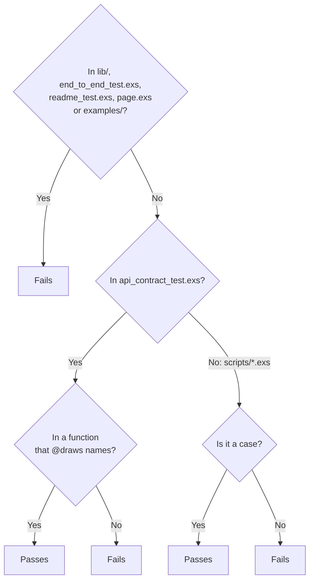

# 0009. Clauses, not conditionals

This record is for a contributor who writes Elixir code in logex, in `lib/`, a test, or a
script under `examples/` or `scripts/`. It is also for a contributor who sees
`test/logex/clauses_test.exs` fail. It gives the rule, the code that the rule covers, the
exceptions, what to do when the check fails, and what the rule makes possible.

## Status

Accepted. No later record replaces this record.

## Date

2026-02-28, the date of the first `CLAUDE.md`. The rule then covered more code, in 5
steps:

| Date | Commit | Change |
|---|---|---|
| 2026-02-28 | `9ff6b5d` | The first `CLAUDE.md` gives the rule |
| 2026-10-25 | `a9ae919` | 7 `case` expressions of `lib/` become clauses. A search of lines holds `lib/` to the 4 older ones |
| 2026-10-26 | `c5c8fff`, `6453938` | Decision 264 puts the oracles of the walks and of the end-to-end tests under the rule. `clauses_test.exs` checks them |
| 2026-11-01 | `c994b75`, `1ab6d89` | The harness of the examples, and the code outside each module |
| 2026-11-12 | `21ad039`, `1d0ec85` | `lib/` read as syntax trees, and each script under `examples/` |
| 2026-11-15 | `edc27ae` | `scripts/page.exs`, and each Elixir script under `scripts/` |

## Context

The first `CLAUDE.md` has 1 line for the rule: "Use pattern matching with multiple
function clauses, not conditionals". It gives no reason. Decision 264, `CLAUDE.md` and
`CONTRIBUTING.md` also give no reason. Thus this record does not give a motive. It says
what the rule makes possible, from `CONTRIBUTING.md`, and what the rule costs.

This page uses these words of the test code:

| Word | Meaning |
|---|---|
| Conditional | A `case`, `cond`, `if` or `unless` expression of Elixir |
| Test | An ExUnit test. This record does not use the word for the step of an [online edit](../../guides/reference/glossary.md#online-edit) |
| Walk | A test of `api_contract_test.exs` that makes random programs, [inputs](../../guides/reference/glossary.md#input) and steps from a seed, runs them in logex and compares each result with an oracle. It is not `Logex.Walk`, which walks the IR of a program |
| Draw | A function of a walk that makes a random program, input, step or [fault](../../guides/reference/glossary.md#fault), or writes a random program as text |
| Oracle | Test code that gives the expected result from the text of a program, with no call to the code that it checks |
| Harness | Test code that runs logex and compares its result with an oracle or with a page |

From 2026-02-28 to 2026-10-25, no test held the rule. On 2026-10-25, a test in
`test/logex/instance_array_test.exs` started to search each line of `lib/` for the 4
words. The walks and the end-to-end tests held 443 conditionals. The review of plan item
M5-15 asked the maintainer which code the rule covers:

- (a) `lib/` only.
- (b) `lib/`, and the oracle of each walk, with the draws free.
- (c) All test code, with a larger search.

The maintainer took (b). The search of lines had 2 defects. A review after Milestone 6
found them (finding a7-docs-9). The search found no conditional written on 1 line, such
as `if(x, do: 1)`. It also counted the word `case` in an example in the moduledoc of
`Logex.Runner` as code.

[IEC 61131-3](../../guides/reference/glossary.md#iec-61131-3) and
[Logix](../../guides/reference/glossary.md#logix) have nothing to say about this rule. It
is a rule for the Elixir code of logex, not for a ladder
[program](../../guides/reference/glossary.md#program).

## Decision

### The rule

Write each choice as a function with 1 clause for each case, with patterns and guards. Do
not write `case`, `cond`, `if` or `unless`. This is also true for a conditional on 1 line,
`if(x, do: 1, else: 0)`, and for a conditional through its module, `Kernel.if(x, do: 1)`.

These 2 blocks show the change of commit `a9ae919`. Before it, 2 functions of
`Logex.Compiler` each had the same `case` with 3 branches. Only the name of the variable
was different:

```diff
         for {_, %Tag{type: type}} <- tags,
-            name =
-              (case type do
-                 {:block, name} -> name
-                 {:array, {:block, name}, _dims} -> name
-                 _other -> nil
-               end),
+            name = held_name(type),
             name != nil,
```

After it, 1 function of 3 clauses has a name, and the 2 functions call it:

<!-- fragment: the 3 clauses of held_name/1 in lib/logex/compiler.ex -->
```elixir
defp held_name({:block, name}), do: name
defp held_name({:array, {:block, name}, _dims}), do: name
defp held_name(_other), do: nil
```

### The code that the rule covers

`clauses_test.exs` has a check that reads each file as a syntax tree, with
`Code.string_to_quoted/1`. The check finds each conditional and the function, test or
form that holds it. This table gives each part of the repository that the check reads,
and the rule for it. The last column counts the conditionals on `main` at `263fc95`:

| Code | Rule | Count |
|---|---|---|
| `lib/` | No conditional, except the 3 `case` expressions of `parser.ex` | 3 |
| The walks, `api_contract_test.exs` | A conditional only in a draw | 137, all in draws |
| `end_to_end_test.exs` | No conditional | 0 |
| The harness of the examples, `readme_test.exs` | No conditional | 0 |
| `scripts/page.exs`, which the harness reads each page through | No conditional. A `case` also fails here | 0 |
| Each script under `examples/` | No conditional | 0 |
| Each other Elixir script, `scripts/*.exs` | A `case` only | 22 `case` in 5 scripts |

Each module of the walks names its draws in `@draws`. Each name there must be a function
of the module. The check of the scripts also compares the names of the files
`scripts/*.exs` with a list of 7. A new `.exs` script fails until its name joins the
list. The check does not read a shell script under `scripts/`.

The check does not read a test file that the table does not name. On `main` at
`263fc95`, 21 such files hold 82 conditionals.

A second test also holds `lib/`, with a search of lines. It is the test "lib/ holds no
case, cond, if or unless but the parser's three and the runner's one" in
`instance_array_test.exs`. It finds only a conditional whose line ends in `do`. It expects
exactly 4 lines: the 3 `case` expressions of the parser, and 1 line of an example in the
moduledoc of `Logex.Runner`, `case Task.yield(task, 10) do`. A change to that line fails
the search of lines, but not `clauses_test.exs`.

The check reads these forms, in the body of a module and outside every module:

- a `def`, `defp`, `defmacro` or `defmacrop`
- a `test`, also in a `describe`
- a `setup`
- the anonymous function of a module attribute, such as `@pick fn x -> ... end`
- the body of the module itself, and the top level of the file

Only a function that `@draws` names can be a draw. A `setup`, an attribute and the top
level of a file are never draws.

The check counts only the 4 words. Runs of `clauses_test.exs` on a copy of the
repository, with 1 form added to `lib/logex/real.ex` each time, gave these results:

| Form added | Result |
|---|---|
| `def probe(x), do: if(x, do: 1, else: 0)` | Fails |
| `def probe(x), do: Kernel.if(x, do: 1)` | Fails |
| `@doc "if x, do: y; case z"` on a function | Passes: the words are in a string |
| `def probe(x), do: (with {:ok, y} <- x, do: y)` | Passes |
| An anonymous function with 2 clauses | Passes |
| `def probe(x), do: x && 1 \|\| 0` | Passes |
| A `receive` with 1 clause and `after 0` | Passes |

### The exceptions

The rule has 4 exceptions. `clauses_test.exs` names the first 3:

| Exception | Where | Why |
|---|---|---|
| 3 `case` expressions | `parser.ex`: `rungs/2`, `branch/2`, `legs/3` | No reason recorded |
| The draws | The functions that `@draws` names | Decision 264 |
| A `case` in a script | `scripts/*.exs`, not `page.exs` | No reason recorded |
| Other test files | Outside [the table](#the-code-that-the-rule-covers) | Decision 264 did not take option (c) |

Each of the 3 `case` expressions of the parser reads the result of a call of `branch/2` or
`legs/3`. `docs/organisation.md` and `PLAN.md` keep them and give no reason. The draws
are in the modules of `api_contract_test.exs`: decision 264 puts the oracles under the
rule and leaves the draws free. `CONTRIBUTING.md` and `clauses_test.exs` let a script use
a `case` to choose by the value of 1 expression, and give no reason.

### When the check fails

This diagram shows how the check judges 1 conditional that it finds:



Figure: the judgement of each conditional that the check finds. A file with no
conditional passes. In `lib/`, the 3 `case` expressions of the parser are a separate
list, and a 4th fails. The check does not read a test file outside the table.

The failure names the file or the module. Only the check of the scripts names the form
and the line. Runs on a copy gave these failures:

| Where the conditional is | What the failure names |
|---|---|
| `lib/` | The file and the word, `{"lib/logex/real.ex", :if}` |
| A walk | The module, `Logex.ApiContractTest: a conditional outside the draws` |
| `end_to_end_test.exs`, `readme_test.exs` or `page.exs` | The module, such as `Logex.EndToEndTest` |
| A script under `examples/` | The file and the form, `examples/fan.exs: "the file's top level"` |
| A script under `scripts/` | The file, module, function, line and word, `{"draw.exs", Draw, :probe, 29, :if}` |

To mend a failure, write the choice as function clauses. In a walk, a conditional can
stay only in a draw, a function that `@draws` names.

### What the rule makes possible

5 practices of `CONTRIBUTING.md` and `CLAUDE.md` need each rule of the code in a separate
clause:

- **A document cites a rule by its clause head.** A clause head stays the same when code
  before it in the file changes. A line number does not.
  [Anchor on names, not line numbers](../../CONTRIBUTING.md#anchor-on-names-not-line-numbers)
  gives the practice. An example is "the `{:xic, _, _}, {false, env}` clause of
  `evaluate/3`".
- **A mutation table removes 1 rule at a time.** `scripts/mutate.sh` applies each patch,
  runs the suite and restores the tree.
  [A fix needs a test that fails when the fix is reverted](../../CONTRIBUTING.md#a-fix-needs-a-test-that-fails-when-the-fix-is-reverted)
  tells you to revert "each clause, guard, fallback and sort the diff adds". A rule in its
  own clause is 1 patch that deletes the clause.
- **A cost bound measures the choice of a clause head.** A catch costs a reduction
  ([0019. Cost in reductions](0019-cost-in-reductions.md)). `tag_bit_test.exs` compares a
  [rung](../../guides/reference/glossary.md#rung) with a twin that is different only in
  a catch. Thus the scan runs an
  [instruction](../../guides/reference/glossary.md#instruction) through a catch only in 2
  cases:
  - Its clause head finds a [bit](../../guides/reference/glossary.md#bit) whose number is
    in a [tag](../../guides/reference/glossary.md#tag), or an
    [element](../../guides/reference/glossary.md#element) whose
    [subscript](../../guides/reference/glossary.md#subscript) is in a tag.
  - The instruction is a `cal`.
- **The clauses for `units: nil` and `reals: nil` come first.** `CLAUDE.md` asks for this
  order in `evaluate/3`. Thus a program with no real, whose
  [timers](../../guides/reference/glossary.md#timer) all count in milliseconds, does no
  look-up.
- **Each instruction has 2 clauses of `evaluate/3`.** 1 clause is for a
  [true rung](../../guides/reference/glossary.md#true-rung), `{true, env}`. 1 clause is for a
  [false rung](../../guides/reference/glossary.md#false-rung), `{false, env}`. The rules of
  [New instructions](../../CONTRIBUTING.md#new-instructions) and of `CLAUDE.md` ask for
  both clauses.

This clause of `element/3` in `Logex.Runtime` shows the cost bound. Its head puts the
catch only on an instruction with such a bit in its first
[operand](../../guides/reference/glossary.md#operand). 14 more clauses do the same for
the 2nd and 3rd operands. They also find an element, a [member](../../guides/reference/glossary.md#member) of an element, and a bit
of each:

<!-- fragment: the clause of element/3 for a bit in the first operand, in lib/logex/runtime.ex -->
```elixir
defp element({_, _, [{:bit_at, _, _, _, _, _} | _]} = instruction, acc, scan) do
  evaluate(instruction, acc, scan)
catch
  :throw, {@out_of_range, kind, read} -> out_of_range(instruction, acc, {kind, read})
end
```

### A clause that is not there

A missing clause does not give a wrong value. It stops the
[scan](../../guides/reference/glossary.md#scan). A run on a copy of the repository
removed this clause of `Logex.Runtime`:

<!-- fragment: the clause that the run removed, from lib/logex/runtime.ex -->
```elixir
defp evaluate({:xic, _, _}, {false, env}, _scan) do
  {false, env}
end
```

The program of the run has 1 rung, `xio stop xic start ote motor`. The run gives 1 new
[instance](../../guides/reference/glossary.md#instance) 2 scans. In scan 1, `stop`
is 0, and `motor` becomes 1. In scan 2, `stop` is 1, so the
[contact](../../guides/reference/glossary.md#contact) `xio stop` opens and the
[power flow](../../guides/reference/glossary.md#power-flow) to `xic start` is false. The
first line that the run prints gives the inputs and the
[outputs](../../guides/reference/glossary.md#output) of scan 1:

<!-- unchecked: the output of a run on a copy with 1 clause of evaluate/3 removed, 2026-11-23 -->
```text
%{"start" => 1, "stop" => 0}  %{"motor" => 1}
** (FunctionClauseError) no function clause matching in Logex.Runtime.evaluate/3

    The following arguments were given to Logex.Runtime.evaluate/3:

        # 1
        {:xic, 5, [{:name, 5, "start"}]}

        # 2
        {false, %{"motor" => 1, "start" => 1, "stop" => 1}}
```

The Elixir compiler printed nothing about the missing clause. Thus a new instruction needs
its `{false, env}` clause together with its `{true, env}` clause.
[Add an instruction](../implementation/adding-an-instruction.md) gives that step.

`scripts/mutate.sh` took the same clause as 1 patch of 4 deleted lines, on a copy, on
2026-11-23. With `end_to_end_test.exs` named, the named file failed 6 of 137 tests, and
the full suite failed 34 of 3,836 tests in 13 files. With only `evaluation_test.exs` and
`jump_test.exs` named, those 39 tests passed.

The 2 test files of the evaluator do not find the missing clause. Only the full suite
finds it. For this reason, `scripts/mutate.sh` judges a mutant by the full suite
([0020. Verify by a run](0020-verify-by-executing.md)).

## Consequences

The good results:

- A document can cite each rule of the code by a clause head. Each head names its case.
- A mutation table can remove each rule alone. A clause with no test that fails without
  it is a survivor in the table.
- A cost test can compare 2 programs that take 2 different clauses, and see the cost of
  the choice alone.
- An `if` with no `else` gives `nil`. A missing clause raises `FunctionClauseError` at the
  first input that needs it.
- A `case` that 2 functions repeat becomes 1 function with a name, such as `held_name/1`.
- The oracles of the walks and the harness of the pages obey the rules of `lib/`. A
  contributor reads 1 style in the code and in the code that checks it.

The costs:

- The code has more small private functions. `evaluate/3` has 68 clauses. A person who
  reads the code follows a name to its clauses to see a choice.
- The check reads syntax only. It does not count `with`, `&&`, `||`, `receive` or an
  anonymous function with clauses.
- 21 other files under `test/` hold 82 conditionals that no test checks. A draw can hold
  any conditional.
- A new `.exs` script under `scripts/` fails `clauses_test.exs` until its name joins the
  list of the test.
- 2 tests hold `lib/`. The search of lines fails when someone changes the line of the
  example in the moduledoc of `Logex.Runner`.

## Alternatives considered

- **`lib/` only, option (a) of the review.** Not taken: the maintainer took (b), and the
  record gives no other reason. With (a), the oracles of the walks keep their 443
  conditionals.
- **All test code, option (c) of the review.** Not taken, and the record gives no
  reason. The draws keep their conditionals: 123 of the 443 after decision 264, 137 on
  `main` at `263fc95`.
- **A search of lines as the only check of `lib/`.** It was the only check from
  2026-10-25 to 2026-11-12. Not taken after 2026-11-12, for its 2 defects: it found no
  conditional on 1 line, and it counted a `case` in a moduledoc as code. A syntax tree has
  neither defect: a string is a string, and `if(x, do: 1)` is a call of `if`. The search
  of lines is still a test in `instance_array_test.exs`.
- **A list of the oracles.** Not taken. The record names the oracles by what they are
  not: each function that `@draws` does not name. With a list of the oracles, a new
  oracle stays outside the rule until a contributor adds it to the list. With
  `@draws`, a new function is inside the rule until a contributor names it as a draw.
- **A check of only `def`, `defp` and `test`.** The first check of decision 264 read only
  these forms. Not taken after the review of the close of Milestone 5. With it, the check
  did not see a conditional in a `setup`, a macro, an attribute or the body itself. The
  check reads each form of a body. It also finds a conditional written as `Kernel.if`.
- **No `case` in any script.** Not taken, and the record gives no reason.
  `CONTRIBUTING.md` lets a script use "a `case` where a value is told apart, function
  clauses for the rest, and no `cond`, `if` or `unless`". `scripts/page.exs` has no
  `case`, because the harness of the examples reads each page through it.

## The decisions that this record sums up

This record sums up decision 264 of
[`docs/organisation.md`](../organisation.md#7-decisions). Decision 517 (b) puts the
examples under `examples/`, and decision 546 (d) makes `scripts/page.exs` the reading of
a page. `PLAN.md` keeps the history: question 5 of the review of M5-15, the review of
M5-14 (`a9ae919`) and finding a7-docs-9 of RV-8. The rule is in
[`CLAUDE.md`](../../CLAUDE.md#conventions), under "Clauses, not conditionals".
[The test strategy](../implementation/testing-strategy.md) gives the walks and their
oracles, and [Add an instruction](../implementation/adding-an-instruction.md) gives the 2
clauses of a new instruction.
