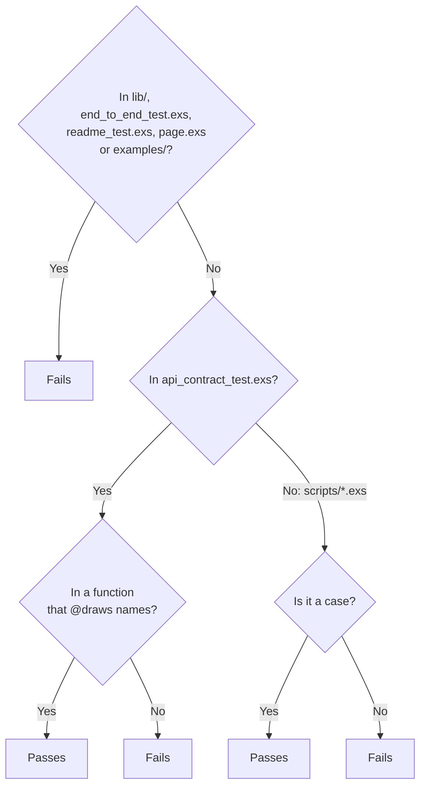

# 0009. Clauses, not conditionals

This record is for a contributor who writes Elixir code in logex, in `lib/`, an ExUnit test, or a
script under `examples/` or `scripts/`. It is also for a contributor who sees
`test/logex/clauses_test.exs` fail. It gives the rule, the code that the rule covers, the
exceptions, what to do when the check fails, and what the rule makes possible.

## Status

Accepted. No later record replaces this record.

## Date

2026-02-28, the date of the first `CLAUDE.md`, which gives the rule. Decision 264 is of
2026-10-26. The rule covered more code in 5 steps up to 2026-11-15.
[Runs and tables of the records: the practice](../implementation/record-runs-practice.md#0009-clauses-not-conditionals) gives each step with its commit.

## Context

The first `CLAUDE.md` has 1 line for the rule: "Use pattern matching with multiple
function clauses, not conditionals". It gives no reason. Decision 264, `CLAUDE.md` and
`CONTRIBUTING.md` also give no reason. Thus this record does not give a motive. It says
what the rule makes possible, from `CONTRIBUTING.md`, and what the rule costs.

This page uses these words of the code of the suite:

| Word | Meaning |
|---|---|
| Conditional | A `case`, `cond`, `if` or `unless` expression of Elixir |
| ExUnit test | A test of the suite. This record uses "test" alone for no other thing |
| Walk | An ExUnit test of `api_contract_test.exs` that makes random programs, [inputs](../../guides/reference/glossary.md#input) and steps from a seed. It compares each result with an oracle. It is not `Logex.Walk` |
| Draw | A function of a walk that makes a random program, input, step or [fault](../../guides/reference/glossary.md#fault) |
| Oracle | Code of the suite that gives the expected result from the text of a program, with no call to the code that it checks |
| Harness | Code of the suite that runs logex and compares its result with an oracle or with a page |

From 2026-02-28 to 2026-10-25, no ExUnit test held the rule. Then a search of each line
of `lib/` for the 4 words started. The walks and the end-to-end ExUnit tests held 443
conditionals. The review of plan item M5-15 asked the maintainer which code the rule
covers:

- (a) `lib/` only
- (b) `lib/` and the oracle of each walk, with the draws free
- (c) all the code of the suite

The maintainer took (b).

The search of lines had 2 defects (finding a7-docs-9). It found no conditional written on
1 line, such as `if(x, do: 1)`. It also counted the word `case` in an example in a
moduledoc as code.

[IEC 61131-3](../../guides/reference/glossary.md#iec-61131-3) and
[Logix](../../guides/reference/glossary.md#logix) have nothing to say about this rule. It
is a rule for the Elixir code of logex, not for a ladder
[program](../../guides/reference/glossary.md#program).

## Decision

### The rule

Write each choice as a function with 1 clause for each case, with patterns and guards. Do
not write `case`, `cond`, `if` or `unless`. This is also true for a conditional on 1 line,
`if(x, do: 1, else: 0)`, and for a conditional through its module, `Kernel.if(x, do: 1)`.

These 2 blocks show the change of commit `a9ae919`. Before it, 2 functions of
`Logex.Compiler` each had the same `case` with 3 branches. Only the name of the variable
was different:

```diff
         for {_, %Tag{type: type}} <- tags,
-            name =
-              (case type do
-                 {:block, name} -> name
-                 {:array, {:block, name}, _dims} -> name
-                 _other -> nil
-               end),
+            name = held_name(type),
             name != nil,
```

After it, 1 function of 3 clauses has a name, and the 2 functions call it:

<!-- fragment: the 3 clauses of held_name/1 in lib/logex/compiler.ex -->
```elixir
defp held_name({:block, name}), do: name
defp held_name({:array, {:block, name}, _dims}), do: name
defp held_name(_other), do: nil
```

### The code that the rule covers

`clauses_test.exs` has a check that reads each file as a syntax tree, with `Code.string_to_quoted/1`. It finds each conditional and the function,
ExUnit test or form that holds it. This table gives each part of the repository that the check
reads, and the rule for it:

| Code | Rule |
|---|---|
| `lib/` | No conditional, except the 3 `case` expressions of `parser.ex` |
| The walks, `api_contract_test.exs` | A conditional only in a draw |
| `end_to_end_test.exs` and the harness of the examples, `readme_test.exs` | No conditional |
| `scripts/page.exs`, which the harness reads each page through | No conditional. A `case` also fails here |
| Each script under `examples/` | No conditional |
| Each other Elixir script, `scripts/*.exs` | A `case` only |

Each module of the walks names its draws in `@draws`. A new `.exs` script under
`scripts/` fails until its name joins the list of the check. The check does not read a
shell script, or a file of the suite that the table does not name.
[Runs and tables of the records: the practice](../implementation/record-runs-practice.md#0009-clauses-not-conditionals) gives the count of conditionals in each part.

A second ExUnit test also holds `lib/`, with a search of lines, in
`instance_array_test.exs`. It expects exactly 4 lines: the 3 `case` expressions of the
parser, and 1 line of an example in the moduledoc of `Logex.Runner`.

The check reads each `def`, `defp`, `defmacro`, `defmacrop`, `test` and `setup`. It also
reads the anonymous function of a module attribute, the body of a module and the top
level of the file. Only a function that `@draws` names can be a draw. The check counts
only the 4 words. It finds `if(x, do: 1)` and `Kernel.if(x, do: 1)`. It passes `with`,
`&&`, `||`, `receive` and an anonymous function of 2 clauses.

### The exceptions

The rule has 4 exceptions. `clauses_test.exs` names the first 3:

| Exception | Where | Why |
|---|---|---|
| 3 `case` expressions | `parser.ex`: `rungs/2`, `branch/2`, `legs/3` | No reason recorded |
| The draws | The functions that `@draws` names | Decision 264 |
| A `case` in a script | `scripts/*.exs`, not `page.exs` | No reason recorded |
| Other files of ExUnit tests | Outside [the table](#the-code-that-the-rule-covers) | Decision 264 did not take option (c) |

Each of the 3 `case` expressions of the parser reads the result of a call of `branch/2` or
`legs/3`. `docs/organisation.md` and `PLAN.md` keep them and give no reason. The draws
are in the modules of `api_contract_test.exs`: decision 264 puts the oracles under the
rule and leaves the draws free. `CONTRIBUTING.md` and `clauses_test.exs` let a script use
a `case` to choose by the value of 1 expression, and give no reason.

### When the check fails

This diagram shows how the check judges 1 conditional that it finds:



Figure: the judgement of each conditional that the check finds. A file with no
conditional passes. In `lib/`, the 3 `case` expressions of the parser are a separate
list, and a 4th fails. The check does not read a file of ExUnit tests outside the table.

The failure names the file or the module. Only the check of the scripts names the form
and the line. To mend a failure, write the choice as function clauses. In a walk, a
conditional can stay only in a draw.

### What the rule makes possible

5 practices of `CONTRIBUTING.md` and `CLAUDE.md` need each rule of the code in a separate
clause:

- **A document cites a rule by its clause head.** A clause head stays the same when code
  before it in the file changes. A line number does not.
  [Anchor on names, not line numbers](../../CONTRIBUTING.md#anchor-on-names-not-line-numbers)
  gives the practice. An example is "the `{:xic, _, _}, {false, env}` clause of
  `evaluate/3`".
- **A mutation table removes 1 rule at a time.** `scripts/mutate.sh` applies each patch,
  runs the suite and restores the tree.
  [A fix needs a test that fails when the fix is reverted](../../CONTRIBUTING.md#a-fix-needs-a-test-that-fails-when-the-fix-is-reverted)
  tells you to revert "each clause, guard, fallback and sort the diff adds". A rule in its
  own clause is 1 patch that deletes the clause.
- **A cost bound measures the choice of a clause head.** A catch costs a reduction
  ([0019. Cost in reductions](0019-cost-in-reductions.md)). `tag_bit_test.exs` compares a
  [rung](../../guides/reference/glossary.md#rung) with a twin that is different only in
  a catch. Thus the scan runs an
  [instruction](../../guides/reference/glossary.md#instruction) through a catch only in 2
  cases:
  - Its clause head finds a [bit](../../guides/reference/glossary.md#bit) whose number is
    in a [tag](../../guides/reference/glossary.md#tag), or an
    [element](../../guides/reference/glossary.md#element) whose
    [subscript](../../guides/reference/glossary.md#subscript) is in a tag.
  - The instruction is a `cal`.
- **The clauses for `units: nil` and `reals: nil` come first.** `CLAUDE.md` asks for this
  order in `evaluate/3`. Thus a program with no real, whose
  [timers](../../guides/reference/glossary.md#timer) all count in milliseconds, does no
  look-up.
- **Each instruction has 2 clauses of `evaluate/3`.** 1 clause is for a
  [true rung](../../guides/reference/glossary.md#true-rung), `{true, env}`. 1 clause is for a
  [false rung](../../guides/reference/glossary.md#false-rung), `{false, env}`. The rules of
  [New instructions](../../CONTRIBUTING.md#new-instructions) and of `CLAUDE.md` ask for
  both clauses.

A missing clause does not give a wrong value. It stops the
[scan](../../guides/reference/glossary.md#scan) with `FunctionClauseError`, and the
Elixir compiler prints nothing about it. In a run, the `{false, env}` clause of `xic` was
removed. The 2 files of ExUnit tests of the evaluator passed, and only the full suite
failed.

Thus `scripts/mutate.sh` judges a mutant by the full suite
([0020. Verify by a run](0020-verify-by-executing.md)). [Runs and tables of the records: the practice](../implementation/record-runs-practice.md#0009-clauses-not-conditionals) gives the run.

## Consequences

The good results:

- A document can cite each rule of the code by a clause head. Each head names its case.
- A mutation table can remove each rule alone. A clause with no ExUnit test that fails without
  it is a survivor in the table.
- An ExUnit test of cost can compare 2 programs that take 2 different clauses, and see the cost of
  the choice alone.
- An `if` with no `else` gives `nil`. A missing clause raises `FunctionClauseError` at the
  first input that needs it.
- A `case` that 2 functions repeat becomes 1 function with a name, such as `held_name/1`.
- The oracles of the walks and the harness of the pages obey the rules of `lib/`. A
  contributor reads 1 style in the code and in the code that checks it.

The costs:

- The code has more small private functions. `evaluate/3` has 68 clauses. A person who
  reads the code follows a name to its clauses to see a choice.
- The check reads syntax only. It does not count `with`, `&&`, `||`, `receive` or an
  anonymous function with clauses.
- 21 other files under `test/` hold conditionals that no ExUnit test checks. A draw can
  hold any conditional.
- 2 ExUnit tests hold `lib/`. The search of lines fails when someone changes the line of
  the example in the moduledoc of `Logex.Runner`.

## Alternatives considered

- **`lib/` only, option (a) of the review.** Not taken: the maintainer took (b), and the
  record gives no other reason. With (a), the oracles of the walks keep their 443
  conditionals.
- **All the code of the suite, option (c) of the review.** Not taken, and the record gives
  no reason.
- **A search of lines as the only check of `lib/`.** Not taken after 2026-11-12, for its 2
  defects. A syntax tree has neither defect: a string is a string, and `if(x, do: 1)` is
  a call of `if`.
- **A list of the oracles.** Not taken. With a list, a new oracle stays outside the rule
  until a contributor adds it. With `@draws`, a new function is inside the rule until a
  contributor names it as a draw.
- **A check of only `def`, `defp` and `test`.** Not taken after the review of the close of
  Milestone 5. It did not see a conditional in a `setup`, a macro, an attribute or the
  body itself.
- **No `case` in any script.** Not taken, and the record gives no reason.

## The decisions that this record sums up

This record sums up decision 264 of
[`docs/organisation.md`](../organisation.md#7-decisions). Decision 517 (b) puts the
examples under `examples/`, and decision 546 (d) makes `scripts/page.exs` the reading of
a page. `PLAN.md` keeps the history: question 5 of the review of M5-15, the review of
M5-14 (`a9ae919`) and finding a7-docs-9 of RV-8. The rule is in
[`CLAUDE.md`](../../CLAUDE.md#conventions), under "Clauses, not conditionals".
[The test strategy](../implementation/testing-strategy.md) gives the walks and their
oracles, and [Add an instruction](../implementation/adding-an-instruction.md) gives the 2
clauses of a new instruction.
