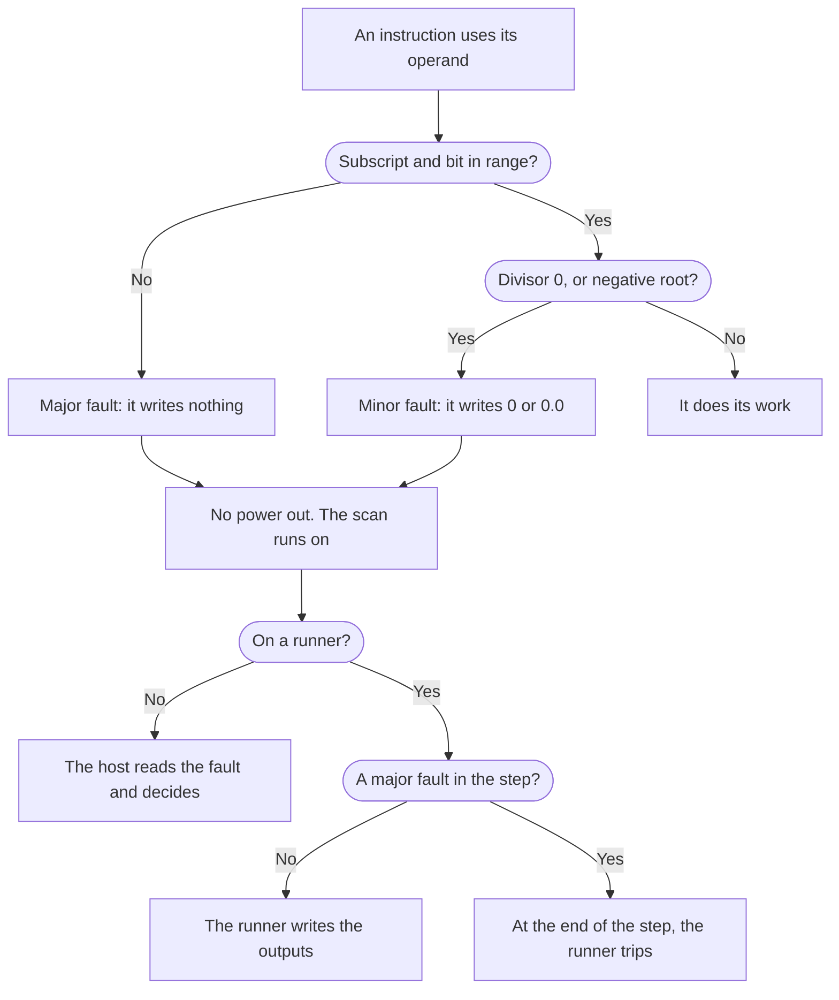

# 0010. A fault does not stop a scan

This record is for a contributor who adds an
[instruction](../../guides/reference/glossary.md#instruction) that can read a bad value
while a [program](../../guides/reference/glossary.md#program) runs. It is also for a
contributor who changes how `Logex.Runtime` reports a
[fault](../../guides/reference/glossary.md#fault), or how `Logex.Runner` trips on one. It
says why a divisor of 0 or a subscript out of range does not stop the
[scan](../../guides/reference/glossary.md#scan). It says why a fault is data, and why
only a [major fault](../../guides/reference/glossary.md#major-fault) trips the
[runner](../../guides/reference/glossary.md#runner). If you add an instruction, read
[What a new instruction must do](#what-a-new-instruction-must-do) first.
[Faults](../../guides/reference/faults.md) gives each rule for a user.

## Status

Accepted. No later record replaces this record. Decisions 153 and 160 amend decision 99,
in which only a divisor of 0 was a fault. They add a reason to the
[trip](../../guides/reference/glossary.md#trip) of decision 113. Decision 233 changes
the form of the field `read` of an index fault, from a list to a tuple.

## Date

2026-10-14, the date of decisions 78 and 99 (`PLAN.md` M3-3). Decisions 153, 160, 164,
165 and 167 are of 2026-10-21. Decisions 210 and 211 are of 2026-10-23, and decision 233
of 2026-10-24.

## Context

A program reads values from the [plant](../../guides/reference/glossary.md#plant) while it
runs. Some values are outside what an instruction can use. The compiler cannot find them,
because they come from a [tag](../../guides/reference/glossary.md#tag) at run time. On
the BEAM, the Erlang function that does the same work raises for most of them, or gives
a wrong value. Examples are a divisor of 0 and a
[subscript](../../guides/reference/glossary.md#subscript) or a
[bit](../../guides/reference/glossary.md#bit) number out of range. The page of the runs
gives what the BEAM does for each case.

An exception from a scan is neither of the 2 errors of the
[host contract](../../guides/reference/glossary.md#host-contract): the program and the
host are both correct here. The value comes from the plant.

[IEC 61131-3](../../guides/reference/glossary.md#iec-61131-3) and the controllers do
different things. IEC 61131-3 calls a division by 0 an error and resets ENO (Ed 3
§6.6.2.5.8). For [Logix](../../guides/reference/glossary.md#logix), the sources give
these facts:

- A subscript out of range is the major fault 4/20 (1756-RM018A p.884, 1756-PM014O p.20).
  A major fault stops the logic (1756-PM014O p.9).
- If a handler of faults clears the fault, "the faulted instruction does not run and
  execution resumes with the next instruction" (1756-PM014O p.9).
- A fault inside an Add-On Instruction aborts the rest of it (1756-PM014O pp.9 and 10).
- The manuals ask for a bit number in the range of the integer (1756-PM004L p.44). They do
  not give the fault.
- `SQRT` takes the absolute value of the source, with no fault (1756-RM018A p.474).
- `DIV` with a divisor of 0 gives Source A, and the minor fault 4/4. The source is the
  stanza of `div` in [the names](../naming.md).

[Runs and tables of the records: faults](../implementation/record-runs-faults.md#0010-a-fault-does-not-stop-a-scan) gives the answers of IEC 61131-3, Logix, MatIEC, Siemens and CODESYS for each
case.

## Decision

[Runs and tables of the records: faults](../implementation/record-runs-faults.md#0010-a-fault-does-not-stop-a-scan) shows each rule of this section in a run. A number in brackets is a result
of that run.

### An instruction does a defined thing, and the scan runs on

For each case of the Context, logex gives 1 defined result. The instruction sets its
[power](../../guides/reference/glossary.md#power-flow) out, as the table gives. The rest
of the [rung](../../guides/reference/glossary.md#rung) runs on that power, and the next
rungs run. The scan always gets to its last rung (result 1).

| Case | The instruction writes | Power out | Fault |
|---|---|---|---|
| `div` or `mod` with a divisor of 0 or 0.0 | 0, or 0.0 to a real | No | `:divide_by_zero`, minor |
| `sqrt` of a value less than 0 | 0.0 | No | `:negative_sqrt`, minor |
| A subscript in a tag, outside its dimension | Nothing | No | `:index_out_of_range`, major |
| A bit number in a tag, outside the bits of its [type](../../guides/reference/glossary.md#type) | Nothing | No | `:bit_out_of_range`, major |
| A shift or a rotate with a count less than 0 | The source, with no shift | No | None |
| `shl` or `shr` with a count of the width or more | 0 | The power in | None |
| `rol` or `ror` with a count of the width or more | The rotate by the count modulo the width | The power in | None |
| An integer result outside its type | The low bits, a [wrap](../../guides/reference/glossary.md#wrap) | No | None |

The rows come from decisions 78, 99, 153, 160, 164 and 165. The last row is the wrap of
decision 146, which is not a fault
([0006. The types of IEC 61131-3 and overflow](0006-iec-types-and-overflow.md)).

### What a new instruction must do

If you add an instruction that can read a bad value at run time, do these 4 things:

1. Give the instruction 1 defined result for each bad value, and no power out. Say in its
   decision which kind of fault it is.
2. Check the value before you call the BEAM. Never let the BEAM raise.
3. Make the compiler refuse a literal that gives a fault on each scan (decision 167).
4. Add a new kind of fault to `Logex.Fault` and to
   [Faults](../../guides/reference/faults.md). Add an ExUnit test to
   `test/logex/fault_test.exs`, and add the kind to the walks.

[Add an instruction](../implementation/adding-an-instruction.md) gives all the steps.

### A fault is data

A fault is a `%Logex.Fault{}`, plain data. logex reports it. It never raises it
(decision 99). The struct gives the `severity`, `:minor` or `:major` (decisions 153 and
160), and the `kind`. It also gives the `instruction`, the `path` of a block instance, the
`file`, the `line` and the value `read`.

The set of kinds is open, so a host must not fail on a kind that it does not know. `read`
is a tuple and not a list, because `inspect/1` shows the list `[8]` as `~c"\b"`
(decision 233).

The host finds the faults in 2 places (decision 99):

| The host runs | Where the faults are |
|---|---|
| `Logex.Runtime.scan/2`, `scan/3` or `call/4` on 1 [instance](../../guides/reference/glossary.md#instance) | `state.faults`: each fault of the last scan, in the sequence of the scan. It is `[]` for a scan with no fault |
| `Logex.Runtime.cycle/3` on a [resource](../../guides/reference/glossary.md#resource) | The event `{:fault, task, instance, fault}`, directly after the event `{:ran, task, instance, now}` of its scan. `task` is `:none` for the programs with no task |

A runner sends the events of the kind `:fault` to a subscriber by default.

The field `faults` of an instance starts as `[]`, and each scan replaces it.
`put_inputs/3`, `restart/3` and the switch of an
[online edit](../../guides/reference/glossary.md#online-edit) keep it. A resource keeps
no fault: a [cycle](../../guides/reference/glossary.md#cycle) gives its faults as events.

### A minor fault reports, and a major fault trips the runner

After a [minor fault](../../guides/reference/glossary.md#minor-fault), the plant runs on.
The runner sends the event and writes the outputs of the
[round](../../guides/reference/glossary.md#round).

After a major fault, the step of the round that found it runs to its end (decisions 153
and 160). No later step of the round runs, and the runner does not write the outputs of
the round. The [trip](../../guides/reference/glossary.md#trip) then writes 0 to each
[output](../../guides/reference/glossary.md#output), through each
[device](../../guides/reference/glossary.md#device) that answers (decision 262). The
reason of the trip, `{:fault, task, instance, fault}`, names the first major fault of the
round. It names the fault also if the step was late for its
[watchdog](../../guides/reference/glossary.md#watchdog) (decision 211).

`cycle/3` does not trip. It runs each task that is due, and gives the events. The host
decides what to do (result 3).

> #### Warning {: .warning}
>
> Do not use a major fault or a trip as a safety function. The trip writes 0 only through
> a device that answers, and only while the Elixir VM runs.
> [Safety and limits](../../guides/explanation/safety-and-limits.md) gives the limits.

### logex checks only an operand that the instruction uses

logex reads a tag that holds a subscript or a bit number only when the instruction reads
or writes the element or the bit. Thus a
[contact](../../guides/reference/glossary.md#contact), a comparison, `move`, `div` or
`sqrt` on a [false rung](../../guides/reference/glossary.md#false-rung) finds no fault.
So does an instruction that a [jump](../../guides/reference/glossary.md#jump) skips. `ote`
on a false rung writes 0, and thus checks its
[operand](../../guides/reference/glossary.md#operand).

A `cal` whose operand is out of range does nothing (decision 210, result 2). The body does
not run, each output keeps its value, and the power out is false. If the copy out reads
the operand, logex discards the run of the body. A major fault in the body of a block does
not stop the body, where Logix aborts the rest of an Add-On Instruction.

### How the code does it

A read or a write through a tag subscript or a tag bit number throws the fault when the
value is out of range. A `catch` writes the fault under the key `:faults` of the env. A
`catch` costs 1 reduction, so only `cal` and an instruction with such a tag among its first
3 operands have one. `div`, `mod` and `sqrt` throw nothing: their clauses write the minor
fault. [The runtime and the evaluator](../architecture/runtime-and-evaluator.md) gives the
functions.

Figure: the path of a fault. The runtime checks the range before the value. With a lone
instance or `cycle/3`, the host decides. Only a runner trips, and only on a major fault.

## Consequences

The good results:

- A scan always gets to its last rung. No value from the plant makes the core raise.
- Each instruction has 1 defined result for each bad value.
- A fault names the instance, the file, the line, the instruction and the value.
- The host decides for a lone instance and for `cycle/3`. Only the runner trips.

The costs:

- A host that reads no `state.faults` and no event does not see a minor fault. The
- A host that reads no `state.faults` and no event does not see a minor fault. The
  value 0 looks like a correct value.
- `state.faults` holds only the faults of the last scan.
- A major fault stops the whole plant, also a fan that must run on (decision 113).
- A retained subscript that tripped the plant trips it again after a
  [warm restart](../../guides/reference/glossary.md#warm-restart) (decision 284).
- logex runs the faulting step to its end, where Logix stops the logic
  (1756-PM014O p.9). Thus the state that `get/2` reads after a trip is not the state that
  a Logix controller keeps. Neither writes the outputs of the round.
- Each `cal` costs 1 reduction more for its `catch`. So does each instruction with a
  subscript or a bit number in a tag among its first 3 operands.

## Alternatives considered

| Alternative | Why logex does not do it |
|---|---|
| A division by 0 gives Source A, as Logix does | Source A looks like a correct answer. IEC's ENO, MatIEC and STEP 7 Safety give 0 (decision 78) |
| A division by 0 gives 0 and no report | The host must know of each division by 0 (decision 78) |
| An index out of range is a minor fault | Logix raises a major fault, and the S7-1500 stops (decision 153) |
| The nearest subscript, or a subscript that wraps | A slot gets the weight of a different box, and nothing tells the host. No vendor does it (decision 153) |
| A negative root gives the root of its absolute value, as Logix does | A root of -0.25 that reads as 0.5 hides the rounding before it (decision 164) |
| A negative root gives NaN, as IEC 60559 does | logex keeps NaN out of each state (decisions 150 and 164) |

Section 7 gives the other options of each decision.

## The decisions that this record sums up

This record sums up 10 decisions of
[`docs/organisation.md`](../organisation.md#7-decisions):

- a fault as data, and the minor faults: 78, 99, 164 and 167
- the major faults: 153, 160, 210, 211 and 233
- the negative count of a shift, which is not a fault: 165

[§4.12](../organisation.md#412-data-types-milestone-5) of the same document gives the
design of the major fault, with its sources. `PLAN.md` keeps the history in M3-3, M5-8,
M5-9, M5-10 and M5-12.

It also uses decisions that other records sum up:

- Decision 113, the trip, and decision 262, the 0 written again at each poll:
  [0013. Watchdogs and the trip](0013-watchdogs-and-the-trip.md).
- Decision 146, the wrap, and decision 150, no NaN:
  [0006. The types of IEC 61131-3 and overflow](0006-iec-types-and-overflow.md).
- Decision 284, a retained value that trips again:
  [0016. Retained values and starts](0016-retained-values-and-starts.md).

[Faults](../../guides/reference/faults.md) gives the rules for a user.
[Trips and watchdogs](../../guides/explanation/trips-and-watchdogs.md) gives the model.
[Find why a plant tripped](../../guides/howto/find-why-a-plant-tripped.md) and
[Restart after a trip](../../guides/howto/restart-after-a-trip.md) give the steps.
