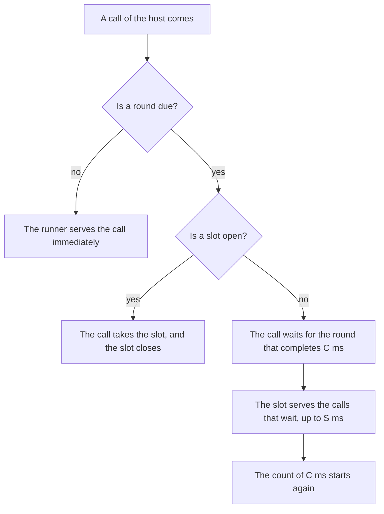

# 0011. Tasks and rounds

This record is for a contributor who changes how logex runs the
[tasks](../../guides/reference/glossary.md#task) of a
[configuration](../../guides/reference/glossary.md#configuration). That work is in the
schedule of `Logex.Runtime`, or in the rounds and the share of `Logex.Runner`. The record
says why 1 [cycle](../../guides/reference/glossary.md#cycle) runs the
[due](../../guides/reference/glossary.md#due) tasks by
[priority](../../guides/reference/glossary.md#priority) and never interrupts a
[scan](../../guides/reference/glossary.md#scan). It says why a late task runs 1 time and
counts the periods that it missed. It says why the
[runner](../../guides/reference/glossary.md#runner) makes its
[rounds](../../guides/reference/glossary.md#round) back to back. It also says why the
runner keeps a [share](../../guides/reference/glossary.md#share) of the time for the
calls of the [host](../../guides/reference/glossary.md#host).

[Tasks and the schedule](../../guides/explanation/tasks-and-scheduling.md) gives the
model for a user.

> #### Warning {: .warning}
>
> Do not use logex for a safety function, such as an emergency stop. The e-stop of the
> example is a signal that a program records. The e-stop that cuts the power must work
> with logex stopped.
>
> A task of priority 0 does not interrupt a round. It waits until the round in progress
> ends, and logex gives no limit for that wait. The watchdog of the continuous task, 500 ms
> by default, trips the runner only after a long round ends.
> [Safety and limits](../../guides/explanation/safety-and-limits.md) gives each limit.

## Status

Accepted. No later record replaces this record.

An untimed instance is an [instance](../../guides/reference/glossary.md#instance) of the
[continuous task](../../guides/reference/glossary.md#continuous-task), or an instance
with no task. Decision 122 changes 2 rules of decision 108:

- Decision 108 runs the rounds of the untimed instances back to back with no limit.
  Decision 122 runs 1 of these rounds in each millisecond of the clock at most. A
  change of a trigger that a device reports, or a
  [force](../../guides/reference/glossary.md#force), still makes its round immediately.
- Decision 108 runs a due task between 2 rounds. Decision 122 runs it at the start of the
  next round.

Decision 50 left a risk to the runner: 2 event tasks that set each other's trigger can
make rounds with no end. Decision 123 closes this risk. Decision 396 extends the share of
decision 108 to a plant with no untimed instance. Decision 442 keeps a slot that finds no
call open until the next call.

## Date

2026-09-28, the date of decision 11. Each part of the record has its date:

- 2026-09-28: decision 11, the rules of the schedule.
- 2026-10-02: decisions 37, 38 and 39, from the design of Milestone 2.
- 2026-10-04: decisions 50, 51 and 52, from a spike of the
  [event tasks](../../guides/reference/glossary.md#event-task). The event tasks are
  available on 2026-10-12.
- 2026-10-17: decisions 108, 111, 112, 120 and 121, from the design of the runner.
- 2026-10-18: decisions 122 and 123, after the review of the first part of the runner.
- 2026-11-01: decisions 350, 375 and 396, after the review of Milestone 6. Decision 396 is
  available on 2026-11-03.
- 2026-11-04: decision 442. 2026-11-08: decision 471.

## Context

[IEC 61131-3](../../guides/reference/glossary.md#iec-61131-3) gives 4 rules for a task
(Ed 2 §2.7.2, p.115):

| Rule | What IEC 61131-3 says |
|---|---|
| 1 | A task with `SINGLE` runs its [programs](../../guides/reference/glossary.md#program) on each [rising edge](../../guides/reference/glossary.md#rising-edge) of its input |
| 2 | A task with `INTERVAL` runs its programs at that interval while `SINGLE` is 0 |
| 3 | Of the programs that wait, the program with the longest wait at the highest priority runs |
| 4 | A program with no task runs again as soon as its run ends |

IEC 61131-3 lets the priority be "preemptive or non-preemptive" (Ed 2 §2.7.2, p.114). It
does not give the sequence of the programs in a task. It makes a missed deadline an error
that the system reports.

A [Logix](../../guides/reference/glossary.md#logix) controller has 1 continuous task at
most, at the lowest priority. "When the continuous task
completes a full scan, it restarts immediately" (the tasks, programs and routines manual,
p.8). Its periodic tasks and event tasks interrupt the continuous task. A share of the
time, the system overhead time slice, goes to the communication of the controller. Its
default is 20 %.

logex has 3 facts that these rules must fit:

- **A scan takes no time in the model.**
  [0007. The host gives the time](0007-the-host-gives-the-time.md) gives the reason. If a
  run takes no time, rule 4 is a loop with no end.
- **A cycle is a function of its arguments.** The same arguments must give the same
  events, on each machine and in each case of the suite.
- **The runner is 1 process.** The runner serves the calls of the host between 2 rounds.
  A host that asks for the status in a loop, such as an HMI, must not stop the
  [plant](../../guides/reference/glossary.md#plant). The plant must not stop the HMI.

The plant of the design shows what the rules must do. The conveyor is due every 10 ms.
The fan is due 2 times in each second. The e-stop has an event task. The program `boxes`
and its "case full" lamp have no interval. They must respond fast.

## Decision

### 1 cycle of the core

`Logex.Runtime.cycle/3` is 1 cycle. A cycle reads the
[trigger](../../guides/reference/glossary.md#trigger) of each event task 1 time, after it
merges the [inputs](../../guides/reference/glossary.md#input) and before any scan. Then it
runs each task that is due, and then each untimed instance. A scan always runs to its
end. logex never interrupts a scan, so the priority gives only the sequence.

The due times of a [periodic task](../../guides/reference/glossary.md#periodic-task) stay
on a grid: the time of the start plus whole intervals.

| Rule | What logex does |
|---|---|
| The priority | Each timed task must have one, from 0 to 65535. 0 is the highest (decisions 11 and 37) |
| A tie of priority | The task with the earlier due time runs first. The due time of an event task is the time of the cycle (decision 11) |
| A tie of due time | The task whose line comes first in the configuration runs first (decision 11) |
| The instances of a task | They run in the sequence of their `program` lines (decision 11) |
| The continuous task | Its instances run last, 1 time in each cycle. It is never due and never misses a period (decision 111) |
| A late periodic task | It runs 1 time, and counts each other due time that passed as an [overlap](../../guides/reference/glossary.md#overlap): 3 due times give 1 run and 2 overlaps. It reports `{:overlap, task, missed}`. Its due times stay on the grid (decision 11) |
| An event task | It is due when the cycle samples 1 from its trigger and the last sample was 0. A trigger that is 1 in the first cycle counts (decision 11) |
| A pulse of a trigger between 2 cycles | No cycle sees it (§4.6) |
| A trigger that logic writes | The next cycle samples it (decision 50) |
| A task with `single` and `interval` | It runs 1 time in a cycle at most. It skips a due time while the cycle samples 1 from its trigger, and does not count it. Its due times stay on the grid (decision 39) |
| A late cycle that samples a rise | It runs the task 1 time. logex judges the due times since the last cycle by this sample, 1, so it skips them and does not count them (decision 51) |
| A late cycle that samples a fall | It runs the task 1 time, for a due time that came while the input image held 1. It counts the other due times that passed as overlaps (decision 52) |
| `Logex.Runtime.next_due_in/1` | It counts the periodic due times only. With event tasks or untimed instances only, it gives `:infinity` (decision 50) |
| The first cycle | The host must run it immediately after `Logex.Runtime.start/1` and `Logex.Runtime.restart/2`, whatever `next_due_in/1` gives (decision 50) |
| `Logex.Runtime.restart/2` | It starts each instance again. It keeps the clock and the input image, and sets each count of overlaps to 0 (decision 38) |
| `Logex.Runtime.overlaps/1` | It gives the count of overlaps of each task (decision 38) |

A [configuration file](../../guides/reference/glossary.md#configuration-file) declares
the continuous task with its own line, for example `task main continuous watchdog 200`.
A configuration has 1 continuous task at most, and its line takes no `interval`, no
`single` and no `priority`. A `program` line with `with main` means the same as a line
with no `with`. The events name the continuous task if the configuration declares it,
and `:none` if it does not (decision 111).
[Configuration file](../../guides/reference/configuration-file.md) gives the lines of a
task and each message of `Logex.Configuration.compile/3`.

A [trip](../../guides/reference/glossary.md#trip) can stop a round between 2 steps. A
step is the run of 1 task in a round. 2 rules keep the trigger of a later event task
correct (decisions 350 and 375):

- The runner records a rise as the last sample of a trigger only when the step of its
  event task runs. A round that a trip stops before that step keeps the old sample. The
  event task then runs in the next cycle that samples the rise, for example the first
  cycle after a [warm restart](../../guides/reference/glossary.md#warm-restart).
- The runner records a sample of 0 immediately. Thus the next rise counts.

A probe on the runner shows the first rule. It is not in the example of this record. In
the probe, the eye latches `arm`, and the event task counts a box and clears `arm`. A
[fault](../../guides/reference/glossary.md#fault) of a periodic task trips the round
before the step of the event task:

| | After the trip | After the warm restart |
|---|---|---|
| The count of the event task | 0 | 1 |
| `arm` | 1 | 0 |

The case "a trigger's rise a trip cut off (decision 350)" in
`test/logex/retain_store_test.exs` checks the same rule, with the same `arm`.

The [retained image](../../guides/reference/glossary.md#retained-image) and the
[store](../../guides/reference/glossary.md#store) keep the old sample also.
[0016. Retained values and starts](0016-retained-values-and-starts.md) gives the rules of
the sample at a start.

### When the runner makes a round

`Logex.Runner` makes rounds on its [clock](../../guides/reference/glossary.md#clock). A
round takes the inputs, runs 1 cycle and writes the
[outputs](../../guides/reference/glossary.md#output). The runner sleeps to absolute times
on its clock, so the due times stay on their grid.

| Cause | When the round runs |
|---|---|
| A start or a [restart](../../guides/reference/glossary.md#restart) | Immediately (decision 50) |
| The configuration has an untimed instance | Back to back, 1 round in each millisecond of the clock at most. After a round of 1 ms or more, the next round runs immediately (decisions 108 and 122) |
| A periodic task is due | At its due time. If a round is in progress, at the start of the next round (decisions 108 and 122) |
| A [device](../../guides/reference/glossary.md#device) reports a change of a trigger | Immediately. Each change of a trigger has its own round, in the sequence of the changes (decisions 112 and 120) |
| A force or an unforce changes what a trigger reads | Immediately, 1 round for each trigger that it changes (decision 123) |
| A round writes a trigger | In the next millisecond of the clock (decision 123) |
| A device reports a change of a different input | No round. The next round merges the change (decision 120) |

With no untimed instance, a round comes only at a due time or at a change of a trigger
(decision 112).

The runner reads each device in each
[poll period](../../guides/reference/glossary.md#poll-period), also a device that
reports its changes (decision 120). The read corrects a lost report, and shows that the
device still answers. The runner does not see a pulse that is shorter than the poll
period, on a device that cannot report. The poll period and the share are options of the
runner, `poll:` and `overhead:`, and not lines of the configuration (decision 121). They
describe 1 machine, not the plant.

### The share of the runner

The share is the part of the time for the work of the runner itself. That work is the
calls of the host, the parts of an
[online edit](../../guides/reference/glossary.md#online-edit) and the write of the store
every `retain_period:` ms. The option `overhead:` gives the share in percent, from 10 to
90, and 20 by default (decisions 108 and 121). The runner serves the share in
[slots](../../guides/reference/glossary.md#slot) (decision 122). For a share of p %:

<!-- unchecked: the formula of the slots, from the moduledoc of Logex.Runner -->
```text
C = max(1, round((100 - p) / p))
S = max(1, round(p / (100 - p)))
```

After C ms of rounds, a slot serves the calls that wait, for up to S ms. Logix uses the
same formula for its system overhead time slice: "ContinuousTime=(100/
SystemOverheadTimeSlice%) - 1".

| `overhead:` | C, ms of rounds | S, ms for calls |
|---|---|---|
| 10 | 9 | 1 |
| 20, the default | 4 | 1 |
| 50 | 1 | 1 |
| 90 | 1 | 9 |

The rules of the count:

- The runner counts the rounds of the untimed instances. Each round adds its time to the
  count, from its start to its end, and 1 ms at least. The time of the timed tasks in the
  round is not in the count.
- With no untimed instance, the runner counts the rounds of the periodic tasks. A call
  that comes while a periodic round is due waits for that round (decision 396).
- The slot comes at the end of the round that completes C ms. A slot always serves its
  first call. It serves each call to its end. Thus a slot can be longer than S ms by 1
  call.
- If no round is due, the runner serves a call immediately. In the rest of a millisecond
  that a round did not fill, it serves the calls with no slot.
- A slot that finds no call stays open. The next call takes it immediately, and the slot
  closes (decision 442).
- The count starts again at each slot, also at a slot that no call took (decision 471).



Figure: what happens to 1 call of the host. A slot that finds no call stays open for the
next call.

On the manual clock a round takes no time, unless something passes time in it. A call
that comes while a round is due waits for its slot. The slot comes only in an advance of
the clock (decision 131).

> #### Caution {: .error}
>
> Do not call the runner from the process that moves the manual clock, if a round is due.
> The call waits for a slot that only an advance brings, and the call has no time limit.
> Make the call from a separate process, and call `advance(clock, 0)` until the call
> answers. Result 7 does this.

### The rules in a run

The script `examples/0011-tasks-and-rounds.exs` shows the rules of this record as
numbered results. Run it from `examples/`. It reads this configuration, the plant of the
design:

<!-- file: 0011-tasks-and-rounds/plant.logex -->
```text
// plant.logex -- the conveyor, the fan, the e-stop and the boxes
task fast interval 10 priority 1
task slow interval 500 priority 2
task trip single estop priority 0
task main continuous

var_global estop      bool at panel.i.7
var_global pb_start_1 bool at panel.i.0
var_global pb_reset   bool at panel.i.2
var_global eye        bool at panel.i.8
var_global hz         real at drive.i.0
var_global k1         bool at panel.q.0
var_global case_full  bool at panel.q.4
var_global fan_rpm    int  at drive.q.0
var_global k1_at_trip bool

program c1 conveyor with fast
  c1.start pb_start_1
  c1.stop  0
  c1.reset pb_reset
  c1.motor k1

program f1 fan with slow
  f1.hz  hz
  f1.rpm fan_rpm

program snap snapshot with trip
  snap.a     k1
  snap.a_was k1_at_trip

program b1 boxes
  b1.eye       eye
  b1.reset_pb  pb_reset
  b1.full_lamp case_full
```

The script also reads 4 program files from `examples/`. Each link leads to the page that
shows the file:

- [`conveyor.ld`](../../guides/howto/try-an-edit-on-a-simulated-device.md), the conveyor.
- [`boxes.ld`](../../guides/howto/try-an-edit-on-a-simulated-device.md), which counts
  the boxes.
- [`snapshot.ld`](../../guides/howto/edit-a-plant-without-the-runner.md), which copies
  `k1` when the e-stop rises.
- [`fan.ld`](0010-a-fault-does-not-stop-a-scan.md), which computes the speed of the fan.

Results 6 and 7 use a small program, `flash`, that changes the lamp in each scan and
counts its scans in `n`. In results 6 and 7, each write to the device `lamps` moves the
manual clock. A write moves it 25 ms in result 6 and 1 ms in result 7, so each round takes
that time. On the manual clock, `advance(clock, 0)` runs the 1 round that the runner owes.
In result 7, each answer is `l1.n`, the count of scans, which is the number of the last
round.

This table gives the line of output that shows each rule:

| Result | Rule | The output to read |
|---|---|---|
| 1 | The due tasks run by priority, then the continuous task. A trigger that is 1 in the first cycle counts | `trip`, priority 0, runs first, then `fast`, `slow` and `main` |
| 2 | A late cycle runs a task 1 time and counts the overlaps | At 55 ms: 30, 40 and 50 ms passed, so 1 run and `{:overlap, "fast", 2}`. The next due time is 60 ms |
| 3 | `next_due_in/1` counts the periodic due times only | `:infinity` for an event task alone |
| 4 | With an untimed instance, the rounds come back to back, and a trigger makes a round immediately | 10 rounds in 10 ms. The e-stop makes 1 more round at 10 ms. The eye makes no round, and the next round counts the box |
| 5 | With no untimed instance, a round comes only at a due time. A trigger that logic writes makes a round 1 ms later | `now` is the time of the last round, 30 ms. The 4 rounds are the start and 3 due times. The start button makes no round. `c1` sets `k1` at 40 ms, and `started` runs at 41 ms |
| 6 | A due task waits for the round in progress | Each round takes 25 ms. `fast` runs every 25 ms, not every 10 ms, and counts its overlaps |
| 7 | A call waits for its slot | At 20 %, the answers come after rounds 4, 8 and 12: C is 4. An open slot answers a call immediately, after round 7 |

```elixir
alias Logex.Runtime
alias Logex.Runner
alias Logex.Runner.Clock.Manual
alias Logex.IO.Sim

programs =
  Map.new(~w(conveyor fan snapshot boxes), fn name ->
    {:ok, program} = Logex.compile_file(name <> ".ld")
    {name, program}
  end)

text = File.read!("0011-tasks-and-rounds/plant.logex")
{:ok, plant} = Logex.Configuration.compile("plant", text, programs)

# Give each cycle its milliseconds and the inputs that change. Print the events.
cycles = fn runtime, changes ->
  Enum.reduce(changes, runtime, fn {ms, inputs}, runtime ->
    {runtime, _outputs, events} = Runtime.cycle(runtime, ms, inputs)
    IO.puts("  +#{ms} ms #{inspect(inputs)}: #{inspect(events)}")
    runtime
  end)
end

IO.puts("1. The core: the due tasks by priority, then the continuous task")
runtime = cycles.(Runtime.start(plant), [{0, %{"estop" => 1}}, {10, %{}}])

IO.puts("2. A late cycle: 1 run, the missed periods counted")
runtime = cycles.(runtime, [{10, %{"estop" => 0}}, {35, %{"estop" => 1}}])
IO.puts("  overlaps: #{inspect(Runtime.overlaps(runtime))}")
IO.puts("  next_due_in: #{Runtime.next_due_in(runtime)} ms")

IO.puts("3. next_due_in/1 counts the periodic tasks only")

{:ok, alone} =
  Logex.Configuration.compile(
    "alone",
    """
    task trip single estop priority 0
    var_global estop      bool at panel.i.7
    var_global k1_at_trip bool
    program snap snapshot with trip
      snap.a     estop
      snap.a_was k1_at_trip
    """,
    Map.take(programs, ["snapshot"])
  )

IO.puts("  an event task alone: #{inspect(Runtime.next_due_in(Runtime.start(alone)))}")

# Each of the first 100 writes to the device passes ms on the manual clock.
slow_writes = fn {:ok, sim}, ms ->
  Enum.each(1..100, fn _write -> Sim.fail(sim, :write, {:delay, ms}) end)
  {:ok, sim}
end

# A device that reports its changes, a device that does not, or a slow device.
device = fn
  clock, :reports -> Sim.start_link(clock: clock, reports: true)
  clock, :reads -> Sim.start_link(clock: clock)
  clock, ms -> slow_writes.(Sim.start_link(clock: clock), ms)
end

# Start a runner on a manual clock, with a simulated device for each name.
on_the_clock = fn configuration, devices, options ->
  {:ok, clock} = Manual.start_link()

  io =
    Map.new(devices, fn {name, kind} ->
      {:ok, sim} = device.(clock, kind)
      {name, {Sim, sim: sim}}
    end)

  options = [configuration: configuration, io: io, clock: {Manual, clock}] ++ options
  {:ok, runner} = Runner.start_link(options)
  {runner, clock, Map.new(io, fn {name, {Sim, sim: sim}} -> {name, sim} end)}
end

rounds = fn runner, label ->
  %{now: now, rounds: rounds} = Runner.status(runner)
  IO.puts("  #{label}: now #{now} ms, #{rounds} rounds")
end

# Print each event that the runner sent since the last look.
events = fn events, runner ->
  receive do
    {Runner, ^runner, event} ->
      IO.puts("    #{inspect(event)}")
      events.(events, runner)
  after
    0 -> :ok
  end
end

IO.puts("4. The runner: rounds back to back while the continuous task runs a program")

{runner, clock, %{"panel" => panel}} =
  on_the_clock.(plant, %{"panel" => :reports, "drive" => :reads}, [])

rounds.(runner, "start")
Manual.advance(clock, 10)
rounds.(runner, "10 ms later")
Sim.set(panel, "panel.i.7", 1)
rounds.(runner, "the e-stop rises")
Sim.set(panel, "panel.i.8", 1)
rounds.(runner, "the eye sees a box")
Manual.advance(clock, 1)
rounds.(runner, "1 ms later")
IO.puts("  b1.count: #{Runner.get!(runner, "b1.count")}")
:ok = Runner.stop(runner)

IO.puts("5. No untimed instance: a round only when a task is due")

{:ok, timed} =
  Logex.Configuration.compile(
    "timed",
    """
    task fast interval 10 priority 1
    task started single k1 priority 3
    var_global pb_start_1 bool at panel.i.0
    var_global estop      bool at panel.i.7
    var_global k1         bool at panel.q.0
    var_global k1_seen    bool
    program c1 conveyor with fast
      c1.start pb_start_1
      c1.stop  0
      c1.reset 0
      c1.motor k1
    program snap snapshot with started
      snap.a     k1
      snap.a_was k1_seen
    """,
    Map.take(programs, ["conveyor", "snapshot"])
  )

{runner, clock, %{"panel" => panel}} = on_the_clock.(timed, %{"panel" => :reports}, [])
:ok = Runner.subscribe(runner, [:ran])
Manual.advance(clock, 35)
rounds.(runner, "35 ms later")
events.(events, runner)
Sim.set(panel, "panel.i.0", 1)
rounds.(runner, "start pressed")
Manual.advance(clock, 5)
rounds.(runner, "5 ms later")
events.(events, runner)
Manual.advance(clock, 1)
rounds.(runner, "1 ms later")
events.(events, runner)
:ok = Runner.stop(runner)

# A program that changes the lamp in each scan, and counts its scans.
{:ok, flash} =
  Logex.compile(
    """
    var_output lamp bool
    var_output n dint

    xio lamp ote lamp
    add n 1 n
    """,
    name: "flash"
  )

IO.puts("6. A round of 25 ms: the fast task waits for the next round")

{:ok, delays} =
  Logex.Configuration.compile(
    "delays",
    """
    task fast interval 10 priority 1
    task main continuous
    var_global lamp       bool at lamps.q.0
    var_global k1_at_trip bool
    program l1 flash
      l1.lamp lamp
    program snap snapshot with fast
      snap.a     0
      snap.a_was k1_at_trip
    """,
    Map.put(Map.take(programs, ["snapshot"]), "flash", flash)
  )

{runner, clock, _sims} = on_the_clock.(delays, %{"lamps" => 25}, poll: 1000)
:ok = Runner.subscribe(runner, [:ran, :overlap])
Enum.each(1..3, fn _advance -> Manual.advance(clock, 0) end)
IO.puts("  each round takes 25 ms: the clock at #{Manual.now_ms(clock)} ms")
events.(events, runner)
:ok = Runner.stop(runner)

IO.puts("7. The share: a call waits for its slot")

# Make the call from a separate process. Advance the clock 0 ms until it answers.
answered = fn
  _answered, {:ok, n}, _task, _clock ->
    n

  answered, nil, task, clock ->
    Manual.advance(clock, 0)
    answered.(answered, Task.yield(task, 10), task, clock)
end

slots = fn configuration, overhead, idle ->
  {runner, clock, _sims} =
    on_the_clock.(configuration, %{"lamps" => 1}, overhead: overhead, poll: 1000)

  Enum.each(1..idle//1, fn _advance -> Manual.advance(clock, 0) end)

  answers =
    Enum.map(1..3, fn _call ->
      task = Task.async(fn -> Runner.get!(runner, "l1.n") end)
      answered.(answered, Task.yield(task, 10), task, clock)
    end)

  :ok = Runner.stop(runner)
  Enum.join(answers, ", ")
end

flashing = fn tasks ->
  {:ok, configuration} =
    Logex.Configuration.compile(
      "lamp",
      tasks <>
        "var_global lamp bool at lamps.q.0\nprogram l1 flash with lamp_task\n  l1.lamp lamp\n",
      %{"flash" => flash}
    )

  configuration
end

continuous = flashing.("task lamp_task continuous\n")
periodic = flashing.("task lamp_task interval 1 priority 1\n")

for {label, configuration, overhead, idle} <- [
      {"continuous task, overhead 20", continuous, 20, 0},
      {"continuous task, overhead 50", continuous, 50, 0},
      {"continuous task, overhead 10", continuous, 10, 0},
      {"continuous task, overhead 20, a call after round 7", continuous, 20, 6},
      {"periodic task of 1 ms, overhead 20", periodic, 20, 0}
    ] do
  IO.puts("  #{label}: answers after rounds #{slots.(configuration, overhead, idle)}")
end
```

```console
$ mix run 0011-tasks-and-rounds.exs
1. The core: the due tasks by priority, then the continuous task
  +0 ms %{"estop" => 1}: [{:ran, "trip", "snap", 0}, {:ran, "fast", "c1", 0}, {:ran, "slow", "f1", 0}, {:ran, "main", "b1", 0}]
  +10 ms %{}: [{:ran, "fast", "c1", 10}, {:ran, "main", "b1", 10}]
2. A late cycle: 1 run, the missed periods counted
  +10 ms %{"estop" => 0}: [{:ran, "fast", "c1", 20}, {:ran, "main", "b1", 20}]
  +35 ms %{"estop" => 1}: [{:ran, "trip", "snap", 55}, {:overlap, "fast", 2}, {:ran, "fast", "c1", 55}, {:ran, "main", "b1", 55}]
  overlaps: %{"fast" => 2, "main" => 0, "slow" => 0, "trip" => 0}
  next_due_in: 5 ms
3. next_due_in/1 counts the periodic tasks only
  an event task alone: :infinity
4. The runner: rounds back to back while the continuous task runs a program
  start: now 0 ms, 1 rounds
  10 ms later: now 10 ms, 11 rounds
  the e-stop rises: now 10 ms, 12 rounds
  the eye sees a box: now 10 ms, 12 rounds
  1 ms later: now 11 ms, 13 rounds
  b1.count: 1
5. No untimed instance: a round only when a task is due
  35 ms later: now 30 ms, 4 rounds
    {:ran, "fast", "c1", 10}
    {:ran, "fast", "c1", 20}
    {:ran, "fast", "c1", 30}
  start pressed: now 30 ms, 4 rounds
  5 ms later: now 40 ms, 5 rounds
    {:ran, "fast", "c1", 40}
  1 ms later: now 41 ms, 6 rounds
    {:ran, "started", "snap", 41}
6. A round of 25 ms: the fast task waits for the next round
  each round takes 25 ms: the clock at 100 ms
    {:overlap, "fast", 1}
    {:ran, "fast", "snap", 25}
    {:ran, "main", "l1", 25}
    {:overlap, "fast", 2}
    {:ran, "fast", "snap", 50}
    {:ran, "main", "l1", 50}
    {:overlap, "fast", 1}
    {:ran, "fast", "snap", 75}
    {:ran, "main", "l1", 75}
7. The share: a call waits for its slot
  continuous task, overhead 20: answers after rounds 4, 8, 12
  continuous task, overhead 50: answers after rounds 1, 2, 3
  continuous task, overhead 10: answers after rounds 9, 18, 27
  continuous task, overhead 20, a call after round 7: answers after rounds 7, 8, 12
  periodic task of 1 ms, overhead 20: answers after rounds 4, 8, 12
```

In result 6, the round at 25 ms finds 2 due times of `fast`, 10 and 20 ms: 1 run and 1
overlap. The round at 50 ms finds 3, 30, 40 and 50 ms: 1 run and 2 overlaps.

In result 7, the first call at 50 % takes the slot that opened after round 1, so it gets
its answer immediately. A call after round 7 takes the slot that opened after round 4.
The count started again at that slot, so the next call waits only for round 8 (decision
471). The periodic task of 1 ms gives the same answers as the continuous task (decision
396).

## Consequences

The good results:

- A cycle is a function of its arguments. The same arguments give the same events in
  each run. The runner gives the same rounds on the manual clock in each run.
- A scan never stops in the middle. An instance reads what an earlier instance of the same
  cycle wrote, and never what a later instance writes. No lock is necessary.
- A late task does not run in a burst after a pause. The work of 1 cycle has a limit, and
  the count of overlaps tells the host that the task was late.
- The program `boxes` and its lamp run again when their round ends. Rule 4 of IEC 61131-3
  and the continuous task of Logix do the same.
- A case of the suite on the manual clock checks the same rule that the plant runs. When
  the rounds take no time, `advance(clock, n)` runs n rounds.
- A change of a trigger that a device reports runs its event task immediately. A press
  and a release of the e-stop between 2 rounds make 2 rounds, and the event task runs 1
  time.
- An HMI that calls in a loop gets a share of the time, and the plant gets the rest. A
  lone caller gets an answer after each round that brings a slot.

The bad results and the costs:

- A due task waits for the round in progress. A long untimed round makes a timed task
  late by up to the length of the round. A delay of 1 interval or more is an overlap
  (result 6).
- The watchdog of the continuous task, 500 ms by default, finds a long round only after
  it ends, and trips the runner. It does not make the wait shorter.
  [0013. Watchdogs and the trip](0013-watchdogs-and-the-trip.md) gives the rules.
- While the configuration has untimed instances, rounds that fill their milliseconds
  keep 1 core busy. Rounds of 0.2 ms keep about a fifth of 1 core busy (decision 122).
- An event task whose trigger logic writes runs 1 ms later than a task whose trigger a
  device reports (decision 123).
- No cycle sees a pulse of a trigger that starts and ends between 2 cycles. The runner
  does not see a pulse shorter than the poll period on a device that cannot report.
- A call that comes while a round is due waits for up to C ms of rounds and the slot.
- On the manual clock, a call from the process that moves the clock, made while a round
  is due, waits for ever. Make the call from a separate process (the Caution in
  [The share of the runner](#the-share-of-the-runner)).
- `Logex.Runtime.restart/2` sets each count of overlaps to 0. A host that wants the
  counts reads `overlaps/1` before the restart.

What this means for a change:

- A new part of a cycle must not interrupt a scan, and must keep the sequence of
  [1 cycle of the core](#1-cycle-of-the-core).
- A new cause of a round must say when the round comes on the manual clock, and how many
  rounds it makes in 1 millisecond.
- The runner serves a new kind of work for itself in the slots of the share, not inside
  a round.
- The suite checks these rules in `test/logex/scheduler_test.exs` and
  `test/logex/runner_test.exs`, and for a rise that a trip cuts off (decision 350) in
  `test/logex/retain_store_test.exs`. `test/logex/api_contract_test.exs` checks them
  across many runs.

## Alternatives considered

| Alternative | Why logex does not do it |
|---|---|
| A task of a higher priority interrupts a scan, as IEC 61131-3 lets and Logix does | A scan takes no time in the model, so nothing can interrupt it. The sequence of a cycle stays the same in each run (§4.6) |
| 1 run for each missed due time | It gives a burst of outputs after a pause, and the work after a long pause has no limit (§4.6) |
| A priority from 0 to 2147483647, the range of a `dint` | IEC 61131-3 gives the [type](../../guides/reference/glossary.md#type) `UINT` to `PRIORITY`, from 0 to 65535 (decision 37) |
| A priority from 0 to 31 | That is the number of 1 vendor (decision 37) |
| No `restart/2` and no `overlaps/1`: `start/1` is the [cold restart](../../guides/reference/glossary.md#cold-restart), and the host reads the counts from the events | The host then sends its whole input image again, and has no other way to read a count (decision 38) |
| A task with `single` and `interval` takes a new grid when the trigger falls | The due times of a periodic task never drift (decision 39) |
| A due time under a trigger of 1 counts as an overlap | Rule 2 gives no periodic run while `SINGLE` is 1. No run is late, so logex counts none (decision 39) |
| A late cycle that samples a rise counts the due times since the last cycle | The cycle samples 1. While the trigger is 1, rule 2 gives no periodic run, so no run is late (decision 51) |
| A late cycle that samples a fall skips the due time that came while the image held 1 | logex knows only the sample, for a trigger of an input [point](../../guides/reference/glossary.md#point) and for a trigger that logic writes. 1 rule serves both (decision 52) |
| `next_due_in/1` gives 0 while an edge waits | 2 untimed instances that raise each other's triggers keep it at 0: a loop that takes no time (decision 50) |
| A steady beat of 10 ms, each timed job done when it is due | The maintainer chose rounds back to back, as rule 4 and the continuous task of Logix do (decision 108) |
| A round only when a timed task is due | A plant with only the fan checks the boxes 2 times in each second. A plant with no timed task needs a beat (decision 108) |
| Refuse `with main`, so that a program has 1 spelling | Refusal of the line changes nothing that runs. It only stops a Logix programmer, who writes `with main` (decision 111) |
| `:none` for the continuous task in each event | 1 task then has 2 names (decision 111) |
| A device that reports is never read | A read corrects a lost report and shows that the device still answers (decision 120) |
| The share and the poll period as lines of the configuration file | They describe 1 machine. The configuration is the logic and the schedule of the plant, and runs the same on each machine (decision 121) |
| Rounds with no wait on the monotonic clock, and 1 in each millisecond on the manual clock | A case of the suite then checks a rule that the plant does not run (decision 122) |
| A round in each poll period | It is the steady beat that decision 108 did not take (decision 122) |
| A trigger that logic writes makes its round immediately | 2 event tasks that set each other's trigger then make rounds with no end and no wait. The runner then serves no call, no edit and no stop (decision 123) |
| A trigger that logic writes makes its round immediately, and the share limits the rounds of event tasks | It is a second rule for 1 risk (decision 123) |
| The share applies only against the untimed instances | With no untimed instance, an HMI that calls in a loop makes a task of 10 ms late. The task stays late while the HMI calls (decision 396) |
| A slot that finds no call ends | An HMI that calls 1 time at a time gets an answer half as often (decision 442) |

## Decisions in section 7

This record sums up 19 decisions of
[`docs/organisation.md`](../organisation.md#7-decisions):

- 11, 37, 38, 39, 50, 51 and 52, the schedule of the core.
- 108, 111, 112, 120, 121, 122 and 123, the rounds and the share of the runner.
- 350, 375, 396, 442 and 471, from the review after Milestone 6.

The design is in [§4.6](../organisation.md#46-execution-model) and
[§4.11](../organisation.md#411-milestone-4s-design-the-wall-clock-runner-decided-2026-10-17)
of the same document.

It also uses decisions that other records sum up:

- Decision 131, the call that waits for its slot on the manual clock:
  [0007. The host gives the time](0007-the-host-gives-the-time.md).
- Decisions 109 and 110, the [watchdog](../../guides/reference/glossary.md#watchdog) of
  each task: [0013. Watchdogs and the trip](0013-watchdogs-and-the-trip.md). This record
  gives decision 111, the continuous task, and 0013 gives its watchdog.
- Decisions 305 and 313, the sample of a trigger at a warm restart:
  [0016. Retained values and starts](0016-retained-values-and-starts.md).

[Tasks and the schedule](../../guides/explanation/tasks-and-scheduling.md) gives the model
for a user. [Execution model](../../guides/reference/execution-model.md) and
[Runner](../../guides/reference/runner.md) give the rules.
[Use an event task](../../guides/howto/use-an-event-task.md) gives the steps to add an
event task.
