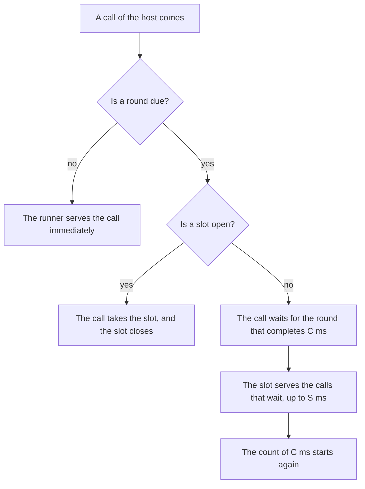

# 0011. Tasks and rounds

This record is for a contributor who changes the schedule of `Logex.Runtime`, or the
rounds and the share of `Logex.Runner`. It says why 1
[cycle](../../guides/reference/glossary.md#cycle) runs the
[due](../../guides/reference/glossary.md#due)
[tasks](../../guides/reference/glossary.md#task) by
[priority](../../guides/reference/glossary.md#priority) and never interrupts a
[scan](../../guides/reference/glossary.md#scan). It also says why the
[runner](../../guides/reference/glossary.md#runner) makes its
[rounds](../../guides/reference/glossary.md#round) back to back, and keeps a
[share](../../guides/reference/glossary.md#share) of the time for the calls of the
[host](../../guides/reference/glossary.md#host).

[Tasks and the schedule](../../guides/explanation/tasks-and-scheduling.md) gives the
model for a user.

> #### Warning {: .warning}
>
> Do not use logex for a safety function, such as an emergency stop. The e-stop of the
> example is a signal that a program records. The e-stop that cuts the power must work
> with logex stopped.
>
> A task of priority 0 does not interrupt a round. It waits until the round in progress
> ends, and logex gives no limit for that wait. The watchdog of the continuous task, 500 ms
> by default, trips the runner only after a long round ends.
> [Safety and limits](../../guides/explanation/safety-and-limits.md) gives each limit.

## Status

Accepted. No later record replaces this record.

An untimed instance is an [instance](../../guides/reference/glossary.md#instance) of the
[continuous task](../../guides/reference/glossary.md#continuous-task), or an instance
with no task. Decision 122 changes 2 rules of decision 108. The rounds of the untimed
instances run 1 in each millisecond of the clock at most, not back to back with no limit.
A due task runs at the start of the next round, not between 2 rounds.

Decisions 123, 396, 442 and 471 add rules to decisions 50 and 108.

## Date

2026-09-28, the date of decision 11, the rules of the schedule. The decisions of the
runner are of 2026-10-17 and 2026-10-18 (108 and 111 to 123). The last decision, 471, is of
2026-11-08. [The decisions that this record sums up](#the-decisions-that-this-record-sums-up)
lists each one.

## Context

[IEC 61131-3](../../guides/reference/glossary.md#iec-61131-3) gives 4 rules for a task
(Ed 2 §2.7.2, p.115):

| Rule | What IEC 61131-3 says |
|---|---|
| 1 | A task with `SINGLE` runs its [programs](../../guides/reference/glossary.md#program) on each [rising edge](../../guides/reference/glossary.md#rising-edge) of its input |
| 2 | A task with `INTERVAL` runs its programs at that interval while `SINGLE` is 0 |
| 3 | Of the programs that wait, the program with the longest wait at the highest priority runs |
| 4 | A program with no task runs again as soon as its run ends |

IEC 61131-3 lets the priority be "preemptive or non-preemptive" (Ed 2 §2.7.2, p.114). It
does not give the sequence of the programs in a task. It makes a missed deadline an error
that the system reports.

A [Logix](../../guides/reference/glossary.md#logix) controller has 1 continuous task at
most, at the lowest priority (1756-PM005M pp.8 and 13). "When the continuous task
completes a full scan, it restarts immediately" (1756-PM005M p.8). Its periodic tasks and
event tasks interrupt the continuous task. A share of the time, the system overhead time
slice, goes to the communication of the controller. Its default is 20 % (1756-PM005M
pp.31 to 33).

logex has 3 facts that these rules must fit. A scan takes no time in the model
([0007. The host gives the time](0007-the-host-gives-the-time.md)), so rule 4 is a loop
with no end. A cycle is a function of its arguments. The runner is 1 process, which
serves the calls of the host between 2 rounds. A host that asks for the status in a loop,
such as an HMI, must not stop the [plant](../../guides/reference/glossary.md#plant).

## Decision

### 1 cycle of the core

`Logex.Runtime.cycle/3` is 1 cycle. A cycle reads the
[trigger](../../guides/reference/glossary.md#trigger) of each event task 1 time, after it
merges the [inputs](../../guides/reference/glossary.md#input) and before any scan. Then it
runs each task that is due, and then each untimed instance. A scan always runs to its
end. logex never interrupts a scan, so the priority gives only the sequence.

The due times of a [periodic task](../../guides/reference/glossary.md#periodic-task) stay
on a grid: the time of the start plus whole intervals.

- The priority of each timed task is 0 to 65535, and 0 is the highest (decisions 11 and
  37). A tie goes to the earlier due time, then to the task whose line comes first.
- The instances of a task run in the sequence of their `program` lines. The instances of
  the continuous task run last, 1 time in each cycle (decision 111).
- A late periodic task runs 1 time. It counts each other due time that passed as an
  [overlap](../../guides/reference/glossary.md#overlap) (decision 38).
- An event task is due when the cycle samples 1 from its trigger and the last sample was
  0. No cycle sees a pulse of a trigger between 2 cycles (§4.6).
- `Logex.Runtime.next_due_in/1` counts the periodic due times only (decision 50).

[Runs and tables of the records: tasks and edits](../implementation/record-runs-tasks-and-edits.md#0011-tasks-and-rounds)
gives the table of each rule of a cycle. It also gives the cases of `single` and
`interval` together (decisions 39, 51 and 52).

A [configuration file](../../guides/reference/glossary.md#configuration-file) declares
the continuous task with its own line, for example `task main continuous watchdog 200`.
A configuration has 1 continuous task at most. The events name the continuous task if the
configuration declares it, and `:none` if it does not (decision 111).

A [trip](../../guides/reference/glossary.md#trip) can stop a round between 2 steps. A
step is the run of 1 task in a round. The runner records a rise as the last sample of a
trigger only when the step of its event task runs. It records a sample of 0 immediately.
Thus a rise that a trip cut off runs its event task in the next cycle that samples it
(decisions 350 and 375). An example is the first cycle after a
[warm restart](../../guides/reference/glossary.md#warm-restart).

### When the runner makes a round

`Logex.Runner` makes rounds on its [clock](../../guides/reference/glossary.md#clock). A
round takes the inputs, runs 1 cycle and writes the
[outputs](../../guides/reference/glossary.md#output). The runner sleeps to absolute times
on its clock, so the due times stay on their grid.

- A start or a [restart](../../guides/reference/glossary.md#restart) makes a round
  immediately (decision 50).
- Untimed instances make rounds back to back, 1 in each millisecond of the clock at most
  (decisions 108 and 122).
- A periodic task makes its round at its due time, or at the start of the next round if a
  round is in progress.
- A change of a trigger that a [device](../../guides/reference/glossary.md#device)
  reports, or a [force](../../guides/reference/glossary.md#force) of a trigger, makes its
  round immediately (decisions 112, 120 and 123). A round that writes a trigger makes the
  next round 1 ms later (decision 123).

The runner reads each device in each
[poll period](../../guides/reference/glossary.md#poll-period), also a device that reports
its changes (decision 120). The poll period and the share are options of the runner,
`poll:` and `overhead:`, because they describe 1 machine, not the plant (decision 121).

### The share of the runner

The share is the part of the time for the work of the runner itself. That work is the
calls of the host, the parts of an
[online edit](../../guides/reference/glossary.md#online-edit) and the write of the store
every `retain_period:` ms. The option `overhead:` gives the share in percent, from 10 to
90, and 20 by default (decisions 108 and 121). The runner serves the share in
[slots](../../guides/reference/glossary.md#slot) (decision 122). For a share of p %:

<!-- unchecked: the formula of the slots, from the moduledoc of Logex.Runner -->
```text
C = max(1, round((100 - p) / p))
S = max(1, round(p / (100 - p)))
```

After C ms of rounds, a slot serves the calls that wait, for up to S ms. Logix uses the
same formula for its system overhead time slice: "ContinuousTime=(100/
SystemOverheadTimeSlice%) - 1" (1756-RM094N p.35).

With the default of 20 %, a slot comes after 4 ms of rounds and lasts 1 ms.

The runner counts the rounds of the untimed instances, or with none, the rounds of the
periodic tasks (decision 396). A slot always serves its first call to its end. A slot that
finds no call stays open, and the next call takes it immediately (decision 442). The count
starts again at each slot (decision 471).



Figure: what happens to 1 call of the host. A slot that finds no call stays open for the
next call.

> #### Caution {: .error}
>
> Do not call the runner from the process that moves the manual clock, if a round is due.
> The call waits for a slot that only an advance brings, and the call has no time limit.
> Make the call from a separate process, and call `advance(clock, 0)` until the call
> answers. Result 7 does this.

[Runs and tables of the records: tasks and edits](../implementation/record-runs-tasks-and-edits.md#0011-tasks-and-rounds) gives a run of the plant of the design for each rule of this record.

## Consequences

The good results:

- A cycle is a function of its arguments. The same arguments give the same events in
  each run, and the runner gives the same rounds on the manual clock in each run.
- A scan never stops in the middle, so no lock is necessary.
- A late task does not run in a burst after a pause. The count of overlaps tells the host
  that the task was late.
- The untimed programs run again when their round ends, as rule 4 of IEC 61131-3 and the
  continuous task of Logix do.
- A change of a trigger that a device reports runs its event task immediately.
- An HMI that calls in a loop gets a share of the time, and the plant gets the rest.

The bad results and the costs:

- A due task waits for the round in progress. A long untimed round makes a timed task
  late by up to the length of the round.
- The watchdog of the continuous task finds a long round only after it ends
  ([0013. Watchdogs and the trip](0013-watchdogs-and-the-trip.md)).
- Rounds that fill their milliseconds keep 1 core busy (decision 122).
- An event task whose trigger logic writes runs 1 ms later than a task whose trigger a
  device reports (decision 123).
- A call that comes while a round is due waits for up to C ms of rounds and the slot.
- `Logex.Runtime.restart/2` sets each count of overlaps to 0.

A new part of a cycle must not interrupt a scan. A new cause of a round must say when the
round comes on the manual clock. The runner serves a new kind of work for itself in the
slots of the share. `test/logex/scheduler_test.exs`, `test/logex/runner_test.exs` and the walks
check these rules.

## Alternatives considered

| Alternative | Why logex does not do it |
|---|---|
| A task of a higher priority interrupts a scan, as IEC 61131-3 lets and Logix does | A scan takes no time in the model, so nothing can interrupt it. The sequence of a cycle stays the same in each run (§4.6) |
| 1 run for each missed due time | It gives a burst of outputs after a pause, and the work after a long pause has no limit (§4.6) |
| A steady beat of 10 ms, each timed job done when it is due | The maintainer chose rounds back to back, as rule 4 and the continuous task of Logix do (decision 108) |
| A trigger that logic writes makes its round immediately | 2 event tasks that set each other's trigger then make rounds with no end and no wait (decision 123) |
| The share applies only against the untimed instances | With no untimed instance, an HMI that calls in a loop makes a task of 10 ms late (decision 396) |

Section 7 gives the other options of each decision.

## The decisions that this record sums up

This record sums up 19 decisions of
[`docs/organisation.md`](../organisation.md#7-decisions):

- 11, 37, 38, 39, 50, 51 and 52, the schedule of the core.
- 108, 111, 112, 120, 121, 122 and 123, the rounds and the share of the runner.
- 350, 375, 396, 442 and 471, from the review after Milestone 6.

The design is in [§4.6](../organisation.md#46-execution-model) and
[§4.11](../organisation.md#411-milestone-4s-design-the-wall-clock-runner-decided-2026-10-17)
of the same document.

It also uses decisions that other records sum up:

- Decision 131, the call that waits for its slot on the manual clock:
  [0007. The host gives the time](0007-the-host-gives-the-time.md).
- Decisions 109 and 110, the [watchdog](../../guides/reference/glossary.md#watchdog) of
  each task: [0013. Watchdogs and the trip](0013-watchdogs-and-the-trip.md). This record
  gives decision 111, the continuous task, and 0013 gives its watchdog.
- Decisions 305 and 313, the sample of a trigger at a warm restart:
  [0016. Retained values and starts](0016-retained-values-and-starts.md).

[Tasks and the schedule](../../guides/explanation/tasks-and-scheduling.md) gives the model
for a user. [Execution model](../../guides/reference/execution-model.md) and
[Runner](../../guides/reference/runner.md) give the rules.
[Use an event task](../../guides/howto/use-an-event-task.md) gives the steps to add an
event task.
