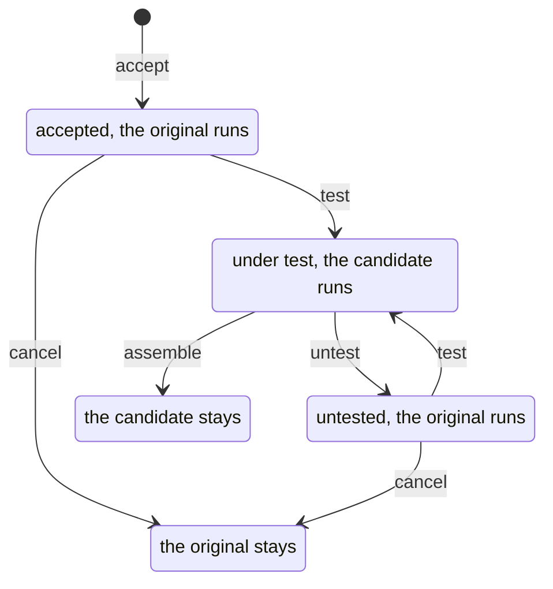

# 0012. The staged online edit

This record is for a contributor who changes how logex edits a running
[program](../../guides/reference/glossary.md#program) or
[plant](../../guides/reference/glossary.md#plant). That work is in `Logex.Edit`,
`Logex.Configuration.Edit`, the plan file `lib/logex/edit/plan.ex` or the steps of
`Logex.Runner`. The record says why an
[online edit](../../guides/reference/glossary.md#online-edit) has 5 steps and why each
step returns a report. It says why a [switch](../../guides/reference/glossary.md#switch)
moves the [state](../../guides/reference/glossary.md#state) by name, and why some changes
wait for a [restart](../../guides/reference/glossary.md#restart). It also says why an
[output](../../guides/reference/glossary.md#output) that the edit stops driving holds its
value.

[The model of an online edit](../../guides/explanation/online-edit-model.md) gives the
model for a user. [Online edit](../../guides/reference/online-edit.md) gives each rule,
each kind of entry of a report and each message.
[The architecture of an online edit](../architecture/online-edit.md) gives the plans, the
record of an edit and the switch in the code.
[Edit a running program](../../guides/howto/edit-a-running-program.md) and
[Edit a running plant](../../guides/howto/edit-a-running-plant.md) give the steps for a
user.

> #### Warning {: .warning}
>
> Do not use logex for a safety function, such as an emergency stop. A test runs new
> logic on a running machine. An output that the edit stops driving keeps its last value,
> and that value can be 1.
>
> The [forecast](../../guides/reference/glossary.md#forecast) names each output that
> holds and whose value the edit knows. After a start or a restart, the edit knows the
> value of an output only after the first scan. A change to the switch must keep the
> forecast true.

## Status

Accepted. No later record replaces this record.

## Date

2026-10-01, the date of decision 18. The last decision of the record, 513, is of
2026-11-12.

## Context

The maintainer asked to change "the whole controller/configuration at runtime", as
Logix does. The maintainer did not want to run each change "through an Elixir compiler
first" ([§4.9](../organisation.md#49-changing-a-running-controller-online-edit)). No part
of logex [compiles](../../guides/reference/glossary.md#compile) a program to BEAM.
[0001. A program is data](0001-a-program-is-data.md) gives that decision. Thus an edit
is a function of data: 2 programs, or 2
[configurations](../../guides/reference/glossary.md#configuration), and the state.

The systems that logex compares itself with do these things:

| System | What it does |
|---|---|
| [IEC 61131-3](../../guides/reference/glossary.md#iec-61131-3) | It gives no online edit |
| [Logix](../../guides/reference/glossary.md#logix) | An edit has stages: accept, test, untest, assemble and cancel. "Outputs in the original logic stay in their last state" (its quick start, Oct 2009, pp.121 and 124). Logic can write the period and the watchdog of a [task](../../guides/reference/glossary.md#task) while the controller runs (1756-RM018A, p.276). A program cannot move to a different task in Run mode. An array changes its size or its type offline only (1756-RM094N p.85) |
| CODESYS | An online change refuses each change to the configuration of the tasks (*Command: Online Change*, Table 106). The first scan does not run again after the change |
| Beremiz | Its hot swap occurs "between two cycles, never inside one", and copies each value by path and type |

logex has 4 facts that the design must fit:

- **The plant must not stop.** A restart sets each value that it does not
  [retain](../../guides/reference/glossary.md#retain) back to its
  [initial value](../../guides/reference/glossary.md#initial-value). An edit must keep
  the values of the state that the 2 programs have in common.
- **The [host](../../guides/reference/glossary.md#host) sees only the report.** Each
  change that an edit makes to the state must be in a report. A change that the report
  does not name is a surprise on the machine.
- **A switch must not move an output that no logic moves.** A write to a
  [storage bit](../../guides/reference/glossary.md#storage-bit) or to a
  [global](../../guides/reference/glossary.md#global) can move an output. So can a 0
  written to an output or to a [member](../../guides/reference/glossary.md#member)
  input.
- **The state is plain data.** `Logex.Runtime` keeps each piece of the state by name,
  never by position. An edit can thus find each value by its name.

## Decision

### 5 steps, and a report from each step

In this record, the original is the program or the configuration that runs before the
edit. The glossary calls it the old program. The
[candidate](../../guides/reference/glossary.md#candidate) is the new program or the new
configuration.

An edit has 5 steps: accept, test, untest, assemble and cancel (decision 18). Each step
occurs between 2 [scans](../../guides/reference/glossary.md#scan) of a lone
[instance](../../guides/reference/glossary.md#instance), or between 2
[cycles](../../guides/reference/glossary.md#cycle) of a
[resource](../../guides/reference/glossary.md#resource). Each step returns a report: a
sorted list of `{kind, name, detail}`.



Figure: the stages of an edit, and the program that runs in each stage.

The candidate can run and stop many times before the edit ends. Only assemble ends with
the candidate. A cancel ends with the original.

| Step | What it does, and what runs next |
|---|---|
| [accept](../../guides/reference/glossary.md#accept) | It changes no state, and the original runs on. It returns the forecast: the report of a test at this moment (decision 27) |
| [test](../../guides/reference/glossary.md#test) | It switches the state to the candidate. The candidate runs |
| [untest](../../guides/reference/glossary.md#untest) | It switches the state back. The original runs |
| [assemble](../../guides/reference/glossary.md#assemble) | It removes the values that only the original declares. The candidate runs, and the edit ends |
| [cancel](../../guides/reference/glossary.md#cancel) from accept | It changes no state, and the report is `[]`. The original runs, and the edit ends |
| cancel after an untest | It removes the values that only the candidate declares. The original runs, and the edit ends |

2 modules give the steps, with the same names and the same report (decision 59).
`Logex.Edit` edits 1 lone instance. `Logex.Configuration.Edit` edits a running
configuration, a `%Logex.Runtime{}`.

A plan is the list of moves that a switch makes in 1 direction. At accept, each edit makes
2 plans for each [program type](../../guides/reference/glossary.md#program-type): 1 for a
test and 1 for an untest. A plan reads the 2 programs and no state. Thus a plan stays
correct for the full edit. Both modules use the same plan file for each instance.

A candidate can also come from Elixir data. It can say only what a text can say. The
compiler refuses each tree that the parser cannot give (decision 28).
`Logex.Tag.new!/4` takes no preset of a timer (decision 24). Thus the same rules apply to
a candidate from text and to a candidate from Elixir data.

### A switch moves the state by name

A switch is a test or an untest. In this record, the program before the switch is the
program that the switch stops. The program after the switch is the program that it
starts. The switch moves the state from the program before the switch to the program
after the switch. It never sets the field `first` of `%Logex.Instance{}`, so it does not
make a [first scan](../../guides/reference/glossary.md#first-scan).

The state keeps each value by name. Thus a [tag](../../guides/reference/glossary.md#tag)
of the same name and type keeps its value (decision 18). A member of a
[function block](../../guides/reference/glossary.md#function-block) moves by its path
(decision 31). Each other change is an entry of the report:

| Change in the candidate | What a switch does |
|---|---|
| An added tag | It starts the tag at its initial value, as `:added` (decisions 18 and 26) |
| A removed tag | It keeps the tag, unused, until assemble or cancel removes it, as `:pruned` (decisions 18 and 315) |
| A [one-shot](../../guides/reference/glossary.md#one-shot) that the edit adds, or whose [rung](../../guides/reference/glossary.md#rung) changes | It blocks the one-shot until a scan runs it, as `:ons_blocked` (decisions 21, 32, 87 and 106) |
| The [preset](../../guides/reference/glossary.md#preset) of a [timer](../../guides/reference/glossary.md#timer) or a [counter](../../guides/reference/glossary.md#counter) | It moves `.pre` (`.pv` of a counter) only if it holds the old preset, as `:preset`. It keeps a value that logic wrote, as `:preset_kept` (decisions 23, 88 and 95). `:dn_rises` and `:dn_drops` say what the done bit does at its next run (decisions 381 and 421) |
| A timer that the program after the switch runs, and the program before the switch does not | It resumes the timer, as `:resumed` (decisions 23 and 339 to 341) |
| An output that the program after the switch does not drive | It keeps the value, as `:held` (decisions 20 and 58) |

A change of [section](../../guides/reference/glossary.md#section), of an initial value
or of a [qualifier](../../guides/reference/glossary.md#qualifier) keeps the value too.
The report names it as `:input`, `:unread`, `:initial_changed`, `:retain_added` or
`:retain_removed`. Decisions 22, 25, 29, 44, 157, 261, 278, 302 and 329 to 335 give
these entries.

At the first test, a switch sets each tag whose value does not fit its type to its
initial value. It reports the tag as `:added` (decision 26). Such a value can come from
a plain swap. In a plain swap, the host scans a new program on the state of the old
program, with no edit.

A switch writes the report and the state together. Apply the writes of a report
(`:added`, `:input`, `:preset`, `:resumed`, `:resume_undone` and `:pruned`) to the state
before the step. The result is the state after the step. A random test in
`test/logex/api_contract_test.exs` checks this on each step. The rules of this record
have their tests in `test/logex/edit_test.exs`, `test/logex/config_edit_test.exs`,
`test/logex/retain_edit_test.exs`, `test/logex/runner_edit_test.exs` and
`test/logex/api_contract_test.exs`. To add a kind of report entry, read
[The architecture of an online edit](../architecture/online-edit.md).

### What a switch never does

A switch writes no storage bit, no global, no 0 to an output and no 0 to a member input.
Each of these writes can move an output, and no logic asked for it.

- **No storage bit** (decision 21). If a switch writes 0, the `ons` gives a false
  pulse. If it writes 1, a rung that reads the storage bit sees a value that no logic
  wrote. Thus a switch lists the one-shot in `ons_blocked` of the instance. The next
  scan that runs the `ons` passes no power, and still writes the storage bit, as a first
  scan does.
- **No global** (decision 55). In the edit of a plant, a `var` that becomes a
  `var_external` reads the global from its next scan. The switch drops the value that
  the instance kept for itself, and reports it as `:joined`. A write of that value into
  the global can release a pressed emergency stop for the whole plant. When a
  `var_external` becomes a `var`, the tag keeps the value of the global as its own. The
  switch reports it as `:left` (decision 25).
- **No 0 to an output** (decision 20). An output that the edit stops driving holds its
  last value, as the outputs of Logix do. Each step reports it as `:held` with its
  value, if the edit has learnt that value. The edit learns it at a step after a scan of
  the program before the switch, with no restart since that scan. Thus an edit accepted
  after a start or a restart, with no scan since, does not name the output.
- **No 0 to a member [input](../../guides/reference/glossary.md#input)** (decision 96).
  `lube` is an `rto`, and `lube.r` is its reset. If the edit removes the rung `xic greased
  ote lube.r` while `greased` is 1, `lube.r` stays 1. The timer then stays reset at 0
  until a restart. The report names `lube.r` as `:unwritten` with its value, whatever that
  value is (decision 251).

### What waits for a restart

Accept refuses a candidate that changes a thing that only a restart can change. It
returns `{:error, diagnostics}` at the stage `:edit`, and the edit does not start.

The state keeps each value by name and [type](../../guides/reference/glossary.md#type),
and a value of the old type does not fit the new type. Thus accept refuses a new type of a
tag, of a member at any depth, of an array or of a global. It also refuses new sizes of an
array (decisions 18, 31, 157, 254, 259 and 334). Logix also changes the type or the size
of an array offline only (decision 157).

The maintainer chose the rules of Logix for the tasks (decisions 19 and 129). Logic in
Logix writes the period and the [watchdog](../../guides/reference/glossary.md#watchdog) of
a task while the controller runs. A program does not move to a different task in Run mode.
Thus these changes wait for a restart:

- A task added or removed, or a task made continuous or timed.
- An instance of a kept program type moved to a different task, or to or from no task.
- The `single` of a task added, removed or changed, or the interval of an
  [event task](../../guides/reference/glossary.md#event-task) added or removed.
- A [located global](../../guides/reference/glossary.md#located-global) added, removed
  or moved (decision 244 and
  [§4.9](../organisation.md#49-changing-a-running-controller-online-edit)).

A switch reports each other change to a task: `:interval`, `:next_due`,
`:priority`, `:watchdog` and `:order` (decisions 19, 40, 62, 129 and 139). A new program
type of an instance is `:instance_stopped` and `:instance_added` (decisions 43 and 61).

A changed interval makes the task next [due](../../guides/reference/glossary.md#due) at
`min(next_due, now + new interval)` (decision 40). Thus a shorter interval acts within 1
new period, and the switch adds no run. The steps `accept/3`, `test/3` and `untest/3` of
`Logex.Configuration.Edit` take `elapsed_ms`, 0 by default. For the due time, `now` is the
time of the resource plus `elapsed_ms`. The time of a timer does not use `elapsed_ms`
(decision 343).

### An output that the edit stops driving holds

A held output keeps its value until a rung writes it again. The edit of a plant names it
2 times (decision 58). It names the global that the operator sees, such as `lamp_1`. It
also names the output of the instance that the programmer changed, such as
`m1.run_lamp`. If no [connection](../../guides/reference/glossary.md#connection) drives
an [array](../../guides/reference/glossary.md#array) after the switch, the edit holds the
array whole, by its name. If connections still drive some of its
[elements](../../guides/reference/glossary.md#element), the edit holds each other
element by its name, such as `speeds[2]` (decision 232).

A `var_output` that no rung writes can also hold a global. At each cycle, the connection
copies that `var_output` to the global. A `var_output` that starts at its initial value
thus writes that value over the held global at the next cycle. So a
switch starts the `var_output` at the value of the global, and reports it as `:holds`
(decisions 347, 386, 387 and 423). The next switch of the same edit gives the
`var_output` its old value again, and reports `:hold_undone`. An untest starts such a
`var_output` at the value of the global also (decision 422).

Accept refuses a hold that it cannot keep as the report says. It refuses a candidate
that wires a held global to 1 of these:

- A `var_output` of a different type than the global. The `var_output` cannot hold each
  value of the global (decision 374).
- A `var_output` that a rung of its program reads. The hold changes what that rung gives
  (decisions 388 and 424).
- A `var_output` that drives a different global also. The hold moves that other global
  (decision 428).

Accept does not refuse a connection that both configurations make for a kept instance.
That connection copies the `var_output` to the global at each run, so the `var_output`
holds the value of the global. Before the first run of that instance after a start or a
restart, the `var_output` can hold a different value. Then accept refuses the
connection if a rung reads the `var_output` (decision 424).

### The edit of a plant

`Logex.Configuration.Edit` adds these rules to those of 1 instance:

- **A changed program type** is a remove and an add (decision 43). The switch keeps the
  old state of the instance, unused, and starts the new instance. This record calls that
  kept state aside. An untest brings the old state back and reports `:instance_back`.
  Its timers do not count the time aside (decisions 57 and 340).
- **A `var_external`** (decision 45). Before the switch, the edit copies each global into
  the state of the instance, for each `var_external` of the program before the switch.
  After the switch, it takes out each global, for each `var_external` of the program
  after the switch. The global does not change. A tag that both programs declare keeps
  its value across each other change of section. `:joined` and `:left` are the 2
  exceptions.
- **A generation** (decisions 60 and 64). A resource keeps a generation, a number that
  counts the steps of its edits. Each step but accept adds 1 to it, cancel from accept
  included. Thus the resource refuses a step on an edit that ended, or on an edit that a
  later edit passed.
- **A restart** during an edit keeps the stage (decision 65). It drops the instances
  aside, and the next switch starts again what it dropped.
- **A later accept** replaces an open edit (decision 66). Its first test drops what the
  replaced edit left: `:instance_pruned` and `:pruned`. Each prune also drops each tag
  that the running program of a kept instance does not declare (decision 315).
- **A candidate that `Logex.Configuration.check/1` refuses** is a wrong argument of the
  host. Accept raises `ArgumentError`, as `Logex.Runtime.start/1` does (decision 63).

### 1 rule for the time of a timer

A timer counts time only while a program that runs it holds the instance. The time does
not count while the instance is aside (decisions 339, 340 and 341).

- A timer resumes if the program after the switch runs it and the program before the
  switch does not. Its `last` moves on by the time that the program before the switch held
  the instance. At its next run, the timer catches up the time before that. A timer does
  the same after a scan that does not run its
  [instruction](../../guides/reference/glossary.md#instruction) ([0007. The host gives the
  time](0007-the-host-gives-the-time.md)).
- If the program before the switch held the instance from before the edit, `last`
  becomes the time of the switch (decisions 23 and 344).
- An untest with no scan and no time after the test gives back what the test moved
  (fix F11, in
  [§4.9](../organisation.md#49-changing-a-running-controller-online-edit)). Thus a test
  and an untest with no scan and no time between them leave each timer as it was.
- In a resource, a switch occurs at the time of the last cycle (decisions 56 and 343).
  The time from that cycle to the step goes to the program that the step leaves
  running.
- The [clock](../../guides/reference/glossary.md#clock) of a lone instance moves only with
  a scan. Thus a switch with no scan after the last switch resumes nothing (decision 341).
- A report gives the preset of a long timer in ns, its own unit. It gives a resume in
  ms, the unit of the clock (decision 199).

### The edit through the runner

`Logex.Runner.accept/2` does the work of accept in the process of the caller (decision
119). The [runner](../../guides/reference/glossary.md#runner) makes its
[rounds](../../guides/reference/glossary.md#round) and does not wait. If a different step
occurs before the accept ends, `Logex.Runner.accept/2` does the accept again against the
resource of that moment (decision 141). Thus the forecast is correct when the runner holds
the edit.

The runner gives each step the time since its last round, as `elapsed_ms` (decision
139). The step moves no clock of the resource. Thus a shorter interval counts from the
edit. The status shows no missed period that the edit made.

### The rules in a run

The script `examples/0012-staged-online-edit.exs` shows the rules of this record as
numbered results. Run it from `examples/`. It reads `motor.ld` and `motor_v2.ld`.

`motor.ld` is the original. A [seal-in](../../guides/reference/glossary.md#seal-in)
rung runs the motor, and a lamp shows that it runs:

<!-- file: motor.ld -->
```text
var_input start bool
var_input stop bool
var_input overtemp bool
var_input reset bool
var_output motor bool
var_output run_lamp bool
var_output speed_sp dint 1200
var fault bool

( xic start | xic motor ) xio stop ote motor
xic motor ote run_lamp
xic overtemp otl fault
xic reset otu fault
xic fault move 0 speed_sp
```

`motor_v2.ld` is the candidate. It removes `run_lamp`. It adds `at_speed`, which comes
on 2 s after the motor starts, and `started`, a pulse when the motor starts:

<!-- file: motor_v2.ld -->
```text
var_input start bool
var_input stop bool
var_input overtemp bool
var_input reset bool
var_output motor bool
var_output at_speed bool
var_output started bool
var_output speed_sp dint 1200
var fault bool
var t1 ton
var s1 bool

( xic start | xic motor ) xio stop ote motor
xic motor ton t1 2000
xic t1.dn ote at_speed
xic motor ons s1 ote started
xic overtemp otl fault
xic reset otu fault
xic fault move 0 speed_sp
```

| Result | What it shows |
|---|---|
| 1 | The original runs the motor. `run_lamp` is 1 |
| 2 | The forecast names each change: 4 tags added, `run_lamp` held at 1, `s1` blocked (decisions 20, 21 and 27) |
| 3 | The report of the test is the forecast. `started` stays 0, because the switch blocks the one-shot. `at_speed` comes on after 2000 ms (decisions 21 and 27) |
| 8 | The forecast reports a shorter interval. The task is due at 30 ms in place of 50 ms (decision 40) |
| 9 | After a cancel from accept, the generation refuses a step on the edit (decisions 60 and 64) |

```elixir
alias Logex.Configuration.Edit, as: PlantEdit
alias Logex.Edit
alias Logex.Runtime

{:ok, motor} = Logex.compile_file("motor.ld")
# An edit keeps the name of the program. compile_file/1 names this program `motor_v2`.
{:ok, v2} = Logex.compile(File.read!("motor_v2.ld"), name: "motor")

# Prints each entry of a report on a line of its own.
show = fn report -> Enum.each(report, &IO.puts("     #{inspect(&1)}")) end

# Gives the inputs to the program, runs 1 scan and prints the outputs.
scan = fn state, program, elapsed, inputs ->
  state = Runtime.put_inputs(program, state, inputs)
  {outputs, state} = Runtime.scan(program, state, elapsed)
  IO.puts("     scan at #{state.now} ms: #{inspect(outputs)}")
  state
end

IO.puts("1. The original runs:")

state =
  Runtime.instance(motor)
  |> scan.(motor, 10, %{"start" => 1})
  |> scan.(motor, 10, %{"start" => 0})

IO.puts("2. accept/3 gives the forecast:")
{:ok, edit, forecast} = Edit.accept(motor, v2, state)
show.(forecast)

IO.puts("3. test/2 gives the same report. The candidate runs:")
{edit, state, report} = Edit.test(edit, state)
IO.puts("     the report is the forecast: #{report == forecast}")
state = state |> scan.(v2, 10, %{}) |> scan.(v2, 2000, %{})

IO.puts("4. untest/2. The original runs again:")
{edit, state, report} = Edit.untest(edit, state)
show.(report)
state = scan.(state, motor, 10, %{})

IO.puts("5. cancel/2 after the untest:")
{_motor, _state, report} = Edit.cancel(edit, state)
show.(report)

IO.puts("6. A change of type is refused:")
text = String.replace(File.read!("motor.ld"), "speed_sp dint", "speed_sp int")
{:ok, retyped} = Logex.compile(text, name: "motor")
{:error, [diagnostic]} = Edit.accept(motor, retyped, Runtime.instance(motor))
IO.puts("     " <> Logex.Diagnostic.format(diagnostic))

plant = """
task fast interval 10 priority 1
task slow interval 50 priority 2
var_global start_1 bool at panel.i.0
var_global stop_1  bool at panel.i.1
var_global start_2 bool at panel.i.2
var_global stop_2  bool at panel.i.3
var_global k1      bool at panel.q.0
var_global k2      bool at panel.q.1
program m1 motor with fast
  m1.start    start_1
  m1.stop     stop_1
  m1.overtemp 0
  m1.reset    0
  m1.motor    k1
program m2 motor with slow
  m2.start    start_2
  m2.stop     stop_2
  m2.overtemp 0
  m2.reset    0
  m2.motor    k2
"""

# Compiles the text of a configuration that runs motor.ld.
configuration = fn text ->
  {:ok, configuration} = Logex.Configuration.compile("plant", text, %{"motor" => motor})
  configuration
end

{runtime, _outputs, _events} = Runtime.start(configuration.(plant)) |> Runtime.cycle(0, %{})
{runtime, _outputs, _events} = Runtime.cycle(runtime, 10, %{})

IO.puts("7. A plant: an instance cannot move to a different task:")
moved = String.replace(plant, "m2 motor with slow", "m2 motor with fast")
{:error, [diagnostic]} = PlantEdit.accept(runtime, configuration.(moved))
IO.puts("     " <> Logex.Diagnostic.format(diagnostic))

IO.puts("8. An interval can change. The forecast:")
faster = String.replace(plant, "slow interval 50", "slow interval 20")
{:ok, edit, forecast} = PlantEdit.accept(runtime, configuration.(faster))
show.(forecast)

IO.puts("9. A step on an edit that has ended is refused:")
{_plant, runtime, []} = PlantEdit.cancel(edit, runtime)

try do
  PlantEdit.test(edit, runtime)
rescue
  error in ArgumentError -> IO.puts("     " <> error.message)
end
```

```console
$ mix run 0012-staged-online-edit.exs
1. The original runs:
     scan at 10 ms: %{"motor" => 1, "run_lamp" => 1, "speed_sp" => 1200}
     scan at 20 ms: %{"motor" => 1, "run_lamp" => 1, "speed_sp" => 1200}
2. accept/3 gives the forecast:
     {:added, "at_speed", 0}
     {:added, "s1", 0}
     {:added, "started", 0}
     {:added, "t1", %{"acc" => 0, "dn" => 0, "en" => 0, "last" => 0, "pre" => 2000, "tt" => 0}}
     {:held, "run_lamp", 1}
     {:ons_blocked, "s1", 0}
3. test/2 gives the same report. The candidate runs:
     the report is the forecast: true
     scan at 30 ms: %{"at_speed" => 0, "motor" => 1, "speed_sp" => 1200, "started" => 0}
     scan at 2030 ms: %{"at_speed" => 1, "motor" => 1, "speed_sp" => 1200, "started" => 0}
4. untest/2. The original runs again:
     {:held, "at_speed", 1}
     {:held, "started", 0}
     scan at 2040 ms: %{"motor" => 1, "run_lamp" => 1, "speed_sp" => 1200}
5. cancel/2 after the untest:
     {:held, "at_speed", 1}
     {:held, "started", 0}
     {:pruned, "at_speed", 1}
     {:pruned, "s1", 1}
     {:pruned, "started", 0}
     {:pruned, "t1", %{"acc" => 2000, "dn" => 1, "en" => 1, "last" => 2030, "pre" => 2000, "tt" => 0}}
6. A change of type is refused:
     line 7: `speed_sp` is a dint in the running program and an int in the candidate: a tag's type changes only with a restart
7. A plant: an instance cannot move to a different task:
     line 15: `m2` runs with `slow` in the running configuration and with `fast` in the candidate: an instance moves to another task only with a restart
8. An interval can change. The forecast:
     {:interval, "slow", {50, 20}}
     {:next_due, "slow", {50, 30}}
9. A step on an edit that has ended is refused:
     this edit expects the resource at generation 0, but it is at generation 1: the edit has ended, or another edit has stepped since
```

In result 5, `s1` is 1. The blocked `ons` passed no power, but it wrote its bit at each
scan.

## Consequences

Good results:

- Each change to the state is in a report. The engineer reads the forecast before the
  candidate runs. A test gives the same entries if the state does not change between
  the accept and the test.
- A test and an untest with no scan and no time between them leave each value that the
  original uses as it was. A preset or a hold goes back only if it still holds the value
  that the test left, with no restart since. What the candidate added stays, unused,
  until assemble or cancel removes it.
- A one-shot never pulses because of an edit.
- The plant runs on during an accept through the runner. Only the caller waits.
- No step calls the Elixir compiler, reads a clock or starts a process.

Bad results and costs:

- The code is large: `lib/logex/edit.ex` has about 600 lines, `lib/logex/edit/plan.ex`
  about 1,900 and `lib/logex/configuration/edit.ex` about 2,500. The migration of
  function blocks member by member made `Logex.Edit` about 2 times larger (decision 31).
- A blocked one-shot can lose 1 [rising
  edge](../../guides/reference/glossary.md#rising-edge). An edit that only adds a `lbl` or
  a `jmp` to the rung of a one-shot blocks it 1 time (decision 106). Take an `osr` in a
  block whose `cal` is false on the first scan. It stays blocked across a test, a cold
  `restart/3` and the untest, and 1 press does not count (decision 377).
- An accept reads each write through a
  [subscript](../../guides/reference/glossary.md#subscript) in a tag as a write of each
  element (decision 513). An accept of a program with `var lane_t ton[4096]` and 40 rungs
  such as `xic a1 move x lane_t[i].pre` takes about 0.5 s to 0.65 s.
- A lone instance has no generation (decision 60). `Logex.Edit` does not refuse a step
  on an edit that ended. In a run, an untest after an assemble returned
  `[{:added, "run_lamp", 0}]`. The host must not take such a step.
- The host has 2 more duties during the edit of a lone instance. Under test, it sends
  only the inputs of `Logex.Edit.running/1`. Before the next scan, it sends each input
  that a step reports as `:input` again. It stops sending each input that a step reports
  as `:unread`.
- A timer can lose time across 2 edits. No instance keeps the time of its last switch,
  so a new edit cannot know the time that an earlier candidate held it (decision 344).
- In a resource, a timer can be early or late by the time since the last cycle, a task's
  interval at most (decision 343).
- A change of a type stops the plant for a restart.

## Alternatives considered

The Decision section gives the reasons against the alternatives of decisions 19, 20, 55,
96, 129, 139, 157 and 347. The maintainer chose the stages from the start (decision 18),
and chose to report a changed initial value (decision 29). These are the other options
that logex did not take:

| Not taken | Why not |
|---|---|
| Set the storage bits to 1, or block each `ons` for 1 scan (decision 21) | A [bit](../../guides/reference/glossary.md#bit) set to 1 goes into a rung that reads it. To block each `ons` loses a rising edge on rungs that the edit did not change |
| Require the new inputs as an argument of test and untest (decision 22) | A report of each input that becomes live is enough |
| Set `.pre` to 0 while no `ton` runs the timer (decision 23) | It turned an output on under test, and no report named it |
| Refuse a change of section (decision 25) | Each result of a change of section is in the report |
| Accept from the 2 programs alone (decision 27) | Then accept gives no report |
| Refuse each change of a [function block type](../../guides/reference/glossary.md#function-block-type) (decision 31) | The migration by path found no failure in the walks. Accept refuses a member that changes its type, as it refuses a tag |
| Block a one-shot in a block for the next scan only (decision 32) | A block that a false `cal` freezes uses up that 1 scan unseen. Its `ons` then gives the false pulse that decision 21 prevents |
| Refuse a change of program type (decision 43) | A switch can add and remove instances while the plant runs, and the state keeps each value by name |
| Let the timers of an instance back from aside catch up (decision 57) | The edit stopped the instance, not its logic |
| Report a held global only, or the output of the instance only (decision 58) | The operator sees the global. The programmer changed the output |
| 1 module for both edits (decision 59) | Each message must then say which edit it is about |
| A generation for a lone instance (decision 60) | A lone instance is for the bench and the tests. A running controller is a resource |
| Refuse a change of order, or say nothing (decision 62) | It needs no restart, and the report is the place for a change of behaviour |
| Keep the instances aside across a restart (decision 65) | They come back with a state that no restart touched |
| Refuse an accept until the host ends the open edit (decision 66) | The host must then end an edit that it does not want |
| Tell the caller that the plant moved on, and let the caller do the accept again (decision 141) | The accept done again gives the same result as the same steps on the resource |
| Count the time from the last run of the timer (decision 339) | The time that the original held the instance is then lost |
| Forecast only a `.acc` at or after the new `.pre` (decision 381) | A lamp that the catch-up alone lights at the first scan is then not in the forecast |
| Make the accept faster (decision 513) | The plant does not wait. The engineer waits a few seconds at most, for an array of tens of thousands of elements |

## Decisions in section 7

This record sums up 76 decisions of
[`docs/organisation.md`](../organisation.md#7-decisions):

- 18 to 29, the staged edit and the edit of 1 instance, with the fixes F1 to F16.
- 31, 32, 40, 43, 44 and 45, function blocks, an interval and the start of the edit of a
  plant.
- 55 to 66, the edit of a plant.
- 87, 88, 95, 96 and 106, the counters, the other timers, the inputs of a block and
  [jumps](../../guides/reference/glossary.md#jump).
- 129, 139 and 141, the edit through the runner.
- 157, 199, 232, 244, 251, 254, 259 and 261, the data types and the arrays.
- 278, 302, 315, 329 to 336, 339 to 341 and 343 to 345, the qualifiers, the prune and
  the time of a timer.
- 347, 374, 377, 381, 386 to 388, 421 to 424 and 428, the held
  [points](../../guides/reference/glossary.md#point) and the forecast.
- 513, the cost of an accept.

Some of these decisions change earlier decisions of the same record:

- 32, 87 and 106 change how long decision 21 blocks a one-shot, and which change of a
  rung blocks it.
- 339, 340 and 341 replace the special cases of decision 336 with 1 rule for the time of
  a timer. They change the values of decisions 56 and 57.
- 157 extends the report of decision 29 to each type. 259 replaces the form of the
  message of decision 254.
- 302 and 329 to 335 complete the reports of decision 278.
- 315 extends the prune of decision 66.

The design is in [§4.9](../organisation.md#49-changing-a-running-controller-online-edit)
of the same document.

Other records explain these decisions further. 24, 28 and 63 are in this record and in
another record:

- Decision 16, no Elixir compiler on the path of an edit:
  [0001. A program is data](0001-a-program-is-data.md).
- Decision 24, the preset map from Elixir withdrawn:
  [0005. Every tag is declared](0005-every-tag-is-declared.md).
- Decision 82, a frozen timer catches up:
  [0007. The host gives the time](0007-the-host-gives-the-time.md).
- Decision 119, the work of a call to the runner done in the process of the caller:
  [0014. Devices are processes](0014-devices-are-processes.md).
- Decision 270, the retention of a path:
  [0016. Retained values and starts](0016-retained-values-and-starts.md).
- Decision 277, a [store](../../guides/reference/glossary.md#store) read at a fresh start
  after an edit:
  [0017. The store on disk](0017-the-store-on-disk.md).
- Decisions 28, 63 and 171, the checks of a candidate and of a state:
  [0008. Errors in the source and errors of the host](0008-source-mistakes-and-host-mistakes.md).
