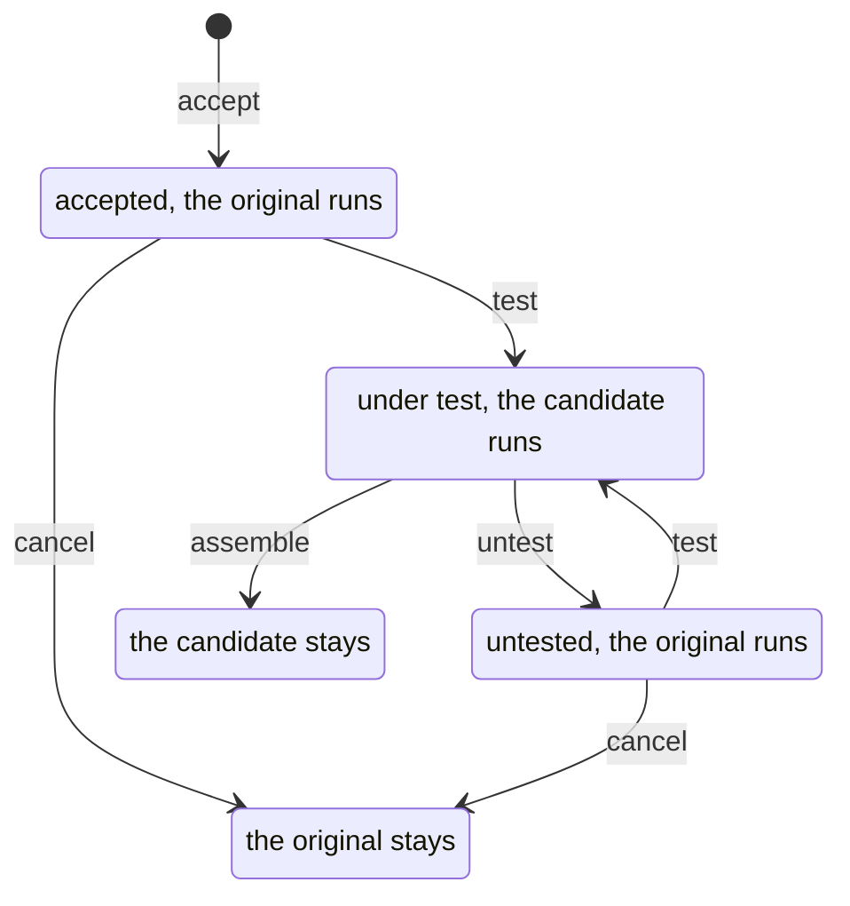

# 0012. The staged online edit

This record is for a contributor who changes `Logex.Edit`, `Logex.Configuration.Edit`,
the plan file `lib/logex/edit/plan.ex` or the steps of `Logex.Runner`. It says why an
[online edit](../../guides/reference/glossary.md#online-edit) has 5 steps, why a
[switch](../../guides/reference/glossary.md#switch) moves the
[state](../../guides/reference/glossary.md#state) by name, and why some changes wait for a
[restart](../../guides/reference/glossary.md#restart).
[The architecture of an online edit](../architecture/online-edit.md) gives the code, and
[Online edit](../../guides/reference/online-edit.md) gives each rule for a user.

> #### Warning {: .warning}
>
> Do not use logex for a safety function, such as an emergency stop. A test runs new
> logic on a running machine. An output that the edit stops driving keeps its last value,
> and that value can be 1.
>
> The [forecast](../../guides/reference/glossary.md#forecast) names each output that
> holds and whose value the edit knows. After a start or a restart, the edit knows the
> value of an output only after the first scan. A change to the switch must keep the
> forecast true.

## Status

Accepted. No later record replaces this record.

## Date

2026-10-01, the date of decision 18. The last decision of the record, 513, is of
2026-11-12.

## Context

The maintainer asked to change "the whole controller/configuration at runtime", as
Logix does. The maintainer did not want to run each change "through an Elixir compiler
first" ([§4.9](../organisation.md#49-changing-a-running-controller-online-edit)). No part
of logex [compiles](../../guides/reference/glossary.md#compile) a program to BEAM.
[0001. A program is data](0001-a-program-is-data.md) gives that decision. Thus an edit
is a function of data: 2 programs, or 2
[configurations](../../guides/reference/glossary.md#configuration), and the state.

The systems that logex compares itself with do these things:

| System | What it does |
|---|---|
| [IEC 61131-3](../../guides/reference/glossary.md#iec-61131-3) | It gives no online edit |
| [Logix](../../guides/reference/glossary.md#logix) | An edit has stages: accept, test, untest, assemble and cancel. "Outputs in the original logic stay in their last state" (its quick start, Oct 2009, pp.121 and 124). Logic can write the period and the watchdog of a [task](../../guides/reference/glossary.md#task) while the controller runs (1756-RM018A, p.276). It changes the size or the type of an array offline only (1756-RM094N p.85) |
| Beremiz | Its hot swap occurs "between two cycles, never inside one", and copies each value by path and type |

The plant must not stop, so an edit keeps the values that the 2 programs have in common.
The [host](../../guides/reference/glossary.md#host) sees only the report, so each change
to the state is in a report.

## Decision

In this record, the original is the program or the configuration that runs before the
edit. The
[candidate](../../guides/reference/glossary.md#candidate) is the new program or the new
configuration.

An edit has 5 steps: accept, test, untest, assemble and cancel (decision 18). Each step
occurs between 2 [scans](../../guides/reference/glossary.md#scan) of a lone
[instance](../../guides/reference/glossary.md#instance), or between 2
[cycles](../../guides/reference/glossary.md#cycle) of a
[resource](../../guides/reference/glossary.md#resource). Each step returns a report: a
sorted list of `{kind, name, detail}`.

Figure: the stages of an edit, and the program that runs in each stage.

Only assemble ends with the candidate. A cancel ends with the original.

`Logex.Edit` edits 1 lone instance, and `Logex.Configuration.Edit` edits a running
configuration. The 2 modules give the same steps and reports (decision 59).

### A switch moves the state by name

A switch is a test or an untest. It moves the state from the program that it stops to the
program that it starts. It does not make a
[first scan](../../guides/reference/glossary.md#first-scan).

The state keeps each value by name. Thus a [tag](../../guides/reference/glossary.md#tag)
of the same name and type keeps its value (decision 18). A member of a
[function block](../../guides/reference/glossary.md#function-block) moves by its path
(decision 31). Each other change is an entry of the report:

- An added tag starts at its initial value, as `:added` (decisions 18 and 26).
- A removed tag stays, unused, until assemble or cancel removes it, as `:pruned`
  (decisions 18 and 315).
- A [one-shot](../../guides/reference/glossary.md#one-shot) that the edit adds, or whose
  [rung](../../guides/reference/glossary.md#rung) changes, is blocked until a scan runs it.
- The [preset](../../guides/reference/glossary.md#preset) of a timer or a counter moves.
  A timer that the program after the switch runs, and the program before it does not,
  resumes, as `:resumed` (decisions 23 and 339 to 341).
- An output that the program after the switch does not drive keeps its value, as `:held`
  (decisions 20 and 58).

A change of [section](../../guides/reference/glossary.md#section), of an initial value
or of a [qualifier](../../guides/reference/glossary.md#qualifier) keeps the value too, and
the report names it.
[Runs and tables of the records: tasks and edits](../implementation/record-runs-tasks-and-edits.md#0012-the-staged-online-edit)
gives the table of each change and its entry.

### What a switch never does

A switch writes no storage bit, no global, no 0 to an output and no 0 to a member input.
Each of these writes can move an output, and no logic asked for it.

- **No storage bit** (decision 21). The switch lists the one-shot in `ons_blocked`, and
  the next scan that runs the `ons` passes no power.
- **No global** (decision 55). A `var` that becomes a `var_external` reads the global
  from its next scan, as `:joined`. A write of its old value into the global can release a
  pressed emergency stop for the whole plant.
- **No 0 to an output** (decision 20). An output that the edit stops driving holds its
  last value, as the outputs of Logix do, and the report names it as `:held`.
- **No 0 to a member [input](../../guides/reference/glossary.md#input)** (decisions 96 and
  251). If the edit removes the rung that writes `lube.r` while it is 1, `lube.r` stays 1,
  and the report names it as `:unwritten`.

### What waits for a restart

Accept refuses a candidate that changes a thing that only a restart can change, with
`{:error, diagnostics}` at the stage `:edit`. A new type of a tag, a member, an array or
a global waits for a restart. So do new sizes of an array (decisions 18, 31, 157, 254, 259
and 334). The maintainer chose the rules of Logix for the tasks (decisions 19 and 129).
Thus a change of the tasks, of the task of an instance or of a
[located global](../../guides/reference/glossary.md#located-global) waits for a restart
(decision 244). A switch reports each other change to a task (decisions 19, 40, 62, 129
and 139).

### An output that the edit stops driving holds

A held output keeps its value until a rung writes it again. The edit of a plant names it
2 times (decision 58). It names the global that the operator sees, and the output of the
instance that the programmer changed. An array holds whole, or element by element (decision
232). A `var_output` that no rung writes starts at the value of the global that it holds,
as `:holds` (decisions 347, 386, 387, 422 and 423). Accept refuses a hold that it cannot
keep as the report says (decisions 374, 388, 424 and 428).

### The edit of a plant

`Logex.Configuration.Edit` adds these rules to those of 1 instance:

- A changed program type is a remove and an add (decision 43). The switch keeps the old
  state of the instance aside, and an untest brings it back (decisions 57 and 340).
- A `var_external` is its global, before and after the switch (decision 45).
- A resource counts the steps of its edits as a generation. Thus it refuses a step on an
  edit that ended, or that a later edit passed (decisions 60 and 64).
- A restart during an edit keeps the stage (decision 65). A later accept replaces an open
  edit (decisions 66 and 315).
- A candidate that `Logex.Configuration.check/1` refuses is a wrong argument of the host,
  and accept raises `ArgumentError` (decision 63).

### 1 rule for the time of a timer

A timer counts time only while a program that runs it holds the instance. The time does
not count while the instance is aside (decisions 339, 340 and 341).

A timer resumes if the program after the switch runs it and the program before the switch
does not. At its next run, the timer catches up the time before the switch
([0007. The host gives the time](0007-the-host-gives-the-time.md)). A test and an untest
with no scan and no time between them leave each timer as it was (fix F11). In a
resource, a switch occurs at the time of the last cycle (decisions 56 and 343).

### The edit through the runner

`Logex.Runner.accept/2` does the work of accept in the process of the caller (decision
119). The [runner](../../guides/reference/glossary.md#runner) makes its
[rounds](../../guides/reference/glossary.md#round) and does not wait. If a different step
occurs before the accept ends, `Logex.Runner.accept/2` does the accept again against the
resource of that moment (decision 141). Thus the forecast is correct when the runner holds
the edit.

The runner gives each step the time since its last round, as `elapsed_ms` (decision
139). The step moves no clock of the resource. Thus a shorter interval counts from the
edit. The status shows no missed period that the edit made.

[Runs and tables of the records: tasks and edits](../implementation/record-runs-tasks-and-edits.md#0012-the-staged-online-edit) gives a run of `motor.ld` and its candidate for each rule of this record.

## Consequences

Good results:

- Each change to the state is in a report. The engineer reads the forecast before the
  candidate runs.
- A test and an untest with no scan and no time between them leave each value that the
  original uses as it was.
- A one-shot never pulses because of an edit.
- The plant runs on during an accept through the runner. Only the caller waits.
- No step calls the Elixir compiler, reads a clock or starts a process.

Bad results and costs:

- The code is large: `lib/logex/edit.ex` has about 600 lines, `lib/logex/edit/plan.ex`
  about 1,900 and `lib/logex/configuration/edit.ex` about 2,500.
- A blocked one-shot can lose 1 [rising
  edge](../../guides/reference/glossary.md#rising-edge) (decisions 106 and 377).
- An accept of a program with large arrays written through tag subscripts takes some
  tenths of a second (decision 513). The page of the runs gives a measurement.
- A lone instance has no generation (decision 60). `Logex.Edit` does not refuse a step
  on an edit that ended. The host must not take such a step.
- During the edit of a lone instance, the host sends only the inputs of
  `Logex.Edit.running/1`.

## Alternatives considered

The Decision section gives the reasons against the alternatives of decisions 19, 20, 55,
96, 129, 139, 157 and 347. These are some other options that logex did not take:

| Not taken | Why not |
|---|---|
| Set the storage bits to 1, or block each `ons` for 1 scan (decision 21) | A [bit](../../guides/reference/glossary.md#bit) set to 1 goes into a rung that reads it. To block each `ons` loses a rising edge on rungs that the edit did not change |
| Set `.pre` to 0 while no `ton` runs the timer (decision 23) | It turned an output on under the test step, and no report named it |
| Refuse a change of program type (decision 43) | A switch can add and remove instances while the plant runs |
| A generation for a lone instance (decision 60) | A lone instance is for the bench and the ExUnit tests. A running controller is a resource |
| Count the time from the last run of the timer (decision 339) | The time that the original held the instance is then lost |

Section 7 gives the other options of each decision.

## The decisions that this record sums up

This record sums up 76 decisions of
[`docs/organisation.md`](../organisation.md#7-decisions):

- 18 to 29, with the fixes F1 to F16: the staged edit of 1 instance.
- 31, 32, 40, 43 to 45 and 55 to 66: function blocks and the edit of a plant.
- 87, 88, 95, 96, 106, 129, 139 and 141: counters, timers, jumps and the runner.
- 157, 199, 232, 244, 251, 254, 259 and 261: the data types and the arrays.
- 278, 302, 315, 329 to 336, 339 to 341 and 343 to 345: qualifiers, the prune and time.
- 347, 374, 377, 381, 386 to 388, 421 to 424, 428 and 513: holds, the forecast and cost.

Later decisions of the record change earlier ones, for example 339 to 341 replace the
special cases of decision 336. Section 7 gives each change, and
[§4.9](../organisation.md#49-changing-a-running-controller-online-edit) gives the design.
[0001. A program is data](0001-a-program-is-data.md),
[0005. Every tag is declared](0005-every-tag-is-declared.md) and
[0007. The host gives the time](0007-the-host-gives-the-time.md) explain decisions 16, 24
and 82, which this record uses.
