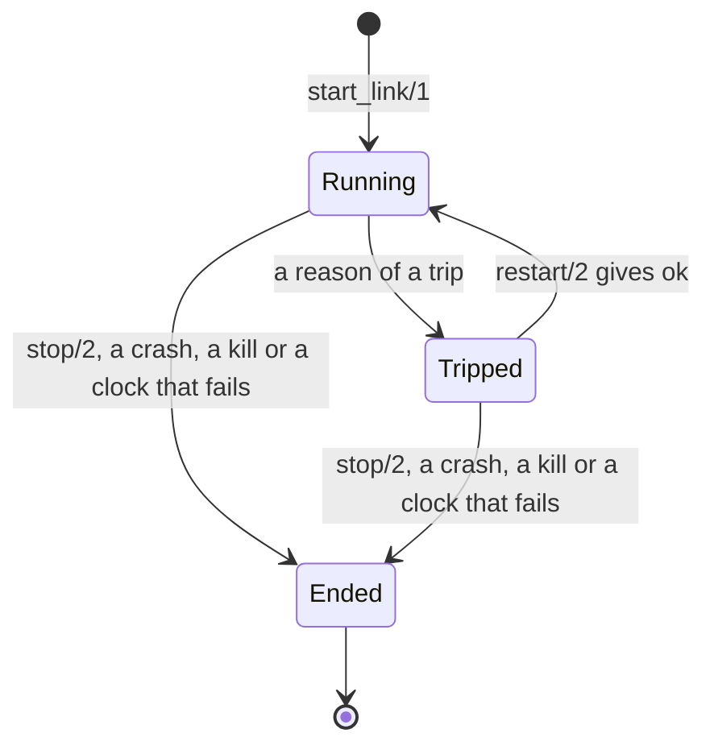
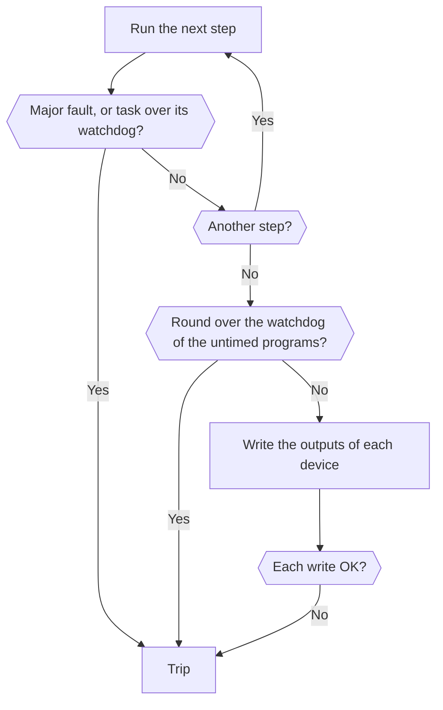

# 0013. Watchdogs and the trip

This record is for a contributor who changes what `Logex.Runner` does when something
fails. An example is a new reason of a [trip](../../guides/reference/glossary.md#trip) or
a new [watchdog](../../guides/reference/glossary.md#watchdog). Another is a change to
`restart/2`, `stop/2` or the end of a crashed
[runner](../../guides/reference/glossary.md#runner). The record says why the trip writes
0 to each output [point](../../guides/reference/glossary.md#point). It says why nothing
starts again until a person asks.

[Trips and watchdogs](../../guides/explanation/trips-and-watchdogs.md) gives the model
for a user. [Runner](../../guides/reference/runner.md) gives each rule, reason and
message.

> #### Warning {: .warning}
>
> Do not use a trip or a watchdog as a
> [safety function](../../guides/reference/glossary.md#safety-function). The trip writes
> 0 only through a [device](../../guides/reference/glossary.md#device) that answers, and
> only while the Elixir VM runs. A watchdog finds late work after the limit. It does not
> stop the work, and it does not make logex a real-time controller.
> [Safety and limits](../../guides/explanation/safety-and-limits.md) gives the limits.

## Status

Accepted. No later record replaces this record. Later decisions change parts of decision
113, the trip, and this record states the rule of each of them:

- Decisions 153 and 160 add a reason, a [major fault](../../guides/reference/glossary.md#major-fault)
  ([0010. A fault does not stop a scan](0010-a-fault-does-not-stop-a-scan.md)).
- Decision 262 writes the 0 of the trip again at each poll, where an adapter refuses it
  ([0014. Devices are processes](0014-devices-are-processes.md)).
- Decisions 271, 273 and 275 keep the retained values at a warm restart, and write the
  [store](../../guides/reference/glossary.md#store) at the trip
  ([0016. Retained values and starts](0016-retained-values-and-starts.md)).
- Decision 394 makes a [clock](../../guides/reference/glossary.md#clock) that gives no
  time a trip, and decision 441 stops a round at a bad reading of the clock.
- Decisions 352 and 482 name the work in the reason of the idle watchdog.
- Decision 354 makes the refusal of decision 133 exact, and decision 508 applies it to a
  second restart.

## Date

2026-10-17, the date of decisions 109, 110, 113, 115 and 116, from the design of the
runner. The first decision of the record, 14, is of 2026-09-28, and the last, 508, is of
2026-11-12.

## Context

The runner runs a [plant](../../guides/reference/glossary.md#plant) on a computer that
also does other work. On 1 computer, the design measured the longest time with no new
outputs. It was 20 ms with no other work, and about 700 ms beside 2 heavy jobs (decision
109). A device can also fail, and a [scan](../../guides/reference/glossary.md#scan) can
meet a major fault. The clock of the [host](../../guides/reference/glossary.md#host) can
give a value that is not a time.

For each of these failures, logex must say what the outputs do, what the operator can read
and who starts the plant again.

[IEC 61131-3](../../guides/reference/glossary.md#iec-61131-3) has no watchdog. It gives
no rule for a restart of a [resource](../../guides/reference/glossary.md#resource) that
runs (decision 133), or after a [fault](../../guides/reference/glossary.md#fault) of the
I/O (decision 142). [Logix](../../guides/reference/glossary.md#logix) does these things:

| Subject | Logix | Source |
|---|---|---|
| The watchdog | Each task has 1. The default is 500 ms, the range is 1 to 2,000,000 ms | 1756-PM005M, p.34 |
| A major fault | The outputs go to their configured fault state | 1756-UM900B, Nov 2025, p.242 |
| A major fault | The logic stops, unless a handler of faults clears the fault | 1756-PM014O, p.9 |
| The outputs | The controller sends them at each RPI, and in the local chassis also at the end of each task | 1756-UM058L, p.24 |
| A module that loses its controller | Its outputs go to the value for a fault that its configuration gives | 1756-PM015Q, p.12 |
| Run mode after a fault of the I/O | The controller makes 1 attempt to connect to each module that the configuration requires | 1756-PM015Q, p.12 |
| A restart of a controller that runs | No such restart. The nearest is a change to Program mode and back | Not recorded |

[`docs/organisation.md` §8](../organisation.md#8-sources-and-what-is-unverified) records
when each manual was read. OpenPLC v3 writes 0 to each output when its runtime stops
(decision 113).

## Decision

This diagram shows the life of a runner:

Figure: the life of a runner. Only `restart/2` takes a runner from `Tripped` to
`Running`. A restart that gives an error keeps the runner in `Tripped`. A restart while
the runner is in `Running` raises an `ArgumentError`, and the runner stays in `Running`.

### Each failure has 1 trip

A trip has 1 path, whatever its reason (decision 113). The runner does these things, in
this sequence:

1. It stops the schedule and refuses each restart that waits.
2. It writes 0 to each output 1 time, through each device that answers. If an adapter
   refuses the 0, the device tries the 0 again at each poll (decision 262).
3. It sends `{:trip, reason}` to each subscriber. `status/1` gives `:tripped` and the
   reason.
4. It writes the store, if the option `retain:` names one (decision 275).
5. It answers each call of the host that waits for the end of a round.

The trip does not set the resource to 0. The resource keeps the values of the last round,
and `get/2` reads them, so the engineer can find the cause. A runner that is tripped keeps
its first reason. Each output gets 0, and no output has its own value for a fault. 0 is the
safe value for a plant with wiring that de-energises to trip (decision 113).

### The reasons of a trip

The reason names the cause. It can be a task, a round or the work between rounds over its
watchdog (decisions 110, 111, 126, 128 and 482). It can be a device (decisions 114, 125,
137 and 490), a major fault (decisions 153 and 160) or a clock (decision 394).
[Runner](../../guides/reference/runner.md) gives the fields of each reason. If a step
meets a major fault and is also late, the reason is the fault (decision 211).

### Each task has a watchdog

`Logex.Runtime` reads no clock, so `cycle/3` has no watchdog
([0007. The host gives the time](0007-the-host-gives-the-time.md)). The runner times each
task:

- Each task has 1 watchdog, set on its line in the
  [configuration file](../../guides/reference/glossary.md#configuration-file), such as
  `watchdog 50` (decision 110). A task with no `watchdog` has 500 ms, the default of
  Logix (decision 109). A watchdog is 1 to 2147483647 ms.
- The watchdog of the [continuous task](../../guides/reference/glossary.md#continuous-task)
  times a whole round where the plant has a program with no timed task (decision 111).
  The reason names each step of the round with its time (decision 126).
- The option `idle:` of `Logex.Runner.start_link/1`, the
  [idle watchdog](../../guides/reference/glossary.md#idle-watchdog), times the work of the runner between
  rounds, 500 ms by default (decision 128). The limit is a setting of the runner because
  it depends on the computer, not on the plant. The reason names the work (decision 482).

Figure: the checks of 1 round. A hexagon is a check. The checks of the faults and the
times come before the write, so a round that takes too long never gets to the plant. A
bad time at any reading goes to the trip immediately.

A watchdog cannot stop a scan while the scan runs. During a long scan, only the deadline
of each device writes the 0: the watchdog of the step and 1
[poll period](../../guides/reference/glossary.md#poll-period).

### A clock that gives no time

After the start, the runner trips if `now_ms/1` gives no integer (decision 394). A round
that reads a bad time stops at that reading and trips (decision 441). The values that the
steps before the reading wrote stay in the resource (decision 469).

### A restart is a new start that a person asks for

After a trip, nothing starts again until the host calls `Logex.Runner.restart/2` with
`:cold` or `:warm` (decision 113). A restart is never a resume. It ends the hold on each
device, reads each device 1 time and restarts the resource. Then it runs the first round
immediately on the values that it read (decision 142). Thus a restart never sends the
outputs from before the trip.

If a device fails to open or to read, the restart fails with
`{:error, {:io_init, device, cause}}` (decisions 136 and 142). The runner stays tripped,
and each device that answers gets the 0 again. A restart while the runner runs raises an
`ArgumentError` (decisions 133, 354 and 508).

### A stop and a crash

`stop/2` writes 0 to each output 1 time and closes each device (decision 116). A runner
that crashes does not start again (decision 115). Each device process traps the exit of
the runner, writes 0 and closes.

[Runs and tables of the records: the runner](../implementation/record-runs-runner.md#0013-watchdogs-and-the-trip)
gives a run of a trip, of 2 restarts and of the watchdog of a round.

## Consequences

The good results:

- 1 path serves each failure. A new reason needs no new behaviour for the outputs.
- The checks come before the write. A round that took too long, met a major fault or
  read a bad time never gets to the plant.
- The resource keeps the last values for the engineer. The reason names the task, the
  step, the device, the fault or the work.
- Nothing starts again by itself. A restart reads each device first, so a device that is
  still at fault keeps the plant off and gets its name in the answer.
- The reason of a trip is the same in each run on the manual clock. ExUnit tests check it.

The costs:

- Each output goes to 0, also an output that must stay on, such as a fan that must run on
  (decision 113).
- The trip writes 0 only through a device that answers. `status/1` names the device in
  `unzeroed`.
- `get/2` can show an output at 1 that the plant never got. A host that shows the plant
  must read the devices, or `unzeroed`, and not only the resource.
- The default of 500 ms can trip a busy computer with no fault in the logic
  (decision 109).

A new failure takes the 1 path of the trip, with a new reason. A new check of a
round comes before the write of the round.

## Alternatives considered

| Decision | Not taken | Why not |
|---|---|---|
| 113 | Each output keeps its value, or each output has a value for a fault | A held value keeps machines in motion with no logic to watch them. A value for a fault waits for a plant that needs one |
| 109 | No default, a default of 100 ms, or no watchdog unless set | Each task of Logix has a watchdog, 500 ms by default. 100 ms can trip a busy computer with no fault of the program |
| 128 | The shortest watchdog of a task as the idle limit | The limit depends on the computer, not on the plant |
| 115 | A crashed runner starts again | No person asked for the start. A fan that an operator holds on with a selector comes back on |
| 116 | A stop does not change the outputs | A conveyor then stays on after the controller stops |
| 142 | The first round runs on the last values | A device that is still at fault turns the plant on |
| 441 | The round runs on as if no time passed, and writes its outputs | Outputs from a round with a bad time get to the plant |

§7 gives the other options.

## The decisions that this record sums up

This record sums up 21 decisions of
[`docs/organisation.md`](../organisation.md#7-decisions):

- 14, 113, 115 and 116: the trip, the crash and the stop.
- 109, 110, 126, 128, 211 and 482: the watchdogs and the reason.
- 133, 136, 142, 354 and 508: the restart.
- 394, 441, 469, 470, 474 and 497: the clock and the cut round.

The design is in
[§4.11](../organisation.md#411-milestone-4s-design-the-wall-clock-runner-decided-2026-10-17)
of the same document. `PLAN.md` keeps the history in M4-4, M4-6, RV-4, RV-11, RV-16,
RV-18 and RV-19.

It also uses decisions that other records sum up:

- Decision 111, the continuous task: [0011. Tasks and rounds](0011-tasks-and-rounds.md).
- Decisions 114, 125, 137, 262, 439 and 490, the device, its deadline and its 0:
  [0014. Devices are processes](0014-devices-are-processes.md).
- Decision 352, the work of the runner between rounds:
  [0018. File work with a limit](0018-file-work-with-a-limit.md).
- Decisions 153 and 160, the major fault:
  [0010. A fault does not stop a scan](0010-a-fault-does-not-stop-a-scan.md).
- Decisions 271, 273, 275 and 291, the store and the warm restart:
  [0016. Retained values and starts](0016-retained-values-and-starts.md).

[Set watchdogs](../../guides/howto/set-watchdogs.md),
[Find why a plant tripped](../../guides/howto/find-why-a-plant-tripped.md) and
[Restart after a trip](../../guides/howto/restart-after-a-trip.md) give the steps.
[The runner](../architecture/runner.md) gives the code.
