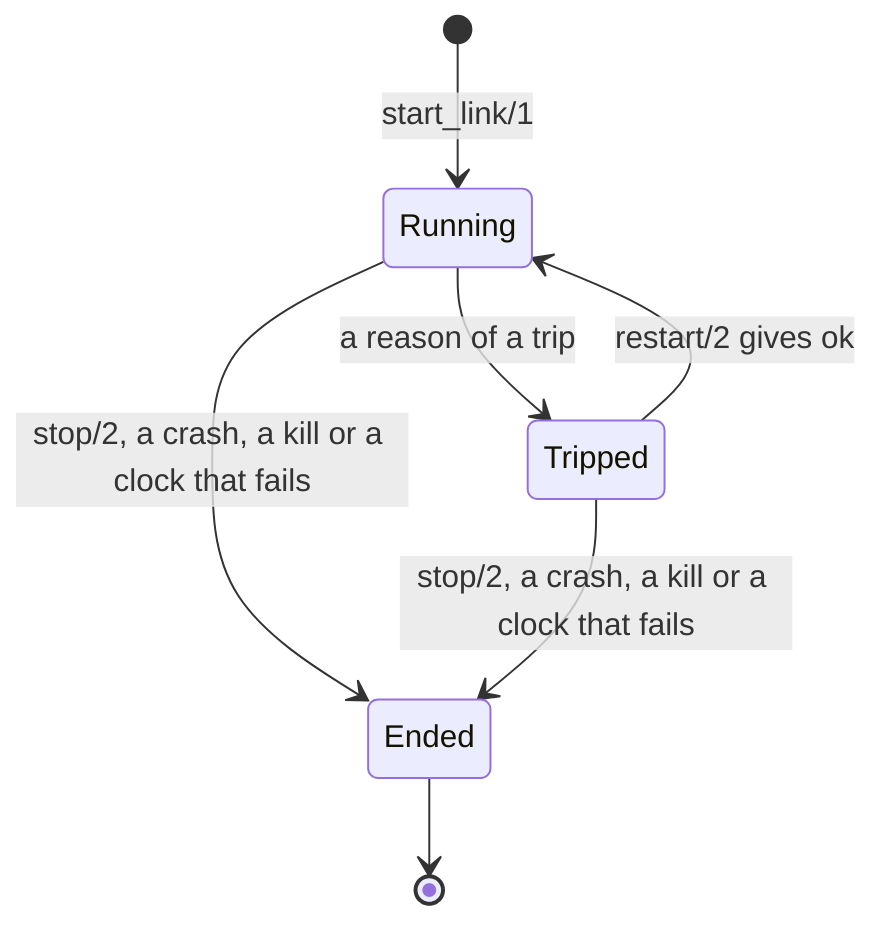
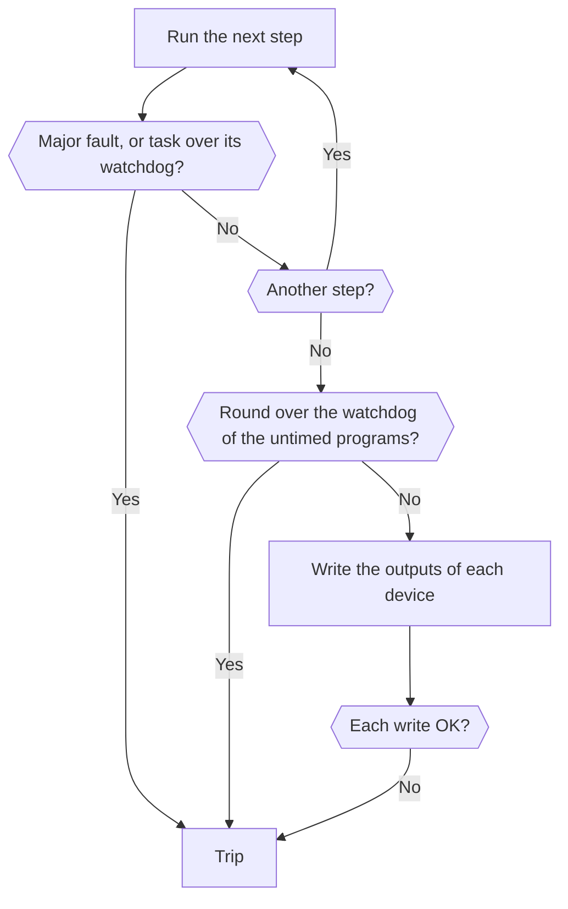
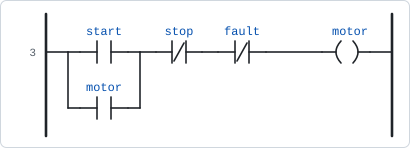

# 0013. Watchdogs and the trip

This record is for a contributor who changes what `Logex.Runner` does when something
fails. Examples are a new reason of a
[trip](../../guides/reference/glossary.md#trip) or a new
[watchdog](../../guides/reference/glossary.md#watchdog). Other examples are a change to
the trip, to `Logex.Runner.restart/2`, to `stop/2` or to the end of a crashed
[runner](../../guides/reference/glossary.md#runner). The record says why each failure
has 1 trip. It says why the trip writes 0 to each output
[point](../../guides/reference/glossary.md#point), and why nothing starts again until a
person asks. It also says why each [task](../../guides/reference/glossary.md#task) has a
watchdog, and why the work of the runner between
[rounds](../../guides/reference/glossary.md#round) has the
[idle watchdog](../../guides/reference/glossary.md#idle-watchdog).

[Trips and watchdogs](../../guides/explanation/trips-and-watchdogs.md) gives the model
for a user. [Runner](../../guides/reference/runner.md) gives each rule, reason and
message.

> #### Warning {: .warning}
>
> Do not use a trip or a watchdog as a
> [safety function](../../guides/reference/glossary.md#safety-function). The trip writes
> 0 only through a [device](../../guides/reference/glossary.md#device) that answers, and
> only while the Elixir VM runs. A watchdog finds late work after the limit. It does not
> stop the work, and it does not make logex a real-time controller.
> [Safety and limits](../../guides/explanation/safety-and-limits.md) gives the limits.

## Status

Accepted. No later record replaces this record. Later decisions change some parts of
decision 113, the trip:

- Decisions 153 and 160 add a reason, a [major fault](../../guides/reference/glossary.md#major-fault).
  [0010. A fault does not stop a scan](0010-a-fault-does-not-stop-a-scan.md) gives them.
- Decisions 271, 273 and 275 keep the retained values at a warm restart, and write the
  [store](../../guides/reference/glossary.md#store) at the trip.
  [0016. Retained values and starts](0016-retained-values-and-starts.md) gives them.
- Decision 394 makes a [clock](../../guides/reference/glossary.md#clock) that gives no
  time a trip. Before it, such a clock stopped the runner.
- Decision 441 stops a round at a bad reading of the clock. Before it, the round ran on
  as if no time passed, and wrote its outputs.
- Decision 352 names the work in the reason of the idle watchdog, and decision 482 keeps
  those names. Before them, the reason was `{:watchdog, {:idle, ms}}`.
- Decision 354 makes the refusal of decision 133 exact. Decision 508 applies it to a
  second restart.

## Date

2026-10-17, the date of decisions 109, 110, 113, 115 and 116, from the design of the
runner. The first decision of the record, 14, is of 2026-09-28, and the last, 508, is of
2026-11-12. [Decisions in section 7](#decisions-in-section-7) lists them all.

## Context

The runner runs a [plant](../../guides/reference/glossary.md#plant) on a computer that
also does other work. The design measured the runner on 1 computer. With no other work,
the longest time with no new outputs was 20 ms. It was about 100 ms beside 1 heavy job,
and about 700 ms beside 2 (decision 109). Work can be late for other reasons too:

- A [scan](../../guides/reference/glossary.md#scan) can take longer than the limit of its task.
- The runner can be slow in its own work, for example a call of the
  [host](../../guides/reference/glossary.md#host) or an
  [online edit](../../guides/reference/glossary.md#online-edit).
- A device can fail, give a bad value or stop to answer.
- A scan can meet a major fault.
- The clock of the host can give a value that is not a time.

For each of these failures, 3 questions need 1 answer:

1. What do the outputs do? Decision 113 asks this for 4 outputs: the conveyor, the fan,
   the lamp and the speed setting of the drive.
2. What can the operator read after the failure?
3. Who starts the plant again, and from which values?

[IEC 61131-3](../../guides/reference/glossary.md#iec-61131-3) has no watchdog. The word
does not occur in either edition (§3 of
[`docs/organisation.md`](../organisation.md#3-the-conventional-familys-hierarchy-mapped-onto-iec)).
Ed 2 §1.5.1 d) 4) asks the system to "initiate appropriate system- or user-defined error
handling procedures". IEC describes a [cold restart](../../guides/reference/glossary.md#cold-restart) and a
[warm restart](../../guides/reference/glossary.md#warm-restart) as the ways a
[resource](../../guides/reference/glossary.md#resource) starts. It gives no rule for a
restart of a resource that runs (decision 133). It gives no rule for a restart after a
[fault](../../guides/reference/glossary.md#fault) of the I/O (decision 142).

[Logix](../../guides/reference/glossary.md#logix) does these things:

| Subject | Logix |
|---|---|
| The watchdog | Each task has 1. The default is 500 ms, the range is 1 to 2,000,000 ms. The time includes the tasks that interrupt the task (1756-PM005M, p.34) |
| A major fault | The outputs go to their configured fault state (1756-UM900B, p.242). Its fault handler decides if the controller shuts down (1756-PM005M, p.34) |
| The outputs | The controller sends them to each module at each RPI, and in the local chassis also at the end of each task (1756-UM058L, p.24) |
| A module that loses its controller | Its outputs go to the value for a fault that its configuration gives (1756-PM015Q, p.12) |
| Run mode after a fault of the I/O | The controller makes 1 attempt to connect to each module that the configuration requires (1756-PM015Q, p.12) |
| A restart of a controller that runs | No such restart. The nearest is a change to Program mode and back. The record did not verify this (decision 133) |

OpenPLC v3 writes 0 to each output when its runtime stops (decision 113).

## Decision

This diagram shows the life of a runner:



Figure: the life of a runner. Only `restart/2` takes a runner from `Tripped` to
`Running`. A restart that gives an error keeps the runner in `Tripped`. A restart while
the runner is in `Running` raises an `ArgumentError`, and the runner stays in `Running`.

### Each failure has 1 trip

A trip has 1 path, whatever its reason (decision 113). The runner does these things, in
this sequence:

1. It stops the schedule. It makes no more rounds, and it gives up its next wake. It
   refuses each restart that waits.
2. It writes 0 to each output 1 time, through each device that answers, in the sequence
   of the device names. After that 0, the device writes no other value until a restart.
   If its adapter refuses the 0, the device tries the 0 again at each poll
   (decision 262).
3. It sends `{:trip, reason}` to each subscriber. `status/1` gives `:tripped` and the
   reason.
4. It writes the store, if the option `retain:` names one (decision 275). The 0 of each
   output comes first.
5. It answers each call of the host that waits for the end of a round. It answers each
   later call immediately.

While the runner is tripped, it keeps each change from a device for the first round after
a restart. A change does not start a round.

The trip does not set the resource to 0. The resource keeps the values of the last round
that the runner computed, and `get/2` reads them. The last values are then available to
find the cause. If the round tripped before its write, some of these values never got to
the plant. Result 1 of [The rules in a run](#the-rules-in-a-run) shows `k1` as 1 in the
resource and 0 at the panel.

A runner that is tripped keeps its first reason. A later failure does not change it.

Each output gets 0, and no output has its own value for a fault. 0 is the safe value for
a plant with wiring that de-energises to trip. An output that holds its value keeps a
machine in motion with no logic to watch it (decision 113).

### The reasons of a trip

The reason names the cause. Each kind has its decisions:

- `{:watchdog, {:task, ...}}`, a timed task over its watchdog: decision 110.
- `{:watchdog, {:round, ...}}`, a round over the watchdog of its untimed programs:
  decisions 111 and 126.
- `{:watchdog, {:idle, ms, work}}`, work of the runner between rounds over the idle
  watchdog: decisions 128 and 482.
- `{:watchdog, {:device, ...}}` and `{:watchdog, {:late, ms}}`, a device that hears
  nothing by its deadline and a runner that is late: decisions 125, 137 and 490.
- `{:io, device, cause}`, a device that fails: decision 114.
- `{:fault, task, instance, fault}`, a major fault: decisions 153 and 160.
- `{:clock, ...}`, a clock that gives no time: decision 394.
- `{:internal, message}`, an exception from the core: decision 113.

[Runner](../../guides/reference/runner.md) gives the fields of each reason.
[0014. Devices are processes](0014-devices-are-processes.md) gives the deadline of a
device and the reasons of the I/O.
[0010. A fault does not stop a scan](0010-a-fault-does-not-stop-a-scan.md) gives the
major fault.

No host can cause `{:internal, message}`. The runner trips in place of a crash, so its
values stay available. A test reaches it through an option of `start_link/1` that the
documentation does not show.

### Each task has a watchdog

`Logex.Runtime` reads no clock, so `Logex.Runtime.cycle/3` has no watchdog and never
trips ([0007. The host gives the time](0007-the-host-gives-the-time.md)). The runner
takes the watchdog of each task from `Logex.Configuration.watchdog/1`:

- Each task has 1 watchdog, set on its line in the
  [configuration file](../../guides/reference/glossary.md#configuration-file), as in
  `task fast interval 10 priority 1 watchdog 50` (decision 110). The conveyor can need
  50 ms, and the fan can wait 2 s.
- A task with no `watchdog` has 500 ms, the default of Logix (decision 109). No task has
  "no watchdog". A watchdog is 1 to 2147483647 ms, the range of a `dint`.
- The run of a timed task starts with the scan of its first
  [instance](../../guides/reference/glossary.md#instance). It ends with the scan of its
  last instance, and includes the time that the computer takes from the runner. If the task is due while a round runs, the wait for the end of that round is
  not part of the time. An [event task](../../guides/reference/glossary.md#event-task)
  has the same rule as a [periodic task](../../guides/reference/glossary.md#periodic-task).
- The watchdog of the [continuous task](../../guides/reference/glossary.md#continuous-task)
  applies to a round only where the plant has a
  [program](../../guides/reference/glossary.md#program) with no timed task. It runs from
  the inputs to the end of the scan of the last such program. The runs of the timed tasks
  in that round are part of the time (decision 111). With no continuous task, the reason
  names the task `:none`, and its watchdog is 500 ms.
- A plant whose programs all have a timed task has no watchdog for the round as a whole.
  Each timed task has only its own. A continuous task with no program times no round.
- The reason of a round names each step of the round with its time, in the sequence of
  the round (decision 126). A step is the run of 1 timed task, or the run of the untimed
  programs. The engineer then sees the slow step. In result 5, the reason is
  `{:watchdog, {:round, "main", 210, 200, [{"fast", 60}, {"main", 60}]}}`.

This flowchart shows where the runner checks a round, and what each failure does:



Figure: the checks of 1 round. A hexagon is a check. The checks of the faults and the
times come before the write, so a round that takes too long never gets to the plant. The
flowchart has no node for the clock: a bad time at any reading goes to the trip
immediately.

A watchdog cannot stop a scan while the scan runs. During a long scan, only the deadline
of each device writes the 0. That deadline is the watchdog of the step and 1
[poll period](../../guides/reference/glossary.md#poll-period). For example, a watchdog of
50 ms and a poll period of 10 ms give a deadline of 60 ms. Each device that answers then
writes 0 no later than 60 ms after the step starts.

These messages are from `task main continuous watchdog 0` and
`task main continuous watchdog 2147483648` on line 1 of a configuration file:

<!-- unchecked: the diagnostics of a run, from watchdog 0 and watchdog 2147483648 -->
```text
line 1: the watchdog of `main` is 0: a watchdog is at least 1 ms, and a task that sets none has 500
line 1: the watchdog of `main` is `2147483648` ms: a watchdog is 1 to 2147483647 ms
```

### The idle watchdog

Between rounds the runner does its own work, for example a call of the host or a step of
an online edit. No task runs then. The option `idle:` of `Logex.Runner.start_link/1`
gives the limit of this work, 500 ms by default (decision 128). It is 1 to 2147483647 ms,
and `start_link/1` refuses another value with an `ArgumentError`:

<!-- unchecked: the message of a run, from idle: 0 -->
```text
the runner's idle: is a whole number of milliseconds, 1 to 2147483647, got: 0
```

- The idle watchdog applies only while the runner runs. Each device then gets `idle:`
  and 1 poll period as its deadline.
- The runner does not stop a request before the request ends. If the request takes
  longer than `idle:`, the caller gets its answer and then the runner trips.
- The idle watchdog does not time a restart. The watchdog of each step times its first
  round.
- The reason names the work, and no [tag](../../guides/reference/glossary.md#tag)
  (decision 482). A call of the host is the name of its function, such as `:get`. A step
  of an edit is `{:edit, step}`. The hand-off of the resource, at each period, to the
  process that writes the store is `:period`.
  [Runner](../../guides/reference/runner.md) lists each name.
- The write of the store, and a write of the
  [forces file](../../guides/reference/glossary.md#forces-file), run outside the runner.
  The idle watchdog does not time them.

The limit is a setting of the runner, not of the
[configuration](../../guides/reference/glossary.md#configuration), because it depends on
the computer, not on the plant. A fixed short limit can trip a busy computer with no fault: the design measured a wake 692 ms
late under load (decision 128).

### Which reason the trip names

- If a step meets a major fault and also takes longer than its watchdog, the reason is
  the fault (decision 211). The engineer must correct the fault, not the time.
- The devices tell the runner of a failure with a notice. The runner takes the notices
  that waited in the sequence of their times. For 2 notices at the same ms, the sequence
  is the sequence of the device names. Thus a run on the manual clock trips for the same
  reason each time.

### A clock that gives no time

After the start, the runner trips if `now_ms/1` gives no integer, or an integer outside a
signed 64-bit integer (decision 394). The reason is `{:clock, {:now_ms, answer}}`. A
period write of the store whose `wall_ms/1` gives no time trips with
`{:clock, {:wall_ms, answer}}`. The runner trips and does not stop, so a restart can
start the plant again when the clock gives a time again.

At `start_link/1`, a bad clock is an `ArgumentError` in the caller. A clock process that
stops, or a clock callback that raises or exits, ends the runner with
`{:shutdown, {:clock, reason}}`: each device writes 0 and closes.

A round that reads a bad time stops at that reading, and trips immediately (decision 441).
The runner writes nothing after the reading. If the reading is before the writes, no
device gets the outputs of the round. If it is between the writes of 2 devices, the
devices written before it keep those outputs until the 0 of the trip.

The values that the steps before the reading wrote stay in the resource (decision 469).
A box that a step counted stays counted, as a major fault of Logix keeps what the
[rungs](../../guides/reference/glossary.md#rung) before it wrote.

If the runner reads a bad time between rounds, it finishes the work that it does. It
trips when it takes its next message (decision 470). An example is the period write of
the store in a plant with a continuous task.

A round can stop after its writes start, at a bad time or at a write that fails
(decision 497). Then the runner sends the event `{:round, now, outputs}` with the outputs
of each device that the writes got to (decision 474). A log that follows the rounds then
shows what the plant got.

### A restart is a new start that a person asks for

After a trip, nothing starts again until the host calls `Logex.Runner.restart/2` with
`:cold` or `:warm` (decision 113). A [restart](../../guides/reference/glossary.md#restart)
is never a resume. The time of the resource does not count the time of the trip. In
results 2 and 4 it stays at 370 ms, but the clock moves on 1000 ms.

A restart does these things, in this sequence:

1. The runner asks its clock for the time, and the wall clock too where `retain:` names a
   store. A clock that gives no time gives `{:error, {:clock, cause}}`, and the runner
   stays tripped. Then the runner reads the forces file again. A
   [force](../../guides/reference/glossary.md#force) that the configuration cannot take
   raises an `ArgumentError` in the caller, and the runner stays tripped.
2. A cold restart with a store writes the store (decision 291). If the write fails,
   `restart/2` gives `{:error, {:retain, reason}}`, and the runner stays tripped.
3. The runner ends the hold on each device, in the sequence of the names. After that, the
   device can write again. The runner kills a device process that does not answer in
   `idle:` and 1 poll period.
4. The runner reads each device 1 time, in the sequence of the names (decision 142). It
   opens again each device that stopped. Each read or open has the limit of the option
   `open:` of its device.
5. The runner restarts the resource, as `Logex.Runtime.restart/2` does. The resource
   keeps its input image, and each other value gets its
   [initial value](../../guides/reference/glossary.md#initial-value). A warm restart
   keeps the retained values.
6. It sends `{:restart, mode}`, and runs the first round immediately, on the values
   that it read. Then `restart/2` gives `:ok`.

A device writes nothing after step 3 until the first round writes its outputs. Thus a
restart never sends to the plant the outputs from before the trip. In result 4, `k1`
stays 0 after the cold restart, because its seal-in starts again at 0.

<!-- rung: conveyor.ld 3 -->


The drawing shows the [seal-in](../../guides/reference/glossary.md#seal-in) of the
conveyor: the [contact](../../guides/reference/glossary.md#contact) `motor` keeps the
[coil](../../guides/reference/glossary.md#coil) `motor` on after the operator releases
`start`. After a restart, `motor` is 0, so the conveyor waits for a new press of `start`.

In step 4, a device can fail to open, fail to read, or give a value that does not fit
its point. Then the restart fails (decisions 136 and 142):

- `restart/2` gives `{:error, {:io_init, device, cause}}`.
- The runner stays tripped, with its first reason.
- Each device that answers gets the 0 again, 1 time. A device that reset itself during
  the trip, or a device opened again in step 4, then also gets the 0.

Nothing comes on from a device that is still at fault, and the answer names it. The host
repairs the device, then calls `restart/2` again. In result 3 the panel gets 1 more
write, the 0.

A restart while the runner runs is an error of the host (decision 133). The runner stays
as it is, and the caller gets this `ArgumentError`:

<!-- unchecked: the message of a run, from restart/2 while the runner runs -->
```text
the runner is running: restart/2 starts a runner again once it has tripped
```

The runner judges a restart when the restart arrives (decision 354). In this sequence of
events, the restart fails:

1. The host calls `restart/2` while the runner runs.
2. A round trips before the runner serves the call.
3. The runner refuses the restart with the `ArgumentError`.

Only a restart that the host asks for after the trip clears it. Of 2 restarts that wait,
for example for a write of the forces file, the runner makes the first and refuses the
second (decision 508). If the runner refuses the first, it makes the second.

### A stop and a crash

`stop/2` writes 0 to each output 1 time and closes each device, in the sequence of the
names, before it returns (decision 116). A device of a tripped runner that took the 0 of
the trip gets no second 0. Then `stop/2` writes the store, if `retain:` names one.

A runner that crashes, or that a process kills, does not start again (decision 115):

- Each device process traps the exit of the runner. It writes 0 to each output 1 time,
  if it did not write that 0 before, and closes.
- A device process that hangs in its
  [adapter](../../guides/reference/glossary.md#adapter) cannot receive the exit signal. A
  separate process kills it in `idle:` and 1 poll period of real time. The outputs then
  do what the hardware does when it loses its controller.
- The child spec of the runner is `restart: :temporary`. Its supervisor does not start it
  again.

A host can supervise the runner with a separate child spec that restarts it. A new
runner with no store starts from the initial values. A new runner with a store starts
warm unless the host gives `start: :cold`, and a retained value can then turn on an
output ([0016. Retained values and starts](0016-retained-values-and-starts.md)).

### The rules in a run

The script `examples/0013-watchdogs-and-the-trip.exs` shows the trip, the restart and the
watchdog of a round as numbered results. It runs `0013-watchdogs-and-the-trip/plant.logex`
on a [simulated device](../../guides/reference/glossary.md#simulated-device), the panel.

The configuration runs the conveyor on a task of 10 ms with a watchdog of 100 ms. It
runs the box [counter](../../guides/reference/glossary.md#counter) in the continuous
task `main`, with a watchdog of 200 ms. The script also reads 2 program files from
`examples/`. Each link leads to the page that shows the file:

- [`conveyor.ld`](../../guides/howto/try-an-edit-on-a-simulated-device.md), the conveyor.
- [`boxes.ld`](../../guides/howto/try-an-edit-on-a-simulated-device.md), which counts
  the boxes.

<!-- file: 0013-watchdogs-and-the-trip/plant.logex -->
```text
// plant.logex -- the conveyor on a 10 ms task watched to 100 ms, the box counter in main
task fast interval 10 priority 1 watchdog 100
task main continuous watchdog 200

var_global estop      bool at panel.i.7
var_global pb_start_1 bool at panel.i.0
var_global pb_reset   bool at panel.i.2
var_global eye        bool at panel.i.8
var_global k1         bool at panel.q.0
var_global case_full  bool at panel.q.4

program c1 conveyor with fast
  c1.start pb_start_1
  c1.stop  0
  c1.reset pb_reset
  c1.motor k1

program b1 boxes
  b1.eye       eye
  b1.reset_pb  pb_reset
  b1.full_lamp case_full
```

The script runs the manual clock through a separate clock module, `Busy`. Each reading
of the time passes the ms that the agent `cost` holds, as on a busy computer. With a cost
of 60 ms, 2 readings of the clock fall in the scan of the conveyor, so the scan takes
120 ms.

```elixir
alias Logex.Runner
alias Logex.Runner.Clock.Manual
alias Logex.IO.Sim

# A manual clock on a busy machine: each reading of the time passes the milliseconds
# that the agent `cost` holds.
defmodule Busy do
  @behaviour Logex.Runner.Clock

  def now_ms({clock, cost}) do
    Manual.pass(clock, Agent.get(cost, & &1))
    Manual.now_ms(clock)
  end

  def wake_at({clock, _cost}, pid, message, at), do: Manual.wake_at(clock, pid, message, at)
  def cancel({clock, _cost}, timer), do: Manual.cancel(clock, timer)
end

programs =
  Map.new(~w(conveyor boxes), fn name ->
    {:ok, program} = Logex.compile_file(name <> ".ld")
    {name, program}
  end)

text = File.read!("0013-watchdogs-and-the-trip/plant.logex")
{:ok, plant} = Logex.Configuration.compile("plant", text, programs)

{:ok, clock} = Manual.start_link()
{:ok, cost} = Agent.start_link(fn -> 0 end)
{:ok, panel} = Sim.start_link(reports: true, clock: clock)

{:ok, runner} =
  Runner.start_link(
    configuration: plant,
    io: %{"panel" => {Sim, sim: panel}},
    clock: {Busy, {clock, cost}}
  )

# Prints the fields of status/1 that the list names, in its order.
status = fn keys ->
  IO.puts("  " <> inspect(for(key <- keys, do: {key, Map.fetch!(Runner.status(runner), key)})))
end

# Prints k1 in the resource, k1 at the panel and the number of writes to the panel.
k1 = fn ->
  IO.puts(
    "  k1 in the resource #{Runner.get!(runner, "k1")}, k1 at the panel " <>
      "#{Sim.outputs(panel)["panel.q.0"]}, writes to the panel #{length(Sim.writes(panel))}"
  )
end

# Runs the clock to 10 ms with each reading at `ms`, then sets the cost back to 0.
busy = fn ms ->
  Agent.update(cost, fn _ -> ms end)
  Manual.advance(clock, 10)
  Agent.update(cost, fn _ -> 0 end)
end

IO.puts("1. The conveyor's scan takes 120 ms, and its watchdog is 100 ms")
Manual.advance(clock, 9)
Sim.set(panel, "panel.i.0", 1)
busy.(60)
status.([:status, :trip, :rounds, :now])
k1.()

IO.puts("2. Tripped: 1000 ms pass")
Sim.set(panel, "panel.i.0", 0)
Manual.advance(clock, 1000)
status.([:status, :rounds, :now])
k1.()

IO.puts("3. A restart while a read of the panel fails")
Sim.fail(panel, :read, {:error, :eio})
IO.puts("  " <> inspect(Runner.restart(runner, :cold)))
status.([:status, :trip])
k1.()

IO.puts("4. A cold restart")
IO.puts("  " <> inspect(Runner.restart(runner, :cold)))
status.([:status, :trip, :rounds, :now])
k1.()

IO.puts("5. A round takes 210 ms, and the watchdog of main is 200 ms")
Sim.set(panel, "panel.i.0", 1)
Manual.advance(clock, 10)
Sim.set(panel, "panel.i.0", 0)
k1.()
busy.(30)
status.([:status, :trip])
k1.()
```

```console
$ mix run 0013-watchdogs-and-the-trip.exs
1. The conveyor's scan takes 120 ms, and its watchdog is 100 ms
  [status: :tripped, trip: {:watchdog, {:task, "fast", 120, 100}}, rounds: 10, now: 370]
  k1 in the resource 1, k1 at the panel 0, writes to the panel 3
2. Tripped: 1000 ms pass
  [status: :tripped, rounds: 10, now: 370]
  k1 in the resource 1, k1 at the panel 0, writes to the panel 3
3. A restart while a read of the panel fails
  {:error, {:io_init, "panel", {:error, :eio}}}
  [status: :tripped, trip: {:watchdog, {:task, "fast", 120, 100}}]
  k1 in the resource 1, k1 at the panel 0, writes to the panel 4
4. A cold restart
  :ok
  [status: :running, trip: nil, rounds: 11, now: 370]
  k1 in the resource 0, k1 at the panel 0, writes to the panel 5
5. A round takes 210 ms, and the watchdog of main is 200 ms
  k1 in the resource 1, k1 at the panel 1, writes to the panel 7
  [status: :tripped, trip: {:watchdog, {:round, "main", 210, 200, [{"fast", 60}, {"main", 60}]}}]
  k1 in the resource 1, k1 at the panel 0, writes to the panel 8
```

Each result shows these rules:

1. The scan that starts the conveyor trips. The resource has `k1` = 1, but the panel
   never gets it (decisions 110 and 113). The time of the resource is then 370 ms.
2. While the runner is tripped, it makes no round and writes nothing (decision 113).
3. The runner refuses a restart with a bad read. The first reason stays, and the panel
   gets the 0 again, 1 time (decisions 136 and 142).
4. A cold restart runs the first round immediately, and `k1` stays 0 (decisions 113
   and 142).
5. Each step is shorter than its own watchdog, but the round is not. The round counts its
   2 steps and the work of the runner around them, so it takes 210 ms. The reason names
   each step with its time (decisions 111 and 126).

## Consequences

The good results:

- 1 path serves each failure. A new reason needs no new behaviour for the outputs.
- The checks come before the write. A round that took too long, met a major fault or
  read a bad time never gets to the plant.
- The resource keeps the last values for the engineer. The reason names the task, the
  step, the device, the fault or the work.
- Nothing starts again by itself. A restart reads each device first, so a device that is
  still at fault keeps the plant off and gets its name in the answer.
- The reason of a trip is the same in each run on the manual clock. The suite checks it
  in `test/logex/trip_test.exs` and `test/logex/runner_test.exs`.

The bad results and the costs:

- Each output goes to 0, also an output that must stay on. A fan that must run on stops
  too. A value for a fault on each output is a possible later item (decision 113).
- The trip writes 0 only through a device that answers. A device process that hangs
  leaves the outputs to what the hardware does when it loses its controller. `status/1`
  names the device in `unzeroed`.
- `get/2` can show an output at 1 that the plant never got (result 1). A host that shows
  the plant must read the devices, or `unzeroed`, and not only the resource.
- The default of 500 ms can trip a busy computer with no fault in the logic
  (decision 109).
- A long request of the host, or a long edit, trips the plant. The moduledoc of
  `Logex.Runner` gives the measured limits of the work, for example about 32,768
  [elements](../../guides/reference/glossary.md#element) of an
  [array](../../guides/reference/glossary.md#array) in 1 plant.
- A host that wants a runner to start again after a crash writes the child spec, and
  owns the risk of a warm start.

What this means for a change:

- A new failure goes through the 1 path of the trip, with a new reason. It needs a row in
  the list of reasons in the moduledoc of `Logex.Runner` and in
  [Runner](../../guides/reference/runner.md). The walks of
  `test/logex/api_contract_test.exs` must reach it.
- A new check of a round comes before the write of the round.
- New work of the runner between rounds has a name for the reason of the idle watchdog.

## Alternatives considered

| Decision | Not taken | Why not |
|---|---|---|
| 113 | Each output keeps its value, or each output has a value for a fault | A held value keeps machines in motion with no logic to watch them. A value for a fault waits for a plant that needs one |
| 109 | No default, a default of 100 ms, or no watchdog unless set | Each task of Logix has a watchdog, 500 ms by default. 100 ms can trip a busy computer with no fault of the program |
| 110 | 1 watchdog for the whole controller, or 1 for the controller and 1 for each task | The conveyor needs 50 ms and the fan 2 s. Each task of Logix has its own |
| 126 | The reason names only the continuous task, or the round does not count the timed tasks | The engineer does not see the slow step, or no watchdog watches a round that grows with them |
| 128 | The watchdog of the continuous task and 1 poll period, or the shortest watchdog of a task | The limit depends on the computer, not on the plant. A short limit trips a busy computer more often |
| 482 | The reason `{:watchdog, {:idle, ms}}`, with no name | The operator does not see which call tripped the plant |
| 211 | The reason names the watchdog | The engineer must correct the fault, not the time |
| 115 | A crashed runner starts again, from the initial values or with each output at 0 | No person asked for the start. A fan that an operator holds on with a selector comes back on |
| 116 | A stop does not change the outputs | A conveyor then stays on after the controller stops |
| 133 | A restart of a runner that runs is a trip and a restart, or it resets the values with no 0 first | Each output goes off for a moment, or the conveyor drops out with no 0 between |
| 136 | A refused restart writes no second 0 | A device that reset itself, or opened again, keeps its outputs from power-up |
| 142 | The first round runs on the last values, or the outputs wait until the runner reads each device | A device that is still at fault turns the plant on, or the runner trips again in 1 poll period |
| 354 and 508 | A waiting restart clears a later trip, or 2 waiting restarts both run | A restart asked while the plant ran clears a trip that came after it, or the plant restarts 2 times |
| 394 | A bad clock stops the runner | A restart cannot start the plant again. A new runner is necessary |
| 441 | The round runs on as if no time passed, and writes its outputs | Outputs from a round with a bad time get to the plant |
| 469 | The round throws its work away | Logix keeps what the rungs before a major fault wrote |
| 470 | A bad time between rounds trips immediately, or each write waits until the runner knows the exit of each device | The maintainer kept the rule of the code. The second costs a look at each write |
| 474 and 497 | No event for a round that a bad time or a failing write cuts | A log then does not show what the plant got |

## Decisions in section 7

This record sums up 21 decisions of
[`docs/organisation.md`](../organisation.md#7-decisions):

- 14, 113, 115 and 116: the trip, the crash and the stop.
- 109, 110, 126, 128, 211 and 482: the watchdogs and the reason.
- 133, 136, 142, 354 and 508: the restart.
- 394, 441, 469, 470, 474 and 497: the clock and the cut round.

The design is in
[§4.11](../organisation.md#411-milestone-4s-design-the-wall-clock-runner-decided-2026-10-17)
of the same document. `PLAN.md` keeps the history in M4-4, M4-6, RV-4, RV-11, RV-16,
RV-18 and RV-19.

It also uses decisions that other records sum up:

- Decision 111, the continuous task: [0011. Tasks and rounds](0011-tasks-and-rounds.md).
- Decisions 114, 125, 137, 262, 439 and 490, the device, its deadline and its 0:
  [0014. Devices are processes](0014-devices-are-processes.md).
- Decision 352, the work of the runner between rounds:
  [0018. File work with a limit](0018-file-work-with-a-limit.md).
- Decisions 153 and 160, the major fault:
  [0010. A fault does not stop a scan](0010-a-fault-does-not-stop-a-scan.md).
- Decisions 271, 273, 275 and 291, the store and the warm restart:
  [0016. Retained values and starts](0016-retained-values-and-starts.md).

[Set watchdogs](../../guides/howto/set-watchdogs.md),
[Find why a plant tripped](../../guides/howto/find-why-a-plant-tripped.md) and
[Restart after a trip](../../guides/howto/restart-after-a-trip.md) give the steps.
[The runner](../architecture/runner.md) gives the code.
