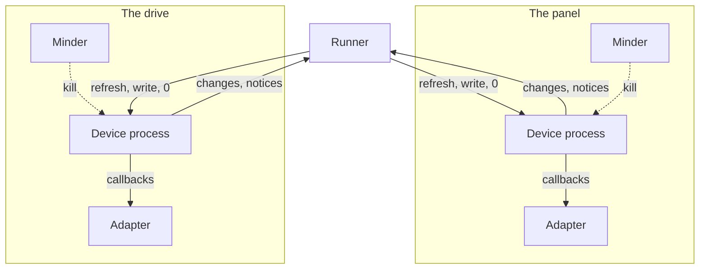
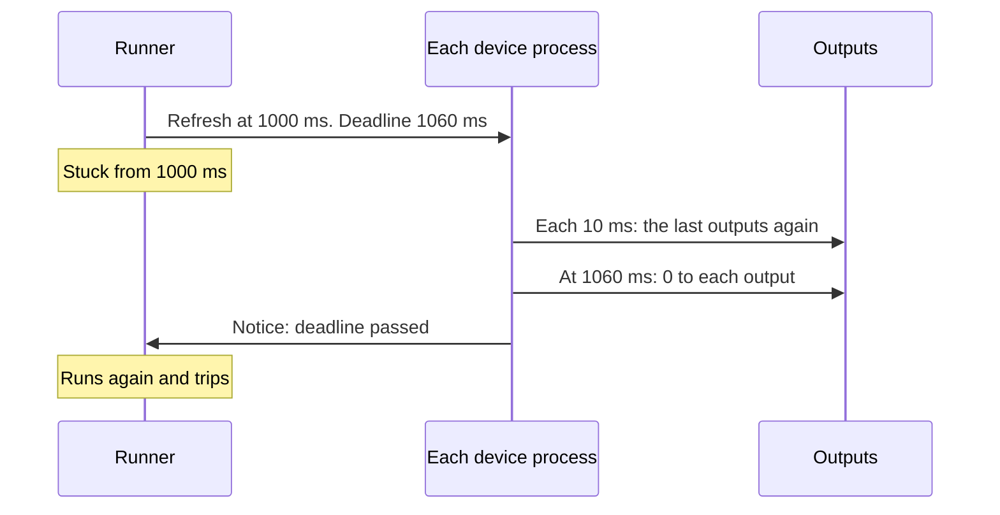
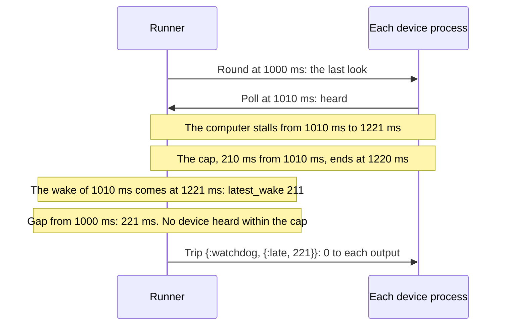

# 0014. Devices are processes

This record is for a contributor who changes how `Logex.Runner` talks to a
[device](../../guides/reference/glossary.md#device). Examples are a change to the
deadline of a device or to the writes at each poll. Other examples are a change to the
limit of a call to an [adapter](../../guides/reference/glossary.md#adapter), or to the
check of a device that is silent. The record says why each device runs in a separate
process with a deadline. It also says why each call to a device has a separate limit,
and how a late computer changes the check.

[Trips and watchdogs](../../guides/explanation/trips-and-watchdogs.md) gives the model
for a user. [Runner](../../guides/reference/runner.md) gives each rule, option, message
and reason of a [trip](../../guides/reference/glossary.md#trip).

> #### Warning {: .warning}
>
> Do not use the deadline of a device as a
> [safety function](../../guides/reference/glossary.md#safety-function). A device writes
> 0 at its deadline only while its process runs and its adapter answers. A device that
> hangs in its adapter writes no 0: its outputs do what the hardware does when it loses
> its controller. When the Elixir VM stops, no process writes a 0.

## Status

Accepted. No later record replaces this record. Some decisions of this record replace
earlier ones: [The decisions that this record sums up](#the-decisions-that-this-record-sums-up) says which.

## Date

2026-10-17, the date of decisions 114, 119 and 120, from the design of the runner. The
last decision of the record, 512, is of 2026-11-12.

## Context

The [runner](../../guides/reference/glossary.md#runner) runs on a computer that also
does other work. 3 kinds of failure concern the devices. The first 2 can keep an
[output](../../guides/reference/glossary.md#output) on:

- The runner is stuck: a bug, a long [scan](../../guides/reference/glossary.md#scan), or
  a computer that gives it no time. It then writes nothing, and it cannot write a 0.
- A card hangs inside its adapter, for example in a read. A press of stop on that card
  then reads as "not pressed".
- A card is slow. A network drive can take 600 ms to connect.

A drive or a remote I/O card often turns its outputs off when it hears nothing from its
master for a time. A plant can run for an hour with no change to an output. A
runner that writes only changed outputs then lets such a drive turn off.

[IEC 61131-3](../../guides/reference/glossary.md#iec-61131-3) gives no rule for the
traffic between a controller and its I/O. [Logix](../../guides/reference/glossary.md#logix)
does these things:

| Subject | Logix |
|---|---|
| The outputs to a module | The controller sends them at the end of each task, in the local chassis, and at the RPI, the requested packet interval (1756-UM058L, p.24) |
| A module that loses its communication with the controller | Its outputs go to the values that its configuration gives for that loss (1756-PM015Q, p.12): a fixed value, or the last value (1756-UM058L, p.123) |
| The timeout of the communication with a module | At least 100 ms, and longer for a longer RPI: 160 ms at the default RPI of 20 ms (1756-UM001Q, p.158). The manuals give no default multiplier |
| An input with no change | The module sends its data at the RPI (1756-PM005M, p.42) |

The record checked these quotations on 2026-10-20 (decisions 120, 130, 134 and 135).
Logix runs its I/O apart from its logic: each module has its own communication and its
own timeout.

## Decision

This table sums up the rules. Each link leads to the section of the rule.

| Rule | Why | Decisions |
|---|---|---|
| [Each device runs in a separate process](#each-device-runs-in-a-separate-process) | The runner does not wait on a device that hangs, and a device can write 0 while the runner is stuck | 114, 120, 124, 143, 397 |
| [Each refresh carries a deadline](#each-refresh-carries-a-deadline) | A stuck runner cannot keep an output on | 119, 125, 137 |
| [Each device writes its outputs again at each poll](#each-device-writes-its-outputs-again-at-each-poll) | A drive that watches for its master stays on while the runner is well | 130, 132 |
| [Each call to a device has its own limit](#each-call-to-a-device-has-its-own-limit) | The trip names the slow device, and a slow connect keeps the idle watchdog short | 134, 348, 398, 438, 439 |
| [A device that fails](#a-device-that-fails) | The runner trips, and each device that answers gets its 0 | 135, 262, 286, 287, 290, 393, 395 |
| [A late computer](#a-late-computer) | A busy computer does not trip a healthy device, and a hung device still trips | 461, 484 to 486, 489 to 492, 503 to 505, 512 |

### Words

| Word | What it means here |
|---|---|
| Device process | The process that holds the adapter of 1 device and calls its callbacks |
| Minder | A process for each device that kills the device process when it lives longer than the idle watchdog + 1 poll period after its runner |
| Poll | A read of the adapter by its device process, 1 time in each [poll period](../../guides/reference/glossary.md#poll-period) |
| Step | The run of 1 [task](../../guides/reference/glossary.md#task) in a [round](../../guides/reference/glossary.md#round). The runner times each step against the watchdog of its task |
| Refresh | A message from the runner to each device process that gives a deadline. It calls no adapter |
| Deadline | The time on the [clock](../../guides/reference/glossary.md#clock) of the runner by which the device process must get its next refresh |
| Notice | A message from a device process to the runner: back from the adapter, deadline passed, failure, or 0 taken |
| Heard | The runner got a notice "back" from the device, or an answer to a write in time |
| Look | A check by the runner for a device that it did not hear in time |
| Late wake | A wake of the runner that comes after its planned time. `Logex.Runner.status/1` gives the largest lateness of a wake as `latest_wake` |
| Turn | A time of 1 poll period after a late wake or a long step, in which the runner checks no device |
| Cap | 4 idle watchdogs + 1 poll period. A turn spares no device that is silent for longer |
| Gap | The time from the last look, or from the end of the last round, to this look |

### The plant of this record

The examples of this record use one [configuration](../../guides/reference/glossary.md#configuration),
`plant.logex`. The panel holds the `k1` and `estop` of the conveyor. The drive holds the
fan. The idle watchdog is 50 ms and the poll period 10 ms, so the deadline between rounds
is 60 ms. The configuration reads 2
[program](../../guides/reference/glossary.md#program) files from `examples/`. Each link
leads to the page that shows the file:

- [`conveyor.ld`](../../guides/howto/try-an-edit-on-a-simulated-device.md), the conveyor.
- [`fan.ld`](0010-a-fault-does-not-stop-a-scan.md), which computes the speed of the fan.

<!-- file: 0014-devices-are-processes/plant.logex -->
```text
// plant.logex -- the conveyor on the panel, watched to 50 ms; the fan on the drive, to 2 s
task fast interval 10 priority 1 watchdog 50
task slow interval 500 priority 2 watchdog 2000

var_global estop      bool at panel.i.7
var_global pb_start_1 bool at panel.i.0
var_global pb_reset   bool at panel.i.2
var_global k1         bool at panel.q.0
var_global hz         real at drive.i.0
var_global fan_rpm    int  at drive.q.0

program c1 conveyor with fast
  c1.start pb_start_1
  c1.stop  0
  c1.reset pb_reset
  c1.motor k1

program f1 fan with slow
  f1.hz  hz
  f1.rpm fan_rpm
```

### Each device runs in a separate process

Each device that the [host](../../guides/reference/glossary.md#host) binds runs in a
separate process, linked to the runner (decisions 114 and 120). The file is
`lib/logex/runner/device.ex`. The process does these things:

- It calls each callback of the adapter. A raise, a throw, an exit or a result of no
  known shape becomes a failure of the device in that process. The runner does not
  crash. It trips with `{:io, device, cause}`.
- It reads the adapter at each poll, at fixed times on the clock of the runner. These
  times are the time of the open + a whole number of poll periods. A late poll does not move the next poll.
  An adapter with `report/2` also gives each change as it comes.
- It sends the runner the [inputs](../../guides/reference/glossary.md#input) that
  changed, 1 change at a time, by a call (decision 124). The runner answers when it
  merged the change. For a change of the
  [trigger](../../guides/reference/glossary.md#trigger) of an
  [event task](../../guides/reference/glossary.md#event-task), the runner answers after
  that round wrote its outputs.
- It writes the outputs of each round, and writes them again at each poll
  (decision 130).
- It writes 0 to each output by itself, 1 time, when its deadline passes (decision 125).
- It traps the exit of the runner. It writes 0 and closes its adapter when the runner
  stops, crashes or ends by a kill.

This diagram shows the processes of the plant, with its 2 devices:



Figure: the runner and its devices. Each solid arrow is a message, and each callback
runs in the process of its device. The minder of a device kills its device process when
it lives too long after the runner.

The reasons for a separate process:

- The runner does not wait on a device that hangs. It kills the process, and opens the
  device again at the next [restart](../../guides/reference/glossary.md#restart). A
  runner that called the adapter itself stops when the adapter hangs.
- A device process runs while the runner is stuck. Thus it can write the 0 that the
  runner cannot write.
- The device process reads each device at each poll. A device that reports also passes
  each change as it comes, and the next read gives again a change whose report did not come. Both
  kinds of change go to the runner by the same call.

Decision 124 makes the changes a call, not a message. A device passes its changes in the
sequence that it saw them, and the next change waits until the runner takes the one
before. A burst of reports thus waits in the mailbox of the device, not of the runner.
While it waits, the device answers the requests of the runner, so neither waits on the
other. `Logex.IO.Sim.set/3` returns after the round that the change makes, so an ExUnit
run needs no other wait.

The cost of the call: a device process that gets thousands of reports in 1 poll period
drains them slowly. The wait for the answer of the runner looks through the whole
mailbox for each change. In 1 run outside the suite, 1,000 reports took 10 ms and 8,000
took 411 ms (decision 397 keeps this).

Decision 143 sets what a refused change does. If 1 point of a change has a value that
does not fit, the runner trips. The device drops the refused point only. It passes the
other points with its next reading. Thus the first round after a restart reads the last
good value of each point, not an older one.

### Each refresh carries a deadline

Before each step of a round, the runner sends each device a refresh (decision 125). The
refresh gives the deadline for the step that follows. By default the idle watchdog is
500 ms and the poll period is 10 ms.

| The runner sends a refresh | The deadline |
|---|---|
| Before a step | The watchdog of the task + 1 poll period, from the start of the step |
| Before the writes, before other work, and at each poll while the runner waits | The [idle watchdog](../../guides/reference/glossary.md#idle-watchdog) + 1 poll period, from the refresh |
| At the start of a write, if the clock moved | The idle watchdog + 1 poll period, from the start of the write |

If a device gets no refresh by its deadline, it writes 0 to each output 1 time. Then it
writes nothing more until a restart, and tells the runner. A runner that is well never
misses a deadline. Each step ends within its watchdog or trips, and the next refresh
comes before the next step. The poll period is the margin.

The reason of the trip depends on where the runner was stuck:

| Where the runner is stuck | Each device writes 0 at | The reason of the trip |
|---|---|---|
| In a step of a round | The start of the step + the watchdog of its task + 1 poll period | `{:watchdog, {:task, task, ms, watchdog}}` |
| Between 2 rounds, or in its own work | The last refresh + the idle watchdog + 1 poll period | `{:watchdog, {:device, device, ms}}` |

A stuck step trips for its task, because the runner checks the task after the step and
before it reads the notices. A run outside the suite held the step of the conveyor for
3000 ms. The trip was `{:watchdog, {:task, "fast", 3000, 50}}`, and each device wrote 0
only 1 time. In `{:watchdog, {:device, device, ms}}`, `ms` is the time from the last
refresh to the deadline (decision 137). The operator reads the time after which the
plant went off, and it is the same in each run. `test/logex/trip_test.exs` pins both
reasons.

This sequence shows result 2 of [The rules in a run](#the-rules-in-a-run), a runner stuck
between 2 rounds:



Figure: a stuck runner and its devices. The devices write the 0 with no help from the
runner.

The deadline is the deadline of the step, not of the device. logex never preempts a
step. While the task of the fan runs, no refresh gets to the panel either. A deadline
from the task of the panel then trips a plant that is well.

The cost: a step that is stuck holds each output of the plant until the deadline of that
step. A run outside the suite held the step of the conveyor, with a watchdog of 50 ms,
from 620 ms. The panel and the drive both wrote 0 at 680 ms. The same run held the step
of the fan, with a watchdog of 2000 ms, from 1000 ms. `k1` then stayed 1 until 3010 ms.

### Each device writes its outputs again at each poll

At each poll, after its read, a device writes again the outputs that it last wrote
(decision 130, amended). A round still writes a device when its outputs change. The
write at each poll follows a fixed period, as Logix sends outputs at the RPI. A drive
that turns its outputs off when its master is quiet thus stays on while the runner is
well.

- A device that no round wrote, and a device with no output point, writes nothing at a
  poll.
- A device writes nothing again after its deadline. Thus it never holds the outputs of a
  stuck runner past the deadline.
- The cost is 1 write of the adapter for each device in each poll period, and the writes
  of the rounds. A poll in the millisecond of a round writes the old value immediately
  before the round writes the new value.

### Each call to a device has its own limit

The runner gives each call to a device a limit of time. The runner kills a device that
does not answer by then and names it. The name is in the reason of the trip, or in
`{:io_init, device, :timeout}` when the runner refuses a start or a restart. At a stop, it kills
the device and does not close its adapter.

| Call | Limit | Decisions |
|---|---|---|
| The open at a start: `init/3` and the first read | `open:`, 5000 ms by default, in real time | 398, 438 |
| The read of each device at a restart, and the open of a device that went down | `open:` of that device | 439 |
| The write of a round | The idle watchdog + 1 poll period, from the start of that write | 348 |
| The release of a restart, a 0 and a close | The idle watchdog + 1 poll period | 134, 290 |
| The notice "back" after each read and report | The idle watchdog + 1 poll period, 510 ms by default | 134 |

A round writes its devices in the sequence of their names. Each write gets its own
limit (decision 348). A device written after a slow device is never cut short by it. The
runner kills and names only the slow device, and each device that answers takes the 0
of the trip. Result 3 shows 2 writes of 59 ms each in 1 round, 118 ms in all, and no
trip.

`open:` is a number for each device or a map of device names to a number. It is a
separate limit, so a drive whose connect takes 600 ms opens with the idle watchdog left
as it is. In a run outside the suite, on the real clock with `idle: 50`, such a drive
opened with the default `open:`. `open: 500` refused the start with
`{:error, {:io_init, "drive", :timeout}}` after 502 ms.
[Runner](../../guides/reference/runner.md) gives the messages of a bad `open:`.

### A device that fails

Each of these causes is a failure of the device, `{:io, device, cause}`
(decision 114):

- An error that a callback gives, and a raise, a throw or an exit in a callback.
- A result of a shape that `Logex.IO` does not give.
- A value that does not fit its [point](../../guides/reference/glossary.md#point), or an
  address that is no point of the device.
- No answer within the limit of the call: `:timeout`.
- No notice "back" within the idle watchdog + 1 poll period: `:timeout`.
- A device process that stops: `{:down, reason}`.

The runner trips, and the trip writes 0 through each device that answers (decision 135).
The device that failed also gets its 0 if it still takes a write. In result 4, the drive
answers its write late, so it gets its 0.

The runner does not drive the conveyor from the last values of a card that it cannot
hear. It cannot know if a person pressed stop on that card. A grace time for a flaky
network is a possible later option (decision 114).

These rules cover a 0 that does not get to the outputs:

- An adapter that refuses the 0 gets the 0 again at each poll, until it takes it
  (decision 262). Result 5 shows this.
- `Logex.Runner.status/1` names in `unzeroed` each device whose outputs are possibly not
  0. A device that stops while the runner is tripped stays in the list until a restart
  opens it (decision 287).
- A stop of a tripped runner writes the 0 again, 1 time, to each device in `unzeroed`,
  then closes it (decision 286). The runner kills a device that hangs on that 0 after the
  idle watchdog + 1 poll period. Its adapter then gets no close (decision 290).
- A device whose first read at a start fails writes 0 and closes its adapter
  (decision 393). Each device opened before it closes too.
- A process can kill the runner while a device hangs. The minder then kills that device
  after the idle watchdog + 1 poll period of real time (decision 395). Each other device
  first writes its own 0. With `idle: 50`, the minder killed a hung drive 62 ms after
  the runner. `test/logex/trip_test.exs` pins this rule.

A device that hangs in its adapter cannot write a 0. The runner kills it, and its outputs
do what the hardware does when it loses its master. With `idle: 50`, a panel that hung in
a read tripped `{:io, "panel", :timeout}` after 62 ms. `k1` stayed 1 at the panel, and
`unzeroed` was `["panel"]`. `test/logex/trip_test.exs` pins this rule.

### A late computer

A busy computer can delay the runner and the device processes together. The runner then
finds a healthy device silent. These rules keep such a device from a trip, and still
trip for a hung one:

- **A turn.** After a wake late by more than the idle watchdog, the runner checks no
  device for 1 poll period (decision 461). If a notice comes in that time, the runner
  takes the time of the wake as the time it heard the device. After a wake late by the
  idle watchdog or less, the runner checks the devices immediately. Each look takes the
  lateness into account. This includes a look that comes first because a device passed a
  change (decision 485).
- **A long step.** A step of a round longer than the idle watchdog gives a turn. The turn
  is 1 poll period from the end of the step (decisions 486 and 492). A step of exactly
  the idle watchdog gives no turn.
- **The cap.** A turn spares only a device silent for less than the cap: 2010 ms by
  default, 210 ms with `idle: 50` (decisions 484 and 491). A device silent for longer
  trips `{:io, device, :timeout}`, also on a late runner (decision 489). It trips at the
  first look after the cap, so a computer late at each wake can make the trip come later
  than the cap.
- **A gap past the cap.** Sometimes a look comes with a gap longer than the cap. The look
  then has 3 outcomes:
  - It finds no device heard within the cap. It trips `{:watchdog, {:late, ms}}`
    (decision 490), and `ms` is the gap (decision 503). For this reason the runner kills
    no device. The reason sends the operator to the computer, not to a healthy card.
  - It finds a device heard within the cap. It trips `{:io, device, :timeout}` for the
    device that it did not hear, also when the look is very late.
  - It finds no device silent past its limit. Nothing trips.
- **The gap counts from the end of the round.** The time of a step counts as work of the
  runner, not as a late computer (decision 504).
- **A restart.** Each device that a restart reads counts as heard at the restart
  (decision 512). The time that the runner stood tripped is thus no gap.

This timeline shows result 6, a stall of 211 ms:



Figure: a computer late past the cap. The trip reads the gap, 221 ms, and `latest_wake`
reads the lateness of the wake, 211 ms.

A late computer can also let the deadline of a device pass before the runner runs again.
The trip then names that device, as in result 2. Decision 505 keeps this reason: the
runner trips for the device, not for the late computer.

> #### Note {: .info}
>
> The record gives 2 Logix figures for the cap. Decision 484 takes the factor 4 from a
> Logix module that loses its communication after 4 missed packets. The check of the
> manuals on 2026-10-20 (decision 134) found no default multiplier. It found only a
> timeout of at least 100 ms that grows with the RPI.

### The rules in a run

The script `examples/0014-devices-are-processes.exs` shows the rules of this record as
numbered results. It runs [the plant](#the-plant-of-this-record) on 2
[simulated devices](../../guides/reference/glossary.md#simulated-device), the panel and
the drive, on the manual clock. Each result starts a new runner with an idle watchdog of
50 ms.

When the runner reads the time, the clock module `Stalled` first moves the manual clock
on by the stall that the agent holds. No device gets a wake during that move. Thus the
runner and the devices see a VM that stopped. Result 2 suspends the runner with `:sys`,
as a runner stuck between 2 rounds. A host does not do these things.

```elixir
alias Logex.Runner
alias Logex.Runner.Clock.Manual
alias Logex.IO.Sim

# A manual clock on a computer that stalls. The next reading of the time by the runner
# passes the milliseconds that the agent holds, and no device gets a wake meanwhile.
defmodule Stalled do
  @behaviour Logex.Runner.Clock

  def now_ms({clock, agent}) do
    me = self()
    Manual.pass(clock, Agent.get_and_update(agent, &stall(&1, me)))
    Manual.now_ms(clock)
  end

  def wake_at({clock, _agent}, pid, message, at), do: Manual.wake_at(clock, pid, message, at)
  def cancel({clock, _agent}, timer), do: Manual.cancel(clock, timer)

  defp stall({runner, ms}, runner), do: {ms, {runner, 0}}
  defp stall(stalls, _reader), do: {0, stalls}
end

programs =
  Map.new(~w(conveyor fan), fn name ->
    {:ok, program} = Logex.compile_file(name <> ".ld")
    {name, program}
  end)

text = File.read!("0014-devices-are-processes/plant.logex")
{:ok, plant} = Logex.Configuration.compile("plant", text, programs)

# Starts the plant at 0 ms with an idle watchdog of 50 ms. The operator starts the
# conveyor at 9 ms, and the drive reads 25 Hz. At 10 ms, k1 is 1. At 500 ms the task of
# the fan runs, and fan_rpm is 1500.
started = fn ->
  {:ok, clock} = Manual.start_link()
  {:ok, stalls} = Agent.start_link(fn -> {nil, 0} end)
  {:ok, panel} = Sim.start_link(reports: true, clock: clock)
  {:ok, drive} = Sim.start_link(reports: true, clock: clock)

  {:ok, runner} =
    Runner.start_link(
      configuration: plant,
      io: %{"panel" => {Sim, sim: panel}, "drive" => {Sim, sim: drive}},
      clock: {Stalled, {clock, stalls}},
      idle: 50
    )

  Agent.update(stalls, fn _stalls -> {runner, 0} end)
  Manual.advance(clock, 9)
  Sim.set(panel, "panel.i.0", 1)
  Sim.set(drive, "drive.i.0", 25.0)
  Manual.advance(clock, 1)
  Sim.set(panel, "panel.i.0", 0)
  %{runner: runner, clock: clock, stalls: stalls, panel: panel, drive: drive}
end

# Prints the time, k1 at the panel and fan_rpm at the drive.
outputs = fn %{clock: clock, panel: panel, drive: drive} ->
  IO.puts(
    "  at #{Manual.now_ms(clock)} ms: k1 at the panel #{Sim.outputs(panel)["panel.q.0"]}, " <>
      "fan_rpm at the drive #{Sim.outputs(drive)["drive.q.0"]}"
  )
end

# Prints the fields of status/1 that the list names, in its order, from 1 call.
status = fn %{runner: runner}, keys ->
  status = Runner.status(runner)
  IO.puts("  " <> inspect(for(key <- keys, do: {key, Map.fetch!(status, key)})))
end

IO.puts("1. No output changes for 100 ms")
plant_1 = started.()
Manual.advance(plant_1.clock, 990)

{panel_writes, drive_writes} =
  {length(Sim.writes(plant_1.panel)), length(Sim.writes(plant_1.drive))}

Manual.advance(plant_1.clock, 100)

IO.puts(
  "  writes: panel #{length(Sim.writes(plant_1.panel)) - panel_writes}, " <>
    "drive #{length(Sim.writes(plant_1.drive)) - drive_writes}"
)

IO.puts("2. The runner is stuck between 2 rounds from 1000 ms")
plant_2 = started.()
Manual.advance(plant_2.clock, 990)
:sys.suspend(plant_2.runner)
Manual.advance(plant_2.clock, 59)
outputs.(plant_2)
Manual.advance(plant_2.clock, 1)
outputs.(plant_2)
:sys.resume(plant_2.runner)
status.(plant_2, [:status, :trip])

IO.puts("3. In the round at 1000 ms, the drive and the panel each take 59 ms to write")
plant_3 = started.()
Manual.advance(plant_3.clock, 980)
# The first delay of each device goes to its write at the poll of 1000 ms.
for sim <- [plant_3.drive, plant_3.panel],
    delay <- [0, 59],
    do: Sim.fail(sim, :write, {:delay, delay})

Sim.set(plant_3.drive, "drive.i.0", 30.0)
Sim.set(plant_3.panel, "panel.i.7", 1)
Manual.advance(plant_3.clock, 10)
outputs.(plant_3)
status.(plant_3, [:status, :trip])

IO.puts("4. In the round at 1000 ms, the drive takes 60 ms to write, and k1 stays 1")
plant_4 = started.()
Manual.advance(plant_4.clock, 980)
for delay <- [0, 60], do: Sim.fail(plant_4.drive, :write, {:delay, delay})
Sim.set(plant_4.drive, "drive.i.0", 30.0)
Manual.advance(plant_4.clock, 10)
status.(plant_4, [:status, :trip])
IO.puts("  the last 2 writes to the drive: #{inspect(Enum.take(Sim.writes(plant_4.drive), -2))}")
IO.puts("  the last write to the panel: #{inspect(List.last(Sim.writes(plant_4.panel)))}")

IO.puts("5. The drive refuses 3 writes: the write at its poll of 1000 ms, then 2 times its 0")
plant_5 = started.()
Manual.advance(plant_5.clock, 980)
for _write <- 1..3, do: Sim.fail(plant_5.drive, :write, {:error, :eio})

for _poll <- 1..3 do
  Manual.advance(plant_5.clock, 10)
  outputs.(plant_5)
  status.(plant_5, [:trip, :unzeroed])
end

IO.puts("6. At 1010 ms the computer stalls the runner and the devices: 210 ms, then 211 ms")

for stall <- [210, 211] do
  plant_6 = started.()
  Manual.advance(plant_6.clock, 990)
  Agent.update(plant_6.stalls, fn {runner, 0} -> {runner, stall} end)
  Manual.advance(plant_6.clock, 10)
  status.(plant_6, [:status, :trip, :latest_wake])
end
```

```console
$ mix run 0014-devices-are-processes.exs
1. No output changes for 100 ms
  writes: panel 10, drive 10
2. The runner is stuck between 2 rounds from 1000 ms
  at 1059 ms: k1 at the panel 1, fan_rpm at the drive 1500
  at 1060 ms: k1 at the panel 0, fan_rpm at the drive 0
  [status: :tripped, trip: {:watchdog, {:device, "drive", 60}}]
3. In the round at 1000 ms, the drive and the panel each take 59 ms to write
  at 1118 ms: k1 at the panel 0, fan_rpm at the drive 1800
  [status: :running, trip: nil]
4. In the round at 1000 ms, the drive takes 60 ms to write, and k1 stays 1
  [status: :tripped, trip: {:io, "drive", :timeout}]
  the last 2 writes to the drive: [%{"drive.q.0" => 1800}, %{"drive.q.0" => 0}]
  the last write to the panel: %{"panel.q.0" => 0}
5. The drive refuses 3 writes: the write at its poll of 1000 ms, then 2 times its 0
  at 1000 ms: k1 at the panel 0, fan_rpm at the drive 1500
  [trip: {:io, "drive", {:error, :eio}}, unzeroed: ["drive"]]
  at 1010 ms: k1 at the panel 0, fan_rpm at the drive 1500
  [trip: {:io, "drive", {:error, :eio}}, unzeroed: ["drive"]]
  at 1020 ms: k1 at the panel 0, fan_rpm at the drive 0
  [trip: {:io, "drive", {:error, :eio}}, unzeroed: []]
6. At 1010 ms the computer stalls the runner and the devices: 210 ms, then 211 ms
  [status: :running, trip: nil, latest_wake: 210]
  [status: :tripped, trip: {:watchdog, {:late, 221}}, latest_wake: 211]
```

Each result shows these rules:

1. With no change, each device writes its outputs again at each poll: 10 writes in
   100 ms (decision 130).
2. Each device writes 0 by itself at its deadline, 1060 ms. The 2 devices passed their
   deadline in the same millisecond. The reason names the first by name, the drive
   (decisions 125 and 137).
3. Each write has its own limit of 60 ms, and nothing trips (decision 348). The estop of
   the panel is 1, so the round writes `k1` 0.
4. A write of 60 ms is too late, and the trip names the drive. The program keeps `k1` at
   1, so the 0 at the panel comes from the trip (decisions 135 and 348).
5. The drive refuses its 0 at 1000 ms and at 1010 ms, so `unzeroed` names it. The poll
   at 1020 ms writes the 0 (decisions 114 and 262).
6. After a stall of 210 ms, each device is silent for the cap exactly, and nothing
   trips. After 211 ms, the trip names the late computer (decisions 461, 484, 490, 491
   and 503).

## Consequences

The good results:

- A stuck runner cannot keep an output on. Each device that runs writes 0 at the
  deadline of the step, with no help from the runner.
- A device that hangs, or a slow device, cannot stop the runner. The runner kills it and
  names it.
- The trip names what failed: the device, the task, or the computer. A late write names
  the slow device, not the device after it.
- A drive that watches for its master hears from logex at each poll period while the
  runner is well.
- A busy computer does not trip a healthy device for 1 late wake. A hung card still
  trips, at the first look after the cap.
- On the manual clock, a run repeats exactly. `test/logex/trip_test.exs` and
  `test/logex/io_test.exs` check these rules.

The bad results and the costs:

- A step that is stuck holds each output until the deadline of that step. A stuck step
  of the fan, with its watchdog of 2000 ms, holds the conveyor on for 2010 ms.
- A device that hangs in its adapter writes no 0. Its outputs do what the hardware does
  when it loses its master. `unzeroed` names it.
- Each device sends a message to the runner each poll period: 100 a second with a poll
  period of 10 ms. Each device also writes its adapter each poll period.
- A request of the host that takes longer than the idle watchdog trips the plant.
  `Logex.Runner.accept/2` therefore does its work in the process of the caller
  (decisions 119 and 141).
- On a late computer, a hung card trips only at the first look after the cap, 2010 ms by
  default. On a computer late at each wake, that look can come later. With a cap of
  210 ms and each wake 100 ms late, the trip comes at 220 ms.
- A burst of thousands of reports in 1 poll period drains in a time that grows faster
  than the number of reports (decision 397).
- No device has a separate limit of silence. 1 limit, the idle watchdog + 1 poll period,
  covers each device until a plant needs more (decision 134).

What this means for a change:

- A new mode of a device process that writes outputs must keep the deadline.
- A new call to a device gets a limit. The runner kills and names a device that misses it.
- A new cause of a failure goes through `{:io, device, cause}` and the 1 path of the trip
  ([0013. Watchdogs and the trip](0013-watchdogs-and-the-trip.md)).

## Alternatives considered

| Decision | Not taken | Why not |
|---|---|---|
| 114 | Run on the last values of a lost card for a grace time, or for as long as it takes | During that time the runner does not see a press of stop on the card |
| 119 | A deadline that is the sum of the watchdogs, or a check of the gap between 2 writes | The sum is slower to 0. A check of the gap is a second limit for the same rule |
| 120 | Read only a device that cannot report | A lost report then stays lost, and a silent card that reports does not trip |
| 124 | A message and a `settle/1` call for tests, or a wait for the event of the round | `settle/1` is a call only tests make. An event comes only for a change that makes a round |
| 125 | A deadline for each device from the tasks that drive its points | logex never preempts a step. A panel deadline of 50 ms trips while the step of the fan, 2 s, runs well |
| 130 | Write again at each refresh, or write only on a change | Thousands of writes a second, or a drive that turns off when the plant is quiet |
| 132 | A poll that leaves its write to a round that comes soon | The maintainer chose a fixed period, as Logix does |
| 134 | 4 missed reads, or a time for each device in its binding | 40 ms trips a busy computer. A time for each device is 1 more setting to get right |
| 135 | No 0 to the device that failed | A flaky drive keeps its last speed until its own timeout |
| 137 | The time that the runner was stuck, or no time | That time changes from run to run, and does not tell when the plant went off |
| 262 | No second try of a refused 0 | The card keeps its last outputs until a restart |
| 286 | A stop of a tripped runner writes no second 0 | The card keeps its last outputs after the stop |
| 287 | Name a device down while tripped only if its 0 failed | The runner does not know what a device did as it went down |
| 348 | 1 deadline for all the writes of a round | The runner kills and names a fast device written after a slow one |
| 398 | 1 limit for each call, open included | A drive with a slow connect makes the whole plant use a longer idle watchdog |
| 439 | `open:` only for a device that went down | A gateway that stayed up and answers its read in 700 ms refuses the restart |
| 461 | Check each device at each look | A healthy card that the computer starved trips the line |
| 484 | No cap | A hung card on a computer late at each wake never trips. In the review, a conveyor ran about 6 s on the last inputs of a hung card |
| 490 | Name the first device in name order | The operator goes to a healthy card |
| 503 | The lateness of the wake in the reason | The reason then does not give the figure that the runner compares with the cap |
| 504 | Count the gap from the last look | A step within its watchdog is no late computer |
| 512 | Keep the time a device was last heard before the trip | The line trips again immediately after a restart |

## The decisions that this record sums up

This record sums up 34 decisions of
[`docs/organisation.md`](../organisation.md#7-decisions):

- 114, 120, 124 and 143: a device process, its changes and its failures.
- 119, 125 and 137: the refresh and the deadline.
- 130 and 132: the writes at each poll.
- 134, 348, 398, 438 and 439: the limit of each call.
- 135, 262, 286, 287, 290, 393 and 395: the 0 that does not get to the outputs.
- 397: the cost of a burst of reports.
- 461, 484, 485, 486, 489, 490, 491, 492, 503, 504, 505 and 512: a late computer.

Later decisions replace parts of the first decisions:

- 125 replaces 119: each refresh carries the deadline of the step that follows, not the
  longest [watchdog](../../guides/reference/glossary.md#watchdog) of the
  [plant](../../guides/reference/glossary.md#plant).
- The amendment of 130 replaces 132: a poll writes the outputs again at a fixed period.
  It does not leave the write to a round that comes soon.
- 262 changes 135: the device writes again at each poll a 0 that its adapter refuses.
- 286 changes 262: a stop of a tripped runner writes a refused 0 again.
- 287 changes 262: `unzeroed` keeps a device that stops while the runner is tripped.
- 348: each write of a round gets its own limit. Before it, 1 deadline covered all the
  writes of a round.
- 398 and 439: the open, and the read of a restart, get the limit `open:`. Before them,
  the limit of 134 covered each call.
- 461, 484 to 486 and 489 to 492: the check of a silent device on a late computer. 490
  then names the late computer in place of the first device.

The design is in
[§4.11](../organisation.md#411-milestone-4s-design-the-wall-clock-runner-decided-2026-10-17)
of the same document. `PLAN.md` keeps the history in M4-3, M4-4, M4-6, RV-4, RV-6, RV-7,
RV-8, RV-11, RV-16, RV-18 and RV-19.

It also uses decisions that other records sum up:

- Decisions 113 and 115, the trip and a crashed runner:
  [0013. Watchdogs and the trip](0013-watchdogs-and-the-trip.md).
- Decision 128, the idle watchdog:
  [0013. Watchdogs and the trip](0013-watchdogs-and-the-trip.md).
- Decision 142, the read of each device at a restart:
  [0013. Watchdogs and the trip](0013-watchdogs-and-the-trip.md).
- Decision 122, the [share](../../guides/reference/glossary.md#share) of the work of the runner:
  [0011. Tasks and rounds](0011-tasks-and-rounds.md).

[Write a device adapter](../../guides/howto/write-a-device-adapter.md) and
[Test a device adapter](../../guides/howto/test-a-device-adapter.md) give the steps for an
adapter. [The runner](../architecture/runner.md) gives the code.
