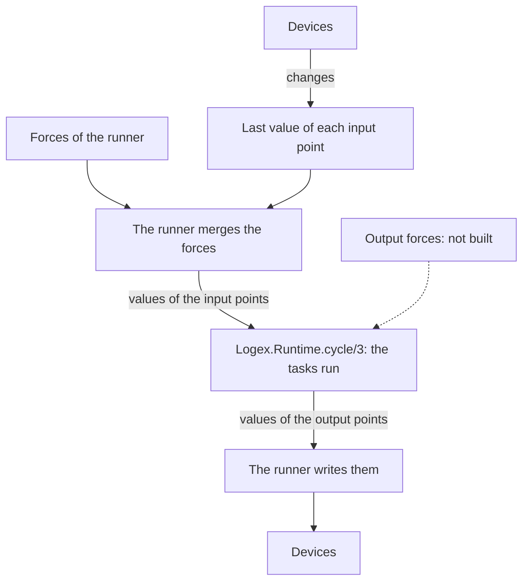
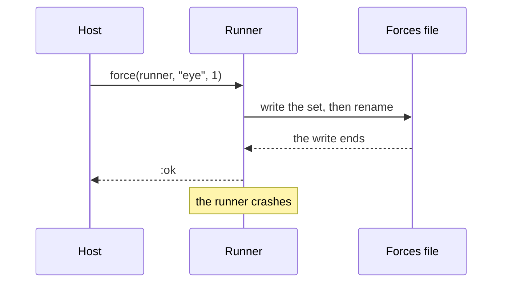
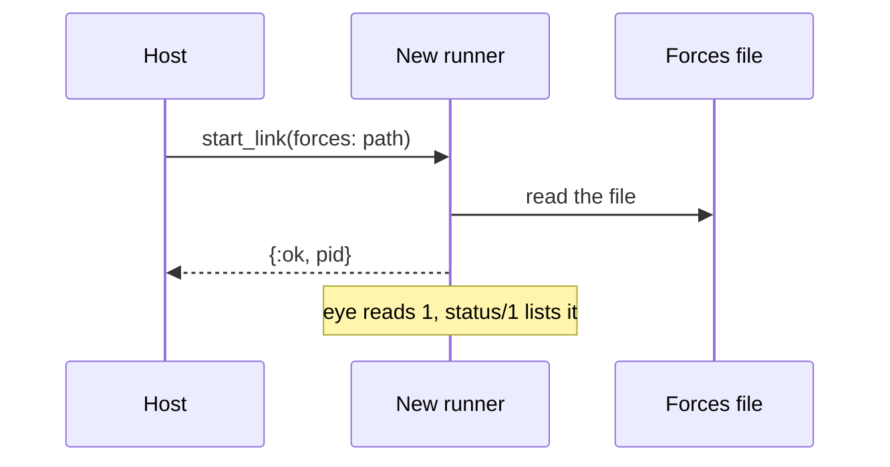

# 0015. Input forcing

This record is for a contributor who changes how `Logex.Runner` forces a
[point](../../guides/reference/glossary.md#point), or who wants to add output forcing. It
says why a host can [force](../../guides/reference/glossary.md#force) an input point
only. It also says why the [runner](../../guides/reference/glossary.md#runner) keeps each force in a
[forces file](../../guides/reference/glossary.md#forces-file) that the
[host](../../guides/reference/glossary.md#host) names.
[Forcing](../../guides/reference/forcing.md) gives each rule and message for a user.

> #### Warning {: .warning}
>
> While an input point has a force, the program does not see the real sensor. A change
> to forcing must keep each force in the file and in `status/1` until a person removes
> it. There is 1 exception: a fresh start that cannot read the forces file starts with no
> force, and `forces_unread` in `status/1` names the file. Do not use logex for a
> [safety function](../../guides/reference/glossary.md#safety-function).

> #### Caution {: .error}
>
> Do not add a force that only the memory of the runner holds. Such a force goes away
> with a crash. The input point then reads the real sensor again, at a start that nobody
> watches, and no key of `status/1` shows the change.
[Runs and tables of the records: forcing](../implementation/record-runs-forcing.md#0015-input-forcing)
gives the words of this record, such as the set of the forces and a joined write.

## Status

Accepted. No later record replaces this record.

## Date

2026-10-17, the date of decision 117, from the design of the runner. The maintainer gave
decision 127 on 2026-10-18. The last decision of the record, 501, is of 2026-11-10.

## Context

A technician wants to see the lamp `case_full` come on without 3 real boxes. She forces
the photo-eye `eye` to 1 and then unforces it, 3 times. That is input forcing. Output
forcing is the other kind: the lamp comes on, whatever the
[program](../../guides/reference/glossary.md#program) writes.

The runner gives each [round](../../guides/reference/glossary.md#round) the values of the
input points, so an input force is 1 more value in that merge. An output force changes
what a round writes, after the programs run. Thus it changes the core, `Logex.Runtime`,
and its [host contract](../../guides/reference/glossary.md#host-contract).

A crash removes each force that only the memory of the runner held. The new runner then
reads the real eye, and the screen of the operator does not show the change.

[IEC 61131-3](../../guides/reference/glossary.md#iec-61131-3) has no rule for forcing.
Editions 2 and 3 of IEC 61131-3 do not use the word force.
[Logix](../../guides/reference/glossary.md#logix) gives these rules (decisions 127, 138
and 140, checked on 2026-10-20):

| Subject | Logix |
|---|---|
| When a force acts | "If forces are enabled and you install a force, the new force immediately takes effect" (1756-PM004L, p.51) |
| What a force does | It "Overrides the value regardless of the value of the physical device" (p.54) |
| Where forces are kept | "I/O forces are held by the controller and not by the programming workstation" (p.53). A force "exists in the project" (p.52) |
| What the operator sees | The FORCE status indicator: "Flashing: At least one tag contains a force value", "Solid: I/O forces are active (enabled)" (p.52) |
| Power off and on again | Not recorded: the manuals that the project read do not say it |
| A file of forces | Not recorded: the manuals that decision 140 cites name no such file |

## Decision

### Only an input point is forced

A force of an input point changes only what the program reads. The runner gives that
already. Thus input forcing is in `Logex.Runner` and needs no change to `Logex.Runtime`
(decision 117). No function of `Logex.Runtime` forces.

Figure: where a force acts in a round. The dotted arrow is the place of output forcing,
inside the core, which logex does not have.
The rules:

- A host forces a point by the name of its
  [global](../../guides/reference/glossary.md#global), `eye`, not by its address.
- The runner refuses an output point, as a wrong argument. It also refuses a name that
  is no input point, for example the [tag](../../guides/reference/glossary.md#tag) `b1.eye` of an
  [instance](../../guides/reference/glossary.md#instance).
- The runner refuses a value that does not fit the
  [type](../../guides/reference/glossary.md#type) of the point, as a wrong argument.
- `Logex.Runner.unforce/2` gives the point its last value again. The runner keeps a
  change of the device while the point has a force.

`docs/organisation.md` [§5](../organisation.md#5-decided-now-and-deferred) gives the
target for output forcing, in `cycle/3`. Input forcing does not change for it.

### The host names the forces file

The maintainer decided that forces stay after a crash, in a file (decision 127). The host
gives the path, `forces:`, as an option of `Logex.Runner.start_link/1`. The person who
sets up the machine chooses where it keeps its files. The program of the plant does not
choose. Also, logex writes no file that the host does not name.

A runner with no `forces:` refuses each force. `force/3`, `unforce/2` and `unforce_all/1`
then raise the same message. Thus each force that exists is in a file.

### The runner writes the file before the force acts

Each force and each unforce writes the whole set to the file before the force acts:

1. A separate process of the runner writes the set to `<path>.tmp`, beside the file.
   The text has 1 force a line, `name value`, in name order. If no point has a force,
   the file is empty.
2. The process flushes it to the disk and renames it over the file. After a crash,
   the file holds the old set or the new set, never a part of a set.
3. The call returns `:ok` at the end of the write. From then, `status/1` lists the force.
4. The program reads the forced value from the next round. A forced trigger is
   different: its round runs before the call returns.

A write that fails changes nothing: the force does not act, and the call returns
`{:error, {:forces, reason}}`. The rounds continue while a write is in progress, and
`status/1` lists in `forcing` the set that the write holds (decision 466).
[0018](0018-file-work-with-a-limit.md#the-rounds-run-on-while-a-force-is-written) gives
the rules for a slow disk, a joined write and a cut write.

### Each start reads the file

At each start, the runner reads its forces from the file (decision 127). A fresh start
reads it before the devices open, and a restart reads it before its first round. A bad
line raises 1 `ArgumentError` that names each bad line, and the runner does not start.
Examples are a line that is no force, a point forced 2 times and a name that is no input
point. A report and a drop remove a force that a technician set, so logex does not drop.

A fresh start that cannot read the file starts with no force, and `forces_unread` names
the file. Then a restart keeps the set of the runner, and an orderly stop writes that set
over the file (decisions 445 and 472). Thus an old force that no screen showed does not
come back. [Runs and tables of the records: forcing](../implementation/record-runs-forcing.md#0015-input-forcing) gives what each kind of start does.

Figure: a force across a crash. The new runner gets the force from the file, not from
the old runner.

### A person can read the file, and the runner reads it strictly

The file is text that a person can read, 1 force a line. A line is the name of an input
point, 1 space and a value (decision 140). The value can be any literal that the type of the point
holds (decisions 218 and 226). A line can end in LF, CRLF or a lone CR (decision 410). The
file keeps 1 line for each element of an array (decision 248).

A comment, an empty line or a second space stops the start, and the message names the
line. A strict file is the safest for a list that decides what the plant reads.

### `status/1` always lists the forces

Each of these 4 keys is in each report of `status/1`, also when it holds nothing.

| Key | What it holds |
|---|---|
| `forces` | Each force in effect, by the name of its point, with its value. `%{}` for none |
| `forcing` | The set that the write in progress holds, or `nil` (decision 466) |
| `forces_unknown` | The set of a cut write that can still reach the disk, or `nil` |
| `forces_unread` | `{path, reason}` for a file that a start was not able to read, until the write of a force or an unforce ends. Otherwise `nil` |

A screen can show "forces on" while `forces` is not empty.
[0018](0018-file-work-with-a-limit.md) gives the rules for the last 2 keys.

### A forced trigger runs its task immediately

A force or an unforce that changes what a
[trigger](../../guides/reference/glossary.md#trigger) reads is a change of the trigger
(decision 138). Thus the change makes its round before the call returns, and a rising
trigger runs its [event task](../../guides/reference/glossary.md#event-task) in that
round. A force to the value that the trigger reads already makes no round. A force and an
unforce of a trigger in 1 joined write make no round (decision 501).

The maintainer gave the reason that a Logix force raises no change-of-state event of a
module (decision 501). Its source is not recorded. The manuals that decision 138 cites do
not say it, and give no rule for an event task that a force triggers.

[Runs and tables of the records: forcing](../implementation/record-runs-forcing.md#0015-input-forcing) gives a run of the packing line for each rule of this record.

## Consequences

The good results:

- Input forcing needs no change to `Logex.Runtime` or to the host contract. Output
  forcing can come later, in `cycle/3`.
- Each force stays after a restart, a crash and a fresh start, and `status/1` lists it.
  The exception is a fresh start that cannot read the file, which `forces_unread` names.
- After a crash at any time, the file holds the old set or the new set.
- No force is in effect that the file does not hold.
- A person can read the file. A wrong line stops the start and names the line.

The bad results and the costs:

- logex cannot force an output point. To check a lamp without its program, use a
  simulated device.
- A runner with no `forces:` refuses each force.
- Each force and each unforce writes the whole file.
- A force belongs to a point by its name only. A file of a different plant that has a
  point of the same name forces that point.

A new way to set a force writes the file before the force acts. Each new start reads the
file, or names it in `forces_unread`. `test/logex/force_test.exs` and the runner walk of
`test/logex/api_contract_test.exs` check the rules.

## Alternatives considered

| Alternative | Why it was not chosen |
|---|---|
| Force inputs and outputs together, later (117) | Input forcing needs only the runner, and nobody writes input forcing again when output forcing comes |
| Keep forces in the memory of the runner only, the first form of decision 117 | A crash removes each force, the case that the maintainer ruled out (127) |
| Report and drop a force that does not fit the configuration (127) | The input point goes to its real value at a start that nobody watches |
| A file that logex names (127) | The person who sets up the machine chooses where it keeps its files |
| Read comments and empty lines and pass them over (140) | The next write of the runner drops what the person added |
| A restart that reads the file while `forces_unread` names it (445) | A force comes back that no screen showed |
| A round for the force and a round for the unforce in 1 joined write (501) | A force is a tool for maintenance, not a signal |

Section 7 gives the other options of each decision.

## The decisions that this record sums up

This record sums up 12 decisions of
[`docs/organisation.md`](../organisation.md#7-decisions):

- 117: input forcing only, in the runner.
- 127: the forces file that the host names, its write and its read at each start.
- 138 and 501: a forced trigger and its round.
- 140, 218, 226, 248 and 255: the lines of the file and their messages.
- 445, 466 and 472: the keys of `status/1`, and a file that a start cannot read.

Decision 218 replaces the reading of a value of decision 140 for a real point. The design
is in [§4.11](../organisation.md#411-milestone-4s-design-the-wall-clock-runner-decided-2026-10-17).
[0018. File work with a limit](0018-file-work-with-a-limit.md) gives the rules for a slow
disk, and [0013. Watchdogs and the trip](0013-watchdogs-and-the-trip.md) gives the
restart.
