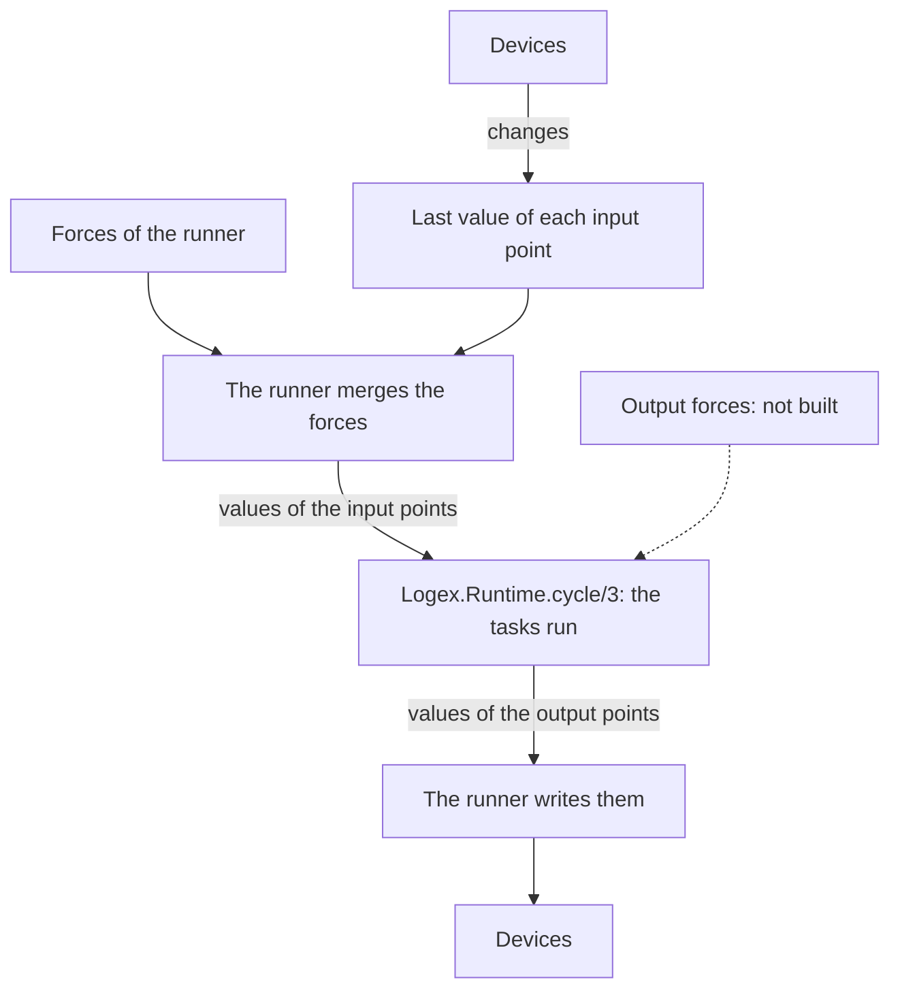
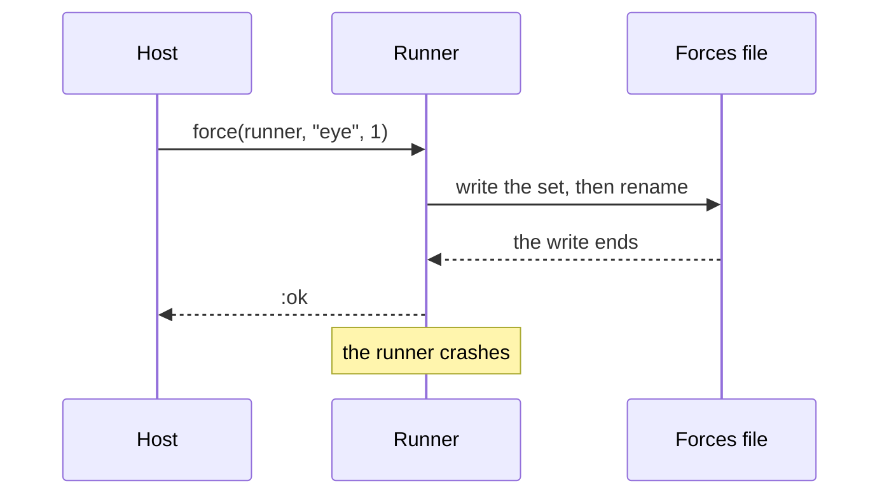
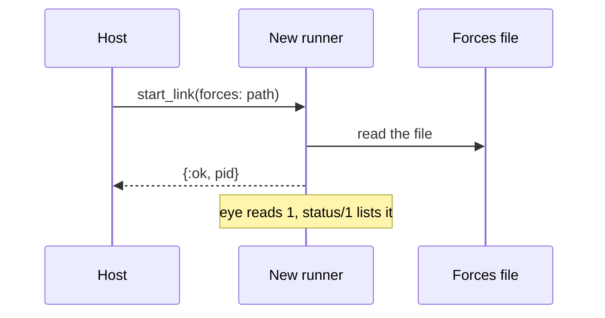

# 0015. Input forcing

This record is for a contributor who changes how `Logex.Runner` forces a
[point](../../guides/reference/glossary.md#point), or who wants to add output forcing.
Examples are a change to the [forces file](../../guides/reference/glossary.md#forces-file),
to what a start reads, or to the keys of `Logex.Runner.status/1` for the forces. The record
says why a host can [force](../../guides/reference/glossary.md#force) an input point only.
It also says why the [runner](../../guides/reference/glossary.md#runner) keeps each
force in a file that the [host](../../guides/reference/glossary.md#host) names.

[Forcing](../../guides/reference/forcing.md) gives each rule and message for a user.
[Force an input point](../../guides/howto/force-inputs.md) gives the steps.
[0018. File work with a limit](0018-file-work-with-a-limit.md) gives the rules for a
slow disk.

> #### Warning {: .warning}
>
> While an input point has a force, the program does not see the real sensor. A change
> to forcing must keep each force in the file and in `status/1` until a person removes
> it. There is 1 exception: a fresh start that cannot read the forces file starts with no
> force, and `forces_unread` in `status/1` names the file. Do not use logex for a
> [safety function](../../guides/reference/glossary.md#safety-function).

> #### Caution {: .error}
>
> Do not add a force that only the memory of the runner holds. Such a force goes away
> with a crash. The input point then reads the real sensor again, at a start that nobody
> watches, and no key of `status/1` shows the change.

These words have 1 meaning on this page:

| Word | Meaning on this page |
|---|---|
| Input point | A point that a [device](../../guides/reference/glossary.md#device) reads, such as `eye` at `panel.i.8` |
| Output point | A point that a device writes, such as `k1` at `panel.q.0` |
| Last value | The value of an input point that its device gave last. The runner keeps it for each input point |
| The set | All the forces of a runner, by the name of each input point |
| Fresh start | A start of a new runner by `Logex.Runner.start_link/1`, for example after a crash |
| Restart | `Logex.Runner.restart/2` of a runner after a [trip](../../guides/reference/glossary.md#trip). The runner is the same process |
| End of a write | The runner renames `<path>.tmp` over the forces file. The file then holds the new set |
| A write in progress | A write of the forces file that started and did not end |
| A joined write | 1 write for all the changes that wait behind a write in progress |
| A cut write | A write that did not end in `write_limit:` ms |

## Status

Accepted. No later record replaces this record.

## Date

2026-10-17, the date of decision 117, from the design of the runner. The maintainer gave
decision 127 on 2026-10-18. The last decision of the record, 501, is of 2026-11-10.

## Context

A technician wants to see the lamp `case_full` come on without 3 real boxes. She makes
the program read the photo-eye `eye` as 1, whatever the real eye gives. She forces `eye`
to 1 and then unforces it, 3 times, and `case_full` comes on. That is input forcing.
Output forcing is the other kind: the lamp comes on, whatever the
[program](../../guides/reference/glossary.md#program) writes.

The 2 kinds change different parts of logex:

- The runner gives each [round](../../guides/reference/glossary.md#round) the values of
  the input points. It keeps the last value of each input point, and merges the changes
  of the devices over them. A force is 1 more value in that merge.
- An output force changes what a round writes, after the programs run.
  `Logex.Runtime.cycle/3` gives the values that a round writes to the output points.
  Thus an output force changes the core, `Logex.Runtime`, and its
  [host contract](../../guides/reference/glossary.md#host-contract).

The software of the controller can crash. The host then starts a new runner. The crash
removes each force that only the memory of the old runner held, and the new runner reads
the real eye. Nobody removed the force, and the screen of the operator does not show the
change.

[IEC 61131-3](../../guides/reference/glossary.md#iec-61131-3) has no rule for forcing.
Editions 2 and 3 of IEC 61131-3 do not use the word force.
[Logix](../../guides/reference/glossary.md#logix) gives these rules (decisions 127, 138
and 140, checked on 2026-10-20):

| Subject | Logix |
|---|---|
| When a force acts | "If forces are enabled and you install a force, the new force immediately takes effect" (1756-PM004L, p.51) |
| What a force does | It "Overrides the value regardless of the value of the physical device" (p.54) |
| Where forces are kept | "I/O forces are held by the controller and not by the programming workstation" (p.53). A force "exists in the project" (p.52) |
| What the operator sees | The FORCE status indicator: "Flashing: At least one tag contains a force value", "Solid: I/O forces are active (enabled)" (p.52) |
| Power off and on again | Not found in the manuals |
| A file of forces | Not found. The Logix manuals that decision 140 cites name no such file |

## Decision

This table sums up the rules. Each link leads to the part of this page that gives the
rule.

| Rule | Why | Decisions |
|---|---|---|
| [Only an input point is forced](#only-an-input-point-is-forced) | An input force needs no change to the core | 117 |
| [The host names the forces file](#the-host-names-the-forces-file) | The new runner after a crash reads each force from the file | 127 |
| [The runner writes the file before the force acts](#the-runner-writes-the-file-before-the-force-acts) | No force is in effect that the file does not hold | 127, 466 |
| [Each start reads the file](#each-start-reads-the-file) | At each start, the runner reads its forces from the file | 127, 445, 472 |
| [A person can read the file, and the runner reads it strictly](#a-person-can-read-the-file-and-the-runner-reads-it-strictly) | The file decides what the [plant](../../guides/reference/glossary.md#plant) reads | 140, 218, 226, 248, 255 |
| [`status/1` always lists the forces](#status1-always-lists-the-forces) | A screen can show each force, also a force in a write in progress | 117, 466 |
| [A forced trigger runs its task immediately](#a-forced-trigger-runs-its-task-immediately) | The task runs before the call returns | 138, 501 |

### Only an input point is forced

A force of an input point changes only what the program reads. The runner gives that
already. Thus input forcing is in `Logex.Runner` and needs no change to `Logex.Runtime`
(decision 117). No function of `Logex.Runtime` forces.



Figure: where a force acts in a round. The dotted arrow is the place of output forcing,
inside the core, which logex does not have.

The rules:

- A host forces a point by the name of its
  [global](../../guides/reference/glossary.md#global), `eye`, not by its address.
- The runner refuses an output point, as a wrong argument. It also refuses a name that
  is no input point, for example the [tag](../../guides/reference/glossary.md#tag) `b1.eye` of an
  [instance](../../guides/reference/glossary.md#instance).
- The runner refuses a value that does not fit the
  [type](../../guides/reference/glossary.md#type) of the point, as a wrong argument.
- `Logex.Runner.unforce/2` gives the point its last value again. The runner keeps a
  change of the device while the point has a force.

[§5](../organisation.md#5-decided-now-and-deferred) of `docs/organisation.md` gives the
target for output forcing. There, `cycle/3` gets a set of forces. It applies the set
after it takes the values of the input points, and again before it gives the values of
the output points. `force/3` can then give its set to `cycle/3`. Input forcing does not
change.

### The host names the forces file

The maintainer decided that forces stay after a crash, in a file (decision 127). The host
gives the path, `forces:`, as an option of `Logex.Runner.start_link/1`. The person who
sets up the machine chooses where it keeps its files. The program of the plant does not
choose. Also, logex writes no file that the host does not name.

A runner with no `forces:` refuses each force. `force/3`, `unforce/2` and `unforce_all/1`
then raise the same message. Thus each force that exists is in a file.

### The runner writes the file before the force acts

Each force and each unforce writes the whole set to the file before the force acts:

1. A separate process of the runner writes the set to `<path>.tmp`, beside the file.
   The text has 1 force a line, `name value`, in name order. If no point has a force,
   the file is empty.
2. The process flushes it to the disk and renames it over the file. After a crash,
   the file holds the old set or the new set, never a part of a set.
3. The call returns `:ok` at the end of the write. From then, `status/1` lists the force.
4. The program reads the forced value from the next round. A forced trigger is
   different: its round runs before the call returns.

A write that fails changes nothing: the force does not act, and the call
returns `{:error, {:forces, reason}}`. The cause is in the plant, for example a full disk.
The cause is not a wrong argument.

The rounds continue while a write is in progress. Meanwhile `status/1` lists in `forcing`
the set that the write in progress holds (decision 466). Thus a screen can show a force
in a write in progress.
[0018](0018-file-work-with-a-limit.md#the-rounds-run-on-while-a-force-is-written) gives
the rules for a slow disk, a joined write and a cut write.

### Each start reads the file

At each start, the runner reads its forces from the file (decision 127). A fresh start
reads it in the caller, before the devices open. A restart reads it again before its
first round.

| Event | What the runner does |
|---|---|
| Fresh start, no file | It starts with no force |
| Fresh start, a file it can read | It forces each point that the file names, and lists the forces from the first round |
| A start or a restart, and a bad line in the file | It raises 1 error that names each bad line, and does not start. A restart stays tripped |
| Restart | It reads the file. A point that the file does not force reads its last value |
| Fresh start, a file it cannot read | It starts with no force. `forces_unread` names the file |
| Restart, a file it cannot read | It keeps its own set. `forces_unread` names the file |
| Restart while `forces_unread` names the file | It keeps its own set and reads no file (decision 445) |
| Orderly stop while `forces_unread` names the file | It writes its own set over the file (decision 472) |
| A crash | It writes nothing |

The error is an `ArgumentError`. A bad line is 1 of these:

- A line that is no force.
- A line that forces a point that an earlier line forces.
- A name that is not an input point of the
  [configuration](../../guides/reference/glossary.md#configuration).
- A value that does not fit the point.

The alternative, a report and a drop, removes a force that a technician set (decision
127). The input point then goes to the real value at a start that nobody watches. Only a
process that subscribes to the events of the runner gets a report.

An orderly stop is `stop/2`, a shutdown by the supervisor, or an end of the runner with
the reason `:normal`. An end because the clock gave a wrong value is not orderly.

Decisions 445 and 472 stop an old force from coming back. For example, the file holds
`level 7`. A fresh start on a stalled disk cannot read the file, and starts with no
force. Then the disk works again. Without these decisions, the next restart or fresh
start reads `level 7`. No screen showed that force, and nobody set it again.

With no runner, a person deletes the file to remove each force.





Figure: a force across a crash. The new runner gets the force from the file, not from
the old runner:

1. The host calls `force/3` for `eye`.
2. The runner writes the set to the file and renames it.
3. At the end of the write, the call returns `:ok`. From the next round, `eye` reads 1.
4. The runner crashes.
5. The host starts a new runner with the same `forces:` path.
6. The new runner reads the file. `eye` reads 1, and `status/1` lists the force.

### A person can read the file, and the runner reads it strictly

The file is text that a person can read, 1 force a line. The runner reads only the form
of line that it writes: the name of an input point, 1 space and a value (decision 140).
The value can be any literal that the type of the point holds (decisions 218 and 226). A
line can end in LF, CRLF or a lone CR (decision 410). A strict file is the safest for a
list that decides what the plant reads.

| A line | What the runner does |
|---|---|
| `eye 1` | It forces `eye` to 1 |
| `eye 01`, `level 16#ff`, `hz 3.75e1` | It reads any number that the lexer reads as 1 [literal](../../guides/reference/glossary.md#literal), in the range of the type of the point. The next write spells it `eye 1`, `level 255` and `hz 37.5` |
| `hz 16777217` at a `real` | It forces the nearest value that the type holds, `16777216.0` |
| `level 16#ffffffff` at a `dint` | It refuses the line. The message quotes the text of the line and the value that the runner reads (decision 255) |
| `zone_t[3] 170.0` | It forces 1 [element](../../guides/reference/glossary.md#element) of a located [array](../../guides/reference/glossary.md#array) |
| `zone_t 170.0 170.0 ...`, a value for each element | It forces each element. The next write gives each element its own line (decision 248). A different count of values is a bad line |
| `eye 1` on 2 lines | It refuses the start and names the second line |
| `k1 1`, at an output point | It refuses the start: only an input point is forced |
| A comment, an empty line, 2 spaces, a tab, or 1 space after the value | It refuses the start and names the line |
| The last line with no line end | It reads the line |

The file keeps 1 line for each element of an array, also when each element has a force.
The runner holds its forces in that form, and `status/1` lists them in it. If `zone_t` is
an array of 8 located reals, and an operator unforces `zone_t[3]`, `status/1` still lists
the other 7 elements (decision 248).

An unforce of a point that has no force is no error. The runner writes the set again
(decision 140).

### `status/1` always lists the forces

Each of these 4 keys is in each report of `status/1`, also when it holds nothing.

| Key | What it holds |
|---|---|
| `forces` | Each force in effect, by the name of its point, with its value. `%{}` for none |
| `forcing` | The set that the write in progress holds, or `nil` (decision 466) |
| `forces_unknown` | The set of a cut write that can still reach the disk, or `nil` |
| `forces_unread` | `{path, reason}` for a file that a start was not able to read, until the write of a force or an unforce ends. Otherwise `nil` |

A screen can show "forces on" while `forces` is not empty.
[0018](0018-file-work-with-a-limit.md) gives the rules for the last 2 keys.

### A forced trigger runs its task immediately

A force or an unforce that changes what a
[trigger](../../guides/reference/glossary.md#trigger) reads is a change of the trigger
(decision 138). Thus the change makes its round before the call returns.

- If the trigger rises, its
  [event task](../../guides/reference/glossary.md#event-task) runs in that round.
- A force to the value that the trigger reads already makes no round.
- While the trigger has a force, a change of its device makes no round.
- `unforce_all/1` that changes several triggers makes 1 round for each. The order is by
  the name of the device, then by the address.
- A force and an unforce of a trigger in 1 joined write make no round (decision 501).
  The file gets only the net change. The trigger keeps its value, so no round runs. A
  force is a tool for maintenance, not a signal.

The maintainer gave the reason that a Logix force raises no change-of-state event of a
module (decision 501). The Logix manuals that decision 138 cites do not say this, and
they give no rule for an event task that a force triggers.

### The rules in a run

The script `0015-input-forcing.exs` runs the packing line on the manual
[clock](../../guides/reference/glossary.md#clock), with a
[simulated device](../../guides/reference/glossary.md#simulated-device). Thus its output
is the same at each run. The script gives a relative path, `packing.forces`, so that its
messages are the same on each machine. A host gives an absolute path:
[0018](0018-file-work-with-a-limit.md#a-file-that-cannot-be-read) gives the reason. The
plant of the script is `packing.logex`:

<!-- file: packing.logex -->
```text
// packing.logex -- a conveyor on a 10 ms task, and a box counter in the continuous task
task fast interval 10 priority 1 watchdog 50
task main continuous watchdog 200

var_global estop      bool at panel.i.7
var_global pb_start_1 bool at panel.i.0
var_global pb_reset   bool at panel.i.2
var_global eye        bool at panel.i.8
var_global k1         bool at panel.q.0
var_global case_full  bool at panel.q.4

program c1 conveyor with fast
  c1.start pb_start_1
  c1.stop  0
  c1.reset pb_reset
  c1.motor k1

program b1 boxes
  b1.eye       eye
  b1.reset_pb  pb_reset
  b1.full_lamp case_full
```

The script also reads 4 files from `examples/`. Each link leads to the page that shows
the file:

- [`conveyor.ld`](../../guides/howto/try-an-edit-on-a-simulated-device.md), the conveyor.
- [`boxes.ld`](../../guides/howto/try-an-edit-on-a-simulated-device.md), which counts
  the boxes in `b1.count`.
- [`trip.logex`](../../guides/howto/edit-a-plant-without-the-runner.md), the conveyor
  with the event task `trip` on the trigger `estop`.
- [`snapshot.ld`](../../guides/howto/edit-a-plant-without-the-runner.md), the program of
  the task `trip`.

```elixir
# The rules of record 0015 in a run: what a runner forces, where it keeps the forces, and
# what a start and a restart read. The runner runs on a manual clock, with a simulated
# panel, so the output is the same at each run.
alias Logex.Runner
alias Logex.Runner.Clock.Manual
alias Logex.IO.Sim

Logger.configure(level: :none)
{:ok, packing} = Logex.Configuration.compile_file("packing.logex")
{:ok, trip} = Logex.Configuration.compile_file("trip.logex")
forces = "packing.forces"
File.rm_rf!(forces)

# Starts a runner of `plant` with the options, and gives the runner, its clock and its panel.
start = fn plant, options ->
  {:ok, clock} = Manual.start_link()
  {:ok, panel} = Sim.start_link(reports: true, clock: clock)
  io = %{"panel" => {Sim, sim: panel}}
  options = [configuration: plant, io: io, clock: {Manual, clock}] ++ options
  {:ok, runner} = Runner.start_link(options)
  {runner, clock, panel}
end

# Prints the answer of `fun`, or the message of the ArgumentError that it raises.
attempt = fn fun ->
  try do
    IO.puts("  " <> inspect(fun.()))
  rescue
    error in ArgumentError -> IO.puts("  " <> error.message)
  end
end

# Prints the time, the value of eye that the program reads, the count and the forces.
show = fn runner ->
  %{now: now, forces: in_effect} = Runner.status(runner)
  eye = Runner.get!(runner, "eye")
  boxes = Runner.get!(runner, "b1.count")
  IO.puts("  t=#{now} eye=#{eye} boxes=#{boxes} forces=#{inspect(in_effect)}")
end

# Moves the real photo-eye on and off. Each change gets a round of 1 ms.
box = fn panel, clock ->
  Sim.set(panel, "panel.i.8", 1)
  Manual.advance(clock, 1)
  Sim.set(panel, "panel.i.8", 0)
  Manual.advance(clock, 1)
end

file = fn -> IO.puts("  packing.forces: " <> inspect(File.read!(forces))) end

IO.puts("1. A runner with no forces file")
{runner, _clock, _panel} = start.(packing, [])
attempt.(fn -> Runner.force(runner, "eye", 1) end)
:ok = Runner.stop(runner)

IO.puts("2. An output point, a tag of an instance, and the core")
{runner, clock, panel} = start.(packing, forces: forces)
attempt.(fn -> Runner.force(runner, "k1", 1) end)
attempt.(fn -> Runner.force(runner, "b1.eye", 1) end)
{:module, Logex.Runtime} = Code.ensure_loaded(Logex.Runtime)
names = for {name, arity} <- Logex.Runtime.__info__(:functions), do: "#{name}/#{arity}"
forcing = Enum.filter(names, &String.contains?(&1, "forc"))
IO.puts("  functions of Logex.Runtime with forc in the name: #{inspect(forcing)}")

IO.puts("3. The real eye counts, then the force holds eye at 1")
box.(panel, clock)
show.(runner)
:ok = Runner.force(runner, "eye", 1)
Manual.advance(clock, 1)
show.(runner)
box.(panel, clock)
box.(panel, clock)
show.(runner)
file.()

IO.puts("4. A write of the file that fails")
File.mkdir!(forces <> ".tmp")
attempt.(fn -> Runner.force(runner, "pb_reset", 1) end)
show.(runner)
file.()
File.rmdir!(forces <> ".tmp")

IO.puts("5. A crash, and a fresh start that reads the file")
Process.flag(:trap_exit, true)
Process.exit(runner, :kill)
receive do: ({:EXIT, ^runner, :killed} -> :ok)
{runner, clock, panel} = start.(packing, forces: forces)
show.(runner)

IO.puts("6. The real eye is on, and then eye is unforced")
Sim.set(panel, "panel.i.8", 1)
Manual.advance(clock, 1)
show.(runner)
:ok = Runner.unforce(runner, "eye")
Manual.advance(clock, 1)
show.(runner)
file.()
:ok = Runner.stop(runner)

IO.puts("7. A forced trigger")
{runner, _clock, panel} = start.(trip, forces: forces)
:ok = Runner.subscribe(runner, [:ran])

# Prints the tasks that ran since the last look, from the :ran events.
ran = fn label ->
  _ = :sys.get_state(runner)
  {:messages, messages} = Process.info(self(), :messages)
  tasks = for {Runner, ^runner, {:ran, task, _, _}} <- messages, do: task
  for {Runner, ^runner, _} <- messages, do: receive(do: ({Runner, ^runner, _} -> :ok))
  IO.puts("  #{label}: ran #{inspect(tasks)}")
end

press = fn ->
  Sim.set(panel, "panel.i.7", 1)
  Sim.set(panel, "panel.i.7", 0)
end

:ok = Runner.force(runner, "estop", 1)
ran.("force estop 1")
press.()
ran.("the real e-stop pressed and let go")
:ok = Runner.force(runner, "estop", 1)
ran.("force estop 1 again")
:ok = Runner.unforce(runner, "estop")
ran.("unforce estop")
press.()
ran.("the real e-stop pressed and let go")
:ok = Runner.stop(runner)

IO.puts("8. A forces file that a person writes")
File.write!(forces, "// the eye, blocked for a test\neye 1\n")
attempt.(fn -> start.(packing, forces: forces) end)
File.write!(forces, "pb_reset 1_0\n")
attempt.(fn -> start.(packing, forces: forces) end)
File.write!(forces, "eye 01\r\n")
{runner, _clock, _panel} = start.(packing, forces: forces)
show.(runner)
:ok = Runner.force(runner, "pb_reset", 1)
file.()
:ok = Runner.stop(runner)

IO.puts("9. A forces file that the start cannot read")
File.rm!(forces)
File.mkdir!(forces)
{runner, clock, panel} = start.(packing, forces: forces)
%{forces_unread: {_path, reason}} = Runner.status(runner)
IO.puts("  forces_unread: the file, #{inspect(reason)}")
File.rmdir!(forces)
File.write!(forces, "eye 1\n")
# A failed read of the panel trips the runner. The script can then ask for a restart.
Sim.fail(panel, :read, {:error, :eio})
Manual.advance(clock, 10)
IO.puts("  #{Runner.status(runner).status}, restart: #{inspect(Runner.restart(runner, :cold))}")
show.(runner)
IO.puts("  stop: #{inspect(Runner.stop(runner))}")
file.()
File.rm!(forces)
```

```console
$ mix run 0015-input-forcing.exs
1. A runner with no forces file
  the runner keeps no forces file, so a force would not survive a crash: start it with forces: a path
2. An output point, a tag of an instance, and the core
  `k1` is an output point, at `panel.q.0`: only an input point is forced
  `b1.eye` is no input point of `packing`
  functions of Logex.Runtime with forc in the name: []
3. The real eye counts, then the force holds eye at 1
  t=2 eye=0 boxes=1 forces=%{}
  t=3 eye=1 boxes=2 forces=%{"eye" => 1}
  t=7 eye=1 boxes=2 forces=%{"eye" => 1}
  packing.forces: "eye 1\n"
4. A write of the file that fails
  {:error, {:forces, :eisdir}}
  t=7 eye=1 boxes=2 forces=%{"eye" => 1}
  packing.forces: "eye 1\n"
5. A crash, and a fresh start that reads the file
  t=0 eye=1 boxes=0 forces=%{"eye" => 1}
6. The real eye is on, and then eye is unforced
  t=1 eye=1 boxes=0 forces=%{"eye" => 1}
  t=2 eye=1 boxes=0 forces=%{}
  packing.forces: ""
7. A forced trigger
  force estop 1: ran ["trip"]
  the real e-stop pressed and let go: ran []
  force estop 1 again: ran []
  unforce estop: ran []
  the real e-stop pressed and let go: ran ["trip"]
8. A forces file that a person writes
  packing.forces: line 1: `// the eye, blocked for a test` is no force: a line holds an input point's name and its value, as `eye_1 1`
  packing.forces: line 1: `pb_reset` is a bool, forced to 0 or 1, got: 1_0, which is 10
  t=0 eye=1 boxes=0 forces=%{"eye" => 1}
  packing.forces: "eye 1\npb_reset 1\n"
9. A forces file that the start cannot read
  forces_unread: the file, :eisdir
  tripped, restart: :ok
  t=9 eye=0 boxes=0 forces=%{}
  stop: :ok
  packing.forces: ""
```

This table gives the line of output that shows each rule:

| Result and rule | The output to read |
|---|---|
| 1. A runner with no `forces:` refuses each force | The message names the option |
| 2. Only an input point is forced. The core has no force | The runner refuses `k1` and `b1.eye`. No function of `Logex.Runtime` has "forc" in its name |
| 3. A force holds the input against its device | The force is a rise of `eye`, and the count goes to 2. 2 boxes of the real eye then count nothing |
| 4. A write that fails changes nothing | A directory in the place of the `.tmp` file stops the write. The forces and the file are as before |
| 5. The file keeps a force after a crash | The new runner reads `eye 1` and lists it. The count is 0: it is not a retained value |
| 6. An unforce gives the last value of the device | The real eye went on during the force. After the unforce, `eye` reads 1 |
| 7. A forced trigger runs its task 1 time, immediately | The force runs `trip`. A press, a second force and the unforce run nothing. After the unforce, a press runs `trip` |
| 8. The runner reads the file strictly, and a value is any literal | The runner refuses a comment. The message quotes `1_0` and the value 10. The runner reads `eye 01` with CRLF, and the next write spells it `eye 1` |
| 9. A restart keeps the set of the runner while `forces_unread` names the file | The start was not able to read the directory. The restart does not read `eye 1` from the file, and the stop writes the empty set over it |

## Consequences

The good results:

- Input forcing needs no change to `Logex.Runtime` or to the host contract. Output
  forcing can come later, in `cycle/3`, and input forcing stays as it is.
- Each force stays after a restart, a crash and a fresh start, and `status/1` lists it.
  The exception is a fresh start that cannot read the file: it starts with no force, and
  `forces_unread` names the file.
- After a crash at any time, the file holds the old set or the new set, never a part of
  a set.
- No force is in effect that the file does not hold. A force whose write fails does not
  act.
- A person can read the file and see each force. A wrong line stops the start and names
  the line. The runner does not guess.
- A screen can show each force and each force in a write in progress. It can also show
  the set of a cut write, and a file that a start was not able to read.

The bad results and the costs:

- logex cannot force an output point. To check a lamp without its program, use a
  simulated device.
- A host that wants forces must give a path and a disk. A runner with no `forces:`
  refuses each force.
- Each force and each unforce writes the whole file. A script that forces 10 points 1
  after the other waits for 10 writes.
- A person who adds a comment or an empty line to the file stops the next start. The
  start names the line, and the plant does not start until a person corrects the line or
  deletes the file.
- The file does not record its configuration. A force belongs to a point by its name
  only. A file of a different plant that has a point of the same name forces that point.
- A forced trigger and a force of a point that is no trigger act at different times. The
  trigger makes its round before the call returns. The other force waits for the next
  round.

### What this means for a change

- A new way to set a force writes the file before the force acts.
- Each new start reads the file, or names it in `forces_unread`.
- `status/1` always has the 4 keys of the forces.
- Only the runner forces. A force of an output point goes into `cycle/3`.
- `test/logex/force_test.exs` gives the rules, and `test/logex/stalled_disk_test.exs`
  gives the slow disk. The runner walk of `test/logex/api_contract_test.exs` checks
  forces and unforces against its model.

## Alternatives considered

| Alternative | Why it was not chosen |
|---|---|
| Force inputs and outputs together, later (117) | Input forcing needs only the runner, and nobody writes input forcing again when output forcing comes |
| No forcing: check the program with a simulated device in place of the real card (117) | Decision 117 gives no reason for this. The technician of its context checks the real lamp and the real eye |
| Keep forces in the memory of the runner only, the first form of decision 117 | A crash removes each force, the case that the maintainer ruled out (127) |
| Write the forces at a stop only (127) | A crash before the stop loses each force |
| Report and drop a force that does not fit the configuration (127) | The input point goes to its real value at a start that nobody watches |
| A file that logex names, or a place that the logic of the plant names (127) | The person who sets up the machine chooses where it keeps its files. logex writes no file that the host does not name |
| Read comments and empty lines and pass them over (140) | The next write of the runner drops what the person added. A strict file is the safest |
| Only the plain decimal of the runner in a line (140) | A person who writes `fan_hz 37.50` or `eye 01` meant a value that the point holds (218, 226) |
| Quote a wrong value only as the text of the line, or only as the value read (255) | `16#ffffffff` alone does not say that it is 4294967295. The value read alone does not say which text the person wrote |
| 1 line for a whole array when each element has a force (248) | The runner and `status/1` hold forces by element. An operator who unforces 1 element then sees the others still listed |
| A round for each force of a trigger, also with no change (138) | A round in which nothing new happens moves the count of rounds for no reason |
| A force of a trigger that waits for the next round on its schedule (138) | The lamp comes on up to 1 period after the call returns |
| A restart that reads the file while `forces_unread` names it (445) | A force comes back that no screen showed |
| A stop that leaves the file as it is while `forces_unread` names it (472) | The next fresh start reads a force that no screen showed |
| A `status/1` that lists only the forces in effect (466) | A force in a write in progress reads as no force until the end of its write |
| A round for the force and a round for the unforce in 1 joined write (501) | A force is a tool for maintenance, not a signal |

## Decisions in section 7

This record sums up 12 decisions of
[`docs/organisation.md`](../organisation.md#7-decisions):

- 117: input forcing only, in the runner, and `unforce/2` gives the last value.
- 127: the forces file that the host names, its write and its read at each start. Also
  the refusal of a force that does not fit the configuration.
- 138: a forced trigger makes its round immediately, 1 round for each trigger.
- 140: the runner reads the file in the form that it writes, and an unforce of a point
  with no force is no error.
- 218 and 226: a value in the file is any number that the lexer reads and its type holds.
- 248: 1 line for each element of an array.
- 255: the message quotes a wrong value as its text and as the value read.
- 445: a restart keeps the set of the runner while `forces_unread` names the file.
- 466: the key `forcing` of `status/1`.
- 472: a stop writes the set of the runner while `forces_unread` names the file.
- 501: a force and an unforce of a trigger in 1 joined write make no round.

Decision 218 replaces the reading of a value of decision 140 for a real point, and
decision 226 for each other point. Decision 127 replaces the forces in memory of the first
form of decision 117. Decision 390 adds the case of a file that a start cannot read: a
fresh start with no force, and `forces_unread`. Decisions 445 and 472 add what a restart
and a stop do in that case.

The design of forcing is in
[§4.11](../organisation.md#411-milestone-4s-design-the-wall-clock-runner-decided-2026-10-17)
of the same document. It says that a file that a start cannot read refuses the start. That
sentence is older than decision 390. A fresh start that cannot read the file starts with
no force. `PLAN.md` keeps the history in M4-5, M5-10, M5-11, M5-13, M5-14,
RV-11, RV-16, RV-18 and RV-19.

It also uses decisions that other records sum up:

- Decision 120, a change of a trigger makes a round:
  [0011. Tasks and rounds](0011-tasks-and-rounds.md).
- Decision 115, nothing starts a runner again after a crash:
  [0013. Watchdogs and the trip](0013-watchdogs-and-the-trip.md).
- Decisions 390, 391, 437, 465, 468, 473 and 475, the forces file on a slow disk:
  [0018. File work with a limit](0018-file-work-with-a-limit.md).
- Decision 410, the line ends of a file:
  [0017. The store on disk](0017-the-store-on-disk.md).

[Forcing](../../guides/reference/forcing.md) gives each rule for a user, and
[Force an input point](../../guides/howto/force-inputs.md) gives the steps.
