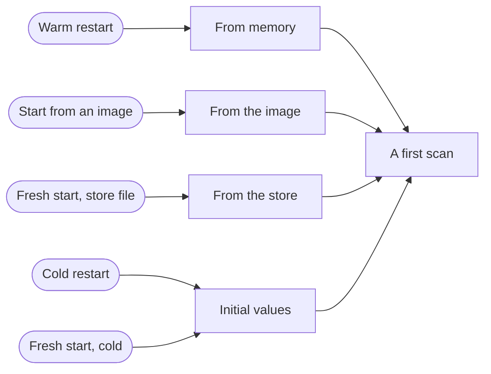
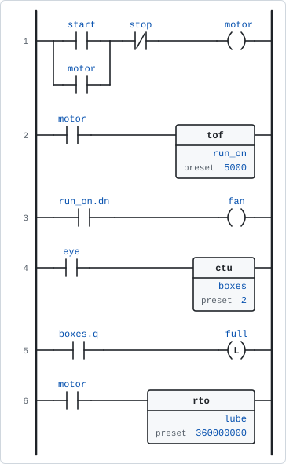

# 0016. Retained values and starts

This record is for a contributor who changes what a start brings back. Examples are
`Logex.Runtime.restart/3` and `Logex.Runtime.restart/2`, the
[qualifier](../../guides/reference/glossary.md#qualifier) `retain`, a
[timer](../../guides/reference/glossary.md#timer) at a restart, and the events at which
the [runner](../../guides/reference/glossary.md#runner) writes its
[store](../../guides/reference/glossary.md#store). The record says why only what a
program marks `retain` comes back, and why logex has no pre-scan. It also says why no
[rising edge](../../guides/reference/glossary.md#rising-edge) of a program fires in a
[first scan](../../guides/reference/glossary.md#first-scan), and why no timer counts the
time of a stop. [What this means for a change](#what-this-means-for-a-change) gives the
rules that a change must keep.

[Warm and cold restarts](../../guides/explanation/warm-and-cold-restarts.md) gives the
model for a user.
[Retained values and the store](../../guides/reference/retained-values-and-store.md)
gives each rule and each message, and [Runner](../../guides/reference/runner.md) each
option of the runner.

These words have 1 meaning on this page:

| Word | Meaning on this page |
|---|---|
| [Warm restart](../../guides/reference/glossary.md#warm-restart), [cold restart](../../guides/reference/glossary.md#cold-restart) | `Logex.Runtime.restart/2,3` or `Logex.Runner.restart/2`, with `:warm` or `:cold` |
| Fresh start | A new runner from `Logex.Runner.start_link/1` |
| Warm start | A warm restart, or a fresh start that reads a store |
| Start from an image | `Logex.Runtime.instance/2` or `Logex.Runtime.start/2` with a [retained image](../../guides/reference/glossary.md#retained-image) |
| Crash | An end of the runner with no orderly exit: a kill, a crash, the loss of its clock, the VM or the computer |
| Orderly exit | `Logex.Runner.stop/2`, or an exit with the reason `:normal`, `:shutdown` or `{:shutdown, term}`. The runner's own `{:shutdown, {:clock, reason}}` is a crash |
| Pre-scan | A pass before the first scan that resets some instructions. Logix calls it the prescan |
| Held on, at rest | A `tof` whose rung was true at the stop: `.en` 1, `.tt` 0. At rest: `.en`, `.tt` and `.dn` 0 |

> #### Warning {: .warning}
>
> Do not keep a value for a
> [safety function](../../guides/reference/glossary.md#safety-function) in a retained
> tag. A person can edit the store, a cold restart or `start: :cold` discards it, and a
> crash can set it back to an earlier write. Examples are the lockout of a burner, a latch
> that the opening of a guard sets, and a count of trips.
>
> A warm start can set an output [point](../../guides/reference/glossary.md#point) to 1 in
> its first round, with no action of an operator. A supervisor that starts a crashed
> runner again makes a warm start, because the fresh start reads the store. logex gives a
> [warning](../../guides/reference/glossary.md#warning) only where a retained
> `var_output` connects directly to an output point. Find each output point that logic
> writes from a retained value, and make it safe.

## Status

Accepted. No later record replaces this record. Some decisions of this record replace
earlier ones: [Decisions in section 7](#decisions-in-section-7) says which.

## Date

2026-10-27, the date of decisions 266 to 284, from the design of retained values. The
first decision of the record, 69, is of 2026-10-14. The last, 427, is of 2026-11-02.

## Context

The plant of this record is a conveyor. It has a motor, the fan of the motor, a box
[counter](../../guides/reference/glossary.md#counter) at a photo-eye, a lamp and a
lubrication timer. The lube timer is an `rto` that adds up the time that the motor runs.
The line gets grease each 100 hours of that time (decision 76).

The power fails at 14:00. The counter holds 41 boxes, the lube timer holds 62 hours, and
the conveyor and its fan run. The power comes back at 14:20. Before this decision, a warm
restart kept no value. So the operator sees a count of 0, a lube timer at 0, and the fan
and the conveyor off. 4 questions follow:

1. Which values come back, and which start again at their
   [initial value](../../guides/reference/glossary.md#initial-value)?
2. Can a start set an output point to 1 by itself?
3. Does a box that arrives during the outage count?
4. Does a timer count the 20 minutes of the outage?

[IEC 61131-3](../../guides/reference/glossary.md#iec-61131-3) marks a section with
`RETAIN` or `NON_RETAIN` (Ed 3 §6.5.6, pp.56-58). Its Figure 9 gives the rules of each
start (p.57):

| Start | `RETAIN` | `NON_RETAIN` | No qualifier |
|---|---|---|---|
| Warm restart | The value at the stop | The initial value | "Implementer specific" (rule 3) |
| Cold restart | The initial value | The initial value | The initial value |

IEC 61131-3 does not say which start follows a loss of power. IEC 61131-1 defines the
starts. This record does not cite it, because no person read it for this record.

A [Logix](../../guides/reference/glossary.md#logix) controller has no qualifier. It
keeps all memory at a loss of power. Before the first scan, its pre-scan resets the state
of some instructions (1756-RM094N p.47). The general instructions reference, 1756-RM018A,
gives these rules:

| Instruction | At the pre-scan | Page |
|---|---|---|
| OTE | Clears the bit | p.85 |
| OTL, OTU | Keeps the bit: a latched bit stays latched | pp.86-87 |
| TON | Clears `.ACC` | p.134 |
| RTO | Keeps `.ACC` and `.DN` | p.113 |
| CTU, CTD | Sets `.CU` or `.CD`, and keeps `.ACC` | pp.99, 95 |
| ONS, OSR | Sets the storage bit | pp.73, 80 |

Thus a run bit latched with `otl` starts the conveyor again in the first scan. Logix
gives a Power-Up Handler task against this (1756-PM014O p.15). Siemens marks a declared
part retentive, and its default is non-retentive (guideline 81318674 p.16).

2 facts of logex limit the answers. The core reads no
[clock](../../guides/reference/glossary.md#clock) and no file
([0007. The host gives the time](0007-the-host-gives-the-time.md)). The clocks of the
runner are monotonic, so a time means nothing in a different VM
([§4.11](../organisation.md#411-milestone-4s-design-the-wall-clock-runner-decided-2026-10-17)).

## Decision

This table sums up the rules. Each link leads to the section of the rule.

| Rule | Why |
|---|---|
| [Only what the program marks comes back](#only-what-the-program-marks-comes-back) | A program that marks nothing restarts warm as cold, and no state needs a reset (decisions 266 to 270 and 279) |
| [1 table of starts](#1-table-of-starts) | Each start has 1 source for its retained values (decision 271) |
| [A warm start can set an output point to 1](#a-warm-start-can-set-an-output-point-to-1) | No output point is retained, but logic writes from retained values (decision 272) |
| [No edge of a program fires in a first scan](#no-edge-of-a-program-fires-in-a-first-scan) | A held button is not a new press (decisions 69, 75 and 274) |
| [No timer counts the stop](#no-timer-counts-the-stop) | The time of a stop is not time that the motor ran (decision 273) |
| [The runner writes the store at events and at a period](#the-runner-writes-the-store-at-events-and-at-a-period) | The plant runs on through a failed write, and an orderly exit loses nothing (decisions 275, 316 and 328) |
| [A retained value that trips the plant](#a-retained-value-that-trips-the-plant) | A person changes the value (decision 284) |

### Only what the program marks comes back

Each value that the program does not mark starts at its initial value at each start, as
in a cold restart (decision 266). Thus each program that marks nothing keeps the
behaviour that it had before this decision. Nothing that the program does not mark needs
a reset, so logex has no pre-scan (decision 279). The first scan is an ordinary scan with
`first: true`.

Each line declares 1 [tag](../../guides/reference/glossary.md#tag). The qualifier comes
straight after the section word, as in IEC: `var retain boxes ctu` (decision 267). A
program marks a `var` or a `var_output`, a function block also a `var_input`, and a
configuration a `var_global` (decision 268). A program's `var_input`, a `var_external`
and a [located global](../../guides/reference/glossary.md#located-global) take no
`retain`. The host gives the input, the global of a `var_external` carries the qualifier,
and each start reads an input point again (decisions 272 and 299).

logex reserves `retain` and `non_retain` in any case (decision 298). From Elixir, the
options `retain: true` and `non_retain: true` give the qualifier (decisions 296 and 304).
A line that is wrong only in its qualifier still declares its tag. Thus each use of the
tag gets its check (decisions 294, 295 and 301). An online edit that changes a qualifier
writes no value and reports each path that changes (decision 302).

A retained [instance](../../guides/reference/glossary.md#instance) or
[array](../../guides/reference/glossary.md#array) is retained whole, with the hidden
[members](../../guides/reference/glossary.md#member) of an instance, such as `cu` of a
counter (decision 269). The member `last` of a timer is never stored (decision 273).
Inside an instance, the nearest mark on the path of a member decides (decision 270). This
block marks its member `n`:

<!-- file: 0016-retained-values-and-starts/seal.ld -->
```text
function_block seal
var_input go bool
var_output on bool
var retain n dint
var t ton
xic go ote on
xic go ton t 100
xic t.dn add n 1 n
```

The compiler writes the result into the field `retained` of `%Logex.Program{}`, a sorted
list of paths (decisions 297 and 379). 2 test runs show the rule:

- A program declares `var retain s1 seal` and `var s2 seal`. Then `retained` is
  `["s1", "s2.n"]`.
- The block marks `var non_retain n dint` in place of `var retain n dint`. Then
  `retained` is `["s1.go", "s1.on", "s1.t"]`, with no `s1.n`.

### 1 table of starts

At each start, each value that is not retained starts at its initial value. A program's
`var_input` keeps the value that the host last gave it. A runner reads each
[device](../../guides/reference/glossary.md#device) before the first
[round](../../guides/reference/glossary.md#round) of each start (decision 142).

| Start | The retained values | The store |
|---|---|---|
| Cold restart of the core | Initial | None |
| Warm restart of the core | Kept in memory | None |
| Start from an image | From the image, each matched by path and type (decision 277) | None |
| Cold restart of a runner, after a [trip](../../guides/reference/glossary.md#trip) | Initial | Written before a device is released or read |
| Warm restart of a runner, after a trip | Kept, as the trip left them | Not written |
| A crash, then a fresh start | From the last write of the store | Read. The crash writes nothing |
| An orderly exit, then a fresh start | From the write of the exit | Read |
| A fresh start with `start: :cold`, or with no store file | Initial | Written before a device is opened |
| A start of a runner with no `retain:` | A warm restart keeps them in memory. Else initial | None |

If the host gives `retain:` and no `start:`, a fresh start reads the store: it is warm
(decision 271). Thus a host's child spec that starts a crashed runner again starts it
warm.



Figure: the source of the retained values at each start. "Fresh start, cold" is a fresh
start with `start: :cold` or with no store file. See that each path ends in the same
first scan.

### A warm start can set an output point to 1

No output point comes back from the store itself. A located global takes no `retain`, and
each output point is 0 until the first round writes it (decision 272). But logic that
reads a retained bit, count or timer writes from it in that first round. A retained bit
that `otl` latches and that drives the motor thus starts the conveyor at a warm start.

The configuration gives a warning where a retained `var_output` connects directly to an
output point. The first line of the output in [The rules in a run](#the-rules-in-a-run)
shows it. It gives a second warning where a `var_output` that is not retained connects
directly to a retained global (decision 306). The first round writes over the kept value
of that global. Both warnings see a direct connection only (decision 303).

### No edge of a program fires in a first scan

Each start sets `first: true`, warm or cold (decision 274). In the first scan, a counter,
a [one-shot](../../guides/reference/glossary.md#one-shot) (`ons`, `osr`, `osf`) and `tp`
find no rising edge (decisions 69 and 75). Thus a box that is at the eye at a warm start
does not count, also when the retained `cu` is 0. A retained
[storage bit](../../guides/reference/glossary.md#storage-bit) and a storage bit that is
not retained act the same.

A [trigger](../../guides/reference/glossary.md#trigger) of an
[event task](../../guides/reference/glossary.md#event-task) is not an edge of a program.
The resource keeps the value of each trigger at its last cycle: its last sample. The task
runs when the trigger is 1 and its last sample is 0. Each start sets each last sample
to 0. So a trigger that is already 1 runs its task in the first cycle, warm or cold
(decision 51). In a test run, an event task on an input point that is held at 1 runs in
the first cycle after each start.

The exception is a retained global that is a trigger. A warm restart keeps its last
sample, and a start from an image takes the sample of the image (decisions 305 and 313).
A trigger that was 1 at the last sample thus runs no task in the first cycle. A rise that
logic wrote after the last sample runs the task 1 time. An image with no sample starts
the trigger at the value of the global, so the task does not run (decision 319).

### No timer counts the stop

A retained timer keeps `.acc` and its bits. Each start sets its member `last` to the time
of the start (decision 273). The first scan then adds the time that the host gives that
[scan](../../guides/reference/glossary.md#scan), as each scan does (decision 293). So the
host must not give the time of the stop to the first scan. In a test run, a lube timer at
50 ms gets a warm restart. The host then gives 3,600,000 ms to the first scan, and the
timer reads 3,600,050 ms.

The runner gives only the time since the start:

- A warm `Logex.Runtime.restart/2` restarts each instance at the `now` of the
  [resource](../../guides/reference/glossary.md#resource) (decisions 382 and 420).
- At a restart, the runner counts its time from the restart, so the trip does not count.
- A fresh start begins at `now` 0, so the time between the 2 runners does not count.
- A retained `tof` in its run-on continues its run-on.
- The restart or the start sets a held-on retained `tof` at rest (decisions 385 and 427).
  Without this rule, the first false rung starts a run-on, and the fan starts by itself.

Logic that wrote the [preset](../../guides/reference/glossary.md#preset) of a retained
timer keeps it at a warm restart. A start from an image gives the number on the
instruction, and reports the stored one (decision 318).

### The runner writes the store at events and at a period

The runner writes the store at these events:

- each `retain_period:`, 1000 ms unless the host sets it, but not while tripped (decision
  275)
- a trip, after each output point is 0
- a cold restart, before it releases or reads a device. If a device then refuses the
  restart, the runner writes the values that it holds back to the store (decision 317)
- each orderly exit, after each output point is 0 and each device is closed
  (decisions 316, 327 and 328)
- a fresh start with `start: :cold` or with no store file, before it opens a device. If
  that write fails, the runner does not start (decision 291)

A warm restart and a warm fresh start write nothing. A crash cannot run code, so it
writes nothing (decision 292). A write each round costs the
[share](../../guides/reference/glossary.md#share) of the round and wears a flash card. So a
crash loses what changed since the last write (decision 342):

- at most 1 period and the write in progress, if each write succeeds and the writer keeps
  up
- each change since the last good write, while the writes fail
- while the runner is tripped, each change of an online edit, because no write takes it
  until a restart

The rename of a write is not made durable. So after a power failure, some file systems
give back the write before the last one
([0017. The store on disk](0017-the-store-on-disk.md)).

A supervisor stops the runner with an orderly exit, so each orderly exit writes the
store. `GenServer.stop/3` with `:shutdown`, `{:shutdown, term}` or `:normal` writes it
from any process (decision 327). Only `Logex.Runner.stop/2` returns a failed write. The
child spec of the runner gives its supervisor time for that write (decisions 326, 400 and
414). [Runner](../../guides/reference/runner.md) gives the formula and the options that
`Logex.Runner.start_link/1` refuses (decisions 322, 323 and 325).

### A retained value that trips the plant

A retained value can cause a
[major fault](../../guides/reference/glossary.md#major-fault). An example is a retained
`dint` `slot` at 8, the [subscript](../../guides/reference/glossary.md#subscript) of an
`int[8]`. The trip writes the store with 8. In a test run, the first scan after a warm
restart gets the same `index_out_of_range` fault at the same line.

logex does nothing special (decision 284). The remedies are a cold restart, an online
edit that writes the value, or an edit of the store while the runner is stopped. A runner
that runs holds each retained value in memory, and its stop writes the value over the
edit. [Edit the store by hand](../../guides/howto/edit-the-store-by-hand.md) gives the
steps.

### The rules in a run

The script `examples/0016-retained-values-and-starts.exs` shows the table of starts as
numbered results. It runs 1 program on a
[simulated device](../../guides/reference/glossary.md#simulated-device), the panel, on
the manual clock.

The program marks the counter `boxes`, the lube timer `lube`, the run-on `run_on` of the
fan and the lamp `full` with `retain`. The tag `motor`, which the
[seal-in](../../guides/reference/glossary.md#seal-in) keeps on, has no qualifier. The
counter latches `full` at 2 boxes.

<!-- file: 0016-retained-values-and-starts/line.ld -->
```text
// line.ld -- the conveyor, its fan, the box counter, the lamp and the lube timer
var_input start bool
var_input stop bool
var_input eye bool
var_output motor bool
var_output fan bool
var_output retain full bool
var retain boxes ctu
var retain lube rto
var retain run_on tof

( xic start | xic motor ) xio stop ote motor
xic motor tof run_on 5000
xic run_on.dn ote fan
xic eye ctu boxes 2
xic boxes.q otl full
xic motor rto lube 360000000
```

<!-- rung: 0016-retained-values-and-starts/line.ld -->


The configuration connects the program to the panel. Its line 15 connects `l1.full`,
which is retained, to the output point `full_lamp`.

<!-- file: 0016-retained-values-and-starts/plant.logex -->
```text
// plant.logex -- the line of line.ld on the panel
var_global pb_start  bool at panel.i.0
var_global pb_stop   bool at panel.i.1
var_global eye       bool at panel.i.2
var_global k1        bool at panel.q.0
var_global fan_q     bool at panel.q.1
var_global full_lamp bool at panel.q.2

program l1 line
  l1.start pb_start
  l1.stop  pb_stop
  l1.eye   eye
  l1.motor k1
  l1.fan   fan_q
  l1.full  full_lamp
```

The script gives the store a period of 1 hour, so that only the events write it. It
kills the runner for a crash. Each result shows the state of the runner and the time of
its resource. It also shows the time of the last write of the store, 3 retained values
and the output points of the panel.

```elixir
alias Logex.IO.Sim
alias Logex.Runner
alias Logex.Runner.Clock.Manual

# A killed runner's device logs its end. The results do not need that log.
Logger.configure(level: :none)
Process.flag(:trap_exit, true)

{:ok, plant} = Logex.Configuration.compile_file("0016-retained-values-and-starts/plant.logex")
Enum.each(plant.warnings, &IO.puts(Logex.Diagnostic.format(&1)))
File.rm("line.retain")

# The manual clock, its wall clock 2026-10-30T14:00:00Z.
{:ok, clock} = Manual.start_link(now: 1_793_368_800_000)
{:ok, panel} = Sim.start_link(clock: clock)

opts = [
  configuration: plant,
  io: %{"panel" => {Sim, sim: panel}},
  clock: {Manual, clock},
  retain: "line.retain",
  retain_period: 3_600_000
]

show = fn runner, title ->
  %{status: status, now: now, retain: %{written_at: written}} = Runner.status(runner)

  [boxes, lube, run_on] =
    Enum.map(["l1.boxes.cv", "l1.lube.acc", "l1.run_on.acc"], &Runner.get!(runner, &1))

  out = Sim.outputs(panel)
  IO.puts(title)
  IO.puts("  #{status}, now #{now} ms, store written #{DateTime.to_time(written)}")
  IO.puts("  boxes=#{boxes} lube=#{lube} run_on=#{run_on}")

  IO.puts(
    "  panel: k1=#{out["panel.q.0"]} fan_q=#{out["panel.q.1"]} full_lamp=#{out["panel.q.2"]}"
  )
end

press = fn address ->
  Sim.set(panel, address, 1)
  Manual.advance(clock, 100)
  Sim.set(panel, address, 0)
  Manual.advance(clock, 100)
end

box = fn ->
  Sim.set(panel, "panel.i.2", 1)
  Manual.advance(clock, 500)
  Sim.set(panel, "panel.i.2", 0)
  Manual.advance(clock, 500)
end

crash = fn runner ->
  Process.exit(runner, :kill)
  receive do: ({:EXIT, ^runner, :killed} -> :ok)
end

{:ok, runner} = Runner.start_link(opts)
show.(runner, "1. A start with no store file")

press.("panel.i.0")
box.()
box.()
show.(runner, "2. The motor runs, and 2 boxes pass the eye")

Sim.set(panel, "panel.i.2", 1)
Sim.fail(panel, :read, {:error, :eio})
Manual.advance(clock, 100)
Manual.advance(clock, 10_000)
show.(runner, "3. A read fails, the runner trips, and 10 s pass. A box is at the eye")

:ok = Runner.restart(runner, :warm)
show.(runner, "4. A warm restart")

Sim.set(panel, "panel.i.2", 0)
press.("panel.i.0")
box.()
show.(runner, "5. The motor runs, and box 3 passes the eye")

crash.(runner)
{:ok, runner} = Runner.start_link(opts)
show.(runner, "6. A crash, then a fresh start")

press.("panel.i.0")
press.("panel.i.1")
Manual.advance(clock, 1_800)
:ok = Runner.stop(runner)
Manual.advance(clock, 60_000)
{:ok, runner} = Runner.start_link(opts)
show.(runner, "7. The stop button, Runner.stop/2 2 s later, a fresh start 60 s later")

Manual.advance(clock, 3_100)
show.(runner, "8. 3.1 s later")

:ok = Runner.stop(runner)
{:ok, runner} = Runner.start_link(opts ++ [start: :cold])
crash.(runner)
{:ok, runner} = Runner.start_link(opts)
show.(runner, "9. A start with start: :cold, a crash, then a fresh start")
:ok = Runner.stop(runner)
```

Run it from the directory `examples/`:

```console
$ mix run 0016-retained-values-and-starts.exs
0016-retained-values-and-starts/plant.logex: line 15: warning: `l1.full` is retained and drives the output `full_lamp`: after a warm start it is written in the first round
1. A start with no store file
  running, now 0 ms, store written 14:00:00
  boxes=0 lube=0 run_on=0
  panel: k1=0 fan_q=0 full_lamp=0
2. The motor runs, and 2 boxes pass the eye
  running, now 2200 ms, store written 14:00:00
  boxes=2 lube=2190 run_on=0
  panel: k1=1 fan_q=1 full_lamp=1
3. A read fails, the runner trips, and 10 s pass. A box is at the eye
  tripped, now 2209 ms, store written 14:00:02
  boxes=2 lube=2199 run_on=0
  panel: k1=0 fan_q=0 full_lamp=0
4. A warm restart
  running, now 2209 ms, store written 14:00:02
  boxes=2 lube=2199 run_on=0
  panel: k1=0 fan_q=0 full_lamp=1
5. The motor runs, and box 3 passes the eye
  running, now 3409 ms, store written 14:00:02
  boxes=3 lube=3389 run_on=0
  panel: k1=1 fan_q=1 full_lamp=1
6. A crash, then a fresh start
  running, now 0 ms, store written 14:00:02
  boxes=2 lube=2199 run_on=0
  panel: k1=0 fan_q=0 full_lamp=1
7. The stop button, Runner.stop/2 2 s later, a fresh start 60 s later
  running, now 0 ms, store written 14:00:15
  boxes=2 lube=2398 run_on=1990
  panel: k1=0 fan_q=1 full_lamp=1
8. 3.1 s later
  running, now 3100 ms, store written 14:00:15
  boxes=2 lube=2398 run_on=5000
  panel: k1=0 fan_q=0 full_lamp=1
9. A start with start: :cold, a crash, then a fresh start
  running, now 0 ms, store written 14:01:18
  boxes=0 lube=0 run_on=0
  panel: k1=0 fan_q=0 full_lamp=0
```

Each result shows these rules:

1. A start with no store file writes the store before the first round (decision 271).
2. The seal-in runs the motor, and `full` latches at 2 boxes.
3. The trip writes the store and sets each output point to 0. While the runner is
   tripped, the time of the resource stays at 2209 ms (decision 113).
4. The warm restart keeps `boxes`, `lube` and `full`. The motor waits for a press of the
   start button, because `motor` is not retained. The box at the eye does not count
   (decision 274). The fan does not start a run-on, because the restart set the held-on
   `tof` at rest (decision 385). The lamp comes on in the first round, with no action of
   an operator (decision 272). `lube` does not count the 10 s of the trip (decision 273).
5. Box 3 counts. The warm restart did not write the store.
6. The crash writes nothing. The fresh start brings back the write of the trip, so box 3
   is lost (decision 292). The lamp comes on again in the first round.
7. `Logex.Runner.stop/2` writes the store (decision 275). The fresh start continues the
   run-on of the fan from 1990 ms. The 60 s between the 2 runners do not count.
8. The run-on ends at its preset, 5000 ms, and the fan goes off.
9. `start: :cold` writes the initial values before its first round. After the crash, no
   start can bring back the old values (decision 291).

## Consequences

The good results:

- In a program that marks nothing, a warm restart is a cold restart. Each program of the
  time before this decision keeps its behaviour, and in it nothing starts that no person
  asked to start (decision 115).
- The program says what it keeps, line by line, and the compiler finds it 1 time. A
  program that retains nothing pays nothing at a restart.
- logex needs no pre-scan, and no instruction needs a separate reset.
- 1 rule covers each edge of a program: no first scan sees one.
- The core stays pure. `Logex.Runtime.retained/1,2` gives the image as plain data, and
  `Logex.Runtime.start/2` and `Logex.Runtime.instance/2` take it (decision 282). The
  runner alone owns the file.

The bad results and the costs:

- A warm start, and a supervisor that starts a crashed runner again, can set an output
  point to 1 in the first round. The warning sees only a direct connection.
- A crash loses each change since the last write.
- A cold restart that runs its first round, and `start: :cold`, discard the retained
  values on the disk. No crash or restart after it brings them back.
- A retained value that faults the plant faults it again at each warm start, until a
  person changes it.
- A retained timer does not count the outage, so a lube timer shows less time than the
  wall clock. A host that needs the time of the outage reads `retain.written_at` of
  `Logex.Runner.status/1`.
- A program gets no first-scan bit and no word of how it started (decision 274). A
  program can keep its own:
  [Keep values across a restart](../../guides/howto/keep-values-across-a-restart.md)
  gives the rungs.

### What this means for a change

- New state gives its rule for each start: a warm restart, a cold restart and a start
  from an image.
- A new instruction that reads an edge finds no edge when `first` is true.
- A new event of the runner that ends it decides if it writes the store.
- `test/logex/retain_test.exs`, `retain_configuration_test.exs`,
  `retain_image_test.exs`, `retain_store_test.exs` and `retain_period_test.exs` give the
  rules. The walks of `test/logex/api_contract_test.exs` restate them from their draws.

## Alternatives considered

| Decision | Not taken | Why not |
|---|---|---|
| 266 | Each value comes back, as in Logix | Each latched bit comes back, and logex then needs a pre-scan. Each program of that time changes its behaviour |
| 267 | The qualifier last on the line, or new section words such as `var_retain` | The tail of a line is its initial value. IEC does not spell `var_retain` |
| 270 | IEC read literally: an outer mark stops at a nested block | The clause is not verified. 1 rule at each depth is easier to check |
| 271 | `start:` necessary wherever `retain:` is given | The host that gives `retain:` asks for the values. The host gives `start: :cold` to discard them |
| 271 | A cold restart writes the store at the next period | A crash 1 s later brings back the values that the cold restart discarded |
| 272 | `retain` on a located global | An output point then comes on from the store itself |
| 273 | The outage counts | The store then holds a wall time, and a new clock is necessary. The lube timer counts time in which the motor did not run |
| 274 | Edges fire where a storage bit is retained | A one-shot that is not retained then fires on a held button |
| 275 | A write each round, or at each change | A sync each round costs the share of the round and wears a flash card |
| 279 | A pre-scan | Only marked values come back, so no state needs a reset |
| 284 | A warm restart that starts named paths cold, or no store write at a trip | A new form of the host with its own refusals, or a fault value older than the period |
| 316, 328 | A supervisor's shutdown, or a `:normal` exit, writes nothing | A count of 10,000 boxes after a shift comes back at its start-of-shift value |
| 349, 385 | A held-on `tof` keeps `.en` 1 | The first false rung starts a run-on, and the fan starts by itself |
| 382 | A warm `Logex.Runtime.restart/2` counts a timer from its last scan | A fan in a slow task stops up to 1 interval sooner than after a fresh start |

## Decisions in section 7

This record sums up 55 decisions of
[`docs/organisation.md`](../organisation.md#7-decisions):

- 69, 75, 274, 279, 305, 313 and 319: the first scan and its edges.
- 76, 273, 293, 318, 349, 382, 385, 420 and 427: the timers.
- 266 to 270, 280 to 283, 294 to 299, 301 to 304, 306, 379 and 383: what a program marks.
- 271, 272 and 284: the table of starts, the output points and a value that trips the
  plant.
- 275, 291, 292, 316, 317, 321 to 328 and 342: the writes of the store.

Later decisions replace parts of the first decisions:

- 385 replaces the means of 349. The restart or the start sets a held-on retained `tof`
  at rest. Before 385, the first scan did this.
- 382 counts the time of a timer from a warm `Logex.Runtime.restart/2`. Before 382, the
  time counted from the last scan of the instance.
- 305, 313 and 319 change the last sample of a retained trigger. Before them, each warm
  restart set it to 0.
- 316, 327 and 328 make each orderly exit write the store. Before them,
  `Logex.Runner.stop/2` was the only exit that wrote it (decision 275), and decision 292
  said that no other end writes it.
- 317 makes a cold restart that a device refuses write the store back.
- 296 makes the qualifier from Elixir a keyword option. 304 gives a global the same
  options.
- 400 and 414 replace the formula of 326 for the time that a supervisor waits. 326 gave
  `(devices + 2) * (idle + poll)`.

The design is in
[§4.13](../organisation.md#413-retained-values-and-a-true-warm-restart-milestone-6)
of the same document. `PLAN.md` keeps the history in Milestone 6, RV-3 and RV-10.

It also uses decisions that other records sum up:

- Decision 51, a trigger that is 1 in the first cycle:
  [0011. Tasks and rounds](0011-tasks-and-rounds.md).
- Decisions 113, 115 and 142, the trip, a crashed runner and the read of each device at a
  restart: [0013. Watchdogs and the trip](0013-watchdogs-and-the-trip.md).
- Decision 277, the matching of an image by path and type:
  [0017. The store on disk](0017-the-store-on-disk.md).
- Decisions 400 and 414, the write limit:
  [0018. File work with a limit](0018-file-work-with-a-limit.md).
- Decision 472, a runner with a forces file:
  [0015. Input forcing](0015-input-forcing.md).

[Keep values across a restart](../../guides/howto/keep-values-across-a-restart.md) and
[Keep values on disk](../../guides/howto/keep-values-on-disk.md) give the steps.
[The store and its files](../architecture/store-and-files.md) gives the code.
