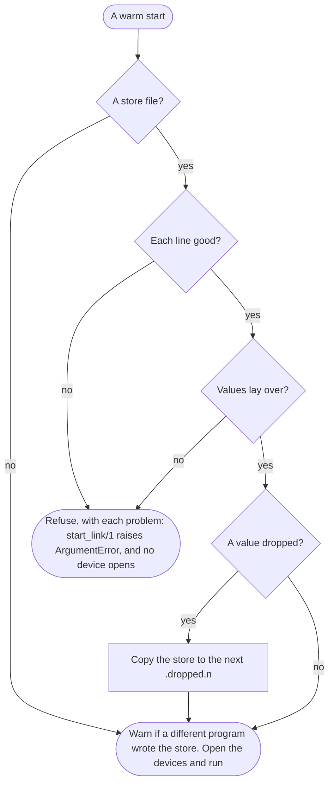

# 0017. The store on disk

This record is for a contributor who changes the
[store](../../guides/reference/glossary.md#store). That can be its text, the code that
reads it at a start, the matching of its values, its refusals or its copies. The record
says why the
store is text that a person can read, and why a start reads a store whole or not at all.
It also says why logex refuses a store that it cannot trust, and never guesses at its
values. [What this means for a change](#what-this-means-for-a-change) gives the rules
that a change must keep.

[0016. Retained values and starts](0016-retained-values-and-starts.md) says which values
a program keeps and when the [runner](../../guides/reference/glossary.md#runner) writes
the store. [0018. File work with a limit](0018-file-work-with-a-limit.md) gives the write
limit and the processes that read and write the files.
[The store](../../guides/reference/store.md)
gives each rule and each message for a user.
[The store and its files](../architecture/store-and-files.md) gives the code.

These words have 1 meaning on this page:

| Word | Meaning on this page |
|---|---|
| Fresh start | `Logex.Runner.start_link/1` with the option `retain:` |
| Warm start | A fresh start that reads the store and lays its values over the new [resource](../../guides/reference/glossary.md#resource). It is the default. A warm start is not a [warm restart](../../guides/reference/glossary.md#warm-restart): a warm restart (`Logex.Runner.restart/2`) reads no store |
| Cold start | A fresh start with `start: :cold`. It reads the store, lays none of its values, and writes a new store |
| Store reader | The code that reads the store at a fresh start, in `lib/logex/retain.ex` |
| Dropped value | A stored value that a start does not keep. The start reports it in `dropped` of `Logex.Runner.status/1` |
| Copy | A file `<store>.dropped.<n>` beside the store. It holds the bytes of the store as a start read it |
| Owed copy | A copy that a start must make, because its first try failed |
| Naming lines | The `resource` line and the `program` lines of the store. They name the program that wrote it |
| Way out | The end of a refusal that says how to start with the store refused: a cold start, which copies the store first |
| Hand edit | A change that a person makes to the store in a text editor while the runner is stopped |

> #### Caution {: .error}
>
> Keep the store reader able to read each store that an earlier logex wrote. If the store
> reader refuses a store, the plant starts only cold, and each retained count goes back to
> its [initial value](../../guides/reference/glossary.md#initial-value). Do not make the
> store reader guess at a store that it cannot trust. A guess sets a value that no person
> wrote, and nobody sees it.

## Status

Accepted. Later decisions replace parts of the first decisions:
[The decisions that this record sums up](#the-decisions-that-this-record-sums-up) says which.

## Date

2026-10-27, the date of decisions 276, 277 and 285.

## Context

A controller keeps its retained values in memory that a battery holds. logex runs on a
computer, so a file on the disk of the [host](../../guides/reference/glossary.md#host)
takes that place: the store. The runner holds the retained values in memory while it
runs. It writes them to the store at the events of
[0016](0016-retained-values-and-starts.md), and a fresh start reads them back.

Between 2 runs of a plant, these events can change the store:

| Event | What the next start finds |
|---|---|
| A crash or a power failure during a write | The old store, the new store, or, on some file systems, a store without its last bytes |
| A copy of the file that stops part of the way | A store without its last lines |
| An operator who corrects 1 value after an incident (decision 284) | A store with 1 line changed, possibly with CRLF line ends |
| A deploy of a changed program | A store of the program before the deploy |
| The files of 1 production line copied to a second production line, or an old backup put back | A store of a different configuration |
| An older logex put back after a failed upgrade | A store that a newer logex wrote |
| An [online edit](../../guides/reference/glossary.md#online-edit) that nobody wrote to the files | A store of a program that the files do not hold |

The first store had no end line. A test run shows the risk. It cuts a store of that
first version after its 6th line. The cut store starts the box counter of this record
with `t1.boxes.cv` at 0 and `full` at 0, and gives no message.

[IEC 61131-3](../../guides/reference/glossary.md#iec-61131-3) has no store that a person
edits, and [Logix](../../guides/reference/glossary.md#logix) has none either. A Logix
controller keeps all its memory at a loss of power. CODESYS matches its persistent
variables by name and type when a program changes (decision 277). The Logix programming
software tells an engineer that the project differs from the project in the controller,
each time the engineer goes online (decision 533).

## Decision

This table sums up the rules. Each link leads to the section of the rule.

| Rule | Why |
|---|---|
| [Text that a person can read](#text-that-a-person-can-read) | A person reads the store after an incident, and corrects 1 value (decisions 276 and 307) |
| [Read whole or not at all](#read-whole-or-not-at-all) | No start reads a cut store as a good one (decisions 355 and 409 to 411) |
| [A version on the first line](#a-version-on-the-first-line) | An older logex refuses a newer store for its version first (decisions 530, 534 and 536) |
| [The program that wrote the store](#the-program-that-wrote-the-store) | The operator learns that the files and the store differ (decisions 527, 528, 531, 533, 535, 537 to 539, 543 and 544) |
| [Match by name and type, and report each dropped value](#match-by-name-and-type-and-report-each-dropped-value) | A changed program keeps each value that still fits (decisions 277, 308 to 312, 320, 378, 389 and 425) |
| [A numbered copy before a write over the store](#a-numbered-copy-before-a-write-over-the-store) | An operator can take back a mistaken deploy (decisions 360, 412, 416 to 418, 447 to 454, 456, 483 and 487) |
| [A refusal names each problem, and the way out](#a-refusal-names-each-problem-and-the-way-out) | The operator knows what to correct, or how to start with the store refused (decisions 285, 309, 413, 419, 457, 540, 545, 573 and 574) |

This diagram shows how a warm start judges a store before it opens a
[device](../../guides/reference/glossary.md#device).



Figure: how a warm start judges a store. With no store file, the start writes the
initial values. "Each line good" means that each line reads,
the count is right, the configuration matches and the naming lines are whole. "Values
lay over" means that the values fit the instances of the resource. A cold start judges
the store too, but it copies a store that it cannot use, and then writes a new store.
See that no refused store reaches a device.

### The rules in a run

The script `examples/0017-the-store-on-disk.exs` shows the rules as numbered results. It
runs a box counter on a
[simulated device](../../guides/reference/glossary.md#simulated-device), the panel, on
the manual clock. The program `tally.ld` counts boxes at a photo-eye, and latches `full`
at 3 boxes. Its [configuration](../../guides/reference/glossary.md#configuration),
`tally.logex`, adds each box to the retained
[global](../../guides/reference/glossary.md#global) `total_boxes`.

<!-- file: tally.ld -->
```text
var_input eye bool
var_output retain full bool
var_external total_boxes dint
var retain boxes ctu
var e bool

xic eye ctu boxes 3
xic eye ons e add total_boxes 1 total_boxes
xic boxes.q otl full
```

<!-- file: tally.logex -->
```text
// tally.logex -- a box counter whose count and total survive a warm restart
var_global eye_1              bool at panel.i.0
var_global retain total_boxes dint 0
var_global case_full          bool

program t1 tally
  t1.eye  eye_1
  t1.full case_full
```

The script counts 4 boxes and stops. Then it starts a deploy that changes 2 lines of
`tally.ld`, and puts its copy back. Then it cuts the store and edits it by hand.

```elixir
alias Logex.IO.Sim
alias Logex.Runner
alias Logex.Runner.Clock.Manual

{:ok, plant} = Logex.Configuration.compile_file("tally.logex")
Enum.each(Path.wildcard("tally.retain*"), &File.rm/1)

# The manual clock, its wall clock 2026-10-30T14:00:00Z.
{:ok, clock} = Manual.start_link(now: 1_793_368_800_000)
{:ok, panel} = Sim.start_link(clock: clock)

opts = [
  configuration: plant,
  io: %{"panel" => {Sim, sim: panel}},
  clock: {Manual, clock},
  retain: "tally.retain"
]

show = fn runner, title ->
  %{dropped: dropped, copy: copy, warning: warning} = Runner.status(runner).retain
  IO.puts(title)
  IO.puts("  t1.boxes.cv=#{Runner.get!(runner, "t1.boxes.cv")} copy=#{inspect(copy)}")
  IO.puts("  dropped=#{inspect(dropped)}")
  IO.puts("  warning=#{inspect(warning)}")
end

refused = fn title ->
  IO.puts(title)

  try do
    Runner.start_link(opts)
  rescue
    error in ArgumentError -> IO.puts(error.message)
  end
end

edit = fn from, to ->
  File.write!("tally.retain", String.replace(File.read!("tally.retain"), from, to))
end

files = fn ->
  IO.puts("  files: " <> Enum.join(Enum.sort(Path.wildcard("tally.retain*")), " "))
end

{:ok, runner} = Runner.start_link(opts)

for eye <- [1, 0, 1, 0, 1, 0, 1, 0] do
  Sim.set(panel, "panel.i.0", eye)
  Manual.advance(clock, 1000)
end

:ok = Runner.stop(runner)
IO.puts("1. Four boxes, then a stop. The store:")
IO.write(File.read!("tally.retain"))

# A deploy: boxes made a ctu_int, and full not retained.
source =
  File.read!("tally.ld")
  |> String.replace("var retain boxes ctu", "var retain boxes ctu_int")
  |> String.replace("var_output retain full bool", "var_output full bool")

{:ok, changed} = Logex.compile(source, name: "tally")

{:ok, deploy} =
  Logex.Configuration.compile("tally", File.read!("tally.logex"), %{"tally" => changed})

{:ok, runner} = Runner.start_link(Keyword.put(opts, :configuration, deploy))
show.(runner, "2. A fresh start of the deploy")
:ok = Runner.stop(runner)

File.cp!("tally.retain.dropped.1", "tally.retain")
{:ok, runner} = Runner.start_link(opts)
show.(runner, "3. The copy put back, and a fresh start of the program before the deploy")
:ok = Runner.stop(runner)

text = File.read!("tally.retain")
File.write!("tally.retain", binary_part(text, 0, byte_size(text) - 40))
refused.("4. The store cut short by 40 bytes")

{:ok, runner} = Runner.start_link(opts ++ [start: :cold])
show.(runner, "5. A start with start: :cold")
:ok = Runner.stop(runner)
files.()

edit.("configuration tally", "configuration line_2")
refused.("6. The configuration line edited by hand")

edit.("configuration line_2", "configuration tally")
edit.("t1.boxes.cv dint 0\n", "t1.boxes.cv dint 0\nt1.boxes.cv dint 2\n")
refused.("7. A line added by hand, and the count not changed")

edit.("t1.boxes.cv dint 0\n", "")
edit.("\n", "\r\n")
{:ok, runner} = Runner.start_link(opts)
show.(runner, "8. The old line taken out, the store saved with CRLF line ends")
:ok = Runner.stop(runner)
```

Run it from the directory `examples/`:

```console
$ mix run 0017-the-store-on-disk.exs
1. Four boxes, then a stop. The store:
logex retain 3
configuration tally written 2026-10-30T14:00:08Z
resource 013cc059392445fdcc1e84c9b0de6118
program tally bd882e28a8159d8e8a4ea56ade7b36b6
global total_boxes dint 4
instance t1 tally
t1.boxes ctu
t1.boxes.cu bool 0
t1.boxes.cv dint 4
t1.boxes.ov bool 0
t1.boxes.pv dint 3
t1.boxes.q bool 1
t1.boxes.r bool 0
t1.full bool 1
end 15 lines
2. A fresh start of the deploy
  t1.boxes.cv=0 copy="tally.retain.dropped.1"
  dropped=[{"t1.boxes", {:retyped, "ctu", "ctu_int"}}, {"t1.full", :unretained}]
  warning="tally.retain: the store was written by another program than the one this start was given: `tally`'s text differs; whether by a deploy of changed files, or an edit tested or assembled online that never reached the files, this start runs the program it was given, with the store's retained values laid over it by name and type"
3. The copy put back, and a fresh start of the program before the deploy
  t1.boxes.cv=4 copy=nil
  dropped=[]
  warning=nil
4. The store cut short by 40 bytes
tally.retain: line 13: `t1.box` is the store's last line, and no end line: a store of `logex retain 3` ends with `end <count> lines`, its count of lines, so this one was cut short, and a store cut short is not read: start it with start: :cold to start over it, which copies it first to the next `.dropped.<n>` beside it and then writes a new store over it
5. A start with start: :cold
  t1.boxes.cv=0 copy="tally.retain.dropped.2"
  dropped=[]
  warning=nil
  files: tally.retain tally.retain.dropped.1 tally.retain.dropped.2
6. The configuration line edited by hand
tally.retain: line 2: the store is of configuration `line_2`, and this configuration is `tally`: a store starts only the configuration it was written for, so a renamed configuration starts only cold: start it with start: :cold to start over it, which copies it first to the next `.dropped.<n>` beside it and then writes a new store over it
7. A line added by hand, and the count not changed
tally.retain: line 10: `t1.boxes.cv dint 2` names what line 9 names already
tally.retain: line 16: the store's end line counts 15 lines, and the store has 16: a line was lost or doubled, or a hand edit added or removed one without changing the count, which counts every line, the end line among them, and the store is not read
8. The old line taken out, the store saved with CRLF line ends
  t1.boxes.cv=2 copy=nil
  dropped=[]
  warning=nil
```

Each result shows these rules:

1. The store is text. Its end line counts 15 lines (decisions 276, 355 and 530).
2. The deploy drops 2 values and reports each (decision 277). It copies the store before
   its first write (decision 360). It warns, because the text of `tally` differs
   (decision 528).
3. With the copy back, the count is 4 again. That start drops nothing, so it makes no
   copy, and `.dropped.1` stays.
4. The cut leaves line 13 last. The start refuses the store, with the way out (decision
   417).
5. The cold start copies the cut store to `.dropped.2` first. Then it writes the initial
   values (decision 417).
6. A store of `line_2` does not start `tally`. The refusal has the way out (decisions 285
   and 545).
7. The refusal names 2 problems. Neither has the way out, because a person can correct
   both (decision 545).
8. The correct hand edit, saved with CRLF line ends, starts with a count of 2 (decision
   410).

### Text that a person can read

The store is text, 1 value on each line (decision 276). The other option was
`:erlang.term_to_binary/1`. A person cannot read that after an incident, or correct 1
value in it.

Result 1 shows each form of line, in its order. A block on the path to a value has a
line `<path> <block type>`, such as `t1.boxes ctu`. A store with a retained
[trigger](../../guides/reference/glossary.md#trigger) also has a line
`trigger <name> <sample>` before the instances. A task whose sample is not that of its
trigger has a line of the same form, with the name of the task (decision 350).

These rules complete the text:

- The time is the wall clock of the host in UTC, to the second, from the callback
  `wall_ms/1` of the [clock](../../guides/reference/glossary.md#clock). It is for a person
  and for `written_at`, never for a [timer](../../guides/reference/glossary.md#timer).
  The member `last` of a timer is never in the store.
- The elements of an [array](../../guides/reference/glossary.md#array) are on 1 line,
  such as `a1.w int[4] 0 0 7 0`. A real is the shortest text that reads back to the same
  value, such as `a1.r real 0.1`.
- The runner ends each line with LF. The store reader also takes CRLF and a lone CR as
  the end of a line, as the program reader does (decision 410).
- The words of a line are 1 space apart, in printable ASCII. The store reader names a
  tab, a byte that is not ASCII and a line that starts with `//` or `#` as what each is.
  It refuses a comment at the end of a line, or an empty line among the values, as a
  line of a wrong form.

The core gives the same values as plain data, the
[retained image](../../guides/reference/glossary.md#retained-image):
`%{configuration:, globals:, instances:, triggers:}` (decision 307).
`Logex.Runtime.retained/1` takes it out of a resource, and `Logex.Runtime.start/2` lays
it over a new one. Only the runner reads and writes the file. The core refuses an image
of a different configuration with an `ArgumentError` (decision 309).

### Read whole or not at all

The runner writes each store to `<store>.tmp`, syncs it to the disk and renames it over
the store. After a crash, the disk holds the old store or the new store. OTP 28 cannot
open a directory to sync it, so the rename itself is not durable. After a power failure,
some file systems hold the store of the write before the last write.

A file system can also lose the last bytes of a file. A cut removes bytes from the end of
a file only. So the last line counts the lines: a cut removes that line or changes it
(decisions 355 and 409). The count includes the header and the end line, as `wc -l`
counts them. It catches each cut:

| Where the cut is | The last line that stays | Result |
|---|---|---|
| At the end of a line before the end line | A line that is not an end line | Refused |
| In a line before the end line, also in the digits of a number | Part of a line | Refused |
| In the end line | `end` and a count that is too small, or a count with no word after it | Refused |
| Only the last newline | The whole end line | Read |

`test/logex/retain_store_test.exs` cuts a store that a runner wrote at each byte offset,
and starts from each cut. The store reader refuses each cut, except the cut of the last
newline. The count also catches a line that is lost or doubled. It catches a hand edit
that adds or removes a line and does not change the end line, as result 7 shows. A hand
edit that changes 1 line, and adds or removes none, needs no change to the end line.

Nothing follows the end line in a store that logex writes. So the store reader refuses
an empty line after it (decision 411).

### A version on the first line

The header gives the version of the text. Each write of this logex makes `logex retain
3`. The store reader reads 3 versions:

| Header | What the store holds | What this logex does |
|---|---|---|
| `logex retain 3` | An end line and the naming lines | Reads it |
| `logex retain 2` | An end line. Naming lines are possible, each `program` digest of the bytes of its files | Reads it, and writes version 3 next |
| `logex retain 1` | No end line and no naming lines | Reads it, and writes version 3 next |
| Each other header | | Refuses it |

A store of version 1 has no end line, so the store reader cannot find a cut in it. That
risk lasts until the first write of this logex. The store reader refuses an end line
under a header that takes none (decision 536). Thus a store with the header `logex
retain 4` has 2 problems. This logex does not read the version, and the header takes no
end line.

Version 3 exists for a rollback (decision 530). The first logex that wrote naming lines
wrote them under `logex retain 2`. An older logex reads that header, but not the naming
lines. Its refusal names the naming lines, not the version. A run of commit 681e326 on
the store of result 1, with its header made `logex retain 2`, gives this refusal:

<!-- unchecked: a message of logex at commit 681e326, from a run on the store of result 1 with its header made logex retain 2 -->
```text
tally.retain: line 3: `resource 013cc059392445fdcc1e84c9b0de6118` comes before any `instance` line: an instance's lines follow its own
tally.retain: line 4: `program tally bd882e28a8159d8e8a4ea56ade7b36b6` comes before any `instance` line: an instance's lines follow its own
```

With a new version, an older logex names the version first. A run of commit ea0fe70,
the last before decision 530, on the store of result 1 gives this:

<!-- unchecked: a message of logex at commit ea0fe70, from a run on the store of result 1 -->
```text
tally.retain: line 1: the store is of version 3, which this logex does not read: it reads `logex retain 2` and `logex retain 1`
tally.retain: line 15: `end 15 lines` is an end line, which a store whose first line is `logex retain 2` ends with, and this store's first line is not
```

In both runs, the older logex then starts only cold. It copies the store to
`tally.retain.dropped.1` and starts the count at 0. The count stays lost until a person
puts the copy back.

A store of version 2 that names its program names each type by the MD5 of the bytes of
its files. For such a store, the start computes each digest from the bytes of the files,
as the logex that wrote it did (decision 534). If a person changes the header of a
version 3 store to `logex retain 2`, the start warns 1 time, though the program is the
same.

### The program that wrote the store

An online edit changes the program in the runner and in its store, not in the files. A
fresh start from the files then runs the old program with the values of the edited one.
So the naming lines name the program that the runner ran when it wrote the store
(decision 517 (c)):

- `resource` is the MD5 of the tasks, globals, instances and connections, as
  `Logex.Configuration.Text.print/1` prints them.
- `program` is the MD5 of the text of the program type and of its blocks, as
  `Logex.Printer` prints it (decision 527). The print gives each literal by its value. It
  gives each keyword, which logex reads in uppercase or lowercase, in lowercase (decision
  532).

Thus a comment, CRLF, spaces, `XIC` for `xic` or `16#3` for `3` change no digest. A test
run with all 5 in `tally.ld` gives no warning. A changed declaration, as in result 2,
changes a digest.

Where a digest differs, the start warns and runs (decision 528). It lays the values over
the program that it got, by name and type, as each start does. Result 2 shows the
warning in `warning` of `Logex.Runner.status/1`.

The runner also sends
`{:retain, {:warning, message}}` to each subscription that takes `:retain`, as the
subscription starts (decision 533). No subscriber can exist before
`Logex.Runner.start_link/1` returns. A second `Logex.Runner.subscribe/2` of the same
process that already takes `:retain` gets nothing more. One that adds `:retain` gets the
warning.

Each store of version 3 that the runner writes has a `resource` line and a `program`
line for each type. A store of version 3 that does not have both is a hand edit, and the
store reader refuses it:

| Naming lines | Result |
|---|---|
| A `resource` line and a `program` line for each type | Read |
| None | Refused at line 1, the header (decisions 535 and 537) |
| A `resource` line, and no `program` line | Refused at the `resource` line (decisions 539 and 543) |
| `program` lines, and no `resource` line | Refused at the first `program` line (decision 531) |

The store reader refuses the naming lines only if the count is correct (decisions 538
and 544). If the count does not read, the refusal names only the count or the cut. Thus a
cut before line 3 gives 1 problem, not 2. Each other problem of a line, such as a
renamed configuration or a tab, is in the same refusal as a wrong count.

### Match by name and type, and report each dropped value

A deploy can add a tag, change a type or remove an instance. 2 options were open
(decision 277). The first option, the rule of the
[forces file](../../guides/reference/glossary.md#forces-file), refuses each change to a
retained tag. Then a deploy that adds 1 tag stops the plant until a person deletes the
store. logex takes the second option: it matches each value and drops the rest, as an
online edit does.

A start keeps a stored value only if each of these is true:

- The configuration has an instance of that name, which runs the same
  [program type](../../guides/reference/glossary.md#program-type).
- The program declares the path retained, with exactly the stored type, under blocks of
  the same block types.
- The value fits the type.

Each other value starts at its initial value. The start reports each dropped value 1
time, in path order, as `{path, reason}`. The reasons are `:undeclared`, `:unretained`,
`:retyped`, `:resized`, `:misfit` and `:preset`, the last 3 with the stored and the
declared values. Result 2 shows 2 of them, and the reference page gives each.

These rules complete the matching:

- A [preset](../../guides/reference/glossary.md#preset) that an instruction gives
  follows the program, and the start reports the stored preset (decision 308). Else a
  lube timer changed from 100 hours to 50 hours greases at 100 hours until a cold start.
  The start keeps a preset that no instruction gives (decision 378).
- A dropped value that each element of an array of blocks gives for the same reason is
  1 entry, such as `{"m1.gates[*].j", {:retyped, :dint, :int}}` (decision 310).
- An integer stored for a `real` or an `lreal` is its nearest real, as an input from the
  host is (decision 311).
- A subscript with leading zeros names the element of its value: `m1.tl[00].acc` sets
  `m1.tl[0].acc` (decisions 312 and 320).
- A stored trigger sample that no task takes is a dropped value, and the resource starts
  (decisions 389 and 425).

The matching accepts a changed program. It does not accept a damaged file. A warm start
also refuses a store whose lines read, but whose values do not lay over the resource.
That refusal names the instance, not a line, as in
``tally.retain: instance "t1": `values` holds "full[x]", which is no path``.

### A numbered copy before a write over the store

A fresh start that drops a value writes over the old store within 1 period. A mistaken
deploy then loses the dropped values. So a start that drops a value copies the store, as
it read it, before its first write over the store (decision 360). It names the copy
`<store>.dropped.<n>`, and it never replaces a copy (decision 418).
[The numbered copies](../../guides/reference/store.md#the-numbered-copies) gives the
rules for a user. Result 2 makes
`tally.retain.dropped.1`, and result 3 puts it back.

| Event | Copy |
|---|---|
| A warm start that drops a value | Yes, before the runner opens a device |
| A cold start over a store that a warm start refuses (decision 417) | Yes, then it writes the new store. Result 5 makes `tally.retain.dropped.2` |
| A cold start over a store that a warm start can read | No |
| A warm start that drops nothing | No. Each earlier copy stays |
| A cold `Logex.Runner.restart/2` (decision 454) | No. It reads no store, so the restart loses a hand edit made while the runner runs |
| A cold start over a store that it cannot read, such as a directory (decision 453) | No copy is possible, so the start returns `{:error, {:retain, :eisdir}}` |
| A cold start whose copy fails (decision 417) | No. The start returns `{:error, {:retain, reason}}`, and the store stays as it was |

The number of a copy is 1 more than the highest number of a file or directory beside the
store. An unnumbered `<store>.dropped` counts for nothing (decision 450). A name such as
`.dropped.007` counts for its number, 7, and the start does not compare its bytes with
the store (decision 487).

If the highest copy holds the same bytes as the store, the start makes no copy. Then
`copy` names the highest copy (decisions 456 and 483). For example, a start drops a
value, makes `.dropped.1`, then cannot open a device. 4 more such starts make no
`.dropped.2`.

The copy is a write as each other write: through `<store>.dropped.tmp`, within the write
limit. If the copy of a warm start fails, the start goes on, and the copy is owed
(decision 416). Each later write over the store makes the owed copy first, and writes the
store only after it. In a test run with a directory at `tally.retain.dropped.tmp`, the
start reports `failed: :eisdir` and `copy: nil`, and the store stays as the start read
it. A cold start is different: it writes the new store only after the copy. If its copy
fails, the runner does not start, `Logex.Runner.start_link/1` returns `{:error, {:retain,
reason}}`, and the store stays as it was (decision 417).

Thus the dropped values are never lost. But while the copy is owed, a crash or a stop
loses each value that changed after the start, and `Logex.Runner.stop/2` returns
`{:error, {:retain, :eisdir}}`.

The runner checks that the name of the copy is free immediately before it renames the `.tmp`
file to that name. A file that a host makes at that name before the check fails the copy
with `:eexist`, and the copy stays owed (decision 448). The rename replaces a file that a
host makes between the check and the rename (decision 449). A copy that the write limit
stops before the runner chooses its name is `failed: :timeout`. A copy that the write
limit stops after that is in `unknown` (decisions 447 and 452).
`test/logex/stalled_disk_test.exs` has a test for each of these edges.

The map `retain` of `Logex.Runner.status/1` gives what a contributor must keep:

| Key | What it holds |
|---|---|
| `path` | The path of the store, as the host gave it |
| `written_at` | The time of the last write that the runner knows is complete |
| `failed` | The reason of the last write that failed, or `nil` |
| `dropped` | Each dropped value of the fresh start, as `{path, reason}` |
| `copy` | The copy that the fresh start made or found, or `nil` (decision 412) |
| `unknown` | The file of a write that the write limit stopped, or `nil` (decisions 447 and 452) |
| `warning` | The warning of a different program, or `nil` (decision 528) |

`copy` is `nil` where the start dropped nothing, and `nil` while the copy is owed.
`dropped` and `failed` tell the 2 cases apart.

### A refusal names each problem, and the way out

A store that a warm start refuses raises an `ArgumentError` from
`Logex.Runner.start_link/1`. The runner does not start, and it reads or writes no device.
Most refusals name the file, each line and each problem. Some refusals end with the way
out. Its text is the same in each refusal that has it:

<!-- unchecked: the end of a refusal with the way out, as results 4 and 6 show it -->
```text
start it with start: :cold to start over it, which copies it first to the next `.dropped.<n>` beside it and then writes a new store over it
```

| The store | The way out | Why |
|---|---|---|
| Cut short (decision 417) | Yes | A hand edit cannot give back the lost lines |
| Of a different configuration (decisions 285 and 545) | Yes | The store belongs to a different plant |
| Of version 3, with the naming lines in part or none (decision 540) | Yes | A person can also put the lines back |
| A line of a wrong form, a tab, a comment, a wrong count or a doubled path. A digest that is not 32 lowercase hexadecimal digits | No (decision 545) | A person corrects the line and keeps the values |
| A header that this logex does not read, or a byte-order mark | No | A person corrects the header, or saves the file without the mark |
| A directory, or a file that does not answer (decision 453) | No | A warm start raises `the store cannot be read`, and a cold start returns `{:error, {:retain, reason}}` |
| A symbolic link (decision 413) | No | A warm start and a cold start raise the same refusal. The host names the file itself |

If more than 1 problem has the way out, only the first of those lines ends with it
(decision 573). A refusal has bounds, so that a person can read it for a broken store of
any size (decisions 419, 457 and 574). It gives the first 50 problems and a count of the
rest. It cuts each quoted text at 60 bytes and each line at 1,000 bytes. It gives a byte
that is not printable, except a tab and a CR, as its escape. The reference page gives
each bound.

The runner refuses a store that is a symbolic link (decision 413). Each write makes a new
file and renames it over the store. Through a link, that puts a file in the place of the
link and leaves the target as it was. The next write replaces a link that a person puts
there after the start.

## Consequences

The good results:

- A person reads the store after an incident and corrects 1 value in an editor. A
  correction in place keeps the count.
- No start reads a cut store as a good store. The count catches each cut but the cut of
  the last newline, which loses nothing.
- A changed program keeps each value that still fits, and the start names each dropped
  value. An operator takes back a mistaken deploy from its copy, also after more starts.
- A cold start never destroys the only bytes of a refused store. It copies them first.
- An older logex refuses a store of version 3 for its version first.
- The operator learns when an online edit did not reach the files.
- Each refusal names the file, the line and the problem, within bounds, whatever the file
  holds.

The bad results and the costs:

- A refused store stops the plant until a person acts: a hand edit, a copy put back, or
  a cold start.
- A cold start sets each retained value to its initial value. The copy keeps the old
  values, but only a person can put them back.
- After a rollback of logex, the older logex refuses a store of version 3. The plant
  starts only cold, unless a person edits the store back to version 2 by hand.
- logex never deletes a copy. Each start that drops a value, with new bytes, adds 1 file.
  The host deletes the copies.
- The rename replaces a host file made at the number of a copy, between the check and
  the rename.
- Each fresh start and each `Logex.Runner.accept/2` prints and digests each program type,
  to make the naming lines.

### What this means for a change

- A new form of line, or a new meaning of a line, gets a new header. An older logex then
  refuses the store for its version. The store reader keeps reading versions 1, 2 and 3.
- A new reason for a dropped value goes into the list `dropped`. The copy follows that
  list, so the copy needs no change.
- For a new refusal, decide if a person can correct the store by hand. If not, the
  refusal ends with the way out, which `lib/logex/retain.ex` keeps in 1 place,
  `@way_out`.
- Each write over the store makes an owed copy first, and goes through the atomic write
  of `lib/logex/retain.ex`.
- Keep each key of the map `retain` of `Logex.Runner.status/1`.
- `test/logex/retain_store_test.exs` gives the text, the versions, the refusals and the
  copies. `retain_image_test.exs` gives the matching, and `stalled_disk_test.exs` the
  copies and the writes on a disk that does not answer. The life walk of
  `test/logex/api_contract_test.exs` restates the store at each start.

## Alternatives considered

| Decision | Not taken | Why not |
|---|---|---|
| 276 | `:erlang.term_to_binary/1` | A person cannot read it after an incident, or correct 1 value |
| 277 | Refuse each change to a retained tag, as the forces file does | A deploy that adds 1 tag stops the plant until a person deletes the store |
| 285 | Match a store of a different configuration, and report the name only, or record no configuration | A second plant starts with the counts of the first plant. Nobody reads a store until a value is wrong |
| 308 | The stored preset kept, as each other member | A changed preset on the rung has no effect until a cold start |
| 355 | Read a store that is cut at the end of a line | Each lost value starts at its initial value with no report. A number cut in its digits reads as a smaller number |
| 360 | No copy | A mistaken deploy loses the dropped values at its first write |
| 416 | Refuse the warm start when the copy fails | A disk that refuses 1 file stops the plant |
| 417 | A cold start that writes over a refused store, and a message that tells the operator to copy it first | An operator who does not read the message loses the readable part of a cut store |
| 418 | 1 copy, replaced at each start that drops a value | A start of the good configuration before a person puts the copy back loses the copy |
| 449 | Make the copy with a hard link, which refuses a name that exists | A FAT card has no hard links |
| 527 | Digests of the bytes of the files | A comment corrected in `tally.ld` gives a warning |
| 528 | The warning in `Logex.Runner.status/1` only | A host that logs or shows events never sees it |
| 530 | The naming lines under `logex retain 2` | An older logex names the place of the lines, not the version |
| 544 | The refusal of the naming lines beside a wrong count | A refusal of a cut store lists what the cut removed, and gives the way out 2 times |

## The decisions that this record sums up

This record sums up 53 decisions of
[`docs/organisation.md`](../organisation.md#7-decisions):

- 276, 307, 309, 410, 411 and 419: the text, the image and its line ends.
- 355, 409, 530, 534 and 536: the end line and the versions.
- 527, 528, 531, 533, 535, 537, 538, 539, 543 and 544: the naming lines and the warning.
- 277, 308, 310, 311, 312, 320, 378, 389 and 425: the matching and the dropped values.
- 360, 412, 416, 417, 418, 447 to 454, 456, 483 and 487: the copies.
- 285, 413, 457, 540, 545, 573 and 574: the refusals and the way out.

Later decisions replace parts of the first decisions:

- 355 replaces the header `logex retain 1` of 276 with `logex retain 2` and an end line.
  530 makes it `logex retain 3`.
- 418 replaces the 1 copy `<store>.dropped` of 360 with numbered copies. 456 makes no copy
  of the same bytes.
- 416 keeps the owed copy that the review of RV-5 built. In the first build of RV-5, the
  next write replaced the store.
- 417 replaces the warning of the refusal of a cut store with a copy that the cold start
  makes. 540 and 545 give that way out to the other refusals.
- 308 makes a preset follow the program, where 277 kept the stored preset. 378 keeps a
  preset that no instruction gives.
- 311 and 312 replace a misfit and a refusal of 277 with a match.
- 410 reads CRLF. Before 410, the store reader refused CRLF.
- 412 makes `copy` always present.
- 539 refuses a store with a `resource` line and no `program` line, which the store
  reader read before. 544 makes the refusal of 531 wait for the count, as 538 makes the
  refusal of 535 wait.

The design is in
[§4.13](../organisation.md#413-retained-values-and-a-true-warm-restart-milestone-6)
of the same document. `PLAN.md` keeps the history in Milestone 6, RV-5, RV-6, RV-13 and
RV-21 to RV-29.

It also uses decisions that other records sum up, or that no record sums up:

- Decisions 275, 284 and 292, when the runner writes the store and the hand edit with
  the runner stopped:
  [0016. Retained values and starts](0016-retained-values-and-starts.md).
- Decisions 127 and 140, the forces file and its text:
  [0015. Input forcing](0015-input-forcing.md).
- Decisions 353, 356, 391, 392, 400 and 415, the write limit, the claim on each file and
  the `.tmp` of each write: [0018. File work with a limit](0018-file-work-with-a-limit.md).
- Decision 532, the case of a keyword and a bit in brackets in the digest of a program:
  [0002. Own dialect and names](0002-own-dialect-and-names.md).
- Decision 517 (c), the naming lines and the warning. No record sums it up.

[Keep values on disk](../../guides/howto/keep-values-on-disk.md),
[Recover a refused store](../../guides/howto/recover-a-refused-store.md),
[Edit the store by hand](../../guides/howto/edit-the-store-by-hand.md) and
[Take back a deploy](../../guides/howto/take-back-a-deploy.md) give the steps for a user.
