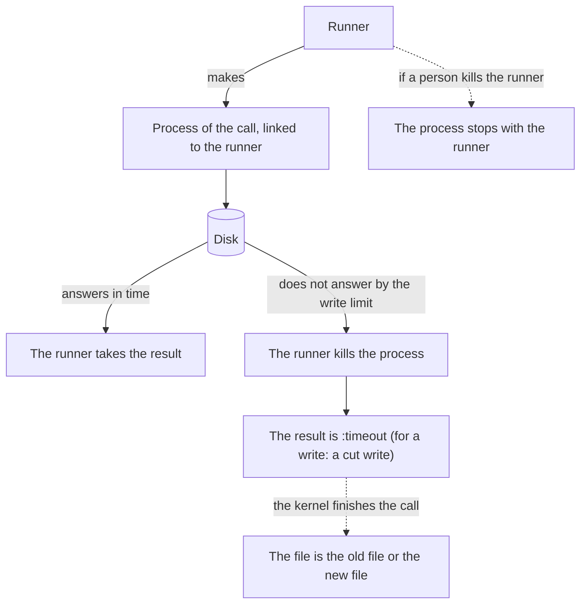
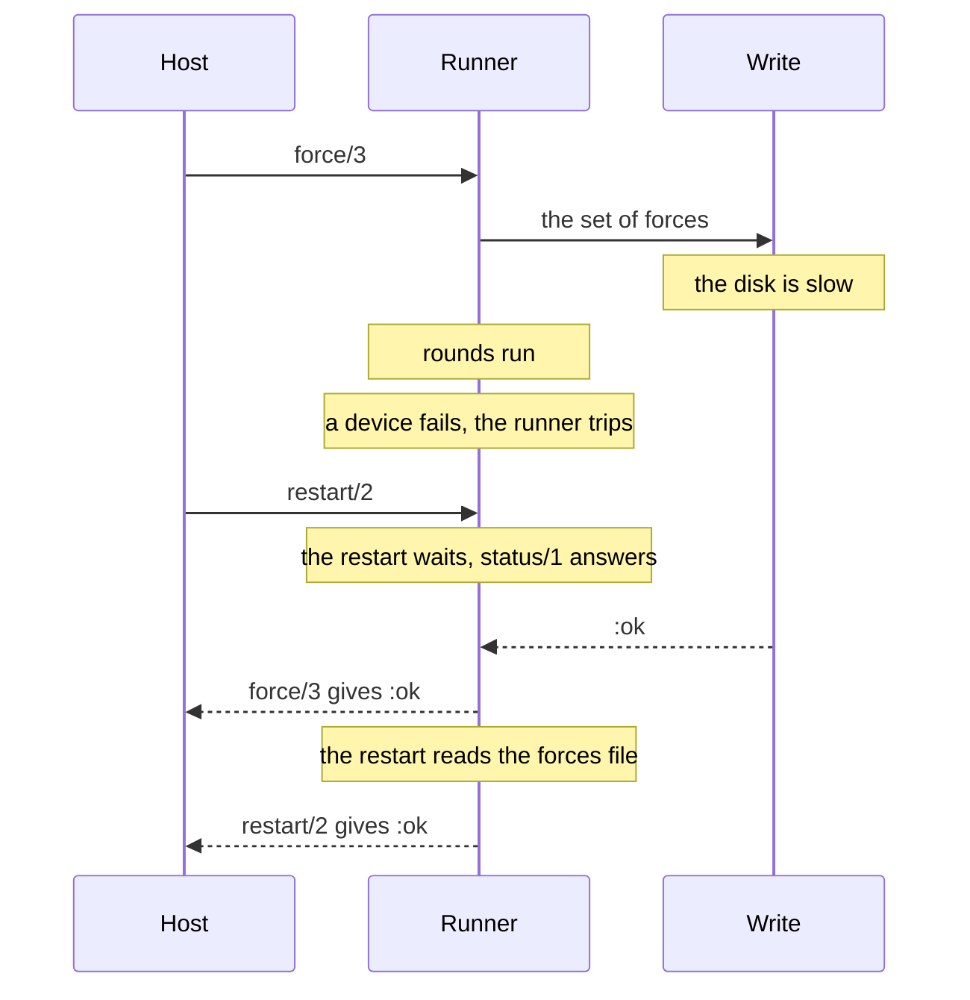

# 0018. File work with a limit

This record is for a contributor who changes a file call of `Logex.Runner`. An example
is a write of the [store](../../guides/reference/glossary.md#store) or of the [forces file](../../guides/reference/glossary.md#forces-file). It says
why each file call runs in a separate process with a limit of real time. The
[rounds](../../guides/reference/glossary.md#round) of the [runner](../../guides/reference/glossary.md#runner) run on while it writes a
[force](../../guides/reference/glossary.md#force).

[Runner](../../guides/reference/runner.md) gives each option and message for a user.
[The file work of the runner](../architecture/runner-files.md) gives the code.
[Runs and tables of the records: file work](../implementation/record-runs-file-work.md#0018-file-work-with-a-limit)
gives the words of this record, its tables, a run and each option not taken. A cut write is a write that did not end within its write limit.

> #### Warning {: .warning}
>
> Do not read `{:error, {:forces, :timeout}}` as "the force is not in the file". The
> cut write can still reach the disk, and the next start then takes that force. While
> `forces_unknown` in `Logex.Runner.status/1` names a set, the file can hold it. When the
> disk answers, make a force or an unforce.

> #### Caution {: .error}
>
> Do not call the file system in the process of the runner. A disk that does not answer
> then stops the rounds, the refresh of each device and each answer to the host.

## Status

Accepted. Some decisions of this record replace earlier ones:
[The decisions that this record sums up](#the-decisions-that-this-record-sums-up) says which.

## Date

2026-11-01, the date of decisions 352, 353 and 356, from the review after Milestone 6.
The last decision of the record, 518, is of 2026-11-12.

## Context

The runner is 1 Erlang process. It runs the rounds, answers the host and refreshes each
device. Before decision 353, it made its file calls in its own
process, with no limit. The review after Milestone 6 found 4 problems:

- A stalled disk stopped the runner, and the runner answered no one (decision 353).
- On a busy computer, a short limit cut a good write (decision 400).
- A large retained [array](../../guides/reference/glossary.md#array) of instances made the runner work past the
  [idle watchdog](../../guides/reference/glossary.md#idle-watchdog), and the plant tripped (decision 352).
- Nothing refused a second runner on the same store or forces file (decision 356).

The file server of the VM, `:file_server_2`, does 1 call at a time. Thus 1 stalled call
holds each other file call of the VM that goes through it (decision 464).

[IEC 61131-3](../../guides/reference/glossary.md#iec-61131-3) has no external forces file (decisions 493, 506 and 507).
[Logix](../../guides/reference/glossary.md#logix) keeps its forces in the memory of the controller (decisions 390, 437
and 499), and answers status during a change of mode (decision 500). The source of these
claims about Logix is not recorded.

## Decision

Each part of this section gives 1 rule, with its decisions.

### Each file call runs in a separate process

The runner makes each file call in a separate process, and waits for it for the write
limit only (decision 353). A file call is a read, a write, a copy or a check of a file.

This diagram shows what happens to 1 file call.

Figure: the life of 1 file call. A dotted arrow is a path that occurs only after a kill.
The write of each period is the exception: the runner does not kill it at its limit
([A cut write is not known](#a-cut-write-is-not-known)).

These rules make the kill safe:

- Each write goes to a `.tmp` beside its file, and then renames the `.tmp` over the file.
  A rename is 1 call of the file system, so a kill leaves the old file or the new file.
- The runner links the process to itself. If a person kills the runner, the write stops
  with it.
- The write first deletes an old `.tmp`, and then makes a new `.tmp` that no other
  process can open (decision 392). Thus a late cut write cannot write into the `.tmp` of
  the next write.
- Each read of the forces file and of the store is raw, so a FIFO or a stalled disk stops
  only that read (decision 464).

The process of the write makes the text of the store, within its limit (decisions 414 and
455). The writer gets only the retained values, not the whole
[resource](../../guides/reference/glossary.md#resource) (decision 488).

### The limit is `write_limit:`

The limit of each file call is the option `write_limit:` of `Logex.Runner.start_link/1`
(decision 400). It is real time: a manual [clock](../../guides/reference/glossary.md#clock) does not move it. Its default
is 5000 ms. A busy computer can sync a good write slowly, and the deadline of a refresh
must stay short. The page of the runs gives the measurement.

The `shutdown:` time of `Logex.Runner.child_spec/1` counts 2 write limits, and 4 with
`forces:` (decisions 414 and 494). [Runner](../../guides/reference/runner.md) gives the
formula.

### The rounds run on while a force is written

The write of a force goes to a separate process, and the runner goes back to its rounds
(decision 437). The runner puts a force in effect only after its write ends with `:ok`.
Thus no force is in effect before the file holds it (decision 117). `status/1` gives the
set that the runner writes as `forcing`, and the set in effect as `forces`.

This diagram shows a force, a trip and a restart on a slow disk.

Figure: a force and a restart while the disk is slow. The runner answers each other
request while the write runs.

While the write runs, a round uses the forces of the last good write. A wrong argument
raises immediately (decision 473). More forcing requests join the next write
(decision 465). A restart of a tripped runner waits for the write, outside the process of
the runner, and then reads the file (decisions 468 and 500). Thus the operator's screen
never shows a force that then goes away.

### A cut write is not known

The runner kills a write at its limit, but the kernel finishes the call that the write
is in. Thus the runner cannot know if a cut write reaches the disk (decision 391).

`status/1` names what a cut write can leave. `retain.unknown` names the file that a cut
write of the store can reach. `forces_unknown` names the set of forces of a cut write of
the forces file. A read at a restart does not clear it (decision 502). Each key stays
until a later write of that file ends. Each key is in each report (decision 440).

The runner does not kill the write of the period at its limit (decision 401). It reports
`{:retain, {:error, :timeout}}` 1 time, names the store `unknown`, and lets the writer
finish. An end write first waits for the writer, up to the write limit. Past that limit
the runner kills the writer and makes its own write. Thus the end write is the last on
the disk.

### A file that cannot be read

A restart or a fresh start that cannot read the forces file goes on. A restart keeps the
forces that the runner holds, and `forces_unread` names the file (decision 390). A fresh
start that cannot read the store is refused (decision 415). The store alone holds the
retained values, and a start from initial values writes over a good store. A relative
path whose working directory does not answer is refused (decision 446).

### Only 1 runner of a VM holds a file

2 runners on 1 file write over each other (decision 356). At its start, a runner claims
its files. A second runner of the same VM that names one of them is refused before it
reads a file. A holder keeps a file while a cut write of it can still reach the disk
(decisions 475, 495 and 499). No part of logex
sees another VM.

### A stop gives each failure

A stop writes the store. While `forces_unread` names the forces file, the stop also
writes the set of the runner over that file (decision 472). If both writes fail, `stop/2`
gives both failures in 1 error, such as
`{:error, [forces: :timeout, retain: :timeout]}` (decisions 493 and 506). A failed write
of the forces file is the event `{:forces, {:error, reason}}` (decision 507).

### A trip during work between rounds names that work

The idle watchdog times the own work of the runner. A trip there names the work
(decision 352): `{:watchdog, {:idle, ms, work}}`. A request of the host is the name of
its function, such as `:get`. A step of an online edit is `{:edit, step}`, and the
hand-off to the writer is `:period`. A file call is not own work.

## Consequences

The good results:

- A stalled disk does not stop the runner. Each file call ends at its write limit.
- The rounds and the devices run on while the runner writes a force.
- The runner says what it does not know: a cut write is `unknown`, not failed.
- 2 runners of 1 VM never write over the same file.

The costs:

- A trip, a stop or a cold restart can hold the runner for 2 write limits, 10000 ms by
  default. A stop with `forces:` can hold it for 4.
- A force that the runner reports as failed can reach the disk later. Only
  `forces_unknown` and the event `{:forces, {:error, reason}}` warn the operator.
- A cut write keeps its call in the queue of the file server. Each other call of the VM
  through the file server waits behind it.
- Raw opens of FIFOs that no process writes can take all 10 dirty I/O schedulers of the VM
  (decision 464).
- A store too large for the write limit is never written. The host must set a larger
  `write_limit:`.

### What this means for a change

A new file call runs in a separate process with the write limit, never in the process of
the runner. A new write goes through its own `.tmp` and a rename. A new write that the
runner can cut names what it can leave in `status/1`. A runner claims a new file at its
start. `test/logex/stalled_disk_test.exs` acts out a stalled disk.

## Alternatives considered

| Decision | Not taken | Why not |
|---|---|---|
| 353 | File calls in the runner with no limit | A stalled disk stops the runner and each request of the host |
| 400 | The idle watchdog and 1 poll period as the limit | A busy computer cuts a good write |
| 401 | Kill the write of the period at its limit | The newest image must wait for the write and then win (decision 275) |
| 475 | Free the files when the runner ends | The next runner reads the old file, and a cut write then changes it |
| 500 | Wait for the write in the process of the runner | `status/1` blocked for up to the write limit, 1,503 ms in a probe |

The page of the runs gives each other option not taken.

## The decisions that this record sums up

This record sums up 33 decisions of
[`docs/organisation.md`](../organisation.md#7-decisions), from 352 to 518:

- A separate process for each file call: 353, 392, 414, 455, 464 and 488.
- The write limit: 400 and 494.
- The rounds during a write of a force: 437, 465, 467, 468, 473, 500, 508, 509, 510 and
  518.
- A cut write: 391, 401, 440 and 502. A file that cannot be read: 390, 415 and 446.
- The hold of a file: 356, 475, 495 and 499. A stop: 493, 506 and 507. The idle work: 352.

Later decisions replace parts of earlier ones. 400 replaces the limit of 353, and 437
replaces the wait of 400. 390 lets a restart go on where it was refused. 391 replaces
`failed: :timeout` with `unknown`.

500 moves the wait of 468 out of the runner. 502 keeps `forces_unknown` at the read of a
restart.

The design of the runner is in
[§4.11](../organisation.md#411-milestone-4s-design-the-wall-clock-runner-decided-2026-10-17).
Other records sum up the decisions that this record uses: 275 in
[0016. Retained values and starts](0016-retained-values-and-starts.md), 360 in
[0017. The store on disk](0017-the-store-on-disk.md), 117, 127, 445 and 472 in
[0015. Input forcing](0015-input-forcing.md), and 128 and 354 in
[0013. Watchdogs and the trip](0013-watchdogs-and-the-trip.md).

[Force an input point](../../guides/howto/force-inputs.md) and
[Keep retained values on disk](../../guides/howto/keep-values-on-disk.md) give the steps
for a user. [The store and its files](../architecture/store-and-files.md) gives the code
of the store.
