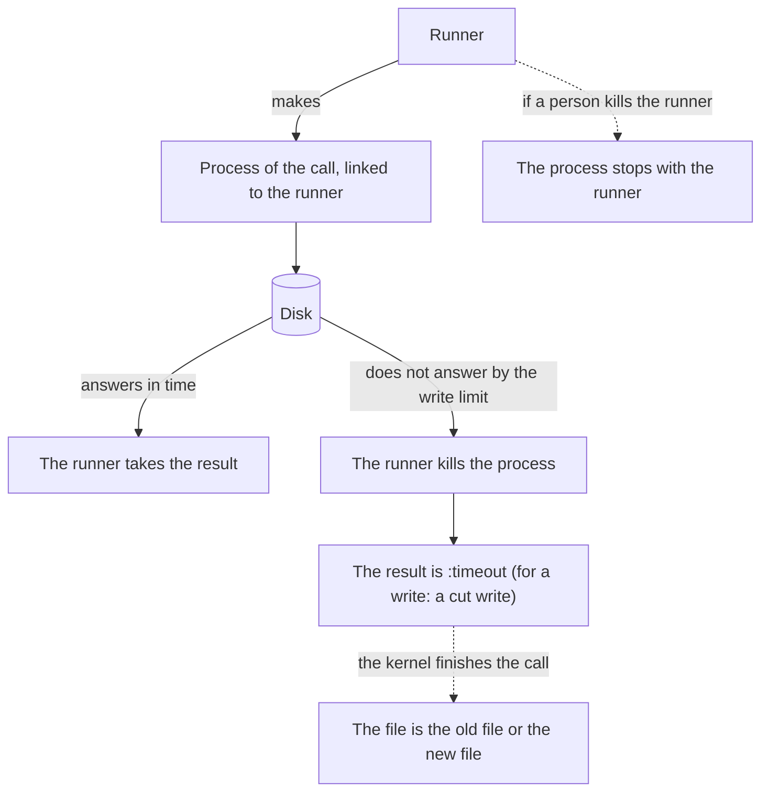
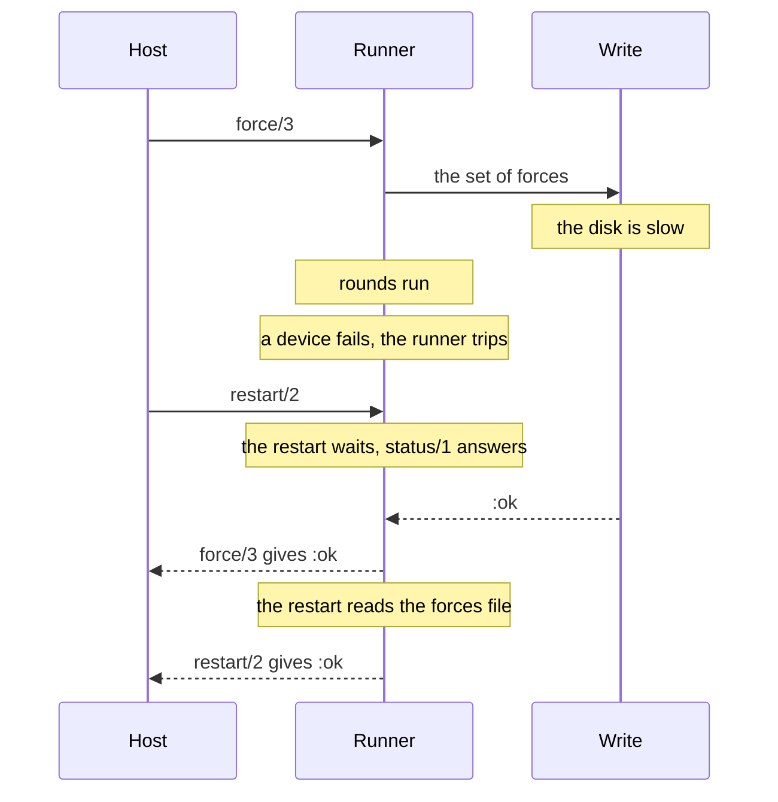

# 0018. File work with a limit

This record is for a contributor who changes a file call of `Logex.Runner`. An example
is a read or a write of the [store](../../guides/reference/glossary.md#store) or of the
[forces file](../../guides/reference/glossary.md#forces-file). Other examples are the
process that writes the store each period, and the table of the files that each
[runner](../../guides/reference/glossary.md#runner) holds. The record says why each file
call runs in a separate process with a limit of real time. It also says these things:

- why the [rounds](../../guides/reference/glossary.md#round) run on while the runner
  writes a [force](../../guides/reference/glossary.md#force)
- what a write that does not end within its limit leaves
- why only 1 runner of a VM holds a file

[Runner](../../guides/reference/runner.md) gives each option, report and message for a
user. [The architecture of the runner](../architecture/runner.md) gives the processes
and the code.

These words have 1 meaning on this page:

| Word | Meaning on this page |
|---|---|
| File call | A read, a write, a copy or a check of a file by the runner |
| Write limit | The time in ms of real time that 1 file call can take: the option `write_limit:` |
| Cut write | A write that did not end within its write limit. The call of the file system that it was in can still end later |
| End write | A write of the store at a [trip](../../guides/reference/glossary.md#trip), a stop, a shutdown or a [cold restart](../../guides/reference/glossary.md#cold-restart) |
| Writer | The process that writes the store each period, `retain_period:` |
| File server | The process of the VM, `:file_server_2`, that does each file call that is not raw. A rename and a delete go through it |
| Raw call | A file call that does not go through the file server |
| Holder | A process of logex that holds the files of a runner that stopped, until its cut writes end |
| Own work | Work of the runner between rounds: a request of the [host](../../guides/reference/glossary.md#host), a step of an [online edit](../../guides/reference/glossary.md#online-edit), or the hand-off to the writer |
| Refresh | A message from the runner to each [device](../../guides/reference/glossary.md#device) with a deadline. A device that gets no refresh by its deadline writes 0 to each output ([0014](0014-devices-are-processes.md)) |

> #### Warning {: .warning}
>
> Do not read `{:error, {:forces, :timeout}}` as "the force is not in the file". The
> cut write can still reach the disk when the disk answers. The next start or restart
> then takes that force from the file. While `forces_unknown` in
> `Logex.Runner.status/1` names a set of forces, the file can hold that set. When the
> disk answers, make a force or an unforce. When its write ends, `forces_unknown` is
> `nil` and the file holds the set of the runner.

> #### Caution {: .error}
>
> Do not call the file system in the process of the runner. A disk that does not answer
> then stops the rounds, the refresh of each device and each answer to the host.

## Status

Accepted. Some decisions of this record replace earlier ones:
[Decisions in section 7](#decisions-in-section-7) says which.

## Date

2026-11-01, the date of decisions 352, 353 and 356, from the review after Milestone 6.
The last decision of the record, 518, is of 2026-11-12.

## Context

The runner is 1 Erlang process. It runs the rounds, answers each request of the host and
sends each device its refresh. Before decision 353, the runner made these file calls in
its own process, with no limit:

- the write of the forces file at a force or an unforce
- the end writes
- the read of the forces file at a [restart](../../guides/reference/glossary.md#restart)

The review after Milestone 6 found 4 problems with this:

| Problem | What occurred | Decision |
|---|---|---|
| A stalled disk | A network drive or a failing disk stops answering. The runner then waits in the file call and answers no one. | 353 |
| A busy computer | When each core is busy, a disk that works correctly can take longer to sync than the [idle watchdog](../../guides/reference/glossary.md#idle-watchdog) and 1 [poll period](../../guides/reference/glossary.md#poll-period). Such a short limit cuts a good write. | 400 |
| The runner's own long work | A large [array](../../guides/reference/glossary.md#array) of [instances](../../guides/reference/glossary.md#instance), retained, made the runner work past the idle watchdog. Each device then wrote 0 at its deadline, and the [plant](../../guides/reference/glossary.md#plant) tripped at its first period. | 352 |
| 2 runners on 1 file | Nothing refused a second runner on the same store or forces file. Each runner wrote over the file of the other. | 356 |

The file server does 1 call at a time. Thus 1 stalled call holds each other file call of
the VM that goes through it (decision 464).

[IEC 61131-3](../../guides/reference/glossary.md#iec-61131-3) has no external forces
file (decisions 493, 506 and 507). [Logix](../../guides/reference/glossary.md#logix)
keeps its forces in the memory of the controller, not in a file (decisions 390, 437 and
499). It does not tie its store to nonvolatile memory to the I/O (decision 400). It answers
status during a change of mode (decision 500).

## Decision

This table sums up the rules. Each link leads to the part of this page that gives the
rule.

| Rule | Why | Decisions |
|---|---|---|
| [Each file call runs in a separate process](#each-file-call-runs-in-a-separate-process) | A disk that stalls does not stop the runner | 353, 392, 414, 455, 464, 488 |
| [The limit is `write_limit:`](#the-limit-is-write_limit) | A busy computer does not cut a good write, and the deadline of a refresh stays short | 400, 414, 494 |
| [The rounds run on while a force is written](#the-rounds-run-on-while-a-force-is-written) | The logic keeps the plant under control on a slow disk | 437, 465, 467, 468, 473, 500, 508, 509, 510, 518 |
| [A cut write is not known](#a-cut-write-is-not-known) | A cut write can still reach the disk | 391, 401, 440, 502 |
| [A file that cannot be read](#a-file-that-cannot-be-read) | Forces come back from memory, and a start never writes initial values over a good store | 390, 415, 446 |
| [Only 1 runner of a VM holds a file](#only-1-runner-of-a-vm-holds-a-file) | 2 runners on 1 file write over each other | 356, 475, 495, 499 |
| [A stop gives each failure](#a-stop-gives-each-failure) | The next start can bring back an old force | 493, 506, 507 |
| [A trip during work between rounds names that work](#a-trip-during-work-between-rounds-names-that-work) | The operator sees which work was too long | 352 |

### Each file call runs in a separate process

The runner makes each file call in a separate process, and waits for it for the write
limit only (decision 353). These are the file calls:

- the write of the forces file at a force, an unforce and `unforce_all`
- the end writes, the write of a start with `start: :cold`, and the first write of a
  fresh start
- the write of the store each period, by the writer
- the copy of the store, and the copy of a store that a cold start refuses
- the reads of the forces file and of the store at a fresh start
- the read of the forces file at a restart, which the runner does not make while
  `forces_unread` names the file (decision 445)
- the check of each path for a symbolic link
- the expansion of a relative path at a start, which reads the working directory

This diagram shows what happens to 1 file call.



Figure: the life of 1 file call. A dotted arrow is a path that occurs only after a kill.
The write of each period is the exception: the runner does not kill it at its limit
([A cut write is not known](#a-cut-write-is-not-known)).

These rules make the kill safe:

- Each write goes to a `.tmp` beside its file, and then renames the `.tmp` over the file.
  A rename is 1 call of the file system. The kernel does all of it or none of it. Thus a
  kill leaves the old file or the new file, never a mix.
- The runner links the process to itself. If a person kills the runner, the write stops
  with it. Thus the write cannot rename its `.tmp` over a file that the next runner uses.
- The `.tmp` of a write is `<file>.tmp`. A copy of the store goes through
  `<store>.dropped.tmp`. The write first deletes an old `.tmp`. Then it makes a new `.tmp`
  that no other process can open (decision 392). Thus a late cut write cannot write into
  the `.tmp` of the next write. No more than 1 `.tmp` of each kind stays beside a store.
- Each read of the forces file and of the store is raw. Thus a FIFO or a stalled disk
  stops only that read. The loader of logex also reads raw (decision 464).

The process of the write makes the text of the store, within its limit
(decisions 414 and 455). Thus the runner answers on while the process makes a large
store. If the store is too large to make and write within the limit, the runner cuts the
write. Then the host must set a larger `write_limit:`.

At each period, the runner sends the writer only the retained values, not the whole
[resource](../../guides/reference/glossary.md#resource) (decision 488). The writer makes
the [retained image](../../guides/reference/glossary.md#retained-image) and the text.
Thus the cost to the runner follows what the [program](../../guides/reference/glossary.md#program) [retains](../../guides/reference/glossary.md#retain), not the size of the plant.

### The limit is `write_limit:`

The limit of each file call is the option `write_limit:` of `Logex.Runner.start_link/1`
(decision 400). It is real time, not the time of the
[clock](../../guides/reference/glossary.md#clock) of the runner: a manual clock does not
move it. [Runner](../../guides/reference/runner.md) gives its range and its default,
5000 ms.

Decision 353 first gave each call the idle watchdog and 1 poll period as its limit,
510 ms by default. Decision 400 made the limit a separate option, for these reasons:

- A disk that works correctly can sync slowly on a computer whose cores are all busy. On such
  a computer, the review measured 231 ms for 1 write of the store. A sleep of 10 ms came
  668 ms late. The default of 5000 ms is about 20 times the first figure.
- The deadline of a refresh must stay short, so that a stuck runner gets its
  [outputs](../../guides/reference/glossary.md#output) to 0 soon. A long write must not
  make that deadline long.

A supervisor must wait for the last writes of a runner. Thus the `shutdown:` time of
`Logex.Runner.child_spec/1` counts 2 write limits, and 4 with `forces:`
(decisions 414 and 494). With `forces:`, the 2 more write limits are for 2 writes. The
first is a write of a force that still runs at the shutdown. The second is the write of
the set of forces at the end, while `forces_unread` names the file. [Runner](../../guides/reference/runner.md) gives the
formula.

### The rounds run on while a force is written

The write of a force goes to a separate process, and the runner goes back to its rounds
(decision 437). The runner puts a force in effect only after its write ends with `:ok`.
Thus no force is in effect before the file holds it (decision 117). `status/1` gives the
set that the runner writes as `forcing`, and the set in effect as `forces`.

This diagram shows a force, a trip and a restart on a slow disk.



Figure: a force and a restart while the disk is slow. The runner answers each other
request while the write runs.

These rules apply while a write of the forces file runs:

| Request | What the runner does |
|---|---|
| A round | Runs with the forces of the last write that ended with `:ok` (437) |
| A forcing request with a wrong argument | Raises an `ArgumentError` in its caller immediately (473) |
| More forcing requests | Joins them into the next write, in the sequence asked. Each caller gets the answer of that write. 10 requests take 2 writes (465) |
| A trip, or a step of an online edit | Leaves the write as it is (437, 518) |
| `restart/2` on a tripped runner | Waits for the write, outside the process of the runner. Then it restarts on the file that the write left (468, 500) |
| `status/1` during that wait | Gives the runner as tripped, and the set that the runner writes as `forcing`. It does not show the restart (510) |
| A second `restart/2` during that wait | The runner takes it after the first restart. If the runner then runs, it raises `the runner is running`. If the first restart tripped again, the trip refuses it. If the runner refused the first restart, it makes the second (508) |
| A force during that wait | Joins the next write, after the restart (509) |
| A step of an online edit during that wait | The runner does it immediately. The restart then runs what the resource holds (518) |
| `stop/2` | Writes each 0 and closes each device immediately. Then it waits for the write, to its limit, and gives its result to the caller of `force/3`. A request that waits behind the write raises `the runner #PID<...> is not running` (467) |

The restart waits so that the operator's screen never shows a force that then goes away
(decision 468). The wait is outside the process of the runner, so that the screen keeps
its status (decision 500). Before decision 500, a probe measured `status/1` blocked for
1,503 ms.

### A cut write is not known

The runner kills a write at its limit, but the kernel finishes the call that the write
is in. A rename that waits in the queue of the file server reaches the disk when the
disk answers. Thus the runner cannot know if a cut write reaches the disk
(decision 391).

`status/1` names what a cut write can leave. `retain.unknown` names the file that a cut
write of the store can reach: the store, or the path of its copy. `forces_unknown` names
the set of forces of a cut write of the forces file. A read of the forces file at a
restart does not clear it (decision 502).

Each key stays until a later write of that file ends, written or failed. Each key is in each report, `nil` when no cut write is
unknown (decision 440). The event and the answer to a caller are those of a failure:
`{:retain, {:error, :timeout}}` and `{:error, {:forces, :timeout}}`.

The write of the period is different (decision 401). At its limit the runner reports
`{:retain, {:error, :timeout}}` 1 time, names the store `unknown`, and lets the writer
finish. It takes the answer of the writer when it comes. The writer then writes the
newest image.

An end write first waits for the writer, for up to the write limit. If the writer does
not answer within that limit, the runner kills it and reports
`{:retain, {:error, :timeout}}`. It drops the image that waits, and starts a new writer at
the next period. Then it makes its own write, with another limit. Thus the end write is
the last on the disk.

### A file that cannot be read

A stalled disk at a start or a restart gives these results:

| File and time | Result | Decision |
|---|---|---|
| The forces file, at a restart | The restart keeps the forces that the runner holds, and goes on. `forces_unread` names the file | 390 |
| The forces file, at a fresh start | The start goes on with no force. `forces_unread` names the file | 390 |
| The store, at a fresh start | The runner refuses the start with an `ArgumentError`. A start with `start: :cold` gives `{:error, {:retain, :timeout}}` | 415 |
| A relative path, when the working directory does not answer | The runner refuses the start: the file cannot be located | 446 |

A start with a FIFO in place of the store and `write_limit: 300` gave this refusal:

<!-- unchecked: the message of a run, the store a FIFO that no process writes, write_limit: 300 -->
```text
tally.retain: the store cannot be read: the disk did not answer within the write limit, 300 ms (write_limit:)
```

The rules differ for these reasons:

- The runner holds its forces in memory. A restart that keeps them brings the plant back
  with the forces that the operator sees.
- The store holds the retained values, and nothing else holds them. A start from
  [initial values](../../guides/reference/glossary.md#initial-value) writes them over a
  good store. Thus the runner refuses the start, and the host starts it again when the
  disk answers.
- A start with a relative path needs the whole path, to claim the file
  ([Only 1 runner of a VM holds a file](#only-1-runner-of-a-vm-holds-a-file)). Give an
  absolute path.

### Only 1 runner of a VM holds a file

2 runners on 1 file write over each other (decision 356). A cut write gives a second
danger. With no hold, a start reads the old forces file. Then the cut write reaches the
disk, and the next restart takes a force that the operator saw as failed. Thus a runner
holds its files while a cut write of them can still reach the disk (decision 475).

At its start, a runner claims its store and its forces file. It also claims the `.tmp`
of each, `<store>.dropped.tmp` and the names of the copies of its store. If a second
runner of the same VM names one of these files, the runner refuses its start before it
reads a file. The message names the option, the path and the other runner. The runner
makes each path absolute 1 time, at its start.

A runner gives up its files when it ends. These cases keep a file longer:

| Case | What happens | Decision |
|---|---|---|
| The runner ends with a cut write | A holder keeps the file. It gives the file up when the file server answers a call made after the cut. The runner refuses a start meanwhile | 475 |
| The disk never answers again | The holder keeps the file with no limit, until a person kills the holder or the VM stops | 495 |
| A person kills the runner | The claim stays with the dead process. A start sends a call to the file server and waits, for up to its write limit. When the answer comes, the file server did each call queued before it, a cut rename also. Then the start takes the file. Past the limit the runner refuses the start | 499 |

No part of logex sees another VM. 2 VMs on 1 file, and 1 file through 2 paths of a
linked directory, are for the host to prevent.

### A stop gives each failure

A stop writes the store. While `forces_unread` names the forces file, the stop also
writes the set of the runner over that file (decision 472). The runner did not read
the file, so the file can hold an old set. The stop writes over it, so that the next
start does not bring the old set back.

If both writes fail, `stop/2` gives both failures in 1 error, in the sequence written
(decisions 493 and 506):

<!-- unchecked: the answer of stop/2 in stalled_disk_test.exs, both writes cut on a held file server -->
```text
{:error, [forces: :timeout, retain: :timeout]}
```

If 1 write fails, the answer is `{:error, {:retain, reason}}` or `{:error, {:forces,
reason}}`. A failed write of the forces file is the event `{:forces, {:error, reason}}`
(decision 507). A stop and a shutdown publish it. A crash does not. A subscriber gets
this kind of event by default. Thus the operator's screen or a log can warn that the
next start can bring back an old force.

### A trip during work between rounds names that work

The idle watchdog times the own work of the runner. A trip there names the work
(decision 352): `{:watchdog, {:idle, ms, work}}`. A request of the host is the name of
its function, such as `:get`. A step of an online edit is `{:edit, step}`, and the
hand-off to the writer is `:period`.
[0013. Watchdogs and the trip](0013-watchdogs-and-the-trip.md) gives the idle watchdog.

Decision 352 also made this work cheaper. A [scan](../../guides/reference/glossary.md#scan)
of a large array of instances, the [switch](../../guides/reference/glossary.md#switch) of
an online edit and the hand-off to the writer each became faster. The moduledoc of
`Logex.Runner` gives the size of plant that the default idle watchdog carries: about
32,768 [elements](../../guides/reference/glossary.md#element). A plant past that bound
trips, with its outputs at 0.

A file call is not own work. The write of a force runs while the rounds run, and the idle
watchdog does not time it.

### The rules in a run

The script `examples/0018-file-work-with-a-limit.exs` shows the rules of this record as
numbered results. It runs the box-counting program of
[0017. The store on disk](0017-the-store-on-disk.md): [`tally.ld`](0017-the-store-on-disk.md)
and [`tally.logex`](0017-the-store-on-disk.md). Both files are in `examples/`.

The script makes the disk stop with `:sys.suspend/1` on the file server of the VM. Each
rename and delete then waits, as on a disk that stalls. A host does not do this. The
runner runs on the manual clock, with a write limit of 300 ms. The script removes the
directory of the run and the numbers of the processes from each message.

> #### Caution {: .error}
>
> Run the script in a separate VM, from `examples/`. It deletes each file
> `tally.retain*` and `tally.forces*` in the directory. It stops each file call of the VM
> through the file server for some seconds.

```elixir
alias Logex.IO.Sim
alias Logex.Runner
alias Logex.Runner.Clock.Manual

Enum.each(Path.wildcard("tally.{retain,forces}*"), &File.rm!/1)
{:ok, plant} = Logex.Configuration.compile_file("tally.logex")
{:ok, clock} = Manual.start_link()
here = File.cwd!() <> "/"

# Each runner gets a new simulated panel. The paths are absolute, so that a start does
# not read the working directory through the file server. A limit of 300 ms keeps the
# run short.
opts = fn ->
  {:ok, panel} = Sim.start_link(clock: clock)

  {panel,
   [
     configuration: plant,
     io: %{"panel" => {Sim, sim: panel}},
     clock: {Manual, clock},
     retain: here <> "tally.retain",
     forces: here <> "tally.forces",
     write_limit: 300
   ]}
end

# A message without the directory of the run and without the numbers of the processes,
# in lines of 80 characters or fewer.
plain = fn message ->
  message |> String.replace(here, "") |> String.replace(~r/#PID<[0-9.]+>/, "#PID<...>")
end

wrap = fn text -> IO.write(Regex.replace(~r/(.{1,78})( |$)/, text, "  \\1\n")) end

refused = fn opts ->
  try do
    Runner.start_link(opts)
  rescue
    error in ArgumentError -> wrap.("refused: " <> plain.(error.message))
  end
end

eye = fn panel, values ->
  for value <- values do
    Sim.set(panel, "panel.i.0", value)
    Manual.advance(clock, 10)
  end
end

# The 3 keys of the forces, in a fixed sequence.
forcing = fn runner ->
  status = Runner.status(runner)
  [forces: status.forces, forcing: status.forcing, forces_unknown: status.forces_unknown]
end

# The disk stops: each call through the VM's file server waits. A real disk that stalls
# does the same to each file call.
server = Process.whereis(:file_server_2)
hold = fn -> :sys.suspend(server) end

let_go = fn ->
  :sys.resume(server)
  :sys.get_state(server)
end

{panel, first} = opts.()
{:ok, runner} = Runner.start_link(first)
:ok = Runner.subscribe(runner)
eye.(panel, [1, 0])

IO.puts("1. A second runner on the same files")
{_panel, second} = opts.()
refused.(second)

IO.puts("2. A force while the disk does not answer")
hold.()
force = Task.async(fn -> Runner.force(runner, "eye_1", 1) end)

wait = fn
  [forces: _, forcing: nil, forces_unknown: _], again -> again.(forcing.(runner), again)
  status, _again -> status
end

IO.puts("  while it is written: #{inspect(wait.(forcing.(runner), wait))}")
eye.(panel, [1, 0, 1, 0])
IO.puts("  total_boxes after 2 more boxes: #{Runner.get!(runner, "total_boxes")}")

try do
  Runner.force(runner, "nope", 1)
rescue
  error in ArgumentError -> wrap.("a wrong point, raised at once: " <> error.message)
end

IO.puts("  the answer at the limit: #{inspect(Task.await(force))}")
IO.puts("  then: #{inspect(forcing.(runner))}")

IO.puts("3. The disk answers again")
let_go.()
IO.puts("  tally.forces holds #{inspect(File.read!("tally.forces"))}")
IO.puts("  the runner: #{inspect(forcing.(runner))}")
IO.puts("  unforce: #{inspect(Runner.unforce(runner, "eye_1"))}")
IO.puts("  the runner: #{inspect(forcing.(runner))}")
IO.puts("  tally.forces holds #{inspect(File.read!("tally.forces"))}")

IO.puts("4. A trip while the disk does not answer")
hold.()
Sim.fail(panel, :read, {:error, :eio})
Manual.advance(clock, 10)
%{status: status, trip: trip, retain: retain} = Runner.status(runner)
IO.puts("  status: #{inspect(status)}, trip: #{inspect(trip)}")
IO.puts("  retain: unknown #{inspect(plain.(retain.unknown))}, failed #{inspect(retain.failed)}")

receive do
  {Runner, ^runner, {:retain, answer}} -> IO.puts("  event: #{inspect({:retain, answer})}")
end

IO.puts("5. A stop and a start while the disk does not answer")
IO.puts("  stop: #{inspect(Runner.stop(runner))}")
{_panel, third} = opts.()
refused.(third)

IO.puts("6. The disk answers again")
let_go.()
{_panel, fourth} = opts.()

attempt = fn ->
  try do
    Runner.start_link(fourth)
  rescue
    ArgumentError -> :held
  end
end

# The holder gives the files up when the cut write ends. Until then a start is refused.
free = fn
  {:ok, runner}, _again ->
    runner

  :held, again ->
    Process.sleep(10)
    again.(attempt.(), again)
end

runner = free.(attempt.(), free)
total = Runner.get!(runner, "total_boxes")
IO.puts("  started: total_boxes #{total}, forces #{inspect(Runner.status(runner).forces)}")
:ok = Runner.stop(runner)
```

Run it from the directory `examples/`. The first run also builds logex, and prints the
lines of the build first. The run takes some seconds:

```console
$ mix run 0018-file-work-with-a-limit.exs
1. A second runner on the same files
  refused: the runner's retain: "tally.retain" names the store of another runner
  of this VM, #PID<...>, which holds it until it stops: two runners on one file
  write each over the other's
2. A force while the disk does not answer
  while it is written: [forces: %{}, forcing: %{"eye_1" => 1}, forces_unknown: nil]
  total_boxes after 2 more boxes: 3
  a wrong point, raised at once: `nope` is no input point of `tally`
  the answer at the limit: {:error, {:forces, :timeout}}
  then: [forces: %{}, forcing: nil, forces_unknown: %{"eye_1" => 1}]
3. The disk answers again
  tally.forces holds "eye_1 1\n"
  the runner: [forces: %{}, forcing: nil, forces_unknown: %{"eye_1" => 1}]
  unforce: :ok
  the runner: [forces: %{}, forcing: nil, forces_unknown: nil]
  tally.forces holds ""
4. A trip while the disk does not answer
  status: :tripped, trip: {:io, "panel", {:error, :eio}}
  retain: unknown "tally.retain", failed nil
  event: {:retain, {:error, :timeout}}
5. A stop and a start while the disk does not answer
  stop: {:error, {:retain, :timeout}}
  refused: the runner's retain: "tally.retain" names the store of a runner of
  this VM that has stopped, #PID<...>, held by #PID<...> until a write of it
  that runner cut at its write limit has ended, which may yet land: two runners
  on one file write each over the other's
6. The disk answers again
  started: total_boxes 3, forces %{}
```

Each result shows these rules:

1. The runner refuses a second runner of the VM on the same store. The message names the
   first runner (decision 356).
2. While its write runs, the force is in `forcing` and not in `forces`. The rounds run
   on: the [counter](../../guides/reference/glossary.md#counter) counts 2 more boxes. A
   wrong [point](../../guides/reference/glossary.md#point) raises immediately. At 300 ms
   the force is a cut write, and `forces_unknown` names its set (decisions 437, 473 and
   391).
3. The cut write reaches the disk when the disk answers. The file then holds the force
   that the runner reported as failed. The runner did not put it in effect.
   `forces_unknown` stays until a later write of the file ends (decisions 391 and 502).
4. The runner cuts the end write of the trip. Then `status/1` answers, and names the
   store `unknown` (decisions 353 and 391).
5. The stop answers `{:error, {:retain, :timeout}}`. The holder keeps the store, and the
   runner refuses a start (decision 475).
6. When the disk answers, the holder gives the files up and a start runs. The store
   holds the count of 3, from a cut write that reached the disk.

## Consequences

The good results:

- A stalled disk does not stop the runner. Each file call ends at its write limit, and
  the runner answers on.
- The rounds and the devices run on while the runner writes a force. The logic keeps the
  plant under control on a slow disk.
- No force is in effect before the forces file holds it.
- The runner says what it does not know: a cut write is `unknown`, not failed.
- 2 runners of 1 VM never write over the same file.
- No runner starts on a file while a cut write can still reach it.
- The idle watchdog does not time a file call. A slow disk does not trip the plant
  through it.

The bad results and the costs:

- The runner waits for its end writes, and answers no request meanwhile. It first waits
  for the writer, up to the write limit. Then it waits for its own write, up to the write
  limit. Thus a trip, a stop or a cold restart can hold it for 2 write limits, 10000 ms
  by default. At a trip the outputs are 0 before the writes.
- A stop with `forces:` can hold the runner for up to 4 write limits. It first waits for
  a force's write that runs. At the end it writes the forces file while `forces_unread`
  names it.
- A force that the runner reports as failed can reach the disk later. The next start
  then takes it. Only `forces_unknown` and the event `{:forces, {:error, reason}}` warn
  the operator.
- The file server of the VM does each rename and delete. A cut write keeps its call in
  the queue of the file server. Each other file call of the VM through the file server
  waits behind it.
- A raw call uses 1 of the 10 dirty I/O schedulers of the VM. Raw opens of FIFOs that no
  process writes can take all 10. Then each raw file call of the VM waits with no end. A kill of the process does not free its scheduler (decision 464).
- A disk that never answers keeps the file held with no limit. The host must kill the
  holder or stop the VM.
- A supervisor waits longer at a shutdown: the `shutdown:` time counts 2 write limits,
  and 4 with `forces:`.
- A store too large for the write limit is never written. The host must set a larger
  `write_limit:`.

### What this means for a change

- A new file call runs in a separate process with the write limit. It never runs in the
  process of the runner. A start does not call the file server in the process of the
  caller of `start_link/1` either.
- A new write goes through its own `.tmp` and a rename, so that a cut write leaves the
  old file or the new file.
- A new write that the runner can cut names what it can leave in `status/1`.
- A runner claims a new file at its start, and holds it while a cut write of it can
  still reach the disk.
- `test/logex/stalled_disk_test.exs` holds the file server to act out a stalled disk.
  `test/logex/runner_paths_test.exs` checks the claims.

## Alternatives considered

| Decision | Not taken | Why not |
|---|---|---|
| 353 | File calls in the runner with no limit | A stalled disk stops the runner and each request of the host |
| 390 | A restart that fails on a forces file that it cannot read | The plant stays tripped on a stalled disk |
| 391 | Report a cut write as failed | A stop that answers `{:error, {:retain, :timeout}}` can leave that same write as the store |
| 400 | The idle watchdog and 1 poll period as the limit | A busy computer cuts a good write |
| 401 | Kill the write of the period at its limit | The newest image must wait for the write and then win (decision 275) |
| 414 | Make the text of the store outside the limit of its write | The supervisor kills the runner in a long write, and the store stays the one before |
| 437 | The runner waits for the write of a force | No round runs meanwhile, and each missed period of a [task](../../guides/reference/glossary.md#task) is an [overlap](../../guides/reference/glossary.md#overlap) |
| 455 | Only the shutdown makes the text of the store in its write | A trip of a large plant held the runner for 11.3 s |
| 465 | 1 write for each forcing request | 10 forces on a disk of 3 s a write take 30 s |
| 468 | A restart that reads the file while the write runs | The operator's screen shows a force that then goes away |
| 473 | Judge a wrong argument in its turn | The caller learns of the error only after the write ahead of it |
| 475 | Free the files when the runner ends | The next runner reads the old file, and a cut write then changes it |
| 488 | Send the whole resource to the writer | 36 ms of the runner each period for a program of 65,536 [rungs](../../guides/reference/glossary.md#rung) that retains 1 `bool` |
| 493 | Give only the failure of the store | The next start brings back a force that the operator removed, with no warning |
| 499 | Take the file of a killed runner immediately | A queued rename of the killed runner reaches the disk after the start reads the file |
| 500 | Wait for the write in the process of the runner | `status/1` blocked for up to the write limit, 1,503 ms in a probe |
| 502 | Clear `forces_unknown` at the read of a restart | The cut write can still bring the force back at the next restart |
| 508 | Make the second restart also | A second press clears a trip that came after the press |

## Decisions in section 7

This record sums up 33 decisions of
[`docs/organisation.md`](../organisation.md#7-decisions), from 352 to 518. The table
under [Decision](#decision) gives each of them, with its rule.

Later decisions replace parts of the first decisions:

- 400 replaces the limit of 353: `write_limit:` in place of the idle watchdog and 1
  poll period.
- 437 replaces the wait of 400. The runner does not wait for the write of a force.
- 390 replaces a restart refused with `{:error, {:forces, :timeout}}`: the restart goes
  on.
- 391 replaces `failed: :timeout` with `unknown` for a cut write.
- 440 makes each of these keys present in each report.
- 500 replaces the wait of 468 in the process of the runner.
- 502 replaces "or a restart reads it" in 391: a restart does not clear `forces_unknown`.

The design of the runner is in
[§4.11](../organisation.md#411-milestone-4s-design-the-wall-clock-runner-decided-2026-10-17)
of the same document. `PLAN.md` keeps the history in RV-4, RV-6, RV-8, RV-11, RV-13,
RV-16, RV-17, RV-18, RV-19 and RV-20.

It also uses decisions that other records sum up:

- Decision 275, the writer of the period:
  [0016. Retained values and starts](0016-retained-values-and-starts.md).
- Decision 360, the copy of a store: [0017. The store on disk](0017-the-store-on-disk.md).
- Decisions 117 and 127, no force before the file holds it and the forces file. Decision
  445, the forces of a restart while `forces_unread` names the file. Decision 472, the
  write of the set at a stop. [0015. Input forcing](0015-input-forcing.md) sums them up.
- Decision 128, the idle watchdog, and decision 354, a restart judged when asked:
  [0013. Watchdogs and the trip](0013-watchdogs-and-the-trip.md).

[Force an input point](../../guides/howto/force-inputs.md) and
[Keep retained values on disk](../../guides/howto/keep-values-on-disk.md) give the steps
for a user. [The store and its files](../architecture/store-and-files.md) gives the code
of the store.
