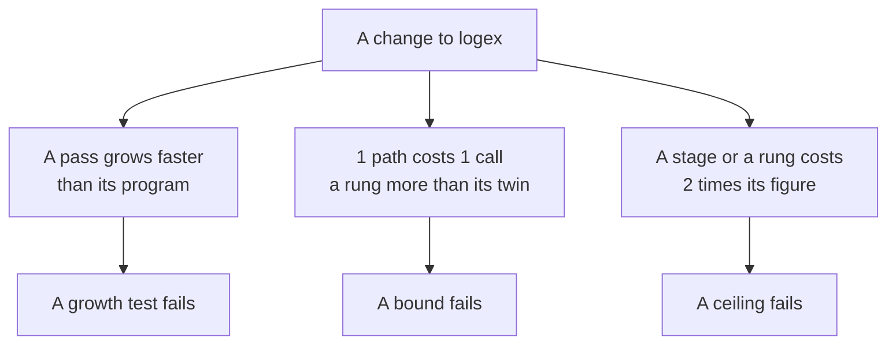

# 0019. Cost in reductions

This record is for a contributor who adds a pass over a [program](../../guides/reference/glossary.md#program), changes a
clause of the evaluator, or sees a cost test fail. It says how the ExUnit tests of logex
hold the cost of a [compile](../../guides/reference/glossary.md#compile), a [scan](../../guides/reference/glossary.md#scan), a [cycle](../../guides/reference/glossary.md#cycle) and a
[round](../../guides/reference/glossary.md#round), and why. The rules are these:

- A test counts [reductions](../../guides/reference/glossary.md#reduction), never time.
- A growth test compares 1 program at 2 sizes.
- A bound compares a program with a twin, counted in the same run.
- A ceiling holds each stage under 2 times a figure recorded with the test.

A twin is a second program that makes the same calls as the first, as often, except on the
path that the test guards. "Test" on this page is an ExUnit test of the suite, never the
step of an online edit.

[The cost of a stage in reductions](../implementation/testing-cost.md) gives each cost test
and its figures. `CONTRIBUTING.md`, in
[Things that will bite you](../../CONTRIBUTING.md#things-that-will-bite-you), gives the
steps to write a cost test.
[Runs and tables of the records: cost](../implementation/record-runs-cost.md#0019-cost-in-reductions) gives the words of this record, the
measurements and each option not taken.
[Runs and tables of the records: the ceilings of cost](../implementation/record-runs-cost-ceilings.md#0019-cost-in-reductions-the-ceilings-and-a-run)
gives the ceilings, their figures and a run of its rules.

> #### Caution {: .error}
>
> Do not make a bound or a ceiling wider to make a test pass. A cost test that fails
> shows a change of cost. Find the change first. Raise a figure only for 1 of these:
>
> - a change that makes its stage dearer on purpose
> - a toolchain release that moves the figure past its ceiling
>
> Give the cause and the size in the commit.

## Status

Accepted. Decision 357 replaces the exact counts that the tests held before the review
after Milestone 6. Decisions 459 and 481 add the ceilings. Decisions 458, 460 and 463
settle 3 questions about the bounds: a lower bound, the allowance, and a bound that no
mutant can fail.

## Date

2026-11-01, the date of decision 357, from the review after Milestone 6. The growth
tests are older: the first is of 2026-09-29, commit `b8a9bd8`. Decisions 190 and 197 are
of 2026-10-22. The last decision of the record, 481, is of 2026-11-08.

## Context

### Time changes with the computer

A test of cost must give the same result on each computer that runs the suite. A CI
runner runs other work on the same cores. On 2026-11-23, 100 scans of the motor took 1.2 ms
to 2.5 ms alone, and 1.0 ms to 159 ms beside 8 busy loops. The count in a large heap was
277,966 reductions each time. Thus a bound in time fails on a busy computer with nothing
wrong.

### A count also moves

A garbage collection costs reductions, and the collections depend on what ran before.
Thus a busy computer moves a count. A change in the VM, a large map or a trace pattern of another test also
moves a count. The page of the runs gives the counts of each.

### Exact counts

Before decision 357, 20 tests held a count exactly, such as `== 27.0` reductions a
[rung](../../guides/reference/glossary.md#rung), or near a figure. The review found 2
problems in them:

- A release of Elixir or OTP that changes the code that the compiler makes moves a count
  by 1 reduction a rung. The tests then fail with no change to logex.
- A change that makes logex cheaper also fails them.

### Cost is part of the design

Some decisions of logex choose a design for its cost in reductions:

- **Decision 190.** A check of an arithmetic destination made a scan 13 % to 28 % dearer.
  It runs only where a program is first handed in, for example at
  `Logex.Runtime.instance/1`. A test of `runtime_test.exs` traces it.
- **Decision 197.** The compiled program carries the unit of each
  [timer](../../guides/reference/glossary.md#timer) in its field `units`. A [routine](../../guides/reference/glossary.md#routine) with no long timer has
  `units: nil`, and a clause head matches it with no look-up. A bound of
  `long_timer_test.exs` holds this saving.

A test of such a saving must fail when the saving goes. It must not fail when a
toolchain or a later saving moves the count.

[IEC 61131-3](../../guides/reference/glossary.md#iec-61131-3) and [Logix](../../guides/reference/glossary.md#logix) give no rule for this. It is a rule
for the tests of logex.

## Decision

### The 3 kinds of cost test

| Kind | Compares | Catches | Does not catch |
|---|---|---|---|
| Growth test | 1 program at 2 sizes | A pass that grows faster than its program | A pass that its program does not reach |
| Bound | A program and its twin | 1 call more a rung on 1 path | A cost that both twins pay |
| Ceiling | A stage and its figure | A stage or a rung at 2 times its figure | A slowdown of less than 2 times |

Most tests make each count in a new process, with a heap so large that no garbage
collection runs, `min_heap_size: 8_000_000`. A test counts several times and keeps the
least. To compare 2 counts, it makes them as a pair, repeats the pair, and keeps the least
difference. The growth tests of `logex_test.exs` also count in the default heap. The
ceiling of the round counts the process of the [runner](../../guides/reference/glossary.md#runner), less the cost of the
manual [clock](../../guides/reference/glossary.md#clock).

This diagram shows which test fails for each kind of change of cost:

Figure: the cost test that fails for each kind of change. A change can fail more than 1
kind. A change of the toolchain moves both twins alike, and a stage by much less than 2
times. Thus it fails none of them.

### Growth tests

A growth test does the same work at 2 sizes, and holds the ratio of the 2 counts under a
bound. `logex_test.exs` compiles 1 program at 500 names and at 2,000 names. A linear
compile grows about 4 times. A pass that walks each use for each tag grows about 14
times. The warnings did that in commit `a34fa87`, and the suite stayed green for 7
commits.

A growth test reads a ratio, so a toolchain that moves each count does not change its
result. Its bound is a fifth more than the highest ratio of 96 runs, alone and beside 2 or
4 other suites.

### Bounds against a twin

Decision 357 replaces each exact count with a bound against a twin. The test counts the
program and its twin in the same run of the same VM. A change of the toolchain moves both
counts. Only a change to the guarded path moves the difference.

A bound is the count of the twin, plus the difference that the twins measured when a
contributor wrote the test, plus an allowance. The allowance is half a reduction for each
rung, key, [point](../../guides/reference/glossary.md#point) or [instance](../../guides/reference/glossary.md#instance) (decision 460). A count moves by
hundredths of a reduction a rung as the maps of a larger program grow. The least
regression is 1 call a rung. Thus half a reduction lets the hundredths pass and catches
the call. A test that counts in groups lets each group move by 1 reduction.

The allowance is never half of the guarded work. RV-7 first set it so, and its review
found 2 regressions that passed.

The twin depends on what selects the guarded path, such as the head of a clause or the
shape of an operand. A twin beside the feature does the guarded work itself, so the bound is a lower
bound on that work. A saving then fails it, and that commit restates the bound
(decision 458). For 1 bound of `retain_edit_test.exs`, no mutant makes 1 twin dearer and
not the other. The test stays as a statement of the rule (decision 463).

### Ceilings

A bound does not see a cost that both twins pay. If each instruction costs 1 call more,
each bound stays green. Decision 459 adds 1 ceiling for each stage, in
`ceiling_test.exs`. Each ceiling holds a stage under 2 times a figure recorded with the
test. The stages run on `examples/motor.ld` and on [plant](../../guides/reference/glossary.md#plant)
`examples/plant.logex`.

Most of the cost of a whole stage is the fixed work of each call and each tag. Thus each
stage also has a ceiling for 1 rung (decision 481). The test counts the motor with its 5
rungs written 16 times over, less the same over 8 times, and divides by 40.

A ceiling is the only cost test of logex that compares a count with a recorded figure. The
factor 2 is wide on purpose. A toolchain can move each item by 1 or 2 reductions, which
moves the cost of 1 rung by up to a quarter. A ceiling catches a stage or a rung at 2
times its figure. It does not catch 1 call more: a bound catches that.

### What a failure says

Each kind of cost test fails with its own message:

- **A growth test** gives the ratio: "4x the instructions took Rx the reductions". Look
  for a new pass that grows faster than its program.
- **A bound** gives the 2 counts. Look at the clause or the walk that only 1 twin runs.
- **A ceiling** gives the stage, the count and the figure. Look for a change that each
  rung, each call or each tag pays.

### How a figure changes

A figure changes only in the commit that adds a ceiling or raises it. That commit counts
the stage again and replaces the figure, never the factor 2. It gives the cause and the
size.

## Consequences

The good results:

- A release of Elixir or OTP that moves code generation by a reduction or 2 an item
  fails no cost test.
- A change that makes logex cheaper fails no bound, except a lower bound of decision
  458, which the same commit restates.
- A count in a large heap is the same on a busy CI runner and on an idle computer.
- Each bound names the path that it guards, and a failure points at that path.
- A slowdown of each path alike fails a ceiling at 2 times its figure.

The costs:

- A contributor must choose each twin, and check it with a mutant.
- A regression of less than half a reduction a rung passes a bound.
- A slowdown of each path alike of less than 2 times passes each test. A mutant of 20
  reductions an item made 100 scans 1.61 times as dear, and passed the whole stage.
- A growth bound needs many runs, alone and with suites at the same time.
- A count can move away from its figure with no test failing. On 2026-11-23 the round
  counted 1,706 to 1,718 against its figure of 1,662.

## Alternatives considered

| Alternative | Why logex does not use it |
|---|---|
| A bound in time | 8 busy loops changed the time of the same work from 1 ms to 159 ms |
| Exact counts, `== 27.0` | A toolchain release or a saving fails them with nothing wrong |
| A count within a delta of a figure | The same problem, with a margin that a toolchain can pass |
| An allowance of half the guarded work | Regressions under that half passed. Decision 460 takes half a reduction a rung |
| No ceiling, option (a) of decision 459 | A slowdown that both twins pay passes each bound, even a large one |

The page of the runs gives each other option not taken.

## The decisions that this record sums up

This record sums up these decisions of
[`docs/organisation.md`](../organisation.md#7-decisions):

- 190 and 197: a cost measured at each scan or run decides a design.
- 357: each exact count becomes a bound against a twin counted in the same run.
- 458, 460 and 463: the lower bound, the allowance and a bound that no mutant fails.
- 459 and 481: 1 ceiling for each stage, whole and for 1 rung.

`PLAN.md` keeps the history: RV-7, with its census of the 20 tests, and RV-17. The rules
of a count are in
[`CONTRIBUTING.md`](../../CONTRIBUTING.md#things-that-will-bite-you). Each rule there
gives its figures. Other records cite this one:
[0009. Clauses, not conditionals](0009-clauses-not-conditionals.md) for the cost of a
catch, and [0020. Verify by a run](0020-verify-by-executing.md) for the mutants.
