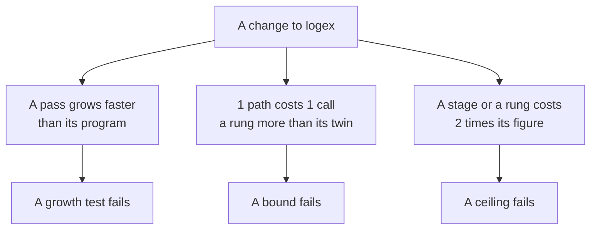

# 0019. Cost in reductions

This record is for a contributor who adds a pass over a
[program](../../guides/reference/glossary.md#program), changes a clause of the evaluator,
or sees a cost test fail. It says how the tests of logex hold the cost of a
[compile](../../guides/reference/glossary.md#compile), a
[scan](../../guides/reference/glossary.md#scan), a
[cycle](../../guides/reference/glossary.md#cycle) and a
[round](../../guides/reference/glossary.md#round), and why. The rules are these:

- A test counts [reductions](../../guides/reference/glossary.md#reduction), never time.
- A growth test compares 1 program at 2 sizes.
- A bound compares a program with a twin, counted in the same run.
- A ceiling holds each stage under 2 times a figure recorded with the test.

[The test strategy](../implementation/testing-strategy.md) gives the other tests of the
suite, and [The cost of a stage in reductions](../implementation/testing-cost.md) gives
each cost test and its figures. `CONTRIBUTING.md`, in
[Things that will bite you](../../CONTRIBUTING.md#things-that-will-bite-you), gives the
steps to write a cost test. It also gives each rule of cost with the figures of each
review.

These words have 1 meaning on this page:

| Word | Meaning on this page |
|---|---|
| Stage | 1 of the 4 kinds of work that a ceiling holds: a compile, a scan, a cycle or a round |
| Count | The reductions of 1 process from the start of some work to its end |
| Growth test | A test that does the same work at 2 sizes and holds the ratio of the 2 counts |
| Twin | A second program that makes the same calls as the first, as often, except on the path that the test guards |
| Bound | A test that holds the count of a program to the count of its twin, made in the same run of the suite |
| Allowance | What a bound adds to the difference that the twins measured, so that a small move of a count passes |
| Ceiling | A test that holds a stage under 2 times its figure |
| Figure | A count recorded in the test file, with the date and the toolchain |
| Item | 1 instruction or 1 [branch](../../guides/reference/glossary.md#branch) of a rung, as the evaluator runs it |
| Mutant | A copy of logex with 1 change, made to see which test fails |
| Test | An ExUnit test of the suite. This record does not use the word for the step of an online edit |

> #### Caution {: .error}
>
> Do not make a bound or a ceiling wider to make a test pass. A cost test that fails
> shows a change of cost. Find the change first. Raise a figure only for 1 of these:
>
> - a change that makes its stage dearer on purpose
> - a toolchain release that moves the figure past its ceiling
>
> Give the cause and the size in the commit.

## Status

Accepted. Decision 357 replaces the exact counts that the tests held before the review
after Milestone 6. Decisions 459 and 481 add the ceilings. Decisions 458, 460 and 463
settle 3 questions about the bounds: a lower bound, the allowance, and a bound that no
mutant can fail.

## Date

2026-11-01, the date of decision 357, from the review after Milestone 6. The growth
tests are older: the first is of 2026-09-29, commit `b8a9bd8`. Decisions 190 and 197 are
of 2026-10-22. The last decision of the record, 481, is of 2026-11-08.

## Context

### Time changes with the computer

A test of cost must give the same result on each computer that runs the suite. A CI
runner runs other work on the same cores. The time of the same work then changes a lot.

A run on 2026-11-23 counted 100 scans of `motor.ld` with its 5 rungs written 16 times
over. Each line gives 2 runs of 9 counts each, in a new process with a large heap:

| Computer | Reductions | Time |
|---|---|---|
| 4 cores, no other work | 277,966 in each count | 1.2 ms to 2.5 ms |
| 4 cores, 8 busy loops | 277,966 in each count | 1.0 ms to 159 ms |

Thus a bound in time fails on a busy computer with nothing wrong. In a heap where no
garbage collection runs, the count did not change.

### A count also moves

A count is not the same in each process. A garbage collection costs reductions, and the
collections depend on what ran before. The same run counted the same 100 scans 9 times in
each of 3 places:

| Where the script counts | The 9 counts |
|---|---|
| A new process with `min_heap_size: 8_000_000` | 277,956 each time |
| A new process with the default heap | 278,976 each time |
| The process of the script, 1 count after the other | 278,103 to 278,629 |

The count of the first table is 10 more, because that script also called
`System.monotonic_time/1` 2 times in the counted work.

A busy computer also moves a count, through its garbage collections. The growth test of
`logex_test.exs` gave these ratios in 4 counts alone, and in 12 counts with 8 busy loops:

| Heap | Alone | 8 busy loops |
|---|---|---|
| A large heap: 1 major collection | 4.06 to 4.07 | 4.07 to 4.16 |
| The default heap: many collections | 4.01 to 4.02 | 4.02 to 4.10 |

In earlier reviews, with 4 suites that ran at the same time, the ratio in the process
of the test got to 7.29. These 3 things also move a count:

- A change in the VM moves a count by a few reductions, for example when other modules
  compile.
- A large map can cost a different count each time that a function makes it. On
  2026-11-23, a map of 256 keys cost 147 to 166 reductions in 300 counts. A map of 64
  keys cost 39 each time.
- A trace pattern that 1 test sets changes the count of each other process that calls
  the traced function.

### Exact counts

Before decision 357, some tests held a count exactly, for example `== 27.0` reductions a
[rung](../../guides/reference/glossary.md#rung). Others held a count within a few
reductions of a figure recorded at a commit. The review after Milestone 6 counted about
27 such tests. The census of RV-7, the plan item that made decision 357, found 20: 9
exact and 11 within a few reductions. The review found 2 problems in them:

- A release of Elixir or OTP that changes the code that the compiler makes moves a count
  by 1 reduction a rung. The tests then fail with no change to logex.
- A change that makes logex cheaper also fails them.

A probe of RV-7 charged 2 reductions more for each
[instruction](../../guides/reference/glossary.md#instruction) that a scan runs. On the
exact counts, this probe failed 6 test files. The same probe for each instruction that
the compiler lowers failed 2 files. For each instruction that the walk of the
[warnings](../../guides/reference/glossary.md#warning) reads, it failed 4 files.

### Cost is part of the design

Some decisions of logex choose a design for its cost in reductions:

- **Decision 190.** A check looks for an arithmetic destination with no integer
  [type](../../guides/reference/glossary.md#type). Run at each call, it made a scan 13 %
  to 28 % dearer. It runs only where a program is first handed in, for example at
  `Logex.Runtime.instance/1`. A test of `runtime_test.exs` traces the check: it runs
  where a [host](../../guides/reference/glossary.md#host) hands in a program, and on
  no scan.
- **Decision 197.** A look-up of the unit of each
  [timer](../../guides/reference/glossary.md#timer) at each run made a scan of 2,000
  timers about 3 % dearer. The compiled program carries the units in its field `units`. A
  [routine](../../guides/reference/glossary.md#routine) with no long timer has
  `units: nil`, and a clause head matches it with no look-up. The test "a plain
  routine's timers pay nothing for their units" of `long_timer_test.exs` holds this
  saving with a bound.

A test of such a saving must fail when the saving goes. It must not fail when a
toolchain or a later saving moves the count.

[IEC 61131-3](../../guides/reference/glossary.md#iec-61131-3) and
[Logix](../../guides/reference/glossary.md#logix) give no rule for this. It is a rule for
the tests of logex.

## Decision

### The 3 kinds of cost test

| Kind | Compares | Catches | Does not catch |
|---|---|---|---|
| Growth test | 1 program at 2 sizes | A pass that grows faster than its program | A pass that its program does not reach |
| Bound | A program and its twin | 1 call more a rung on 1 path | A cost that both twins pay |
| Ceiling | A stage and its figure | A stage or a rung at 2 times its figure | A slowdown of less than 2 times |

Most tests make each count in a new process, with a heap so large that no garbage
collection runs, `min_heap_size: 8_000_000`. A test counts several times and keeps the
least. To compare 2 counts, it makes them as a pair, 1 after the other, repeats the pair,
and keeps the least difference. There are 2 exceptions:

- The growth tests of `logex_test.exs` count in a heap of 4,000,000 words, and again in
  the default heap.
- The ceiling of the round counts the process of the
  [runner](../../guides/reference/glossary.md#runner). It subtracts the cost of the
  synchronisation of the manual [clock](../../guides/reference/glossary.md#clock), which a round does not pay.

This diagram shows which test fails for each kind of change of cost:



Figure: the cost test that fails for each kind of change. A change can fail more than 1
kind. A change of the toolchain moves both twins alike, and a stage by much less than 2
times. Thus it fails none of them.

### Growth tests

A growth test does the same work at 2 sizes. It holds the ratio of the 2 counts under a
bound. `logex_test.exs` compiles 1 program at 2 sizes, 4 times apart: 500 names and 2,000
names. Each name has 3 [tags](../../guides/reference/glossary.md#tag). The test holds the
ratio under 5.40 in a large heap and under 7.43 in the default heap.

A linear compile grows about 4 times. A pass that walks each use for each tag grows
about 14 times. The warnings did that in commit `a34fa87`, and the suite stayed green
for 7 commits.

A growth test reads a ratio, not a figure. Thus a toolchain that moves each count by a
few reductions does not change its result. Its bound is a fifth more than the highest
ratio of 96 runs. Of these runs, 32 ran alone, 32 with 2 suites at the same time and 32
with 4. The busy runs give the highest ratios.

### Bounds against a twin

Decision 357 replaces each exact count with a bound against a twin. The test counts the
program and its twin in the same run of the same VM. A change of the toolchain moves both
counts. Only a change to the guarded path moves the difference.

`tag_bit_test.exs` is an example. It holds a
[contact](../../guides/reference/glossary.md#contact) on a
[bit](../../guides/reference/glossary.md#bit) whose number is in a tag. That bit needs a
catch in the evaluator. A run on 2026-11-23 gave these counts for each rung, the
difference of 200 rungs and 100 rungs over 100. The tag `off` is 0 and each
[input](../../guides/reference/glossary.md#input) is 1:

| Operand | After `xic off` | Alone |
|---|---|---|
| `w.[n]` | 30.0 | 35.0 |
| `w.3` | 29.0 | 27.0 |
| `a` | 29.0 | 24.0 |

For example, the first cell is the rung `xic off xic w.[n] ote q`. After `xic off`, the
rung is a [false rung](../../guides/reference/glossary.md#false-rung). No instruction
reads its [operand](../../guides/reference/glossary.md#operand). Thus the false rungs
differ by the catch alone, 1 reduction. The test asserts that each plain false rung costs
at least 0.5 less than the caught false rung. If the evaluator also catches on the rung
with `w.3`, the 2 costs are the same, and the test fails.

The [true rungs](../../guides/reference/glossary.md#true-rung) alone differ by 8: the read of `n`, the mask and the catch. A bound is the
count of the twin, plus the difference that the twins measured when a contributor wrote
the test, plus an allowance:

<!-- fragment: the bound of a bit whose number is in a tag, from tag_bit_test.exs -->
```elixir
assert tag_bit <= literal + 8 + 0.5
```

Here `literal` is 27, the count of `xic w.3 ote q`, and `tag_bit` is the count of
`xic w.[n] ote q`.

The allowance is half a reduction for each rung, key,
[point](../../guides/reference/glossary.md#point) or
[instance](../../guides/reference/glossary.md#instance) (decision 460). A count moves by
hundredths of a reduction a rung as the maps of a larger program grow, for example 58.02
against 58.0. The least regression is 1 call a rung. Thus half a reduction lets the
hundredths pass and catches the call. A test that counts in groups lets each group move by 1
reduction, because the count of a group moves by about a tenth. An example is the group of
4 [globals](../../guides/reference/glossary.md#global) of a [restart](../../guides/reference/glossary.md#restart) in
`located_array_test.exs`, whose [output](../../guides/reference/glossary.md#output) point is an
[element](../../guides/reference/glossary.md#element) of a located
[array](../../guides/reference/glossary.md#array).

The allowance is never half of the guarded work. RV-7 first set it so. Its review then
found 2 regressions that passed:

- a walk of the keys, of 1 reduction a key, under a margin of 11
- a look-up of a [storage bit](../../guides/reference/glossary.md#storage-bit), of 9 reductions a rung, under a margin of 29

The twin depends on what selects the guarded path:

- **The head of a clause.** Twin: the same rung made false, with an operand that does not
  take the clause. Example: `tag_bit_test.exs`.
- **The shape of an operand.** Twin: the same rungs with the other shape. Example: a tag
  against a [literal](../../guides/reference/glossary.md#literal) [subscript](../../guides/reference/glossary.md#subscript) of an element,
  in `array_test.exs`.
- **A field that is `nil` when the program has no such feature.** Twin: the same program
  beside the feature. Example: a `move` beside a `real`, in `real_test.exs`.
- **A clause that each program takes.** Twin: an instruction whose clause makes the same
  calls. Example: an `add` against a `div`, in `real_test.exs`.
- **A path of the compile.** Twin: the same rungs in a different order, or over plain
  tags. Example: `compile_total_test.exs`.

A twin beside the feature (the 3rd item) does the guarded work itself. The bound then
holds the whole difference, and it is a lower bound on that work. A change that makes the
feature cheaper fails the bound with nothing wrong. That commit restates the bound, so
that its diff shows the saving (decision 458).

For 1 bound, no mutant makes 1 twin dearer and not the other. `retain_edit_test.exs`
holds that the [switch](../../guides/reference/glossary.md#switch) of an
[online edit](../../guides/reference/glossary.md#online-edit) of programs marked
`non_retain` costs no more than the switch of an edit of unmarked programs. No change
found makes 1 side dearer and not the other. The test stays as a statement of the rule.
Its comment gives this reason (decision 463).

### Ceilings

A bound does not see a cost that both twins pay. If each instruction costs 1 call more,
each bound stays green, even for a large slowdown. Decision 459 adds 1 ceiling for each
stage, in `ceiling_test.exs`. Each ceiling holds a stage of the motor and of the
[plant](../../guides/reference/glossary.md#plant) of `README.md` under 2 times a figure
recorded with the test.

Most of the cost of a whole stage is the fixed work of each call and each tag. The rungs
are a small part. Thus each stage also has a ceiling for 1 rung (decision 481).

The test counts the stage over the motor with its 5 rungs written 16 times over, less the same
over 8 times. It divides the difference by 40. The tags are the same at both sizes, so
the result is the work of 1 rung. Thus `ceiling_test.exs` holds 8 ceilings in 4 tests:

| Stage | Figure | 1 rung |
|---|---|---|
| Compile `motor.ld` | 8,649 | 999.2 |
| 100 scans of the motor | 44,606 | 3,110.0 |
| 100 cycles of the plant | 83,262 | 3,762.9 |
| 1 round of the plant | 1,662 | 37.5 |

The figures are of 2026-11-07 and 2026-11-08, on Elixir 1.20.4 and OTP 28. Counts made
by `mix run` on 2026-11-23, on the same toolchain, gave these ratios to the figures:

| Stage | Whole | 1 rung |
|---|---|---|
| Compile | 8,712: 1.007 | 999.3: 1.000 |
| Scans | 44,706: 1.002 | 3,109.975: 1.000 |
| Cycles | 83,386: 1.001 | 3,762.975: 1.000 |
| Round | 1,706 to 1,718: 1.03 | 37.52 to 37.55: 1.00 |

A ceiling is the only cost test of logex that compares a count with a recorded figure.
The factor 2 is wide on purpose. A toolchain can move each item by 1 or 2 reductions.
That moves a whole stage by a few percent, and the cost of 1 rung by up to a quarter. A
saving lowers both. Neither fails a ceiling.

Mutants of `series/3` in `Logex.Runtime` show the 2 ceilings of the scans. That function
runs the items of a rung. Each mutant charged each item more reductions with
`:erlang.bump_reductions/1`. The counts are of a run on 2026-11-23, with the ratio to the
figure. A count in bold fails its ceiling:

| Each item | 100 scans | 1 rung |
|---|---|---|
| +0 | 46,006: 1.03 | 3,370.0: 1.08 |
| +2 | 48,606: 1.09 | 3,889.7: 1.25 |
| +20 | 71,881: 1.61 | **8,561.9: 2.75** |
| +60 | **123,649: 2.77** | **18,914.1: 6.08** |

The mutant of +0 adds only 1 call of `:erlang.bump_reductions(0)` to each item. The
mutant of +20 makes each rung almost 3 times as dear. The whole stage stays under its
ceiling, and the ceiling of 1 rung fails. That mutant also fails the ceilings of 1 rung
of the cycles and of the round. Only the compile passes, which runs no rung.

The mutant of +2 is the probe of RV-7. On the bounds, the 350 tests of the same 6 files
pass: `tag_bit_test.exs`, `tag_subscript_test.exs`, `array_test.exs`, `real_test.exs`,
`element_bit_test.exs` and `instance_array_test.exs`. The 4 tests of `ceiling_test.exs`
also pass.

A ceiling catches a stage or a rung that costs 2 times its figure or more. It does not
catch 1 call more. A bound catches that. A mutant added a call of
`:erlang.bump_reductions(1)` to the catching clause of a bit whose number is in a tag: 2
reductions more a rung. It failed 1 test of `tag_bit_test.exs` and no ceiling. The call
of `:erlang.bump_reductions(0)` alone, 1 reduction more, also failed that test.

### What a failure says

Each kind of cost test fails with its own message. The message points to the kind of
change:

- **A growth test.** The message gives the ratio. The quadratic warnings of `a34fa87`
  grew 14.2 times. The test gives that ratio as "4x the tags took 14.2x the
  reductions". Look for a new pass, or a walk that copies what it found, that grows
  faster than its program.
- **A bound.** The message gives the 2 counts, for example the first message after this
  list, from the catch mutant. Look at the path that the test names: the clause or the
  walk that only 1 of the 2 twins runs.
- **A ceiling.** The message gives the stage, the count and the figure, for example the
  second message after this list, from the mutant of +20. Look for a change that each
  rung, each call or each tag pays.

<!-- unchecked: the failure of tag_bit_test.exs on the catch mutant, a run of 2026-11-23 -->
```text
a tag's bit took 37.0 a rung, a literal one 27.0
```

<!-- unchecked: a failure of ceiling_test.exs on the mutant of +20, a run of 2026-11-23 -->
```text
the scans cost 8561.875 reductions a rung, at or past its ceiling of twice its figure, 3110.0: a gross slowdown, or a change that makes the stage dearer on purpose, which raises the figure and says why (CONTRIBUTING.md)
```

### How a figure changes

A figure changes only in the commit that adds a ceiling or raises it. That commit counts
the stage again, as the comment of `ceiling_test.exs` says, and replaces the figure,
never the factor 2. It gives the cause and the size. A commit that makes a stage cheaper
can record its new figure, which makes the ceiling lower. It does not have to.
`CONTRIBUTING.md` gives the steps.

### The rules in a run

The script `examples/0019-cost-in-reductions.exs` shows each kind of cost test on the
motor. It reads `motor.ld`, the program of
[Your first program](../../guides/tutorials/first-program.md). Run it from `examples/`.
It prints `true` or `false` for each test, not a count. Thus a toolchain that moves a
count does not change what it prints.

<!-- file: motor.ld -->
```text
var_input start bool
var_input stop bool
var_input overtemp bool
var_input reset bool
var_output motor bool
var_output run_lamp bool
var_output speed_sp dint 1200
var fault bool

( xic start | xic motor ) xio stop ote motor
xic motor ote run_lamp
xic overtemp otl fault
xic reset otu fault
xic fault move 0 speed_sp
```

The ceilings of the scans count these 5 rungs. The ceilings of 1 rung count them 8
times and 16 times over. Like `ceiling_test.exs`, the script makes each instance before
it counts.

```elixir
alias Logex.Runtime

# Counts the reductions of a function, in a new process whose heap no collection visits.
reductions = fn fun ->
  {pid, ref} =
    :erlang.spawn_opt(
      fn ->
        {:reductions, before} = Process.info(self(), :reductions)
        fun.()
        {:reductions, later} = Process.info(self(), :reductions)
        exit({:counted, later - before})
      end,
      [:monitor, min_heap_size: 8_000_000]
    )

  receive do
    {:DOWN, ^ref, :process, ^pid, {:counted, count}} -> count
  end
end

source = File.read!("motor.ld")
[declarations, rungs] = String.split(source, "\n\n")
# The motor with its 5 rungs written `times` over. The tags stay the same.
times_over = fn times -> declarations <> "\n\n" <> String.duplicate(rungs, times) end
compiled = fn text -> fn -> {:ok, _} = Logex.compile(text, name: "motor") end end

# Gives a function that runs 100 scans of 10 ms, with start toggled before each scan.
# It makes the instance before the count, as ceiling_test.exs does.
scans = fn program ->
  instance = Runtime.instance(program)

  fn ->
    Enum.reduce(1..100, instance, fn i, state ->
      state = Runtime.put_inputs(program, state, %{"start" => rem(i, 2)})
      {_outputs, state} = Runtime.scan(program, state, 10)
      state
    end)
  end
end

{:ok, motor} = Logex.compile(source, name: "motor")

IO.puts("1. The same 100 scans of motor.ld, counted 5 times")
counts = for _ <- 1..5, do: reductions.(scans.(motor))
IO.puts("   the 5 counts are equal: #{length(Enum.uniq(counts)) == 1}")

IO.puts("2. A growth test: the compile of 32 copies of the rungs against 8 copies")
# A linear compile gives about 3.7 times. The script allows 4.6, a fifth and more above.
small = reductions.(compiled.(times_over.(8)))
large = reductions.(compiled.(times_over.(32)))
IO.puts("   4 times the rungs cost less than 4.6 times the reductions: #{large < 4.6 * small}")

IO.puts("3. A bound against a twin: 1 rung, 100 times and 200 times, the tag off at 0")
head = "var off bool\nvar_input w word\nvar_input n int\nvar_output q bool\n"

per_rung = fn rung ->
  cost = fn copies ->
    text = head <> String.duplicate(rung <> "\n", copies)
    {:ok, program} = Logex.compile(text, name: "twin")
    instance = Runtime.instance(program)
    reductions.(fn -> Runtime.scan(program, instance, 0) end)
  end

  (cost.(200) - cost.(100)) / 100
end

plain = per_rung.("xic off xic w.3 ote q")
caught = per_rung.("xic off xic w.[n] ote q")
IO.puts("   the rung with w.[n] costs at least 0.5 more a rung: #{plain <= caught - 0.5}")

IO.puts("4. A ceiling: 100 scans under twice the figure 44606")
IO.puts("   under the ceiling: #{Enum.min(counts) < 2 * 44_606}")
```

```console
$ mix run 0019-cost-in-reductions.exs
1. The same 100 scans of motor.ld, counted 5 times
   the 5 counts are equal: true
2. A growth test: the compile of 32 copies of the rungs against 8 copies
   4 times the rungs cost less than 4.6 times the reductions: true
3. A bound against a twin: 1 rung, 100 times and 200 times, the tag off at 0
   the rung with w.[n] costs at least 0.5 more a rung: true
4. A ceiling: 100 scans under twice the figure 44606
   under the ceiling: true
```

A copy of the script printed its counts in 3 runs on 2026-11-23, on Elixir 1.20.4 and
OTP 28. Other runs give about the same values:

| Result | The counts |
|---|---|
| 1 | 44,706 in each of the 5 counts |
| 2 | 43,678 for 8 copies, 163,588 for 32 copies: 3.75 times |
| 3 | 29.0 a rung plain, 30.0 a rung with `w.[n]` |
| 4 | 44,706, under 89,212 |

## Consequences

The good results:

- A release of Elixir or OTP that moves code generation by a reduction or 2 an item
  fails no cost test. The probe of 2 reductions an item passed the 4 tests of
  `ceiling_test.exs` and the 350 tests of 6 test files of bounds.
- A change that makes logex cheaper fails no bound, except a lower bound of decision
  458, which the same commit restates.
- A count in a large heap is the same on a busy CI runner and on a computer with no
  other work. A growth test reads a ratio that a busy computer moves a little, under a
  bound a fifth more than the highest busy run.
- Each bound names the path that it guards. A failure points at that path.
- A slowdown of each path alike, which no bound sees, fails a ceiling when it gets to 2
  times its figure.

The costs:

- A twin must make each call of the program as often. A contributor must choose and
  check it, with a mutant, for each new bound.
- A regression of less than half a reduction a rung passes a bound.
- A slowdown of each path alike of less than 2 times passes each test. For example, a
  mutant of 20 reductions an item made 100 scans 1.61 times as dear and passed the
  ceiling of the whole stage.
- A twin that does the guarded work gives a lower bound. A saving in that work fails it.
- A count needs care: a new process, a large heap, the least of several counts, pairs.
  The count of a round holds all the work of the runner process in it, the messages that
  it receives included. The test subtracts the cost of the messages of the manual clock.
- A growth bound needs many runs, alone and with suites at the same time, before a
  commit adds it.
- The figures of the ceilings stay in the test file. A count can move away from its
  figure with no test failing. On 2026-11-23 the round counted 1,706 to 1,718 against its
  figure of 1,662.

## Alternatives considered

| Alternative | Why logex does not use it |
|---|---|
| A bound in time | 8 busy loops changed the time of the same work from 1 ms to 159 ms |
| Exact counts, `== 27.0` | A toolchain release or a saving fails them with nothing wrong |
| A count within a delta of a figure | The same problem, with a margin that a toolchain can pass |
| An allowance of half the guarded work | Regressions under that half passed. Decision 460 takes half a reduction a rung |
| Half the work as the margin of a lower bound, option (b) of decision 458 | It passes each regression under that half. Decision 458 holds the whole difference |
| A seam in `lib/` that skips the guarded clause, option (c) of decision 458 | It adds code to `lib/` for the tests only |
| No allowance, option (c) of decision 460 | The hundredths that a count moves fail the bound |
| A count of the calls, with `:erlang.trace_pattern/3`, option (c) of decision 459 | A trace pattern changes the counts of each other process |
| No ceiling, option (a) of decision 459 | A slowdown that both twins pay passes each bound, even a large one |
| The whole stage only, on the motor written 16 times over, option (c) of decision 481 | Then the work of each call and each tag is a small part of the figure. A slowdown there gets near to no ceiling |
| A ceiling for 1 rung only, option (b) of decision 481 | The work of each call and each tag, a large part of a stage, then has no ceiling |

## The decisions that this record sums up

This record sums up decisions 357, 458, 459, 460, 463 and 481 of
[`docs/organisation.md`](../organisation.md#7-decisions), and the cost measures of
decisions 190 and 197:

| Decision | What it gives |
|---|---|
| 190 | The check of a program at 1 time only, where it is first handed in, for its cost at each scan |
| 197 | The unit of each timer, carried in the compiled program, for its cost at each run |
| 357 | Each exact count becomes a bound against a twin counted in the same run |
| 458 | A twin that does the guarded work gives a lower bound, restated when the work gets cheaper |
| 459 | 1 ceiling for each stage, under 2 times a recorded figure |
| 460 | The allowance of a bound: half a reduction a rung, a key, a point or an instance |
| 463 | The bound of an edit of programs marked `non_retain` stays, as a statement of the rule |
| 481 | Each stage held whole and for 1 rung |

`PLAN.md` keeps the history: RV-7, with its census of the 20 tests, and RV-17. The rules
of a count are in
[`CONTRIBUTING.md`](../../CONTRIBUTING.md#things-that-will-bite-you). Each rule there
gives its figures. Other records cite this one:
[0009. Clauses, not conditionals](0009-clauses-not-conditionals.md) for the cost of a
catch, and [0020. Verify by a run](0020-verify-by-executing.md) for the mutants.
