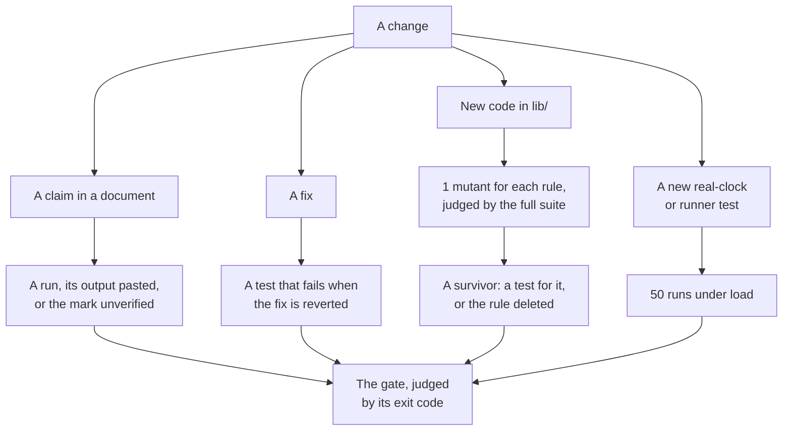

# 0020. Verify by a run

This record is for a contributor who fixes a defect, adds a rule to `lib/` or writes a
test. It is also for a contributor who writes a claim about logex in a document. It says
what a claim or a change needs before it goes into `main`, and why.

This page uses each of these words with 1 meaning only:

| Word | Meaning on this page |
|---|---|
| Claim | A sentence about what logex does: in a document, a comment, a commit or a report |
| Run | The execution of code, with its output and its exit code |
| Test | An ExUnit test of the suite. This record does not use the word for the step of an [online edit](../../guides/reference/glossary.md#online-edit) |
| Rule | 1 clause, guard, fallback, check or call that sorts, in the code of `lib/` |
| Mutant | A copy of logex with 1 rule changed or removed |
| Survivor | A mutant on which the full suite passes. `scripts/mutate.sh` marks it `SURVIVED` |
| Mutation table | 1 row for each mutant: the test files that fail on it, or `SURVIVED` |
| Projection | A value made from the value that a change changes. A defect can leave it the same. An example is the keys of a map in place of its values |
| Walk | A test that draws programs, inputs and calls at random from a seed, and checks each result |
| Oracle | Test code that gives the expected result from the text of a program. It calls no module of logex |
| Reach | The cases that a walk meets in a run. A walk asserts that it meets each case |
| Atom of the reach | 1 named case in the reach of a walk |
| Family of seeds | Seeds that differ in 1 number only, as `{n, 77, 7}` for `n` from 1 to 60 |
| Real-clock test | A test of the [runner](../../guides/reference/glossary.md#runner) on the clock of the machine, not on the manual clock |
| Load run | A run of tests while busy loops hold each core of the machine |

The rules are these:

- A claim is true when a run shows it. Paste the output of the run. If you cannot run
  the claim, mark it `unverified`.
- A fix comes with a test that fails when you revert the fix.
- New code comes with a mutation table: 1 mutant for each rule that the diff adds. The
  full suite must fail on each mutant. A survivor gets a test, or its rule goes. If you
  keep the rule on an argument, the commit says that the argument is all that holds it.
- A walk asserts its reach. It compares each result with an oracle that knows only the
  text of the [program](../../guides/reference/glossary.md#program) and the rules of the
  language.
- A new test on the real [clock](../../guides/reference/glossary.md#clock) runs 50
  times under load before it goes into `main`.

> #### Caution {: .error}
>
> Do not skip, disable, quarantine or weaken a test to get a green run. A red test shows
> a defect in the code or in the test. Find which, and correct it.

[The test strategy](../implementation/testing-strategy.md) gives the steps of each check.
`CONTRIBUTING.md` gives each rule with the commits that broke it, in 3 sections:

- [its first rule](../../CONTRIBUTING.md#the-one-rule), "Verify by executing, not by
  reasoning"
- [the fix and its test](../../CONTRIBUTING.md#a-fix-needs-a-test-that-fails-when-the-fix-is-reverted)
- [a green suite](../../CONTRIBUTING.md#beware-of-a-green-suite)

## Status

Accepted. No later record replaces this record. Decisions 49, 337, 359, 362 to 365, 462,
480 and 498 apply the rule to the tests, the examples and the scripts.

## Date

2026-09-01, the date of `CONTRIBUTING.md` (commit `8d3dd7f`). That file gives the rule
and forbids a skipped test. The decisions of section 7 that this record sums up are of
2026-10-12 to 2026-11-10.

## Context

4 audits of the documents found 1 pattern, which `CONTRIBUTING.md` gives. Each wrong
claim of the documents was "arrived at by reasoning". Each claim that survived "was
executed". The file adds: "A plausible-sounding statement about this codebase is
roughly a coin flip."

The suite was also green on defects that the right test shows in 1 run. Each item of this
list is a commit or a review of the history. M1-3, M1-5 and M5-5 are items of `PLAN.md`.

1. **`3f3b104`**: a fix of 2 defects in 1 regular expression came with no test. Its
   revert left the suite green. Shown by: `b8fc743`, 1 test for each defect.
2. **`690fc2d`**: for an integer
   [literal](../../guides/reference/glossary.md#literal), the evaluator matched the atom
   `:lit_int`, and the parser gave `:int_lit`. The tests of the evaluator typed
   `:lit_int` by hand, so they agreed with the defect. Shown by: a run from source text
   to the result.
3. **The fix of the empty rung**: its first check printed only the result of the
   [scan](../../guides/reference/glossary.md#scan). The result was the same with the
   defect. Shown by: `b65e756`, which asserted the count of rungs.
4. **`ee91fe5`**: 31 mutants, each red, but the clause `on_line(%Tag{line: nil})` that
   the commit added was removable with all 184 tests green. Shown by: a mutant for each
   rule of the diff.
5. **The review of M1-3**: 52 of 112 mutants survived. Shown by: a mutation table of
   each rule (`0e83b5f`).
6. **The review of M1-5**: 15 rules that no test failed without, 12 of them in the code
   of M1-5. Shown by: a mutation table of each rule. `b8a9bd8` added the tests.
7. **`3e45ea8`**: the commit kept a survivor on an argument that its case cannot occur.
   Shown by: the next walk, under the seed `{2, 2, 2}`, which met the case. `c1e5d54`
   added the test.
8. **`02d555e`**: the contract walk failed each mutant of its table. It never declared a
   `dint` [input](../../guides/reference/glossary.md#input). It never gave 2 of its 9
   kinds of refusal. Thus it caught none of 12 defects off those paths. Shown by: an
   assertion of the reach.
9. **The review of M5-5**: `trip_test.exs` failed while 3 mutation runs held the
   machine. Under 8 busy loops on 4 cores, 6 of 15 runs failed. Shown by: a load run.
   `8cef95b` widened 3 margins of about 100 ms.

Also, the output of `mix test` is not a judgement. Elixir 1.20 prints `Result: 39/40
passed` for a run with 1 failure. A search of the output for `[0-9]+ passed` reads that
line as a pass. Only the exit code judges a run.

[IEC 61131-3](../../guides/reference/glossary.md#iec-61131-3) and
[Logix](../../guides/reference/glossary.md#logix) give no rule for this. It is a rule for
the work on logex.

## Decision

This diagram shows the check that each kind of change needs before it goes into `main`.



Figure: the check of each kind of change. A change can be of more than 1 kind, and it
then needs each check of its kinds.

The same checks as a table:

| Kind of change | The check | What runs it |
|---|---|---|
| [A claim in a document](#a-claim-needs-a-run) | A run, with its output pasted, or the mark `unverified` | You, then the suite for the examples of a page |
| [A fix](#a-fix-needs-a-test-that-fails-when-the-fix-is-reverted) | A test that fails when you revert the fix | The test, by hand |
| [New code in `lib/`](#new-code-needs-a-mutation-table) | 1 mutant for each rule, judged by the full suite | `scripts/mutate.sh` |
| [A new walk](#a-walk-asserts-its-reach) | An assertion of its reach, under 60 seeds or more | The walk itself |
| [A new real-clock test](#a-real-clock-test-runs-under-load) | 50 runs under load | `scripts/load.sh` |
| [Each commit](#ci-cannot-skip-a-gate) | The gate, judged by its exit code | `scripts/gate.sh`, then CI |

### A claim needs a run

Run the claim. Paste the real output of the run. If you cannot run it, mark the claim
`unverified`, as `docs/naming.md` does where its writer did not check a source. Do
not close the gap with a guess. Where a document and the code differ, the code is
correct, and the document changes.

Judge each run by its exit code, never by its output. `scripts/gate.sh`,
`scripts/mutate.sh` and `scripts/load.sh` read the exit code of each `mix test`. Each
deletes the failures manifest of ExUnit before the run, so that the tests it names are
of that run.

A run that fails must name its tests. In Milestone 6, 1 full run in 7 failed 1 test, and
its output named no test: its last line was `Result: 2406/2407 passed`. `scripts/gate.sh`
gives the name of each failed test from the failures manifest, with
`elixir scripts/failed.exs` (decision 337). CI does the same in its test step.

### The checks are files of the repository

The checks of a claim are files under `scripts/` and `test/`, not the notes of a
session. Decision 359 made these checks part of the repository:

- `test/logex/readme_test.exs`, in the default suite, which runs each example of each
  page and compares its output with the page
- `scripts/gate.sh` and `scripts/failed.exs`, the gates and the names of the failed tests
- `scripts/mutate.sh`, the mutation table
- `scripts/load.sh`, the load runs

Each example of each page runs in each run of the suite (decision 362). This includes
the example of README on the real clock. That example prints 1 line of times, which
change from run to run. The suite compares only the first words of that line
(decision 364).

A page also shows each file that its example reads. README shows the
configuration `wired.logex` in a separate block. Thus the
[warning](../../guides/reference/glossary.md#warning) that cites line 7 of that file
cites a line that the reader can see (decision 363).

An `elixir` block that no output follows is a fragment, and the test parses it. The prose
can say what a fragment does. Then the test also makes the setup that the prose
describes, and runs the fragment in that setup. It compares the result with the prose
(decision 365).

### A fix needs a test that fails when the fix is reverted

Check a fix by a revert, not by an argument:

1. Write the test.
2. Revert the fix, and run the test. It must fail.
3. Put the fix back, and run the test. It must pass.

Make each test fail for exactly 1 reason. Commit `3f3b104` fixed 2 defects of the
regular expression of a [tag](../../guides/reference/glossary.md#tag) name. `b8fc743`
added 1 test for each defect, and recorded which test fails on which of 4 forms of the
expression:

| Form of `NAME` | Changed from the first form | The tests that fail |
|---|---|---|
| `[a-zA-Z_][a-zA-Z0-9_]*` | Nothing: the correct form | None |
| `[a-zA-Z_][a-zA-Z0-9_]+` | `+` for `*` | A tag of 1 character |
| `[a-zA-Z_][a-zA-z0-9_]*` | `A-z` for `A-Z` | Brackets in a name |
| `[a-zA-Z_][a-zA-z0-9_]+` | Both | Both tests |

The range `A-z` also takes `[`, `\`, `]`, `^` and the backtick, so `a[3]` is 1 name. A
test of the name `motor` alone passes on all 4 forms. A run on 2026-11-23 tried the 4
expressions with `Regex`. Each form took `motor` as a name. Only the forms with `*` took
`a`, and only the forms with `A-z` took `a[3]`.

Assert on the value that the fix changes, not on a projection of it that the defect
leaves the same. The first check of the empty-rung fix printed only the result of the
scan, which the defect did not change.

A commit that only moves or rewrites tests has no fix to revert. With the commit
reverted, the old tests pass again, and the run shows nothing. Check the commit with the
mutants that the old tests failed.

Where the new test asserts less than the old one, find a mutant that only the dropped
part failed. Apply that mutant, and see the new test fail. For example, `72bee33` rewrote a test of the [coil](../../guides/reference/glossary.md#coil)
`ote` and dropped its check of the
[power flow](../../guides/reference/glossary.md#power-flow). A mutant in which a
de-energised `ote` passes on power then passed the full suite until `b8a9bd8`.

### New code needs a mutation table

New code has no fix to revert. A revert of the whole of a feature fails each test that
calls the feature, whatever the test asserts. Revert each rule instead, 1 at a time. Take
the list of rules from the diff, not from the tests that you wrote. `scripts/mutate.sh`
applies each mutant as a patch, runs the test files that you name and then the full
suite, and restores the tree. It prints 1 row for each mutant.

A mutant counts only by the exit code of the full suite. A mutant that only a real-clock
test fails, or that fails only under load, runs again alone before it counts. A busy
machine can fail a real-clock test that has nothing to do with the mutant.

Give each survivor a test, or delete its rule. If you keep a survivor because of an
argument, say that the argument is all that holds the rule. In `3e45ea8`, the argument
was that the case cannot occur, and the next walk met the case.

### A rule that no public function can see

A [resource](../../guides/reference/glossary.md#resource) keeps 1 copy of each
[global](../../guides/reference/glossary.md#global). Between 2
[cycles](../../guides/reference/glossary.md#cycle), the
[state](../../guides/reference/glossary.md#state) of an
[instance](../../guides/reference/glossary.md#instance) holds no `var_external`. If the
state keeps a copy of a global, the next cycle writes over that copy before a public
function can read it. Thus no public function shows if the rule holds. In the first code
of the rule, a revert of any of the 3 places that drop a global left the suite green.

A test then looks inside the opaque `%Logex.Runtime{}` on purpose (decision 49).
`scheduler_test.exs` asserts that no state holds a global after `start/1`, a cycle and
`restart/2`. On 2026-11-23, `scripts/mutate.sh` ran a mutant on a copy of the repository.
The mutant removes the `Map.drop/2` that takes the globals out of the state after a
cycle. With `-t test/logex/scheduler_test.exs`, the script printed this row:

<!-- unchecked: the row that scripts/mutate.sh printed for the mutant of decision 49, a run of 2026-11-23 -->
```text
| m49.patch | rc=2 Result: 66/67 passed | rc=2 Result: 3841/3845 passed (11/11 doctests, 3830/3834 tests) | test/logex/api_contract_test.exs (2), test/logex/config_edit_test.exs (1), test/logex/scheduler_test.exs (1) |
```

The 4 cells of the row:

- The patch: `m49.patch`.
- The named file: `rc=2 Result: 66/67 passed`.
- The full suite: `rc=2 Result: 3841/3845 passed`. The totals change as the suite
  grows.
- The test files whose tests failed, and for each file the count of its failures:
  `api_contract_test.exs` (2), `config_edit_test.exs` (1) and `scheduler_test.exs` (1).

The failures manifest of that run named these 4 tests. Each reads the instances inside
`%Logex.Runtime{}`:

| Module | What the test asserts |
|---|---|
| `Logex.SchedulerTest` | No state holds a global after `start/1`, a cycle and `restart/2` |
| `Logex.ConfigEditTest` | No state holds a `var_external` after a step of an edit |
| `Logex.ApiContractTest` | A resource whose programs share globals runs as a model of 1 map of globals says |
| `Logex.ApiContractTest` | The edit of a configuration refuses each wrong argument, and the writes of each step rebuild the resource |

No test that uses only the public functions failed. The row also shows why only the exit
code judges a run: `Result: 3841/3845 passed` is a red run.

### A walk asserts its reach

A walk tests only the cases that its draws meet. Thus each walk asserts its reach: each
stage of the [compile](../../guides/reference/glossary.md#compile), each kind of refusal
and each case of each oracle. A walk that does not meet a case fails. On 2026-11-23, the
compile walk of `api_contract_test.exs` ran in a copy of the repository with 20 sources
in place of 2,000. It failed with this message:

<!-- unchecked: the message of the compile walk with 20 sources, a run of 2026-11-23 in a copy of the repository -->
```text
no source reached the message containing "a declaration takes `retain` or `non_retain`, not both"
```

Give each condition of a restated rule an atom of the reach for the case that it
decides. Size the draws of a walk so that its rarest atom occurs 15 times or more in a
run. Then run the walk under 60 seeds or more. Take the seeds from more than 1 family of
seeds, and not from the family that you sized the draws on. The reach assertion must pass at each seed.

A walk over a [rung](../../guides/reference/glossary.md#rung) reaches a
[branch](../../guides/reference/glossary.md#branch) inside a leg of another branch, and
a test asserts that it does. Each mutation table of such a walk has a row for this case.

An oracle restates a rule, and a contributor writes the oracle and the code from the same
design. A misreading of the design then goes into both, and they agree. So a walk also
has checks that do not restate the rule. For example, apply the writes that a report
lists to the state before the step: the result must be the state after the step. With
the restated rules of the oracle turned off, these checks alone still failed 10 of 14
[timer](../../guides/reference/glossary.md#timer) mutants and 14 of 18
[one-shot](../../guides/reference/glossary.md#one-shot) mutants. A rule that neither kind
of check sees gets a separate test, with its values written by hand.

`end_to_end_test.exs` runs source text to a result. Its assertions name no part of the
IR, so it passes only when the lexer, the parser, the compiler and the runtime agree.
Add a test to it when you change what logex does.

### A real-clock test runs under load

A rule of time has a test on `Logex.Runner.Clock.Manual`, a clock that the test moves.
Tests on the clock of the machine are few. Each new real-clock or runner test runs 50
times under load before it goes into `main`, with `scripts/load.sh -n 50` on its file.
Each of the 50 runs must pass.

A real-clock test obeys these rules:

- Give each margin of real time hundreds of milliseconds where the rule lets you.
- Wait for the message that the test needs, not for a fixed time.
- A test can need the reread of 1 [device](../../guides/reference/glossary.md#device)
  at a [restart](../../guides/reference/glossary.md#restart) to wait while a different
  device polls. Hold that reread in the
  [simulated device](../../guides/reference/glossary.md#simulated-device) with
  `Logex.IO.Sim.hold/1`. Let it go with `Logex.IO.Sim.let_go/1` (decision 462).
  `hold/1` holds the next reread only: a read of a poll and a write go on. Do not use a
  sleep.
- The loader tests of many files use the dirty I/O schedulers. They are in
  `loading_test.exs`, which is `async: false`, and no test gets more time
  (decision 480).
- `LogexTest.HeldFileServer` holds the file server of the VM. It stays a separate module
  in `test/logex_test.exs`, with `async: false`, beside the async tests of that file
  (decision 498).

### CI cannot skip a gate

The gate of `CONTRIBUTING.md`, "Before you commit", is 4 commands, each judged by its exit
code. `scripts/gate.sh` runs them in order. CI runs the same 4, then Dialyzer, on each
push and each pull request.

`scripts_test.exs` compares the keys of each step of the CI workflow with a fixed list.
Thus no step has an `if:` or a `continue-on-error:` that can skip a gate or let its
failure pass. On GitHub, a failed suite under `continue-on-error: true` is a green job.

### The rules in a run

The script `examples/0020-verify-by-executing.exs` makes a mutation table for rung 1 of
`motor.ld`, the [seal-in](../../guides/reference/glossary.md#seal-in) of the motor. It
changes the text of the program and not `lib/`, but the method is the same. Run the
script in a Mix project that has logex as a dependency. Put
[`motor.ld`](../../guides/tutorials/first-program.md#step-2-write-the-ladder-program) in
the same directory. Use the project `first` of the tutorial "Your first program", or
`examples/` of the repository, where `examples/mix.exs` gives logex. This is rung 1:

<!-- rung: motor.ld 1 -->


Each mutant changes 1 rule of the rung: the
[leg](../../guides/reference/glossary.md#leg) of the seal-in, the
[contact](../../guides/reference/glossary.md#contact) on `stop` and the coil. The first 3
tests are the tests that a contributor writes with the rung. The 4th test comes after the
first table shows 2 survivors.

```elixir
# A mutation table for rung 1 of motor.ld. Each mutant changes 1 rule of the rung. Each
# test checks 1 fact of the motor. A mutant that no test fails is SURVIVED.
#
#   ( xic start | xic motor ) xio stop ote motor
defmodule Tests do
  alias Logex.Runtime

  # Runs 1 scan for each map of inputs and gives the outputs of the last scan.
  def outputs(program, steps) do
    Enum.reduce(steps, {%{}, Runtime.instance(program)}, fn inputs, {_outputs, state} ->
      inputs = Map.merge(%{"start" => 0, "stop" => 0}, inputs)
      Runtime.scan(program, Runtime.put_inputs(program, state, inputs))
    end)
    |> elem(0)
  end

  # Each test gives true when the program passes it.
  def passes(program, "a scan gives motor"),
    do: Map.has_key?(outputs(program, [%{"start" => 1}]), "motor")

  def passes(program, "start runs motor"),
    do: outputs(program, [%{"start" => 1}])["motor"] == 1

  def passes(program, "motor stays on"),
    do: outputs(program, [%{"start" => 1}, %{}])["motor"] == 1

  def passes(program, "stop stops motor"),
    do: outputs(program, [%{"start" => 1}, %{}, %{"stop" => 1}])["motor"] == 0
end

defmodule Table do
  # 1 line: the program and the tests that fail on it.
  def row({kind, name, program}, tests) do
    failed = Enum.reject(tests, &Tests.passes(program, &1))
    IO.puts("  #{String.pad_trailing(name, 16)} #{verdict(kind, failed)}")
  end

  defp verdict(:original, []), do: "passes each test"
  defp verdict(:mutant, []), do: "SURVIVED"
  defp verdict(_kind, failed), do: "fails: " <> Enum.join(failed, ", ")
end

source = File.read!("motor.ld")
rung = "( xic start | xic motor ) xio stop ote motor"

# Each mutant changes 1 rule of the rung. The list comes from the rung, not from the tests.
mutants = [
  {"no seal-in leg", "xic start xio stop ote motor"},
  {"xic stop", "( xic start | xic motor ) xic stop ote motor"},
  {"no stop contact", "( xic start | xic motor ) ote motor"},
  {"otl motor", "( xic start | xic motor ) xio stop otl motor"}
]

texts =
  [{:original, "motor.ld", source}] ++
    for {name, changed} <- mutants, do: {:mutant, name, String.replace(source, rung, changed)}

programs =
  Enum.map(texts, fn {kind, name, text} ->
    {:ok, program} = Logex.compile(text, name: "motor")
    {kind, name, program}
  end)

first = ["a scan gives motor", "start runs motor", "motor stays on"]

IO.puts("1. The tests written with the rung")
for program <- programs, do: Table.row(program, first)

IO.puts("2. A test added for the survivors")
for program <- programs, do: Table.row(program, first ++ ["stop stops motor"])
```

```console
$ mix run 0020-verify-by-executing.exs
1. The tests written with the rung
  motor.ld         passes each test
  no seal-in leg   fails: motor stays on
  xic stop         fails: start runs motor, motor stays on
  no stop contact  SURVIVED
  otl motor        SURVIVED
2. A test added for the survivors
  motor.ld         passes each test
  no seal-in leg   fails: motor stays on
  xic stop         fails: start runs motor, motor stays on
  no stop contact  fails: stop stops motor
  otl motor        fails: stop stops motor
```

The output shows 4 rules of this record:

- The unchanged program passes each test. A mutation table means something only then.
- `a scan gives motor` fails on no mutant. It asserts a projection: a key of the
  outputs, not the value that the mutant changes.
- In the first table, 2 mutants survive. The 3 tests check that the motor starts and
  stays on. No test checks that `stop` stops it. A list of mutants made from the tests
  does not find this gap. A list made from the rung finds it.
- The 4th test fails on both survivors. With `otl`, the motor stays on after `stop`,
  because `otl` does not change its tag on a
  [false rung](../../guides/reference/glossary.md#false-rung).

A survivor in `lib/` gets the test that it lacks. Make the table again until no mutant
survives. [The test strategy](../implementation/testing-strategy.md)
gives the steps of `scripts/mutate.sh` and `scripts/load.sh`. Then run the gate of
[Before you commit](../../CONTRIBUTING.md#before-you-commit).

## Consequences

The good results:

- A claim in a document or a report comes with the run that shows it. A reader can run it
  again.
- A test that cannot see its defect shows in the mutation table, before a reviewer finds
  it.
- An example that the suite runs cannot go out of date: each run of the suite runs it
  and compares its output. A block marked `unchecked`, such as the 2 recorded runs on
  this page, can.
- A walk with a seed fails the same way on the next run, and its reach shows what it
  does not test.
- A real-clock test meets a busy machine before it goes into `main`, not first in CI.

The costs:

- A mutation table runs the full suite for each mutant. For the mutant of decision 49,
  the full suite took 334 s on 2026-11-23.
- A load run of 50 runs takes 50 times the run of its test file. It holds each core of
  the machine for that time.
- The examples of the pages add their time to each run of the suite. On 2026-11-23,
  `readme_test.exs` alone ran 732 tests in 32 s, on a machine with other work.
- A walk with a large draw and its reach under 60 seeds take time to write and to run.
- A test that looks inside an opaque structure, as for decision 49, fails when the
  structure changes, with no defect.
- A survivor kept on an argument stays a gap that no run closes.

## Alternatives considered

| Alternative | Why logex does not use it |
|---|---|
| Take a claim as true on an argument | The audits found each wrong claim of the documents to be a claim made by an argument |
| 1 test that a feature works | A test of the name `motor` alone passes on all 4 forms of the regular expression, 3 of them wrong |
| Revert the whole of a feature to check its tests | Each test that calls the feature fails, whatever it asserts |
| Judge a mutant by the named test files only | In the work of record 0009, a mutant passed the 39 tests of the 2 test files of the evaluator. It failed 34 tests of the full suite |
| Keep a survivor because its case cannot occur | The case of `3e45ea8` occurred in the next walk |
| A walk with no assertion of its reach | The walk of `02d555e` failed each mutant of its table and caught none of 12 defects off its paths |
| Read the output of `mix test` | `Result: 39/40 passed` reads as a pass |
| A sleep in a real-clock test, or the timing of the machine (decision 462) | A sleep of 800 ms met no poll in 3 runs of 100 under load |
| More time for a slow test (decision 480) | The loader tests run alone instead, so that no other test uses their schedulers at the same time |
| The examples of the pages only in CI, or the suite without the real-clock example (decision 362) | A change that breaks an example then passes the suite on the computer of the contributor |
| A range for each figure of the real-clock example (decision 364) | A range that finds a runner that stalls can fail on a busy machine with no defect |
| A fragment of a page parsed and never run (decision 365) | A fragment can parse and do nothing that its prose says |
| The rule of 1 copy of each global seen only through the public functions (decision 49) | In the first code of the rule, a revert of any of the 3 places that drop a global left the suite green |
| A state that keeps a copy of a global, written again at each cycle (decision 49) | A drop is 1 line, and a refactor can lose it. The [switch](../../guides/reference/glossary.md#switch) of an online edit of a [configuration](../../guides/reference/glossary.md#configuration), decision 45, needs the 3 drops |
| Skip or quarantine a test that fails | A skipped test hides the defect that it shows |

## Decisions in section 7

This record sums up these decisions of
[`docs/organisation.md`](../organisation.md#7-decisions). It also sums up the 3 sections
of `CONTRIBUTING.md` that the start of this record names:

| Decision | What it gives |
|---|---|
| 49 | A test that looks inside the opaque resource for the rule of 1 copy of each global |
| 337 | The gate names each failed test from the failures manifest of ExUnit |
| 359 | The checks become files of the repository: the test of the examples and 4 scripts |
| 362 | The examples of the pages run in each run of the suite |
| 363 | `wired.logex` is a block of its page, not a file that the test makes |
| 364 | The suite compares the line of figures of the real-clock example by its first words |
| 365 | The test runs the fragment of a page in the setup that its prose describes, and compares the result with the prose |
| 462 | `Logex.IO.Sim` holds a restart's reread until the test lets it go |
| 480 | The loader tests of many files run alone, in `loading_test.exs` |
| 498 | `LogexTest.HeldFileServer` stays a separate module that is not async |

`PLAN.md` keeps the history of each decision. Other records apply this one:
[0019. Cost in reductions](0019-cost-in-reductions.md) for the mutants of a cost test,
and [0009. Clauses, not conditionals](0009-clauses-not-conditionals.md) for a mutant
that only the full suite fails.
