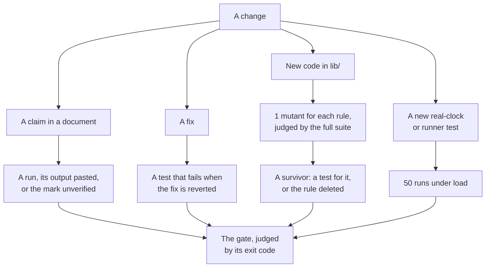

# 0020. Verify by a run

This record is for a contributor who fixes a defect, adds a rule to `lib/` or writes an
ExUnit test. It is also for a contributor who writes a claim about logex in a document. It
says what a claim or a change needs before it goes into `main`, and why.

On this page, a rule is 1 clause, guard, fallback, check or call that sorts, in the code of
`lib/`. A mutant is a copy of logex with 1 rule changed or removed, and a survivor is a
mutant on which the full suite passes. A walk is a test that draws programs, inputs and
calls at random from a seed. "Test" is an ExUnit test, never the step of an
[online edit](../../guides/reference/glossary.md#online-edit).

The rules are these:

- A claim is true when a run shows it. Paste the output of the run. If you cannot run
  the claim, mark it `unverified`.
- A fix comes with a test that fails when you revert the fix.
- New code comes with a mutation table: 1 mutant for each rule that the diff adds. The
  full suite must fail on each mutant. A survivor gets a test, or its rule goes. If you
  keep the rule on an argument, the commit says that the argument is all that holds it.
- A walk asserts its reach. It compares each result with an oracle that knows only the
  text of the [program](../../guides/reference/glossary.md#program) and the rules of the
  language.
- A new test on the real [clock](../../guides/reference/glossary.md#clock) runs 50
  times under load before it goes into `main`.

> #### Caution {: .error}
>
> Do not skip, disable, quarantine or weaken a test to get a green run. A red test shows
> a defect in the code or in the test. Find which, and correct it.

[The test strategy](../implementation/testing-strategy.md) gives the steps of each check.
[Tests of time](../implementation/testing-time.md) gives the load runs. [Runs and tables of the records: verification](../implementation/record-runs-verify.md#0020-verify-by-a-run) gives the
words of this record, the history, a run of its rules and each option not taken.
`CONTRIBUTING.md` gives each rule with the commits that broke it, in 3 sections:

- [its first rule](../../CONTRIBUTING.md#the-one-rule), "Verify by executing, not by
  reasoning"
- [the fix and its test](../../CONTRIBUTING.md#a-fix-needs-a-test-that-fails-when-the-fix-is-reverted)
- [a green suite](../../CONTRIBUTING.md#beware-of-a-green-suite)

## Status

Accepted. No later record replaces this record. Decisions 49, 337, 359, 362 to 365, 462,
480 and 498 apply the rule to the tests, the examples and the scripts.

## Date

2026-09-01, the date of `CONTRIBUTING.md` (commit `8d3dd7f`). That file gives the rule
and forbids a skipped test. The decisions of section 7 that this record sums up are of
2026-10-12 to 2026-11-10.

## Context

4 audits of the documents found 1 pattern, which `CONTRIBUTING.md` gives. Each wrong
claim of the documents was "arrived at by reasoning". Each claim that survived "was
executed".

The suite was also green on defects that the right test shows in 1 run. A fix of 2
defects came with no test, and its revert left the suite green (`3f3b104`). In the review
of M1-3, 52 of 112 mutants survived. A walk caught none of 12 defects off its paths
(`02d555e`). The page of the runs gives each case with the check that showed it.

Also, the output of `mix test` is not a judgement. Elixir 1.20 prints `Result: 39/40
passed` for a run with 1 failure. Only the exit code judges a run.

[IEC 61131-3](../../guides/reference/glossary.md#iec-61131-3) and [Logix](../../guides/reference/glossary.md#logix) give no rule for this. It is a rule
for the work on logex.

## Decision

This diagram shows the check that each kind of change needs before it goes into `main`.

Figure: the check of each kind of change. A change can be of more than 1 kind, and it
then needs each check of its kinds.

### A claim needs a run

Run the claim, and paste the real output of the run. If you cannot run it, mark the claim
`unverified`. Do not close the gap with a guess. Where a document and the code differ, the
code is correct, and the document changes.

Judge each run by its exit code, never by its output. A run that fails must name its
tests. `scripts/gate.sh` gives the name of each failed test from the
failures manifest, with `elixir scripts/failed.exs` (decision 337). CI does the same.

### The checks are files of the repository

The checks of a claim are files under `scripts/` and `test/`, not the notes of a session
(decision 359): `test/logex/readme_test.exs`, `scripts/gate.sh`, `scripts/failed.exs`,
`scripts/mutate.sh` and `scripts/load.sh`.

Each example of each page runs in each run of the suite (decision 362), the example on the
real clock also. The suite compares only the first words of its line of times
(decision 364). A page also shows each file that its example reads, so that a
[warning](../../guides/reference/glossary.md#warning) cites a line that the reader can see (decision 363). An `elixir`
block that no output follows is a fragment. The test parses it, and runs it in the setup
that its prose describes (decision 365).

### A fix needs a test that fails when the fix is reverted

Check a fix by a revert, not by an argument:

1. Write the test.
2. Revert the fix, and run the test. It must fail.
3. Put the fix back, and run the test. It must pass.

Make each test fail for exactly 1 reason. Assert on the value that the fix changes, not on
a projection of it that the defect leaves the same. A projection is a value made from the
changed value, such as the keys of a map in place of its values.

A commit that only moves or rewrites tests has no fix to revert. Check it with the mutants
that the old tests failed. Where the new test asserts less, find a mutant that only the
dropped part failed, and see the new test fail on it.

### New code needs a mutation table

New code has no fix to revert. A revert of the whole of a feature fails each test that
calls the feature, whatever the test asserts. Revert each rule instead, 1 at a time. Take
the list of rules from the diff, not from the tests that you wrote. `scripts/mutate.sh`
prints 1 row for each mutant.

A mutant counts only by the exit code of the full suite. A mutant that only a real-clock
test fails runs again alone before it counts.

Give each survivor a test, or delete its rule. If you keep a survivor because of an
argument, say that the argument is all that holds the rule. In `3e45ea8`, the argument
was that the case cannot occur, and the next walk met the case.

### A rule that no public function can see

A [resource](../../guides/reference/glossary.md#resource) keeps 1 copy of each [global](../../guides/reference/glossary.md#global). Between 2
[cycles](../../guides/reference/glossary.md#cycle), the state of an [instance](../../guides/reference/glossary.md#instance) holds no `var_external`. No
public function shows if the rule holds: the next cycle writes over a copy before a
function can read it. Thus a test looks inside the opaque `%Logex.Runtime{}` on purpose
(decision 49). `scheduler_test.exs` asserts that no state holds a global after `start/1`, a
cycle and `restart/2`.

### A walk asserts its reach

A walk tests only the cases that its draws meet. Thus each walk asserts its reach: each
stage of the [compile](../../guides/reference/glossary.md#compile), each kind of refusal and each case of each oracle. An
oracle is test code that gives the expected result from the text of a program. A walk that
does not meet a case fails.

Give each condition of a restated rule an atom of the reach. Size the draws so that the
rarest atom occurs 15 times or more in a run. Then run the walk under 60 seeds or more,
from more than 1 family of seeds. The reach assertion must pass at each seed.

An oracle and the code come from the same design, so a misreading goes into both. Thus a
walk also has checks that do not restate the rule.

`end_to_end_test.exs` runs source text to a result, and its assertions name no part of the
IR. Add a test to it when you change what logex does.

### A real-clock test runs under load

A rule of time has a test on `Logex.Runner.Clock.Manual`, a clock that the test moves.
Each new real-clock or runner test runs 50 times under load before it goes into `main`,
with `scripts/load.sh -n 50`. Each of the 50 runs must pass. These rules apply:

- Give each margin of real time hundreds of milliseconds where the rule lets you.
- Wait for the message that the test needs, not for a fixed time. Hold a reread with
  `Logex.IO.Sim.hold/1` and let it go with `Logex.IO.Sim.let_go/1` (decision 462).
- The loader tests of many files are in `loading_test.exs`, which is `async: false`
  (decision 480).
- `LogexTest.HeldFileServer` stays a separate module that is not async (decision 498).

### CI cannot skip a gate

The gate of `CONTRIBUTING.md`, "Before you commit", is 5 commands, each judged by its exit
code, the fifth `scripts/dialyzer.sh` (decision 549). `scripts/gate.sh` runs them in
order. CI runs the same 5 on each push and each pull request.

`scripts_test.exs` compares the keys of each step of the CI workflow with a fixed list.
Thus no step has an `if:` or a `continue-on-error:` that can skip a gate or let its
failure pass. On GitHub, a failed suite under `continue-on-error: true` is a green job.

## Consequences

The good results:

- A claim comes with the run that shows it, and a reader can run it again.
- A test that cannot see its defect shows in the mutation table.
- An example that the suite runs cannot go out of date.
- A walk with a seed fails the same way on the next run.
- A real-clock test meets a busy machine before it goes into `main`, not first in CI.

The costs:

- A mutation table runs the full suite for each mutant: 334 s for 1 mutant on 2026-11-23.
- A load run of 50 runs holds each core of the machine for 50 times its test file.
- The examples of the pages add their time to each run of the suite.
- A walk with a large draw and its reach under 60 seeds take time to write and to run.
- A test that looks inside an opaque structure fails when the structure changes.
- A survivor kept on an argument stays a gap that no run closes.

## Alternatives considered

| Alternative | Why logex does not use it |
|---|---|
| Take a claim as true on an argument | The audits found each wrong claim of the documents to be a claim made by an argument |
| Judge a mutant by the named test files only | In the work of record 0009, a mutant passed the 39 tests of the 2 test files of the evaluator. It failed 34 tests of the full suite |
| Keep a survivor because its case cannot occur | The case of `3e45ea8` occurred in the next walk |
| A walk with no assertion of its reach | The walk of `02d555e` failed each mutant of its table and caught none of 12 defects off its paths |
| Read the output of `mix test` | `Result: 39/40 passed` reads as a pass |
| Skip or quarantine a test that fails | A skipped test hides the defect that it shows |

The page of the runs gives each other option not taken.

## The decisions that this record sums up

This record sums up these decisions of
[`docs/organisation.md`](../organisation.md#7-decisions), and the 3 sections of
`CONTRIBUTING.md` that the start of this record names:

- 49: a test that looks inside the opaque resource.
- 337 and 359: the gate names each failed test, and the checks are files of the
  repository.
- 362, 363, 364 and 365: the examples and fragments of the pages run in each suite.
- 462, 480 and 498: the real-clock tests and the loader tests.

`PLAN.md` keeps the history of each decision. Other records apply this one:
[0019. Cost in reductions](0019-cost-in-reductions.md) for the mutants of a cost test,
and [0009. Clauses, not conditionals](0009-clauses-not-conditionals.md) for a mutant
that only the full suite fails.
