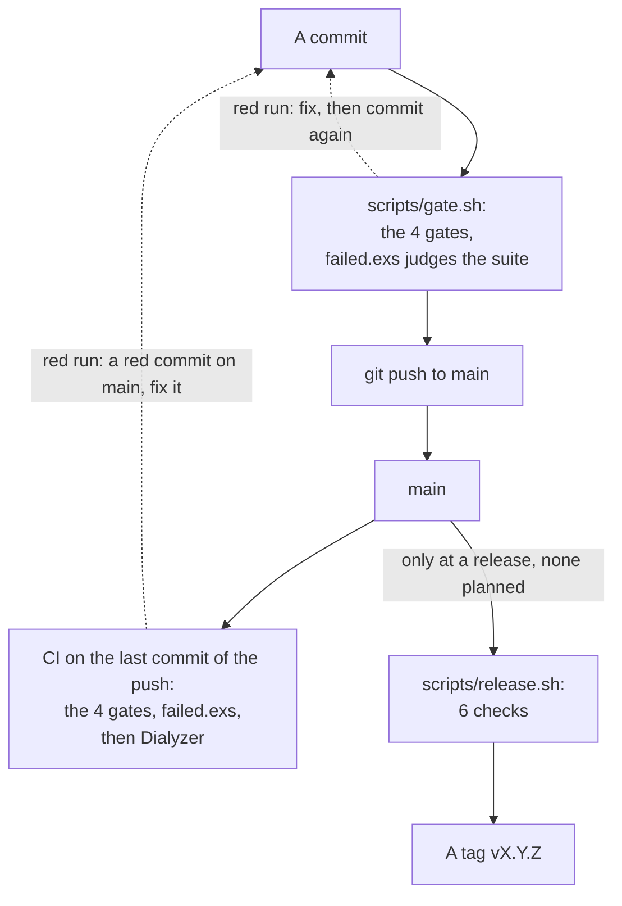

# 0021. A pinned toolchain and the gates

This record is for a contributor who sets up a machine for logex, or who is about to
commit. It says why logex builds on 1 toolchain only. It says why a commit must pass 4
gates, and why a script judges each gate by its exit code. It also says why the suite
compares the changelog with the decisions at each commit, while the maintainer plans no
release.
[The toolchain and the gates](../contributing/toolchain.md) gives the steps. It gives the
files that name the versions, how to install the toolchain, how to run each gate and
what CI does.

> #### Caution {: .error}
>
> Do not change the bound in `mix.exs` to build logex on an older Elixir. Install the
> pinned toolchain. No check runs logex on an older Elixir. A commit can take a loosened
> bound by accident.

These words have 1 meaning on this page:

- **Toolchain**: Erlang/OTP and Elixir, which build and run logex.
- **Bound**: the requirement `elixir: "~> 1.20"` in `mix.exs`. Mix reads it before it
  compiles a file.
- **Gate**: 1 command that must exit with 0 before a commit.
- **Red run**: a run that exits with a code that is not 0.
- **Failures manifest**: the file of ExUnit that names the tests that failed.
- **CI**: the workflow `.github/workflows/ci.yml`, which GitHub Actions runs on each push
  and each pull request.
- **Section 7**: the numbered list of decisions in
  [section 7 of `docs/organisation.md`](../organisation.md#7-decisions).

On this page, the words compile, warning, test and tag have their meaning in Elixir and
Git. A compile is the build of the Elixir modules by Mix, and a warning is a warning of
the Elixir compiler. A test is an ExUnit test, and a tag is a Git tag such as `v0.2.0`.
This page does not use these words for a
[compile](../../guides/reference/glossary.md#compile), a
[warning](../../guides/reference/glossary.md#warning) or a
[tag](../../guides/reference/glossary.md#tag) of a ladder
[program](../../guides/reference/glossary.md#program).

## Status

Accepted. No later record replaces this record. Decision 549 makes
`scripts/dialyzer.sh` the fifth step of `scripts/gate.sh`.
[0022. Typespecs and Dialyzer](0022-typespecs-and-dialyzer.md) gives Dialyzer and that
step.

## Date

2026-11-15, the date of decisions 541 and 542, the last decisions of this record. The
pin is of 2026-09-09 (`37b64c9`), and CI is of 2026-10-14 (`970dede`).

## Context

These problems came before the decision. Each item gives the commit or the decision that
records it.

1. **A toolchain out of support** (`9c1a7bd`, `PLAN.md` B4). Until September 2026 the
   repository named Erlang/OTP 26 and Elixir 1.15. OTP 26 left support on 2026-05-26,
   and Elixir 1.15 left the window of security fixes on 2026-06-03. The oldest pair that
   still had security fixes was Elixir 1.16 on OTP 27. The old `shell.nix` named
   `erlangR26`, which nixpkgs removed on 2024-05-24. In nixpkgs, `erlang_26` and
   `elixir_1_15` also give an error.
2. **2 answers to 1 question** (`37b64c9`). `9c1a7bd` gave Elixir 1.20 in `shell.nix`,
   but `mix.exs` kept `~> 1.15`. The repository named 2 versions of Elixir.
3. **A sandbox that cannot build the code** (decision 359). `CONTRIBUTING.md` and
   `CLAUDE.md` offered a sandbox of Elixir 1.14. The code calls `Map.split_with/2`, which
   Elixir 1.15 added. The early recorded outputs of runs that `PLAN.md` quotes came from
   that sandbox, on Erlang/OTP 25 and Elixir 1.14.
4. **Red commits on `main`** (`PLAN.md` B3). The suite fails at `ec0534a` and `35fe1b9`.
   No CI ran, so nothing showed it.
5. **A red run that names no test** (decision 337). In 7 full runs of the suite, 1 run
   failed 1 test. Its last line was `Result: 2406/2407 passed`. The output named no
   test. A red run of CI also printed only `Result: 2938/2939 passed` (decision 515).
6. **No version and no changelog** (decision 515). `mix.exs` said 0.1.0 across changes
   that alter what a running program writes to its
   [outputs](../../guides/reference/glossary.md#output). No changelog and no tag recorded
   them.

A search of the output cannot judge a run. A run on 2026-11-23 in a scratch project had
41 tests, and 1 test failed. `mix test` exited with 2, and a search of its output for
`[0-9]+ passed` found this line:

<!-- unchecked: the line that a search for [0-9]+ passed found, in a run of 2026-11-23 in a scratch project -->
```text
Result: 40/41 passed
```

The line names no test, and the search reads it as a pass.

[IEC 61131-3](../../guides/reference/glossary.md#iec-61131-3) gives no rule for the
toolchain, the gates or a release. The firmware of a
[Logix](../../guides/reference/glossary.md#logix) controller has a number for each
revision, and each revision has release notes (decisions 515 and 541).

## Decision

logex builds on 1 toolchain: Elixir 1.20.4 on Erlang/OTP 28. Each commit passes 4 gates,
and a script judges each gate by its exit code. CI runs the same 4 gates on the last
commit of each push. The suite compares `CHANGELOG.md` with section 7 at each commit. A
release step exists, and the maintainer plans no release.



Figure: the path of a commit to `main`, and to a tag. A solid arrow is the path of a
green run. A dotted arrow is the path of a red run. CI runs after the push. Thus CI does
not stop a red commit before it comes into `main`. A red run of CI shows that the commit
is red.

### 1 toolchain

Elixir 1.20 on Erlang/OTP 28 is the newest pair inside the windows of security fixes of
both projects. OTP 28 has support to 2028-05, and Elixir patches its last 5 minor
versions. 7 files name the toolchain: `mix.exs`, `examples/mix.exs`, `.tool-versions`,
`shell.nix`, `flake.nix`, `ci.yml` and `docs.yml`. None of them names another version of
Elixir or of Erlang/OTP.
[The toolchain and the gates](../contributing/toolchain.md) gives each file and its
value, under "The pinned versions".

The bound takes Elixir 1.20.0 and each later 1.x version. It refuses 1.19 and 2.0. On an
Elixir that the bound refuses, Mix stops before it compiles a file, with a message that
names the bound. No file stops a build on another Erlang/OTP, and no check runs logex
there. Install OTP 28.

The bound is a choice that decision 359 made, not a limit that the calls of `lib/` set.
Decision 359 removed the sandbox of Elixir 1.14 from the documents, and nobody keeps
logex working on an older toolchain.

On 2026-11-23 a script read the calls of the compiled modules of `lib/`. The newest
function that `lib/` calls is `Process.set_label/1`, which Elixir 1.17 added. `lib/`
calls no function that Elixir 1.18, 1.19 or 1.20 added.

Runs on Elixir 1.20.4 recorded the figures of cost in
[reductions](../../guides/reference/glossary.md#reduction), and the suite compares the
code with these figures ([0019. Cost in reductions](0019-cost-in-reductions.md)). On
another Elixir, these tests can fail. Nobody has run logex on Elixir 1.17 to 1.19.

### 4 gates, each judged by its exit code

`CONTRIBUTING.md` lists the gates in
[Before you commit](../../CONTRIBUTING.md#before-you-commit). `scripts/gate.sh` runs them
in this sequence and stops at the first red gate:

1. `mix format --check-formatted` refuses a file that `mix format` changes.
2. `mix compile --force --warnings-as-errors` refuses a warning in any module of `lib/`,
   also in a file that the change does not touch.
3. `MIX_ENV=test mix compile --force --warnings-as-errors` refuses a warning in `lib/`
   when it compiles as the suite compiles it.
4. `mix test --warnings-as-errors`, then `elixir scripts/failed.exs --exit N`, refuse a
   test that fails and a warning in a test file. `scripts/failed.exs` also refuses a
   suite that does not finish.

The flag of gate 4 is necessary, because `mix compile` never compiles the tests. From
`ee91fe5` to `4a1079c`, 6 commits passed while the type checker gave 2 warnings in
`runtime_test.exs`. On 2026-11-23, a scratch project of 42 tests had a test file with an
unused variable. Each test passed. Plain `mix test` exited with 0. With
`--warnings-as-errors`, it exited with 1, and its last line was this:

<!-- unchecked: the last line of mix test --warnings-as-errors on a test file with an unused variable, a run of 2026-11-23 in a scratch project -->
```text
ERROR! Test suite aborted after successful execution due to warnings while using the --warnings-as-errors option
```

The message says that each test passed and that a warning makes the run red.

A red run names its tests (decisions 337 and 515). `scripts/gate.sh` deletes the
failures manifest before the suite. After the suite, `scripts/failed.exs` reads the
manifest, with `N` the exit code of `mix test`. It names each test that failed, with its
file and its line, and it judges each run, green or red.

If a test calls
`System.halt(0)`, the suite stops, and ExUnit writes no failures manifest. Plain
`mix test` then exits with 0, but `scripts/failed.exs` finds no manifest and makes the
run red. [The toolchain and the gates](../contributing/toolchain.md) shows what the
script prints for each cause, under "`scripts/gate.sh`".

Decision 337 adds only the names of the tests that failed. Nobody looked for the cause of
the 1 failed run in 7, because the runs after it passed.

### CI runs the same gates

CI runs the 4 gates, 1 step for each gate (`PLAN.md` B3). CI judges each step by its own
exit code. The step of the suite does what gate 4 of `scripts/gate.sh` does. It deletes
the failures manifest, runs `mix test --warnings-as-errors` and gives its exit code to
`elixir scripts/failed.exs --exit`.

After the 4 gates, CI runs `scripts/dialyzer.sh` (decision 515). `scripts/gate.sh` runs
the 4 gates and not Dialyzer.

`test/logex/scripts_test.exs` compares the keys of each step of `ci.yml` with a fixed
list. No step has an `if:`, which can skip a step. No step has `continue-on-error:`. On
GitHub, a failed suite under `continue-on-error: true` is a green job.
`test/logex/docs_test.exs` compares the versions of `docs.yml` with the versions of
`ci.yml`, and both with `"28"` and `"1.20.4"`.

A push puts its commits on `main` first, and CI then examines the last commit of the
push only. A commit inside a push of several commits gets no separate run. A red run of
CI is a red commit, also when `scripts/gate.sh` was green on the machine of the
contributor.

### The changelog at each commit, and a release step with no release

A release is a version, an entry of `CHANGELOG.md` and a tag (decision 515). Each entry
of the changelog starts with a line that names decisions of section 7. The head of the
changelog gives this example: `Decisions: 1–14, 30, 41–54.` The script
`scripts/changelog.exs` compares these lines with section 7.

The changelog names each decision at the commit that records it (decision 542).
`test/logex/release_test.exs` runs `scripts/changelog.exs` on the tree, so the suite
fails until the changelog names each decision. On 2026-11-23, a copy of the repository
had 1 more decision in section 7. The script printed this line and exited with 1:

<!-- unchecked: the refusal of scripts/changelog.exs on a copy with decision 575 added to section 7, a run of 2026-11-23 -->
```text
changelog: decision 575 is recorded in §7 and named by no entry
```

When you add a decision to section 7, name its number on the `Decisions:` line under
`## Unreleased`, in the same commit. When each decision has its entry, the script prints
1 line and exits with 0.

> #### Note {: .info}
>
> The maintainer plans no release (decision 541). `mix.exs` says 0.1.0,
> `## Unreleased` is the newest entry, and no tag exists. Decision 541 leaves 4
> questions open until the maintainer plans a release:
>
> - The first version number.
> - The push of its tag.
> - What the first entry lists under "What changes a running program's outputs".
> - If the release step reads the runs of CI itself.

`scripts/release.sh` makes the tag `vX.Y.Z` only when each of its 6 checks passes:

1. The tree is clean.
2. The commit is on the `main` of origin.
3. CI ran on the commit, and each run of `ci.yml` on it concluded `success`, read
   with `gh api`.
4. The newest entry of the changelog is the version of `mix.exs`. The changelog names
   each decision 1 time (`elixir scripts/changelog.exs --release`).
5. The tag is not in the local repository and not on origin.
6. `scripts/gate.sh` is green.

`--dry-run` does the checks and makes no tag. `release_test.exs` runs the script in a
scratch repository, with a separate stand-in `gh` and a separate origin. While the
maintainer plans no release, check 4 refuses. On 2026-11-23,
`elixir scripts/changelog.exs --release` exited with 1: the newest entry is
`## Unreleased`, and a release needs a heading with a version and a date.
`CONTRIBUTING.md` gives the procedure in
[Releasing](../../CONTRIBUTING.md#releasing).

### The metadata of `mix.exs`

`mix.exs` has a `description`, a `package` with the licence `Apache-2.0` and a
`source_url` (`PLAN.md` B6). Its `application/0` starts no extra application, because
no code uses `Logger`. The bound stays `~> 1.20`.

## Consequences

The good results:

- A contributor has 1 toolchain to think about. The 7 files name OTP 28 and Elixir 1.20.
- On an older Elixir, Mix stops before it compiles a file, with a message that names the
  bound. Nothing fails later in a way that is hard to read.
- A red run names each test that failed, on the machine and in CI. If a test stops the
  suite, the run is red.
- Each push gets a run of CI on its last commit. A red run shows that the commit on
  `main` is red.
- The changelog cannot omit a decision. A release finds each decision already named.

The costs:

- A contributor on another system must install the toolchain. asdf builds Erlang/OTP
  from its source on the first install.
- No test compares `mix.exs`, `examples/mix.exs`, `.tool-versions`, `shell.nix` and
  `flake.nix` with each other or with CI. The suite compares only the 2 workflows. A
  change of the pin must change each file by hand.
- The patch releases differ. `.tool-versions` names OTP 28.5.0.6. CI resolved 28.5.0.7 on
  2026-10-14 (`970dede`). The machine that wrote this record ran 28.5.0.8.
- The committed `flake.lock` is of 2024-01-19, older than the pin. The first
  `nix develop` writes it again (`PLAN.md` B4).
- The gate runs the full suite, which takes some minutes.
- A commit inside a push of several commits gets no run of CI.
- `scripts/gate.sh` runs the 4 gates and not Dialyzer, so a commit can pass the gate and
  then fail the step of Dialyzer in CI. Decision 549 makes `scripts/dialyzer.sh` the
  fifth step of `scripts/gate.sh`.
- Each commit that records a decision also changes `CHANGELOG.md`.
- The release step ran only against a stand-in `gh` and a scratch origin, never for
  a real release.

## Alternatives considered

| Alternative | Why logex does not use it |
|---|---|
| Keep the bound `~> 1.15` and recommend 1.20 (`9c1a7bd`) | The repository then named 2 versions. Elixir 1.15 and OTP 26 were out of their windows of security fixes |
| Bound at the oldest supported pair, Elixir 1.16 on OTP 27 | The code calls `Process.set_label/1`, which Elixir 1.17 added. That pair cannot build logex |
| A matrix of versions in CI | No contributor runs logex on an older toolchain, and decision 359 drops everything before Elixir 1.20 |
| Keep the sandbox of Elixir 1.14 (decision 359) | It cannot build the code, which calls `Map.split_with/2` |
| Loosen the bound on a machine with an older Elixir | No check runs that build. The edit goes into a commit by accident |
| Judge a run by its output | `Result: 40/41 passed` reads as a pass to a search for `[0-9]+ passed` |
| Plain `mix test` as gate 4 | It exits with 0 on a warning in a test file, and when a test stops the suite |
| Look for the cause of the 1 failed run in 7 (decision 337) | The runs after it passed. The manifest names the failure if it comes again |
| An `if:` or `continue-on-error:` on a step of CI | A skipped step, or a failed suite that CI shows green |
| Name each decision in the changelog at the release, all at 1 time (decision 542) | A release can then omit a decision. At each commit, the suite finds the omission |
| A first release, 0.2.0, with its tag pushed (decision 541) | The maintainer plans no release |

## Decisions in section 7

This record sums up these decisions of
[`docs/organisation.md`](../organisation.md#7-decisions), and 3 items of the findings
register of [`PLAN.md`](../../PLAN.md#7-findings-register). `CONTRIBUTING.md` gives the
rules in [The toolchain](../../CONTRIBUTING.md#the-toolchain) and
[Before you commit](../../CONTRIBUTING.md#before-you-commit).

| Decision or item | What it gives |
|---|---|
| 337 | A red run names its tests from the failures manifest. The decision adds nothing more |
| 359 | Everything before Elixir 1.20 goes from the documents. `readme_test.exs` runs the examples, and `scripts/mutate.sh` and `scripts/load.sh` are in the repository |
| 515 | CI names the tests that failed, a release step, and Dialyzer in CI |
| 541 | The maintainer plans no release. 4 questions of the release step stay open |
| 542 | The suite compares the changelog with section 7 at each commit |
| B3 | CI runs the 4 gates on each push and each pull request |
| B4 | `shell.nix` and `flake.nix` give OTP 28 and Elixir 1.20 |
| B6 | The metadata of `mix.exs`, and no `:logger` |

`PLAN.md` keeps the history of each decision.
[0020. Verify by a run](0020-verify-by-executing.md) gives the checks that a change needs
before the gate. [0003. No dependencies and no generated code](0003-no-dependencies-no-generated-code.md)
says why the toolchain is all that a build needs.
