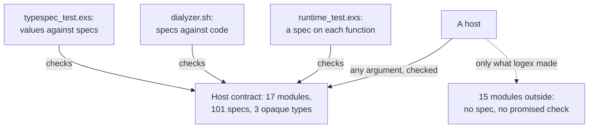

# 0022. Typespecs and Dialyzer

This record is for a contributor who changes a public function of logex, adds one, or
meets a red run of Dialyzer or of `test/logex/typespec_test.exs`. It says where the
[host contract](../../guides/reference/glossary.md#host-contract) ends. It says why each
public function of the contract has a spec, and which 3 checks compare the specs with
the code.

[The toolchain and the gates](../contributing/toolchain.md) gives the steps to run
Dialyzer. [Host contract](../../guides/reference/host-contract.md) gives the modules and
the functions for a [host](../../guides/reference/glossary.md#host).
[0008. Errors in the source and errors of the host](0008-source-mistakes-and-host-mistakes.md)
gives how a function of the contract refuses a wrong argument.
[Runs and tables of the records: typespecs](../implementation/record-runs-typespecs.md#0022-typespecs-and-dialyzer) gives the runs of this record, its
measurements and each option not taken.

> #### Caution {: .error}
>
> Do not silence a warning of Dialyzer. Do not add an `@dialyzer` attribute, a wider
> spec, a `no_return()` spec or a flag that turns a class of warnings off. Change the code
> until Dialyzer gives no warning. A silenced warning hides the next defect of its class.

These words have 1 meaning on this page:

- **Spec**: an `@spec` attribute. It gives the types of the arguments and of the value of
  1 function.
- **Typedoc**: a `@typedoc` attribute. It documents 1 type that a module exports.
- **Opaque type**: a type that a module declares with `@opaque`. Only that module reads
  the fields of its values.
- **PLT**: the file in which Dialyzer keeps the types of the applications that logex
  calls.
- **Success typing**: the types that Dialyzer finds from the code of a function.

Here a warning is of Dialyzer, a test is an ExUnit test, and a type is of Elixir.

## Status

Accepted. No later record replaces this record.

The item RV-30 of [`PLAN.md`](../../PLAN.md) built decisions 549, 550 and 555
(565f057).

## Date

2026-11-15, the date of decisions 549 to 555. Decision 514 is of 2026-11-12, and
decision 523 of 2026-11-13.

## Context

These problems came before the decision:

1. **No line between the host and the rest** (decision 514). A review called 40
   documented functions with wrong arguments, and they raised `FunctionClauseError`. The
   rule of logex is that a wrong argument of the host gets an `ArgumentError`.
2. **The examples call more modules** (decision 523), such as `Logex.IO.Sim` and the
   clocks of the runner. Decision 514 did not say if these modules are in the contract.
3. **No types and no static analysis** (decision 515).
4. **Warnings that are not defects** (decision 551). The first run of Dialyzer gave 12
   warnings, and none was a defect.
5. **logex read the fields of the opaque resource** (decision 553), in 28 places of
   `Logex.Configuration.Edit`.
6. **Specs that Dialyzer cannot check** (decision 554). Dialyzer types the value of 33 of
   the 101 specs as `any()`, such as a call to a process.

[IEC 61131-3](../../guides/reference/glossary.md#iec-61131-3) gives a type to the
interface of each program, but no rule for the API of a host. Decision 553 compares the
opaque resource with a [function block](../../guides/reference/glossary.md#function-block)
of IEC 61131-3. Code outside the block reads its internal values only through its outputs.
Decision 33 reads this rule in Ed 2 Table 32 and in Ed 3 Figure 13.

## Decision

The host contract is 17 modules. Each public function of these modules has a spec, and
each type that they export has a typedoc. 3 checks compare the specs with logex:
`test/logex/runtime_test.exs`, `scripts/dialyzer.sh` and
`test/logex/typespec_test.exs`. The resource and the 2 edits are opaque types. The 15
documented modules outside the contract have no spec, and they promise no check of the
arguments of a host.

Figure: the host contract and its 3 checks. The solid arrow from the host is a call with
any argument, which the module checks. The dotted arrow is a call with only what logex
made.

### Where the contract ends

The contract is the way in, 8 modules where a host starts. It also holds the modules that
a host calls with its own values (decisions 514 and 523). [Host contract](../../guides/reference/host-contract.md) lists the 17 modules.

A function of the contract refuses a wrong argument of the host with an `ArgumentError`.
The moduledoc of each other documented module ends with the same sentence: "Outside the
host contract, this module takes logex's own data unguarded". 13 more modules are
internal, with `@moduledoc false`. `runtime_test.exs` fails if a module does not agree
with its group, so a new documented module fails until a contributor puts it in one.

The examples of the pages call `Logex.Diagnostic`, `Logex.FbType` and `Logex.Scan`, but
they stay outside the contract (decision 523). A host gives these modules only what logex
made. A check that a module outside the contract makes is not a promise of the contract.

### A spec on each public function

Each public function of the 17 modules has a spec (decision 552). The rule has 3 parts:

- A function with `@doc false` also has a spec.
- A callback of a behaviour has no separate spec. The `@callback` of the behaviour gives
  its types: `GenServer`, `Logex.IO` or `Logex.Runner.Clock`.
- Each type that a module of the contract exports has a typedoc. A type that only logex
  uses has `@typedoc false`.

`runtime_test.exs` fails on a public function with no spec and on a type with no
typedoc. It also fails if `Logex.Runtime.t()`, `Logex.Edit.t()` or
`Logex.Configuration.Edit.t()` is not opaque.

A spec gives what the documentation of the function takes and gives. An argument that the
function refuses with an `ArgumentError` is outside the spec. Thus a spec is narrower than
the success typing. For example, the spec of `Logex.Runtime.instance/1` takes a
`Logex.Program.t()`, and the code takes any term and refuses each wrong one.

### The resource stays opaque

`Logex.Runtime.t()`, `Logex.Edit.t()` and `Logex.Configuration.Edit.t()` are opaque. A
host keeps each value and gives it back, and only its module reads its fields. Dialyzer
gives a warning where another module of logex reads them.

`Logex.Configuration.Edit` reads the fields of the resource through 1 internal function
of `Logex.Runtime`, and another writes them back (decision 553). Each step of a
configuration edit uses 6 to 25 more [reductions](../../guides/reference/glossary.md#reduction) for the call.

### Dialyzer, with no dependency

`scripts/dialyzer.sh` runs the `dialyzer` of Erlang/OTP over the dev build of logex. It
adds no dependency to `mix.exs`, as
[0003. No dependencies and no generated code](0003-no-dependencies-no-generated-code.md)
requires. Its PLT holds `erts`, `kernel`, `stdlib` and `elixir`, the applications that
logex calls. The PLT is under `_build/dialyzer/`, and its name holds the version of OTP,
the version of Elixir and the applications.

The script sets `DIALYZER_CONFIG=/dev/null`. Thus Dialyzer reads no file of settings, and
the settings of a contributor change nothing.

Dialyzer gives its default warnings, and the script turns on 6 more flags, such as
`-Wunderspecs` and `-Wunmatched_returns` (decision 550). The page of the runs lists them.

Each call whose value the code drops on purpose starts with `_ =`.
`test/logex/dropped_answers_test.exs` holds each of them to a list, with its reason.

These flags stay off, each for its reason:

- `-Werror_handling`. Its 18 warnings are of functions that raise or exit by design. Only
  a `no_return()` spec passes them, and decision 551 does not let a spec silence a warning.
- `-Woverspecs` and `-Wspecdiffs`. A spec is narrower than its success typing on
  purpose.

A warning that is not a defect does not stay (decision 551). The contributor changes the
code to say what it does. The function that finds a wrong argument raises its refusal, and
a separate function makes only the message. `lib/` has no `@dialyzer` attribute.
Correct the spec or the code until they agree.

### A test holds the values to the specs

`test/logex/typespec_test.exs` checks each of the 101 specs, the 33 that Dialyzer cannot
check among them (decision 554). Its checker reads each spec and each type from the
compiled module, with `fetch_specs/1` and `fetch_types/1` of Elixir. A form of a type
that the checker does not know makes the test fail.

6 tests call the functions of the contract as their documentation shows, some with wrong
arguments on purpose. They cover a [compile](../../guides/reference/glossary.md#compile),
a lone instance, a configuration, a [resource](../../guides/reference/glossary.md#resource),
their online edits and the [runner](../../guides/reference/glossary.md#runner).

Each argument must be a value of its spec. Each returned value must be a value of the
return type of the spec. The seventh test fails if the 6 tests do not call each of the
101 specs. It also fails if they call a function of the contract that has no spec.

A spec that is wider than the values of its function passes the 2 tests. Dialyzer
refuses it only where it finds a type for the value (decision 554). The page of the runs
gives 5 changes to a spec, and which check finds each.

### A wrong initial value of a global

`Logex.Configuration.Global.new!/3` makes a [global](../../guides/reference/glossary.md#global) from Elixir. A global of
the type `:bool` takes 0 or 1, not `true`. `Global.new!/3` refuses a wrong initial value
with an `ArgumentError` when it gets it (decision 555), as `Logex.Tag.new!/5` does for a
[tag](../../guides/reference/glossary.md#tag). Its message has the words of `check/1` (decision 575).

## Consequences

The good results:

- A host knows which modules check its arguments.
- Each public function of the contract has its types in its documentation.
- Dialyzer finds a spec that does not agree with its code, and a module that reads an
  opaque value. It adds no dependency.
- `typespec_test.exs` checks each spec with the values of real calls.
- Nobody silences a warning.

The costs:

- A spec wider than its values passes the tests, and passes Dialyzer where Dialyzer
  cannot type the value (decision 554).
- The 15 modules outside the contract raise any exception of Elixir for a wrong argument.
- A step of a configuration edit uses 6 to 25 more reductions.
- The first run of the script on a computer builds the PLT, about 1 minute.
- A new public function of the contract needs a spec, a typedoc for each new type, and a
  call in `typespec_test.exs`, or the suite fails.
- A warning that Dialyzer gives on correct code makes the contributor change it.

## Alternatives considered

| Alternative | Why logex does not use it |
|---|---|
| Check each argument of each documented function (decision 514) | The maintainer chose the way in. This option adds a check, and a message that a test compares, to 40 functions that take only what logex makes |
| Dialyzer by hand and in CI only (decision 549) | A contributor learns of a broken spec from CI, minutes after the push |
| Dialyzer as a test of the suite (decision 549) | Each run of `mix test` takes 20 s to 35 s longer, with the PLT kept |
| Silence a warning with `@dialyzer {:nowarn_function, ...}` (decision 551) | The mark stays when the code changes, and it hides the next defect |
| Turn a class of warnings off (decision 551) | A class off hides each defect of that class |
| `-Wno_opaque`, with the rule of opacity in the documents only (decision 553) | Dialyzer then gives no warning when a module reads an opaque value |

The page of the runs gives each other option not taken.

## The decisions that this record sums up

This record sums up these decisions of
[`docs/organisation.md`](../organisation.md#7-decisions):

- 514 and 523: where the host contract ends.
- 549, 550 and 551: Dialyzer in the gate, its flags, and no silenced warning.
- 552: a spec on each public function of the contract, a typedoc on each type.
- 553: only 1 internal function of `Logex.Runtime` reads the fields of the resource.
- 554: `typespec_test.exs` compares each value with its spec.
- 555 and 575: `Global.new!/3` refuses a wrong initial value, in the words of `check/1`.

Decision 515 asks for the specs and Dialyzer in CI.
[0021. A pinned toolchain and the gates](0021-pinned-toolchain-and-gates.md) gives that
decision and the gates.
[0020. Verify by a run](0020-verify-by-executing.md) gives the mutants that show what a
check finds.

`PLAN.md` keeps the history in RV-8, RV-20, RV-24, RV-26 and RV-30.
