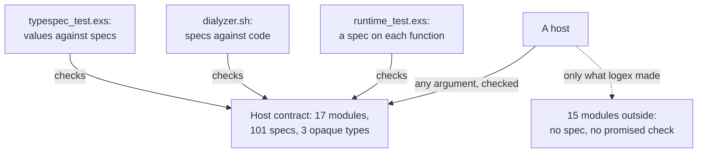

# 0022. Typespecs and Dialyzer

This record is for a contributor who changes a public function of logex, adds one, or
meets a red run of Dialyzer or of `test/logex/typespec_test.exs`. It says where the
[host contract](../../guides/reference/glossary.md#host-contract) ends. It says why each
public function of the contract has a spec, and which 3 checks compare the specs with
the code.

The decision: the host contract is 17 modules. Each of their public functions has a
spec. `runtime_test.exs`, `scripts/dialyzer.sh` and `typespec_test.exs` check the specs.
Nobody silences a warning of Dialyzer.

[The toolchain and the gates](../contributing/toolchain.md) gives the steps to run
Dialyzer. [Host contract](../../guides/reference/host-contract.md) gives the modules and
the functions for a [host](../../guides/reference/glossary.md#host).
[0008. Errors in the source and errors of the host](0008-source-mistakes-and-host-mistakes.md)
gives how a function of the contract refuses a wrong argument.

> #### Caution {: .error}
>
> Do not silence a warning of Dialyzer. Do not add an `@dialyzer` attribute, a wider
> spec, a `no_return()` spec or a flag that turns a class of warnings off. Change the code
> until Dialyzer gives no warning. A silenced warning hides the next defect of its class.

These words have 1 meaning on this page:

- **Spec**: an `@spec` attribute. It gives the types of the arguments and of the value of
  1 function.
- **Typedoc**: a `@typedoc` attribute. It documents 1 type that a module exports.
- **Opaque type**: a type that a module declares with `@opaque`. Only that module reads
  the fields of its values. Dialyzer gives a warning where another module reads them.
- **Dialyzer**: the tool of Erlang/OTP that finds type errors in compiled modules, the
  command `dialyzer`.
- **PLT**: the file in which Dialyzer keeps the types of the applications that logex
  calls.
- **Success typing**: the types that Dialyzer finds from the code of a function.
- **Flag**: an option `-W` of Dialyzer that turns 1 class of warnings on or off.
- **Section 7**: the numbered list of decisions in
  [section 7 of `docs/organisation.md`](../organisation.md#7-decisions).

Here a warning is a warning of Dialyzer, a test is an ExUnit test, and a type is a type
of Elixir.

## Status

Accepted. No later record replaces this record.

The item RV-30 of [`PLAN.md`](../../PLAN.md) made the 3 changes that decisions 549, 550
and 555 ask for (565f057):

- **Decision 549**: `scripts/gate.sh` runs `scripts/dialyzer.sh` as its fifth step.
- **Decision 550**: the flag `-Wunmatched_returns` is on, and each answer that the code
  drops on purpose is written as `_ = ...`.
- **Decision 555**: `Logex.Configuration.Global.new!/3` refuses a wrong
  [initial value](../../guides/reference/glossary.md#initial-value) when it gets it.

## Date

2026-11-15, the date of decisions 549 to 555. Decision 514 is of 2026-11-12, and
decision 523 of 2026-11-13.

## Context

These problems came before the decision:

1. **No line between the host and the rest** (decision 514). A review called 40
   documented functions with wrong arguments, in 118 cases. Each of these functions
   takes only values that logex makes. For example, `Logex.Program.initial_env(:x)` and
   `Logex.Walk.writes(nil)` raised `FunctionClauseError`. The rule of logex is different.
   A wrong argument of the host gets an `ArgumentError`, and a test compares its message.
2. **The examples call more modules** (decision 523). The examples of the pages call
   `Logex.Diagnostic.format/1`, `Logex.IO.Sim`, the clocks of the runner, the parts of a
   configuration and `Logex.FbType.ctu/0`. Decision 514 did not say if these modules are
   in the contract.
3. **No types and no static analysis** (decision 515). No function had a spec, and no
   tool compared the code with a type.
4. **Warnings that are not defects** (decision 551). The first run of Dialyzer gave 12
   warnings, and none was a defect. 10 of them had the same cause. A function called a
   second function only to raise its refusal. An example is the refusal of a wrong
   `steps:` option of the runner. Dialyzer read that call as a call that never returns.
5. **logex read the fields of the opaque resource** (decision 553). The specs made
   `Logex.Runtime.t()` opaque. `Logex.Configuration.Edit` reads the fields of the
   resource at each step, and it broke the opacity in 28 places.
6. **Specs that Dialyzer cannot check** (decision 554). Dialyzer finds no type for the
   value of a call to a process, or for the field of a struct. On 2026-11-23,
   `dialyzer -Wspecdiffs` gave `any()` as the type of the value for 33 of the 101 specs.
   Among them are 15 functions of the runner, 6 of `Logex.IO.Sim` and 3 of the manual
   [clock](../../guides/reference/glossary.md#clock). `Logex.compile/2`,
   `Logex.compile_file/1` and `Logex.compile_files/1` are also among them. For these 33
   specs, Dialyzer finds no error in a wrong return type.

[IEC 61131-3](../../guides/reference/glossary.md#iec-61131-3) gives a type to the
interface of each program, function and function block. It gives no rule for the API of
a host. Section 7 cites no [Logix](../../guides/reference/glossary.md#logix) interface for
a host. The decisions compare the checks with the tools of these 2 systems:

- The tools of IEC 61131-3 check a typed interface at each compile, and refuse each
  mismatch (decisions 549 and 550).
- The Verify command of Logix Designer checks a project before each download to the
  controller. An error stops the download, and a warning goes into a list (decisions 549
  and 550).
- Neither has a mark that hides 1 warning (decision 551).
- Code outside a [function block](../../guides/reference/glossary.md#function-block) of
  IEC 61131-3 reads its internal values only through its outputs (decision 553).

## Decision

The host contract is 17 modules. Each public function of these modules has a spec, and
each type that they export has a typedoc. 3 checks compare the specs with logex:
`test/logex/runtime_test.exs`, `scripts/dialyzer.sh` and
`test/logex/typespec_test.exs`. The resource and the 2 edits are opaque types. The 15
documented modules outside the contract have no spec, and they promise no check of the
arguments of a host.



Figure: the host contract and its 3 checks. The solid arrow from the host is a call with
any argument, which the module checks. The dotted arrow is a call that gives the module
only what logex made. The 3 arrows marked "checks" go from a check to the contract.

`typespec_test.exs` reads only the modules of the contract. `runtime_test.exs` reads the
specs of the contract and the moduledoc of each module. Dialyzer reads each module of
logex and compares each call to the contract with its spec.

### Where the contract ends

The way in is the 8 modules that the documentation names as where a host starts. The
contract is the way in and the modules that a host calls with its own values (decisions
514 and 523):

| Group | Modules |
|---|---|
| The way in (decision 514) | `Logex`, `Logex.Runtime`, `Logex.Edit`, `Logex.Configuration`, `Logex.Configuration.Edit`, `Logex.Runner`, `Logex.IO` and `Logex.Tag` |
| The tools of the host and the parts of a configuration (decision 523) | `Logex.Configuration.Task`, `Logex.Configuration.Global`, `Logex.Configuration.Instance`, `Logex.Configuration.Connection`, `Logex.IO.Point`, `Logex.IO.Sim`, `Logex.Runner.Clock`, `Logex.Runner.Clock.Manual` and `Logex.Runner.Clock.Monotonic` |

A function of the contract refuses a wrong argument of the host with an `ArgumentError`,
and a test compares its message. The moduledoc of each other documented module ends with 1
sentence, the same in each. It starts: "Outside the host contract, this module takes
logex's own data unguarded". 13 more modules are internal, with `@moduledoc false`.

`runtime_test.exs` reads the moduledoc of each module of the application. It fails if a
module outside the contract does not hold that sentence, or if a module inside it does.
It also holds the list of the 15 modules outside. Thus a new documented module fails the
test until a contributor puts it in a group.

The examples of the pages call `Logex.Diagnostic`, `Logex.FbType` and `Logex.Scan`, but
they stay outside the contract (decision 523). Thus `Logex.Diagnostic.format/1` with a value that is not a
[diagnostic](../../guides/reference/glossary.md#diagnostic) raises
`FunctionClauseError`. A host gives these modules only what logex made.

Some modules outside the contract check an argument all the same. For example,
`Logex.Lexer.tokenize/1` refuses an atom with an `ArgumentError`. That check is not a
promise of the contract.

### A spec on each public function

Each public function of the 17 modules has a spec (decision 552). The rule has 3 parts:

- A function with `@doc false` also has a spec. Examples are `cycle_steps/3` and
  `fields/1` of `Logex.Runtime`. Other examples are the 3 internal functions of
  `Logex.Runner.Clock` that examine what a host gives a clock: `receiver!/1`, `time!/1`
  and `timer!/1`.
- A callback of a behaviour has no separate spec. The `@callback` of the behaviour gives
  its types: `GenServer`, `Logex.IO` or `Logex.Runner.Clock`.
- Each type that a module of the contract exports has a typedoc. A type that only logex
  uses has `@typedoc false`.

`runtime_test.exs` fails on a public function with no spec and on a type with no
typedoc. It also fails if `Logex.Runtime.t()`, `Logex.Edit.t()` or
`Logex.Configuration.Edit.t()` is not opaque.

A spec gives what the documentation of the function takes and gives. An argument that the
function refuses with an `ArgumentError` is outside the spec. Thus a spec is narrower than
the success typing. For example, the spec of `Logex.Runtime.instance/1` takes a
`Logex.Program.t()`, and the code takes any term and refuses each wrong one.

### A script that counts the specs

The script `examples/0022-typespecs-and-dialyzer.exs` reads the specs and the opaque
types of each module of the contract from its compiled file. It counts the modules whose
moduledoc says that they are outside. Then it gives the same wrong value to a function
inside the contract and to a function outside it. Run it from `examples/`.

```elixir
# The modules of the host contract: the way in (decision 514), then the tools of the host
# and the parts of a configuration (decision 523).
contract = [
  Logex,
  Logex.Runtime,
  Logex.Edit,
  Logex.Configuration,
  Logex.Configuration.Edit,
  Logex.Runner,
  Logex.IO,
  Logex.Tag,
  Logex.Configuration.Task,
  Logex.Configuration.Global,
  Logex.Configuration.Instance,
  Logex.Configuration.Connection,
  Logex.IO.Point,
  Logex.IO.Sim,
  Logex.Runner.Clock,
  Logex.Runner.Clock.Manual,
  Logex.Runner.Clock.Monotonic
]

# Reads the specs and the opaque types of a module from its compiled file.
specs = fn module ->
  {:ok, specs} = Code.Typespec.fetch_specs(module)
  length(specs)
end

opaque = fn module ->
  {:ok, types} = Code.Typespec.fetch_types(module)
  for {:opaque, {name, _type, _parameters}} <- types, do: "#{name}()"
end

# Gives "" for no opaque type, and the list after a comma for each other list.
shown = fn
  [] -> ""
  names -> ", opaque " <> Enum.join(names, " and ")
end

IO.puts("1. The host contract")

for module <- contract do
  IO.puts("   #{inspect(module)}: #{specs.(module)} specs" <> shown.(opaque.(module)))
end

IO.puts("   #{length(contract)} modules, #{Enum.sum(Enum.map(contract, specs))} specs")

# Gives the moduledoc of a module on 1 line, or "" for a hidden module.
moduledoc = fn
  {:docs_v1, _, :elixir, _, %{"en" => text}, _, _} -> String.replace(text, ~r/\s+/, " ")
  _hidden -> ""
end

# A module outside the contract ends its moduledoc with 1 sentence that says so. The
# script loads the application of logex to read its list of modules.
_ = Application.load(:logex)
sentence = "Outside the host contract, this module takes logex's own data unguarded"
outside? = &String.contains?(moduledoc.(Code.fetch_docs(&1)), sentence)
outside = Enum.filter(Application.spec(:logex, :modules), outside?)
IO.puts("2. Outside the contract")
IO.puts("   #{length(outside)} modules, #{Enum.sum(Enum.map(outside, specs))} specs")

# Runs a call and prints the exception that it raises.
raised = fn call ->
  try do
    IO.puts("   returned " <> inspect(call.()))
  rescue
    error -> IO.puts("   #{inspect(error.__struct__)}: " <> Exception.message(error))
  end
end

IO.puts(~s(3. The name "motor" in place of the program motor))
raised.(fn -> Logex.Runtime.instance("motor") end)
raised.(fn -> Logex.Program.initial_env("motor") end)
```

```console
$ mix run 0022-typespecs-and-dialyzer.exs
1. The host contract
   Logex: 3 specs
   Logex.Runtime: 25 specs, opaque t()
   Logex.Edit: 7 specs, opaque t()
   Logex.Configuration: 7 specs
   Logex.Configuration.Edit: 10 specs, opaque t()
   Logex.Runner: 19 specs
   Logex.IO: 2 specs
   Logex.Tag: 4 specs
   Logex.Configuration.Task: 0 specs
   Logex.Configuration.Global: 2 specs
   Logex.Configuration.Instance: 0 specs
   Logex.Configuration.Connection: 0 specs
   Logex.IO.Point: 0 specs
   Logex.IO.Sim: 13 specs
   Logex.Runner.Clock: 3 specs
   Logex.Runner.Clock.Manual: 6 specs
   Logex.Runner.Clock.Monotonic: 0 specs
   17 modules, 101 specs
2. Outside the contract
   15 modules, 0 specs
3. The name "motor" in place of the program motor
   ArgumentError: expected a %Logex.Program{} from Logex.compile/2, got: "motor"
   FunctionClauseError: no function clause matching in Logex.Program.initial_env/1
```

The 5 modules with 0 specs have no public function that needs a spec. 4 of them are
structs, and `Logex.Runner.Clock.Monotonic` has only the callbacks of
`Logex.Runner.Clock`. Result 3 shows where the contract ends. A function of the contract
gives 1 `ArgumentError` with a message. A function outside it gives what Elixir raises.

### The resource stays opaque

`Logex.Runtime.t()`, `Logex.Edit.t()` and `Logex.Configuration.Edit.t()` are opaque. A
host keeps each value and gives it back, and only its module reads its fields. Dialyzer
gives a warning where another module of logex reads them.

`Logex.Configuration.Edit` reads the fields of the resource at each step. It reads them
through `fields/1`, an internal function of `Logex.Runtime` (decision 553). `fields/1`
gives each field but the wiring, as a map. `edited/2`, also internal to
`Logex.Runtime`, is the only function that writes them back. Dialyzer then gives a
warning if another module reads the fields. Each step of a configuration edit uses 6 to
25 more [reductions](../../guides/reference/glossary.md#reduction) for the call, from
the records of decision 553.

### Dialyzer, with no dependency

`scripts/dialyzer.sh` runs the `dialyzer` of Erlang/OTP over the dev build of logex. It
adds no dependency to `mix.exs`, as
[0003. No dependencies and no generated code](0003-no-dependencies-no-generated-code.md)
requires. Its PLT holds `erts`, `kernel`, `stdlib` and `elixir`, the applications that
logex calls. The PLT is under `_build/dialyzer/`, and its name holds the version of OTP,
the version of Elixir and the applications.

The script sets `DIALYZER_CONFIG=/dev/null`. Thus Dialyzer reads no file of settings, and
the settings of a contributor change nothing.

Dialyzer gives its default warnings. The script also turns on these 6 flags:

| Flag | The warning |
|---|---|
| `-Wextra_return` | A spec gives a value that its function never returns |
| `-Wmissing_return` | A spec omits a value that its function returns |
| `-Wunderspecs` | A spec lets in more values than its function takes or gives |
| `-Woverlapping_contract` | 2 specs of 1 function take the same arguments |
| `-Wopaque_union` | A function returns an opaque value or another value |
| `-Wunmatched_returns` | A call whose structured value the code drops (decision 550) |

When the flag `-Wunmatched_returns` was first turned on, it gave 24 warnings, none a
defect. Each was a call whose value the code dropped on purpose. These calls start with
`_ =`. `test/logex/dropped_answers_test.exs` reads each `_ =` of `lib/` and compares the
list with its own list. Its list gives the reason why the code can drop each answer.

These flags stay off, each for its reason:

- `-Werror_handling`. It gives 18 warnings: 15 refusals that raise by design, and 3
  functions of the writer of the [store](../../guides/reference/glossary.md#store) that
  exit by design. Only a `no_return()` spec passes them, and decision 551 does not let a
  spec silence a warning.
- `-Woverspecs` and `-Wspecdiffs`. A spec is narrower than its success typing on
  purpose. `-Wspecdiffs` gives 89 warnings. 59 say that a spec is a subtype of its success
  typing, and 30 say that the 2 types are not equal.

The first run of the script on a computer builds the PLT. On 2026-11-23, on a computer of
4 cores, that took 44 s to 61 s. With the PLT kept, a run of the script took 17 s to
27 s. The analysis of Dialyzer took 8 s to 19 s of that time.

A warning that is not a defect does not stay (decision 551). The contributor changes the
code to say what it does. The function that finds the wrong argument raises each of the
10 refusals of the context. A separate function makes only the message, with
the same words. `lib/` has no `@dialyzer` attribute.

This is the end of a red run. On 2026-11-23 a copy of the code had a false spec: the spec
of `Logex.Runtime.overlaps/1` gave a list where the function gives a map. Dialyzer gave
7 warnings and exited with 2. The last one was this:

<!-- unchecked: the last warning of scripts/dialyzer.sh on a copy of the code with a false spec of overlaps/1, a run of 2026-11-23 -->
```text
lib/logex/runtime.ex:1593: Invalid type specification for function 'Elixir.Logex.Runtime':overlaps/1.
 The success typing is 'Elixir.Logex.Runtime':overlaps
          (#{'__struct__' := 'Elixir.Logex.Runtime', _ => _}) -> map()
 But the spec is 'Elixir.Logex.Runtime':overlaps
          (t()) -> [non_neg_integer()]
 The return types do not overlap
```

Dialyzer also gave 6 warnings in `Logex.Configuration.Edit`, which calls `overlaps/1`.
Correct the spec or the code until they agree.
[The toolchain and the gates](../contributing/toolchain.md) gives the steps.

### A test holds the values to the specs

`test/logex/typespec_test.exs` checks each of the 101 specs, the 33 that Dialyzer cannot
check among them (decision 554). Its checker reads each spec and each type from the
compiled module, with `fetch_specs/1` and `fetch_types/1` of Elixir. A form of a type
that the checker does not know makes the test fail.

6 tests call the functions of the contract as their documentation shows. Some of the
calls are wrong on purpose, to cause each refusal. The 6 tests cover these parts:

- a [compile](../../guides/reference/glossary.md#compile)
- a lone [instance](../../guides/reference/glossary.md#instance), and its
  [online edit](../../guides/reference/glossary.md#online-edit)
- a [configuration](../../guides/reference/glossary.md#configuration)
- a [resource](../../guides/reference/glossary.md#resource), and its online edit
- the [runner](../../guides/reference/glossary.md#runner), with a
  [simulated device](../../guides/reference/glossary.md#simulated-device) and the
  manual clock

Each argument must be a value of its spec. Each returned value must be a value of the
return type of the spec. The seventh test fails if the 6 tests do not call each of the
101 specs. It also fails if they call a function of the contract that has no spec.

On 2026-11-23, a copy of the code had a false spec of `Logex.Runner.status/1`. The false
spec gave `:ok` as the only value. Dialyzer exited with 0. The test failed with this
line:

<!-- unchecked: a line of a failure of typespec_test.exs on a copy of the code with a false spec of Logex.Runner.status/1, a run of 2026-11-23, the map cut -->
```text
Logex.Runner.status/1 gave what its spec does not: %{status: :running, now: 12, edit: nil, ...}
```

Correct the spec or the code until they agree.

A spec that is wider than the values of its function passes the 2 tests. Dialyzer
refuses it only where it finds a type for the value. It passes a wider spec of each of the
33 specs whose value it types as `any()`. Decision 554 keeps this limit.

On 2026-11-23 a copy of the code had 5 changes to a spec, 1 at a time. The "Tests" column
is `runtime_test.exs` and `typespec_test.exs` together, and the "Dialyzer" column is
`scripts/dialyzer.sh`:

| Change to a spec | Tests | Dialyzer |
|---|---|---|
| `Logex.Edit.stage/1`: spec removed | 3 fail | exit 0 |
| `Logex.Runtime.overlaps/1`: a list | 1 fails | exit 2 |
| `Logex.Runtime.overlaps/1`: also `:none` | each passes | exit 2 |
| `Logex.Runner.status/1`: `:ok` | 1 fails | exit 0 |
| `Logex.Edit.stage/1`: any `atom` | each passes | exit 0 |

The third change is wider, and Dialyzer refuses it because it types the value of
`overlaps/1` as a map. The last change passes both checks because `atom` holds each of
the 3 values of `Logex.Edit.stage/1`, and Dialyzer types its value as `any()`. Only
`edit_test.exs` finds a wrong value of `stage/1`, because it compares each stage with its
value.

### A wrong initial value of a global

`Logex.Configuration.Global.new!/3` makes a
[global](../../guides/reference/glossary.md#global) from Elixir. `Global.t()` takes a
number as the initial value. A global of the type `:bool` takes 0 or 1, not `true`.
`Global.new!("fan_on", :bool, initial: true)` raises an `ArgumentError` when it gets the
value (decision 555), as `Logex.Tag.new!/5` does for a
[tag](../../guides/reference/glossary.md#tag). Its message has the words of `check/1`
(decision 575):

<!-- unchecked: the message of Logex.Configuration.Global.new!/3 for initial: true, a run of 2026-11-23 on main 263fc95 -->
```text
the initial value of global `fan_on` must be an integer, found true
```

`check/1` keeps its refusal for a struct that a host builds by hand.

## Consequences

The good results:

- A host knows which modules check its arguments. Each other documented module says in
  its moduledoc that it does not promise to check them.
- Each public function of the contract has its types in its documentation, and
  `runtime_test.exs` fails on a new function with no spec.
- Dialyzer finds a spec that does not agree with its code, and a module that reads an
  opaque value. It adds no dependency.
- `typespec_test.exs` checks each spec with the values of real calls, the 33 that
  Dialyzer cannot check among them.
- Nobody silences a warning. A run with no warning means that the code agrees with each
  spec that Dialyzer can check.

The costs:

- A spec wider than its values passes the tests, and passes Dialyzer where Dialyzer
  cannot type the value (decision 554).
- The 15 modules outside the contract raise any exception of Elixir for a wrong argument.
  A host that calls them with its own values finds the error at run time.
- Each step of a configuration edit uses 6 to 25 more reductions for `fields/1`.
- The first run of the script on a computer builds the PLT, about 1 minute.
- A new public function of the contract needs a spec, a typedoc for each new type, and a
  call in `typespec_test.exs`, or the suite fails.
- A refusal that Dialyzer misreads makes the contributor write the code again, even when
  the code is correct.

## Alternatives considered

| Alternative | Why logex does not use it |
|---|---|
| Check each argument of each documented function (decision 514) | The maintainer chose the way in. This option adds a check, and a message that a test compares, to 40 functions that take only what logex makes |
| Make the helpers of the contract `@doc false`, so that the documented functions are the contract (decision 514) | The maintainer chose the way in. The modules of the compiler and the walks stay documented |
| Put `Logex.Diagnostic.format/1` in the contract (decision 523) | It takes only a diagnostic that logex returns. The maintainer kept it outside, with `Logex.FbType` and `Logex.Scan` |
| The 8 modules of decision 514 alone as the contract (decision 523) | The examples call the simulated device, the clocks and the parts of a configuration with arguments that a host makes |
| Specs on the modules of decision 514 alone (decision 552) | `Logex.IO.Sim`, the clocks and the parts of a configuration then have no spec |
| Specs on the documented functions alone (decision 552) | The internal functions then have no spec, and Dialyzer does not check them. Examples are `cycle_steps/3`, which the runner calls, and `fields/1`, which a configuration edit calls |
| Dialyzer by hand and in CI only (decision 549) | A contributor learns of a broken spec from CI, minutes after the push |
| Dialyzer as a test of the suite (decision 549) | Each run of `mix test` takes 20 s to 35 s longer, with the PLT kept |
| Silence a warning with `@dialyzer {:nowarn_function, ...}` (decision 551) | The mark stays when the code changes, and it hides the next defect |
| Turn a class of warnings off (decision 551) | A class off hides each defect of that class |
| `-Wunmatched_returns` off (decision 550) | A change that drops an `{:error, _}`, for example of a write of the store, passes |
| `-Werror_handling` on (decision 550) | Only a `no_return()` spec passes its 18 warnings, and that spec silences a warning |
| `-Wno_opaque`, with the rule of opacity in the documents only (decision 553) | Dialyzer then gives no warning when a module reads an opaque value |
| A plain type for the resource (decision 553) | The same: no check of the opacity |
| A test that reaches each value of the return type of each spec (decision 554) | The tests must then cause each error value in a run. The file gets much longer. The maintainer kept the limit |
| No `typespec_test.exs` (decision 554) | 33 specs then have no check |
| Keep the wrong initial value of a global until `new!/1` (decision 555) | The struct is outside `Global.t()`, and the refusal comes far from its cause |

## The decisions that this record sums up

This record sums up these decisions of
[`docs/organisation.md`](../organisation.md#7-decisions):

| Decision | What it gives |
|---|---|
| 514 | The host contract is the modules of the way in. Each other documented module says that it takes logex's own data unguarded |
| 523 | The tools of the host and the parts of a configuration are in the contract. `Logex.Diagnostic`, `Logex.FbType` and `Logex.Scan` are outside |
| 549 | `scripts/dialyzer.sh` is the fifth step of `scripts/gate.sh` |
| 550 | The flags of Dialyzer, with `-Wunmatched_returns` on and `-Werror_handling` off |
| 551 | A warning that is not a defect makes the code change. No mark silences a warning |
| 552 | A spec on each public function of the contract, a typedoc on each type |
| 553 | Outside `Logex.Runtime`, only `fields/1` reads the fields of the resource |
| 554 | `typespec_test.exs` compares each value with its spec. A spec wider than its values passes |
| 555 | `Global.new!/3` refuses a wrong initial value when it gets it |
| 575 | `Global.new!/3` refuses a value in the words of `check/1` |

Decision 515 asks for the specs and Dialyzer in CI.
[0021. A pinned toolchain and the gates](0021-pinned-toolchain-and-gates.md) gives that
decision and the gates.
[0020. Verify by a run](0020-verify-by-executing.md) gives the changes of code that show
what a check finds.

`PLAN.md` keeps the history of each decision. Decision 514 is under
RV-8 and RV-20, and decision 523 under RV-20 and RV-26. Decisions 549 to 555 are under
RV-24 and RV-30.
