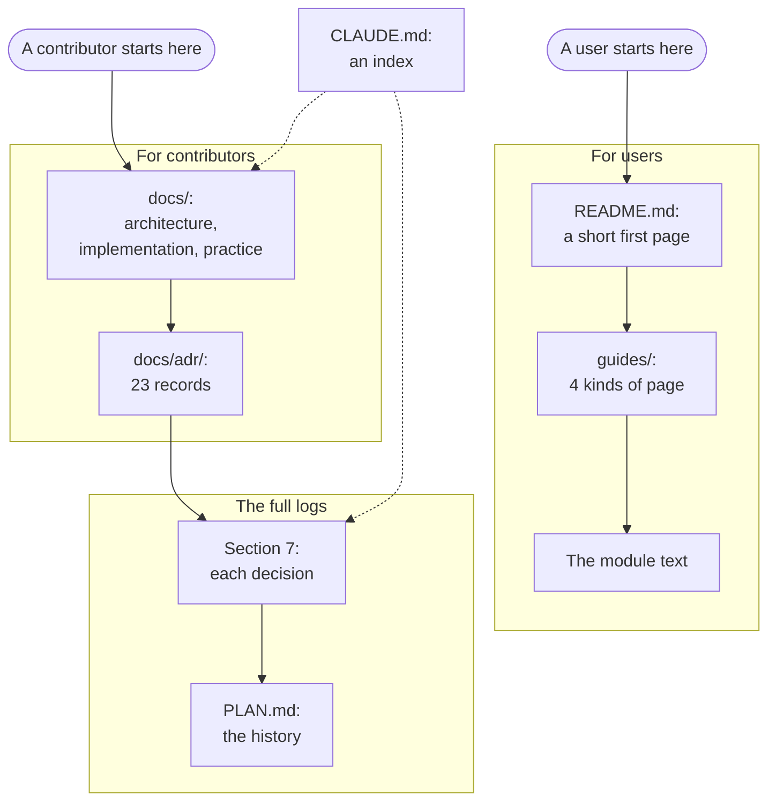
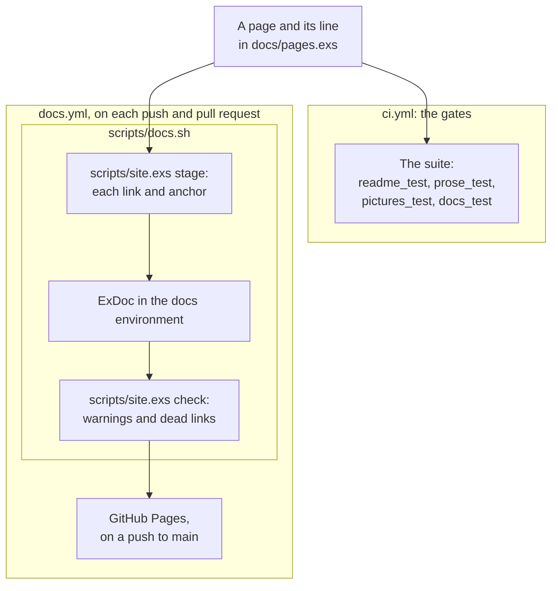

# 0023. The shape of the documentation

This record is for a contributor who adds a page of the documentation, changes one, or
changes a script that checks one. It says why the documentation has its parts, and why
each page follows the same writing rules. It also says why the suite runs each example
of a page, and why CI publishes the site to GitHub Pages.
[Add and check a page](../check-a-page.md) gives the steps. The
[style guide](../style-guide.md) gives the rules.

> #### Caution {: .error}
>
> Do not write a hidden module or a hidden function in backticks on a page. A hidden
> module has `@moduledoc false`, and a hidden function has `@doc false`. Some modules of
> Erlang/OTP are hidden also, for example erts_debug. ExDoc warns, and `scripts/docs.sh`
> fails.
>
> The style guide says to link a module or a function by its name in a code span.
> A hidden module or function is the exception. Write the function without its module, or
> in plain words.

The words page, site and checker have the meaning that
[Add and check a page](../check-a-page.md) gives them. These words have 1 meaning on this
page:

- **Older document**: 1 of the 10 Markdown files of the kind `:legacy`. These files are
  older than the writing rules, and the rules do not apply to them.
- **Mark**: an HTML comment on the line before a code block or a picture. It tells the
  suite what the block is.
- **Manner**: the forms of sentence that the older documents use and a page does not
  use, such as `of its own`. [Forms that the pages do not have](../house-manner.md)
  lists them.
- **Module text**: the `@moduledoc` and `@doc` text of each module. ExDoc shows it as the
  API reference of the site.
- **Plan item**: 1 unit of work of `PLAN.md`, with a name such as DOC-1 or RV-30.
- **Section 7**: the numbered list of decisions in
  [section 7 of `docs/organisation.md`](../organisation.md#7-decisions).

In this record, a test is an ExUnit test, and a warning is a warning of ExDoc. A section
is a part of a Markdown file. These words do not mean a
[test](../../guides/reference/glossary.md#test) of an
[online edit](../../guides/reference/glossary.md#online-edit), a
[warning](../../guides/reference/glossary.md#warning) of a
[program](../../guides/reference/glossary.md#program) or a
[section](../../guides/reference/glossary.md#section) of
[declarations](../../guides/reference/glossary.md#declaration).

## Status

Accepted. No later record replaces this record.

Plan item DOC-1 builds the decision in 3 steps. Step 1 is on `main` at `9d3d696`. Step 2
writes the pages and the records, this record among them. Step 3 reviews the whole.

Until the close of step 2, `README.md` keeps the kind `:legacy` and its long text. The
close of step 2 writes it again as a short first page, with the kind `:readme`.

## Date

2026-11-16, the date of decisions 556 to 572, the last decisions of this record. The
maintainer asked for the change on 2026-11-15 (decisions 546 to 548). The rules for
`CLAUDE.md` are of 2026-11-01 (decisions 358, 361 and 366).

## Context

These problems came before the decision.

1. **A first page that was too long** (decision 546). At `0793a86`, `README.md` had 5,824
   lines and 52,653 words. It held the tutorial and each rule of the
   [dialect](../../guides/reference/glossary.md#dialect). It also held the
   [host contract](../../guides/reference/glossary.md#host-contract), the
   [runner](../../guides/reference/glossary.md#runner), the
   [store](../../guides/reference/glossary.md#store) and the history of each change. A
   reader who wanted 1 rule read through all of it.
2. **3 readers on 1 page.** An Elixir developer, a controls engineer and a contributor
   read the same text. Each one knows different things and wants different things
   ([The readers](../style-guide.md#the-readers)).
3. **An index that held history** (decision 358). The agent tool that works on logex
   loads `CLAUDE.md` whole at the start of each session. On 2026-11-01 the file had
   237 KB and grew by 46% in 8 days. Most of its text gave how each rule came, not what
   the rule is.
4. **A log of decisions with no first page** (decision 547). Section 7 held 545
   decisions in about 10,000 lines. The code, the tests and `CHANGELOG.md` cite each
   decision by its number.
5. **Examples that the suite runs** (decisions 359 and 362). `readme_test.exs` ran each
   example of `README.md` and compared what it printed. An example that moves to a
   different file must not lose that check.
6. **No release** (decision 541). HexDocs publishes the documentation of a package only
   after a release, and the maintainer plans none.

The maintainer gave the request in these words on 2026-11-15:

<!-- unchecked: the request of the maintainer, word for word, as decision 546 records it -->
```text
The readme is a massive wall of text. We need to move all the details from the readme
into a) diataxis exdocs for users and high level explanations and detailed definition of
behaviour of the engine or b) contributor focused documentation including deeper
architecture, ADRs, explanations of implementation approaches etc. This needs to be
mannered-prose-free ASD-STE100 with empathy for the reader, with lots of nice formatting,
diagrams, and other visual aids.
```

ASD-STE100 is Simplified Technical English. It has 53 writing rules and a dictionary of
about 900 approved words. The dictionary is the property of ASD, and ASD certifies no
document. The repository does not hold its text.

[IEC 61131-3](../../guides/reference/glossary.md#iec-61131-3) gives no rule for the shape
of a manual. Decision 546 notes that the manuals of
[Logix](../../guides/reference/glossary.md#logix) have a similar split: a quick start, a
programming manual and a reference of the
[instructions](../../guides/reference/glossary.md#instruction).

## Decision

The documentation has 3 layers. Each page has 1 kind and 1 reader. Each page follows the
writing rules of Simplified Technical English as the style guide gives them, and claims
no conformance. The suite runs each example of each page. ExDoc builds a site from the
pages and the module text, and CI publishes it to GitHub Pages.



Figure: the 3 layers of the documentation. A solid arrow goes to more detail. A dotted
arrow is a pointer from the index. A user starts at `README.md`, and a contributor starts
at `docs/`. The detail of a decision is in section 7, and its history is in `PLAN.md`.

### README is a short first page

`README.md` says what logex is and shows 1 small program (decision 546). It links to the
first tutorial, to each kind of user page and to the contributor pages. It is the first
page of the site. It has its own kind, `:readme`, and its own template,
[`docs/templates/readme.md`](../templates/readme.md). It is a user page under each
writing rule. It ends with its status and its licence, not with "See also" (decision
568).

### A user page is 1 of the 4 kinds of Diátaxis

Diátaxis is a model that puts each page of a manual into 1 of 4 kinds. Each kind has 1 job
for 1 need of the reader. [Add and check a page](../check-a-page.md#the-kinds-of-page)
gives the directory of each kind.

| Kind | The reader | The page gives |
|---|---|---|
| Tutorial | Is new to logex | A lesson on 1 safe path, with a result at each step |
| How-to guide | Knows the basics and has work to do | The steps of 1 job |
| Reference | Looks up a rule | The exact rules of the engine, complete |
| Explanation | Wants to understand | The model and the reasons |

The reference pages define the behaviour of the engine exactly. A user page names no
decision number and no plan item, and tells no history. A tutorial, a how-to guide, a
reference page and an explanation end with "See also".

The module text is the API reference of the site. It stays as it is. Plan item DOC-2
writes it again by the same rules (decision 546).

### A contributor page holds the architecture, a record or a practice

A contributor page is under `docs/`. It holds the architecture, the notes on the design
of each part, or a practice such as the style guide. A contributor page can cite a
decision by its number.

A decision record is 1 page for 1 large decision: the context, the decision, the
alternatives and the consequences (decision 547). The plan has 23 records. Each record
names the decisions of section 7 that it sums up.

### Section 7 stays the full log

Section 7 keeps each decision, with its options and the choice of the maintainer. A
record does not replace a decision. Thus each number that the code, the tests and
`CHANGELOG.md` cite still leads to its decision. `PLAN.md` keeps the history of each
plan item.

### CLAUDE.md is an index

`CLAUDE.md` gives the commands, the conventions and 1 line for each module and each test
file (decision 358). It holds no history. The rules of a module are in its module text,
the reasons are in `docs/organisation.md`, and the history is in `PLAN.md`.

`test/logex/claude_md_test.exs` refuses a `CLAUDE.md` of 40,000 characters or more
(decision 361). It refuses a file of `lib/` or `test/` that `CLAUDE.md` does not name,
and a name in `CLAUDE.md` that does not exist. It also refuses a plan item's name, a
commit and a rule with the time when it came (decision 366). On 2026-11-23,
`CLAUDE.md` had less than 33,000 characters.

The cap of 40,000 is the size at which the agent tool warns of a large file. It is not a
measure of logex. A plan item's name is a pointer into `PLAN.md`, but the test cannot
tell a pointer from history. Thus the test refuses each one.

### The writing rules

Each page follows the writing rules of ASD-STE100 as
[the style guide](../style-guide.md#simplified-technical-english) gives them (decisions
546 and 560). Nobody compares a page with the dictionary, and no page claims conformance.
A page does not use the manner. Each page says in its first lines who its reader is, what
the page gives and what the reader must know first.

The checker refuses each form of its lists that it finds, with the file, the line, the
rule and the words to write. It has 23 rules. On a contributor page and a decision record,
2 of them do not apply: the rule of plan items and the rule of "See also". What a script
cannot judge, the checker counts for a reviewer and fails no page for it.

On 2026-11-23, the checker read 1 draft 2 times: as a decision record, and as a how-to
guide. The draft had these 5 sentences:

1. `The older record says "each device runs in a process of its own".`
2. `You should run the gate before a commit.`
3. `The output is written by the rung.`
4. `The timer adds the time since the last scan.`
5. `Since the tag is retained, it keeps its value.`

| Sentence | As a decision record | As a how-to guide |
|---|---|---|
| 1 | Passes: a quotation, counted | Refused: the manner, `of its own` |
| 2 | Refused: `should` | Refused: `should` |
| 3 | Passes: a possible passive, counted | Passes, counted |
| 4 | Passes: `since` of a time | Passes |
| 5 | Refused: `since` for a reason | Refused |

These decisions set the limits of the checker:

- The checker counts a passive verb and does not refuse it (decision 559). A script cannot tell
  `the tag is written by the rung` from `the contact is closed`, which is not a passive.
- A word with 2 senses passes where a script can tell the sense (decision 569). Sentences
  4 and 5 show this for `since`. In the review of step 1, the first form of the checker
  gave 36 refusals in 40 correct sentences.
- On a user page, the checker reads the words between quotation marks as it reads all
  other words. Thus a user page writes a message of logex as code, not between
  quotation marks. A contributor page and a decision record quote the older documents.
  Thus the checker counts their quotations and does not read them (decision 570).
- A page names the [conventional set](../../guides/reference/glossary.md#conventional-set)
  and not its vendor (decision 561). A page names Logix only to compare what a
  controller does. The glossary gives the conventional word beside a term, for example
  `Conventional set: OTL, Output Latch.` for `latch`.

A technical word is a heading of level 3 of the
[glossary](../../guides/reference/glossary.md). The checker reads the glossary for the
words that it does not refuse.

### The suite runs each example

The suite reads each code block of each page, and also `README.md` (decision 546).
`readme_test.exs` does this work. Its name stays, so each citation of it in section 7
stays correct (decision 566).

A script and the `console` block of its run make an example. The suite runs the script
from `examples/` in a fresh VM and compares what it prints with the page. Each other
block has a mark, or a language that the suite compares with nothing.
[Examples and pictures](../examples-and-pictures.md#code-blocks) gives each mark and
what the suite does with it. `readme_test.exs` refuses a block with no mark, with the
line of the block and the marks that it can have.

The suite does not compare a message in a block with the mark `unchecked` (decision
558). A
`console` block shows commands only, not what they print (decision 572). The checker
counts both kinds of block for a reviewer.

A page shows each file that its examples read, or links to the page that shows it
(decision 557). The link text is the file name. For example, `README.md` has the link
[`motor.ld`](../../guides/tutorials/first-program.md), which goes to the tutorial that
shows the file. More than 1 page can show the same file, and the suite compares each
block with the 1 file.

The tutorial's project gets logex with `{:logex, github: "rellen/logex"}` (decision
565). The suite cannot fetch from GitHub, so that block is a fragment, which the suite
parses.

### ExDoc builds the site, and CI publishes it

logex has no dependency outside the `docs` environment. In that environment, ExDoc is its
only dependency (decision 546). On 2026-11-23, `mix deps` with an empty `MIX_HOME` listed
nothing in `dev`, `test` and `prod`. In `docs` it asked for Hex.
[0003. No dependencies and no generated code](0003-no-dependencies-no-generated-code.md)
gives the reason.

`docs/pages.exs` is the only list of pages: 1 line for each page, with its path, its kind
and its group in the site. `test/logex/docs_test.exs` compares each Markdown file of the
repository with the list. It refuses a new page of the kind `:legacy`.

This diagram shows the path of a page from its file to the site.



Figure: the checks of a page on its path to the site. The suite runs in the gates of
`ci.yml`. `docs.yml` is a separate workflow: it runs `scripts/docs.sh`, and on a push to
`main` it publishes the site.

These decisions set the form of the site:

| Decision | The site |
|---|---|
| 556 | The older documents other than `README.md` are not in the site. A link to one goes to GitHub |
| 562 | Mermaid 11.4.1 comes from jsDelivr, with a check of its hash. A reader with no network sees the text of a diagram |
| 563 | HTML only, no EPUB |
| 564 | A picture is 1 file with its own light panel, the same in the light and the dark theme |
| 567 | A page's name in the site: see [Add and check a page](../check-a-page.md#the-name-of-a-page-in-the-site) |
| 571 | The sidebar shows no version. The title in the tab of the browser still ends `logex v0.1.0` |

`scripts/docs.sh` prints `DOCS-FAIL` on each warning of ExDoc and each dead link that
`docs/site-warnings.txt` does not list. It also fails on a line of the list that the
build does not give. The list has 13 lines: 6 warnings and 7 dead links. All of them
come from the module text, which plan item DOC-2 writes again. If a page makes a
warning, mend the page. Do not add the warning to the list.

`.github/workflows/docs.yml` runs `scripts/docs.sh` on each push and each pull request
(decision 548). On each push, it asks GitHub if Pages publishes from GitHub Actions. On a
push to `main`, if yes, a separate job publishes `doc/`. If no, the run shows a notice,
publishes nothing and stays green. The maintainer set GitHub Actions as the source of
Pages 1 time, in the settings of the repository. The first run on `main` published the
site.

## Consequences

The good results:

- A reader finds 1 kind of text on a page, for 1 need. A page links to the other kinds.
- A user page says what logex does, with no decision number and no history.
- A contributor enters the decisions through 23 records, and each number of section 7
  still leads to its decision.
- `CLAUDE.md` stays an index under its cap, and a test refuses history in it.
- An example on a page cannot become false without a red test. A file shown on 2 pages
  is the same file on both.
- The checker finds the forms of its lists, with the words to write. It reads 1 page in
  about 1 s, and all the pages in about 4 s.
- A page with a dead link or an unlisted warning makes the Docs workflow red. A pull
  request shows it before the page comes into `main`.
- The site needs no release, and the Markdown pages also read on GitHub.

The costs:

- The checker reads no meaning. A wrong word, a group of 4 nouns, a missing article or a
  new form of the manner passes. A reviewer reads each page for these.
- The checker refuses some correct sentences. [Add and check a
  page](../check-a-page.md#what-the-checker-does-not-find) gives the way out of each
  frequent case.
- ASD certifies no page of logex. Nobody compared a page with its dictionary.
- The suite compares a block marked `unchecked` and a `console` block with nothing. A
  message in such a block can become old, and only a reviewer finds it.
- A Mermaid diagram needs the network in the site.
- The module text keeps the manner until plan item DOC-2.
- A page that names a hidden module or function in backticks fails the build of the
  site. On 2026-11-21, 5 runs of the Docs workflow on the branches of step 2 failed for
  this reason. 1 of them named a hidden function of the Erlang/OTP module erts_debug.
- No script follows a link to a different site. Of the older documents, the stage reads
  the links of `README.md` only.
- About 150 pages are more files to keep true than 1 `README.md`. A change of the
  language makes old the pages that show it, and the suite finds only their examples.

## Alternatives considered

| Alternative | Why logex does not use it |
|---|---|
| Keep 1 long `README.md` | It mixes 3 readers and 4 kinds of text in 52,653 words |
| Split section 7 into record files (decision 547) | Each citation of a decision number then leads to a different place |
| No decision records (decision 547) | A new contributor then enters through about 10,000 lines of section 7 |
| A build that publishes nothing (decision 548) | A reader then builds the site to read it |
| HexDocs (decision 548) | It publishes only the documentation of a release, and the maintainer plans none |
| The older documents in the site under "Project" (decision 556) | About 50 more warnings. Each warning names a hidden module or function |
| A file shown on 1 page only (decision 557) | Each later page then links to it, also where the reader wants to see it |
| A mark that the reader does not see, in place of the link (decision 557) | The reader then does not know where the file is |
| No `unchecked` mark (decision 558) | A page that shows a message then runs a script that prints it |
| Refuse each passive form unless marked (decision 559) | Most pages then need a mark on each sentence such as `the contact is closed` |
| Ask ASD for the text and read pages against its dictionary (decision 560) | No page claims conformance, and the style guide gives the rules |
| Name the vendor of the conventional set beside each word (decision 561) | `CONTRIBUTING.md` keeps the vendor unnamed in each document |
| Mermaid kept in the repository (decision 562) | A file of 2.6 MB in the repository |
| No Mermaid (decision 562) | No diagrams |
| An EPUB book also (decision 563) | No Mermaid diagram shows in it |
| 2 files for each picture, 1 for each theme (decision 564) | 2 files to keep the same |
| A path to a clone in the tutorial's project (decision 565) | The reader must clone logex first |
| Rename `readme_test.exs` to `examples_test.exs` (decision 566) | Each citation of the old name in section 7 becomes false |
| Each page by its file name alone (decision 567) | No 2 files of the repository can then have the same name |
| `README.md` ends with "See also" (decision 568) | Decision 546 ends it with its status and its licence |
| Refuse each form of a word with 2 senses (decision 569) | 36 refusals in 40 correct sentences |
| The checker skips quotations on each page, user pages too (decision 570) | A mannered sentence in quotation marks then passes on a user page |
| The version in the sidebar (decision 571) | The maintainer plans no release, so 0.1.0 is the version of no release |
| Any `console` block, counted (decision 572) | An old result of a command in a `console` block then passes |
| A cap of `CLAUDE.md` in lines, or a smaller cap (decision 361) | The cap is the size at which the agent tool warns, not a measure of logex |
| A plan item's name in `CLAUDE.md` as a pointer (decision 366) | No check can tell a pointer from history |

## Decisions in section 7

This record sums up these decisions of
[`docs/organisation.md`](../organisation.md#7-decisions).

| Decision | What it gives |
|---|---|
| 358 | `CLAUDE.md` is an index, with no history, and a test caps its size |
| 361 | The cap is 40,000 characters |
| 366 | No plan item's name and no commit in `CLAUDE.md` |
| 546 | `README.md` short, the 4 kinds of Diátaxis for users, contributor pages, the writing rules, and each example still run |
| 547 | About 20 decision records. Section 7 stays the full log |
| 548 | The site on GitHub Pages, from its own workflow |
| 556 | The older documents stay on GitHub, out of the site |
| 557 | A page shows a file, or links to the page that shows it |
| 558 | The `unchecked` mark |
| 559 | The checker counts a passive verb |
| 560 | The rules as the style guide gives them, and no claim of conformance |
| 561 | No vendor name for the conventional set |
| 562 | Mermaid from jsDelivr |
| 563 | HTML only |
| 564 | 1 file for each picture, on a light panel |
| 565 | The tutorial gets logex from GitHub |
| 566 | `readme_test.exs` keeps its name |
| 567 | The name of a page in the site |
| 568 | `README.md` ends with its status and its licence |
| 569 | The checker passes the clear cases of a word with 2 senses |
| 570 | The checker reads quotations on a user page |
| 571 | No version in the sidebar |
| 572 | A `console` block shows commands only |

[`PLAN.md`](../../PLAN.md) keeps the history of plan item DOC-1.
[The list of decision records](README.md) gives each record.
[0003. No dependencies and no generated code](0003-no-dependencies-no-generated-code.md)
says why ExDoc is in the `docs` environment only.
[0020. Verify by a run](0020-verify-by-executing.md) says why the suite runs each example.
