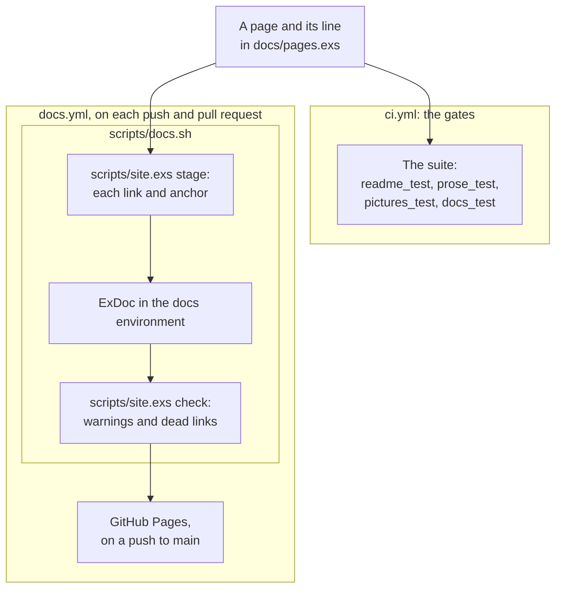

# 0023. The shape of the documentation

This record is for a contributor who adds a page of the documentation, changes one, or
changes a script that checks one. It says why the documentation has its parts, and why
each page follows the same writing rules. It also says why the suite runs each example
of a page, and why CI publishes the site to GitHub Pages.
[Add and check a page](../check-a-page.md) gives the steps. The
[style guide](../style-guide.md) gives the rules.
[Runs and tables of the records: the documentation](../implementation/record-runs-documentation.md#0023-the-shape-of-the-documentation) gives the runs of this record,
its tables and each option not taken.

> #### Caution {: .error}
>
> Do not write a hidden module or a hidden function in backticks on a page. A hidden
> module has `@moduledoc false`, and a hidden function has `@doc false`. ExDoc warns, and
> `scripts/docs.sh` fails. Write the function without its module, or in plain words.

The words page, site and checker have the meaning that
[Add and check a page](../check-a-page.md) gives them. These words have 1 meaning on this
page:

- **Older document**: 1 of the 10 Markdown files of the kind `:legacy`. The writing rules
  do not apply to them.
- **Mark**: an HTML comment on the line before a code block or a picture. It tells the
  suite what the block is.
- **Manner**: the forms of sentence that a page does not use.
  [Forms that the pages do not have](../house-manner.md) lists them.
- **Module text**: the `@moduledoc` and `@doc` text of each module, the API reference of
  the site.
- **Plan item**: 1 unit of work of `PLAN.md`, such as DOC-1.

In this record, a test is an ExUnit test, and a warning is a warning of ExDoc. A section
is a part of a Markdown file. These words do not mean a [test](../../guides/reference/glossary.md#test) of an
[online edit](../../guides/reference/glossary.md#online-edit), a [warning](../../guides/reference/glossary.md#warning) of a [program](../../guides/reference/glossary.md#program) or a
[section](../../guides/reference/glossary.md#section) of [declarations](../../guides/reference/glossary.md#declaration).

## Status

Accepted. No later record replaces this record.

Plan item DOC-1 builds the decision in 3 steps. Step 1 is on `main` at `9d3d696`, and
step 2 at `4ce7465`. Step 3 reviews the whole. Its decisions 589, 590 and 592 change the
records, and [The writing rules](#the-writing-rules) states them.

## Date

2026-11-16, the date of decisions 556 to 572. The maintainer asked for the change on
2026-11-15 (decisions 546 to 548). The rules for `CLAUDE.md` are of 2026-11-01 (decisions
358, 361 and 366).

## Context

These problems came before the decision:

1. **A first page that was too long** (decision 546). At `0793a86`, `README.md` had
   52,653 words. It held the tutorial, each rule, the
   [host contract](../../guides/reference/glossary.md#host-contract) and the history of each change.
2. **3 readers on 1 page.** An Elixir developer, a controls engineer and a contributor
   read the same text ([The readers](../style-guide.md#the-readers)).
3. **An index that held history** (decision 358). The agent tool loads `CLAUDE.md` whole
   at the start of each session. On 2026-11-01 the file had 237 KB.
4. **A log of decisions with no first page** (decision 547). Section 7 of
   [`docs/organisation.md`](../organisation.md#7-decisions) held 545 decisions.
5. **Examples that the suite runs** (decisions 359 and 362). An example that moves to a
   different file must not lose its check.
6. **No release** (decision 541). HexDocs publishes the documentation of a package only
   after a release.

The maintainer asked for user pages and contributor pages in ASD-STE100, Simplified
Technical English. ASD owns its dictionary, and the repository does not hold its text.

[IEC 61131-3](../../guides/reference/glossary.md#iec-61131-3) gives no rule for the shape of a manual. Decision 546 notes
that the manuals of [Logix](../../guides/reference/glossary.md#logix) have a similar split: a quick start, a programming
manual and a reference of the [instructions](../../guides/reference/glossary.md#instruction). The source of this claim is
not recorded.

## Decision

The documentation has 3 layers. Each page has 1 kind and 1 reader. Each page follows the
writing rules as the style guide gives them, and claims no conformance. The suite runs
each example of each page. ExDoc builds a site, and CI publishes it to GitHub Pages.

Figure: the 3 layers of the documentation. A solid arrow goes to more detail. A dotted
arrow is a pointer from the index.

### README is a short first page

`README.md` says what logex is and shows 1 small program (decision 546). It links to the
first tutorial and to each kind of page. It has its own kind, `:readme`, and its own
[template](../templates/readme.md). It ends with its status and its licence (decision
568).

### A user page is 1 of the 4 kinds of Diátaxis

Diátaxis puts each page of a manual into 1 of 4 kinds, each for 1 need of the reader.
[Add and check a page](../check-a-page.md#the-kinds-of-page) gives the directory of each
kind.

| Kind | The reader | The page gives |
|---|---|---|
| Tutorial | Is new to logex | A lesson on 1 safe path, with a result at each step |
| How-to guide | Knows the basics and has work to do | The steps of 1 job |
| Reference | Looks up a rule | The exact rules of the engine, complete |
| Explanation | Wants to understand | The model and the reasons |

A user page names no decision number and no plan item, and tells no history. It ends
with "See also". The module text is the API reference, and plan item DOC-2 writes it again
by the same rules.

### A contributor page holds the architecture, a record or a practice

A contributor page is under `docs/`, and it can cite a decision by its number. A decision
record is 1 page for 1 large decision (decision 547). Each record names the decisions of
section 7 that it sums up. Section 7 stays the full log, so each number that the code and
`CHANGELOG.md` cite still leads to its decision.

### CLAUDE.md is an index

`CLAUDE.md` gives the commands, the conventions and 1 line for each module and each test
file (decision 358). It holds no history. `test/logex/claude_md_test.exs` refuses a
`CLAUDE.md` of 40,000 characters or more (decision 361), the size at which the agent tool
warns. It refuses a file that `CLAUDE.md` does not name, and a plan item's name or a commit
in it (decision 366).

### The writing rules

Each page follows the writing rules of ASD-STE100 as
[the style guide](../style-guide.md#simplified-technical-english) gives them (decisions
546 and 560). A page does not use the manner. Each page says in its first lines who its
reader is and what it gives.

The checker refuses each form of its lists that it finds, with the file, the line and the
words to write. What a script cannot judge, the checker counts for a reviewer:

- It counts a passive verb and does not refuse it (decision 559).
- A word with 2 senses passes where a script can tell the sense (decision 569).
- A contributor page and a decision record quote the older documents, so the checker
  counts their quotations (decision 570).

A page names the [conventional set](../../guides/reference/glossary.md#conventional-set) and not its vendor
(decision 561).

A decision record has these rules:

- It has at most 2,000 words, about 1,500 as the aim. Its runs, measurements and long
  tables are on a contributor page that it links (decision 589).
- It says "ExUnit test" for a test of the suite, and "test" for the step of an online edit
  (decision 590).
- It gives each claim about Logix its source, or says that the source is not recorded
  (decision 592).

### The suite runs each example

`readme_test.exs` reads each code block of each page (decisions 546 and 566). A script and
the `console` block of its run make an example. The suite runs the script from
`examples/` in a fresh VM and compares what it prints with the page. Each other block has
a mark, or a language that the suite compares with nothing.
[Examples and pictures](../examples-and-pictures.md#code-blocks) gives each mark.

The suite does not compare a message in a block with the mark `unchecked` (decision 558).
A `console` block shows commands only (decision 572). A page shows each file that its
examples read, or links to the page that shows it (decision 557).

### ExDoc builds the site, and CI publishes it

ExDoc is the only dependency, in the `docs` environment only (decision 546).
`docs/pages.exs` is the only list of pages, and `test/logex/docs_test.exs` compares each
Markdown file with it.

Figure: the checks of a page on its path to the site. `docs.yml` is a separate workflow
from `ci.yml`.

Decisions 556, 562, 563, 564, 567 and 571 set the form of the site. The older documents
other than `README.md` are not in the site, and HTML is the only format.

`scripts/docs.sh` prints `DOCS-FAIL` on each warning of ExDoc and each dead link that
`docs/site-warnings.txt` does not list. Each line of that list comes from the module text.
If a page makes a warning, mend the page. Do not add the warning to the list.
`.github/workflows/docs.yml` runs `scripts/docs.sh` on each push and each pull request
(decision 548). On a push to `main`, it publishes `doc/` to GitHub Pages.

## Consequences

The good results:

- A reader finds 1 kind of text on a page, for 1 need.
- A user page says what logex does, with no decision number and no history.
- A contributor enters the decisions through the records, and each number of section 7
  still leads to its decision.
- `CLAUDE.md` stays an index under its cap.
- An example on a page cannot become false without a red test.
- A page with a dead link or an unlisted warning makes the Docs workflow red.
- The site needs no release, and the Markdown pages also read on GitHub.

The costs:

- The checker reads no meaning. A wrong word or a new form of the manner passes, and a
  reviewer reads each page for these.
- The checker refuses some correct sentences.
  [Add and check a page](../check-a-page.md#what-the-checker-does-not-find) gives the way
  out of each frequent case.
- ASD certifies no page of logex.
- A message in a block marked `unchecked` can become old, and only a reviewer finds it.
- A Mermaid diagram needs the network in the site.
- A page that names a hidden module or function in backticks fails the build of the site.
- About 150 pages are more files to keep true than 1 `README.md`.

## Alternatives considered

| Alternative | Why logex does not use it |
|---|---|
| Keep 1 long `README.md` | It mixes 3 readers and 4 kinds of text in 52,653 words |
| Split section 7 into record files (decision 547) | Each citation of a decision number then leads to a different place |
| No decision records (decision 547) | A new contributor then enters through about 10,000 lines of section 7 |
| A build that publishes nothing (decision 548) | A reader then builds the site to read it |
| HexDocs (decision 548) | It publishes only the documentation of a release, and the maintainer plans none |
| No `unchecked` mark (decision 558) | A page that shows a message then runs a script that prints it |
| Refuse each passive form unless marked (decision 559) | Most pages then need a mark on each sentence such as `the contact is closed` |
| Rename `readme_test.exs` to `examples_test.exs` (decision 566) | Each citation of the old name in section 7 becomes false |

The page of the runs gives each other option not taken.

## The decisions that this record sums up

This record sums up these decisions of
[`docs/organisation.md`](../organisation.md#7-decisions):

- 358, 361 and 366: `CLAUDE.md` is an index under a cap, with no history.
- 546, 547 and 548: the parts of the documentation, the records and the site.
- 556, 562, 563, 564, 567 and 571: the form of the site.
- 557, 558, 565, 566 and 572: the examples and the marks of the blocks.
- 559, 560, 561, 568, 569 and 570: the writing rules and the checker.
- 589, 590 and 592: the length of a record, its words and its sources.

[`PLAN.md`](../../PLAN.md) keeps the history of plan item DOC-1.
[The list of decision records](README.md) gives each record.
[0003. No dependencies and no generated code](0003-no-dependencies-no-generated-code.md)
says why ExDoc is in the `docs` environment only.
[0020. Verify by a run](0020-verify-by-executing.md) says why the suite runs each example.
