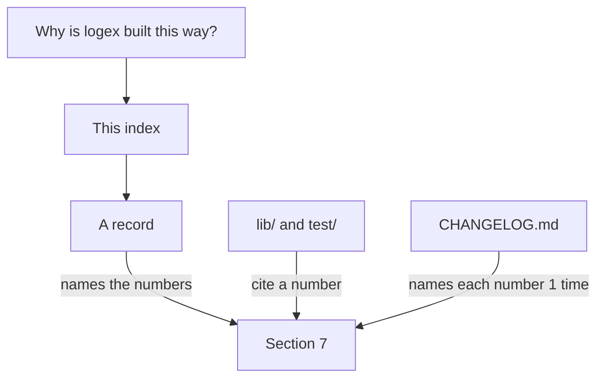

# Decision records

This page is for a contributor who wants to know the reasons for the design of logex,
before a change to it. It says what a decision record is, and how the records stand beside
section 7 of [`docs/organisation.md`](../organisation.md#7-decisions). It has 2 lists:

- [The records](#the-records): each record, with 1 line.
- [Read a record before you change a part](#read-a-record-before-you-change-a-part): the
  records to read before you change each part of logex.

## What a record is

On this page, these words have these meanings:

| Word | Meaning |
|---|---|
| Decision | 1 numbered entry of section 7 of `docs/organisation.md`, for example decision 352 |
| Record | 1 page under `docs/adr/` that sums up the decisions about 1 large choice |
| Section 7 | The section "Decisions" of `docs/organisation.md` |
| Section | 1 part of a document, with a heading. This page does not use the word for a declaration section |
| Test | An ExUnit test of the suite. This page does not use the word for the step of an online edit |

A record gives the problem, the choice, the options that logex did not take and the
results. A record has the 7 sections of the [template of a record](../templates/adr.md):

| Section | What it gives |
|---|---|
| Status | Accepted, Replaced or Withdrawn, and each later decision that changes a part of the record |
| Date | The date of the decision, and the dates of the later decisions |
| Context | The problem and the forces. What [IEC 61131-3](../../guides/reference/glossary.md#iec-61131-3) and [Logix](../../guides/reference/glossary.md#logix) do, where it helps |
| Decision | What logex does, in the present tense |
| Consequences | The good results, the bad results and the costs |
| Alternatives considered | Each option that logex did not take, and why |
| The decisions that this record sums up | The number of each decision that the record sums up |

No record replaces a different record, and no record has the status Withdrawn.

A record follows the [style guide](../style-guide.md) as a contributor page does. It can
cite a decision by its number. It can quote text between double quotation marks, and the
checker does not apply its word rules to a quotation.

## The records and section 7

Section 7 is the full log. It holds each decision that the project took, with its number,
in the sequence of time. It has more than 500 decisions in more than 10,000 lines. Most
entries give the question and the options. Then they give the option that the maintainer
took, with its date. Many entries end with a note in italics that tells what the code
does.

A record does not replace section 7. It is a short way in. It sums up a group of
decisions about 1 subject, explains the reasons and names each number. Many decisions are
small and have no record. Section 7 alone gives them.

Other files cite the numbers of section 7:

- `lib/` and `test/` cite a decision by its number, as `decision 352`.
- `CHANGELOG.md` gives the numbers of the decisions of each release.
- `test/logex/release_test.exs` runs `scripts/changelog.exs` at each run of the suite.
  That script makes sure that `CHANGELOG.md` names each decision 1 time.

So a number never changes its meaning.



Figure: a reader goes from a question to this index, then to a record, then to section 7.
The code, the tests and `CHANGELOG.md` cite the numbers of section 7. For a reader who
cannot see the figure: each path ends at section 7, which holds each number.

This table compares the 2 documents.

| | Section 7 | A record |
|---|---|---|
| Holds | Each decision, large or small | 1 large choice |
| Form | The question, the options, the choice, the date and a note | The 7 sections of the template |
| Words | The style of the older documents ([house manner](../house-manner.md)) | The rules of the style guide |
| In the site | No. A reader reads it on GitHub | Yes, in the group Decision records |
| Cited by | The code, the tests and `CHANGELOG.md` | The contributor pages and the explanation pages |

If a record and section 7 give different rules, read the code in `lib/` and its test.
The code is correct. Then correct the document that is wrong.

Decision 547 chose this approach: a small set of records, 1 for each large choice. It did
not take 2 other options:

- Split section 7 into 1 file for each decision. Then each citation in the code, the
  tests and the changelog must change to name the new file.
- Write no records. Then a new contributor enters through all the lines of section 7.

## The records

- **[0001. A program is data](0001-a-program-is-data.md)**: logex compiles a
  [program](../../guides/reference/glossary.md#program) to `%Logex.Program{}` data that
  `Logex.Runtime` interprets. It never compiles a program to BEAM code.
- **[0002. A dialect for logex, and a survey for each word](0002-own-dialect-and-names.md)**:
  logex reads its own [dialect](../../guides/reference/glossary.md#dialect), not the
  export format of a vendor. A survey in `docs/naming.md` selects each word before its
  code.
- **[0003. No dependencies and no generated code](0003-no-dependencies-no-generated-code.md)**:
  logex has no dependency to build, run or test it. A person wrote its lexer and its
  parser. ExDoc is a dependency of the `docs` environment only.
- **[0004. The software model of IEC 61131-3](0004-iec-software-model.md)**: a file is a
  [program type](../../guides/reference/glossary.md#program-type) or a
  [function block type](../../guides/reference/glossary.md#function-block-type). An
  [instance](../../guides/reference/glossary.md#instance) holds the values. A
  [configuration file](../../guides/reference/glossary.md#configuration-file) puts the
  instances on [tasks](../../guides/reference/glossary.md#task).
- **[0005. Every tag is declared](0005-every-tag-is-declared.md)**: a program declares
  each [tag](../../guides/reference/glossary.md#tag) before its first
  [rung](../../guides/reference/glossary.md#rung). logex reserves each of its words, in
  any case, in the kind of file that uses it.
- **[0006. The types of IEC 61131-3 and overflow](0006-iec-types-and-overflow.md)**: logex
  has 15 [elementary types](../../guides/reference/glossary.md#elementary-type) of
  IEC 61131-3, with their IEC names. An integer result outside its type
  [wraps](../../guides/reference/glossary.md#wrap) and passes no power.
- **[0007. The host gives the time](0007-the-host-gives-the-time.md)**: the core reads no
  [clock](../../guides/reference/glossary.md#clock). The
  [host](../../guides/reference/glossary.md#host) gives the time to each call, and only
  the [runner](../../guides/reference/glossary.md#runner) reads a clock.
- **[0008. Errors in the source and errors of the host](0008-source-mistakes-and-host-mistakes.md)**:
  a [compile](../../guides/reference/glossary.md#compile) returns an error in the source
  as a [diagnostic](../../guides/reference/glossary.md#diagnostic). logex raises an
  `ArgumentError` for an error of the host.
- **[0009. Clauses, not conditionals](0009-clauses-not-conditionals.md)**: the code of
  `lib/` writes each choice as function clauses, not `case`, `cond`, `if` or `unless`.
  The 3 `case` expressions of the parser are the only exception.
  `test/logex/clauses_test.exs` checks it.
- **[0010. A fault does not stop a scan](0010-a-fault-does-not-stop-a-scan.md)**: a
  divisor of 0 or a [subscript](../../guides/reference/glossary.md#subscript) out of range
  gives a [fault](../../guides/reference/glossary.md#fault) as data. The
  [scan](../../guides/reference/glossary.md#scan) runs on. Only a
  [major fault](../../guides/reference/glossary.md#major-fault) trips the runner.
- **[0011. Tasks and rounds](0011-tasks-and-rounds.md)**: a
  [cycle](../../guides/reference/glossary.md#cycle) runs the
  [due](../../guides/reference/glossary.md#due) tasks by
  [priority](../../guides/reference/glossary.md#priority) and never interrupts a scan. A
  late task runs 1 time and counts the periods that it missed.
- **[0012. The staged online edit](0012-staged-online-edit.md)**: an
  [online edit](../../guides/reference/glossary.md#online-edit) has 5 steps, and each step
  returns a report. The [switch](../../guides/reference/glossary.md#switch) moves the
  [state](../../guides/reference/glossary.md#state) by name.
- **[0013. Watchdogs and the trip](0013-watchdogs-and-the-trip.md)**: each kind of failure
  ends in the same [trip](../../guides/reference/glossary.md#trip). The runner writes 0
  to each output [point](../../guides/reference/glossary.md#point), through each device
  that answers, and nothing starts again until a person asks. Each task has a
  [watchdog](../../guides/reference/glossary.md#watchdog).
- **[0014. Devices are processes](0014-devices-are-processes.md)**: each
  [device](../../guides/reference/glossary.md#device) runs in a separate process and has a
  deadline. Each call to an [adapter](../../guides/reference/glossary.md#adapter) also has
  a separate limit of time.
- **[0015. Input forcing](0015-input-forcing.md)**: a person can
  [force](../../guides/reference/glossary.md#force) an input
  [point](../../guides/reference/glossary.md#point) only, never an output point. The
  runner keeps each force in the
  [forces file](../../guides/reference/glossary.md#forces-file).
- **[0016. Retained values and starts](0016-retained-values-and-starts.md)**: only what a
  program or a configuration marks [`retain`](../../guides/reference/glossary.md#retain)
  comes back at a [warm restart](../../guides/reference/glossary.md#warm-restart). logex
  has no pre-scan.
- **[0017. The store on disk](0017-the-store-on-disk.md)**: the
  [store](../../guides/reference/glossary.md#store) is text that a person can read. A
  start reads the store whole or refuses it, and never guesses a value.
- **[0018. File work with a limit](0018-file-work-with-a-limit.md)**: each file call of the
  runner runs in a separate process with a limit of real time. A disk that stalls does not
  stop the runner.
- **[0019. Cost in reductions](0019-cost-in-reductions.md)**: a test of cost counts
  [reductions](../../guides/reference/glossary.md#reduction), never time.
- **[0020. Verify by a run](0020-verify-by-executing.md)**: each claim and each change
  needs a run that shows it. A fix needs a test that fails when you revert the fix.
- **[0021. A pinned toolchain and the gates](0021-pinned-toolchain-and-gates.md)**: logex
  pins Elixir 1.20.4 on Erlang/OTP 28 and keeps no other toolchain working. `mix.exs`
  refuses an Elixir older than 1.20. A commit passes the gates of `scripts/gate.sh`, and a
  script judges each gate by its exit code.
- **[0022. Typespecs and Dialyzer](0022-typespecs-and-dialyzer.md)**: each public function
  of the [host contract](../../guides/reference/glossary.md#host-contract) has a spec.
  Dialyzer and 2 test files compare the specs with the code.
- **[0023. The shape of the documentation](0023-documentation-shape.md)**: the
  documentation has 3 layers, and each page has 1 kind and 1 reader. The suite runs each
  example of a page, and CI publishes the site.

## Read a record before you change a part

This table gives the records to read before you change a part of logex.

| If you change | Read |
|---|---|
| The lexer, the parser or a word of the dialect | [0002](0002-own-dialect-and-names.md), [0003](0003-no-dependencies-no-generated-code.md), [0005](0005-every-tag-is-declared.md) |
| The compiler, a [type](../../guides/reference/glossary.md#type) or an [instruction](../../guides/reference/glossary.md#instruction) | [0001](0001-a-program-is-data.md), [0005](0005-every-tag-is-declared.md), [0006](0006-iec-types-and-overflow.md), [0008](0008-source-mistakes-and-host-mistakes.md) |
| The evaluator or a fault | [0007](0007-the-host-gives-the-time.md), [0010](0010-a-fault-does-not-stop-a-scan.md) |
| A [configuration](../../guides/reference/glossary.md#configuration), a task or the schedule | [0004](0004-iec-software-model.md), [0011](0011-tasks-and-rounds.md) |
| An online edit | [0012](0012-staged-online-edit.md) |
| The runner, a trip or a device | [0013](0013-watchdogs-and-the-trip.md), [0014](0014-devices-are-processes.md), [0015](0015-input-forcing.md), [0018](0018-file-work-with-a-limit.md) |
| A retained value or the store | [0016](0016-retained-values-and-starts.md), [0017](0017-the-store-on-disk.md), [0018](0018-file-work-with-a-limit.md) |
| A public function | [0008](0008-source-mistakes-and-host-mistakes.md), [0022](0022-typespecs-and-dialyzer.md) |
| A test, a script or the toolchain | [0009](0009-clauses-not-conditionals.md), [0019](0019-cost-in-reductions.md), [0020](0020-verify-by-executing.md), [0021](0021-pinned-toolchain-and-gates.md) |
| A page of the documentation | [0023](0023-documentation-shape.md) |

## Add a record

Add a record for a large choice only. A small decision stays in section 7 alone.

1. Make sure that section 7 has each decision of the choice, with its number.
2. Copy `docs/templates/adr.md` to `docs/adr/NNNN-short-title.md`. NNNN is 1 more than
   the highest number under `docs/adr/`, with 4 digits, for example `0024`.
3. Write the 7 sections. The title is the number, a full stop and the decision in a few
   words, for example `# 0024. A new decision`.
4. Add 1 line for the record to `docs/pages.exs`, after the line of the last record:
   `{"docs/adr/0024-a-new-decision.md", :adr, "Decision records"}`.
5. Run `mix test test/logex/docs_test.exs`. It passes. If it fails, see
   [If the test of the pages fails](#if-the-test-of-the-pages-fails).
6. Add 1 item for the record to [The records](#the-records). Add its number to
   [Read a record before you change a part](#read-a-record-before-you-change-a-part). No
   test checks these lists. Check them yourself.
7. Do the checks of [Add and check a page](../check-a-page.md#check-a-page).

### If the test of the pages fails

Each message in this section comes from a run of `mix test test/logex/docs_test.exs`
with a record `0024`.

If you did not do step 4, the test that fails has a name that ends with this text:

<!-- unchecked: the end of the name of the test of test/logex/docs_test.exs that fails, copied from a run -->
```text
it lists every Markdown file of the repository, each once, and no file that is not there
```

Your file is in the list `right:` only. Add its line to `docs/pages.exs`.

If the line gives a different kind, for example `:contributor`, the test fails with this
message, and with a second message about the group:

<!-- unchecked: the first message of test/logex/docs_test.exs for a record of the kind :contributor, copied from a run -->
```text
docs/adr/0024-a-new-decision.md: a page under docs/adr/ is an :adr
```

Give the kind `:adr`.

If the line gives a different group, for example `"Project"`, the test fails with this
message:

<!-- unchecked: the message of test/logex/docs_test.exs for a record in the group "Project", copied from a run -->
```text
docs/adr/0024-a-new-decision.md: a adr page stands under Decision records, or :github
```

Give the group `"Decision records"`.

## Change a record

A later decision can change a part of a record. Then change the record:

1. Add the number of the new decision to the section "The decisions that this record sums up".
2. Add the date of the new decision to the section "Date".
3. In the section "Status", say which earlier decision the new decision changes.
4. Correct the sections "Decision" and "Consequences" so that they say what the code does.

If a later record replaces a record, give the earlier record the status Replaced, with a
link to the later record. If section 7 takes a decision back and no record replaces it,
give the record the status Withdrawn, with the number of that decision.

## See also

- [A map of the documents](../README.md): each document of logex and who reads it.
- [`docs/organisation.md`, section 7](../organisation.md#7-decisions): the full log of the
  decisions.
- [The template of a record](../templates/adr.md): the file to copy.
- [Add and check a page](../check-a-page.md): the kinds of page and the checks.
- [0023. The shape of the documentation](0023-documentation-shape.md): why the
  documentation has its parts.
