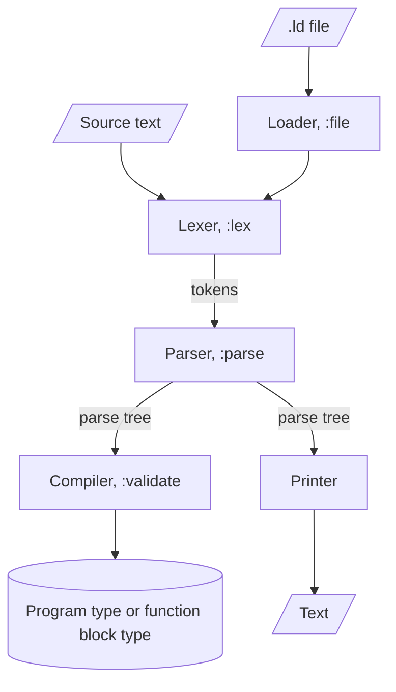

# The compile pipeline

This page is for a contributor. It gives each stage that makes a
[program type](../../guides/reference/glossary.md#program-type) from the text of a `.ld`
file, and the data that passes between the stages. Read it before you add a form of the
syntax, a check of the compiler or a
[diagnostic](../../guides/reference/glossary.md#diagnostic).
[The parts of logex](overview.md) gives the place of the pipeline among the other parts.

## What the pipeline does

The pipeline takes text and gives data. It gives a `%Logex.Program{}`, a
`%Logex.FbType{}` for the file of a
[function block](../../guides/reference/glossary.md#function-block) (a block, on this
page), or a list of diagnostics. No stage makes BEAM code: `Logex.Runtime`
[interprets](../../guides/reference/glossary.md#interpret) the program type.



Figure: the stages and the `stage` of their diagnostics. `Logex.compile_file/1` starts
at the loader and `Logex.compile/2` at the lexer.

| Stage | Gives | `stage` |
|---|---|---|
| Loader: `Logex.compile_file/1`, `Logex.compile_files/1` | The text of the file and of each block file beside it | `:file`, and `:validate` for a block |
| Lexer: `Logex.Lexer.tokenize/1` | Tokens | `:lex` |
| Parser: `Logex.Parser.parse/1` | The parse tree | `:parse` |
| Compiler: `Logex.Compiler.instructionize/3` | The program type or the [function block type](../../guides/reference/glossary.md#function-block-type) | `:validate` |
| Printer: `Logex.Printer.print/1` | Text | None |

This page uses 3 words for the data of the stages:

- A **token** is 1 word, number or mark of the text, with its line and column.
- The **parse tree** (the code calls it the parse AST) is each line of the text as a list
  of words, with each [branch](../../guides/reference/glossary.md#branch) nested. Each
  [operand](../../guides/reference/glossary.md#operand) keeps its line and no column.
- The **IR**, the intermediate representation, is each [rung](../../guides/reference/glossary.md#rung) as a list of
  [instructions](../../guides/reference/glossary.md#instruction).
  [The IR and the program type](ir-and-program-type.md) gives each form of it.

### Where each error comes from

The script [`examples/compile-pipeline.exs`](../../examples/compile-pipeline.exs) gives
the pipeline 4 texts with errors, and prints the stage of each diagnostic. Run it from
`examples/`:

```elixir
# Print the stage and the message of each diagnostic.
show = fn {:error, diagnostics} ->
  Enum.each(diagnostics, fn d ->
    IO.puts("#{d.stage}: " <> Logex.Diagnostic.format(d))
  end)
end

head = "var_input start bool\nvar_output motor bool\n"

# The loader cannot read a file that is not there.
show.(Logex.compile_file("missing.ld"))

# The lexer stops at the first character it cannot read.
show.(Logex.compile(head <> "xic start @ ote motor\n", name: "motor"))

# The parser stops at its first error: line 4 has a second one.
show.(Logex.compile(head <> "( xic start\n( xic motor\n", name: "motor"))

# The compiler gives each error that it finds, in line order.
show.(Logex.compile(head <> "xic strat ote motor\nxyz start\nxic start ote 5\n", name: "motor"))
```

```console
$ mix run compile-pipeline.exs
file: missing.ld: cannot be read: no such file or directory
lex: line 3, column 11: illegal character "@"
parse: line 3, column 12: expected `|` or `)`, found a newline
validate: line 3: `strat` is not declared — did you mean `start`?
validate: line 4: unknown instruction `xyz`
validate: line 5: `ote` expects a tag, found `5`
```

| Stage | Diagnostics | Column | Order |
|---|---|---|---|
| Lexer, parser | The first error only. The parser has no rule to recover from an error. | Yes | Not applicable |
| Compiler | Each error | No | By line |

The compiler gives an undeclared name 1 time, at its first line. In each text, the first
100 undeclared names can get a suggestion. The suggestion is the same name in another
case, or a declared name that is near the name. A name after the first 100 gets no
suggestion. A [warning](../../guides/reference/glossary.md#warning) is a
`%Logex.Diagnostic{}` with `severity: :warning`. A program type carries its warnings only
when the [compile](../../guides/reference/glossary.md#compile) has no error.

## How it is built

### The loader and the process of a compile

`Logex.compile/2`, `Logex.compile_file/1` and `Logex.compile_files/1` delegate to
`Logex.Compiler`. The internal module
[`lib/logex/compiler/worker.ex`](../../lib/logex/compiler/worker.ex) runs each call in a
separate process and gives the result to the caller. The worker charges the reductions of
the compile to the caller. So `Process.info(self(), :reductions)` in a measurement of cost
counts the whole compile. The worker raises each error of the compile again in the
caller, with its message and its stack.

The loader is private code of `Logex.Compiler`:

1. It refuses a path that does not end in `.ld`, with a `:file` diagnostic.
2. It reads the file raw, through the internal module
   [`lib/logex/source_file.ex`](../../lib/logex/source_file.ex), and not through the file
   server of the VM. It refuses a FIFO, a socket or another special file before it reads it.
3. It names the [program](../../guides/reference/glossary.md#program) after the file:
   `motor.ld` gives the name `motor`. A file name that cannot be a name gets a `:file`
   diagnostic.
4. It loads `<type>.ld` from the same directory for each
   [type](../../guides/reference/glossary.md#type) of a declaration that logex does not
   have. Example: `var g gate` loads `gate.ld`. With no such file, the type is
   unknown.
5. It refuses these blocks with a `:validate` diagnostic, at the line of the declaration
   or of the heading:
   - A block that holds an instance of itself at any depth. The message names the chain.
   - A type that names the file of a program.
   - A block whose name is not the name of its file.
6. It keeps each file that it compiled in a memo, by its expanded path. In 1 call of
   `Logex.compile_files/1`, each block compiles 1 time.
7. It gives the warnings of a block to the first program that holds it. Each warning has
   the file of the block.

The loader trusts each block that it compiled in the same call. It does not check that
block a second time.

### The lexer

`Logex.Lexer.tokenize/1` reads the text by binary pattern matching. Each token has its
position `loc`, which is `{line, column}`, counted from 1, the column in characters. The
lexer drops spaces and `//` comments. It knows no
[mnemonic](../../guides/reference/glossary.md#mnemonic): `xic` is a `:name` token, as
`t1.dn` and `temps[slot]` are.

| Token | Means | Example of the text |
|---|---|---|
| `{:bst, loc}` | Branch start | `(` |
| `{:nxb, loc}` | Next [leg](../../guides/reference/glossary.md#leg) | `\|` |
| `{:bnd, loc}` | Branch end | `)` |
| `{:rnd, loc}` | Rung end | A newline |
| `{:name, loc, text}` | A name | `xic`, `t1.dn`, `status.[n]`, `temps[slot]`, `real[4]` |
| `{:int_lit, loc, value}` | An integer | `3000`, `-5` |
| `{:int_lit, loc, value, spelling}` | An integer with a spelling | `16#3c`, `1_000`, `007` |
| `{:real_lit, loc, value}` | A real | `40.0` |
| `{:real_lit, loc, value, spelling}` | A real with a spelling | `37.50` |

A [literal](../../guides/reference/glossary.md#literal) keeps its spelling only where the
spelling is not the plain text of its value. A number has 10,000 characters at most. The
exponent of a real is 9,999 at most, for example `1.0e9999`. A longer number or a larger
exponent is a `:lex` diagnostic. Each limit is far more than the largest value of a type,
so the work of the lexer stays in proportion to the text.

### The parser

`Logex.Parser.parse/1` is a recursive descent parser. Its moduledoc gives the grammar.
The parser uses the left-factored form of the grammar, which is LL(1): the next token
alone decides each step. The parser reads a
[declaration](../../guides/reference/glossary.md#declaration) line as it reads a rung.
The compiler tells them apart. The parser drops an empty line.

`Logex.Parser.well_formed!/1` defines the trees that `parse/1` can give.
`instructionize/3` calls it first. It raises an `ArgumentError` for a tree that no text
can give:

<!-- unchecked: the message copied from a call of instructionize/3, with its defaults, on a tree built by hand -->
```text
not a tree Logex.Parser.parse/1 can produce: a literal is an integer, got: {:int_lit, 1, 1.5}
```

So a tree that you build by hand in a test file must be a tree that `well_formed!/1`
takes.

### The compiler

`Logex.Compiler.instructionize/3` takes the parse tree, the
[tags](../../guides/reference/glossary.md#tag) declared from Elixir and the function
block types. It does these steps:

1. It reads the first line. If the first line is `function_block <name>`, the file is a
   block. If not, the file is a program.
2. It makes the tag table from the declaration lines, with `Logex.Declarations`. It
   refuses a declaration after the first rung. It refuses a declaration that holds more
   than 65,536 tags, [elements](../../guides/reference/glossary.md#element) and
   instances. A timer or a counter counts 1. An instance of a block counts 1, and each
   tag, element and instance that its type holds.
3. It lowers each rung to the IR. It changes the rung of the parse tree into a list of IR
   instructions. It finds each mnemonic in `Logex.Compiler.instructions/0`. It reads the
   operands in the order and with the access that the signature of the mnemonic gives.
4. It checks the rungs as a whole:
   - Each name, each [label](../../guides/reference/glossary.md#label) and each
     [jump](../../guides/reference/glossary.md#jump).
   - Each [timer](../../guides/reference/glossary.md#timer),
     [counter](../../guides/reference/glossary.md#counter) and block
     [instance](../../guides/reference/glossary.md#instance) has 1 instruction of each
     mnemonic at most. A `ctud` takes 1 `ctu` and 1 `ctd`, with the same
     [preset](../../guides/reference/glossary.md#preset).
   - Each rung writes a tag, runs an instance or jumps.
5. With no error, it settles the facts that each
   [scan](../../guides/reference/glossary.md#scan) reads: `units`, `reals`, `arrays` and
   `retained`. It gets the warnings from `Logex.Warnings`. With errors, it sorts them by
   line.

If a [host](../../guides/reference/glossary.md#host) gives a function block type in
`types:`, the compiler compiles the type again from its source text. If the result is not
the same as the type given, `Logex.compile/2` raises an `ArgumentError`.

`Logex.Walk` reads the IR for the checks, the warnings and an
[online edit](../../guides/reference/glossary.md#online-edit). A new walk reads the
operands of an instruction through `Logex.Compiler.signature/2`, never through a separate
table.

### The printer

`Logex.Printer.print/1` gives the parse tree back as text, 1 rung on each line, with 1
space between the words. It keeps each name, each spelling and the case of each word. It
does not keep a comment or an empty line, because the lexer drops them.

The [store](../../guides/reference/glossary.md#store) finds the program that wrote it by
the digest of a canonical print. The internal module
[`lib/logex/retain.ex`](../../lib/logex/retain.ex) makes this text with `print/1`. It
writes each number as its value, and each word that logex reads in any case in lowercase.
So `XIC start` gives `xic start`, `16#00ff` gives `255`, and `w.[4]` gives `w.4`. The
name of a tag keeps its case.

## Why it is built this way

Each number is a decision of [`docs/organisation.md`](../organisation.md) §7, the full
log.

- **A lexer and a parser in plain Elixir.** yecc, the parser generator of OTP, needed a
  guard of 221 lines. NimbleParsec and Pegasus were 6.9 to 8.3 times slower
  ([`PLAN.md`](../../PLAN.md#6-deliberately-not-changing) §6).
- **Mnemonics are not in the grammar.** A new instruction is a row of `@instructions` and
  2 clauses of the evaluator. The lexer and the parser do not change.
- **The parse tree defines its own shape.** `instructionize/3` checks each tree with
  `well_formed!/1` before any other step (decision 28). So a tree built as data is a tree
  that text can give.
- **A literal keeps its spelling.** The printer gives `16#00ff` back, and a message
  quotes `16#ffff` and not `65535` (decision 202). The lexer limits the length of a
  number (decision 369).
- **A declaration has a limit.** Without it, `var row cell[256]`, each `cell` holding
  `ton[256]`, compiled and used all the memory at its
  [first scan](../../guides/reference/glossary.md#first-scan) (decisions 370 and 403).
- **A rung that writes nothing is an error.** A newline ends a rung, so a rung on 2 lines
  is 2 rungs. The first one writes nothing, and the compiler refuses it (decision 351).
- **The compiler compiles a type given again.** So a type edited by hand cannot pass
  (decision 54). The compile of the loader is private, so a host cannot give the loader
  a type that skips this check (decisions 371 and 432).
- **A raw read.** A compile does not wait behind the file server of the VM (decision
  464). It shares the dirty I/O schedulers of the VM (10 by default, `+SDio`) with each
  other raw file call. So it can wait while other raw calls hold all of them.
- **A separate process.** A program keeps its source text. Before the worker, a compile
  with many refusals held more binaries than a process keeps off its heap. Then each
  collection became a full one. The worker starts with an allowance that the size of the
  text sets (decisions 520 and 524).
- **100 suggestions in each text.** A refusal of many names costs about its count
  (decisions 520, 522 and 525).

## How to change it

To add a form of the syntax:

1. Read the moduledoc of `Logex.Lexer` or `Logex.Parser`, and the Conventions of
   [`CLAUDE.md`](../../CLAUDE.md).
2. Add the form to the generator and to `@required_shapes` in
   `test/logex/printer_test.exs`. Run `mix test test/logex/printer_test.exs`. It fails on
   the new shape.
3. Change the lexer or the parser, `Logex.Parser.well_formed!/1` and the grammar in the
   moduledoc of `Logex.Parser`.

> #### Caution {: .error}
>
> Do not change the text that `print/1` gives for a form that exists. The store finds a
> program by the digest of its canonical print. A warm start with a changed digest warns
> that another program wrote the store.

4. Change the printer for the new form only. Run `mix test test/logex/printer_test.exs`.
   It passes.
5. If the form adds a keyword, add its stanza to `docs/naming.md`. Without it,
   `test/logex/naming_test.exs` fails.

> #### Caution {: .error}
>
> Do not regenerate the golden record to make `frontend_golden_test.exs` pass. The golden
> record, `test/fixtures/frontend_golden.txt`, holds the parse tree or the error line of
> 1,590 sources. No tool finds an ambiguity in the grammar, so this record is the only
> check. If `frontend_golden_test.exs` fails, your change alters how an old source
> parses. Find that source in the failure, and correct the lexer or the parser.

6. Run `mix run test/fixtures/generate_frontend_golden.exs`, then
   `git diff test/fixtures/`. Read each changed line. Each one must be a source whose
   result the new form changes on purpose.
7. Change [Source syntax](../../guides/reference/source-syntax.md) and its examples.
8. Run `mix format`, then `scripts/gate.sh`. After 7 to 10 minutes, it prints `GATE-OK`.

To add a check of the compiler:

1. Find the step of `instructionize/3` that has the facts that the check needs.
2. Add an assertion of the whole message to `test/logex/validation_test.exs`. Run that
   file. The new assertion fails.
3. Return a `%Logex.Diagnostic{}` with `stage: :validate`, its line and its message. Do
   not raise: logex raises only for a wrong argument of the host. Run the file again. It
   passes.
4. For a name that the compiler cannot find, make the message through
   `Logex.Declarations.offer/5`. Then the suggestions stay inside their limit.
5. Add the message to [Diagnostics](../../guides/reference/diagnostics.md).
6. Run `scripts/gate.sh`. It prints `GATE-OK`.

To add an instruction, follow
[Add an instruction](../implementation/adding-an-instruction.md).

| Part | Its test files, under `test/logex/` if the row names no other path |
|---|---|
| Tokens and parse tree | `frontend_golden_test.exs`, `lex_and_parse_test.exs`, `frontend_test.exs`, `lexer_binaries_test.exs` |
| Printer | `printer_test.exs` |
| Checks and messages of the compiler | `validation_test.exs`, `instructionize_test.exs`, `review_lows_test.exs` |
| Each text compiles or gets a diagnostic | `compile_total_test.exs` |
| Loader | `test/logex_test.exs`, `loading_test.exs`, `function_block_test.exs`, `review_lows_test.exs` |
| Fields of a diagnostic | `diagnostic_test.exs` |

## See also

- [0003. No dependencies and no generated code](../adr/0003-no-dependencies-no-generated-code.md).
- [0008. Errors in the source and errors of the host](../adr/0008-source-mistakes-and-host-mistakes.md).
- [The IR and the program type](ir-and-program-type.md) and
  [The runtime and the evaluator](runtime-and-evaluator.md).
- [The architecture of the store and its files](store-and-files.md): the store and its
  digest.
- [The test strategy](../implementation/testing-strategy.md).
- [Glossary](../../guides/reference/glossary.md): the technical words of logex.
