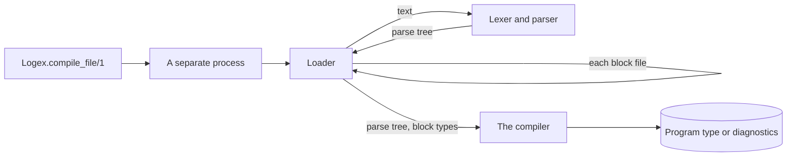

# The loader and the compiler

This page is for a contributor. It gives the 2 stages at the ends of the compile
pipeline. The loader reads the files. The compiler checks the parse tree and lowers it to
the IR. Read it before you add a check of the compiler, a
[diagnostic](../../guides/reference/glossary.md#diagnostic) or a rule of the loader.
[The compile pipeline](compile-pipeline.md) gives each stage, the lexer, the parser, the
printer and the stage of each diagnostic.

## What the part does

The loader reads a `.ld` file, and the file of each
[function block](../../guides/reference/glossary.md#function-block) type (a block, on
this page) that it declares. The compiler takes the parse tree of each text and gives a
`%Logex.Program{}`, a `%Logex.FbType{}` or a list of diagnostics.

Figure: a compile from a file. The loader parses the file, then loads and compiles each
block that it declares. Then the compiler compiles the program with those block types.

## How it is built

### The loader and the process of a compile

`Logex.compile/2`, `Logex.compile_file/1` and `Logex.compile_files/1` delegate to
`Logex.Compiler`. The internal module
[`lib/logex/compiler/worker.ex`](../../lib/logex/compiler/worker.ex) runs each call in a
separate process and gives the result to the caller. The worker charges the reductions of
the compile to the caller. So `Process.info(self(), :reductions)` in a measurement of cost
counts the whole compile. The worker raises each error of the compile again in the
caller, with its message and its stack.

The loader is private code of `Logex.Compiler`:

1. It refuses a path that does not end in `.ld`, with a `:file` diagnostic.
2. It reads the file raw, through the internal module
   [`lib/logex/source_file.ex`](../../lib/logex/source_file.ex), and not through the file
   server of the VM. It refuses a FIFO, a socket or another special file before it reads it.
3. It names the [program](../../guides/reference/glossary.md#program) after the file:
   `motor.ld` gives the name `motor`. A file name that cannot be a name gets a `:file`
   diagnostic.
4. It loads `<type>.ld` from the same directory for each
   [type](../../guides/reference/glossary.md#type) of a declaration that logex does not
   have. Example: `var g gate` loads `gate.ld`. With no such file, the type is
   unknown.
5. It refuses these blocks with a `:validate` diagnostic, at the line of the declaration
   or of the heading:
   - A block that holds an instance of itself at any depth. The message names the chain.
   - A type that names the file of a program.
   - A block whose name is not the name of its file.
6. It keeps each file that it compiled in a memo, by its expanded path. In 1 call of
   `Logex.compile_files/1`, each block compiles 1 time.
7. It gives the warnings of a block to the first program that holds it. Each warning has
   the file of the block.

The loader trusts each block that it compiled in the same call. It does not check that
block a second time.

### The compiler

`Logex.Compiler.instructionize/3` takes the parse tree, the
[tags](../../guides/reference/glossary.md#tag) declared from Elixir and the function
block types. It does these steps:

1. It reads the first line. If the first line is `function_block <name>`, the file is a
   block. If not, the file is a program.
2. It makes the tag table from the declaration lines, with `Logex.Declarations`. It
   refuses a declaration after the first rung. It refuses a declaration that holds more
   than 65,536 tags, [elements](../../guides/reference/glossary.md#element) and
   instances. A timer or a counter counts 1. An instance of a block counts 1, and each
   tag, element and instance that its type holds.
3. It lowers each rung to the IR. It changes the rung of the parse tree into a list of IR
   instructions. It finds each mnemonic in `Logex.Compiler.instructions/0`. It reads the
   operands in the order and with the access that the signature of the mnemonic gives.
4. It checks the rungs as a whole:
   - Each name, each [label](../../guides/reference/glossary.md#label) and each
     [jump](../../guides/reference/glossary.md#jump).
   - Each [timer](../../guides/reference/glossary.md#timer),
     [counter](../../guides/reference/glossary.md#counter) and block
     [instance](../../guides/reference/glossary.md#instance) has 1 instruction of each
     mnemonic at most. A `ctud` takes 1 `ctu` and 1 `ctd`, with the same
     [preset](../../guides/reference/glossary.md#preset).
   - Each rung writes a tag, runs an instance or jumps.
5. With no error, it settles the facts that each
   [scan](../../guides/reference/glossary.md#scan) reads: `units`, `reals`, `arrays` and
   `retained`. It gets the warnings from `Logex.Warnings`. With errors, it sorts them by
   line.

If a [host](../../guides/reference/glossary.md#host) gives a function block type in
`types:`, the compiler compiles the type again from its source text. If the result is not
the same as the type given, `Logex.compile/2` raises an `ArgumentError`.

`Logex.Walk` reads the IR for the checks, the warnings and an
[online edit](../../guides/reference/glossary.md#online-edit). A new walk reads the
operands of an instruction through `Logex.Compiler.signature/2`, never through a separate
table.

## Why it is built this way

Each number is a decision of [`docs/organisation.md`](../organisation.md) §7, the full
log.

- **A declaration has a limit.** Without it, `var row cell[256]`, each `cell` holding
  `ton[256]`, compiled and used all the memory at its
  [first scan](../../guides/reference/glossary.md#first-scan) (decisions 370 and 403).
- **A rung that writes nothing is an error.** A newline ends a rung, so a rung on 2 lines
  is 2 rungs. The first one writes nothing, and the compiler refuses it (decision 351).
- **The compiler compiles a type given again.** So a type edited by hand cannot pass
  (decision 54). The compile of the loader is private, so a host cannot give the loader
  a type that skips this check (decisions 371 and 432).
- **A raw read.** A compile does not wait behind the file server of the VM (decision
  464). It shares the dirty I/O schedulers of the VM (10 by default, `+SDio`) with each
  other raw file call. So it can wait while other raw calls hold all of them.
- **A separate process.** A program keeps its source text. Before the worker, a compile
  with many refusals held more binaries than a process keeps off its heap. Then each
  collection became a full one. The worker starts with an allowance that the size of the
  text sets (decisions 520 and 524).
- **100 suggestions in each text.** A refusal of many names costs about its count
  (decisions 520, 522 and 525).

## How to change it

To add a check of the compiler:

1. Find the step of `instructionize/3` that has the facts that the check needs.
2. Add an assertion of the whole message to `test/logex/validation_test.exs`. Run that
   file. The new assertion fails.
3. Return a `%Logex.Diagnostic{}` with `stage: :validate`, its line and its message. Do
   not raise: logex raises only for a wrong argument of the host. Run the file again. It
   passes.
4. For a name that the compiler cannot find, make the message through
   `offer/5`, an internal function of `Logex.Declarations`. Then the suggestions stay
   inside their limit.
5. Add the message to [Diagnostics](../../guides/reference/diagnostics.md).
6. Run `scripts/gate.sh`. It prints `GATE-OK`.

To add an instruction, follow
[Add an instruction](../implementation/adding-an-instruction.md).

| Part | Its test files, under `test/logex/` if the row names no other path |
|---|---|
| Checks and messages of the compiler | `validation_test.exs`, `instructionize_test.exs`, `review_lows_test.exs` |
| Each text compiles or gets a diagnostic | `compile_total_test.exs` |
| Loader | `test/logex_test.exs`, `loading_test.exs`, `function_block_test.exs`, `review_lows_test.exs` |
| Fields of a diagnostic | `diagnostic_test.exs` |

## See also

- [0008. Errors in the source and errors of the host](../adr/0008-source-mistakes-and-host-mistakes.md).
- [The compile pipeline](compile-pipeline.md): each stage and its diagnostics.
- [The IR and the program type](ir-and-program-type.md): what the compiler gives.
- [The cost of a stage in reductions](../implementation/testing-cost.md): the growth tests
  of the compile.
- [Diagnostics](../../guides/reference/diagnostics.md): each message, for a user.
- [Glossary](../../guides/reference/glossary.md): the technical words of logex.
