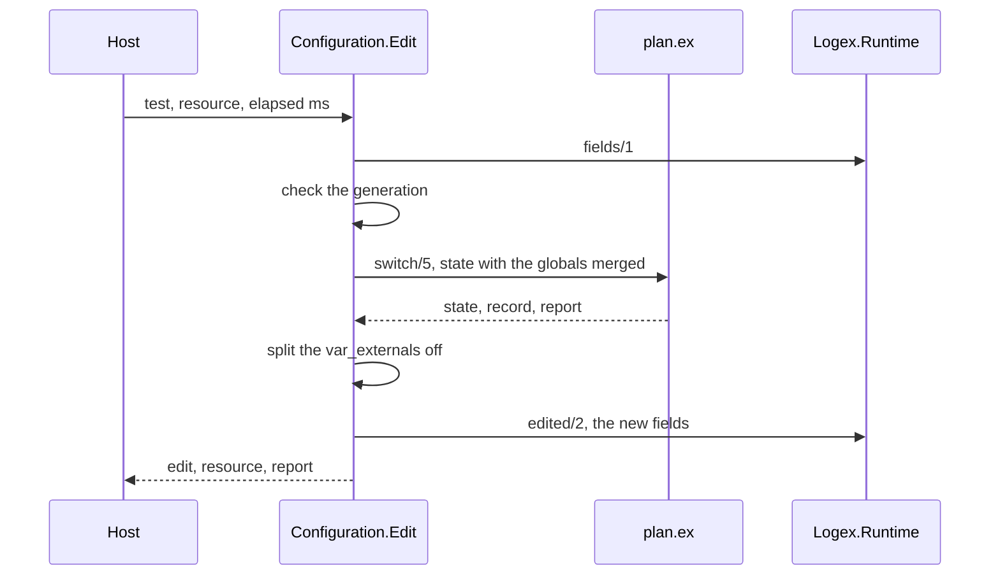

# The online edit of a resource

This page is for a contributor. It describes how `Logex.Configuration.Edit` does an
[online edit](../../guides/reference/glossary.md#online-edit) of a
[resource](../../guides/reference/glossary.md#resource), and how `Logex.Runner` holds an
edit. Read it before you change a rule of a
[configuration](../../guides/reference/glossary.md#configuration) edit or a step through
the [runner](../../guides/reference/glossary.md#runner).
[The architecture of an online edit](online-edit.md) gives the plans, the record and the
[switch](../../guides/reference/glossary.md#switch) of 1
[instance](../../guides/reference/glossary.md#instance). Read it first.

> #### Caution {: .error}
>
> Write the fields of `%Logex.Runtime{}` only through the internal function `edited/2` of
> `Logex.Runtime`. It derives the wiring again and adds 1 to the generation. The check of
> an old edit reads that generation.

## What the part does

`Logex.Configuration.Edit` has the 5 steps of `Logex.Edit`, and the same form of report.
Each step takes the resource and returns it. The
[host](../../guides/reference/glossary.md#host) selects no [program](../../guides/reference/glossary.md#program):
`Logex.Runtime.cycle/3` runs the configuration that the resource holds.

At the [accept](../../guides/reference/glossary.md#accept), the edit makes 1 plan for each
[program type](../../guides/reference/glossary.md#program-type) that an instance runs in
both configurations. It calls `plans/3` with `:globals`. Thus each `var_external` is a
[global](../../guides/reference/glossary.md#global), and no start rule starts it.



Figure: 1 test of a configuration, for 1 instance that both configurations run.

The diagram shows that the plan file never sees the resource. The edit reads the fields
of the resource through `fields/1` and writes them through `edited/2`. Both are internal
functions of `Logex.Runtime`, and the [type](../../guides/reference/glossary.md#type) of the resource stays opaque.

## How it is built

### The edit

`%Logex.Configuration.Edit{}` has the fields of `%Logex.Edit{}`, with `records` in place
of `record`. It also has these fields:

| Field | Holds |
|---|---|
| `records` | 1 record for each instance name |
| `generation` | The generation of the resource that the next step expects |
| `held` | For each direction, the globals that hold their value |
| `holders` | For each direction, the [connections](../../guides/reference/glossary.md#connection) that hold a [point](../../guides/reference/glossary.md#point) |
| `holds` | The [outputs](../../guides/reference/glossary.md#output) that the last switch started at the value of a held global |
| `aside_at` | The time at which the edit set aside each instance |

### A switch of a configuration

A switch of a configuration does these steps:

1. At the first [test](../../guides/reference/glossary.md#test), it drops what an earlier edit left: instances set aside and unused globals.
2. It starts each global of the new configuration that the resource does not have.
3. It merges the globals into the state of each kept instance, by the program that stops.
4. It does `switch/5` of the plan file for each kept instance, at the `now` of the resource.
5. It removes each `var_external` from the state again.
6. It sets aside each instance that the new configuration does not run.
7. It brings back or starts each instance that only the new configuration runs.
8. It moves the [due](../../guides/reference/glossary.md#due) time of each
   [task](../../guides/reference/glossary.md#task) whose interval changes.
9. It writes the new fields through `edited/2`.

A kept instance is an instance that both configurations run with the same program type.
Its report entries get the name of the instance before their paths, for example
`c1.t1`. Steps 3 and 5 keep 1 copy of each global, in the resource. Thus no switch writes
a global.

An instance set aside keeps its [state](../../guides/reference/glossary.md#state) in the field `aside` of the
resource, and no [cycle](../../guides/reference/glossary.md#cycle) does a [scan](../../guides/reference/glossary.md#scan) of it. An [untest](../../guides/reference/glossary.md#untest)
brings it back. Its [timers](../../guides/reference/glossary.md#timer) then resume by the time that it was aside, from
`aside_at`.

The time of a step is the `now` of the resource plus the elapsed milliseconds that the
host gives. Only the move of a due time uses it. A timer resumes from the `now` of the
resource.

### The generation

Each step but the accept adds 1 to the generation of the resource, through `edited/2`.
A [cancel](../../guides/reference/glossary.md#cancel) from the accept also adds 1, and changes nothing else. Each step compares the generation of the edit with
the generation of the resource, and then the configuration that the resource runs. A
step of an old edit raises an `ArgumentError`.

A second accept replaces the open edit. At its first test, it drops each instance set
aside and each global that only the replaced edit kept. A `Logex.Runtime.restart/2`
during an edit keeps the generation and the stage. It drops the instances set aside. The next
switch starts each of them again as a new instance.

### The edit through the runner

The runner holds 1 edit and a count of the steps that it did, `edits`. The accept does
its work in the process that calls it:

1. The caller gets the count, the resource and the elapsed time from the runner.
2. The caller does `Logex.Configuration.Edit.accept/3` against that resource.
3. The caller sends the edit, the [forecast](../../guides/reference/glossary.md#forecast) and the count to the runner.
4. If the count is the same, the runner keeps the edit. If not, the caller does the accept
   again.

The runner does each other step in its own process, between 2
[rounds](../../guides/reference/glossary.md#round). After a step, it reads the
[watchdogs](../../guides/reference/glossary.md#watchdog) and the untimed instances of the
configuration that runs. It adds 1 to `edits` and sends `{:edit, step, report}` to each
subscriber. If the runner keeps a [store](../../guides/reference/glossary.md#store), it
also notes the program that the next write of the store names.

## An example

The script `online-edit-of-a-resource.exs` removes the conveyor `c2` from
[`line.logex`](resource-and-schedule.md) and puts it back. It reads the fields of the
resource at each step. Get [`conveyor.ld`](resource-and-schedule.md) also, and run the
script from `examples/`.

```elixir
alias Logex.Configuration.Edit
alias Logex.Runtime

{:ok, line} = Logex.Configuration.compile_file("line.logex")
# The new configuration is line.logex with no conveyor c2. Its program types are those of line.
[text, _c2] = String.split(File.read!("line.logex"), "program c2 ")
{:ok, smaller} = Logex.Configuration.compile("line", text, line.programs)

# The generation, the instances that run and the instances set aside. These are fields of
# the resource that only logex reads: fields/1 is an internal function of Logex.Runtime.
names = fn
  map when map_size(map) == 0 -> "none"
  map -> Enum.join(Map.keys(map), " ")
end

show = fn label, resource, report ->
  fields = Runtime.fields(resource)
  run = names.(fields.instances)
  aside = names.(fields.aside)

  IO.puts(
    String.pad_trailing(label, 7) <> "generation #{fields.generation}, run #{run}, aside #{aside}"
  )

  Enum.each(report, fn entry -> IO.puts("  " <> inspect(entry)) end)
end

resource = Runtime.start(line)
{resource, _outputs, _events} = Runtime.cycle(resource, 0, %{"pb_start_2" => 1})
show.("start", resource, [])

{:ok, edit, forecast} = Edit.accept(resource, smaller)
show.("accept", resource, forecast)
{edit, resource, report} = Edit.test(edit, resource)
show.("test", resource, report)
{resource, outputs, _events} = Runtime.cycle(resource, 50, %{})
IO.puts("outputs after a cycle: #{inspect(outputs)}")
{untested, resource, report} = Edit.untest(edit, resource)
show.("untest", resource, report)
{_line, resource, report} = Edit.cancel(untested, resource)
show.("cancel", resource, report)

# The edit of the untest expects generation 2. The cancel moved the resource to 3.
try do
  Edit.test(untested, resource)
rescue
  error in ArgumentError -> IO.puts(Exception.message(error))
end
```

```console
$ mix run online-edit-of-a-resource.exs
start  generation 0, run c1 c2, aside none
accept generation 0, run c1 c2, aside none
  {:held, "k2", 1}
  {:instance_stopped, "c2", "conveyor"}
test   generation 1, run c1, aside c2
  {:held, "k2", 1}
  {:instance_stopped, "c2", "conveyor"}
outputs after a cycle: %{"k1" => 0, "k2" => 1}
untest generation 2, run c1 c2, aside none
  {:instance_back, "c2", "conveyor"}
cancel generation 3, run c1 c2, aside none
this edit expects the resource at generation 2, but it is at generation 3: the edit has ended, or another edit has stepped since
```

- **The accept changes nothing.** The generation stays 0, and the forecast is the report
  of the test.
- **The test sets `c2` aside.** The motor of `c2` runs, and no instance drives `k2` after
  the test. Thus `k2` holds 1, and the cycle gives it to the host.
- **The untest brings `c2` back** from `aside`, with its state.
- **Each step adds 1 to the generation.** The edit of the untest expects 2, and the
  cancel moved the resource to 3.

## Why it is built this way

Each number is a decision of [`docs/organisation.md`](../organisation.md) §7, the full
log. §4.9 of that document gives the design, from "OE-2's design".

- **A separate module.** Decision 59 keeps `Logex.Edit` the edit of 1 instance. The
  plan file serves both edits.
- **1 copy of each global.** Decisions 45 and 49 merge and split the globals around each
  switch. Decision 55 makes a [tag](../../guides/reference/glossary.md#tag) that becomes a `var_external` read the global.
- **The time of the resource.** Decision 56 gives each kept instance the `now` of the
  resource. Decision 57 resumes the timers of an instance by the time that it was aside.
- **The generation.** Decisions 60 and 64 count the steps in the resource only. A lone
  instance serves the bench and the suite. A controller in a
  [plant](../../guides/reference/glossary.md#plant) is a resource.
- **A superseded edit.** Decision 66 drops what a replaced edit left at the first test.
  Thus no instance comes back that this edit never ran.
- **A [restart](../../guides/reference/glossary.md#restart) during an edit.** Decision 65 keeps the stage, so a person can correct a
  program and restart.
- **Accept in the caller.** Decisions 119 and 141 keep the work of an accept out of the
  runner. A large accept then delays no round.
- **A new interval.** Decisions 40 and 139 count a new interval from the time of the
  step. A task then misses no period.

The decision record is
[0012. The staged online edit](../adr/0012-staged-online-edit.md).

## How to change it

To add a rule to the edit of a configuration:

1. Read §4.9 of `docs/organisation.md`, from "OE-2's design".
2. Read the moduledoc of `Logex.Configuration.Edit`.
3. Write a case in `test/logex/config_edit_test.exs` that the rule makes true. See it fail.
4. Change `Logex.Configuration.Edit`. Write each field of the resource through `edited/2`.
5. Report each write. Add a new kind to the table of the moduledoc and of §4.9.
6. Add a new kind to `@report_kinds` and `@configuration_kinds` in
   `test/logex/api_contract_test.exs`.
7. Run `scripts/gate.sh`. It must print `GATE-OK`.

| If you change | The test file that fails if it is wrong |
|---|---|
| A rule of a configuration edit | `test/logex/config_edit_test.exs` |
| The generation or `aside` across a cycle | `test/logex/scheduler_test.exs` |
| A step through the runner | `test/logex/runner_edit_test.exs` |
| A write that the report does not list | `test/logex/api_contract_test.exs` |

## See also

- [0012. The staged online edit](../adr/0012-staged-online-edit.md) and the other
  [decision records](../adr/README.md).
- [The architecture of an online edit](online-edit.md): the plans, the record and the
  switch of 1 instance.
- [The resource and the schedule](resource-and-schedule.md): the fields of the resource
  and the cycle.
- [The architecture of the runner](runner.md): the rounds between the steps.
- [An online edit of a plant](../../guides/explanation/online-edit-of-a-plant.md): the
  model and the reasons, for a user.
- [Glossary](../../guides/reference/glossary.md): the technical words of logex.
