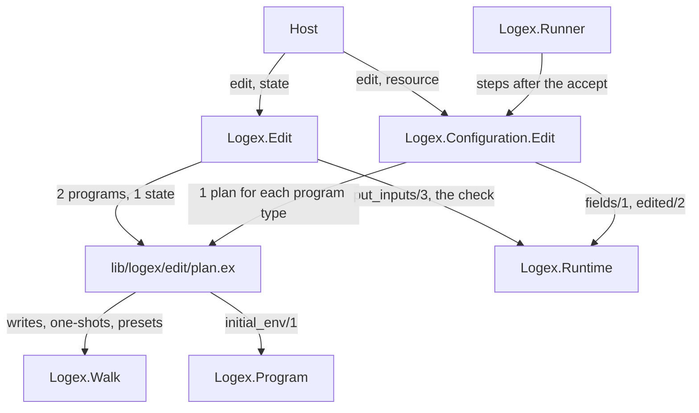

# The architecture of an online edit

This page is for a contributor. It describes how logex does an
[online edit](../../guides/reference/glossary.md#online-edit): the plans, the
[switch](../../guides/reference/glossary.md#switch), the record of an edit and the
[state](../../guides/reference/glossary.md#state) across the steps. Read it before you
change a rule of a switch or add a kind of report entry. Read it also before you add a
field to an [instance](../../guides/reference/glossary.md#instance) or a
[resource](../../guides/reference/glossary.md#resource).

[The online edit of a resource](online-edit-of-a-resource.md) gives the edit of a
[configuration](../../guides/reference/glossary.md#configuration) and the edit through the
[runner](../../guides/reference/glossary.md#runner).
[The model of an online edit](../../guides/explanation/online-edit-model.md) gives the
rules as a user sees them. [Online edit](../../guides/reference/online-edit.md) gives each
rule and each kind of entry.

> #### Caution {: .error}
>
> Report each change that a switch makes to the state, with an entry of a write kind
> ([The report](#the-report)). The host sees only the report. A random test in
> `test/logex/api_contract_test.exs` applies the writes of each report to the state
> before the step. It compares the result with the state after the step. If a change has
> no entry, the test fails.

## What the part does

An edit is plain data that the [host](../../guides/reference/glossary.md#host) keeps
between 2 steps. It holds the old [program](../../guides/reference/glossary.md#program),
the new program, the stage, 2 plans and a record. Each step is a function of the edit and
the state, and it returns a report. No step starts a process, reads a [clock](../../guides/reference/glossary.md#clock) or calls the Elixir
compiler.



Figure: the modules of an online edit. Both edits use the same plan file for each
instance.

The diagram shows 1 rule of the design: the per-instance work is in 1 internal file,
[`plan.ex`](../../lib/logex/edit/plan.ex). `Logex.Edit` calls it for 1 instance.
`Logex.Configuration.Edit` calls it for each instance of a configuration.

This table gives what each step of `Logex.Edit` calls in the plan file.

| Step | Calls | Returns |
|---|---|---|
| `accept/3` | `retyped/2`, `plans/2`, `switch/4` (plan `test`) | `{:ok, edit, forecast}` |
| `test/2` | `switch/4` (plan `test`) | `{edit, state, report}` |
| `untest/2` | `switch/4` (plan `untest`) | `{edit, state, report}` |
| `assemble/2` | `prune/3` (plan `test`) | `{new program, state, report}` |
| `cancel/2` | `prune/3` (plan `untest`) | `{old program, state, report}` |

`retyped/2` checks that each [tag](../../guides/reference/glossary.md#tag) keeps its
[type](../../guides/reference/glossary.md#type). The accept drops the state of its switch
and keeps only the report, the [forecast](../../guides/reference/glossary.md#forecast).
A [cancel](../../guides/reference/glossary.md#cancel) from the accept calls nothing and
gives an empty report. Each step first checks the state: it calls
`Logex.Runtime.put_inputs/3` with no inputs, which changes nothing.

## How it is built

### The edit

`%Logex.Edit{}` is opaque. A host keeps it and gives it to the next step.

| Field | Holds |
|---|---|
| `original` | The program that runs before the edit |
| `candidate` | The new program |
| `stage` | `:accepted`, `:testing` or `:untested` |
| `plans` | 2 plans: `test`, from the old program to the new program, and `untest`, back |
| `record` | What the switches of this edit learn about the instance |

`%Logex.Configuration.Edit{}` has these fields, with `records` (1 record for each
instance name) in place of `record`. It also has 5 more fields: `generation`, `held`,
`holders`, `holds` and `aside_at`.
[The online edit of a resource](online-edit-of-a-resource.md#the-edit) gives them.

### A plan

A plan is a map that `plans/3` makes at the [accept](../../guides/reference/glossary.md#accept).
It reads the 2 programs only, and never the state. Thus a plan stays correct for the full
edit, and 1 plan serves each instance of a
[program type](../../guides/reference/glossary.md#program-type). Each plan goes in 1
direction: from the program that a switch stops to the program that it starts.

`plans/3` reads the facts of each program 1 time: the tags and their types, the
[inputs](../../guides/reference/glossary.md#input), the
[outputs](../../guides/reference/glossary.md#output) and what the
[rungs](../../guides/reference/glossary.md#rung) write. `Logex.Walk` gives the writes,
the member writes, the [bit](../../guides/reference/glossary.md#bit) writes and the
presets. `Logex.Program.initial_env/1` gives the initial values. `plans/3` then makes 1
plan for each direction.

To find the [one-shots](../../guides/reference/glossary.md#one-shot) to block, `plans/3`
compares the rungs of the 2 programs. Before it compares them, it removes the line
numbers, the preset of each timer and counter, and the spelling of each
[literal](../../guides/reference/glossary.md#literal). The list `blocks` then has the
[storage bit](../../guides/reference/glossary.md#storage-bit) of each one-shot of the
program that the switch starts. It leaves out a bit only if 2 conditions are true:

- The rung of the one-shot is the same in the 2 programs.
- The program that the switch stops writes the bit only through that one-shot.

That program can also write the bit through another
[instruction](../../guides/reference/glossary.md#instruction). Then the bit can hold a
value that is not the power that the one-shot last received. The list also has the edge
memory of each counter and each `tp` whose rung is not the same, for example `boxes.cu`
or `horn.en`. No instruction writes an edge memory, so `plans/3` compares only its rung. A
switch uses `blocks` only if the program that it stops did the last scan.

This table gives the keys of a plan that a switch uses for its rules.

| Key | What the switch does with it |
|---|---|
| `stops` | Names the program that the switch stops: `:original` or `:candidate` |
| `starts` | Lists each tag of the program that it starts, for the start rules ([A switch](#a-switch)) |
| `live` | Reports each input that only the program that it starts reads |
| `unread` | Reports each input that only the program that it stops reads |
| `changed` | Reports each initial value that changes |
| `blocks` | Gives the bits to block if the program that it stops did the last scan |
| `ons` | Lists each one-shot bit of the program that it starts. An earlier bit stays blocked only if it is in this list |
| `held` | Lists each output that the program that it stops drives and the program that it starts does not drive |
| `left` | Lists the held outputs of either direction that the program that it stops shows |
| `shows` | Lists the outputs of the program that it starts |
| `timers` | Moves the [preset](../../guides/reference/glossary.md#preset) of each [timer](../../guides/reference/glossary.md#timer) and [counter](../../guides/reference/glossary.md#counter), and the time of each timer |
| `unwritten` | Reports each [member](../../guides/reference/glossary.md#member) input that the program that it stops writes and the program that it starts does not write |
| `nested` | Does the same work for the members of each instance of a user [function block](../../guides/reference/glossary.md#function-block), by path |
| `requalified` | Reports each path whose `retain` changes |
| `keep` | Gives the tags that a prune keeps |

A plan also has keys that a switch reads to look up a value. They are `initial` (the
initial values), `table` (the
[function block types](../../guides/reference/glossary.md#function-block-type)), `inputs`,
`lists` (the [arrays](../../guides/reference/glossary.md#array)) and `opens` (the arrays
of instances).

The third argument of `plans/3` is `:tags` for `Logex.Edit` and `:globals` for
`Logex.Configuration.Edit`. With `:globals`, each `var_external` is a
[global](../../guides/reference/glossary.md#global). No start rule starts it, and no entry
reports its initial value. `Logex.Configuration.Edit` makes 1 plan for each program type
that an instance runs in both configurations. It calls `switch/5` for each instance that
both configurations run with the same program type.

### The record

A plan cannot know what occurs between 2 steps. The record holds that. It starts empty
at the accept, and each switch returns a new record.

A timer has an internal member, `last`: the time from which it counts. A resume moves
`last` on by a time that the timer must not count. The report gives it as a `:resumed`
entry. A resume given back moves `last` back, as a `:resume_undone` entry.

| Field | Holds |
|---|---|
| `shown` | The last value of each held output, as the host received it |
| `pre` | For each timer and counter, the preset that the last switch found and the preset that it left. For a timer, also the `last` that it found and left, if it moved `last` |
| `scanned` | The program that last wrote the storage bits, and the bits that a switch listed and that no scan has run yet |
| `held` | The time from which the instance runs its current program |
| `prior` | The same time for the other program, before the last switch |

The record field `held` is a time. It is not the plan key `held`, which lists outputs.

A switch uses `pre` to give back a preset or a resume of the last switch. It uses `held`
and `prior` for 1 rule: the time of a timer counts only while the instance runs a program
that runs the timer. A switch that only gives the instance back, with no scan and no time
after the last switch, swaps `held` and `prior`. A new edit starts with an empty record.
Thus it does not give back a move that an earlier edit made.

### A switch

`Logex.Edit` calls `switch/4`. It calls `switch/5` with the `now` of the instance as the
time of the switch, so the time does not move. In a resource, the time is the `now` of
the resource. The fourth argument, `first_test?`, is true at the first
[test](../../guides/reference/glossary.md#test) only.

The start rules start a tag at its
[initial value](../../guides/reference/glossary.md#initial-value):

- A tag that the state does not have starts at each switch.
- At the first test, a tag that the new program adds also starts, even if the state has a
  value for it. A plain swap (a scan of the new program over the old state, with no edit)
  can leave such a value.
- At the first test, a tag of the 2 programs whose value does not fit its type also
  starts.

`switch/5` does these steps, in this sequence:

1. It finds the values of the outputs of `left`. If the program that it stops scanned
   after the last switch, it copies them to the record field `shown`.
   If a [restart](../../guides/reference/glossary.md#restart) came after that scan, it
   removes them from `shown`.
2. It starts each tag that the start rules name.
3. It moves the members of each user block instance by their paths.
4. It reports the inputs, the changed initial values, the bits to block and the held
   outputs.
5. It moves the preset of each timer and counter, and the time of each timer.
6. It reports each input of `unwritten`, with the value that it keeps.
7. It sets `switched` to true and `now` to the time of the switch. It sets `ons_blocked`
   to the bits to block from step 4.
8. It adds the changes of `retain` and sorts the report.

The bits to block are the bits of `blocks`, if the program that it stops did the last
scan. They are also each bit of the record's `scanned` that no scan has run yet, if the
bit is in `ons`.

A switch never sets a storage bit to block a one-shot: it lists the bit in
`ons_blocked`. It starts a storage bit only as it starts any tag, at its initial value,
as `added s1 0` in the example shows. A switch does not change `first` and removes no
tag. Only `prune/3` removes tags.

### The fields of an instance across an edit

2 fields of `%Logex.Instance{}`, `switched` and `ons_blocked`, exist for an online edit.
This table gives what changes them, and also `now` and `first`.

| Event | `switched` | `ons_blocked` | `now` | `first` |
|---|---|---|---|---|
| A switch | true | the bits to block | the time of the switch | kept |
| A [scan](../../guides/reference/glossary.md#scan) | false | each bit run removed | + the elapsed time | false |
| `restart/3` | kept | empty | kept | true |

`restart/3` is `Logex.Runtime.restart/3`. `switched` tells the next switch if the program
that it stops did a scan after the last switch. If it did not, the state does not hold
the outputs of that program. The record then gives the values.

### The report

A report is a sorted list of `{kind, name, detail}`, with 1 entry or fewer for each kind
and name. This table gives the write kinds: each entry of these kinds changes the state.

| Kind | The write to the state |
|---|---|
| `:added`, `:input` | Puts the tag at the value of the entry |
| `:preset` | Sets `.pre` (a counter's `.pv`) to `to` of the detail `{from, to}` |
| `:resumed` | Moves the timer's `last` on by the value |
| `:resume_undone` | Moves the timer's `last` back by the value |
| `:pruned` | Removes the tag |

Each other kind is a fact or a forecast and writes nothing. A switch also sets
`switched`, and sets the block list from the `:ons_blocked` entries. The kinds are an
open set, and a host ignores a kind that it does not know. The moduledoc of `Logex.Edit`
has the table of each kind.

## An example

The script `online-edit-architecture.exs` shows the fields of the instance at each step.
It uses [`motor.ld`](../../guides/tutorials/first-program.md) and
[`motor_v2.ld`](../../guides/explanation/online-edit-model.md). Run it from `examples/`.

```elixir
alias Logex.{Edit, Runtime}

{:ok, motor} = Logex.compile_file("motor.ld")
# An edit keeps the name of the program, so the script gives motor_v2.ld the name `motor`.
{:ok, v2} = Logex.compile(File.read!("motor_v2.ld"), name: "motor")

# 1 line for each step: 3 fields of the instance. Then 1 line for each entry of the
# report: the kind, the name and the value. For a timer, the script shows only the preset.
value = fn
  %{"pre" => preset} -> "pre=#{preset}"
  value -> inspect(value)
end

show = fn label, state, report ->
  fields = Map.take(state, [:now, :switched, :ons_blocked])
  IO.puts(String.pad_trailing(label, 9) <> inspect(fields))

  Enum.each(report, fn {kind, name, detail} ->
    IO.puts("  " <> String.pad_trailing("#{kind}", 12) <> "#{name} " <> value.(detail))
  end)
end

state = Runtime.put_inputs(motor, Runtime.instance(motor), %{"start" => 1})
{_outputs, state} = Runtime.scan(motor, state, 10)
show.("before", state, [])

# The accept does the switch of a test, keeps its report and drops its state.
{:ok, edit, forecast} = Edit.accept(motor, v2, state)
{edit, tested, report} = Edit.test(edit, state)
show.("test", tested, report)
IO.puts("forecast is the report of the test: #{forecast == report}")

# This report has only :added writes. Applied to the state before the test, they give
# the state after it.
added = for {:added, name, value} <- report, into: %{}, do: {name, value}
IO.puts("state rebuilt from the report: #{Map.merge(state.env, added) == tested.env}")

# An untest with no scan between gives the instance back. It removes nothing.
{edit, untested, report} = Edit.untest(edit, tested)
show.("untest", untested, report)
IO.puts("the tags of the test stay: #{Map.merge(state.env, added) == untested.env}")

{edit, tested, report} = Edit.test(edit, untested)
show.("test", tested, report)
# running/1 gives the program that the instance runs at this stage of the edit.
{_outputs, scanned} = Runtime.scan(Edit.running(edit), tested, 10)
show.("scan", scanned, [])
{_program, assembled, report} = Edit.assemble(edit, scanned)
show.("assemble", assembled, report)
```

```console
$ mix run online-edit-architecture.exs
before   %{now: 10, switched: false, ons_blocked: []}
test     %{now: 10, switched: true, ons_blocked: ["s1"]}
  added       at_speed 0
  added       s1 0
  added       started 0
  added       t1 pre=2000
  held        run_lamp 1
  ons_blocked s1 0
forecast is the report of the test: true
state rebuilt from the report: true
untest   %{now: 10, switched: true, ons_blocked: []}
the tags of the test stay: true
test     %{now: 10, switched: true, ons_blocked: ["s1"]}
  held        run_lamp 1
  ons_blocked s1 0
scan     %{now: 20, switched: false, ons_blocked: []}
assemble %{now: 20, switched: false, ons_blocked: []}
  held        run_lamp 1
  pruned      run_lamp 1
```

- **The switch does not move the time.** `now` stays 10 at each switch. Only the scan
  moves it to 20.
- **The test starts 4 tags.** `motor_v2.ld` adds `at_speed`, `s1`, `started` and `t1`.
  The switch starts each at its initial value, `s1` also, and blocks the one-shot on
  `s1`.
- **The [untest](../../guides/reference/glossary.md#untest) blocks nothing and removes nothing.** The program that last scanned is
  `motor.ld`, and the untest starts it again. Its bits are as it left them. The 4 tags of
  the test stay in the state until a prune.
- **The second test blocks `s1` again.** The record says that the old program last wrote
  the bits, and `motor.ld` has no rung with `s1`.
- **The untest reports no held output.** No scan of `motor_v2.ld` gave `at_speed` or
  `started` to the host, so the record knows no value for them.
- **The [assemble](../../guides/reference/glossary.md#assemble) removes `run_lamp`.** `motor_v2.ld` does not declare it. The report
  gives it as held, because the host keeps its
  [point](../../guides/reference/glossary.md#point) at the last value 1. It gives it also
  as pruned, because the prune removes the tag from the state.

## Why it is built this way

Each number is a decision of [`docs/organisation.md`](../organisation.md) §7, the full
log. §4.9 of that document gives the design.

- **No Elixir compiler.** Decisions 15 and 16 keep a program as data, and keep the
  Elixir compiler off the edit path. An edit with an error changes nothing that runs.
  [0001. A program is data](../adr/0001-a-program-is-data.md).
- **5 steps.** Decision 18 stages the edit from the start: accept, test, untest, assemble
  and cancel. The other option was an edit that applies immediately.
  [0012. The staged online edit](../adr/0012-staged-online-edit.md).
- **The forecast is a switch.** Decision 27 gives the accept the state, so that each step
  returns a report, the accept also. Its report is the forecast: the report of a test at
  that moment. Thus the forecast and a test use 1 function and give 1 report.
- **Plans from the programs alone.** Fix F5 puts the per-instance work in functions of 1
  plan, 1 record and 1 state. Decision 59 then makes `Logex.Configuration.Edit` a
  separate module that calls the same functions.
- **Blocks, not writes.** Decision 21 blocks a one-shot and writes no storage bit. The
  other option was to set the storage bit to 1, so that the one-shot sees no
  [rising edge](../../guides/reference/glossary.md#rising-edge).
  That write also changes each other rung that reads the bit.
- **Held outputs.** Decision 20 keeps the last value of an output that no program drives.
  An output that goes to 0 can stop or start a machine.
- **The time of a timer.** Decisions 339 to 341 give 1 rule: the time counts only while
  the instance runs a program that runs the timer.

## How to change it

To add a rule to a switch:

1. Read §4.9 of `docs/organisation.md` and the moduledoc of `Logex.Edit`.
2. Write a case in `test/logex/edit_test.exs` that the rule makes true. See it fail.
3. Put each fact of the 2 programs that the rule reads into the plan, in `plans/3`.
4. Add the rule to `switch/5`. Report each write that it makes.
5. Write the rule in the moduledoc of `Logex.Edit`. Add a new kind to its table and to
   §4.9.

> #### Warning {: .warning}
>
> A new kind of entry makes the random test of `test/logex/api_contract_test.exs` fail
> until you do steps 6 to 8.

6. Add the new kind to `@report_kinds` in `test/logex/api_contract_test.exs`. If only the
   edit of a configuration gives it, add it to `@configuration_kinds` also.
7. If the kind is a write, add a clause for it to `write/2` in that file. Without the
   clause, the test does not apply the write, and the rebuilt state is different.
8. Make sure that the random programs of the test give the kind. The test fails if it
   does not get each kind of `@report_kinds`.
9. Run `scripts/gate.sh`. It must print `GATE-OK`.

A new field of `%Logex.Instance{}` needs a check in the runtime with its message. It also
needs a value from `Logex.Runtime.instance/1`, and a rule for a scan, `restart/3` and a
switch. The moduledoc of `Logex.Instance` gives the rules of the other fields.

The files of this table are in `test/logex/`.

| If you change | The test file that fails if it is wrong |
|---|---|
| A rule of 1 instance | `edit_test.exs` |
| A rule inside a function block | `function_block_test.exs` |
| A change of `retain` | `retain_edit_test.exs` |
| A change of the state that no entry lists | `api_contract_test.exs` |
| A field of `%Logex.Instance{}` | `runtime_test.exs` |
| The cost of a step | The growth cases of `edit_test.exs` |

## See also

- [0012. The staged online edit](../adr/0012-staged-online-edit.md) and the other
  [decision records](../adr/README.md).
- [The online edit of a resource](online-edit-of-a-resource.md): the edit of a
  configuration, and the edit through the runner.
- [The runtime and the evaluator](runtime-and-evaluator.md): the scan that runs between 2
  steps.
- [The model of an online edit](../../guides/explanation/online-edit-model.md) and
  [An online edit of a plant](../../guides/explanation/online-edit-of-a-plant.md): the
  model and the reasons, for a user.
- [Online edit](../../guides/reference/online-edit.md): each rule and each kind of entry.
- [Glossary](../../guides/reference/glossary.md): the technical words of logex.
