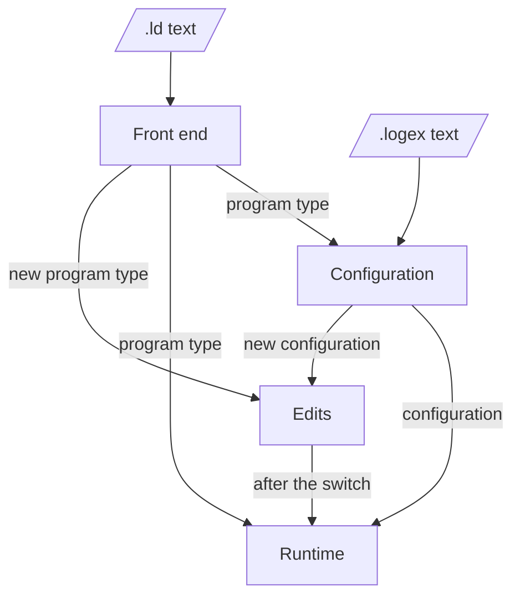
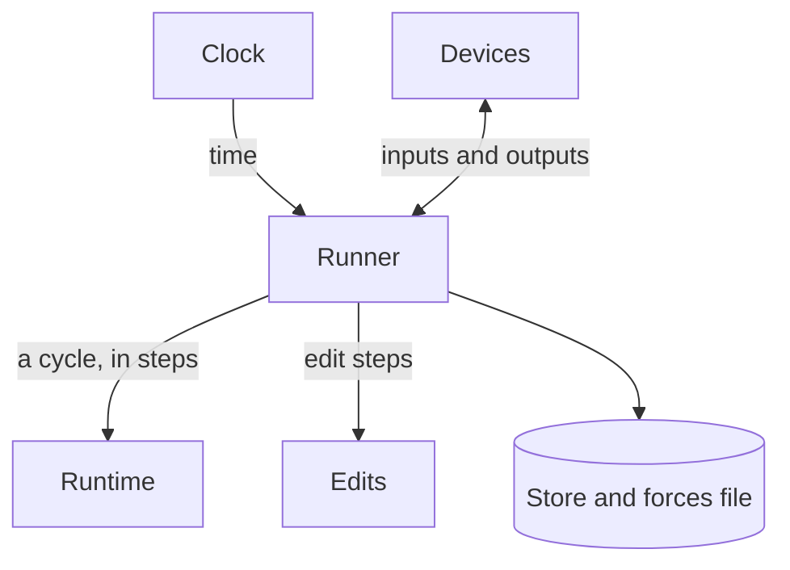
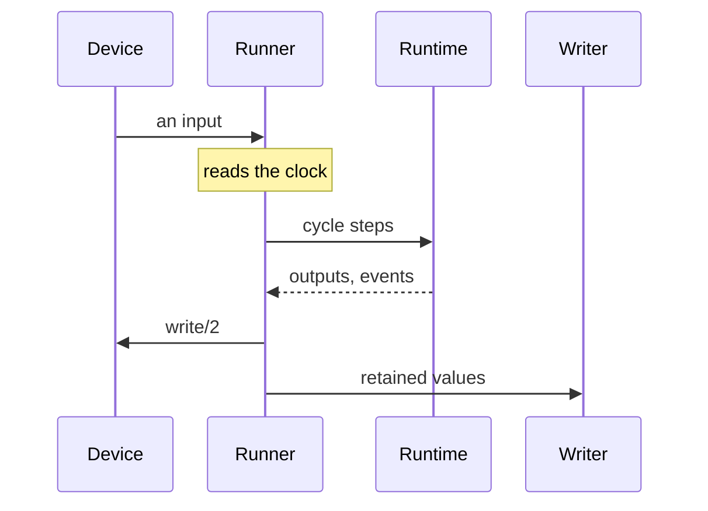

# The parts of logex

This page is for a contributor. It gives the 5 parts of logex, the data that moves
between them and the processes that run them. Read it before you change the code. Then
read the page of the part that you change, and the documentation of its modules.

> #### Caution {: .error}
>
> Do not read a clock in `Logex.Runtime`, and do not make BEAM code from a
> [program](../../guides/reference/glossary.md#program): logex
> [interprets](../../guides/reference/glossary.md#interpret) each program. The suite
> gives the time as a number of milliseconds, and a clock read makes each run different.
> An [online edit](../../guides/reference/glossary.md#online-edit) compares 2 program
> types as data, and it cannot compare 2 BEAM modules.

## What the parts do

The [host](../../guides/reference/glossary.md#host) gives text or Elixir data to a part.
Each part gives data to the next part or to the host. Only the
[runner](../../guides/reference/glossary.md#runner) reads a
[clock](../../guides/reference/glossary.md#clock).



Figure: what the host gets from a [compile](../../guides/reference/glossary.md#compile).
The host gives the text, and it takes each result to the next part.



Figure: the run on the clock. The runner takes the place of the host: it reads the clock
and the devices, and it calls the runtime and the edits.

| Part | Takes | Gives |
|---|---|---|
| Front end | The text of a `.ld` file | A [program type](../../guides/reference/glossary.md#program-type), `%Logex.Program{}`, or a list of [diagnostics](../../guides/reference/glossary.md#diagnostic) |
| Configuration | The text of a `.logex` file, or Elixir data | A [configuration](../../guides/reference/glossary.md#configuration), `%Logex.Configuration{}` |
| Runtime | An instance or a resource, the [inputs](../../guides/reference/glossary.md#input) and the milliseconds that passed | The [outputs](../../guides/reference/glossary.md#output), the instance or the resource after the run and, for a cycle, its events |
| Edits | The instance or the resource that runs, and a new program type or configuration | A report for each step, and the instance or the resource after the [switch](../../guides/reference/glossary.md#switch) |
| Runner | A configuration, an [adapter](../../guides/reference/glossary.md#adapter) for each [device](../../guides/reference/glossary.md#device), and a clock | The outputs that it writes to the devices at each [round](../../guides/reference/glossary.md#round), and the [store](../../guides/reference/glossary.md#store) on disk |

The runtime runs 2 kinds of data. An
[instance](../../guides/reference/glossary.md#instance) is 1 copy of a program type with
its [state](../../guides/reference/glossary.md#state), `%Logex.Instance{}`.
`Logex.Runtime.scan/3` runs 1 [scan](../../guides/reference/glossary.md#scan) of it. A
[resource](../../guides/reference/glossary.md#resource) is a configuration while it
runs, `%Logex.Runtime{}`. `Logex.Runtime.cycle/3` runs 1
[cycle](../../guides/reference/glossary.md#cycle) of it. A host can use the runtime with
no runner: it then gives the time itself.

### The path of 1 rung

This drawing shows [rung](../../guides/reference/glossary.md#rung) 1 of
[`motor.ld`](../../guides/tutorials/first-program.md), the program of the tutorial:

<!-- rung: motor.ld 1 -->


The script [`examples/overview.exs`](../../examples/overview.exs) takes this rung
through each stage. `motor.ld` is in the same directory, and `examples/mix.exs` gives
logex as a dependency. The script calls `Logex.Lexer.tokenize/1` and
`Logex.Parser.parse/1`, which are outside the [host
contract](../../guides/reference/glossary.md#host-contract). A host calls
`Logex.compile_file/1` and not these 2 functions. Run the script from `examples/`:

```elixir
source = File.read!("motor.ld")

# The lexer: text to tokens. Each token has its line and its column.
{:ok, tokens, _end_line} = Logex.Lexer.tokenize(source)

line_of = fn
  {_kind, {line, _column}} -> line
  {_kind, {line, _column}, _text} -> line
end

# Rung 1 is line 10 of motor.ld. Lines 1 to 8 are declarations.
rung_1 = Enum.filter(tokens, fn token -> line_of.(token) == 10 end)
IO.inspect(Enum.take(rung_1, 3), label: "tokens")

# The parser: tokens to the parse tree. Each leaf has its line only.
# The parser makes 1 list of words for each line that is not empty,
# and a declaration is such a line also. Line 10 is the 9th, at index 8.
{:ok, {:routine, {:rungs, lines}}} = Logex.Parser.parse(tokens)
IO.inspect(Enum.at(lines, 8), label: "tree  ", width: 70)

# The compiler: the parse tree to a program type, each rung as IR.
{:ok, motor} = Logex.compile_file("motor.ld")
[ir | _] = motor.rungs
IO.inspect(ir, label: "IR    ", width: 70)

# The runtime: 1 scan of 1 instance. The time that passed is 0 by default.
state = Logex.Runtime.instance(motor)
state = Logex.Runtime.put_inputs(motor, state, %{"start" => 1})
{outputs, _state} = Logex.Runtime.scan(motor, state)
IO.inspect(outputs, label: "scan  ")
```

```console
$ mix run overview.exs
tokens: [{:bst, {10, 1}}, {:name, {10, 3}, "xic"}, {:name, {10, 7}, "start"}]
tree  : {:rung,
 [
   {:branches,
    [
      [{:name, 10, "xic"}, {:name, 10, "start"}],
      [{:name, 10, "xic"}, {:name, 10, "motor"}]
    ]},
   {:name, 10, "xio"},
   {:name, 10, "stop"},
   {:name, 10, "ote"},
   {:name, 10, "motor"}
 ]}
IR    : {:rung,
 [
   {:branches,
    [
      [{:xic, 10, [{:name, 10, "start"}]}],
      [{:xic, 10, [{:name, 10, "motor"}]}]
    ]},
   {:xio, 10, [{:name, 10, "stop"}]},
   {:ote, 10, [{:name, 10, "motor"}]}
 ]}
scan  : %{"motor" => 1, "run_lamp" => 1, "speed_sp" => 1200}
```

The lexer and the parser know no [mnemonic](../../guides/reference/glossary.md#mnemonic)
and no [declaration](../../guides/reference/glossary.md#declaration). `xic` is a `:name`
token. `(` is the token `:bst`, the start of a
[branch](../../guides/reference/glossary.md#branch). The line `var_input start bool` is
a list of 3 words in the tree.

Compare the tree with the IR. The compiler finds each mnemonic, takes its
[operands](../../guides/reference/glossary.md#operand) by its signature and makes 1
[instruction](../../guides/reference/glossary.md#instruction) of them. In 1 scan, rung 1
sets `motor`, and rung 2 reads that value and sets `run_lamp`.

| Module | Data | What the data holds |
|---|---|---|
| `Logex.Lexer` | Tokens | Each word, number and mark of the text, with its line and column |
| `Logex.Parser` | The parse tree | Each line as a list of words, with the branches nested. Each leaf has its line |
| `Logex.Compiler` | The IR, the intermediate representation | Each instruction as `{mnemonic, line, operands}`, with each operand checked against the [tags](../../guides/reference/glossary.md#tag) |
| `Logex.Compiler` | The program type | The IR of each rung, the tags, the [function block types](../../guides/reference/glossary.md#function-block-type), the warnings and the source text |
| `Logex.Runtime` | The instance | The value of each tag, the time and the [faults](../../guides/reference/glossary.md#fault) of the last scan |

[The compile pipeline](compile-pipeline.md) gives each stage of the front end. [The
runtime and the evaluator](runtime-and-evaluator.md) gives the scan and the cycle.

## The processes

The runtime is functions only. A compile runs in a separate process and returns when
that process ends. The runner, its devices and its writers are processes that stay. The
[simulated device](../../guides/reference/glossary.md#simulated-device), `Logex.IO.Sim`,
and the manual clock, `Logex.Runner.Clock.Manual`, are processes also: a host or a test
starts them. An internal module has no page on the site, so the table gives its file.

| Process | Starts | Stops | Job |
|---|---|---|---|
| The compile, [`lib/logex/compiler/worker.ex`](../../lib/logex/compiler/worker.ex) | At each call of `Logex.compile/2`, `Logex.compile_file/1` or `Logex.compile_files/1` | When it gives its result to the caller | Compiles away from the heap of the caller |
| The runner, `Logex.Runner` | `Logex.Runner.start_link/1` | At a stop, or with its caller | Runs the rounds, the edits, the [forces](../../guides/reference/glossary.md#force) and the store |
| 1 for each device, [`lib/logex/runner/device.ex`](../../lib/logex/runner/device.ex) | When the runner opens the device | With the runner | Reads the adapter at each poll and writes the outputs |
| 1 minder for each device, in the same file | With the device | With the device, or when it kills the device | Kills the device if it does not stop within the idle watchdog and 1 [poll period](../../guides/reference/glossary.md#poll-period) after the runner |
| The writer, [`lib/logex/runner/writer.ex`](../../lib/logex/runner/writer.ex) | At the first periodic write of the store | With the runner | Writes the store each [retain](../../guides/reference/glossary.md#retain) period |
| 1 for each other file write or read, in the same file | At each write or read of the runner | At its answer, or at the write limit | Writes or reads 1 file |
| The keeper of the paths, [`lib/logex/runner/paths.ex`](../../lib/logex/runner/paths.ex) | When the first runner of the VM claims a file | With the VM | Keeps the table of the files of each runner |
| A holder of the files, in the same file | When a runner stops with a write still out | When the file server answers | Keeps the files from the next start until the write ends |

This diagram shows 1 round of the runner with 1 device:



Figure: 1 round. A device process sends a change of an input, and the writer gets the
retained values each retain period. The runtime is a module and not a process: the
runner calls it in its own process.

The cycle steps are 3 internal functions of `Logex.Runtime`: `cycle_steps/3`,
`cycle_step/2` and `cycle_outputs/1`. `Logex.Runtime.cycle/3` is the 3 of them in
sequence, for a host with no runner.

[The architecture of the runner](runner.md) gives the round, the
[watchdogs](../../guides/reference/glossary.md#watchdog), the
[trip](../../guides/reference/glossary.md#trip) and the devices. [The architecture of
the store and its files](store-and-files.md) gives the writer and the paths.

## How it is built

logex has no dependencies and no generated code. `mix.exs` gives ExDoc in the `docs`
environment only. The lexer reads the text by binary pattern matching, and the parser is
a recursive descent parser. Both are Elixir that a person writes.

These modules and 1 function make the host contract. A function of the host contract
refuses a wrong argument with an `ArgumentError`, and no other exception comes out of
it. The message says what the function takes:

- `Logex`, `Logex.Runtime` and `Logex.Edit`
- `Logex.Configuration`, its structs `Logex.Configuration.Task`,
  `Logex.Configuration.Global`, `Logex.Configuration.Instance` and
  `Logex.Configuration.Connection`, and `Logex.Configuration.Edit`
- `Logex.Runner`, its clocks `Logex.Runner.Clock`, `Logex.Runner.Clock.Manual` and
  `Logex.Runner.Clock.Monotonic`, `Logex.IO`, `Logex.IO.Point` and `Logex.IO.Sim`
- the function `Logex.Tag.new!/5`

Each other module takes only data that logex makes, and its moduledoc states this. It
does not have to check an argument, and a wrong argument can raise any exception. A
module with `@moduledoc false` is internal: the comment at the head of its file gives
its rules.

A run gave these messages for the argument `:motor`:

<!-- unchecked: messages copied from a run of 5 calls with the argument :motor -->
```text
Logex.Runtime.instance(:motor)
  ArgumentError: expected a %Logex.Program{} from Logex.compile/2, got: :motor
Logex.compile(:motor, name: "m")
  ArgumentError: Logex.compile/2 takes source text as a binary, got: :motor
Logex.Lexer.tokenize(:motor)
  ArgumentError: tokenize/1 takes a source text, a binary, got: :motor
Logex.Parser.parse(:motor)
  ArgumentError: parse/1 takes the list of tokens Logex.Lexer.tokenize/1 gives, got: :motor
Logex.Program.initial_env(:motor)
  FunctionClauseError: no function clause matching in Logex.Program.initial_env/1
```

`Logex.Lexer` and `Logex.Parser` are outside the host contract, but each checks its
argument. `Logex.Program.initial_env/1` does not. A function that you add to a module of
the host contract checks each argument and raises an `ArgumentError`. A test compares
its message whole.

2 modules serve more than 1 part. `Logex.Diagnostic` is the struct of each error and
each [warning](../../guides/reference/glossary.md#warning) in the source text.
`Logex.Walk` finds the instructions, the reads and the writes of a program in its IR, at
each depth of `cal`. [`CLAUDE.md`](../../CLAUDE.md) gives 1 line for each module and
each test file.

## Why it is built this way

Each number is a decision of [`docs/organisation.md`](../organisation.md) §7, the full
log.

- **A program is data.** Decisions 15, 16 and 17 make a program type a value that
  `Logex.Runtime` interprets. An online edit then compares 2 values and moves the state.
  [0001. A program is data](../adr/0001-a-program-is-data.md).
- **No dependencies.**
  [0003. No dependencies and no generated code](../adr/0003-no-dependencies-no-generated-code.md)
  and [`PLAN.md`](../../PLAN.md#6-deliberately-not-changing) §6 give the reasons. With yecc,
  a guard of 221 lines still built a grammar with a conflict, and NimbleParsec and
  Pegasus were 6.9 to 8.3 times slower. The golden record,
  [`test/fixtures/frontend_golden.txt`](../../test/fixtures/frontend_golden.txt), and
  `test/logex/printer_test.exs` replace the conflict check. Decisions 515 and 546 add
  Dialyzer and ExDoc with no dependency at run time.
- **The host gives the time.** Decision 13 gives the elapsed milliseconds as an
  argument, so the suite moves the time with a number. Decision 118 cuts a cycle into
  steps, so that the runner reads its clock between the
  [tasks](../../guides/reference/glossary.md#task).
  [0007. The host gives the time](../adr/0007-the-host-gives-the-time.md).
- **The host contract is a short list.** Decisions 514 and 523 name its modules.
  `test/logex/runtime_test.exs` checks the last sentence of each other moduledoc.
  [0008. Errors in the source and errors of the host](../adr/0008-source-mistakes-and-host-mistakes.md).
- **A compile has its own process.** A program keeps its source text. In the process of
  the caller, a long text and its messages pass the binary allowance. Then many
  collections copy the whole heap: 7,096 of some 54,000 for a program of 280 KB.
  Decision 520 runs the compile in a separate process, with an allowance,
  `min_bin_vheap_size`, from the size of the text.
- **A device has its own process.** Decisions 112, 120 and 124 let a device read its
  adapter at each poll and pass each change to the runner. Decision 125 gives each
  refresh from the runner a deadline: past it, the device writes 0 to each output and
  latches. [0014. Devices are processes](../adr/0014-devices-are-processes.md).
- **A file write has its own process and a limit.** Decisions 275, 353 and 400 keep a
  stalled disk from stopping the rounds. Decision 356 refuses 2 runners of 1 VM on 1
  file. [0018. File work with a limit](../adr/0018-file-work-with-a-limit.md).

## How to change it

1. Find the part of the change in [What the parts do](#what-the-parts-do).
2. Read the moduledoc and the line in [`CLAUDE.md`](../../CLAUDE.md) of each module that
   you change. Read the Conventions and the Commands of `CLAUDE.md` also.
3. Read the design of the part in §4 of `docs/organisation.md`. The table after these
   steps gives them.
4. Write a test case first, and see it fail. Then change the code.
5. Run `scripts/gate.sh`. It must print `GATE-OK`.

| Part | §4 of `docs/organisation.md` |
|---|---|
| Front end | [§4.2](../organisation.md#42-a-program-type-the-readme-motor), [§4.3](../organisation.md#43-hierarchy-inside-a-program-timers-and-function-blocks), [§4.7](../organisation.md#47-one--token-three-readings), [§4.8](../organisation.md#48-reserved-words-by-file-kind), [§4.12](../organisation.md#412-data-types-milestone-5) |
| Configuration | [§4.4](../organisation.md#44-the-configuration), [§4.5](../organisation.md#45-io-mapping) |
| Runtime | [§4.6](../organisation.md#46-execution-model), [§4.13](../organisation.md#413-retained-values-and-a-true-warm-restart-milestone-6) |
| Edits | [§4.9](../organisation.md#49-changing-a-running-controller-online-edit) |
| Runner | [§4.11](../organisation.md#411-milestone-4s-design-the-wall-clock-runner-decided-2026-10-17) |

| If you add | Also change | The test file that fails if you do not |
|---|---|---|
| A module or a test file | 1 line in `CLAUDE.md` | `test/logex/claude_md_test.exs` |
| A function of the host contract | Its spec, its line in the public surface that `test/logex/runtime_test.exs` pins, and a call in `test/logex/typespec_test.exs` | `test/logex/runtime_test.exs`, `test/logex/typespec_test.exs` |
| An instruction | The steps of [Add an instruction](../implementation/adding-an-instruction.md) | `test/logex/naming_test.exs` |

No test file fails by itself when you add a form of the syntax. Add the form to the
generator and to `@required_shapes` of `test/logex/printer_test.exs`, and keep the
golden record green.

## See also

- [0001. A program is data](../adr/0001-a-program-is-data.md) and the other [decision
  records](../adr/README.md).
- [The compile pipeline](compile-pipeline.md) and [The runtime and the
  evaluator](runtime-and-evaluator.md).
- The architecture of [an online edit](online-edit.md), of [the runner](runner.md) and
  of [the store and its files](store-and-files.md).
- [Host contract](../../guides/reference/host-contract.md): the rules of each function
  that a host calls.
- [A map of the documents](../README.md): each document, and who reads it.
- [Glossary](../../guides/reference/glossary.md): the technical words of logex.
