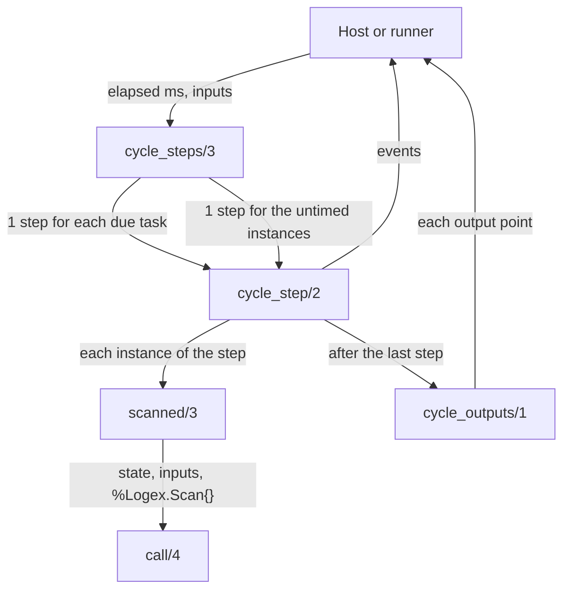
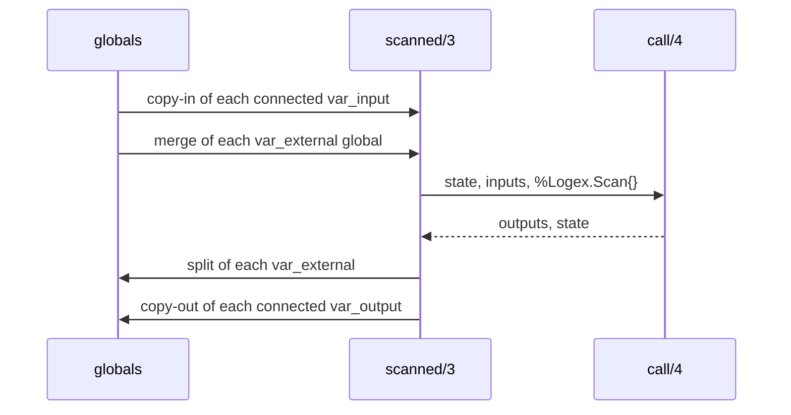

# The resource and the schedule

This page is for a contributor. It describes how `Logex.Runtime` runs a
[configuration](../../guides/reference/glossary.md#configuration) as a
[resource](../../guides/reference/glossary.md#resource): the
[cycle](../../guides/reference/glossary.md#cycle), the schedule of the
[tasks](../../guides/reference/glossary.md#task) and the copies around each
[scan](../../guides/reference/glossary.md#scan). Read it before you change a rule of a
cycle or a field of `%Logex.Runtime{}`. [The runtime and the
evaluator](runtime-and-evaluator.md) gives the scan of 1
[instance](../../guides/reference/glossary.md#instance).

> #### Caution {: .error}
>
> Do not read a clock or a [watchdog](../../guides/reference/glossary.md#watchdog) in a
> cycle. A cycle runs each due step, also if a step takes a long time or finds a
> [major fault](../../guides/reference/glossary.md#major-fault). The
> [runner](../../guides/reference/glossary.md#runner) times the steps and
> [trips](../../guides/reference/glossary.md#trip). A host that calls `cycle/3` itself
> gets no watchdog and no trip.

## What the resource does

`Logex.Runtime.start/1` makes a `%Logex.Runtime{}` from a `%Logex.Configuration{}`. Each
call of `cycle/3` gives the elapsed milliseconds and the
[inputs](../../guides/reference/glossary.md#input) that changed. It returns the new
resource, every [output](../../guides/reference/glossary.md#output) point and the events.



Figure: 1 cycle. `cycle_steps/3` moves the time, merges the inputs, samples the triggers
and finds the due tasks. `cycle/3` calls the 3 internal functions in sequence. The
runner calls them itself, and it reads its clock between 2 steps.

## How it is built

### The fields of the resource

| Field | Holds |
|---|---|
| `config` | The configuration that runs |
| `now` | The time of the resource, in ms. 0 at `start/1` |
| `globals` | The value of each [global](../../guides/reference/glossary.md#global), the input and output points among them |
| `instances` | The state of each instance, by name |
| `tasks` | For each task: the next due time, the overlap count and the last sample of its [trigger](../../guides/reference/glossary.md#trigger) |
| `wiring` | What `start/1` finds in the configuration 1 time: the copies of each instance, its `var_external` names, the output points |
| `generation` | The number of steps of the configuration edits |
| `aside` | The state of each instance that an edit's [switch](../../guides/reference/glossary.md#switch) put aside |
| `restarts` | The number of calls of `restart/2` |

The type is opaque. Only `Logex.Runtime` reads and writes the fields.
`Logex.Configuration.Edit` gets them through the internal functions `fields/1` and
`edited/2`. The moduledoc of `Logex.Runtime` has the section "One rule for each piece of
a resource's state". It gives the rule of each field for a cycle, `restart/2` and a
switch.

### The steps of a cycle

`cycle_steps/3` does these steps:

1. It adds the elapsed time to `now`.
2. It merges the inputs into `globals`. An input point keeps its value until a cycle
   changes it.
3. It samples each trigger 1 time. Each scan of the cycle sees the same sample.
4. It finds the [due](../../guides/reference/glossary.md#due) tasks.
5. It sorts the due tasks by [priority](../../guides/reference/glossary.md#priority), then
   by due time, then by the sequence of the configuration.
6. It gives 1 step for each due task. It then gives 1 step for the untimed instances:
   those with no task and those of the
   [continuous task](../../guides/reference/glossary.md#continuous-task).

`cycle_step/2` runs each instance of 1 step, in the sequence of the configuration.
`cycle_outputs/1` reads each output point after the last step.

`plan/5` decides if a task is due:

| Task | Due in a cycle when |
|---|---|
| [Periodic task](../../guides/reference/glossary.md#periodic-task) | Its next due time is at or before `now` |
| [Event task](../../guides/reference/glossary.md#event-task) | Its trigger samples 1 and its last sample is 0. After `start/1`, the last sample is 0. `start/2` takes the last sample of a retained trigger from the [retained image](../../guides/reference/glossary.md#retained-image) |
| A task with a trigger and an interval | Its trigger rises, or its trigger samples 0 and a due time came. The task skips a due time that comes while its trigger samples 1, and does not count it |
| The continuous task | Never. Its instances run 1 time in each cycle, after the due tasks |

A periodic task that runs late runs 1 time. `periods/3` counts the periods that it
missed and gives `{:overlap, task, missed}`. It moves the due time past `now` by whole
intervals, so the phase does not move.

The sample of a rising trigger goes into the step of its task. The last sample changes
only when that step runs. If the runner trips before the step, the task runs at the next
cycle that samples the rise.

### The run of 1 instance

`scanned/3` runs 1 instance in 1 step:



Figure: 1 instance in 1 step. The split comes before the copy-out. Thus a copy-out to a
global stands over a write through a `var_external` in the same scan.

Between 2 scans, the state of an instance holds no `var_external`. The resource holds 1
copy of each global, in `globals`. An instance reads what an earlier instance wrote in
the same cycle, and never what a later one writes.

After `call/4`, `scanned/3` gives the event `{:ran, task, instance, now}`. It then gives
1 `{:fault, task, instance, fault}` for each [fault](../../guides/reference/glossary.md#fault)
of the scan, and sets `faults` of the state to `[]`. The resource keeps no fault: the
events are the record. The events are an open set, and a host ignores a kind that it does
not know.

## An example

The configuration `line.logex` has 2 instances of a conveyor. The task of `c1` runs each
10 ms, and the task of `c2` runs each 50 ms. Each instance reads the e-stop through
`var_external estop bool`.

<!-- file: conveyor.ld -->
```text
var_input start bool
var_input stop bool
var_input reset bool
var_output motor bool
var_external estop bool
var fault bool

xic estop otl fault
xic reset otu fault
( xic start | xic motor ) xio stop xio fault ote motor
```

<!-- file: line.logex -->
```text
// line.logex -- two conveyors, one e-stop
task fast interval 10 priority 1
task slow interval 50 priority 2

var_global estop      bool at panel.i.7
var_global pb_start_1 bool at panel.i.0
var_global pb_start_2 bool at panel.i.1
var_global pb_reset   bool at panel.i.2
var_global k1         bool at panel.q.0
var_global k2         bool at panel.q.1

program c1 conveyor with fast
  c1.start pb_start_1
  c1.stop  0
  c1.reset pb_reset
  c1.motor k1

program c2 conveyor with slow
  c2.start pb_start_2
  c2.stop  0
  c2.reset pb_reset
  c2.motor k2
```

The script `runtime-and-evaluator-cycle.exs` runs 1 cycle in its steps, and then 1 late
cycle. It reads the inside of the resource, which only a test of the runtime does. Run
it from `examples/`, which holds `conveyor.ld` and `line.logex`:

```elixir
{:ok, line} = Logex.Configuration.compile_file("line.logex")
rt = Logex.Runtime.start(line)

# cycle/3 in its steps, as the runner calls them. These 3 functions are
# internal: a host calls cycle/3.
{rt, steps} = Logex.Runtime.cycle_steps(rt, 0, %{"pb_start_1" => 1})
IO.inspect(steps, label: "steps")

rt =
  Enum.reduce(steps, rt, fn step, rt ->
    {rt, events} = Logex.Runtime.cycle_step(rt, step)
    IO.inspect(events, label: "events")
    rt
  end)

IO.inspect(Logex.Runtime.cycle_outputs(rt), label: "outputs")

# 120 ms later, with the e-stop pressed: each task runs 1 time.
{rt, outputs, events} = Logex.Runtime.cycle(rt, 120, %{"estop" => 1})
IO.inspect(events, label: "events")
IO.inspect(outputs, label: "outputs")
IO.inspect(Logex.Runtime.next_due_in(rt), label: "next_due_in")

# The resource holds 1 copy of the global. Between cycles, the state of
# c2 holds no estop. get!/2 reads c2.estop as the global.
IO.inspect(Map.has_key?(rt.instances["c2"].env, "estop"), label: "c2 holds estop")
IO.inspect(Logex.Runtime.get!(rt, "c2.estop"), label: "c2.estop")
```

```console
$ mix run runtime-and-evaluator-cycle.exs
steps: [
  {:timed, "fast", {"fast", {nil, 10}, 1, 0, ["c1"]}},
  {:timed, "slow", {"slow", {nil, 50}, 2, 1, ["c2"]}}
]
events: [{:ran, "fast", "c1", 0}]
events: [{:ran, "slow", "c2", 0}]
outputs: %{"k1" => 1, "k2" => 0}
events: [
  {:overlap, "fast", 11},
  {:ran, "fast", "c1", 120},
  {:overlap, "slow", 1},
  {:ran, "slow", "c2", 120}
]
outputs: %{"k1" => 0, "k2" => 0}
next_due_in: 10
c2 holds estop: false
c2.estop: 1
```

A step of a task holds the name, the trigger and interval, the priority, the place in the
configuration and the instances. At 120 ms, the 10 ms task was due at 10 ms, so it missed
11 periods. Its next due time is 130 ms. Both instances read `estop` as 1 in the same
cycle, latch `fault` and stop their motors.

## Why it is built this way

Each number is a decision of [`docs/organisation.md`](../organisation.md) §7, the full
log. The design of the cycle is in §4.6 of that document. The design of the globals and
the event tasks is in §4.10.

- **The host gives the time.** Decision 13 keeps `now` in the resource, and the host
  gives the elapsed milliseconds. A cycle is a function of its arguments. Thus a host
  that records each `elapsed_ms` and each input map can run the cycles again and get the
  same outputs and events.
  [0007. The host gives the time](../adr/0007-the-host-gives-the-time.md).
- **A cycle in steps.** Decision 118 cuts `cycle/3` into 3 internal functions. The runner
  times each task between 2 steps, and the host contract does not change.
- **The schedule.** Decision 11 gives the priorities and the overlap count. A late task
  counts each missed period and does not run it again. A run for each missed period gives
  bursts of outputs after a pause.
- **The continuous task.** Decision 111 runs its instances 1 time in each cycle, after
  the due tasks.
  [0011. Tasks and rounds](../adr/0011-tasks-and-rounds.md).
- **The triggers.** Decision 11 runs an event task whose trigger is 1 at the start.
  Decisions 39 and 50 to 52 give the rules of a task with a trigger and an interval, and
  of a late cycle. Decision 350 keeps a rise until the step of its task runs.
- **1 copy of each global.** Decision 47 puts the copy-out after the split, as IEC 61131-3
  writes an external during the body of a program. Decision 49 makes a test look inside the
  resource, because no public function shows a second copy.

## How to change it

To change a rule of a cycle:

1. Read §4.6 of `docs/organisation.md` and the moduledoc of `Logex.Runtime`.
2. Write a test case in `test/logex/scheduler_test.exs`. See it fail.
3. Change `cycle_steps/3`, `plan/5`, `run_task/2` or `scanned/3`.
4. For a new field of `%Logex.Runtime{}`, give it a value in `start/1`. Give it a rule for
   a cycle, for `restart/2` and for the switch of a configuration edit.
5. Write the rule in the section "One rule for each piece of a resource's state" of the
   moduledoc.
6. Run `scripts/gate.sh`. It must print `GATE-OK`.

| If you change | The test file that fails if it is wrong |
|---|---|
| The rules of a cycle | `test/logex/scheduler_test.exs` |
| The faults as events | `test/logex/fault_test.exs` |
| A field of the resource across an edit | `test/logex/config_edit_test.exs`, `test/logex/api_contract_test.exs` |
| A message of the host contract | `test/logex/runtime_test.exs` |
| The cost of a cycle | `test/logex/ceiling_test.exs` |

## See also

- [0011. Tasks and rounds](../adr/0011-tasks-and-rounds.md) and the other [decision
  records](../adr/README.md).
- [The runtime and the evaluator](runtime-and-evaluator.md): the scan of 1 instance.
- [The architecture of the runner](runner.md): the round, the watchdogs and the trip.
- [The online edit of a resource](online-edit-of-a-resource.md): the switch of a
  configuration.
- [Execution model](../../guides/reference/execution-model.md): the rules of a cycle for
  a user.
- [Tasks and the schedule](../../guides/explanation/tasks-and-scheduling.md): the model
  and the reasons, for a user.
- [Glossary](../../guides/reference/glossary.md): the technical words of logex.
