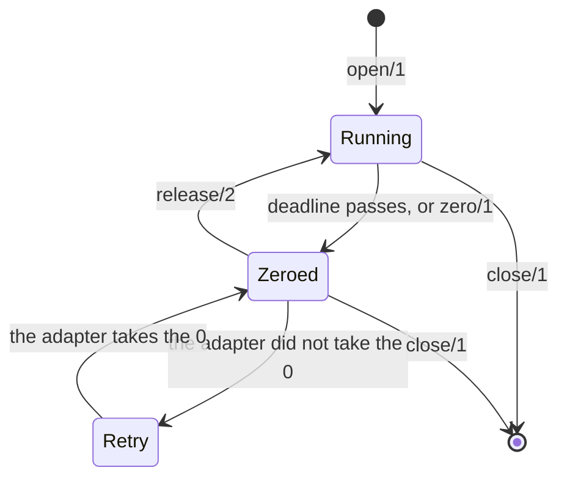

# The devices of the runner

This page is for a contributor. It describes the process of each
[device](../../guides/reference/glossary.md#device) of the
[runner](../../guides/reference/glossary.md#runner): its messages, its deadline, its
writes at each poll and the check of silent devices. Read it before you change
`lib/logex/runner/device.ex` or a check in `lib/logex/runner.ex`.
[The architecture of the runner](runner.md) gives the processes, the options, a
[round](../../guides/reference/glossary.md#round) and the
[trip](../../guides/reference/glossary.md#trip).

> #### Warning {: .warning}
>
> Do not remove the deadline of a device. If the runner is stuck, the deadline is the
> only part of logex that writes 0 to the outputs of the
> [plant](../../guides/reference/glossary.md#plant).

## What a device does

The process of a device holds 1 [adapter](../../guides/reference/glossary.md#adapter) and the data that
the adapter keeps. It reads its adapter at each
[poll period](../../guides/reference/glossary.md#poll-period), on a grid of the clock of
the runner. It sends the changed inputs to the runner, writes the outputs of each round,
and writes 0 when the runner is silent too long.



Figure: what 1 device process does. In Zeroed, the device writes nothing. In Retry, it
writes the 0 again at each poll.

## How it is built

### The messages

The runner opens the devices in device-name order.
[`device.ex`](../../lib/logex/runner/device.ex) calls each callback of the adapter in a
`try`. A raise, a throw or an exit becomes an I/O fault.

| From | Message | What it does |
|---|---|---|
| Runner | `open/1` | Calls `init/3` of the adapter and reads it 1 time, within `open:` |
| Runner | `write/2` | Writes the outputs of a round. The answer comes after the adapter writes them |
| Runner | `refresh/3`, a cast | Gives the deadline of the device |
| Runner | `zero/1` | Writes 0 to each output 1 time, then writes nothing until a release |
| Runner | `release/2`, `reread/1` | A restart: forget the last outputs, then read the adapter 1 time |
| Runner | `close/1` | Writes 0 to each output, if `zero/1` did not, and closes the adapter |
| Device | `{:changes, device, restarts, changes}`, a call | The inputs that changed. The runner merges them and answers |
| Device | A notice: `:back`, `:latched`, `:fault` or `:zeroed` | The device is back from its adapter, passed its deadline, failed, or wrote its 0 at last |

After `zero/1`, or after its deadline, a device writes 0 to each output 1 time. If the
adapter does not take the 0, the device writes the 0 again at each poll. When the adapter
takes it, the device sends `:zeroed`. Then the device writes nothing until a release.

Each notice carries the count of [restarts](../../guides/reference/glossary.md#restart) that the device knows. The runner ignores a
`:latched` or a `:fault` from before the last restart. It sorts the notices that wait
by their time, then by the name of the device. Thus a run on the manual clock trips for
the same reason each time.

### The deadline

The deadline protects the plant from a stuck runner. The runner gives a new deadline to
each device at these times:

| When the runner refreshes | The deadline it gives |
|---|---|
| Before each step of a round | The [watchdog](../../guides/reference/glossary.md#watchdog) of the task + 1 poll period |
| Before its own work, and at each poll period while it waits for the next round | `idle:` + 1 poll period |
| At the start of each write of a round, if the clock moved since the last refresh | `idle:` + 1 poll period from that write, to each device |

The third row does not send a message to each device. The runner puts the deadline and
the time in 1 shared `:atomics` array with 2 slots. Each device reads it at its poll.
Thus the cost of a round does not grow as the square of its devices.

If the deadline passes, the device writes 0 to each output 1 time and sends `:latched`.
The runner then trips `{:watchdog, {:device, device, ms}}`. `ms` is the time from the
last refresh to the deadline.

At each poll, a device writes its last outputs again, until its deadline. A drive that
stops when its controller is silent thus stays on while the runner runs on time. A
device with no output writes nothing at a poll.

### The check of silent devices

A device is heard when it sends `:back`, or when it answers the write of a round in
time. It sends `:back` after each read of its adapter, after each `report/2` of its
adapter, and at each poll while it waits for the runner.

`silent/1` looks for a device that is silent for longer than its limit. It looks as each
round starts, and at each wake while the runner waits for the next round. A request of
the [host](../../guides/reference/glossary.md#host) refreshes the devices but makes no check. The runner kills a silent device and
trips `{:io, device, :timeout}`.

A busy computer can delay the runner and the devices together. Thus the limit is longer
for a short time after the runner was late:

| Case | Limit of silence before `{:io, device, :timeout}` |
|---|---|
| Usual | `idle:` + 1 poll period |
| For 1 poll period after a check that finds the runner more than `idle:` past its wake | 4 × `idle:` + 1 poll period |
| For 1 poll period after the end of a step of a round longer than `idle:` | 4 × `idle:` + 1 poll period |

In such a poll period, the runner counts a later `:back` as heard no earlier than the
start of that poll period. `latest_wake` keeps the largest lateness that a check
found. `status/1` shows it.

The runner can itself be the cause. Before a trip for a silent device, the runner looks
at the time since the last check or the end of the last round. Let L be
4 × `idle:` + 1 poll period. If that time is more than L, the runner looks for a device
heard in the last L ms. If it finds none, it trips `{:watchdog, {:late, ms}}` and
kills no device. If it finds 1, it trips `{:io, device, :timeout}` for the silent device.

The own work of the runner that takes longer than `idle:` has already tripped
`{:watchdog, {:idle, ms, work}}` when that work ended. 2 times are different:

- The time after the end of a long step. In it, the limit is longer.
- The time since the last check. It counts from the end of the round.

## An example

The configuration `packing.logex` runs the conveyor on a 10 ms task and the box counter
in the continuous task. The 3 files are in `examples/`.

`packing.logex`, the configuration:

<!-- file: packing.logex -->
```text
// packing.logex -- a conveyor on a 10 ms task, and a box counter in the continuous task
task fast interval 10 priority 1 watchdog 50
task main continuous watchdog 200

var_global estop      bool at panel.i.7
var_global pb_start_1 bool at panel.i.0
var_global pb_reset   bool at panel.i.2
var_global eye        bool at panel.i.8
var_global k1         bool at panel.q.0
var_global case_full  bool at panel.q.4

program c1 conveyor with fast
  c1.start pb_start_1
  c1.stop  0
  c1.reset pb_reset
  c1.motor k1

program b1 boxes
  b1.eye       eye
  b1.reset_pb  pb_reset
  b1.full_lamp case_full
```

`conveyor.ld`, the program type of `c1`:

<!-- file: conveyor.ld -->
```text
var_input start bool
var_input stop bool
var_input reset bool
var_output motor bool
var_external estop bool
var fault bool

xic estop otl fault
xic reset otu fault
( xic start | xic motor ) xio stop xio fault ote motor
```

`boxes.ld`, the program type of `b1`:

<!-- file: boxes.ld -->
```text
var_input eye bool
var_input reset_pb bool
var_output full_lamp bool
var_output count dint
var boxes ctu

xic reset_pb ote boxes.r
xic eye ctu boxes 3
xic boxes.q ote full_lamp
move boxes.cv count
```

The script `runner-devices.exs` lists the processes linked to the runner. Then it
suspends the runner, as a runner stuck between 2 rounds. It reads the links of the
runner and suspends it with `:sys`. A host does not do these things.

```elixir
alias Logex.Runner
alias Logex.Runner.Clock.Manual
alias Logex.IO.Sim

{:ok, plant} = Logex.Configuration.compile_file("packing.logex")
{:ok, clock} = Manual.start_link()
{:ok, panel} = Sim.start_link(reports: true, clock: clock)
File.rm("packing.retain")

{:ok, runner} =
  Runner.start_link(
    configuration: plant,
    io: %{"panel" => {Sim, sim: panel}},
    clock: {Manual, clock},
    retain: "packing.retain",
    retain_period: 100
  )

# The processes linked to the runner, by the module that runs each.
linked = fn ->
  {:links, pids} = Process.info(runner, :links)
  for pid <- pids, pid != self(), do: elem(:proc_lib.translate_initial_call(pid), 0)
end

IO.inspect(linked.(), label: "at 0")
Sim.set(panel, "panel.i.0", 1)              # start pressed: k1 comes on
Manual.advance(clock, 110)                  # the first period of the store is at 100
Sim.set(panel, "panel.i.0", 0)
IO.inspect(linked.(), label: "at 110")

:ok = Runner.subscribe(runner, [:trip])
writes = length(Sim.writes(panel))
:ok = :sys.suspend(runner)                  # the runner is stuck: no round, no refresh
Manual.advance(clock, 509)
IO.inspect(Sim.outputs(panel), label: "stuck, at 619")
IO.inspect(length(Sim.writes(panel)) - writes, label: "writes while stuck")
Manual.advance(clock, 2)
IO.inspect(Sim.outputs(panel), label: "stuck, at 621")

:ok = :sys.resume(runner)
IO.inspect(Map.take(Runner.status(runner), [:status, :trip, :unzeroed]))
{:messages, messages} = Process.info(self(), :messages)
events = for {Runner, ^runner, event} <- messages, do: event
IO.inspect(events, label: "events")

writes = length(Sim.writes(panel))
Manual.advance(clock, 200)
IO.inspect(length(Sim.writes(panel)) - writes, label: "writes in 200 ms after the trip")
:ok = Runner.stop(runner)
File.rm("packing.retain")
```

```console
$ mix run runner-devices.exs
at 0: [Logex.Runner.Device]
at 110: [Logex.Runner.Device, Logex.Runner.Writer]
stuck, at 619: %{"panel.q.0" => 1, "panel.q.4" => 0}
writes while stuck: 50
stuck, at 621: %{"panel.q.0" => 0, "panel.q.4" => 0}
%{status: :tripped, trip: {:watchdog, {:device, "panel", 510}}, unzeroed: []}
events: [trip: {:watchdog, {:device, "panel", 510}}]
writes in 200 ms after the trip: 0
```

What the output shows:

- The writer starts at the first period of the store.
- The last refresh came at 110 ms, while the runner waited for the next round. Thus it
  gave the deadline of a wait, `idle:` + 1 poll period, not the 50 ms watchdog of the
  task. The deadline is 620 ms: 110 + 500 + 10.
- Until that deadline, the panel writes `k1` again at each poll, 50 times. At 620 ms it
  writes 0 by itself.
- The runner reads the notice when it runs again, and trips. 510 is the time from the
  last refresh to the deadline.
- The panel took its 0, so `unzeroed` is empty, and the panel writes nothing more.

## Why it is built this way

Each number is a decision of [`docs/organisation.md`](../organisation.md) §7, the full
log.

- **A device is a process.** A device polls or reports by itself (decisions 112, 120
  and 124). Each refresh carries a deadline (decision 125), and each write of a round has
  its own deadline (decision 348). A device writes its outputs again at each poll, as
  [Logix](../../guides/reference/glossary.md#logix) does at each requested packet interval (decision 130).
  [0014. Devices are processes](../adr/0014-devices-are-processes.md).
- **The 0 of a trip.** A device writes its 0 again until the adapter takes it
  (decision 262). The trip names the time from the refresh to the deadline
  (decision 137).
- **Silent devices.** The runner kills a device hung in its adapter (decision 134). A
  late computer does not trip a healthy device (decisions 461, 484, 485, 486 and 490).
  Logix also faults a connection only after 4 missed packets.
  [0013. Watchdogs and the trip](../adr/0013-watchdogs-and-the-trip.md).

## How to change it

1. Read the comment at the head of `lib/logex/runner/device.ex` and the moduledoc of
   `Logex.IO`.
2. Write a test case on the manual clock with `Logex.IO.Sim`, and see it fail.
3. Change the code. Keep the deadline in each state of the device that writes outputs.
4. Run `scripts/load.sh -n 50` for a new test on the real clock.
5. Run `scripts/gate.sh`. It must print `GATE-OK`.

| If you change | The test file that fails if it is wrong |
|---|---|
| A device, an adapter, `Logex.IO.Sim` | `test/logex/io_test.exs`, `test/logex/trip_test.exs` |
| The deadline, the check of silent devices | `test/logex/trip_test.exs` |
| A rule across many runs | `test/logex/api_contract_test.exs` |

## See also

- [0014. Devices are processes](../adr/0014-devices-are-processes.md) and the other
  [decision records](../adr/README.md).
- [The architecture of the runner](runner.md): the processes, a round and the trip.
- [Runner](../../guides/reference/runner.md): the options, the status and the events, for
  a user.
- [Glossary](../../guides/reference/glossary.md): the technical words of logex.
