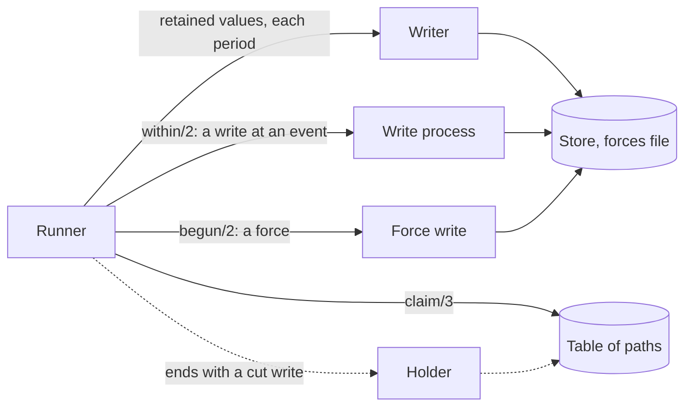

# The file work of the runner

This page is for a contributor. It describes how `Logex.Runner` writes and reads its
files. It gives the writer of the period, a write with a limit, the write of a
[force](../../guides/reference/glossary.md#force) and the table of paths. Read it before
you add a call of the file system to the runner. [The architecture of the
runner](runner.md) gives the processes and the rounds. [The architecture of the store and
its files](store-and-files.md) gives the text of the
[store](../../guides/reference/glossary.md#store), the atomic write and the refusals.

> #### Caution {: .error}
>
> Do not call the file system in the process of the runner. A disk that stops answering
> then stops the rounds, the refresh of each device and each answer to the host. Make
> each call in a separate process, and wait for it for the write limit only.

## What the file work does

A runner can have 2 files: the store, `retain:`, and the
[forces file](../../guides/reference/glossary.md#forces-file), `forces:`. The option
`write_limit:` gives the limit of each write and each read of a file, in ms of real
time. The default is 5000 ms. It is not the clock of the runner: a manual clock does not
move it.



Figure: the file work of 1 runner. A dotted arrow is the path when the runner ends
before a write.

| File work | Function | Does the runner wait? | At the write limit |
|---|---|---|---|
| The store, each `retain_period:` | `write/4` of the writer, a cast | No | The write is reported as `:timeout` 1 time, and finishes later, unless a write at an event kills it first |
| The store at an event: a trip, a stop, a shutdown, a cold restart, a fresh start | `written/3`, through `within/2` | Yes, up to the limit | The runner kills the write: `{:error, :timeout}` |
| A read at a start or a restart, and the look for a link | `read/2` or `within/2` | Yes, up to the limit | The file cannot be read |
| The forces file, at a force or an unforce | `begun/2` | No. The rounds run on | `cut/1` kills the write: `{:error, {:forces, :timeout}}` |

## How it is built

### The writer of the period

The writer, [`writer.ex`](../../lib/logex/runner/writer.ex), is a GenServer linked to the
runner. The runner starts it at the first period that it hands off. Then it does these steps:

1. Between 2 rounds, the runner picks the retained values out of the resource with
   `retained_values/1`, an internal function of `Logex.Runtime`. It sends them with
   `write/4`.
2. The writer makes the retained image and the text of the store. It writes the text
   through `written/2` of [`retain.ex`](../../lib/logex/retain.ex).
3. The writer sends `{Logex.Runner.Writer, pid, at, result}` to the runner.

The writer holds 1 write at a time. While a write is out, the runner keeps only the
newest values for the next write. A write at an event waits for the write of the
period, for up to the write limit, then drops the values that wait. Thus the write of the
event is the last on the disk. If the writer does not answer by the limit, the runner
kills it and reports its write as `:timeout`. A new writer starts at the next period.

With an untimed program, the hand-off comes first in the slot of the share. With none,
it comes at a separate wake, or after the round that is due at that time. The runner times the hand-off as its own work. If it is longer
than `idle:`, the runner trips `{:watchdog, {:idle, ms, :period}}`.

### A write with a limit

`within/2` makes 1 process for 1 call, linked to the runner and monitored. The result
of the call is the exit reason of that process. Thus nothing stays in the mailbox of
the runner.

- If the call ends in time, the runner gets its result.
- If the process stops with no result, the result is `{:error, {:down, reason}}`.
- At the limit, the runner kills the process. The result is `{:error, :timeout}`.

A killed process does nothing after the call of the file system that it is in. The
kernel finishes that call. Thus the file is the old file or the new file, never a mix.
A write that the runner kills can still put its file on the disk later. `status/1` then
names that file as `unknown`, or the set of forces as `forces_unknown`.

`read/2` is the same, with no link, for a read in the process of the caller of
`start_link/1`. Each read of a file is raw, off the file server of the VM. Thus a FIFO or a
stalled disk stops no other process.

### The write of a force

A force writes the whole set of forces before its call returns. The rounds run on while
the write is out, and read the forces of the last write.

1. `writing/2` applies each change that waits, in the sequence asked, to the set of
   the runner. It writes 1 text.
2. `begun/2` makes the process of the write, linked and monitored. A timer of the VM
   sends `{Logex.Runner.Writer, :forces_late, ref}` at the limit.
3. The runner keeps the write in `writing`. `status/1` shows its set as `forcing`.
4. A change that comes meanwhile goes into the queue `behind`. A wrong argument raises
   in its caller immediately.
5. At the `:DOWN` of the write, `ended/2` gives its result. At the timer, `cut/1` kills
   the write.
6. The runner takes the new set and runs a round for each trigger that changed. It
   answers each caller of the write with the same answer.
7. It makes each restart that waits in `restarting`. Then it joins the changes `behind`
   into the next write.

A trip or a step of an edit does not change a write that is out. A restart that comes
while a write is out waits in `restarting`. The runner answers
each other request meanwhile. Thus the restart reads the file that the write leaves. A stop waits for the write with `awaited/2`, up to the
limit.

### The table of paths

[`paths.ex`](../../lib/logex/runner/paths.ex) keeps the files of each runner of the VM in
a public ETS table with the name of its module. Each row is `{path, pid, role}`. The first claim starts a keeper
process, with no link, that owns the table until the VM stops. The group leader of the
keeper is the `init` process of the VM. Thus the stop of an application does not delete
the table.

| Role | The file |
|---|---|
| `:retain` | The store |
| `:forces` | The forces file |
| `{:tmp, :retain}`, `{:tmp, :forces}` | The file that each write renames over the store or the forces file |
| `{:tmp, :dropped}` | The file through which each write of a copy of the store goes: a copy that a start or a later write owes |
| `:dropped` | The name of a copy of the store, `<store>.dropped.<n>`, in a refusal |

`claim/3` adds each row with `:ets.insert_new/2`, and claims all the files or none. A
start that names a file of a live runner raises an `ArgumentError` in its caller, before
it reads a file. A run gives this message, with the pid of the first runner:

<!-- unchecked: a message from a run; the pid is different in each run -->
```text
the runner's retain: "packing.retain" names the store of another runner of this VM, #PID<0.109.0>, which holds it until it stops: two runners on one file write each over the other's
```

A runner gives up its rows in `terminate/2`, after its last write. These 2 cases keep
the rows longer:

| Case | What keeps the file |
|---|---|
| The runner ends with a write that it cut at the limit | `held_on/3` gives the rows to a holder process. The holder asks the file server a question after the kill. It gives up the rows when the answer comes |
| The runner is killed, so `terminate/2` does not run | The rows stay with the dead pid. The next start asks the file server the same question, within its write limit. Then it takes the rows with `:ets.select_replace/2` |

The file server answers its calls in the sequence asked. Thus its answer comes after
each call that the cut write left in its queue.

## Why it is built this way

Each number is a decision of [`docs/organisation.md`](../organisation.md) §7, the full
log. The design of the store is in
[§4.13](../organisation.md#413-retained-values-and-a-true-warm-restart-milestone-6) of
that document.

- **A disk must not stop the plant.** Decision 275 gives the period its own writer.
  Decision 353 puts each other write in a separate process with a limit. Decision 400
  makes that limit the option `write_limit:`, apart from the deadline of a device.
  [0018. File work with a limit](../adr/0018-file-work-with-a-limit.md).
- **The text in the write.** Decisions 414 and 455 make the image and the text of the
  store in the process of the write, within its limit. Decision 488 sends only the
  retained values to the writer, so that the hand-off follows what the program retains.
- **A force on a slow disk.** Decision 437 runs the rounds while a force writes. Decision
  465 joins the changes that wait. Decisions 468 and 500 make a restart wait for the
  write, off the path of the runner.
- **1 runner for 1 file.** Decision 356 refuses 2 runners of 1 VM on 1 file. Decisions
  475 and 495 keep the file until a cut write ends. 2 VMs on 1 file are the task of the
  host: no part of logex sees the other VM.

## How to change it

1. Read the comment at the head of `lib/logex/runner/writer.ex` or
   `lib/logex/runner/paths.ex`.
2. Write a test case that holds the file server or stalls the disk, and see it fail.
3. Put the new call of the file system in `within/2`, `read/2` or the writer.
4. Run `scripts/gate.sh`. It must print `GATE-OK`.

| If you change | The test file that fails if it is wrong |
|---|---|
| A write on a stalled disk, the `.tmp` of a write | `test/logex/stalled_disk_test.exs` |
| The writer of the period | `test/logex/retain_period_test.exs` |
| The store at each start and end | `test/logex/retain_store_test.exs` |
| The write of a force | `test/logex/force_test.exs` |
| The table of paths | `test/logex/runner_paths_test.exs` |

## See also

- [0018. File work with a limit](../adr/0018-file-work-with-a-limit.md) and the other
  [decision records](../adr/README.md).
- [The architecture of the runner](runner.md): the processes, the rounds and the trip.
- [The architecture of the store and its files](store-and-files.md): the text, the
  atomic write and the refusals.
- [Runner](../../guides/reference/runner.md): the options and the status, for a user.
- [Glossary](../../guides/reference/glossary.md): the technical words of logex.
