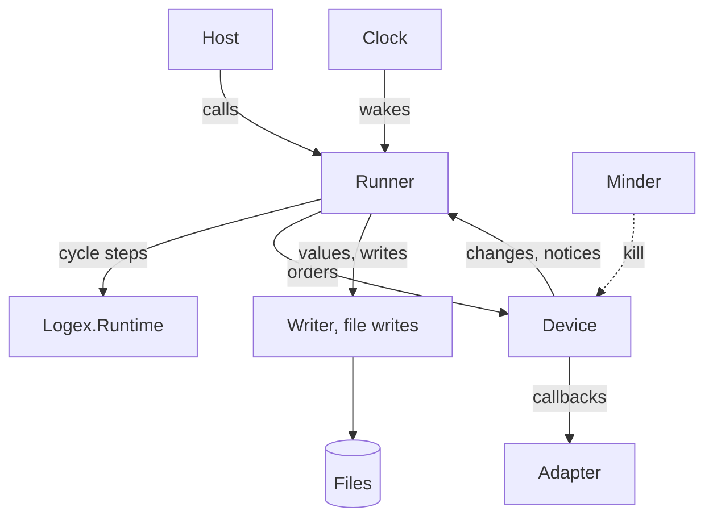
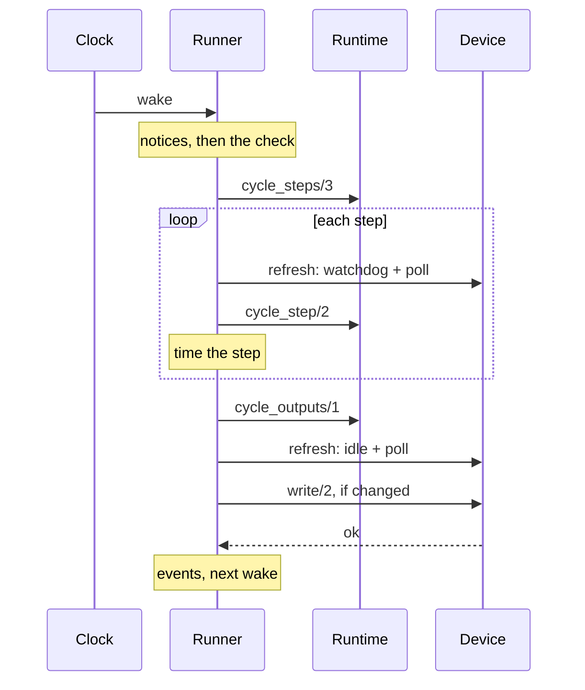

# The architecture of the runner

This page is for a contributor. It describes how `Logex.Runner` runs a
[resource](../../guides/reference/glossary.md#resource) on a
[clock](../../guides/reference/glossary.md#clock). It gives the processes, a
[round](../../guides/reference/glossary.md#round), the share of the time, the
[trip](../../guides/reference/glossary.md#trip) and an edit. Read it before you change
`lib/logex/runner.ex`. 3 other pages give the parts that a round uses:

- [The devices of the runner](runner-devices.md): the messages, the deadline and the
  check of silent [devices](../../guides/reference/glossary.md#device).
- [The file work of the runner](runner-files.md): the writer, the writes and the paths.
- [The resource and the schedule](resource-and-schedule.md): the cycle that a round runs.

> #### Warning {: .warning}
>
> Do not move a check after the write of a round. The outputs of a round that runs too
> long, or of a device that fails, must not reach the
> [plant](../../guides/reference/glossary.md#plant). The
> [watchdogs](../../guides/reference/glossary.md#watchdog) reduce the risk. They do not
> make logex safe. [Safety and limits](../../guides/explanation/safety-and-limits.md)
> gives what logex must not do.

## What the runner does

The [runner](../../guides/reference/glossary.md#runner) is a GenServer. The runner and
its device processes are the only parts of logex that read a clock. The runner runs the
[cycle](../../guides/reference/glossary.md#cycle) of 1
[configuration](../../guides/reference/glossary.md#configuration) through
`Logex.Runtime`, a module of functions, in the process of the runner. It reads the clock
through the behaviour `Logex.Runner.Clock`, and each device through the behaviour
`Logex.IO`.



Figure: the processes around 1 runner. Each arrow between 2 processes is a message. The
arrow to `Logex.Runtime` is a function call in the process of the runner. The table of
paths is on [The file work of the runner](runner-files.md).

The [host](../../guides/reference/glossary.md#host) gives these options to
`start_link/1`. This page uses them:

| Option | Default | What it limits |
|---|---|---|
| `idle:` | 500 ms | The own work of the runner, and the time that a device waits for the runner |
| `poll:` | 10 ms | The [poll period](../../guides/reference/glossary.md#poll-period): a device reads its adapter 1 time in each |
| `overhead:` | 20 % | The share of the time for the own work of the runner |
| `open:` | 5000 ms of real time | The open of 1 device |

3 words of the devices come in the round:

- A **refresh** gives each device a deadline.
- If a device hears no refresh by its deadline, it writes 0 to each output.
- A **notice** is a message from a device to the runner, for example `:latched` when
  the deadline passed.

[The devices of the runner](runner-devices.md) gives each of them.

## How it is built

### The processes

| Process | File | Linked to the runner | If the runner stops or dies |
|---|---|---|---|
| Runner | `runner.ex` | It is the runner | It traps exits. A crash writes no [store](../../guides/reference/glossary.md#store) |
| Device, 1 for each device | [`device.ex`](../../lib/logex/runner/device.ex) | Yes | It traps the exit, writes 0 to each output 1 time and closes its [adapter](../../guides/reference/glossary.md#adapter) |
| Minder, 1 for each device | `device.ex`, `minded/3` | No. It monitors the runner and the device | It kills the device if the device lives `idle:` + 1 poll period longer than the runner |
| Writer | [`writer.ex`](../../lib/logex/runner/writer.ex) | Yes, from the first period of the store | It stops with the runner |
| File write, 1 for each other write and for the read of a restart | `writer.ex` | Yes, until its call of the file system answers | It stops after the call of the file system that it is in |
| Paths keeper | [`paths.ex`](../../lib/logex/runner/paths.ex) | No | It stays until the VM stops |

A start reads its files in the process of the caller of `start_link/1`, with no link
(`read/2`). [The file work of the runner](runner-files.md) gives the writer, the file
writes and the paths keeper.

### A round

The runner does not call `Logex.Runtime.cycle/3`. It calls the 3 internal functions that
make up `cycle/3`:

- `cycle_steps/3` moves the clock of the resource, merges the inputs and gives the list
  of steps. A step is the run of 1 [task](../../guides/reference/glossary.md#task).
- `cycle_step/2` runs 1 step.
- `cycle_outputs/1` gives the outputs.

Thus the runner reads its clock between 2 steps. If you change `cycle/3`, change these 3
functions in the same way.



Figure: 1 round with 1 device. Each check comes before `write/2`.

These functions of `lib/logex/runner.ex` do a round, in this sequence:

1. `woken/1` takes the wake of the clock. `rounded/1` takes each notice of a device
   that waits in the mailbox. A device that passed its deadline thus trips the runner
   before any logic runs.
2. `in_round/1` calls `silent/1`, the
   [check of the silent devices](runner-devices.md#the-check-of-silent-devices).
3. `a_round/1` gives `cycle_steps/3` the elapsed time and the inputs. The inputs are the
   changes of the devices, with each [force](../../guides/reference/glossary.md#force) merged over them.
4. `stepped/2` refreshes each device and runs 1 step. It trips for a
   [major fault](../../guides/reference/glossary.md#major-fault). It also trips if the
   run of a [periodic task](../../guides/reference/glossary.md#periodic-task) or an
   [event task](../../guides/reference/glossary.md#event-task) is longer than its
   watchdog: `{:watchdog, {:task, task, took_ms, limit_ms}}`.
5. `computed/2` times the round of the
   [continuous task](../../guides/reference/glossary.md#continuous-task). A round longer
   than its watchdog trips `{:watchdog, {:round, task, took_ms, limit_ms, steps}}`.
6. The runner writes each device whose outputs changed, in device-name order.
7. The runner publishes the events of the round and plans its next wake.

The runner keeps 2 numbers to make the elapsed time of step 3:

- `anchor` is the clock reading at the start.
- `logical` is the sum of the elapsed times of the earlier rounds.

The elapsed time is the clock reading less `anchor` and less `logical`. Thus no rounding
error adds up.

If the clock gives a value that is not a usable time, the runner stops the round. It
throws the cause to `in_round/1`, which trips `{:clock, cause}`. If no write started,
the runner writes no output. If some writes ended, `cut_round/2` publishes
`{:round, now, outputs}` with the outputs of those devices.

### When a round comes

The runner sleeps to absolute times on its clock. Thus the rounds keep their grid.

| Cause | When the round runs |
|---|---|
| A start or a restart | Immediately, before the call returns |
| The configuration has an untimed program | Back to back, at most 1 in each millisecond of the clock |
| A periodic task is [due](../../guides/reference/glossary.md#due) | A wake at that time. `Logex.Runtime.next_due_in/1` gives it |
| A device changes the [trigger](../../guides/reference/glossary.md#trigger) of an event task | Immediately. The device gets its answer after that round writes its outputs |
| A force or an unforce changes a trigger | When its write ends with success, before the call returns |
| A round writes a trigger | At the next millisecond of the clock |

### The share of the runner's own work

The own work of the runner is a request of the host, an edit request or the hand-off
of the store's period to the writer. `overhead:` gives the share of the time for that
work. `slots/1` makes 2 numbers, C and S, from a share of p %:

<!-- unchecked: the formula of slots/1 in lib/logex/runner.ex -->
```text
C = max(1, round((100 - p) / p))
S = max(1, round(p / (100 - p)))
```

After C ms of rounds, a slot serves the requests that wait, for up to S ms.

| `overhead:` | C, ms | S, ms |
|---|---|---|
| 10 | 9 | 1 |
| 20, the default | 4 | 1 |
| 50 | 1 | 1 |
| 90 | 1 | 9 |

The runner serves a request immediately if no round is due. If a slot finds no request, the
runner keeps the slot for later, and the rounds continue. The next request takes that
slot immediately, even if a round is due. A request of the host refreshes each device before
its work.

If the own work takes longer than `idle:`, the runner trips
`{:watchdog, {:idle, ms, work}}` when that work ends. `work` names it: the function
that the host called, for example `:get`, an edit request `{:edit, step}`, or `:period`.

### The trip

`tripped/2` is the only path of a trip. It does these things, in this sequence:

1. It cancels the wake, so that no round comes.
2. It refuses each call of `restart/2` that waits. A
   [restart](../../guides/reference/glossary.md#restart) must come after the trip.
3. It calls `zero/1` on each device, in device-name order.
4. It publishes `{:trip, reason}`.
5. It writes the store, if `retain:` names one.
6. It answers each request of the host that waits in the queue.

In step 3, the runner gives each device `idle:` + 1 poll period to answer. The runner
kills a device that does not answer in that time. The runner adds that device to
`unzeroed`, which `status/1` shows. It also adds each device that does not take the 0.
That device writes the 0 again at each poll.

The runner keeps the resource of the last round for `get/2`. A later reason does not
replace the first.

### An edit through the runner

The runner holds 1 edit, and serves each edit request between 2 rounds. `accept/2` does
its work in the process of the caller. It gets the resource from the runner with a call,
runs `Logex.Configuration.Edit.accept/3`, and gives the result back. If a different edit
request came between, the runner answers `:stale` and `accept/2` does the work again.
Thus a large accept never delays a round.

## Why it is built this way

Each number is a decision of [`docs/organisation.md`](../organisation.md) §7, the full
log. The design of the runner is in
[§4.11](../organisation.md#411-milestone-4s-design-the-wall-clock-runner-decided-2026-10-17)
of that document.

- **Only the runner reads a clock.** The runner times each step, so the runtime stays a
  function of its arguments (decision 118).
  [0007. The host gives the time](../adr/0007-the-host-gives-the-time.md).
- **Rounds.** The runner runs rounds back to back or on the grid of the tasks
  (decisions 108 and 396).
  [0011. Tasks and rounds](../adr/0011-tasks-and-rounds.md).
- **The share.** C and S follow the system overhead time slice of
  [Logix](../../guides/reference/glossary.md#logix) (decision 122). The runner keeps an
  unused slot (decision 442). On the manual clock, a call waits for its slot
  (decision 131).
- **1 path for a trip.** Each task has its watchdog, and each trip takes the same path
  (decisions 110, 111, 113 and 128). The runner refuses a restart that waits
  (decision 354). A device writes 0 when the runner dies (decision 115).
  [0013. Watchdogs and the trip](../adr/0013-watchdogs-and-the-trip.md).
- **A bad clock reading.** The runner stops the round at the reading and publishes the
  outputs that the writes reached (decisions 441 and 474).
- **Long work away from the runner.** `accept/2` does its work in the caller
  (decisions 119 and 141). An idle trip names the work (decisions 352 and 482).

## How to change it

1. Read §4.11 of `docs/organisation.md` and the moduledoc of `Logex.Runner`. The
   moduledoc gives each rule of the present.
2. Write a test case on the manual clock, and see it fail. Use the real clock only for
   a rule of real time.
3. On the manual clock, a request made while a round is due waits for its slot. Call
   from a second process, and move the clock with `advance(clock, 0)` until the call
   returns.
4. Change the code. Keep each check before the write of the round.
5. Give a new key of the map of the runner a value in `running/2`. Give it a rule for a trip, a
   restart and an edit request.
6. Run `scripts/load.sh -n 50` for a new test on the real clock.
7. Run `scripts/gate.sh`. It must print `GATE-OK`.

| If you change | The test file that fails if it is wrong |
|---|---|
| The rounds, the share, the edits through the runner | `test/logex/runner_test.exs`, `test/logex/runner_edit_test.exs` |
| The watchdogs, the trip, the restart | `test/logex/trip_test.exs` |
| The clocks | `test/logex/clock_test.exs` |
| A rule across many runs | `test/logex/api_contract_test.exs` |
| The cost of a round | `test/logex/ceiling_test.exs` |

## See also

- [0013. Watchdogs and the trip](../adr/0013-watchdogs-and-the-trip.md) and the other
  [decision records](../adr/README.md).
- [The devices of the runner](runner-devices.md): the messages, the deadline and the
  checks.
- [The file work of the runner](runner-files.md): the writer, the writes and the paths.
- [The resource and the schedule](resource-and-schedule.md): the cycle that a round runs.
- [Runner](../../guides/reference/runner.md): the options, the status and the events, for
  a user.
- [Trips and watchdogs](../../guides/explanation/trips-and-watchdogs.md): the model and
  the reasons, for a user.
- [Glossary](../../guides/reference/glossary.md): the technical words of logex.
