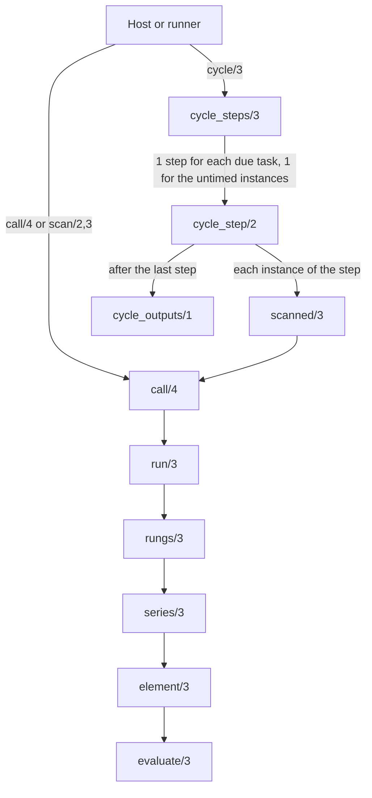

# The runtime and the evaluator

This page is for a contributor. It describes the core of `Logex.Runtime`: the
[instance](../../guides/reference/glossary.md#instance) and its
[state](../../guides/reference/glossary.md#state), the
[scan](../../guides/reference/glossary.md#scan) and the evaluator. Read it before you add
a clause of the evaluator, a [record of a scan](#the-records-of-a-scan) or a field of
`%Logex.Instance{}`. [The IR and the program type](ir-and-program-type.md) gives the data
that the runtime runs. [The resource and the schedule](resource-and-schedule.md) gives the
[cycle](../../guides/reference/glossary.md#cycle) of a
[configuration](../../guides/reference/glossary.md#configuration).

> #### Caution {: .error}
>
> Do not read a clock in `Logex.Runtime`, and do not raise an exception for a
> [fault](../../guides/reference/glossary.md#fault). The host gives the time of each scan
> as a number. A fault is data, and the scan runs to its last rung. An `ArgumentError` is
> only for a wrong argument of the host. A check raises it before the rungs of the scan
> run.

## What the runtime does

`Logex.Runtime` is a module of functions. It starts no process. It
[interprets](../../guides/reference/glossary.md#interpret) a
[program type](../../guides/reference/glossary.md#program-type) in 2 forms:

| Form | Data | Functions |
|---|---|---|
| A lone instance | `%Logex.Instance{}` | `instance/1,2`, `call/4`, `put_inputs/3`, `scan/2,3`, `restart/3`, `retained/2` |
| A [resource](../../guides/reference/glossary.md#resource) | `%Logex.Runtime{}`, opaque | `start/1,2`, `cycle/3`, `next_due_in/1`, `overlaps/1`, `get/2`, `get!/2`, `restart/2`, `retained/1` |



Figure: the calls from the host to 1 instruction. A cycle and a lone scan meet at
`call/4`, and each instruction of each scan goes through `evaluate/3`.

`cycle/3` calls 3 internal functions in sequence: `cycle_steps/3`, `cycle_step/2` and
`cycle_outputs/1`. The [runner](../../guides/reference/glossary.md#runner) calls the 3
functions itself. It reads its clock between 2 steps of the cycle. `scanned/3` runs 1
instance in a step of the cycle.
[The resource and the schedule](resource-and-schedule.md) gives these 4 functions.

## The instance

`Logex.Runtime.instance/1` makes the state of a new instance. The state does not hold the
program type. Thus 1 program type can run as many instances. Each instance has its own
state.

| Field | Holds | Changed by |
|---|---|---|
| `type` | The name of the program type | Nothing |
| `env` | The value of each [tag](../../guides/reference/glossary.md#tag), by name | A scan, `put_inputs/3`, `restart/3`, an edit |
| `now` | The time of the last scan, in ms. It is 0 before the first scan | A scan |
| `first` | `true` if the next scan is the [first scan](../../guides/reference/glossary.md#first-scan) | A scan clears it. `restart/3` sets it |
| `ons_blocked` | The [blocked edge memories](#blocked-edge-memories) | A switch sets it. A scan keeps those that did not run. `restart/3` empties it |
| `switched` | `true` after a switch, until the next scan | A switch sets it. A scan clears it |
| `faults` | Each `%Logex.Fault{}` of the last scan, in sequence | A scan replaces it |

The value of a tag in `env` is an integer, or a float for a real. For an instance of a
[function block](../../guides/reference/glossary.md#function-block), it is a map of its
[members](../../guides/reference/glossary.md#member). An
[array](../../guides/reference/glossary.md#array) is a tuple, with a tuple of tuples for
2 or 3 dimensions. The host sets and reads an array as a list. An edge memory is the
[storage bit](../../guides/reference/glossary.md#storage-bit) of a
[one-shot](../../guides/reference/glossary.md#one-shot), or the memory of the last input of
a [counter](../../guides/reference/glossary.md#counter).

Each function that takes a state checks all of the state. The check includes the tags that
no rung writes. A guard checks each element of an integer, bit-string or bool array. A
function, `value?/2` of [`real.ex`](../../lib/logex/real.ex), checks each element of a real
array, and that costs more.
Thus the check costs time with a large array. These times are from 3 runs on 1 machine,
with 200 scans of 1 rung in each run:

| The state holds | Time of 1 scan |
|---|---|
| No array | About 1.4 µs |
| `int[4096]` | About 36 µs |
| `int[65536]` | 0.5 ms to 0.64 ms |
| `real[65536]` | 9.5 ms to 10.5 ms |

## A scan

`call/4` is 1 scan. A host gives the program type, the state, the
[inputs](../../guides/reference/glossary.md#input) and a `%Logex.Scan{}` with `now` and
`first`. `scan/2,3` makes the `%Logex.Scan{}` from the state and the time that passed,
and calls `call/4`. `scan/2` gives 0 ms. `call/4` does these actions in sequence:

1. It checks the program type, the state and the `%Logex.Scan{}`. A wrong value raises an
   `ArgumentError`.
2. It merges the inputs into `env`. It refuses a tag that is not a `var_input` and a value
   outside its [type](../../guides/reference/glossary.md#type).
3. `run/3` completes the `%Logex.Scan{}`. It adds the tag table, the block types, `units`
   and `reals` from the program type. It adds the state's `ons_blocked` as a nested map,
   by instance.
4. `run/3` runs the rungs. The `%Logex.Scan{}` is the same for each instruction of the
   program's rungs.
5. `run/3` takes the records `:faults` and `:ran` out of `env`. It makes a
   `%Logex.Fault{}` of each fault.
6. It returns the [outputs](../../guides/reference/glossary.md#output) and the new state.
   The state has the new `now`, and `first` and `switched` set to `false`. Its
   `ons_blocked` holds the edge memories that did not run, and `faults` the new faults.

The program `scales.ld` weighs a box when the eye sees it. It keeps each weight in an
array, at the subscript that `slot` gives.

<!-- file: scales.ld -->
```text
var_input  eye    bool
var_input  weight int
var_input  slot   int
var_output last   int
var_output heavy  bool
var weights int[8]
var edge    bool
var p       bool

xic eye ons edge ote p
xic p move weight weights[slot]
move weights[slot] last
gt weights[slot] 500 ote heavy
```

The script `runtime-and-evaluator-scan.exs` calls `call/4` 3 times. It then gives 3
wrong arguments. Run it from `examples/`, which holds `scales.ld`:

```elixir
{:ok, scales} = Logex.compile_file("scales.ld")

# A new instance: each tag at its initial value. The array is a tuple.
state = Logex.Runtime.instance(scales)
IO.inspect(state, label: "instance", width: 70)

# call/4 is 1 scan. The host gives the inputs and a %Logex.Scan{}.
scan = fn state, inputs, now ->
  at = %Logex.Scan{now: now, first: state.first}
  {outputs, state} = Logex.Runtime.call(scales, state, inputs, at)
  IO.inspect(outputs, label: "t=#{now} outputs")
  state
end

state = scan.(state, %{"eye" => 0}, 0)
state = scan.(state, %{"eye" => 1, "weight" => 620, "slot" => 2}, 10)
IO.inspect(state.env["weights"], label: "weights")

# A subscript outside int[8]: 2 faults. The scan runs on.
state = scan.(state, %{"eye" => 0, "slot" => 8}, 20)
IO.inspect(state.faults, label: "faults", width: 70)

# Each of these calls raises an ArgumentError. The script prints its message.
refused = fn call ->
  try do
    call.()
  rescue
    error in ArgumentError -> IO.puts(Exception.message(error))
  end
end

refused.(fn -> Logex.Runtime.call(scales, state, %{}, %Logex.Scan{now: 10, first: false}) end)
refused.(fn -> Logex.Runtime.call(scales, state, %{}, %Logex.Scan{now: 30, first: true}) end)
held = %{state | env: Map.put(state.env, :faults, [])}
refused.(fn -> Logex.Runtime.call(scales, held, %{}, %Logex.Scan{now: 30, first: false}) end)
```

```console
$ mix run runtime-and-evaluator-scan.exs
instance: %Logex.Instance{
  type: "scales",
  env: %{
    "edge" => 0,
    "eye" => 0,
    "heavy" => 0,
    "last" => 0,
    "p" => 0,
    "slot" => 0,
    "weight" => 0,
    "weights" => {0, 0, 0, 0, 0, 0, 0, 0}
  },
  now: 0,
  first: true,
  ons_blocked: [],
  switched: false,
  faults: []
}
t=0 outputs: %{"heavy" => 0, "last" => 0}
t=10 outputs: %{"heavy" => 1, "last" => 620}
weights: {0, 0, 620, 0, 0, 0, 0, 0}
t=20 outputs: %{"heavy" => 0, "last" => 620}
faults: [
  %Logex.Fault{
    severity: :major,
    kind: :index_out_of_range,
    instruction: :move,
    path: nil,
    file: "scales.ld",
    line: 12,
    read: {8}
  },
  %Logex.Fault{
    severity: :major,
    kind: :index_out_of_range,
    instruction: :gt,
    path: nil,
    file: "scales.ld",
    line: 13,
    read: {8}
  }
]
time went backwards: this scan is at 10 ms, but the instance was last scanned at 20 ms
scan.first is true, but the instance has been scanned since it started or restarted
state.env holds :faults, the runtime's own key for a record a scan keeps and takes out before it ends: an env is keyed by tag names
```

At `t=20`, the rungs `move weights[slot] last` (line 12) and `gt weights[slot] 500 ote
heavy` (line 13) read `weights[8]`. Each of the 2 instructions does nothing and passes no
power, and the scan continues. `last` keeps 620. `heavy` is 0, because the `gt` passes no
power. The rung `xic p move weight weights[slot]` is false, so its `move` reads no
subscript and finds no fault.

## The evaluator

The evaluator is a set of private functions of `Logex.Runtime`. They run the rungs of a
[routine](../../guides/reference/glossary.md#routine): the rungs of the program, or the
rungs of the body of a block. No test calls them. A test runs a program through
`call/4`, on a state from `instance/1` or on a `%Logex.Instance{}` that the test makes.

| Function | Job |
|---|---|
| `run/3` | Completes the `%Logex.Scan{}`, runs the rungs of the program, takes out `:faults` and `:ran`, and gives the new state |
| `rungs/3` | Runs each rung in sequence. Each rung starts with power, `true` |
| `jumped/3` | After a rung, skips to the rung of the [label](../../guides/reference/glossary.md#label) if the rung energised a `jmp` |
| `series/3` | Gives `{power, env}` from each element of a rung to the next element |
| `element/3` | Runs a group of [branches](../../guides/reference/glossary.md#branch), or catches a fault of 1 instruction |
| `evaluate/3` | Runs 1 [instruction](../../guides/reference/glossary.md#instruction) |
| `closed/1` | At the end of a routine, writes the elements of each large array back into its tuple |

`evaluate/3` takes `(instruction, {power, env}, %Logex.Scan{})` and gives
`{power, env}`. Each instruction has 2 clauses: 1 for `{true, env}` and 1 for
`{false, env}`. Without the clause for `false`, a program raises `FunctionClauseError`
when a contact opens. A clause that does not read the scan takes `_scan`. A clause for
`units: nil` or `reals: nil` comes before the general clause, so a routine with no long
timer and no real does no look-up.

A group of branches runs each [leg](../../guides/reference/glossary.md#leg) from the power
that comes into the group. The `env` goes through the legs in sequence, so a leg reads
what an earlier leg wrote. The group passes power if 1 leg passes power. The group skips
no leg.

### How `cal` runs a body

A `cal` on a false rung does not run its block. A `cal` on a true rung runs the body of
the block in `called/5`.

First, `members_of/1` drops each key of `@own_keys` from the map
of the block instance. Then the body runs with a narrowed scan. The scan has the tags,
`units`, `reals` and blocked edge memories of the block. It keeps the same `now`, `first`
and block types. At the end of the body, `called/5` takes the records `:faults` and
`:ran` out of the map of the instance.

### The records of a scan

A scan keeps some records in `env`, each under an atom key. A tag name is a string, so no
tag can have the key of a record.

| Key | Holds | Taken out by |
|---|---|---|
| `:faults` | Each fault that the routine found | `run/3`, or `called/5` for a body, at the end of the routine |
| `:jump` | The label of a `jmp` that its rung energised | `jumped/3`, when the rung ends |
| `:ran` | The instances whose bodies ran, and the edge memories of skipped rungs | `run/3`, through `unrun/2`, or `called/5` for a body, through `ran/3` |
| `:open` | The elements written of each array of more than 256 elements | `closed/1`, at the end of the routine |

The 4 keys are `@own_keys`. `state!/2` refuses an `env` that holds 1 of these keys, as the
script shows. A guard cannot read a list, so the guard of `state!/2` names each key.

### Blocked edge memories

An online edit can change a rung that holds a one-shot. The edit's
[switch](../../guides/reference/glossary.md#switch) then blocks the edge memories of the
changed rungs:

- The switch puts each of these memories into `ons_blocked`. Thus a one-shot does not
  compare the new rung with the bit that the old rung wrote, and it fires no false pulse.
- `run/3` gives the evaluator these memories as a nested map, by instance. Each one-shot
  finds its bit with 1 look-up.
- A blocked one-shot passes no power on its next run, and it writes its bit.
- If the routine has a blocked memory, a skipped rung marks its edge memories under
  `:ran`. A body that does not run marks nothing.
- After the rungs, `unrun/2` keeps in `ons_blocked` each memory that a skipped rung marked,
  and each memory in a body that did not run. It drops the others.

### Faults

A fault never leaves `element/3` as an exception. A tag can give the subscript of an
element or the number of a bit. If its value is out of range, the read or the write
throws.

No instruction except `cal` has more than 3 operands. Thus a clause of `element/3` adds a
`catch` only if 1 of the first 3 operands has such a tag. Each `cal` has a `catch`,
because a `cal` can have any number of operands. A `catch` costs 1 reduction, so the other
instructions have none.

The `catch` writes the fault to `:faults` and gives the power `false`. A division by 0 and
the square root of a negative number do not throw. The clause of `evaluate/3` writes these
2 faults.

| Kind | Severity | What the instruction does |
|---|---|---|
| `:divide_by_zero` | Minor | Writes 0, or 0.0 to a real, and passes no power |
| `:negative_sqrt` | Minor | Writes 0.0 and passes no power |
| `:bit_out_of_range` | Major | Writes nothing and passes no power |
| `:index_out_of_range` | Major | Writes nothing and passes no power |

The runtime does not stop the plant for a
[major fault](../../guides/reference/glossary.md#major-fault). A host that calls `call/4` or
`scan/2,3` reads `state.faults` and decides what to do. The runner
[trips](../../guides/reference/glossary.md#trip) at the end of the step of the cycle that
found the fault. [The resource and the schedule](resource-and-schedule.md) gives the
steps.

### Rungs that do not run

A `jmp` on a true rung puts its label under `:jump`. After that rung, `jumped/3` skips the
rungs up to the rung that the label starts. A skipped rung runs nothing.

A timer has a hidden member `last`, the time of its last run. A skipped rung does not change it. At its
next run, the timer adds all the time since `last`.
[Rungs that a scan does not run](../../guides/explanation/rungs-that-do-not-run.md) gives
these rules for a user.

### After a restart

After each start and each restart, `first` is `true`, and `ons_blocked` is empty. On the
first scan, no one-shot and no counter fires on an edge. This rule includes a retained
counter. The clauses of a one-shot and of a counter read `first` from the scan.

A retained `tof` can be on and not timing: its input was on when the instance stopped. A
[warm restart](../../guides/reference/glossary.md#warm-restart), and a start from a
[retained image](../../guides/reference/glossary.md#retained-image), put such a `tof` at
rest. Its `.dn`, `.tt` and `.en` go to 0, and `.acc` keeps its value. A `tof_ltime` is the
same. Thus a run-on does not start by itself when its rung is first false. A retained
`tof` in its delay continues the delay at its next run.

The restart or the start does this, and no scan does it. A scan pays nothing for it. Thus
the restart puts a `tof` at rest wherever it is:

- On a skipped rung
- In a block that does not run
- In an element of an array of `tof`
- In a member of a block at any depth

## Why it is built this way

Each number is a decision of [`docs/organisation.md`](../organisation.md) §7, the full
log. §4.6 of that document gives the design of the scan.

- **The host gives the time (13).** A test moves the time with a number.
  [0007. The host gives the time](../adr/0007-the-host-gives-the-time.md).
- **A fault is data (78, 99, 153, 160).** The scan runs on, and `state.faults` reports.
  [0010. A fault does not stop a scan](../adr/0010-a-fault-does-not-stop-a-scan.md).
- **A `cal` on a false rung runs nothing (12).** The block keeps its state, as in
  IEC 61131-3.
- **The block list (21).** A changed rung fires no false pulse after a switch.
- **Jumps (104, 106).** Decision 104: the skip starts when the whole rung of the `jmp`
  ends. Decision 106: a skipped rung keeps each edge memory that a switch blocked, until a
  scan runs its instruction.
- **The check of each state (171, 173).** No value outside its type gets to a rung.
- **Large arrays (352).** A write into a tuple copies the tuple. With `:open`, a scan that
  writes each element of `ton[16000]` takes 84 ms, not 1.8 s.
- **A restart puts a `tof` at rest (385).** A scan pays nothing.
  [0016. Retained values and starts](../adr/0016-retained-values-and-starts.md).

## How to change it

Read the moduledoc of `Logex.Runtime`, `Logex.Instance` and `Logex.Scan` first.

### Add an instruction

1. Do the naming survey of
   [Add an instruction](../implementation/adding-an-instruction.md).
2. Write a test case that runs a program through `call/4`. See it fail.
3. Add the mnemonic and its operands to `@instructions` in `lib/logex/compiler.ex`.
4. Add the 2 clauses of `evaluate/3`, for `true` and for `false`.
5. Run `scripts/gate.sh`. It must print `GATE-OK`.

### Add a record of a scan

1. Write a test case that runs a program through `call/4`. See it fail.
2. Use an atom key. Add the key to `@own_keys` and to the guard of `state!/2`.
3. Take the record out at the end of the routine: in `run/3` for the program.
4. For the body of a block, take the record out in `called/5`.
5. Run `scripts/gate.sh`. It must print `GATE-OK`.

### Add a field of the instance

1. Write a test case that runs a program through `call/4`. See it fail.
2. Add the field to `%Logex.Instance{}` and to its type `Logex.Instance.t()`.
3. Give the field a value in `instance/1`.
4. Add a check to `state!/2`, with a message that a test compares.
5. Give the field a rule for a scan in `run/3`, and for `restart/3`.
6. Give the field a rule for a switch, in `lib/logex/edit/plan.ex`.
7. Run `scripts/gate.sh`. It must print `GATE-OK`.

Each test file of this table is under `test/logex/`:

| If you change | The test file that fails |
|---|---|
| An instruction | `evaluation_test.exs` and the file of its kind, such as `timer_test.exs` |
| A message of the [host contract](../../guides/reference/glossary.md#host-contract) | `runtime_test.exs` |
| A field or the type of a spec | `typespec_test.exs` |
| The cost of a scan | `ceiling_test.exs` |

## See also

- [0001. A program is data](../adr/0001-a-program-is-data.md), [0010. A fault does not
  stop a scan](../adr/0010-a-fault-does-not-stop-a-scan.md) and the other [decision
  records](../adr/README.md).
- [The resource and the schedule](resource-and-schedule.md): the cycle of a
  configuration.
- [The parts of logex](overview.md) and [The IR and the program
  type](ir-and-program-type.md).
- [Execution model](../../guides/reference/execution-model.md): the rules of a scan for a
  user.
- [The scan, the cycle and time](../../guides/explanation/scan-cycle-and-time.md) and
  [Power flow in a rung](../../guides/explanation/power-flow.md).
- [Rungs that a scan does not run](../../guides/explanation/rungs-that-do-not-run.md) and
  [Warm and cold restarts](../../guides/explanation/warm-and-cold-restarts.md).
- [Glossary](../../guides/reference/glossary.md): the technical words of logex.
